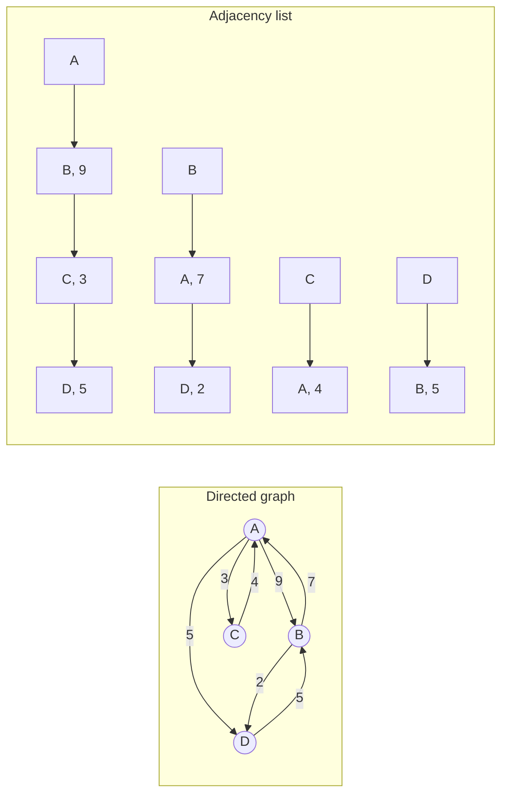
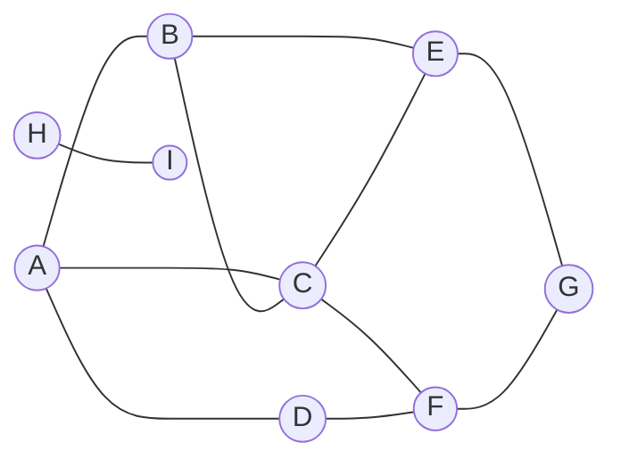
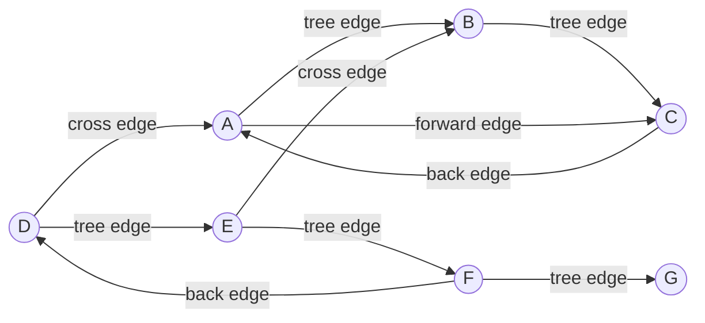

In a linear structure each element has at most one predecessor and one successor, and in a tree each node has at most one parent; a graph allows a relation between any two objects and is the most general structure for expressing "relations". Road networks, computer networks, social relations, the call relations of programs and the dependencies among tasks are all naturally modeled as graphs. The mathematical theory of graphs was covered in the graph theory part of discrete mathematics ([1.4](/1.4)); this chapter discusses two questions from the viewpoint of data structures: how graphs are represented in a computer, and how to visit all vertices and edges of a graph systematically. The latter is graph traversal, mainly of two kinds, breadth-first search and depth-first search, which turn a nonlinear graph into a traversal tree (or a forest) and leave behind time labels of vertices and a classification of edges during the traversal. This information is the basis of algorithms such as topological sorting, biconnected components, shortest paths and minimum spanning trees in [4.3.11](/4.3.11). The search on a state space in [4.1.14](/4.1.14) is precisely a traversal on a graph that is given implicitly.

## 10.1. Terminology and the Graph ADT

### 10.1.1. Terminology

A graph $G = (V, E)$ consists of a vertex set $V$ and an edge set $E$; write $n = |V|$ for the number of vertices and $m = |E|$ for the number of edges. The two vertices of an edge $(u, v)$ are adjacent to each other, and a vertex and the edges it belongs to are incident to each other. If edges have no direction, $G$ is an **undirected graph**; if every edge $(u, v)$ has a direction, pointing from the tail $u$ to the head $v$, $G$ is a **directed graph**. An undirected edge can be regarded as a pair of directed edges in opposite directions, so the structures and algorithms of this chapter are mainly described for directed graphs. Unless stated otherwise, we consider only **simple graphs** without self-loops and multiple edges, for which $m = O(n^2)$.

This chapter follows the usual terminology of data-structures textbooks, which corresponds to that of the graph theory part ([1.4](/1.4)) as follows (terms that coincide in both, such as vertex, out-degree, in-degree, spanning tree and weighted graph, are omitted):

| This chapter | Graph theory part (1.4) |
|---|---|
| path $\langle v_0, v_1, \dots, v_k \rangle$ of length $k$ | walk |
| simple path (distinct vertices) | path |
| closed path ($v_0 = v_k$), simple closed path | closed walk, cycle |

A directed graph without closed paths is called a *directed acyclic graph* (DAG, [4.3.11](/4.3.11)). A closed path that traverses every edge exactly once is an **Eulerian circuit**, and a closed path that visits every vertex exactly once is a **Hamiltonian cycle**. A subgraph $T = (V, F)$ of $G$ that is a tree is a **spanning tree** of $G$; in a network with weighted edges, a spanning tree of minimum total weight is a **minimum spanning tree** (MST).

### 10.1.2. The Graph ADT

Whatever structure implements it, a graph should provide a uniform interface, and graph algorithms access the graph only through this interface. Below, the vertices are numbered $0, 1, \dots, n-1$:

| Category | Operations |
|---|---|
| Vertices | Insert and delete vertices; read and write vertex data; query the **out-degree** and **in-degree** |
| Edges | Test whether an edge $(v, u)$ exists; insert and delete edges; read and write edge data and weights |
| Neighbors | Enumerate all vertices adjacent to $v$ (`firstNbr`, `nextNbr`, or return an iterable sequence) |

In addition, a traversal algorithm attaches some auxiliary information to each vertex: the status (`UNDISCOVERED` not yet discovered, `DISCOVERED` discovered, `VISITED` completely visited), the time labels $d(v)$ and $f(v)$ (the times of discovery and of completion of the visit), the parent `parent(v)` in the traversal tree, and the priority `priority(v)` ([4.3.11](/4.3.11)); to each edge it attaches its type in the traversal tree (§10.5.3). This information must be reset before every traversal.

## 10.2. Adjacency Matrices

An **adjacency matrix** records the adjacency relations among vertices in an $n \times n$ matrix $A$: $A(v, u) = 1$ if and only if the edge $(v, u)$ exists, and $0$ otherwise. The matrix entries are in one-to-one correspondence with the edges that may exist in the graph; for a weighted network, the weight of the edge (or a pointer to the edge record, with empty meaning no edge) is stored at $A(v, u)$. The adjacency matrix of an undirected graph is symmetric, and the diagonal of a simple graph is all $0$.

The advantages of the adjacency matrix are that it is intuitive and easy to implement, and the basic operations are all fast:

| Operation | Time |
|---|---|
| Test whether the edge $(v, u)$ exists; read and write its data and weight | $O(1)$ |
| Insert and delete an edge (updating the degrees at both ends) | $O(1)$ |
| Query the out-degree and in-degree of a vertex (maintaining degree records) | $O(1)$ |
| Enumerate all neighbors of $v$ (scan row $v$) | $O(n)$ |
| Insert and delete a vertex (add or remove a row and a column) | $O(n)$ (amortized) |

Its disadvantage is space: always $\Theta(n^2)$, independent of the actual number of edges. Are there really that many edges? Take **planar graphs** as an example: by Euler's formula ([1.4.4](/1.4.4)), a simple planar graph with $n \ge 3$ vertices has at most $3n - 6$ edges, so fewer than a fraction $6/n$ of the entries of the adjacency matrix are nonzero. Most large-scale graphs in practice (road networks, web links, social networks) are like this. A graph with $m = O(n)$ edges, or far fewer than $n^2$, is called a *sparse graph*, and one with $m = \Theta(n^2)$ a *dense graph*. The adjacency matrix suits only dense graphs or graphs of small size.

The **incidence matrix**, which records the incidence relation between vertices and edges, is an $n \times m$ matrix with space $\Theta(nm)$; each column has only two nonzero entries, so the utilization is only $2/n$. It is rarely used in data structures, but is very effective in theoretical problems such as network flow.

## 10.3. Adjacency Lists

### 10.3.1. Structure

To avoid the waste of space of the adjacency matrix, we can compress each row of the matrix into a **list** that records only the edges that actually exist:

**Definition 10.3.1 (Adjacency List)** The **adjacency list** of a graph $G = (V, E)$ maintains for each vertex $v$ a list $L_v = \{\, u : (v, u) \in E \,\}$ holding all out-edges of $v$ (and their weights).



The adjacency list of a directed graph has $n$ list heads and $m$ list entries, so the space is $O(n + m)$; in an undirected graph each edge is stored once at each end, for $2m$ entries in all, and the space is still $O(n + m)$. The adjacency list of a planar graph needs only $O(n)$ space, an enormous improvement over the adjacency matrix.

The times of the operations are as follows ($\deg(v)$ is the out-degree of $v$):

| Operation | Adjacency matrix | Adjacency list |
|---|---|---|
| Space | $\Theta(n^2)$ | $\Theta(n + m)$ |
| Test whether the edge $(v, u)$ exists | $O(1)$ | $O(1 + \deg(v))$ |
| Enumerate the out-edges of $v$ | $O(n)$ | $O(1 + \deg(v))$ |
| Enumerate the in-edges of $v$ | $O(n)$ | $O(n + m)$; $O(1 + \text{in-degree})$ if a reverse adjacency list is built separately |
| Query out-degree and in-degree (maintaining degree records) | $O(1)$ | $O(1)$ |
| Insert an edge | $O(1)$ | $O(1)$ (without duplicate checking) |
| Traverse the whole graph | $O(n^2)$ | $O(n + m)$ |

A few remarks:

- If in-edges are often needed, one can maintain a reverse adjacency list as well (a list of in-edges for each vertex), which doubles the space but keeps it $O(n + m)$.
- If edge existence is often tested, each $L_v$ can be replaced by a **hash table** ([4.3.9](/4.3.9)): the expected time of testing an edge is $O(1)$, "the same" as for the adjacency matrix, and the space is still $O(n + m)$.
- For a large graph that is not modified after construction, all adjacency lists are often concatenated end to end into one array of length $m$, and another array of length $n + 1$ records the starting point of the list of each vertex in it. This compressed sparse row (CSR) format stores everything fully contiguously, has the highest cache efficiency, and is the standard format of graph-computation libraries and sparse matrices ([4.4](/4.4)).
- Adjacency matrices still have their uses: besides dense graphs, some graphs are given implicitly, such as the Euclidean graph in which points of the plane at distance at most $r$ are connected, interval intersection graphs, and the **state space** in [4.1.14](/4.1.14). Such graphs need not be stored explicitly; as long as the question "what are the neighbors of $v$" can be answered, traversal algorithms work.

| When to use | Adjacency matrix | Adjacency list |
|---|---|---|
| Sparsity of the graph | Dense graph | Sparse graph |
| Main operations | Frequent edge existence tests, frequent edge insertion and deletion | Frequent traversal, frequent computation of vertex degrees |
| Size | Fixed and small number of vertices | Unknown or large number of vertices |

### 10.3.2. Implementation

Below we implement the two structures with the same interface: the adjacency matrix uses an $n \times n$ two-dimensional array in which an empty cell means no edge; the adjacency list keeps an array of out-edges for each vertex, with the in-degree recorded separately. The example is the weighted directed graph of the figure above; the program lists the adjacency list vertex by vertex and checks that the two structures give the same degrees.

```cpp tab
#include <format>
#include <iostream>
#include <optional>
#include <vector>

// Directed weighted graph as an adjacency matrix: n x n cells, empty = no edge.
class GraphMatrix {
    std::vector<std::vector<std::optional<int>>> w_;
    std::vector<int> in_, out_;
public:
    explicit GraphMatrix(int n) : w_(n, std::vector<std::optional<int>>(n)), in_(n), out_(n) {}
    int n() const { return static_cast<int>(w_.size()); }
    bool exists(int v, int u) const { return w_[v][u].has_value(); }           // O(1)
    void insert(int v, int u, int weight) {
        if (exists(v, u)) return;
        w_[v][u] = weight; ++out_[v]; ++in_[u];
    }
    void remove(int v, int u) {
        if (!exists(v, u)) return;
        w_[v][u].reset(); --out_[v]; --in_[u];
    }
    int in_degree(int v) const { return in_[v]; }
    int out_degree(int v) const { return out_[v]; }
    std::vector<int> neighbors(int v) const {                                  // O(n)
        std::vector<int> r;
        for (int u = 0; u < n(); ++u) if (exists(v, u)) r.push_back(u);
        return r;
    }
};

// The same graph as adjacency lists: vertex v keeps only its out-edges.
class GraphList {
public:
    struct Arc { int to, weight; };
private:
    std::vector<std::vector<Arc>> adj_;
    std::vector<int> in_;
public:
    explicit GraphList(int n) : adj_(n), in_(n) {}
    int n() const { return static_cast<int>(adj_.size()); }
    bool exists(int v, int u) const {                                          // O(out_degree(v))
        for (const Arc& a : adj_[v]) if (a.to == u) return true;
        return false;
    }
    void insert(int v, int u, int weight) {
        if (exists(v, u)) return;
        adj_[v].push_back({u, weight}); ++in_[u];
    }
    void remove(int v, int u) {
        auto& list = adj_[v];
        for (std::size_t i = 0; i < list.size(); ++i)
            if (list[i].to == u) { list[i] = list.back(); list.pop_back(); --in_[u]; return; }
    }
    int in_degree(int v) const { return in_[v]; }
    int out_degree(int v) const { return static_cast<int>(adj_[v].size()); }  // O(1)
    const std::vector<Arc>& neighbors(int v) const { return adj_[v]; }         // O(1 + deg)
};

int main() {
    // A=0, B=1, C=2, D=3:  A->B 9, A->C 3, A->D 5, B->A 7, B->D 2, C->A 4, D->B 5
    const int edges[][3] = {{0, 1, 9}, {0, 2, 3}, {0, 3, 5}, {1, 0, 7}, {1, 3, 2}, {2, 0, 4}, {3, 1, 5}};
    GraphMatrix m(4);
    GraphList l(4);
    for (auto [v, u, w] : edges) { m.insert(v, u, w); l.insert(v, u, w); }
    for (int v = 0; v < 4; ++v) {
        std::cout << std::format("{}: out {} in {} |", char('A' + v), l.out_degree(v), l.in_degree(v));
        for (const auto& a : l.neighbors(v)) std::cout << std::format(" {}({})", char('A' + a.to), a.weight);
        std::cout << std::format(" | matrix agrees: {}\n",
                                 m.neighbors(v).size() == l.neighbors(v).size() &&
                                     m.in_degree(v) == l.in_degree(v));
    }
}
```

```python tab
class GraphMatrix:
    """Directed weighted graph as an adjacency matrix; None means no edge."""

    def __init__(self, n: int) -> None:
        self.w: list[list[int | None]] = [[None] * n for _ in range(n)]
        self.indeg, self.outdeg = [0] * n, [0] * n

    def exists(self, v: int, u: int) -> bool:          # O(1)
        return self.w[v][u] is not None

    def insert(self, v: int, u: int, weight: int) -> None:
        if not self.exists(v, u):
            self.w[v][u] = weight
            self.outdeg[v] += 1
            self.indeg[u] += 1

    def remove(self, v: int, u: int) -> None:
        if self.exists(v, u):
            self.w[v][u] = None
            self.outdeg[v] -= 1
            self.indeg[u] -= 1

    def neighbors(self, v: int) -> list[int]:          # O(n)
        return [u for u, x in enumerate(self.w[v]) if x is not None]


class GraphList:
    """The same graph as adjacency lists: v -> list of (u, weight)."""

    def __init__(self, n: int) -> None:
        self.adj: list[list[tuple[int, int]]] = [[] for _ in range(n)]
        self.indeg = [0] * n

    def exists(self, v: int, u: int) -> bool:          # O(out-degree of v)
        return any(x == u for x, _ in self.adj[v])

    def insert(self, v: int, u: int, weight: int) -> None:
        if not self.exists(v, u):
            self.adj[v].append((u, weight))
            self.indeg[u] += 1

    def remove(self, v: int, u: int) -> None:
        for i, (x, _) in enumerate(self.adj[v]):
            if x == u:
                self.adj[v][i] = self.adj[v][-1]
                self.adj[v].pop()
                self.indeg[u] -= 1
                return

    def out_degree(self, v: int) -> int:               # O(1)
        return len(self.adj[v])

    def neighbors(self, v: int) -> list[tuple[int, int]]:   # O(1 + degree)
        return self.adj[v]


# A=0, B=1, C=2, D=3
edges = [(0, 1, 9), (0, 2, 3), (0, 3, 5), (1, 0, 7), (1, 3, 2), (2, 0, 4), (3, 1, 5)]
m, l = GraphMatrix(4), GraphList(4)
for v, u, w in edges:
    m.insert(v, u, w)
    l.insert(v, u, w)
for v in range(4):
    arcs = " ".join(f"{chr(65 + u)}({w})" for u, w in l.neighbors(v))
    agrees = len(m.neighbors(v)) == l.out_degree(v) and m.indeg[v] == l.indeg[v]
    print(f"{chr(65 + v)}: out {l.out_degree(v)} in {l.indeg[v]} | {arcs} | matrix agrees: {agrees}")
```

The algorithms of this chapter and the next use the simplest adjacency list: in C++ it is `std::vector<std::vector<int>>` (each entry is a (neighbor, weight) pair when weights are present), and in Python it is `list[list[int]]`.

## 10.4. Breadth-First Search

### 10.4.1. The Algorithm

**Breadth-first search** (BFS) starts from a source $s$: it first visits $s$, then visits in turn all not yet visited neighbors of $s$, then in turn their not yet visited neighbors, and so on, until there are no more unvisited neighbors. This strategy is exactly the same as the **level-order traversal** of trees ([4.3.5](/4.3.5)): vertices are discovered level by level according to their distance from $s$, like ripples on a water surface. In the implementation, a queue holds the vertices that have been discovered but not yet completely visited:

1. Discover $s$ (change its status to `DISCOVERED`) and enqueue it;
2. While the queue is nonempty, dequeue the front vertex $v$ and examine each of its neighbors $u$: if $u$ has not been discovered, discover it, set `parent(u) = v`, and enqueue $u$;
3. When all neighbors of $v$ have been examined, change its status to `VISITED`.

If the graph has several connected components (in a directed graph, not all vertices are reachable from $s$), one BFS visits only the component of $s$. To traverse the whole graph, we check each vertex in turn and, whenever we meet one that has not been discovered, start another BFS from it.

The program below performs a whole-graph BFS on an undirected graph, records the level `dist` (that is, the distance) of every vertex, and divides the edges into two classes, tree edges and cross edges (§10.4.2). Each edge of an undirected graph is examined once at each end; if $u$ has already been completely visited when we examine a neighbor $u$ of $v$, this edge was classified long ago when $u$ was scanned and is not counted again. Finally, the cross edges are used to decide whether the graph is a **bipartite graph** (Theorem 10.4.4).



```cpp tab
#include <format>
#include <iostream>
#include <queue>
#include <string>
#include <utility>
#include <vector>

enum class Status { Undiscovered, Discovered, Visited };

struct BfsResult {
    std::vector<int> dist, parent;
    std::vector<std::pair<int, int>> tree, cross;
};

// Breadth-first search over the whole undirected graph (every component).
BfsResult bfs(const std::vector<std::vector<int>>& adj) {
    int n = static_cast<int>(adj.size());
    BfsResult r{std::vector<int>(n, -1), std::vector<int>(n, -1), {}, {}};
    std::vector<Status> status(n, Status::Undiscovered);
    for (int s = 0; s < n; ++s) {
        if (status[s] != Status::Undiscovered) continue;   // a new component: start a new tree
        std::queue<int> q;
        status[s] = Status::Discovered; r.dist[s] = 0; q.push(s);
        while (!q.empty()) {
            int v = q.front(); q.pop();
            for (int u : adj[v]) {
                if (status[u] == Status::Undiscovered) {   // tree edge: u joins the next level
                    status[u] = Status::Discovered;
                    r.dist[u] = r.dist[v] + 1; r.parent[u] = v;
                    r.tree.emplace_back(v, u);
                    q.push(u);
                } else if (status[u] == Status::Discovered) {   // u still queued: cross edge
                    r.cross.emplace_back(v, u);
                }   // u visited: edge {u, v} was classified when u was scanned
            }
            status[v] = Status::Visited;
        }
    }
    return r;
}

int main() {
    const std::string name = "ABCDEFGHI";
    std::vector<std::vector<int>> adj(name.size());
    for (auto e : {"AB", "AC", "AD", "BC", "BE", "CE", "CF", "DF", "EG", "FG", "HI"}) {
        int v = e[0] - 'A', u = e[1] - 'A';
        adj[v].push_back(u);
        adj[u].push_back(v);
    }
    BfsResult r = bfs(adj);
    for (std::size_t v = 0; v < name.size(); ++v)
        std::cout << std::format("{}:{} ", name[v], r.dist[v]);
    std::cout << std::format("\ntree {} cross {}:", r.tree.size(), r.cross.size());
    bool bipartite = true;
    for (auto [v, u] : r.cross) {
        std::cout << std::format(" {}{}", name[v], name[u]);
        if (r.dist[v] == r.dist[u]) bipartite = false;   // same level: odd cycle
    }
    std::cout << std::format("\nbipartite: {}\n", bipartite);
}
```

```python tab
from collections import deque
from enum import Enum


class Status(Enum):
    UNDISCOVERED = 0
    DISCOVERED = 1
    VISITED = 2


def bfs(adj: list[list[int]]) -> tuple[list[int], list[int], list[tuple[int, int]], list[tuple[int, int]]]:
    """Breadth-first search over the whole undirected graph (every component)."""
    n = len(adj)
    dist, parent = [-1] * n, [-1] * n
    tree: list[tuple[int, int]] = []
    cross: list[tuple[int, int]] = []
    status = [Status.UNDISCOVERED] * n
    for s in range(n):
        if status[s] is not Status.UNDISCOVERED:
            continue                               # a new component: start a new tree
        status[s], dist[s] = Status.DISCOVERED, 0
        q = deque([s])
        while q:
            v = q.popleft()
            for u in adj[v]:
                if status[u] is Status.UNDISCOVERED:     # tree edge: u joins the next level
                    status[u] = Status.DISCOVERED
                    dist[u], parent[u] = dist[v] + 1, v
                    tree.append((v, u))
                    q.append(u)
                elif status[u] is Status.DISCOVERED:     # u still queued: cross edge
                    cross.append((v, u))
                # u visited: edge {u, v} was classified when u was scanned
            status[v] = Status.VISITED
    return dist, parent, tree, cross


names = "ABCDEFGHI"
adj: list[list[int]] = [[] for _ in names]
for e in ["AB", "AC", "AD", "BC", "BE", "CE", "CF", "DF", "EG", "FG", "HI"]:
    v, u = names.index(e[0]), names.index(e[1])
    adj[v].append(u)
    adj[u].append(v)
dist, parent, tree, cross = bfs(adj)
print(*(f"{c}:{d}" for c, d in zip(names, dist)))
print(f"tree {len(tree)} cross {len(cross)}:", *(names[v] + names[u] for v, u in cross))
print("bipartite:", all(dist[v] != dist[u] for v, u in cross))   # same level: odd cycle
```

The output is:

```text
A:0 B:1 C:1 D:1 E:2 F:2 G:3 H:0 I:1
tree 7 cross 4: BC CE DF FG
bipartite: false
```

Now consider the complexity. Each vertex is enqueued and dequeued exactly once; on dequeueing, its adjacency list is scanned, so all adjacency lists are scanned once in total. Initialization (reset) takes $O(n)$ time, so a whole-graph BFS with adjacency lists takes $O(n + m)$ time; with an adjacency matrix, enumerating neighbors scans a whole row and the time is $O(n^2)$. The same holds for directed graphs.

### 10.4.2. BFS Trees and Edge Classification

**Definition 10.4.1 (BFS Tree)** In BFS, if a neighbor $u$ of $v$ has not been discovered when it is examined, the edge $(v, u)$ is called a **tree edge**. All tree edges of one BFS from $s$ form a tree rooted at $s$, called a BFS tree; the BFS trees of a whole-graph BFS form a BFS forest. The remaining edges are collectively called cross edges in BFS.

When examining an edge $(v, u)$: if $u$ is `UNDISCOVERED`, $(v, u)$ is a tree edge; if $u$ is `DISCOVERED` (still in the **queue**) or `VISITED` (already dequeued), $(v, u)$ is a cross edge.

**Theorem 10.4.1** Let an undirected graph $G$ have $n$ vertices, $m$ edges and $c$ connected components. The BFS forest generated by a whole-graph BFS has exactly $c$ trees and $n - c$ tree edges, and the remaining $m - n + c$ edges are cross edges.

**Proof** A whole-graph BFS starts exactly one BFS for each connected component (the queue is empty at the start and empty again at the end), and each generates one tree. Each vertex is discovered exactly once in the `UNDISCOVERED` status: the source is discovered directly and every other vertex is discovered through one tree edge, so there are $n - c$ tree edges in all. Each edge is classified exactly once, and the remaining $m - (n - c)$ edges are cross edges. $\square$

In the example above, $n = 9$, $m = 11$, $c = 2$, with $7$ tree edges and $4$ cross edges.

### 10.4.3. Shortest Paths

In an unweighted graph, let $\operatorname{dist}(s, v)$ be the minimum number of edges of a path from $s$ to $v$ ($\infty$ if unreachable). The queue of BFS behaves like a "snake":

**Theorem 10.4.2** During a BFS from $s$, suppose that at some moment the vertices in the queue are $v_1, v_2, \dots, v_r$ from head to tail. Then

$$
\operatorname{lev}(v_1) \le \operatorname{lev}(v_2) \le \cdots \le \operatorname{lev}(v_r) \le \operatorname{lev}(v_1) + 1,
$$
where $\operatorname{lev}(v)$ is the depth of $v$ in the BFS tree (`dist` in the program).

**Proof** By induction on the number of queue operations. At the start the queue contains only $s$, and the claim holds. After dequeueing $v_1$, the remaining sequence still satisfies $\operatorname{lev}(v_2) \le \cdots \le \operatorname{lev}(v_r) \le \operatorname{lev}(v_1) + 1 \le \operatorname{lev}(v_2) + 1$. A vertex $u$ enqueued while scanning $v_1$ satisfies $\operatorname{lev}(u) = \operatorname{lev}(v_1) + 1$, which is not smaller than the level of the former tail ($\le \operatorname{lev}(v_1) + 1$), and for the new head $v_2$ we have $\operatorname{lev}(u) = \operatorname{lev}(v_1) + 1 \le \operatorname{lev}(v_2) + 1$. $\square$

**Corollary 10.4.1** Vertices are discovered in nondecreasing order of level and are dequeued in the same order; the two ends of any cross edge $(v, u)$ satisfy $\operatorname{lev}(u) \le \operatorname{lev}(v) + 1$, and in an undirected graph moreover $\lvert \operatorname{lev}(u) - \operatorname{lev}(v) \rvert \le 1$.

**Proof** The first statement follows directly from Theorem 10.4.2. When we examine a neighbor $u$ of $v$ and $u$ has already been discovered, it has either been dequeued or is still in the queue, and in either case $\operatorname{lev}(u) \le \operatorname{lev}(v) + 1$ ($v$ is at this moment the head that has just been dequeued). In an undirected graph, the same argument applied to the other end of the edge gives $\operatorname{lev}(v) \le \operatorname{lev}(u) + 1$. $\square$

**Theorem 10.4.3** After a BFS from $s$, $\operatorname{lev}(v) = \operatorname{dist}(s, v)$ for every vertex $v$; the path from $s$ to $v$ in the BFS tree is a shortest path in the original graph.

**Proof** The path from $s$ to $v$ in the BFS tree has $\operatorname{lev}(v)$ edges, so $\operatorname{dist}(s, v) \le \operatorname{lev}(v)$. Conversely, let $s = u_0, u_1, \dots, u_k = v$ be a shortest path. By Corollary 10.4.1, every edge satisfies $\operatorname{lev}(u_{i+1}) \le \operatorname{lev}(u_i) + 1$ (with equality for tree edges), and adding these term by term gives $\operatorname{lev}(v) \le k = \operatorname{dist}(s, v)$. Unreachable vertices are not discovered by this BFS. $\square$

BFS thus solves the single-source shortest path problem in unweighted graphs in $O(n + m)$ time. When edges have different weights, shortest paths require Dijkstra's algorithm of [4.3.11](/4.3.11), which replaces the queue of BFS by a priority queue.

**Theorem 10.4.4** An undirected graph $G$ is a **bipartite graph** if and only if no edge in a whole-graph BFS joins two vertices of the same level.

**Proof** If there is no such edge, then by Corollary 10.4.1 every edge joins two vertices whose levels differ by exactly $1$, and it suffices to split the vertices into two parts by the parity of the level. Conversely, if a cross edge $(v, u)$ satisfies $\operatorname{lev}(u) = \operatorname{lev}(v)$, let $w$ be the lowest common ancestor of $u$ and $v$ in the BFS tree; then the two tree paths from $w$ to $u$ and from $w$ to $v$ have the same length, and together with the edge $(v, u)$ they form a closed path of odd length, while a bipartite graph has no odd cycle. $\square$

In the example above, the cross edge $(B, C)$ joins two vertices both at level $1$, corresponding to the odd cycle $A, B, C$, so the graph is not bipartite.

### 10.4.4. Applications

The typical applications of BFS all concern "distance":

- Collaboration distance: the Erdős number of a mathematician is the distance to Paul Erdős in the graph of co-authorship, and the "Bacon number" of actors is analogous. One BFS from the central person yields the values for everyone, with $\infty$ for those who are unreachable.
- Eccentricity, radius, diameter and center: the eccentricity of a vertex $v$ is its maximum distance to the other vertices, the radius and diameter of a graph are the minimum and maximum of the eccentricities respectively, and a vertex of minimum eccentricity is a center of the graph. One BFS from every vertex takes $O(n(n + m))$ time in all.
- Girth (the length of a shortest cycle), shortest paths in unweighted graphs, and the minimum number of steps in mazes and on boards ([4.1.14](/4.1.14)).
- Multi-source BFS: put several sources into the initial queue at the same time to find the distance from each vertex to the nearest source.

## 10.5. Depth-First Search

### 10.5.1. The Algorithm

The strategy of **depth-first search** (DFS) is "go as deep as possible":

1. Visit the vertex $v$ (discover $v$);
2. If $v$ still has an undiscovered neighbor, pick any one $u$ and execute DFS($u$) recursively;
3. Otherwise return, and the visit of $v$ is complete.

For a tree, DFS is exactly the **preorder traversal**; for a general graph, DFS likewise constructs a spanning tree (the DFS tree). If not all vertices can be visited from the source, then, like the whole-graph BFS, we start DFS again from a vertex that has not been discovered, and finally obtain a DFS forest.

When DFS discovers a vertex and completes its visit, it stamps the time labels $d(v)$ and $f(v)$ with the same global clock; when examining each edge $(v, u)$, it classifies the edge according to the status of $u$ at that time (§10.5.3):

| Status of $u$ when $(v, u)$ is examined | Type of the edge |
|---|---|
| `UNDISCOVERED` | tree edge, recursively enter $u$ |
| `DISCOVERED` | back edge (`BACKWARD`) |
| `VISITED`, and $d(v) < d(u)$ | forward edge (`FORWARD`) |
| `VISITED`, and $d(v) > d(u)$ | cross edge (`CROSS`) |

Below we perform a whole-graph DFS on the following directed graph (the neighbors of each vertex are examined in alphabetical order):



```cpp tab
#include <format>
#include <iostream>
#include <string>
#include <utility>
#include <vector>

enum class Status { Undiscovered, Discovered, Visited };
enum class EdgeType { Tree, Backward, Forward, Cross };

struct Dfs {
    const std::vector<std::vector<int>>& adj;
    std::vector<Status> status;
    std::vector<int> d, f, parent;                 // discovery / finishing times
    std::vector<std::pair<std::pair<int, int>, EdgeType>> edges;
    int clock = 0;

    explicit Dfs(const std::vector<std::vector<int>>& g)
        : adj(g), status(g.size(), Status::Undiscovered), d(g.size(), 0), f(g.size(), 0),
          parent(g.size(), -1) {
        for (int s = 0; s < static_cast<int>(g.size()); ++s)   // one DFS tree per start
            if (status[s] == Status::Undiscovered) visit(s);
    }
    void visit(int v) {
        d[v] = ++clock; status[v] = Status::Discovered;
        for (int u : adj[v]) {
            switch (status[u]) {
            case Status::Undiscovered:             // the tree grows through u
                edges.push_back({{v, u}, EdgeType::Tree});
                parent[u] = v;
                visit(u);
                break;
            case Status::Discovered:               // u is an ancestor still on the stack
                edges.push_back({{v, u}, EdgeType::Backward});
                break;
            case Status::Visited:                  // u is finished: descendant or unrelated
                edges.push_back({{v, u}, d[v] < d[u] ? EdgeType::Forward : EdgeType::Cross});
                break;
            }
        }
        status[v] = Status::Visited; f[v] = ++clock;
    }
};

int main() {
    const std::string name = "ABCDEFG";
    std::vector<std::vector<int>> adj(name.size());
    for (auto e : {"AB", "AC", "BC", "CA", "DA", "DE", "EB", "EF", "FD", "FG"})
        adj[e[0] - 'A'].push_back(e[1] - 'A');
    Dfs r(adj);
    for (std::size_t v = 0; v < name.size(); ++v)
        std::cout << std::format("{}[{},{}] ", name[v], r.d[v], r.f[v]);
    const char* label[] = {"TREE", "BACKWARD", "FORWARD", "CROSS"};
    std::cout << '\n';
    for (auto [e, t] : r.edges)
        std::cout << std::format("{}{}:{} ", name[e.first], name[e.second], label[int(t)]);
    std::cout << '\n';
}
```

```python tab
from enum import Enum


class Status(Enum):
    UNDISCOVERED = 0
    DISCOVERED = 1
    VISITED = 2


def dfs(adj: list[list[int]]) -> tuple[list[int], list[int], list[tuple[int, int, str]]]:
    """Depth-first search of a digraph: times d, f and the type of every edge."""
    n = len(adj)
    status = [Status.UNDISCOVERED] * n
    d, f, parent = [0] * n, [0] * n, [-1] * n
    edges: list[tuple[int, int, str]] = []
    clock = 0

    def visit(v: int) -> None:
        nonlocal clock
        clock += 1
        d[v], status[v] = clock, Status.DISCOVERED
        for u in adj[v]:
            match status[u]:
                case Status.UNDISCOVERED:          # the tree grows through u
                    edges.append((v, u, "TREE"))
                    parent[u] = v
                    visit(u)
                case Status.DISCOVERED:            # u is an ancestor still on the stack
                    edges.append((v, u, "BACKWARD"))
                case Status.VISITED:               # u is finished: descendant or unrelated
                    edges.append((v, u, "FORWARD" if d[v] < d[u] else "CROSS"))
        status[v] = Status.VISITED
        clock += 1
        f[v] = clock

    for s in range(n):                             # one DFS tree per start
        if status[s] is Status.UNDISCOVERED:
            visit(s)
    return d, f, edges


names = "ABCDEFG"
adj: list[list[int]] = [[] for _ in names]
for e in ["AB", "AC", "BC", "CA", "DA", "DE", "EB", "EF", "FD", "FG"]:
    adj[names.index(e[0])].append(names.index(e[1]))
d, f, edges = dfs(adj)
print(*(f"{c}[{d[i]},{f[i]}]" for i, c in enumerate(names)))
print(*(f"{names[v]}{names[u]}:{t}" for v, u, t in edges))
```

The output is (the numbers in square brackets are $[d(v), f(v)]$):

```text
A[1,6] B[2,5] C[3,4] D[7,14] E[8,13] F[9,12] G[10,11]
AB:TREE BC:TREE CA:BACKWARD AC:FORWARD DA:CROSS DE:TREE EB:CROSS EF:TREE FD:BACKWARD FG:TREE
```

Now consider the complexity. Each vertex is discovered exactly once and called DFS once; each call scans the adjacency list of the vertex, and each edge is examined exactly once (twice in an undirected graph). So a whole-graph DFS takes $O(n + m)$ time with adjacency lists and $O(n^2)$ with an adjacency matrix, the same as BFS.

### 10.5.2. Active Intervals and the Parenthesis Lemma

We call the interval $[d(v), f(v)]$ the active interval of the vertex $v$: during it, the DFS call of $v$ is on the **call stack** and its status is `DISCOVERED`. In a DFS tree, $u$ is a descendant of $v$ if and only if DFS($u$) was called (directly or indirectly) during the execution of DFS($v$). Since recursive calls are strictly nested, the active intervals of the vertices are necessarily nested as well:

**Theorem 10.5.1 (Parenthesis Lemma)** For any DFS forest of a directed (or undirected) graph and any two vertices $u \ne v$, exactly one of the following three holds:

1. $[d(u), f(u)] \subset [d(v), f(v)]$, and $u$ is a descendant of $v$;
2. $[d(v), f(v)] \subset [d(u), f(u)]$, and $u$ is an ancestor of $v$;
3. the two intervals are disjoint, and neither of $u$ and $v$ is an ancestor or a descendant of the other in the forest ("unrelated").

**Proof** Without loss of generality let $d(u) < d(v)$. If $d(v) < f(u)$, then DFS($u$) has not yet returned when $v$ is discovered, DFS($v$) was called during the execution of DFS($u$), and $v$ is a descendant of $u$; DFS($v$) must return before DFS($u$), so $f(v) < f(u)$, that is, $[d(v), f(v)] \subset [d(u), f(u)]$. If $d(v) > f(u)$, then $d(u) < f(u) < d(v) < f(v)$ and the two intervals are disjoint; DFS($u$) has already returned when $v$ is discovered, so $v$ is not a descendant of $u$, and since $u$ was discovered first, $u$ is not a descendant of $v$ either. $\square$

Writing $d(v)$ as a left parenthesis and $f(v)$ as a right parenthesis, the sequence of parentheses arranged in time order is matched, which is the origin of the name. The parenthesis sequence of the example above is $(_A (_B (_C\, )_C\, )_B\, )_A\, (_D (_E (_F (_G\, )_G\, )_F\, )_E\, )_D$. Hence, after a DFS, the two arrays $d$ and $f$ alone suffice to decide in $O(1)$ time the ancestor-descendant relation of any two vertices in the DFS forest.

**Theorem 10.5.2 (White-Path Theorem)** In a DFS forest, $u$ is a descendant of $v$ if and only if at time $d(v)$ there is a path from $v$ to $u$ all of whose vertices (other than $v$) have not yet been discovered.

**Proof** Necessity: if $u$ is a descendant of $v$, all vertices on the path from $v$ to $u$ in the DFS tree are descendants of $v$, and by the parenthesis lemma they are all discovered after $d(v)$. Sufficiency: suppose that there is such a path at time $d(v)$ and yet $u$ is not a descendant of $v$; without loss of generality let $u$ be the first vertex on the path that is not a descendant of $v$ and let $w$ be its predecessor on the path ($w = v$ or $w$ is a descendant of $v$), so $f(w) \le f(v)$. The vertex $u$ is discovered after $d(v)$, and necessarily before DFS($w$) returns: when the edge $(w, u)$ is scanned, if $u$ is still undiscovered, the search recurses into $u$. Hence $d(v) < d(u) < f(w) \le f(v)$, and by the parenthesis lemma $u$ is a descendant of $v$, a contradiction. $\square$

### 10.5.3. Edge Classification

**Definition 10.5.1 (Edge Classification)** Suppose a whole-graph DFS has been performed on a graph $G$. Each edge $(v, u)$ is classified by the status of $u$ when it is examined: if $u$ has not been discovered, $(v, u)$ is a tree edge; if $u$ is `DISCOVERED`, that is, $u$ is an ancestor of $v$ (including the self-loop $u = v$), $(v, u)$ is called a **back edge**; if $u$ is `VISITED` and a descendant of $v$, $(v, u)$ is called a **forward edge**; if $u$ is `VISITED` and unrelated to $v$, $(v, u)$ is called a **cross edge**.

By the parenthesis lemma, the classification can be stated entirely in terms of time labels:

**Theorem 10.5.3** In a DFS of a directed graph, an edge $(v, u)$ is
- a tree edge or forward edge if and only if $d(v) < d(u) < f(u) < f(v)$;
- a back edge if and only if $d(u) \le d(v) < f(v) \le f(u)$;
- a cross edge if and only if $d(u) < f(u) < d(v) < f(v)$.

**Proof** The first two cases follow directly from the parenthesis lemma and the definitions. For a cross edge, $u$ has been completely visited and is unrelated to $v$, the two intervals are disjoint, and $f(u)$ precedes the time of examination, so $f(u) < d(v)$. Conversely, if $d(v) < d(u)$ while the two intervals are disjoint, that is, $f(v) < d(u)$, then $u$ has not yet been discovered when the visit of $v$ completes, but DFS($v$) must examine the edge $(v, u)$, at which time $u$ would be discovered and become a descendant of $v$, a contradiction. Cross edges therefore always point from a later-discovered vertex to an earlier-discovered one. $\square$

This is exactly why the `VISITED` branch in the program distinguishes forward edges from cross edges by $d(v) < d(u)$.

**Theorem 10.5.4** In a DFS of an undirected graph, every edge is a tree edge or a back edge.

**Proof** Let an edge $\{u, v\}$ satisfy $d(u) < d(v)$. After $u$ is discovered, it must examine all of its neighbors (including $v$) before its visit can complete, so $v$ is discovered before the visit of $u$ completes, and by the parenthesis lemma $v$ is a descendant of $u$. If the edge is first examined while scanning $u$, then $v$ has not yet been discovered and the edge is a tree edge; if it is first examined while scanning $v$, then $u$ is an ancestor still on the call stack and the edge is a back edge. $\square$

**Theorem 10.5.5** A directed graph $G$ contains a cycle if and only if a back edge appears in a DFS of it.

**Proof** If there is a back edge $(v, u)$, then $u$ is an ancestor of $v$, and the path from $u$ to $v$ in the DFS tree plus $(v, u)$ is a cycle. Conversely, let $C$ be a cycle, let $u$ be the vertex of $C$ discovered first, and let $v$ be the predecessor of $u$ on $C$. At time $d(u)$, all other vertices of $C$ have not yet been discovered, and going along $C$ from $u$ to $v$ is a "white path"; by the white-path theorem, $v$ is a descendant of $u$. When the edge $(v, u)$ is examined, DFS($v$) is executing and $u$, as an ancestor of $v$, is still `DISCOVERED`, so $(v, u)$ is a back edge. $\square$

DFS can therefore detect in $O(n + m)$ time whether a directed graph has a cycle; the number of back edges, however, does not correspond to the number of cycles (one back edge can correspond to many cycles). In the example above, the back edges $(C, A)$ and $(F, D)$ correspond to the cycles $A, B, C$ and $D, E, F$, respectively.

### 10.5.4. The Iterative Version

Recursive DFS needs $n$ levels of **recursion** on a graph of depth $n$ (for example, a long chain). Python's default recursion limit is only 1000 levels (`sys.getrecursionlimit()`), and exceeding it raises `RecursionError`; the call stack of a C++ program on Linux is usually 8 MB, and a few hundred thousand levels of recursion cause a **stack overflow**. For large graphs, one should switch to an explicit **stack**.

Note that the simple formulation "pop a vertex and push all of its neighbors" is also a depth-first order, but it cannot give $f(v)$ and the edge classification correctly. The correct approach is to simulate the **call stack**: each stack entry holds (vertex, how far its neighbor scan has progressed), which is exactly what the stack frame of a recursive call holds. At each step we look at the top of the stack and take its next neighbor; if that neighbor has not been discovered, we discover it and push it (equivalent to a recursive call); if the neighbors of the top vertex have all been scanned, its visit completes and it is popped (equivalent to a return).

```cpp tab
#include <format>
#include <iostream>
#include <string>
#include <utility>
#include <vector>

// Iterative DFS: the explicit stack holds (vertex, index of its next neighbour),
// which is exactly what a recursive call keeps in its stack frame.
void dfs_iterative(const std::vector<std::vector<int>>& adj, std::vector<int>& d, std::vector<int>& f) {
    int n = static_cast<int>(adj.size()), clock = 0;
    d.assign(n, 0);
    f.assign(n, 0);                                   // d[v] == 0: undiscovered
    std::vector<std::pair<int, std::size_t>> stack;
    for (int s = 0; s < n; ++s) {
        if (d[s]) continue;
        d[s] = ++clock;
        stack.push_back({s, 0});
        while (!stack.empty()) {
            auto& [v, i] = stack.back();
            if (i < adj[v].size()) {
                int u = adj[v][i++];                  // advance before possibly descending
                if (!d[u]) { d[u] = ++clock; stack.push_back({u, 0}); }
            } else {
                f[v] = ++clock;                       // all neighbours done: v finishes
                stack.pop_back();
            }
        }
    }
}

int main() {
    const std::string name = "ABCDEFG";
    std::vector<std::vector<int>> adj(name.size());
    for (auto e : {"AB", "AC", "BC", "CA", "DA", "DE", "EB", "EF", "FD", "FG"})
        adj[e[0] - 'A'].push_back(e[1] - 'A');
    std::vector<int> d, f;
    dfs_iterative(adj, d, f);
    for (std::size_t v = 0; v < name.size(); ++v) std::cout << std::format("{}[{},{}] ", name[v], d[v], f[v]);
    std::cout << '\n';
}
```

```python tab
def dfs_iterative(adj: list[list[int]]) -> tuple[list[int], list[int]]:
    """DFS with an explicit stack of (vertex, iterator over its neighbours)."""
    n = len(adj)
    d, f = [0] * n, [0] * n                        # d[v] == 0: undiscovered
    clock = 0
    for s in range(n):
        if d[s]:
            continue
        clock += 1
        d[s] = clock
        stack = [(s, iter(adj[s]))]
        while stack:
            v, it = stack[-1]
            u = next(it, None)                     # the iterator remembers where v stopped
            if u is None:
                clock += 1
                f[v] = clock                       # all neighbours done: v finishes
                stack.pop()
            elif not d[u]:
                clock += 1
                d[u] = clock
                stack.append((u, iter(adj[u])))
    return d, f


names = "ABCDEFG"
adj: list[list[int]] = [[] for _ in names]
for e in ["AB", "AC", "BC", "CA", "DA", "DE", "EB", "EF", "FD", "FG"]:
    adj[names.index(e[0])].append(names.index(e[1]))
d, f = dfs_iterative(adj)
print(*(f"{c}[{d[i]},{f[i]}]" for i, c in enumerate(names)))
```

The output is the same as for the recursive version: `A[1,6] B[2,5] C[3,4] D[7,14] E[8,13] F[9,12] G[10,11]`.

## 10.6. Applications of Traversals

BFS and DFS both visit the whole graph in $O(n + m)$ time, but they leave behind different information: BFS gives distances, and DFS gives nested active intervals and an edge classification. Many graph algorithms are just a small amount of extra computation attached to the framework of a traversal:

| Problem | Method | See |
|---|---|---|
| Spanning tree of a connected graph, spanning forest of a disconnected graph | BFS / DFS | §10.4, §10.5 |
| Connectivity testing, reachability and path finding | BFS / DFS | §10.4, §10.5 |
| Shortest distances in unweighted graphs; eccentricity, radius, diameter, center, girth | BFS | §10.4.3, §10.4.4 |
| Cycle detection in undirected graphs, bipartiteness testing | BFS / DFS | Theorem 10.4.4, Theorem 10.5.4 |
| Cycle detection in directed graphs | DFS | Theorem 10.5.5 |
| Topological sorting | DFS (or the zero-in-degree algorithm) | [4.3.11](/4.3.11) |
| Biconnected components, articulation points and bridges; strongly connected components | DFS | [4.3.11](/4.3.11) |
| Eulerian circuits | DFS | [1.4.2](/1.4.2) |
| Weighted shortest paths, minimum spanning trees | Priority-first search | [4.3.11](/4.3.11) |

## Summary

- A graph $G = (V, E)$ has $n$ vertices and $m$ edges. The graph ADT provides a uniform interface for vertices, edges and neighbor enumeration; traversal algorithms attach status, time labels, parent and priority to vertices and a type to edges.
- Adjacency matrix: space $\Theta(n^2)$, edge test $O(1)$, neighbor enumeration $O(n)$, suited to dense graphs. Adjacency list: space $\Theta(n + m)$, enumerating the neighbors of $v$ in $O(1 + \deg(v))$, suited to sparse graphs (a planar graph has only $O(n)$ edges); large graphs often use the contiguous CSR format.
- BFS advances level by level with a queue in $O(n + m)$ time; the levels of the vertices in the **queue** are monotone and differ by at most 1, so the BFS tree gives shortest paths in unweighted graphs; a BFS forest has $c$ trees and $n - c$ tree edges; an edge within one level implies an odd cycle, which is used to test bipartiteness.
- DFS "goes as deep as possible" by recursion (or an explicit stack simulating the call stack) in $O(n + m)$ time; the active intervals $[d(v), f(v)]$ satisfy the parenthesis lemma, and ancestor-descendant relations can be decided in $O(1)$.
- DFS divides edges into tree edges, back edges, forward edges and cross edges: a back edge points to an ancestor, a forward edge points to a descendant that is not a child, and a cross edge points from a later-discovered vertex to an earlier-discovered unrelated vertex; an undirected graph has only tree edges and back edges; a directed graph has a cycle if and only if a back edge appears.
