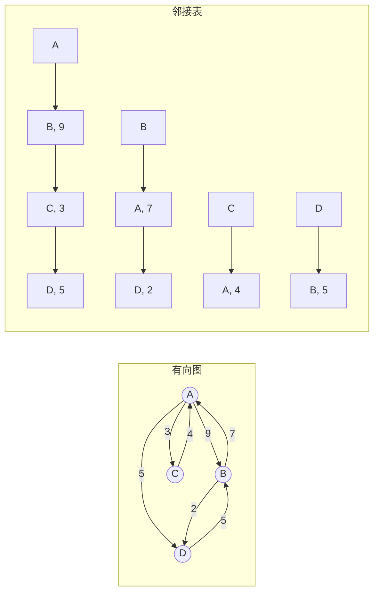
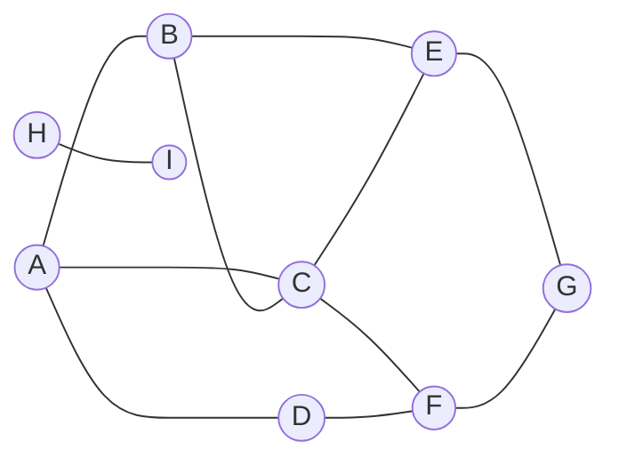
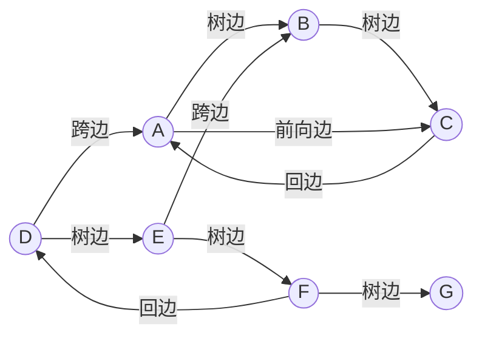

线性结构中每个元素至多有一个前驱和一个后继，树中每个节点至多有一个父亲；图则允许任意两个对象之间存在联系，是表达"关系"最一般的结构。道路网、计算机网络、社交关系、程序的调用关系、任务之间的依赖，都自然地建模为图。图的数学理论在离散数学的图论部分（[1.4](/1.4)）中已经讲过；本章从数据结构的角度讨论两个问题：图怎样在计算机中表示，以及怎样系统地访问图中的所有顶点和边。后者就是图的遍历，主要有广度优先搜索与深度优先搜索两种，它们把非线性的图转化为一棵（或一片）遍历树，并在遍历过程中留下顶点的时间标签与边的分类。这些信息是 [4.3.11](/4.3.11) 中拓扑排序、双连通分量、最短路径与最小生成树等算法的基础。[4.1.14](/4.1.14) 中在状态空间上做的搜索，正是隐式给出的图上的遍历。

## 10.1. 术语与图 ADT

### 10.1.1. 术语

图 $G = (V, E)$ 由顶点集 $V$ 与边集 $E$ 组成，记顶点数 $n = |V|$，边数 $m = |E|$。边 $(u, v)$ 的两个顶点彼此邻接，顶点与它所属的边彼此关联。若边没有方向，$G$ 是**无向图**；若每条边 $(u, v)$ 都有方向，从尾 $u$ 指向头 $v$，$G$ 是**有向图**。无向边可以看作一对方向相反的有向边，所以本章的结构与算法主要针对有向图叙述。除特别说明外，只考虑不含自环和重边的**简单图**，此时 $m = O(n^2)$。

本课程沿用数据结构教材的习惯用语，与 [1.4](/1.4) 的对应关系如下：

| 本章 | 图论部分（1.4） | 英文 |
|---|---|---|
| 顶点 | 结点 | vertex |
| 出度、入度 | 正度、负度 | out-degree, in-degree |
| 路径 $\langle v_0, v_1, \dots, v_k \rangle$，长度 $k$ | 道路 | walk |
| 简单路径（顶点互不相同） | 初级道路 | path |
| 环路（$v_0 = v_k$）、简单环路 | 回路、初级回路 | closed walk, cycle |
| 支撑树 | 生成树 | spanning tree |
| 带权网络 | 赋权图 | weighted graph |

不含环路的有向图称为有向无环图（DAG，[4.3.11](/4.3.11)）。经过每条边恰好一次的环路是**欧拉回路**，经过每个顶点恰好一次的环路是**哈密顿回路**。$G$ 的子图 $T = (V, F)$ 若是一棵树，则为 $G$ 的**支撑树**；各边带权的网络中总权重最小的支撑树是**最小生成树**（MST）。

### 10.1.2. 图 ADT

无论用什么结构实现，图都应提供统一的接口，图算法只通过这些接口访问图。以下把顶点编号为 $0, 1, \dots, n-1$：

| 类别 | 操作 |
|---|---|
| 顶点 | 插入、删除顶点；读写顶点数据；查询**出度**、**入度** |
| 边 | 判断边 $(v, u)$ 是否存在；插入、删除边；读写边的数据与权重 |
| 邻点 | 枚举 $v$ 的所有邻接顶点（`firstNbr`、`nextNbr`，或返回一个可遍历的序列） |

此外，遍历算法要给每个顶点附加若干辅助信息：状态（`UNDISCOVERED` 尚未发现、`DISCOVERED` 已发现、`VISITED` 访问完毕）、时间标签 $d(v)$ 与 $f(v)$（被发现与访问完毕的时刻）、遍历树中的父亲 `parent(v)`、优先级数 `priority(v)`（[4.3.11](/4.3.11)）；给每条边附加它在遍历树中的类型（§10.5.3）。每次遍历之前，这些信息都要复位。

## 10.2. 邻接矩阵

**邻接矩阵**用一个 $n \times n$ 矩阵 $A$ 记录顶点之间的邻接关系：$A(v, u) = 1$ 当且仅当存在边 $(v, u)$，否则为 $0$。矩阵元素与图中可能存在的边一一对应；对带权网络，就在 $A(v, u)$ 处存放边的权重（或指向边记录的指针，空表示没有边）。无向图的邻接矩阵是对称的；简单图的对角线全为 $0$。

邻接矩阵的优点是直观、易于实现，各种基本操作都很快：

| 操作 | 时间 |
|---|---|
| 判断边 $(v, u)$ 是否存在；读写其数据与权重 | $O(1)$ |
| 插入、删除边（同时更新两端的度数） | $O(1)$ |
| 查询顶点的出度、入度（维护度数记录） | $O(1)$ |
| 枚举 $v$ 的所有邻点（扫描第 $v$ 行） | $O(n)$ |
| 插入、删除顶点（增删一行一列） | $O(n)$（分摊） |

它的缺点是空间：总是 $\Theta(n^2)$，与实际的边数无关。真会有这么多边吗？以**平面图**为例：由 Euler 公式（[1.4.4](/1.4.4)），$n \ge 3$ 个顶点的简单平面图至多有 $3n - 6$ 条边，邻接矩阵中只有不到 $6/n$ 的元素非零。实际中的大规模图（道路网、网页链接、社交网络）大多如此。边数 $m = O(n)$ 或远小于 $n^2$ 的图称为稀疏图（sparse graph），$m = \Theta(n^2)$ 的称为稠密图（dense graph）。邻接矩阵只适合稠密图或规模较小的图。

记录顶点与边之间关联关系的**关联矩阵**是 $n \times m$ 矩阵，空间为 $\Theta(nm)$，而每一列只有两个非零元，利用率只有 $2/n$，在数据结构中很少使用，但在网络流等理论问题中十分有效。

## 10.3. 邻接表

### 10.3.1. 结构

要避免邻接矩阵的空间浪费，可以把矩阵的每一行压缩成一个**列表**，只记录实际存在的边：

**定义 10.3.1（邻接表）** 图 $G = (V, E)$ 的**邻接表**为每个顶点 $v$ 维护一个列表 $L_v = \{\, u : (v, u) \in E \,\}$，存放 $v$ 的所有出边（及其权重）。



有向图的邻接表共有 $n$ 个表头和 $m$ 个表项，空间为 $O(n + m)$；无向图的每条边在两端各存一次，共 $2m$ 个表项，空间仍为 $O(n + m)$。平面图的邻接表只需 $O(n)$ 空间，较邻接矩阵是极大的改进。

各操作的时间如下（$\deg(v)$ 为 $v$ 的出度）：

| 操作 | 邻接矩阵 | 邻接表 |
|---|---|---|
| 空间 | $\Theta(n^2)$ | $\Theta(n + m)$ |
| 判断边 $(v, u)$ 是否存在 | $O(1)$ | $O(1 + \deg(v))$ |
| 枚举 $v$ 的出边 | $O(n)$ | $O(1 + \deg(v))$ |
| 枚举 $v$ 的入边 | $O(n)$ | $O(n + m)$；另建逆邻接表则为 $O(1 + \text{入度})$ |
| 查询出度、入度（维护度数记录） | $O(1)$ | $O(1)$ |
| 插入边 | $O(1)$ | $O(1)$（不查重时） |
| 遍历全图 | $O(n^2)$ | $O(n + m)$ |

几点补充：

- 若经常需要入边，可以同时维护逆邻接表（每个顶点的入边列表），空间加倍，仍为 $O(n + m)$。
- 若经常需要判断边是否存在，可以把每个 $L_v$ 换成一个**散列表**（[4.3.9](/4.3.9)）：判断边的期望时间为 $O(1)$，与邻接矩阵"相同"，空间仍为 $O(n + m)$。
- 对构造后不再修改的大图，常把所有邻接表首尾相接存入一个长为 $m$ 的数组，再用一个长为 $n + 1$ 的数组记录每个顶点的列表在其中的起点。这种压缩稀疏行（CSR）格式完全连续地存放，缓存效率最高，是图计算库和稀疏矩阵的标准格式（[4.4](/4.4)）。
- 邻接矩阵仍有用武之地：除了稠密图，有些图是隐式给出的，例如平面上距离不超过 $r$ 的点对相连的欧氏图、区间相交图、[4.1.14](/4.1.14) 中的**状态空间**。这些图不必显式存储，只要能回答"$v$ 的邻点有哪些"，遍历算法就能工作。

| 适用场合 | 邻接矩阵 | 邻接表 |
|---|---|---|
| 图的稀疏程度 | 稠密图 | 稀疏图 |
| 主要操作 | 经常检测边的存在、经常插入删除边 | 经常遍历、经常计算顶点的度数 |
| 规模 | 顶点数固定且较小 | 顶点数不确定或很大 |

### 10.3.2. 实现

下面以相同的接口实现两种结构：邻接矩阵用 $n \times n$ 的二维数组，空单元表示没有边；邻接表为每个顶点保存一个出边数组，入度另行记录。示例是上图中的带权有向图，程序逐个顶点列出邻接表，并核对两种结构给出的度数一致。

```cpp tab
#include <format>
#include <iostream>
#include <optional>
#include <vector>

// Directed weighted graph as an adjacency matrix: n x n cells, empty = no edge.
class GraphMatrix {
    std::vector<std::vector<std::optional<int>>> w_;
    std::vector<int> in_, out_;
public:
    explicit GraphMatrix(int n) : w_(n, std::vector<std::optional<int>>(n)), in_(n), out_(n) {}
    int n() const { return static_cast<int>(w_.size()); }
    bool exists(int v, int u) const { return w_[v][u].has_value(); }           // O(1)
    void insert(int v, int u, int weight) {
        if (exists(v, u)) return;
        w_[v][u] = weight; ++out_[v]; ++in_[u];
    }
    void remove(int v, int u) {
        if (!exists(v, u)) return;
        w_[v][u].reset(); --out_[v]; --in_[u];
    }
    int in_degree(int v) const { return in_[v]; }
    int out_degree(int v) const { return out_[v]; }
    std::vector<int> neighbors(int v) const {                                  // O(n)
        std::vector<int> r;
        for (int u = 0; u < n(); ++u) if (exists(v, u)) r.push_back(u);
        return r;
    }
};

// The same graph as adjacency lists: vertex v keeps only its out-edges.
class GraphList {
public:
    struct Arc { int to, weight; };
private:
    std::vector<std::vector<Arc>> adj_;
    std::vector<int> in_;
public:
    explicit GraphList(int n) : adj_(n), in_(n) {}
    int n() const { return static_cast<int>(adj_.size()); }
    bool exists(int v, int u) const {                                          // O(out_degree(v))
        for (const Arc& a : adj_[v]) if (a.to == u) return true;
        return false;
    }
    void insert(int v, int u, int weight) {
        if (exists(v, u)) return;
        adj_[v].push_back({u, weight}); ++in_[u];
    }
    void remove(int v, int u) {
        auto& list = adj_[v];
        for (std::size_t i = 0; i < list.size(); ++i)
            if (list[i].to == u) { list[i] = list.back(); list.pop_back(); --in_[u]; return; }
    }
    int in_degree(int v) const { return in_[v]; }
    int out_degree(int v) const { return static_cast<int>(adj_[v].size()); }  // O(1)
    const std::vector<Arc>& neighbors(int v) const { return adj_[v]; }         // O(1 + deg)
};

int main() {
    // A=0, B=1, C=2, D=3:  A->B 9, A->C 3, A->D 5, B->A 7, B->D 2, C->A 4, D->B 5
    const int edges[][3] = {{0, 1, 9}, {0, 2, 3}, {0, 3, 5}, {1, 0, 7}, {1, 3, 2}, {2, 0, 4}, {3, 1, 5}};
    GraphMatrix m(4);
    GraphList l(4);
    for (auto [v, u, w] : edges) { m.insert(v, u, w); l.insert(v, u, w); }
    for (int v = 0; v < 4; ++v) {
        std::cout << std::format("{}: out {} in {} |", char('A' + v), l.out_degree(v), l.in_degree(v));
        for (const auto& a : l.neighbors(v)) std::cout << std::format(" {}({})", char('A' + a.to), a.weight);
        std::cout << std::format(" | matrix agrees: {}\n",
                                 m.neighbors(v).size() == l.neighbors(v).size() &&
                                     m.in_degree(v) == l.in_degree(v));
    }
}
```

```python tab
class GraphMatrix:
    """Directed weighted graph as an adjacency matrix; None means no edge."""

    def __init__(self, n: int) -> None:
        self.w: list[list[int | None]] = [[None] * n for _ in range(n)]
        self.indeg, self.outdeg = [0] * n, [0] * n

    def exists(self, v: int, u: int) -> bool:          # O(1)
        return self.w[v][u] is not None

    def insert(self, v: int, u: int, weight: int) -> None:
        if not self.exists(v, u):
            self.w[v][u] = weight
            self.outdeg[v] += 1
            self.indeg[u] += 1

    def remove(self, v: int, u: int) -> None:
        if self.exists(v, u):
            self.w[v][u] = None
            self.outdeg[v] -= 1
            self.indeg[u] -= 1

    def neighbors(self, v: int) -> list[int]:          # O(n)
        return [u for u, x in enumerate(self.w[v]) if x is not None]


class GraphList:
    """The same graph as adjacency lists: v -> list of (u, weight)."""

    def __init__(self, n: int) -> None:
        self.adj: list[list[tuple[int, int]]] = [[] for _ in range(n)]
        self.indeg = [0] * n

    def exists(self, v: int, u: int) -> bool:          # O(out-degree of v)
        return any(x == u for x, _ in self.adj[v])

    def insert(self, v: int, u: int, weight: int) -> None:
        if not self.exists(v, u):
            self.adj[v].append((u, weight))
            self.indeg[u] += 1

    def remove(self, v: int, u: int) -> None:
        for i, (x, _) in enumerate(self.adj[v]):
            if x == u:
                self.adj[v][i] = self.adj[v][-1]
                self.adj[v].pop()
                self.indeg[u] -= 1
                return

    def out_degree(self, v: int) -> int:               # O(1)
        return len(self.adj[v])

    def neighbors(self, v: int) -> list[tuple[int, int]]:   # O(1 + degree)
        return self.adj[v]


# A=0, B=1, C=2, D=3
edges = [(0, 1, 9), (0, 2, 3), (0, 3, 5), (1, 0, 7), (1, 3, 2), (2, 0, 4), (3, 1, 5)]
m, l = GraphMatrix(4), GraphList(4)
for v, u, w in edges:
    m.insert(v, u, w)
    l.insert(v, u, w)
for v in range(4):
    arcs = " ".join(f"{chr(65 + u)}({w})" for u, w in l.neighbors(v))
    agrees = len(m.neighbors(v)) == l.out_degree(v) and m.indeg[v] == l.indeg[v]
    print(f"{chr(65 + v)}: out {l.out_degree(v)} in {l.indeg[v]} | {arcs} | matrix agrees: {agrees}")
```

本章和下一章的算法都用最简单的邻接表：C++ 中是 `std::vector<std::vector<int>>`（带权时每项是 (邻点, 权重)），Python 中是 `list[list[int]]`。

## 10.4. 广度优先搜索

### 10.4.1. 算法

**广度优先搜索**（BFS）从起点 $s$ 出发：先访问 $s$，再依次访问 $s$ 所有尚未访问的邻点，再依次访问它们尚未访问的邻点……如此反复，直到没有尚未访问的邻点。这一策略与树的**层次遍历**（[4.3.5](/4.3.5)）完全相同：顶点按到 $s$ 的距离逐层被发现，如同水面的涟漪。实现时用一个队列保存已发现而尚未访问完毕的顶点：

1. 发现 $s$（状态改为 `DISCOVERED`），入队；
2. 队列非空时，取出队首顶点 $v$，考察它的每个邻点 $u$：若 $u$ 尚未发现，则发现之，令 `parent(u) = v`，$u$ 入队；
3. $v$ 的邻点考察完毕，状态改为 `VISITED`。

若图有多个连通分量（有向图中，从 $s$ 不能到达全部顶点），一次 BFS 只能访问 $s$ 所在的分量。为遍历全图，依次检查每个顶点，一旦遇到尚未发现的，就从它出发再做一次 BFS。

下面的程序对一个无向图做全图的 BFS，记录每个顶点的层次 `dist`（即距离），并把边分为树边与跨边两类（§10.4.2）。无向图的每条边在两端各被考察一次；若考察 $v$ 的邻点 $u$ 时 $u$ 已访问完毕，这条边早在扫描 $u$ 时就已分类，不再重复计入。最后用跨边判定该图是否为**二分图**（定理 10.4.4）。



```cpp tab
#include <format>
#include <iostream>
#include <queue>
#include <string>
#include <utility>
#include <vector>

enum class Status { Undiscovered, Discovered, Visited };

struct BfsResult {
    std::vector<int> dist, parent;
    std::vector<std::pair<int, int>> tree, cross;
};

// Breadth-first search over the whole undirected graph (every component).
BfsResult bfs(const std::vector<std::vector<int>>& adj) {
    int n = static_cast<int>(adj.size());
    BfsResult r{std::vector<int>(n, -1), std::vector<int>(n, -1), {}, {}};
    std::vector<Status> status(n, Status::Undiscovered);
    for (int s = 0; s < n; ++s) {
        if (status[s] != Status::Undiscovered) continue;   // a new component: start a new tree
        std::queue<int> q;
        status[s] = Status::Discovered; r.dist[s] = 0; q.push(s);
        while (!q.empty()) {
            int v = q.front(); q.pop();
            for (int u : adj[v]) {
                if (status[u] == Status::Undiscovered) {   // tree edge: u joins the next level
                    status[u] = Status::Discovered;
                    r.dist[u] = r.dist[v] + 1; r.parent[u] = v;
                    r.tree.emplace_back(v, u);
                    q.push(u);
                } else if (status[u] == Status::Discovered) {   // u still queued: cross edge
                    r.cross.emplace_back(v, u);
                }   // u visited: edge {u, v} was classified when u was scanned
            }
            status[v] = Status::Visited;
        }
    }
    return r;
}

int main() {
    const std::string name = "ABCDEFGHI";
    std::vector<std::vector<int>> adj(name.size());
    for (auto e : {"AB", "AC", "AD", "BC", "BE", "CE", "CF", "DF", "EG", "FG", "HI"}) {
        int v = e[0] - 'A', u = e[1] - 'A';
        adj[v].push_back(u);
        adj[u].push_back(v);
    }
    BfsResult r = bfs(adj);
    for (std::size_t v = 0; v < name.size(); ++v)
        std::cout << std::format("{}:{} ", name[v], r.dist[v]);
    std::cout << std::format("\ntree {} cross {}:", r.tree.size(), r.cross.size());
    bool bipartite = true;
    for (auto [v, u] : r.cross) {
        std::cout << std::format(" {}{}", name[v], name[u]);
        if (r.dist[v] == r.dist[u]) bipartite = false;   // same level: odd cycle
    }
    std::cout << std::format("\nbipartite: {}\n", bipartite);
}
```

```python tab
from collections import deque
from enum import Enum


class Status(Enum):
    UNDISCOVERED = 0
    DISCOVERED = 1
    VISITED = 2


def bfs(adj: list[list[int]]) -> tuple[list[int], list[int], list[tuple[int, int]], list[tuple[int, int]]]:
    """Breadth-first search over the whole undirected graph (every component)."""
    n = len(adj)
    dist, parent = [-1] * n, [-1] * n
    tree: list[tuple[int, int]] = []
    cross: list[tuple[int, int]] = []
    status = [Status.UNDISCOVERED] * n
    for s in range(n):
        if status[s] is not Status.UNDISCOVERED:
            continue                               # a new component: start a new tree
        status[s], dist[s] = Status.DISCOVERED, 0
        q = deque([s])
        while q:
            v = q.popleft()
            for u in adj[v]:
                if status[u] is Status.UNDISCOVERED:     # tree edge: u joins the next level
                    status[u] = Status.DISCOVERED
                    dist[u], parent[u] = dist[v] + 1, v
                    tree.append((v, u))
                    q.append(u)
                elif status[u] is Status.DISCOVERED:     # u still queued: cross edge
                    cross.append((v, u))
                # u visited: edge {u, v} was classified when u was scanned
            status[v] = Status.VISITED
    return dist, parent, tree, cross


names = "ABCDEFGHI"
adj: list[list[int]] = [[] for _ in names]
for e in ["AB", "AC", "AD", "BC", "BE", "CE", "CF", "DF", "EG", "FG", "HI"]:
    v, u = names.index(e[0]), names.index(e[1])
    adj[v].append(u)
    adj[u].append(v)
dist, parent, tree, cross = bfs(adj)
print(*(f"{c}:{d}" for c, d in zip(names, dist)))
print(f"tree {len(tree)} cross {len(cross)}:", *(names[v] + names[u] for v, u in cross))
print("bipartite:", all(dist[v] != dist[u] for v, u in cross))   # same level: odd cycle
```

输出为：

```text
A:0 B:1 C:1 D:1 E:2 F:2 G:3 H:0 I:1
tree 7 cross 4: BC CE DF FG
bipartite: false
```

再看复杂度。每个顶点恰好入队、出队一次；出队时扫描它的邻接表，所有邻接表共扫描一遍。初始化（复位）需要 $O(n)$ 时间，所以采用邻接表时全图 BFS 的时间为 $O(n + m)$；采用邻接矩阵时，枚举邻点要扫描整行，时间为 $O(n^2)$。有向图同样如此。

### 10.4.2. BFS 树与边分类

**定义 10.4.1（BFS 树）** 在 BFS 中，若考察 $v$ 的邻点 $u$ 时 $u$ 尚未发现，则边 $(v, u)$ 称为**树边**。从 $s$ 出发的一次 BFS 的全部树边构成以 $s$ 为根的一棵树，称为 BFS 树；全图 BFS 的各棵 BFS 树构成 BFS 森林。其余的边在 BFS 中统称为跨边。

考察边 $(v, u)$ 时：若 $u$ 为 `UNDISCOVERED`，$(v, u)$ 为树边；若 $u$ 为 `DISCOVERED`（仍在**队列**中）或 `VISITED`（已出队），$(v, u)$ 为跨边。

**定理 10.4.1** 设无向图 $G$ 有 $n$ 个顶点、$m$ 条边、$c$ 个连通分量。全图 BFS 生成的 BFS 森林恰有 $c$ 棵树、$n - c$ 条树边，其余 $m - n + c$ 条边为跨边。

**证明** 全图 BFS 对每个连通分量恰好启动一次 BFS（启动时队列为空，结束时队列又为空），每次生成一棵树。每个顶点恰好以 `UNDISCOVERED` 状态被发现一次：起点被直接发现，其余顶点各通过一条树边被发现，所以树边共 $n - c$ 条。每条边恰被分类一次，其余 $m - (n - c)$ 条即为跨边。$\square$

上例中 $n = 9$，$m = 11$，$c = 2$，树边 $7$ 条，跨边 $4$ 条。

### 10.4.3. 最短路径

在无权图中，记 $\operatorname{dist}(s, v)$ 为从 $s$ 到 $v$ 的路径的最少边数（不可达时为 $\infty$）。BFS 的队列犹如一条"贪吃蛇"：

**定理 10.4.2** 在从 $s$ 出发的 BFS 过程中，设某时刻队列中的顶点自首至尾为 $v_1, v_2, \dots, v_r$，则

$$
\operatorname{lev}(v_1) \le \operatorname{lev}(v_2) \le \cdots \le \operatorname{lev}(v_r) \le \operatorname{lev}(v_1) + 1,
$$
其中 $\operatorname{lev}(v)$ 是 $v$ 在 BFS 树中的深度（程序中的 `dist`）。

**证明** 对队列操作的次数归纳。开始时队列只有 $s$，成立。出队 $v_1$ 后，剩余序列仍满足 $\operatorname{lev}(v_2) \le \cdots \le \operatorname{lev}(v_r) \le \operatorname{lev}(v_1) + 1 \le \operatorname{lev}(v_2) + 1$。扫描 $v_1$ 时入队的顶点 $u$ 满足 $\operatorname{lev}(u) = \operatorname{lev}(v_1) + 1$，它不小于原队尾的层次（$\le \operatorname{lev}(v_1) + 1$），而对新的队首 $v_2$ 有 $\operatorname{lev}(u) = \operatorname{lev}(v_1) + 1 \le \operatorname{lev}(v_2) + 1$。$\square$

**推论 10.4.1** 顶点按层次的非降次序被发现，也按此次序出队；任一跨边 $(v, u)$ 的两端满足 $\operatorname{lev}(u) \le \operatorname{lev}(v) + 1$，在无向图中进而有 $\lvert \operatorname{lev}(u) - \operatorname{lev}(v) \rvert \le 1$。

**证明** 前一句由定理 10.4.2 直接得到。考察 $v$ 的邻点 $u$ 时，若 $u$ 已被发现，它要么已经出队、要么还在队列中，无论哪种情况 $\operatorname{lev}(u) \le \operatorname{lev}(v) + 1$（$v$ 此刻是刚出队的队首）。在无向图中对边的另一端做同样的论证，得到 $\operatorname{lev}(v) \le \operatorname{lev}(u) + 1$。$\square$

**定理 10.4.3** 从 $s$ 出发的 BFS 结束后，对每个顶点 $v$ 有 $\operatorname{lev}(v) = \operatorname{dist}(s, v)$；BFS 树中从 $s$ 到 $v$ 的路径就是原图中的一条最短路径。

**证明** BFS 树中 $s$ 到 $v$ 的路径有 $\operatorname{lev}(v)$ 条边，故 $\operatorname{dist}(s, v) \le \operatorname{lev}(v)$。反之，设 $s = u_0, u_1, \dots, u_k = v$ 是一条最短路径。由推论 10.4.1，每条边都满足 $\operatorname{lev}(u_{i+1}) \le \operatorname{lev}(u_i) + 1$（树边取等号），逐项相加得 $\operatorname{lev}(v) \le k = \operatorname{dist}(s, v)$。不可达的顶点不会被这次 BFS 发现。$\square$

所以 BFS 解决了无权图的单源最短路径问题，时间 $O(n + m)$。边带有不同权重时，最短路径要用 [4.3.11](/4.3.11) 的 Dijkstra 算法，它把 BFS 的队列换成了优先级队列。

**定理 10.4.4** 无向图 $G$ 是**二分图**，当且仅当全图 BFS 中没有一条边连接同一层次的两个顶点。

**证明** 若没有这样的边，由推论 10.4.1，每条边连接层次之差恰为 $1$ 的两个顶点，按层次的奇偶性把顶点分为两部分即可。反之，若跨边 $(v, u)$ 满足 $\operatorname{lev}(u) = \operatorname{lev}(v)$，设 $w$ 是 $u$ 与 $v$ 在 BFS 树中的最近公共祖先，则树中 $w$ 到 $u$、$w$ 到 $v$ 的两条路径长度相同，连同边 $(v, u)$ 构成一个奇数长的环路，而二分图中没有奇环。$\square$

上例中跨边 $(B, C)$ 连接层次都为 $1$ 的两个顶点，对应奇环 $A, B, C$，所以不是二分图。

### 10.4.4. 应用

BFS 的典型应用都与"距离"有关：

- 合作距离：数学家的 Erdős 数是合作发表论文的关系图中到 Paul Erdős 的距离，演员的"Bacon 数"同理。从中心人物做一次 BFS 即可求出所有人的数值，不可达者为 $\infty$。
- 偏心率、半径、直径与中心：顶点 $v$ 的偏心率是它到其余顶点的最大距离，图的半径与直径分别是偏心率的最小值与最大值，偏心率最小的顶点是图的中心。对每个顶点做一次 BFS，共 $O(n(n + m))$ 时间。
- 围长（最短环路的长度）、无权图上的最短路径、迷宫与棋盘上的最少步数（[4.1.14](/4.1.14)）。
- 多源 BFS：把多个起点同时放入初始队列，求每个顶点到最近起点的距离。

## 10.5. 深度优先搜索

### 10.5.1. 算法

**深度优先搜索**（DFS）的策略是"能走多深走多深"：

1. 访问顶点 $v$（发现 $v$）；
2. 若 $v$ 尚有未被发现的邻点，任取其一 $u$，递归地执行 DFS($u$)；
3. 否则返回，$v$ 访问完毕。

对树而言，DFS 就是**先序遍历**；对一般的图，DFS 同样构造一棵支撑树（DFS 树）。若从起点出发不能访问全部顶点，就像全图 BFS 那样，再从尚未发现的顶点启动 DFS，最终得到 DFS 森林。

DFS 在发现与访问完毕顶点时，用同一个全局时钟分别打上时间标签 $d(v)$ 与 $f(v)$；考察每条边 $(v, u)$ 时，根据 $u$ 当时的状态给边分类（§10.5.3）：

| 考察 $(v, u)$ 时 $u$ 的状态 | 边的类型 |
|---|---|
| `UNDISCOVERED` | 树边，递归进入 $u$ |
| `DISCOVERED` | 回边（`BACKWARD`） |
| `VISITED`，且 $d(v) < d(u)$ | 前向边（`FORWARD`） |
| `VISITED`，且 $d(v) > d(u)$ | 跨边（`CROSS`） |

下面对如下有向图做全图 DFS（各顶点的邻点按字母顺序考察）：



```cpp tab
#include <format>
#include <iostream>
#include <string>
#include <utility>
#include <vector>

enum class Status { Undiscovered, Discovered, Visited };
enum class EdgeType { Tree, Backward, Forward, Cross };

struct Dfs {
    const std::vector<std::vector<int>>& adj;
    std::vector<Status> status;
    std::vector<int> d, f, parent;                 // discovery / finishing times
    std::vector<std::pair<std::pair<int, int>, EdgeType>> edges;
    int clock = 0;

    explicit Dfs(const std::vector<std::vector<int>>& g)
        : adj(g), status(g.size(), Status::Undiscovered), d(g.size(), 0), f(g.size(), 0),
          parent(g.size(), -1) {
        for (int s = 0; s < static_cast<int>(g.size()); ++s)   // one DFS tree per start
            if (status[s] == Status::Undiscovered) visit(s);
    }
    void visit(int v) {
        d[v] = ++clock; status[v] = Status::Discovered;
        for (int u : adj[v]) {
            switch (status[u]) {
            case Status::Undiscovered:             // the tree grows through u
                edges.push_back({{v, u}, EdgeType::Tree});
                parent[u] = v;
                visit(u);
                break;
            case Status::Discovered:               // u is an ancestor still on the stack
                edges.push_back({{v, u}, EdgeType::Backward});
                break;
            case Status::Visited:                  // u is finished: descendant or unrelated
                edges.push_back({{v, u}, d[v] < d[u] ? EdgeType::Forward : EdgeType::Cross});
                break;
            }
        }
        status[v] = Status::Visited; f[v] = ++clock;
    }
};

int main() {
    const std::string name = "ABCDEFG";
    std::vector<std::vector<int>> adj(name.size());
    for (auto e : {"AB", "AC", "BC", "CA", "DA", "DE", "EB", "EF", "FD", "FG"})
        adj[e[0] - 'A'].push_back(e[1] - 'A');
    Dfs r(adj);
    for (std::size_t v = 0; v < name.size(); ++v)
        std::cout << std::format("{}[{},{}] ", name[v], r.d[v], r.f[v]);
    const char* label[] = {"TREE", "BACKWARD", "FORWARD", "CROSS"};
    std::cout << '\n';
    for (auto [e, t] : r.edges)
        std::cout << std::format("{}{}:{} ", name[e.first], name[e.second], label[int(t)]);
    std::cout << '\n';
}
```

```python tab
from enum import Enum


class Status(Enum):
    UNDISCOVERED = 0
    DISCOVERED = 1
    VISITED = 2


def dfs(adj: list[list[int]]) -> tuple[list[int], list[int], list[tuple[int, int, str]]]:
    """Depth-first search of a digraph: times d, f and the type of every edge."""
    n = len(adj)
    status = [Status.UNDISCOVERED] * n
    d, f, parent = [0] * n, [0] * n, [-1] * n
    edges: list[tuple[int, int, str]] = []
    clock = 0

    def visit(v: int) -> None:
        nonlocal clock
        clock += 1
        d[v], status[v] = clock, Status.DISCOVERED
        for u in adj[v]:
            match status[u]:
                case Status.UNDISCOVERED:          # the tree grows through u
                    edges.append((v, u, "TREE"))
                    parent[u] = v
                    visit(u)
                case Status.DISCOVERED:            # u is an ancestor still on the stack
                    edges.append((v, u, "BACKWARD"))
                case Status.VISITED:               # u is finished: descendant or unrelated
                    edges.append((v, u, "FORWARD" if d[v] < d[u] else "CROSS"))
        status[v] = Status.VISITED
        clock += 1
        f[v] = clock

    for s in range(n):                             # one DFS tree per start
        if status[s] is Status.UNDISCOVERED:
            visit(s)
    return d, f, edges


names = "ABCDEFG"
adj: list[list[int]] = [[] for _ in names]
for e in ["AB", "AC", "BC", "CA", "DA", "DE", "EB", "EF", "FD", "FG"]:
    adj[names.index(e[0])].append(names.index(e[1]))
d, f, edges = dfs(adj)
print(*(f"{c}[{d[i]},{f[i]}]" for i, c in enumerate(names)))
print(*(f"{names[v]}{names[u]}:{t}" for v, u, t in edges))
```

输出为（方括号内是 $[d(v), f(v)]$）：

```text
A[1,6] B[2,5] C[3,4] D[7,14] E[8,13] F[9,12] G[10,11]
AB:TREE BC:TREE CA:BACKWARD AC:FORWARD DA:CROSS DE:TREE EB:CROSS EF:TREE FD:BACKWARD FG:TREE
```

再看复杂度。每个顶点恰好被发现一次、调用一次 DFS；每次调用扫描该顶点的邻接表，每条边恰被考察一次（无向图两次）。所以采用邻接表时全图 DFS 的时间为 $O(n + m)$，采用邻接矩阵时为 $O(n^2)$，与 BFS 相同。

### 10.5.2. 活跃期与括号引理

称区间 $[d(v), f(v)]$ 为顶点 $v$ 的活跃期：在此期间 $v$ 的 DFS 调用位于**调用栈**上，状态为 `DISCOVERED`。DFS 树中，$u$ 是 $v$ 的后代当且仅当 DFS($u$) 是在 DFS($v$) 执行期间（直接或间接）被调用的。由于递归调用是严格嵌套的，各顶点的活跃期也必然嵌套：

**定理 10.5.1（括号引理）** 对有向图（或无向图）的任一 DFS 森林和任意两个顶点 $u \ne v$，以下三者恰有一个成立：

1. $[d(u), f(u)] \subset [d(v), f(v)]$，且 $u$ 是 $v$ 的后代；
2. $[d(v), f(v)] \subset [d(u), f(u)]$，且 $u$ 是 $v$ 的祖先；
3. 两个区间不相交，且 $u$ 与 $v$ 在森林中互不为祖先与后代（"无关"）。

**证明** 不妨设 $d(u) < d(v)$。若 $d(v) < f(u)$，则 $v$ 被发现时 DFS($u$) 尚未返回，DFS($v$) 是在 DFS($u$) 执行期间被调用的，$v$ 是 $u$ 的后代；DFS($v$) 必在 DFS($u$) 之前返回，故 $f(v) < f(u)$，即 $[d(v), f(v)] \subset [d(u), f(u)]$。若 $d(v) > f(u)$，则 $d(u) < f(u) < d(v) < f(v)$，两区间不相交；$v$ 被发现时 DFS($u$) 已经返回，$v$ 不是 $u$ 的后代，又因 $u$ 先被发现，$u$ 也不是 $v$ 的后代。$\square$

把 $d(v)$ 写成左括号、$f(v)$ 写成右括号，按时间顺序排成的括号序列是匹配的，这就是名称的由来。上例中的括号序列为 $(_A (_B (_C\, )_C\, )_B\, )_A\, (_D (_E (_F (_G\, )_G\, )_F\, )_E\, )_D$。于是，DFS 之后仅凭 $d$、$f$ 两个数组，就能在 $O(1)$ 时间内判断任意两个顶点在 DFS 森林中的祖先与后代关系。

**定理 10.5.2（白路径定理）** 在 DFS 森林中，$u$ 是 $v$ 的后代，当且仅当在时刻 $d(v)$，存在一条从 $v$ 到 $u$ 的路径，其上的顶点（除 $v$ 外）全都尚未被发现。

**证明** 必要性：若 $u$ 是 $v$ 的后代，DFS 树中 $v$ 到 $u$ 的路径上的顶点都是 $v$ 的后代，由括号引理它们都在 $d(v)$ 之后才被发现。充分性：设在时刻 $d(v)$ 有这样一条路径，而 $u$ 不是 $v$ 的后代；不妨设 $u$ 是路径上第一个不是 $v$ 的后代的顶点，$w$ 是它在路径上的前驱（$w = v$ 或 $w$ 是 $v$ 的后代），于是 $f(w) \le f(v)$。$u$ 在 $d(v)$ 之后才被发现，且必在 DFS($w$) 返回之前被发现：扫描边 $(w, u)$ 时若 $u$ 仍未被发现，就会递归进入 $u$。所以 $d(v) < d(u) < f(w) \le f(v)$，由括号引理 $u$ 是 $v$ 的后代，矛盾。$\square$

### 10.5.3. 边分类

**定义 10.5.1（边分类）** 设对图 $G$ 做了一次全图 DFS。对每条边 $(v, u)$，按考察它时 $u$ 的状态分类：$u$ 尚未发现，则 $(v, u)$ 是树边；$u$ 为 `DISCOVERED`，即 $u$ 是 $v$ 的祖先（含 $u = v$ 的自环），则 $(v, u)$ 称为**回边**（也称后向边）；$u$ 为 `VISITED` 且是 $v$ 的后代，则 $(v, u)$ 称为**前向边**；$u$ 为 `VISITED` 且与 $v$ 无关，则 $(v, u)$ 称为**跨边**。

由括号引理，分类可以完全用时间标签表述：

**定理 10.5.3** 在有向图的 DFS 中，边 $(v, u)$ 是
- 树边或前向边，当且仅当 $d(v) < d(u) < f(u) < f(v)$；
- 回边，当且仅当 $d(u) \le d(v) < f(v) \le f(u)$；
- 跨边，当且仅当 $d(u) < f(u) < d(v) < f(v)$。

**证明** 前两种情形由括号引理与定义直接得到。对跨边，$u$ 已访问完毕而与 $v$ 无关，两区间不相交且 $f(u)$ 早于考察时刻，所以 $f(u) < d(v)$。反过来，若 $d(v) < d(u)$ 而两区间不相交，即 $f(v) < d(u)$，那么 $v$ 访问完毕时 $u$ 还未被发现，但 DFS($v$) 必须考察边 $(v, u)$，此时 $u$ 会被发现而成为 $v$ 的后代，矛盾。所以跨边总是从后发现的顶点指向先发现的顶点。$\square$

这正是程序中 `VISITED` 分支用 $d(v) < d(u)$ 区分前向边与跨边的依据。

**定理 10.5.4** 在无向图的 DFS 中，每条边都是树边或回边。

**证明** 设边 $\{u, v\}$ 满足 $d(u) < d(v)$。$u$ 被发现后，必须考察完它的全部邻点（包括 $v$）才能访问完毕，所以 $v$ 在 $u$ 访问完毕之前被发现，由括号引理 $v$ 是 $u$ 的后代。若这条边首先在扫描 $u$ 时被考察，此时 $v$ 尚未发现，它是树边；若首先在扫描 $v$ 时被考察，此时 $u$ 是仍在调用栈上的祖先，它是回边。$\square$

**定理 10.5.5** 有向图 $G$ 含有环路，当且仅当对它做 DFS 时出现回边。

**证明** 若有回边 $(v, u)$，$u$ 是 $v$ 的祖先，DFS 树中 $u$ 到 $v$ 的路径加上 $(v, u)$ 就是一条环路。反之，设 $C$ 是一条环路，$u$ 是 $C$ 上最先被发现的顶点，$v$ 是 $C$ 上 $u$ 的前驱。在时刻 $d(u)$，$C$ 上其余顶点都尚未被发现，沿 $C$ 从 $u$ 到 $v$ 就是一条"白路径"，由白路径定理，$v$ 是 $u$ 的后代。考察边 $(v, u)$ 时 DFS($v$) 正在执行，$u$ 作为 $v$ 的祖先仍为 `DISCOVERED`，所以 $(v, u)$ 是回边。$\square$

所以 DFS 可以在 $O(n + m)$ 时间内检测有向图中是否有环路；而回边的数目与环路的数目并无对应关系（一条回边可以对应很多条环路）。上例中的回边 $(C, A)$、$(F, D)$ 分别对应环路 $A, B, C$ 与 $D, E, F$。

### 10.5.4. 迭代写法

递归的 DFS 在深度为 $n$ 的图（例如一条长链）上需要 $n$ 层**递归**。Python 默认的递归深度上限只有 1000 层（`sys.getrecursionlimit()`），超过时抛出 `RecursionError`；C++ 程序的调用栈在 Linux 上通常为 8 MB，几十万层递归就会**栈溢出**。处理大图时应改用显式的**栈**。

需要注意，"弹出一个顶点、把它的所有邻点压栈"的简单写法虽然也是一种深度优先的次序，却不能正确地给出 $f(v)$ 和边分类。正确的做法是模拟**调用栈**：栈中每项保存 (顶点, 它的邻点扫描到哪里)，这正是递归调用的栈帧中保存的内容。每次查看栈顶，取它的下一个邻点；若该邻点尚未发现，就发现它并压栈（相当于递归调用）；若栈顶顶点的邻点已扫描完毕，它就访问完毕并出栈（相当于返回）。

```cpp tab
#include <format>
#include <iostream>
#include <string>
#include <utility>
#include <vector>

// Iterative DFS: the explicit stack holds (vertex, index of its next neighbour),
// which is exactly what a recursive call keeps in its stack frame.
void dfs_iterative(const std::vector<std::vector<int>>& adj, std::vector<int>& d, std::vector<int>& f) {
    int n = static_cast<int>(adj.size()), clock = 0;
    d.assign(n, 0);
    f.assign(n, 0);                                   // d[v] == 0: undiscovered
    std::vector<std::pair<int, std::size_t>> stack;
    for (int s = 0; s < n; ++s) {
        if (d[s]) continue;
        d[s] = ++clock;
        stack.push_back({s, 0});
        while (!stack.empty()) {
            auto& [v, i] = stack.back();
            if (i < adj[v].size()) {
                int u = adj[v][i++];                  // advance before possibly descending
                if (!d[u]) { d[u] = ++clock; stack.push_back({u, 0}); }
            } else {
                f[v] = ++clock;                       // all neighbours done: v finishes
                stack.pop_back();
            }
        }
    }
}

int main() {
    const std::string name = "ABCDEFG";
    std::vector<std::vector<int>> adj(name.size());
    for (auto e : {"AB", "AC", "BC", "CA", "DA", "DE", "EB", "EF", "FD", "FG"})
        adj[e[0] - 'A'].push_back(e[1] - 'A');
    std::vector<int> d, f;
    dfs_iterative(adj, d, f);
    for (std::size_t v = 0; v < name.size(); ++v) std::cout << std::format("{}[{},{}] ", name[v], d[v], f[v]);
    std::cout << '\n';
}
```

```python tab
def dfs_iterative(adj: list[list[int]]) -> tuple[list[int], list[int]]:
    """DFS with an explicit stack of (vertex, iterator over its neighbours)."""
    n = len(adj)
    d, f = [0] * n, [0] * n                        # d[v] == 0: undiscovered
    clock = 0
    for s in range(n):
        if d[s]:
            continue
        clock += 1
        d[s] = clock
        stack = [(s, iter(adj[s]))]
        while stack:
            v, it = stack[-1]
            u = next(it, None)                     # the iterator remembers where v stopped
            if u is None:
                clock += 1
                f[v] = clock                       # all neighbours done: v finishes
                stack.pop()
            elif not d[u]:
                clock += 1
                d[u] = clock
                stack.append((u, iter(adj[u])))
    return d, f


names = "ABCDEFG"
adj: list[list[int]] = [[] for _ in names]
for e in ["AB", "AC", "BC", "CA", "DA", "DE", "EB", "EF", "FD", "FG"]:
    adj[names.index(e[0])].append(names.index(e[1]))
d, f = dfs_iterative(adj)
print(*(f"{c}[{d[i]},{f[i]}]" for i, c in enumerate(names)))
```

输出与递归版本相同：`A[1,6] B[2,5] C[3,4] D[7,14] E[8,13] F[9,12] G[10,11]`。

## 10.6. 遍历算法的应用

BFS 与 DFS 都在 $O(n + m)$ 时间内访问全图，但留下的信息不同：BFS 给出距离，DFS 给出嵌套的活跃期与边的分类。许多图算法就是在遍历的框架上附加少量计算：

| 问题 | 方法 | 见 |
|---|---|---|
| 连通图的支撑树、非连通图的支撑森林 | BFS / DFS | §10.4、§10.5 |
| 连通性检测、可达性与路径求解 | BFS / DFS | §10.4、§10.5 |
| 无权图的最短距离；偏心率、半径、直径、中心、围长 | BFS | §10.4.3、§10.4.4 |
| 无向图的环路检测、二分图判定 | BFS / DFS | 定理 10.4.4、定理 10.5.4 |
| 有向图的环路检测 | DFS | 定理 10.5.5 |
| 拓扑排序 | DFS（或零入度算法） | [4.3.11](/4.3.11) |
| 双连通分量、关节点与桥；强连通分量 | DFS | [4.3.11](/4.3.11) |
| 欧拉回路 | DFS | [1.4.2](/1.4.2) |
| 带权最短路径、最小生成树 | 优先级搜索 | [4.3.11](/4.3.11) |

## 小结

- 图 $G = (V, E)$，$n$ 个顶点、$m$ 条边。图 ADT 提供顶点、边、邻点枚举的统一接口；遍历算法为顶点附加状态、时间标签、父亲与优先级，为边附加类型。
- 邻接矩阵：空间 $\Theta(n^2)$，判断边 $O(1)$，枚举邻点 $O(n)$，适合稠密图。邻接表：空间 $\Theta(n + m)$，枚举 $v$ 的邻点 $O(1 + \deg(v))$，适合稀疏图（平面图只有 $O(n)$ 条边）；大图常用连续存储的 CSR 格式。
- BFS 用队列逐层推进，时间 $O(n + m)$；**队列**中顶点的层次单调且相差不超过 1，所以 BFS 树给出无权图的最短路径；BFS 森林有 $c$ 棵树、$n - c$ 条树边；同层的边意味着奇环，据此判定二分图。
- DFS 用递归（或模拟调用栈的显式栈）"能走多深走多深"，时间 $O(n + m)$；活跃期 $[d(v), f(v)]$ 满足括号引理，祖先与后代关系可以 $O(1)$ 判定。
- DFS 把边分为树边、回边、前向边、跨边：回边指向祖先，前向边指向非子女的后代，跨边从后发现者指向先发现的无关顶点；无向图只有树边与回边；有向图有环路当且仅当出现回边。
