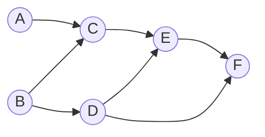
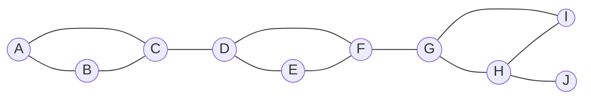
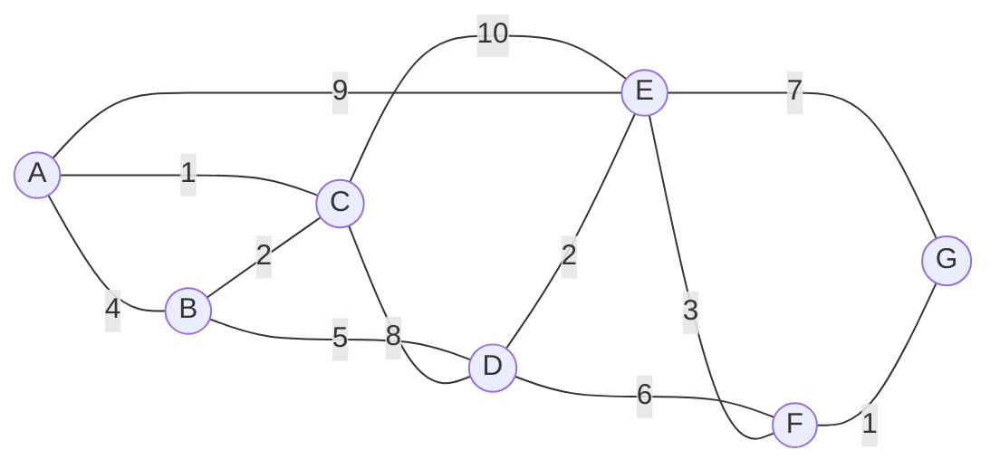
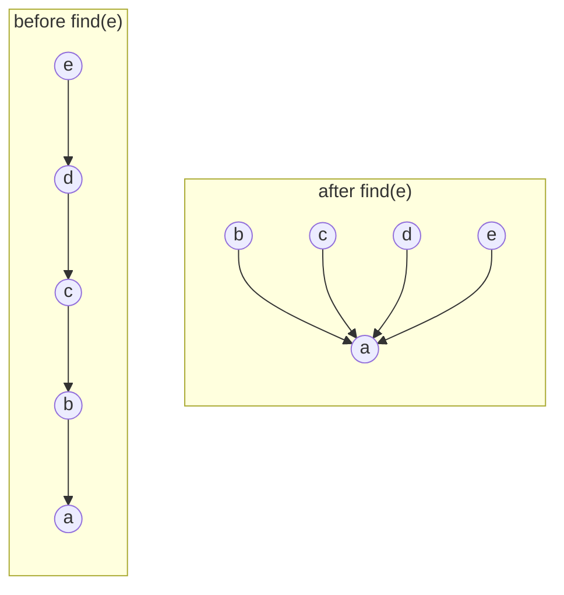
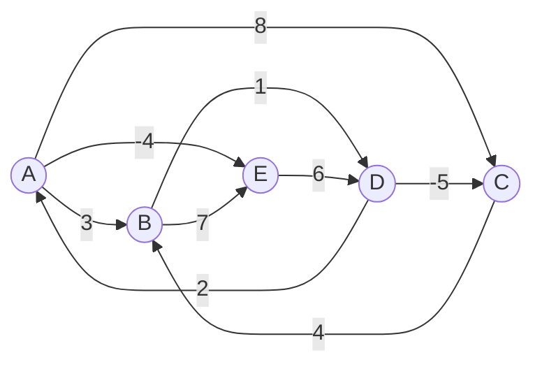

[4.3.10](/4.3.10) presented the representations of graphs and the two basic traversals. This chapter solves several classical problems on top of these traversals. The first two sections use information that DFS leaves behind: listing vertices in reverse order of finishing time gives a topological order of a directed acyclic graph, and the highest ancestor reachable through back edges lets a single DFS find all cut vertices and biconnected components of an undirected graph. The third section unifies BFS and DFS as priority-first search: the traversals differ only in which vertex is visited next, and this is determined by the priority of each vertex. With different priority-update rules, the same framework yields Dijkstra's algorithm for single-source shortest paths and Prim's algorithm for minimum spanning trees. The last two sections present two other approaches: Kruskal's algorithm greedily selects edges in increasing order of weight, and its efficiency rests on the disjoint-set data structure; the Floyd–Warshall algorithm uses **dynamic programming** to compute the shortest paths between all pairs of vertices at once. The mathematical background of these problems (the existence of shortest paths and minimum spanning trees, and the steps of the classical algorithms) was covered in [1.4.2](/1.4.2) and [1.4.3](/1.4.3); here we concentrate on implementation, complexity and correctness proofs.

## 11.1. Topological Sorting

### 11.1.1. Directed Acyclic Graphs

In many problems the dependency relation has no cycles: prerequisites among courses, dependencies among software packages, inheritance among classes, the order of steps in a project, references among spreadsheet cells. A cycle signals a circular definition or a deadlock, and must be detected and reported.

**Definition 11.1.1 (Directed Acyclic Graph)** A directed graph that contains no cycle is called a **directed acyclic graph** (DAG).

A **topological sorting** ([1.4.2](/1.4.2)) of a directed graph arranges all of its vertices into a linear sequence such that every edge $(u, v)$ points from an earlier vertex to a later one. We want an algorithm that detects and reports a cycle if one exists, and otherwise produces a topological order. In terms of order theory, reachability in a DAG is a **partial order** on the vertex set, and topological sorting constructs a compatible **total order**.

**Lemma 11.1.1** Every nonempty DAG has a vertex of in-degree zero (and also a vertex of out-degree zero).

**Proof** Suppose every vertex has nonzero in-degree. Starting from any vertex and walking backward along incoming edges, we can always take another step. In a finite graph, after $n$ steps some vertex must repeat, which yields a cycle, a contradiction. The case of out-degree is symmetric. $\square$

**Theorem 11.1.1** A directed graph $G$ has a topological order if and only if $G$ is a DAG.

**Proof** If $G$ has a cycle $v_0, v_1, \dots, v_k = v_0$, then in any linear sequence some edge of the cycle points from a later vertex to an earlier one, so no topological order exists. Conversely, we use induction on the number of vertices. By Lemma 11.1.1, the DAG $G$ has a vertex $v$ of in-degree zero. Deleting $v$ and its incident edges leaves a DAG, which has a topological order $S$ by the induction hypothesis; then $v$ followed by $S$ is a topological order of $G$. $\square$

In general, a topological order is not unique: whenever several vertices have in-degree zero, any of them may be chosen. The order is unique if and only if every two adjacent vertices in the sequence are joined by an edge, that is, if the DAG contains a path through all vertices.

### 11.1.2. The Zero In-Degree Algorithm

The proof of Theorem 11.1.1 directly yields an algorithm (Kahn, 1962):

1. Compute the in-degree of each vertex and put the vertices of in-degree zero into a container $S$ (a **stack** or a queue will do);
2. While $S$ is nonempty, remove a vertex $v$ from it and output $v$, then delete all outgoing edges of $v$: the in-degree of each neighbor $u$ of $v$ decreases by one, and each $u$ whose in-degree drops to zero is put into $S$;
3. When $S$ is empty, if all $n$ vertices have been output, the output sequence is a topological order; otherwise every vertex of the remaining subgraph has nonzero in-degree, so by the proof of Lemma 11.1.1 it contains a cycle, and the algorithm reports "not a DAG".

Computing in-degrees scans all edges once; each vertex enters and leaves $S$ once, and its **adjacency list** is scanned once when its outgoing edges are deleted, so the total time is $O(n + m)$. The algorithm need not actually delete edges; it only maintains the in-degree counters.

### 11.1.3. The Zero Out-Degree Algorithm

The other direction is to output vertices in reverse order: a vertex of out-degree zero can be placed last. DFS finishes vertices in exactly this order: when a vertex is marked `VISITED`, all of its successors have already been finished.

**Theorem 11.1.2** Run DFS over the whole graph of a DAG. Then $f(u) < f(v)$ for every edge $(v, u)$. Hence listing the vertices in decreasing order of finishing time $f$ gives a topological order.

**Proof** When the edge $(v, u)$ is examined, DFS($v$) is executing. The vertex $u$ cannot be `DISCOVERED`, for otherwise $(v, u)$ would be a **back edge** and the graph would contain a cycle by Theorem 10.5.5. If $u$ is `UNDISCOVERED`, then $u$ becomes a descendant of $v$, and $f(u) < f(v)$ by the **parenthesis theorem**; if $u$ is `VISITED`, then $f(u)$ is earlier than the current time while $f(v)$ is later. $\square$

Thus it suffices to push each vertex onto a stack whenever it is marked `VISITED` during DFS, and to pop the stack when the DFS ends; as soon as a back edge is found, the algorithm reports "not a DAG" and exits. The complexity is that of DFS, namely $O(n + m)$.

### 11.1.4. Implementation

The programs below implement both algorithms. The six courses A–F in the example have the prerequisite relations shown below; afterwards the edge $F \to B$ is added, creating the cycle $B \to D \to F \to B$.



```cpp tab
#include <algorithm>
#include <format>
#include <iostream>
#include <optional>
#include <string>
#include <vector>

using Graph = std::vector<std::vector<int>>;

// Zero in-degree algorithm (Kahn): repeatedly output a source and delete it.
std::optional<std::vector<int>> topo_kahn(const Graph& adj) {
    int n = static_cast<int>(adj.size());
    std::vector<int> indeg(n, 0), order, ready;
    for (const auto& out : adj) for (int u : out) ++indeg[u];
    for (int v = 0; v < n; ++v) if (indeg[v] == 0) ready.push_back(v);
    while (!ready.empty()) {                       // any bag works; a stack here
        int v = ready.back(); ready.pop_back();
        order.push_back(v);
        for (int u : adj[v]) if (--indeg[u] == 0) ready.push_back(u);   // delete v's edges
    }
    if (static_cast<int>(order.size()) < n) return std::nullopt;        // a cycle remains
    return order;
}

// Zero out-degree algorithm: DFS, output vertices in decreasing finishing time.
bool topo_dfs_visit(const Graph& adj, int v, std::vector<int>& status, std::vector<int>& finished) {
    status[v] = 1;                                 // 0 undiscovered, 1 discovered, 2 visited
    for (int u : adj[v]) {
        if (status[u] == 1) return false;          // backward edge: not a DAG
        if (status[u] == 0 && !topo_dfs_visit(adj, u, status, finished)) return false;
    }
    status[v] = 2;
    finished.push_back(v);                         // v has no unfinished successors left
    return true;
}
std::optional<std::vector<int>> topo_dfs(const Graph& adj) {
    std::vector<int> status(adj.size(), 0), finished;
    for (int s = 0; s < static_cast<int>(adj.size()); ++s)
        if (status[s] == 0 && !topo_dfs_visit(adj, s, status, finished)) return std::nullopt;
    std::reverse(finished.begin(), finished.end());
    return finished;
}

std::string show(const std::optional<std::vector<int>>& order) {
    if (!order) return "NOT_A_DAG";
    std::string s;
    for (int v : *order) s += char('A' + v);
    return s;
}

int main() {
    Graph g(6);                                    // A..F: prerequisites
    for (auto e : {"AC", "BC", "BD", "CE", "DE", "DF", "EF"}) g[e[0] - 'A'].push_back(e[1] - 'A');
    std::cout << std::format("kahn {} dfs {}\n", show(topo_kahn(g)), show(topo_dfs(g)));
    g[5].push_back(1);                             // add F -> B: cycle B -> D -> F -> B
    std::cout << std::format("kahn {} dfs {}\n", show(topo_kahn(g)), show(topo_dfs(g)));
}
```

```python tab
def topo_kahn(adj: list[list[int]]) -> list[int] | None:
    """Zero in-degree algorithm (Kahn): repeatedly output a source and delete it."""
    n = len(adj)
    indeg = [0] * n
    for out in adj:
        for u in out:
            indeg[u] += 1
    ready = [v for v in range(n) if indeg[v] == 0]
    order = []
    while ready:                                   # any bag works; a stack here
        v = ready.pop()
        order.append(v)
        for u in adj[v]:                           # delete v's edges
            indeg[u] -= 1
            if indeg[u] == 0:
                ready.append(u)
    return order if len(order) == n else None      # None: a cycle remains


def topo_dfs(adj: list[list[int]]) -> list[int] | None:
    """Zero out-degree algorithm: DFS, output in decreasing finishing time."""
    status = [0] * len(adj)                        # 0 undiscovered, 1 discovered, 2 visited
    finished: list[int] = []

    def visit(v: int) -> bool:
        status[v] = 1
        for u in adj[v]:
            if status[u] == 1:                     # backward edge: not a DAG
                return False
            if status[u] == 0 and not visit(u):
                return False
        status[v] = 2
        finished.append(v)                         # v has no unfinished successors left
        return True

    for s in range(len(adj)):
        if status[s] == 0 and not visit(s):
            return None
    return finished[::-1]


def show(order: list[int] | None) -> str:
    return "NOT_A_DAG" if order is None else "".join(chr(65 + v) for v in order)


g: list[list[int]] = [[] for _ in range(6)]       # A..F: prerequisites
for e in ["AC", "BC", "BD", "CE", "DE", "DF", "EF"]:
    g[ord(e[0]) - 65].append(ord(e[1]) - 65)
print("kahn", show(topo_kahn(g)), "dfs", show(topo_dfs(g)))
g[5].append(1)                                     # add F -> B: cycle B -> D -> F -> B
print("kahn", show(topo_kahn(g)), "dfs", show(topo_dfs(g)))
```

The output is:

```text
kahn BDACEF dfs BDACEF
kahn NOT_A_DAG dfs NOT_A_DAG
```

Here the two algorithms happen to give the same sequence, which is not true in general: whether the zero in-degree algorithm keeps the in-degree-zero vertices in a stack or a queue, and where DFS starts, both affect the result, but each result is a valid topological order.

## 11.2. Biconnected Components

### 11.2.1. Cut Vertices and Biconnected Components

In communication, power and transportation networks, one cares whether the failure of a single node disconnects the network.

In an undirected graph, a vertex whose deletion increases the number of connected components is a **cut vertex** (also called an articulation point), and an edge whose deletion increases the number of connected components is a **cut edge**, also called a bridge ([1.4.3](/1.4.3), [1.4.6](/1.4.6)). A connected graph without cut vertices is called biconnected, which is the **nonseparable graph** of [1.4.6](/1.4.6).

**Definition 11.2.1 (Biconnected Component)** A maximal biconnected subgraph of an undirected graph $G$ is called a **biconnected component** (BCC) of $G$; this is the block of [1.4.6](/1.4.6). A single edge (with its two endpoints) also counts as a biconnected component.

Biconnected components partition the edges rather than the vertices: every edge belongs to exactly one biconnected component, while a cut vertex belongs to every biconnected component that it connects.

The brute-force method checks, for each vertex $v$, whether the graph remains connected after $v$ is deleted, which takes $O(n(n + m))$ time; moreover, even after the cut vertices are found, the biconnected components still have to be determined separately. Hopcroft and Tarjan (1973) gave a linear-time algorithm that needs only one DFS.

### 11.2.2. The Criterion

Construct a DFS tree from any vertex. By Theorem 10.5.4, DFS on an undirected graph produces only tree edges and **back edges**, and no **cross edges**; this allows cut vertices to be recognized from the shape of the DFS tree and its back edges.

**Theorem 11.2.1** Let $T$ be a DFS tree of a connected undirected graph $G$ with root $r$.

1. $r$ is a cut vertex if and only if $r$ has at least two children in $T$;
2. a non-root vertex $v$ is a cut vertex if and only if $v$ has a child $u$ such that no vertex in the subtree $\operatorname{subtree}(u)$ is joined by a back edge to a proper ancestor of $v$.

In particular, a leaf is never a cut vertex: after deleting it, the remaining vertices are still connected by the rest of $T$.

**Proof** (1) Since there are no cross edges, different subtrees of $r$ are connected to each other only through $r$. If $r$ has two or more children, deleting $r$ disconnects the subtrees from each other; if it has only one child, the remaining vertices are still connected through that subtree.

(2) Only two kinds of edges leave $\operatorname{subtree}(u)$: the **tree edge** from $u$ to its parent $v$, and back edges from vertices of the subtree to their ancestors (there are no cross edges); the ancestors lying outside the subtree are $v$ or proper ancestors of $v$. If no back edge from $\operatorname{subtree}(u)$ points to a proper ancestor of $v$, then after $v$ is deleted, $\operatorname{subtree}(u)$ is no longer connected to the parent of $v$, so $v$ is a cut vertex. Conversely, if the subtree of every child of $v$ has a back edge to a proper ancestor of $v$, then after $v$ is deleted every subtree is still connected to the part containing the parent of $v$, and the part of $T$ outside $\operatorname{subtree}(v)$ is itself connected, so the graph remains connected. $\square$

To check condition (2) efficiently during DFS, we introduce the following quantity.

**Definition 11.2.2 (Highest Connected Ancestor)** For a vertex $v$ of the DFS tree, let $\operatorname{hca}(v)$ be the minimum of $d(v)$ and the discovery times of all vertices reachable from vertices of $\operatorname{subtree}(v)$ through one back edge. By the parenthesis theorem, ancestors are discovered earlier than descendants, so a smaller $\operatorname{hca}(v)$ means that $\operatorname{subtree}(v)$ can reach a more senior ancestor through back edges; we call it the **highest connected ancestor** of $v$.

In Tarjan's original paper this quantity is called the low value. It satisfies the recurrence

$$
\operatorname{hca}(v) = \min\Bigl( d(v),\ \min_{(v, w)\text{ is a back edge}} d(w),\ \min_{u\text{ is a child of } v} \operatorname{hca}(u) \Bigr),
$$
so it can be computed bottom-up during DFS: set $\operatorname{hca}(v) = d(v)$ when $v$ is discovered; update it with $d(w)$ when a back edge $(v, w)$ is found; and update it with $\operatorname{hca}(u)$ when DFS($u$) returns to $v$. Condition (2) of Theorem 11.2.1 then becomes: $v$ has a child $u$ with

$$
\operatorname{hca}(u) \ge d(v).
$$
Similarly, a tree edge $(v, u)$ is a bridge if and only if $\operatorname{hca}(u) > d(v)$: $\operatorname{subtree}(u)$ cannot even reach $v$ itself through back edges.

### 11.2.3. The Algorithm

Alongside DFS, the algorithm maintains a **stack** onto which vertices are pushed when discovered. When DFS($u$) returns to $v$ and $\operatorname{hca}(u) \ge d(v)$, the vertex $v$ separates $\operatorname{subtree}(u)$ from the rest of the graph, and the vertices of $\operatorname{subtree}(u)$ not yet assigned to other components are gathered at the top of the stack (from $u$ upward). These vertices together with $v$ form one biconnected component: we pop $u$ and everything above it from the stack, while $v$ stays on the stack because it may belong to other components.

Two points deserve attention:

- When examining a neighbor $u$ of $v$, if $u$ has already been discovered and is not the parent of $v$, then $(v, u)$ is either a back edge or the reverse of a back edge already examined from the side of $u$. We update $\operatorname{hca}(v)$ with $d(u)$; in the latter case $d(u) > d(v)$, so the update has no effect and there is no need to distinguish the two cases. The parent must be excluded, otherwise the tree edge would be mistaken for a back edge.
- In a graph with parallel edges, "is not the parent" should be replaced by "is not the edge we came by" (decided by edge index), because two parallel edges form a biconnected component by themselves.



```cpp tab
#include <algorithm>
#include <format>
#include <iostream>
#include <string>
#include <vector>

// Biconnected components of an undirected simple graph (Hopcroft–Tarjan).
// hca[v]: smallest discovery time reachable from subtree(v) by one backward edge.
struct Bcc {
    const std::vector<std::vector<int>>& adj;
    std::vector<int> d, hca, parent, stack;
    std::vector<bool> articulation;
    std::vector<std::vector<int>> components;
    std::vector<std::pair<int, int>> bridges;
    int clock = 0;

    explicit Bcc(const std::vector<std::vector<int>>& g)
        : adj(g), d(g.size(), 0), hca(g.size(), 0), parent(g.size(), -1), articulation(g.size(), false) {
        for (int s = 0; s < static_cast<int>(g.size()); ++s)
            if (!d[s]) {
                articulation[s] = visit(s) >= 2;   // the root: at least two subtrees
                stack.clear();                     // only the root itself is left
            }
    }
    int visit(int v) {                             // returns the number of tree children
        int children = 0;
        d[v] = hca[v] = ++clock;
        stack.push_back(v);
        for (int u : adj[v]) {
            if (!d[u]) {                           // tree edge
                parent[u] = v;
                ++children;
                visit(u);
                if (hca[u] < d[v]) {               // subtree(u) climbs above v: v is no cut here
                    hca[v] = std::min(hca[v], hca[u]);
                } else {                           // v separates subtree(u): pop one BCC
                    if (parent[v] != -1) articulation[v] = true;
                    if (hca[u] > d[v]) bridges.emplace_back(v, u);
                    std::vector<int> comp{v};
                    int w;
                    do { w = stack.back(); stack.pop_back(); comp.push_back(w); } while (w != u);
                    components.push_back(comp);
                }
            } else if (u != parent[v]) {           // backward edge (or its reverse, harmless)
                hca[v] = std::min(hca[v], d[u]);
            }
        }
        return children;
    }
};

int main() {
    const std::string name = "ABCDEFGHIJ";
    std::vector<std::vector<int>> adj(name.size());
    for (auto e : {"AB", "BC", "CA", "CD", "DE", "EF", "FD", "FG", "GH", "HI", "IG", "HJ"}) {
        adj[e[0] - 'A'].push_back(e[1] - 'A');
        adj[e[1] - 'A'].push_back(e[0] - 'A');
    }
    Bcc r(adj);
    for (auto& c : r.components) {
        std::string s;
        for (int v : c) s += name[v];
        std::cout << s << ' ';
    }
    std::cout << "\narticulation points:";
    for (std::size_t v = 0; v < name.size(); ++v) if (r.articulation[v]) std::cout << ' ' << name[v];
    std::cout << "\nbridges:";
    for (auto [v, u] : r.bridges) std::cout << std::format(" {}{}", name[v], name[u]);
    std::cout << '\n';
}
```

```python tab
def biconnected(adj: list[list[int]]) -> tuple[list[list[int]], list[int], list[tuple[int, int]]]:
    """Biconnected components, articulation points and bridges (Hopcroft–Tarjan).

    hca[v]: smallest discovery time reachable from subtree(v) by one backward edge.
    """
    n = len(adj)
    d, hca, parent = [0] * n, [0] * n, [-1] * n
    stack: list[int] = []
    components: list[list[int]] = []
    articulation: set[int] = set()
    bridges: list[tuple[int, int]] = []
    clock = 0

    def visit(v: int) -> int:                      # returns the number of tree children
        nonlocal clock
        clock += 1
        d[v] = hca[v] = clock
        stack.append(v)
        children = 0
        for u in adj[v]:
            if not d[u]:                           # tree edge
                parent[u] = v
                children += 1
                visit(u)
                if hca[u] < d[v]:                  # subtree(u) climbs above v
                    hca[v] = min(hca[v], hca[u])
                else:                              # v separates subtree(u): pop one BCC
                    if parent[v] != -1:
                        articulation.add(v)
                    if hca[u] > d[v]:
                        bridges.append((v, u))
                    comp = [v]
                    while True:
                        w = stack.pop()
                        comp.append(w)
                        if w == u:
                            break
                    components.append(comp)
            elif u != parent[v]:                   # backward edge (or its reverse, harmless)
                hca[v] = min(hca[v], d[u])
        return children

    for s in range(n):
        if not d[s]:
            if visit(s) >= 2:                      # the root: at least two subtrees
                articulation.add(s)
            stack.clear()                          # only the root itself is left
    return components, sorted(articulation), bridges


names = "ABCDEFGHIJ"
adj: list[list[int]] = [[] for _ in names]
for e in ["AB", "BC", "CA", "CD", "DE", "EF", "FD", "FG", "GH", "HI", "IG", "HJ"]:
    v, u = names.index(e[0]), names.index(e[1])
    adj[v].append(u)
    adj[u].append(v)
comps, cut, bridges = biconnected(adj)
print(*("".join(names[v] for v in c) for c in comps))
print("articulation points:", *(names[v] for v in cut))
print("bridges:", *(names[v] + names[u] for v, u in bridges))
```

The output is:

```text
HJ GIH FG DFE CD ACB
articulation points: C D F G H
bridges: HJ FG CD
```

The six biconnected components are popped in the order of DFS backtracking: three triangles, and the single-edge components formed by each of the three bridges.

The running time is that of DFS, $O(n + m)$: each vertex is pushed and popped exactly once (the root is emptied at the end). Besides the graph itself, the stack holds at most $n$ vertices, and the recursion needs another $O(n)$ of call-stack space.

**Remark 11.2.1** The corresponding notion for directed graphs is the *strongly connected component*: a maximal subgraph in which any two vertices are mutually reachable. Contracting each strongly connected component to a single vertex yields a DAG. Strongly connected components can also be found in linear time: Kosaraju's algorithm first runs DFS on $G$, then runs DFS on the reverse graph in decreasing order of $f$, and each DFS tree of the second pass is one strongly connected component; Tarjan's algorithm uses just one DFS, with the same low values as $\operatorname{hca}$ and a stack of vertices.

## 11.3. Priority-First Search

### 11.3.1. A Unified Framework

Compare BFS and DFS: both start from a source and gradually add vertices and edges to a traversal tree, and they differ only in which discovered vertex is expanded at each step. BFS prefers the vertex discovered earlier (a **queue**), and DFS prefers the vertex discovered later (a **stack**). We abstract this selection policy.

**Definition 11.3.1 (Priority-First Search)** Maintain a priority number $\operatorname{priority}(v)$ for each vertex $v$; a smaller number means a higher priority (the initial value is $\infty$, the lowest priority). Starting from a source $s$ (with $\operatorname{priority}(s) = 0$), repeat the following two steps; this traversal framework is called **priority-first search** (PFS):

1. Among the vertices not yet in the traversal tree, select the vertex $v$ with the smallest priority number and add it to the tree together with the edge $(\operatorname{parent}(v), v)$;
2. For each neighbor $u$ of $v$ not yet in the tree, update $\operatorname{priority}(u)$ according to some rule; if the update succeeds, set $\operatorname{parent}(u) = v$.

Different algorithms differ only in the "priority updater" of step 2. For example, letting $\operatorname{priority}(u)$ be the sequence number at which $u$ is first discovered (updated only on first discovery) gives BFS; giving newly discovered or re-encountered vertices a decreasing counter as priority number (the later encountered, the higher the priority) gives the order of DFS. The next two sections show the updaters of Dijkstra's algorithm and Prim's algorithm:

| Algorithm | Candidate priority when $u$ is updated via $v$ |
|---|---|
| Dijkstra (shortest paths) | $\operatorname{priority}(v) + w(v, u)$: the length of the path reaching $u$ via $v$ |
| Prim (minimum spanning tree) | $w(v, u)$: the cost of attaching $u$ to the tree through the edge $(v, u)$ |

Both update only when the candidate value is smaller. In C++ and Python, the updater is naturally written as a **function object** or a **lambda expression** passed as an argument to a generic PFS function.

### 11.3.2. Complexity

The running time is spent on two kinds of operations: updating the neighbors of each vertex after it joins the tree ($O(n + m)$ updates in total, or $O(n^2)$ with an adjacency matrix), and selecting the vertex of highest priority at each step ($n$ times in total).

- Store the priority numbers in an array and select by a linear scan: selection costs $O(n^2)$ in total, and so does the whole algorithm. This is already optimal for a **dense graph** ($m = \Theta(n^2)$), since the input itself has that size.
- Use a binary heap as the priority queue ([4.3.12](/4.3.12)): a selection is a delete-min and an update is a decrease-key, each $O(\log n)$, for a total of $O((n + m) \log n)$. This is a great improvement for a **sparse graph** and a step backward for a dense graph.
- In practice a "lazy" style is common: instead of modifying elements in the heap, every update pushes a new (priority, vertex) pair, and the old one becomes stale; on popping, a vertex that is already in the tree or whose priority is stale is skipped. The heap holds at most $m + 1$ entries, the total time is $O(m \log m) = O(m \log n)$, and only the standard library's `std::priority_queue` or `heapq` is needed (neither supports decrease-key).
- With a Fibonacci heap (Fredman and Tarjan, 1987), decrease-key takes $O(1)$ amortized time, and the total time is $O(m + n \log n)$.

### 11.3.3. Implementation

The following is a generic PFS using a lazy heap. The function parameter `candidate(pv, w)` gives the priority number that $u$ can obtain via a vertex $v$ of the tree (`pv` is $\operatorname{priority}(v)$ and `w` is the edge weight). The same function combined with two different lambdas is Dijkstra's algorithm and Prim's algorithm. The example graph is as follows (undirected, with the numbers on the edges being weights):



```cpp tab
#include <format>
#include <functional>
#include <iostream>
#include <limits>
#include <queue>
#include <string>
#include <utility>
#include <vector>

struct Arc { int to; long long w; };
using WGraph = std::vector<std::vector<Arc>>;
constexpr long long INF = std::numeric_limits<long long>::max();

struct PfsTree { std::vector<long long> priority; std::vector<int> parent; };

// Priority-first search: repeatedly move the undiscovered vertex of smallest
// priority number into the tree; `candidate(priority(v), w(v, u))` is the
// priority that u would get through the tree vertex v.
template <typename Candidate>
PfsTree pfs(const WGraph& g, int s, Candidate candidate) {
    int n = static_cast<int>(g.size());
    PfsTree t{std::vector<long long>(n, INF), std::vector<int>(n, -1)};
    std::vector<bool> in_tree(n, false);
    using Item = std::pair<long long, int>;                    // (priority, vertex)
    std::priority_queue<Item, std::vector<Item>, std::greater<>> heap;   // min-heap
    t.priority[s] = 0;
    heap.push({0, s});
    while (!heap.empty()) {
        auto [p, v] = heap.top(); heap.pop();
        if (in_tree[v] || p != t.priority[v]) continue;        // stale copy: skip it
        in_tree[v] = true;                                     // v joins the PFS tree
        for (auto [u, w] : g[v]) {                             // update v's neighbours
            if (in_tree[u]) continue;
            if (long long c = candidate(t.priority[v], w); c < t.priority[u]) {
                t.priority[u] = c; t.parent[u] = v;
                heap.push({c, u});                             // the old copy becomes stale
            }
        }
    }
    return t;
}

int main() {
    const std::string name = "ABCDEFG";
    WGraph g(name.size());
    const std::pair<const char*, long long> edges[] = {
        {"AB", 4}, {"AC", 1}, {"BC", 2}, {"BD", 5}, {"CD", 8}, {"CE", 10},
        {"DE", 2}, {"DF", 6}, {"EF", 3}, {"FG", 1}, {"AE", 9}, {"EG", 7}};
    for (auto [e, w] : edges) {
        g[e[0] - 'A'].push_back({e[1] - 'A', w});
        g[e[1] - 'A'].push_back({e[0] - 'A', w});
    }
    auto dijkstra = pfs(g, 0, [](long long pv, long long w) { return pv + w; });  // path length
    auto prim = pfs(g, 0, [](long long, long long w) { return w; });               // edge length
    long long mst = 0;
    for (std::size_t v = 0; v < name.size(); ++v) {
        std::cout << std::format("{}: dist {:2} via {}   mst edge {}{}\n", name[v], dijkstra.priority[v],
                                 v ? name[dijkstra.parent[v]] : '-', v ? name[prim.parent[v]] : '-', name[v]);
        if (v) mst += prim.priority[v];
    }
    std::cout << std::format("MST weight {}\n", mst);
}
```

```python tab
import heapq
from collections.abc import Callable

INF = float("inf")
WGraph = list[list[tuple[int, int]]]              # v -> [(u, weight)]


def pfs(g: WGraph, s: int, candidate: Callable[[float, int], float]) -> tuple[list[float], list[int]]:
    """Priority-first search; candidate(priority(v), w(v, u)) is u's priority via v."""
    n = len(g)
    priority, parent = [INF] * n, [-1] * n
    in_tree = [False] * n
    priority[s] = 0
    heap = [(0, s)]                                # (priority, vertex), a min-heap
    while heap:
        p, v = heapq.heappop(heap)
        if in_tree[v] or p != priority[v]:         # stale copy: skip it
            continue
        in_tree[v] = True                          # v joins the PFS tree
        for u, w in g[v]:                          # update v's neighbours
            if not in_tree[u] and (c := candidate(priority[v], w)) < priority[u]:
                priority[u], parent[u] = c, v
                heapq.heappush(heap, (c, u))       # the old copy becomes stale
    return priority, parent


names = "ABCDEFG"
g: WGraph = [[] for _ in names]
for e, w in [("AB", 4), ("AC", 1), ("BC", 2), ("BD", 5), ("CD", 8), ("CE", 10),
             ("DE", 2), ("DF", 6), ("EF", 3), ("FG", 1), ("AE", 9), ("EG", 7)]:
    v, u = names.index(e[0]), names.index(e[1])
    g[v].append((u, w))
    g[u].append((v, w))
dist, spt = pfs(g, 0, lambda pv, w: pv + w)        # Dijkstra: path length
key, mst = pfs(g, 0, lambda pv, w: w)              # Prim: edge length
for v, c in enumerate(names):
    via = names[spt[v]] if v else "-"
    edge = names[mst[v]] + c if v else "-" + c
    print(f"{c}: dist {dist[v]:2} via {via}   mst edge {edge}")
print("MST weight", sum(key[1:]))
```

The output is:

```text
A: dist  0 via -   mst edge -A
B: dist  3 via C   mst edge CB
C: dist  1 via A   mst edge AC
D: dist  8 via B   mst edge BD
E: dist  9 via A   mst edge DE
F: dist 12 via E   mst edge EF
G: dist 13 via F   mst edge FG
MST weight 14
```

## 11.4. Shortest Paths: Dijkstra's Algorithm

### 11.4.1. The Problem

In a weighted network, the length of a path is the sum of the weights of its edges, and $\operatorname{dist}(s, v)$ is the length of a shortest path from $s$ to $v$. Shortest-path problems come in two kinds: single-source shortest paths (given $s$, find shortest paths from $s$ to all other vertices) and all-pairs shortest paths (§11.7). In this section we assume all edge weights are nonnegative. If negative edges are allowed, there may be cycles of negative total weight, around which a path can be made arbitrarily short, so that shortest paths are undefined; even without negative cycles, Dijkstra's algorithm may fail (Example 11.4.1), and the **Bellman–Ford algorithm** ([1.4.2](/1.4.2)) must be used instead.

**Theorem 11.4.1** In a network with nonnegative weights, every prefix of a shortest path is also a shortest path: if $s, \dots, u, \dots, v$ is a shortest path from $s$ to $v$, then its segment from $s$ to $u$ is a shortest path from $s$ to $u$.

**Proof** If there were a shorter path from $s$ to $u$, replacing the segment from $s$ to $u$ of the original path by it would give a shorter path from $s$ to $v$ (if repeated vertices arise, deleting the cycles between them does not increase the length), a contradiction. $\square$

This is precisely **optimal substructure**. Consequently, choosing for each vertex $v \ne s$ its predecessor $\operatorname{parent}(v)$ on a shortest path, these edges form a tree rooted at $s$.

**Definition 11.4.1 (Shortest-Path Tree)** A spanning tree rooted at $s$ in which the tree path from $s$ to every reachable vertex $v$ is a shortest path of length $\operatorname{dist}(s, v)$ is called a **shortest-path tree** (SPT) of $s$.

If the shortest paths between all pairs of vertices are unique (this can always be ensured by slightly perturbing the weights without affecting the result of the computation), then the union of all shortest paths is itself connected and acyclic, and this tree is unique.

### 11.4.2. The Algorithm and Its Correctness

**Dijkstra's algorithm** ([1.4.2](/1.4.2)) determines the vertices one by one in order of increasing distance. Suppose the set $V_k$ of the $k$ vertices nearest to $s$ has been determined ($V_1 = \{s\}$). By Theorem 11.4.1, on a shortest path to the $(k+1)$-st nearest vertex $u$, all vertices other than $u$ are nearer than $u$ and hence lie in $V_k$; so $u$ must be reached through an edge $(v, u)$ leaving $V_k$, and

$$
\operatorname{dist}(s, u) = \min_{v \in V_k,\ (v, u) \in E} \bigl( \operatorname{dist}(s, v) + w(v, u) \bigr).
$$
This is exactly the PFS framework: $\operatorname{priority}(u)$ records the length of the shortest path known so far from $s$ to $u$ through vertices of the tree; each time the vertex with the smallest priority number is added to the tree, and then used to update its neighbors:

$$
\operatorname{priority}(u) \leftarrow \min\bigl( \operatorname{priority}(u),\ \operatorname{priority}(v) + w(v, u) \bigr).
$$
This step is called *relaxation* of the edge $(v, u)$: it tightens the upper bound on the distance to $u$ using the new possibility of passing through $v$.

**Theorem 11.4.2** Suppose the edge weights are nonnegative. When Dijkstra's algorithm adds a vertex $v$ to the tree, $\operatorname{priority}(v) = \operatorname{dist}(s, v)$.

**Proof** Throughout the process $\operatorname{priority}(v)$ is the length of some actual path, so $\operatorname{priority}(v) \ge \operatorname{dist}(s, v)$ always holds. Suppose the claim fails, and let $v$ be the first vertex ($v \ne s$) with $\operatorname{priority}(v) > \operatorname{dist}(s, v)$ when it is added to the tree. Take a shortest path from $s$ to $v$, let $y$ be the first vertex on it that is not yet in the tree, and let $x$ be its predecessor (already in the tree). By the choice of $v$, $\operatorname{priority}(x) = \operatorname{dist}(s, x)$ when $x$ was added to the tree, and $(x, y)$ was relaxed right after; hence

$$
\operatorname{priority}(y) \le \operatorname{dist}(s, x) + w(x, y) = \operatorname{dist}(s, y) \le \operatorname{dist}(s, v) < \operatorname{priority}(v),
$$
where the second inequality uses the nonnegativity of the weights ($y$ lies on a shortest path from $s$ to $v$). But the algorithm has chosen $v$ rather than $y$ at this moment, so $\operatorname{priority}(v) \le \operatorname{priority}(y)$, a contradiction. $\square$

**Example 11.4.1** A negative edge breaks the second inequality in the proof above. Let the directed edge $A \to B$ have weight $2$, $A \to C$ weight $3$, and $C \to B$ weight $-2$. Starting from $A$, Dijkstra's algorithm first adds $B$ to the tree with distance $2$ and never modifies it afterwards, whereas in fact $\operatorname{dist}(A, B) = 3 - 2 = 1$.

The output of §11.3.3 gives the distances from $A$ to all vertices of the example graph and the shortest-path tree: for example $\operatorname{dist}(A, F) = 12$, with shortest path $A \to E \to F$ (through the edge $A$–$E$ of weight 9, rather than $A \to C \to B \to D \to E \to F$ of length 13).

**Remark 11.4.1** The $O(m + n \log n)$ bound with Fibonacci heaps was long regarded as the limit of comparison-based Dijkstra, because the algorithm outputs all vertices in order of distance, which amounts to sorting. Two important advances have been made recently. Haeupler et al. (2024) proved that, with a suitable heap, Dijkstra's algorithm is optimal on every graph (universal optimality); Duan et al. (2025) gave a single-source shortest-path algorithm for directed graphs with running time $O(m \log^{2/3} n)$, which for the first time breaks this "sorting barrier" on **sparse graphs**; its method no longer determines vertices one by one in order of distance.

## 11.5. Minimum Spanning Trees: Prim's Algorithm

### 11.5.1. Minimum Spanning Trees

In a connected weighted undirected graph $G = (V, E)$, a spanning tree of minimum total weight is called a **minimum spanning tree** (MST). Connecting all stations at the lowest cost of lines when laying out a communication network, a power grid or chip wiring is exactly this problem; it is also a basic model for many optimization problems, for instance it yields an approximate solution to the Euclidean traveling salesman problem within twice the optimum.

Brute-force enumeration is infeasible: by Cayley's formula, the complete graph on $n$ vertices has $n^{n-2}$ spanning trees. The classical efficient algorithms are those of Borůvka (1926), Jarník (1930) and Prim (1957), and Kruskal (1956); the randomized Karger–Klein–Tarjan algorithm (1995) runs in expected linear time, and Chazelle's (2000) deterministic algorithm runs in $O(m\,\alpha(m, n))$.

A few remarks:

- Edge weights may be zero or negative: all spanning trees have exactly $n - 1$ edges, so adding the same constant to every edge increases the total weight of every spanning tree by $n-1$ times that constant, and the minimum is unchanged.
- A minimum spanning tree is not necessarily unique. It is unique if all edge weights are distinct. When weights coincide, we can extend the weight of an edge $(u, v)$ to $(w(u, v), \min(u, v), \max(u, v))$ and compare in **lexicographic order**, which removes the ambiguity.
- A minimum spanning tree generally differs from a shortest-path tree. In the example of §11.3.3, the shortest-path tree uses the edge $A$–$E$ (weight 9) because it gives the shortest path from $A$ to $E$, whereas the minimum spanning tree connects $E$ by the edge $D$–$E$ of weight 2, for a total weight of 14.

### 11.5.2. The Cut Property and the Cycle Property

Partitioning the vertex set into two nonempty parts $(U, V \setminus U)$ is called a cut; an edge whose endpoints lie in different parts is called a crossing edge of the cut.

**Theorem 11.5.1 (Cut Property)** Let $(U, V \setminus U)$ be a cut of $G$ and let $e = (u, v)$ be one of the crossing edges of minimum weight. Then there exists a minimum spanning tree containing $e$. If $e$ is the unique crossing edge of minimum weight, then every minimum spanning tree contains $e$.

**Proof** Take any minimum spanning tree $T$ and suppose $e \notin T$. Adding $e$ to $T$ creates a unique cycle; it passes through $e$ from one side of the cut to the other, so to return it must pass through another crossing edge $f \in T$ of the cut. By the minimality of $e$, $w(e) \le w(f)$. After deleting $f$, $T - f + e$ is still a spanning tree whose total weight does not exceed that of $T$, so it is also a minimum spanning tree, and it contains $e$. If $e$ is the unique minimum crossing edge, then $w(e) < w(f)$ and $T - f + e$ is lighter than $T$, contradicting the minimality of $T$; hence $e \in T$. $\square$

**Theorem 11.5.2 (Cycle Property)** If $f$ is the unique edge of maximum weight on some cycle $C$, then $f$ belongs to no minimum spanning tree.

**Proof** Suppose a minimum spanning tree $T$ contains $f$. Deleting $f$ splits $T$ into two trees, whose vertex sets form a cut with $f$ as a crossing edge. The cycle $C$ crosses this cut an even number of times, so $C$ has another crossing edge $e$ with $w(e) < w(f)$. Then $T - f + e$ is a lighter spanning tree, a contradiction. $\square$

The cut property is the basis of Prim's algorithm; the cycle property and the cut property together explain the correctness of Kruskal's algorithm (§11.6).

### 11.5.3. The Algorithm and Its Correctness

**Prim's algorithm** starts from any vertex $s$ with $T_1 = (\{s\}, \varnothing)$; at step $k$, it regards the vertex set $V_k$ of $T_k$ as one side of a cut, selects the minimum crossing edge $(v, u)$ of this cut ($v \in V_k$, $u \notin V_k$), and sets $T_{k+1} = T_k + (v, u)$. After $n - 1$ steps, $T_n$ is a minimum spanning tree.

A plausible but flawed argument goes: "By the cut property, every edge chosen by Prim's algorithm belongs to some minimum spanning tree, so $T_n$ is a minimum spanning tree." But "every edge belongs to some minimum spanning tree" does not imply "they all belong to the same one". For example, in a triangle $A, B, C$ with $w(A, B) = 1$ and $w(B, C) = w(A, C) = 2$, each of the edges $B$–$C$ and $A$–$C$ belongs to some minimum spanning tree, yet the spanning tree formed by them has total weight 4 and is not minimum (the minimum is 3). A correct proof needs a stronger induction hypothesis.

**Theorem 11.5.3** Every $T_k$ in the course of Prim's algorithm is a subtree of some minimum spanning tree. Hence $T_n$ is a minimum spanning tree.

**Proof** Induction on $k$. $T_1$ has a single vertex, so the claim is clear. Suppose $T_k$ is contained in a minimum spanning tree $T^*$, and the algorithm selects the minimum crossing edge $e$ of the cut $(V_k, V \setminus V_k)$. If $e \in T^*$, then $T_{k+1} \subseteq T^*$. Otherwise, as in the proof of Theorem 11.5.1, the cycle in $T^* + e$ contains another crossing edge $f \in T^*$ of this cut, with $w(e) \le w(f)$, and $T' = T^* - f + e$ is also a minimum spanning tree. Since $f$ is a crossing edge while the edges of $T_k$ lie inside $V_k$, $f \notin T_k$, so $T_{k+1} = T_k + e \subseteq T'$. $\square$

As a PFS, $\operatorname{priority}(u)$ records the weight of the shortest edge between $u$ and the current tree, so selecting the vertex $u$ of smallest priority number is selecting the minimum crossing edge; after $u$ joins the tree, only the priority numbers of its neighbors can decrease:

$$
\operatorname{priority}(u') \leftarrow \min\bigl( \operatorname{priority}(u'),\ w(u, u') \bigr).
$$
The only difference from Dijkstra's algorithm is that the candidate value no longer accumulates $\operatorname{priority}(v)$. The implementation is in §11.3.3, and the complexity is also the same as for Dijkstra's algorithm: $O(n^2)$ with an array, $O((n + m) \log n)$ with a binary heap, and $O(m + n \log n)$ with a Fibonacci heap.

## 11.6. Kruskal's Algorithm and Disjoint Sets

### 11.6.1. Kruskal's Algorithm

Looking back at Prim's algorithm, the shortest edge will be used sooner or later, and so will the second shortest, but the third shortest may not be: it may form a cycle with the first two. **Kruskal's algorithm** turns this observation into a greedy strategy: examine the edges in increasing order of weight, and adopt an edge whenever adding it creates no cycle.

1. Maintain a forest $F$, initially consisting of $n$ single-vertex trees and no edges;
2. Sort all edges in nondecreasing order of weight;
3. Examine each edge $(u, v)$ in turn: if $u$ and $v$ belong to different trees of $F$, add the edge to $F$ and merge the two trees; otherwise discard it (it would form a cycle with the chosen edges, and it is the longest edge on that cycle);
4. Stop when $n - 1$ edges have been selected.

If each step is locally optimal, is the result globally optimal? For Kruskal's algorithm it is indeed.

**Theorem 11.6.1** Throughout Kruskal's algorithm, the forest $F$ is contained in some minimum spanning tree. Hence $F$ is a minimum spanning tree when the algorithm ends.

**Proof** Induction on the number of edges added. Suppose $F \subseteq T^*$ and the algorithm next adopts the edge $e = (u, v)$, and let $C$ be the vertex set of the tree containing $u$. Consider the cut $(C, V \setminus C)$. An edge examined before $e$ is either already in $F$ (inside some tree, not crossing the cut) or was discarded because both endpoints were already in the same tree (and the endpoints remain in the same tree afterwards, so it does not cross the cut either). All edges examined after $e$ have weight at least $w(e)$, so $e$ is one of the minimum-weight crossing edges of this cut. As in the proof of Theorem 11.5.3, we can replace the other crossing edge $f$ of this cut in $T^*$ by $e$, obtaining a minimum spanning tree containing $F + e$; $f$ crosses the cut and is not in $F$. $\square$

Sorting takes $O(m \log m) = O(m \log n)$ time. What remains is how to quickly decide whether $u$ and $v$ lie in the same tree, and how to merge two trees. This calls for a dedicated data structure.

### 11.6.2. Disjoint Sets

**Definition 11.6.1 (Disjoint-Set Data Structure)** A data structure that maintains a partition of the set $\{0, 1, \dots, n-1\}$ (into pairwise disjoint subsets, each represented by one of its members) and supports the following operations is called a **disjoint-set data structure** (union–find):

- `find(x)`: return the representative of the subset containing $x$;
- `union(x, y)`: merge the subsets containing $x$ and $y$.

Initially every element forms a subset by itself. The elements $x$ and $y$ are in the same subset if and only if `find(x) == find(y)`. In Kruskal's algorithm, the subsets are the vertex sets of the trees of the forest $F$.

The most direct implementation is quick-find: an array `group[x]` records the label of the subset to which $x$ belongs; `find` takes only $O(1)$, but `union` must relabel all members of one subset, taking $O(n)$. Another is quick-union: each subset is organized as a tree, each element records only its parent, and the root is the representative; `union` merely hangs one root under another, while `find` must follow parent pointers to the root, taking time proportional to the height of the tree, which in the worst case degenerates into a chain of length $n$. There are two key improvements.

The first is *union by size*: when merging, always hang the smaller tree under the larger one. *Union by rank* replaces the size by a rank (an upper bound on the height) and hangs the root of smaller rank under the root of larger rank; the two have the same effect.

**Theorem 11.6.2** With union by size, every tree in a disjoint-set structure on $n$ elements has height at most $\log_2 n$.

**Proof** The depth of an element $x$ increases by 1 only when its tree is hung under another tree, and then its tree is at least as small as the other, so after merging the size of the tree containing $x$ at least doubles. The size is at most $n$, so the depth of $x$ increases at most $\log_2 n$ times. $\square$

Thus both `find` and `union` take $O(\log n)$, and the total time of Kruskal's algorithm is $O(m \log n)$, dominated by sorting.

The second is *path compression*: after `find(x)` has found the root, every node on the path from $x$ to the root is hung directly under the root, so that looking them up again takes only one step. The following figure shows the situation before and after executing `find` on the element $e$:



Path compression changes the subset of no element; it only makes the trees shorter. A one-pass variant is *path halving*: during a lookup, make every node point to its grandparent.

**Theorem 11.6.3 (Tarjan, 1975)** With both union by rank and path compression, a sequence of $m \ge n$ `find` and `union` operations on $n$ elements takes $O(m\,\alpha(n))$ time in total, where $\alpha$ is the inverse of the Ackermann function.

The function $\alpha(n)$ grows extremely slowly: for any $n$ that can occur in practice (far beyond the number of atoms in the universe), $\alpha(n) \le 4$. So the amortized time per operation is effectively constant. Fredman and Saks (1989) proved that this bound cannot be improved in the general model. The proof is long and omitted here; a weaker but easily proved result is $O(m \log^* n)$ (Hopcroft and Ullman, 1973), where $\log^* n$ is the number of times the logarithm must be applied to $n$ before the value is at most 1.

### 11.6.3. Implementation

The disjoint-set structure below uses union by size and path compression (in two passes: first find the root, then hang the nodes on the path under the root one by one), and runs Kruskal's algorithm on the example graph; finally, random operations are compared with quick-find to check the correctness of the implementation.

```cpp tab
#include <algorithm>
#include <format>
#include <iostream>
#include <numeric>
#include <random>
#include <string>
#include <tuple>
#include <utility>
#include <vector>

// Disjoint sets: union by size + path compression.
class UnionFind {
    std::vector<int> parent_, size_;
    int groups_;
public:
    explicit UnionFind(int n) : parent_(n), size_(n, 1), groups_(n) {
        std::iota(parent_.begin(), parent_.end(), 0);       // n singletons
    }
    int find(int x) {
        int root = x;
        while (parent_[root] != root) root = parent_[root];
        while (parent_[x] != root) {                        // path compression:
            int next = parent_[x];                          // hang every node on the path
            parent_[x] = root;                              // directly below the root
            x = next;
        }
        return root;
    }
    bool unite(int a, int b) {                              // false if already together
        a = find(a); b = find(b);
        if (a == b) return false;
        if (size_[a] < size_[b]) std::swap(a, b);           // the smaller tree goes below
        parent_[b] = a;
        size_[a] += size_[b];
        --groups_;
        return true;
    }
    int groups() const { return groups_; }
};

// Kruskal: scan edges by weight, keep those joining two different trees.
std::vector<std::tuple<long long, int, int>> kruskal(int n, std::vector<std::tuple<long long, int, int>> edges) {
    std::sort(edges.begin(), edges.end());
    UnionFind uf(n);
    std::vector<std::tuple<long long, int, int>> tree;
    for (auto [w, v, u] : edges)
        if (uf.unite(v, u)) {
            tree.emplace_back(w, v, u);
            if (static_cast<int>(tree.size()) == n - 1) break;
        }
    return tree;
}

int main() {
    const std::string name = "ABCDEFG";
    std::vector<std::tuple<long long, int, int>> edges;
    const std::pair<const char*, long long> list[] = {
        {"AB", 4}, {"AC", 1}, {"BC", 2}, {"BD", 5}, {"CD", 8}, {"CE", 10},
        {"DE", 2}, {"DF", 6}, {"EF", 3}, {"FG", 1}, {"AE", 9}, {"EG", 7}};
    for (auto [e, w] : list) edges.emplace_back(w, e[0] - 'A', e[1] - 'A');
    long long total = 0;
    for (auto [w, v, u] : kruskal(7, edges)) {
        std::cout << std::format("{}{}({}) ", name[v], name[u], w);
        total += w;
    }
    std::cout << std::format("weight {}\n", total);

    // Random self-test against quick-find (an explicit group label per element).
    std::mt19937 gen(11);
    const int n = 2000;
    UnionFind uf(n);
    std::vector<int> label(n);
    std::iota(label.begin(), label.end(), 0);
    for (int step = 0; step < 3000; ++step) {
        int a = gen() % n, b = gen() % n;
        if (gen() % 2) {
            bool merged = uf.unite(a, b);
            if (merged != (label[a] != label[b])) { std::cout << "unite mismatch\n"; return 1; }
            int old = label[b];
            for (int& l : label) if (l == old) l = label[a];
        } else if ((uf.find(a) == uf.find(b)) != (label[a] == label[b])) {
            std::cout << "find mismatch\n"; return 1;
        }
    }
    std::cout << std::format("ok: {} groups\n", uf.groups());
}
```

```python tab
import random


class UnionFind:
    """Disjoint sets: union by size + path compression."""

    def __init__(self, n: int) -> None:
        self.parent = list(range(n))               # n singletons
        self.size = [1] * n
        self.groups = n

    def find(self, x: int) -> int:
        root = x
        while self.parent[root] != root:
            root = self.parent[root]
        while self.parent[x] != root:              # path compression: hang every node
            self.parent[x], x = root, self.parent[x]   # on the path below the root
        return root

    def union(self, a: int, b: int) -> bool:       # False if already together
        a, b = self.find(a), self.find(b)
        if a == b:
            return False
        if self.size[a] < self.size[b]:            # the smaller tree goes below
            a, b = b, a
        self.parent[b] = a
        self.size[a] += self.size[b]
        self.groups -= 1
        return True


def kruskal(n: int, edges: list[tuple[int, int, int]]) -> list[tuple[int, int, int]]:
    """Scan edges (w, v, u) by weight, keep those joining two different trees."""
    uf, tree = UnionFind(n), []
    for w, v, u in sorted(edges):
        if uf.union(v, u):
            tree.append((w, v, u))
            if len(tree) == n - 1:
                break
    return tree


names = "ABCDEFG"
edges = [(w, names.index(e[0]), names.index(e[1])) for e, w in
         [("AB", 4), ("AC", 1), ("BC", 2), ("BD", 5), ("CD", 8), ("CE", 10),
          ("DE", 2), ("DF", 6), ("EF", 3), ("FG", 1), ("AE", 9), ("EG", 7)]]
tree = kruskal(7, edges)
print(*(f"{names[v]}{names[u]}({w})" for w, v, u in tree), "weight", sum(w for w, _, _ in tree))

# Random self-test against quick-find (an explicit group label per element).
rng, n = random.Random(11), 2000
uf, label = UnionFind(n), list(range(n))
for _ in range(3000):
    a, b = rng.randrange(n), rng.randrange(n)
    if rng.getrandbits(1):
        assert uf.union(a, b) == (label[a] != label[b])
        old = label[b]
        label = [label[a] if l == old else l for l in label]
    else:
        assert (uf.find(a) == uf.find(b)) == (label[a] == label[b])
print(f"ok: {uf.groups} groups")
```

The first line of the output is `AC(1) FG(1) BC(2) DE(2) EF(3) BD(5) weight 14`, the same minimum spanning tree as obtained by Prim's algorithm.

Disjoint sets are used far beyond Kruskal's algorithm: maintaining the connectivity of a graph online (deciding whether two vertices are connected when only edges are added), percolation simulation, labeling connected regions in images, **unification** in compiler type inference, and deciding the closure of equivalence relations all use them as a core component.

## 11.7. All-Pairs Shortest Paths: The Floyd–Warshall Algorithm

### 11.7.1. The Problem

Given a weighted network $G$, find the shortest distances between all pairs of vertices. This underlies many problems, for example determining the center of a network: the radius of a vertex $s$ is defined as the maximum distance from the vertices to $s$, and the vertex of minimum radius is the center, the best place for a service station.

The direct method runs Dijkstra's algorithm once from each vertex: $O(n^3)$ in total with arrays, and $O(n(n + m) \log n)$ with binary heaps. The Floyd–Warshall algorithm also runs in $O(n^3)$, and its value lies elsewhere: it is simple, compact, easy to implement and has a small constant; moreover, it allows negative edges (though still no negative cycles).

### 11.7.2. Dynamic Programming

A shortest path from $u$ to $v$ either does not exist, or is a single edge joining them directly, or passes through some intermediate vertex $x$ and is composed of shortest paths from $u$ to $x$ and from $x$ to $v$. To decompose the problem by size, number the vertices arbitrarily as $1, 2, \dots, n$ and define

$$
d^{(k)}(u, v) = \text{the length of a shortest path from } u \text{ to } v \text{ whose intermediate vertices all lie in the first } k \text{ vertices } \{1, \dots, k\}.
$$
Then $d^{(0)}(u, v)$ is the weight of the edge $(u, v)$ ($\infty$ if there is no edge, $0$ if $u = v$), and $d^{(n)}(u, v)$ is the desired distance. Consider the shortest paths when vertex $k$ is allowed as an intermediate vertex: if such a path does not pass through $k$, its length is $d^{(k-1)}(u, v)$; if it does (it may be assumed to pass through $k$ only once when there are no negative cycles), it consists of a segment from $u$ to $k$ and one from $k$ to $v$, each using only the first $k - 1$ vertices as intermediates. Hence

$$
d^{(k)}(u, v) = \min\Bigl( d^{(k-1)}(u, v),\ d^{(k-1)}(u, k) + d^{(k-1)}(k, v) \Bigr). \tag{11.1}
$$

Recursing directly by Eq. (11.1), every call spawns three subcalls, and the time is of order $3^n$, with a great many repeated recursive calls: the same $d^{(k)}(u, v)$ is computed over and over. These are **overlapping subproblems**, and **memoization**, which keeps a table of the values already computed, avoids them. Simpler still is **dynamic programming**: $d^{(k)}$ depends only on $d^{(k-1)}$, so it suffices to fill in the table layer by layer in the order $k = 1, 2, \dots, n$.

**Algorithm 11.7.1 (Floyd–Warshall Algorithm)** Let $D$ be an $n \times n$ matrix with initial value $D = d^{(0)}$.

```text
for k = 1 to n
    for u = 1 to n
        for v = 1 to n
            D[u][v] = min(D[u][v], D[u][k] + D[k][v])
```

At the end $D[u][v] = \operatorname{dist}(u, v)$. The time is $O(n^3)$ and the space is $O(n^2)$.

**Theorem 11.7.1** If $G$ has no negative cycle, then at the end of round $k$ of the outer loop of Algorithm 11.7.1, $D = d^{(k)}$.

**Proof** Induction on $k$. Suppose $D = d^{(k-1)}$ at the start of round $k$. The algorithm uses only one matrix, so the values $D[u][k]$ and $D[k][v]$ read in round $k$ may already have been updated in this round; but by Eq. (11.1), $d^{(k)}(u, k) = \min\bigl(d^{(k-1)}(u, k),\ d^{(k-1)}(u, k) + d^{(k-1)}(k, k)\bigr) = d^{(k-1)}(u, k)$, because $d^{(k-1)}(k, k) = 0$ when there is no negative cycle. Likewise $d^{(k)}(k, v) = d^{(k-1)}(k, v)$. So row $k$ and column $k$ do not change in round $k$, the in-place update agrees with Eq. (11.1), and $D = d^{(k)}$ at the end of the round. $\square$

To recover the paths, we maintain another matrix $\operatorname{next}[u][v]$, the first vertex after $u$ on the current shortest path from $u$ to $v$: its initial value is $v$ (when there is an edge), and whenever $D[u][v]$ is improved through $k$, we set $\operatorname{next}[u][v] = \operatorname{next}[u][k]$. Repeatedly jumping from $u$ to $\operatorname{next}[\cdot][v]$ yields the path.

The algorithm can also detect negative cycles: $G$ has a negative cycle if and only if some $D[u][u] < 0$ at the end. (With a negative cycle the intermediate values may decrease exponentially fast, so an implementation must guard against overflow; one can stop early as soon as a negative value is detected.)

### 11.7.3. Implementation

The example is a directed graph with negative edges and no negative cycle:



```cpp tab
#include <algorithm>
#include <format>
#include <iostream>
#include <limits>
#include <optional>
#include <string>
#include <vector>

constexpr long long INF = std::numeric_limits<long long>::max() / 4;   // safe to add two

struct AllPairs { std::vector<std::vector<long long>> dist; std::vector<std::vector<int>> next; };

// Floyd–Warshall: after round k, dist[u][v] is the shortest u-v path whose
// intermediate vertices all lie in {0, ..., k}. next[u][v]: first hop on that path.
std::optional<AllPairs> floyd_warshall(int n, const std::vector<std::vector<long long>>& w) {
    AllPairs r{w, std::vector<std::vector<int>>(n, std::vector<int>(n, -1))};
    for (int u = 0; u < n; ++u) {
        r.dist[u][u] = std::min(r.dist[u][u], 0LL);
        for (int v = 0; v < n; ++v) if (w[u][v] < INF) r.next[u][v] = v;
    }
    for (int k = 0; k < n; ++k)                    // allow k as an intermediate vertex
        for (int u = 0; u < n; ++u) {
            if (r.dist[u][k] == INF) continue;
            for (int v = 0; v < n; ++v)
                if (r.dist[k][v] < INF && r.dist[u][k] + r.dist[k][v] < r.dist[u][v]) {
                    r.dist[u][v] = r.dist[u][k] + r.dist[k][v];
                    r.next[u][v] = r.next[u][k];
                }
        }
    for (int u = 0; u < n; ++u)
        if (r.dist[u][u] < 0) return std::nullopt; // u lies on a negative cycle
    return r;
}

int main() {
    const std::string name = "ABCDE";
    const int n = 5;
    std::vector<std::vector<long long>> w(n, std::vector<long long>(n, INF));
    auto add = [&](const char* e, long long x) { w[e[0] - 'A'][e[1] - 'A'] = x; };
    add("AB", 3); add("AC", 8); add("AE", -4); add("BD", 1); add("BE", 7);
    add("CB", 4); add("DA", 2); add("DC", -5); add("ED", 6);
    auto r = floyd_warshall(n, w);
    for (int u = 0; u < n; ++u) {
        for (int v = 0; v < n; ++v) std::cout << std::format("{:4}", r->dist[u][v]);
        std::cout << '\n';
    }
    std::string path = "A";                        // follow first hops from A to B
    for (int x = 0; x != 1; x = r->next[x][1]) path += std::format(" -> {}", name[r->next[x][1]]);
    std::cout << path << '\n';
    add("CB", -2);                                 // now B -> D -> C -> B has weight -6
    std::cout << std::format("negative cycle: {}\n", !floyd_warshall(n, w).has_value());
}
```

```python tab
INF = float("inf")


def floyd_warshall(w: list[list[float]]) -> tuple[list[list[float]], list[list[int]]] | None:
    """All-pairs shortest paths; None if there is a negative cycle.

    After round k, dist[u][v] is the shortest u-v path whose intermediate
    vertices all lie in {0, ..., k}; nxt[u][v] is the first hop on that path.
    """
    n = len(w)
    dist = [row[:] for row in w]
    nxt = [[v if w[u][v] < INF else -1 for v in range(n)] for u in range(n)]
    for u in range(n):
        dist[u][u] = min(dist[u][u], 0)
    for k in range(n):                             # allow k as an intermediate vertex
        dk = dist[k]
        for u in range(n):
            du = dist[u]
            if du[k] == INF:
                continue
            for v in range(n):
                if du[k] + dk[v] < du[v]:
                    du[v] = du[k] + dk[v]
                    nxt[u][v] = nxt[u][k]
    if any(dist[u][u] < 0 for u in range(n)):      # u lies on a negative cycle
        return None
    return dist, nxt


names = "ABCDE"
w = [[INF] * 5 for _ in range(5)]
for e, x in [("AB", 3), ("AC", 8), ("AE", -4), ("BD", 1), ("BE", 7),
             ("CB", 4), ("DA", 2), ("DC", -5), ("ED", 6)]:
    w[names.index(e[0])][names.index(e[1])] = x
dist, nxt = floyd_warshall(w)
for row in dist:
    print("".join(f"{x:4}" for x in row))
x, path = 0, ["A"]                                 # follow first hops from A to B
while x != 1:
    x = nxt[x][1]
    path.append(names[x])
print(" -> ".join(path))
w[2][1] = -2                                       # now B -> D -> C -> B has weight -6
print("negative cycle:", floyd_warshall(w) is None)
```

The output consists of the distance matrix (rows and columns in the order A–E), a shortest path from $A$ to $B$, and the negative-cycle detection after the weight of $C \to B$ is changed to $-2$:

```text
   0   1  -3   2  -4
   3   0  -4   1  -1
   7   4   0   5   3
   2  -1  -5   0  -2
   8   5   1   6   0
A -> E -> D -> C -> B
negative cycle: true
```

Some connections and comparisons:

- If only reachability matters, replace $\min$ by logical OR and $+$ by logical AND, and we obtain Warshall's algorithm for the reachability matrix in [1.4.2](/1.4.2).
- Eq. (11.1) can be seen as a matrix operation over the $(\min, +)$ algebra, with the same structure as matrix multiplication in linear algebra.
- For a **sparse graph**, Johnson's algorithm first uses the Bellman–Ford algorithm to assign a potential to each vertex so that all edge weights become nonnegative, and then runs Dijkstra's algorithm once from each vertex, for a total time of $O(nm \log n)$, which beats $O(n^3)$ when $m \ll n^2$.

## Summary

- A topological order exists if and only if the graph is a DAG. The zero in-degree algorithm repeatedly outputs vertices of in-degree zero; the zero out-degree algorithm outputs vertices in reverse order of DFS finishing time and reports a cycle on meeting a **back edge**. Both take $O(n + m)$.
- Biconnected components: compute the highest connected ancestor $\operatorname{hca}$ (the low value) in one DFS. The root is a cut vertex if and only if it has at least two children; a non-root vertex $v$ is a cut vertex if and only if it has a child $u$ with $\operatorname{hca}(u) \ge d(v)$; a **tree edge** $(v, u)$ is a bridge if and only if $\operatorname{hca}(u) > d(v)$. A vertex stack pops the components during backtracking, in $O(n + m)$.
- Priority-first search unifies the traversals: at each step the vertex of highest priority is added to the traversal tree and the priorities of its neighbors are updated. It takes $O(n^2)$ with an array, $O((n + m) \log n)$ with a binary heap, and $O(m + n \log n)$ with a Fibonacci heap.

  | Algorithm | Problem | Update rule | Key to correctness |
  |---|---|---|---|
  | Dijkstra | Single-source shortest paths, nonnegative weights | $\min(\operatorname{priority}(u), \operatorname{priority}(v) + w(v, u))$ | Prefixes of shortest paths are shortest; nonnegative weights |
  | Prim | Minimum spanning tree | $\min(\operatorname{priority}(u), w(v, u))$ | Cut property; $T_k$ is contained in some MST |

- Kruskal's algorithm greedily selects edges in increasing order of weight, and its correctness is again guaranteed by an inductive proof using the cut property; a disjoint-set structure detects cycles, for a total time of $O(m \log n)$. Union by size or rank keeps the tree height at $O(\log n)$, and adding path compression gives an amortized time of $O(\alpha(n))$.
- The Floyd–Warshall algorithm performs dynamic programming over the state "only the first $k$ vertices are used as intermediates", in $O(n^3)$; it allows negative edges and can detect negative cycles.
