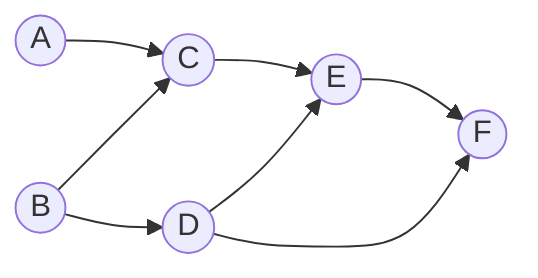
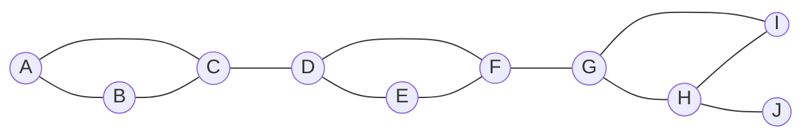
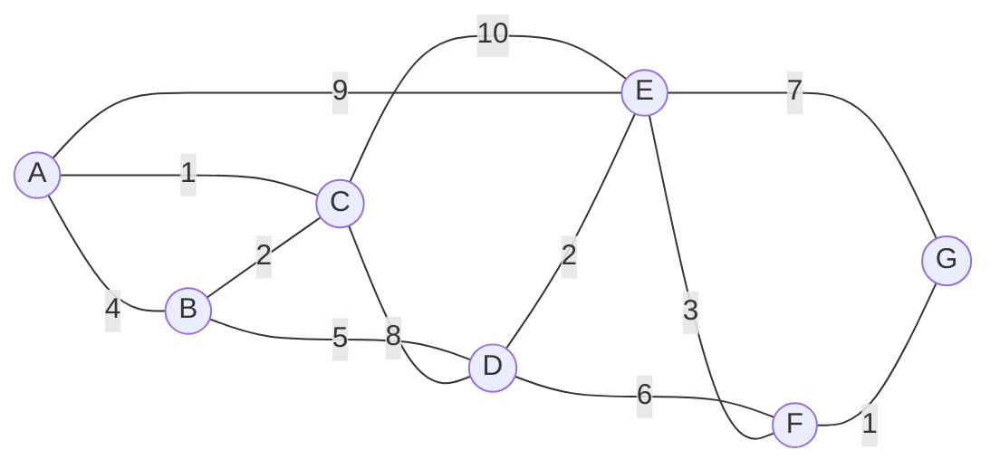
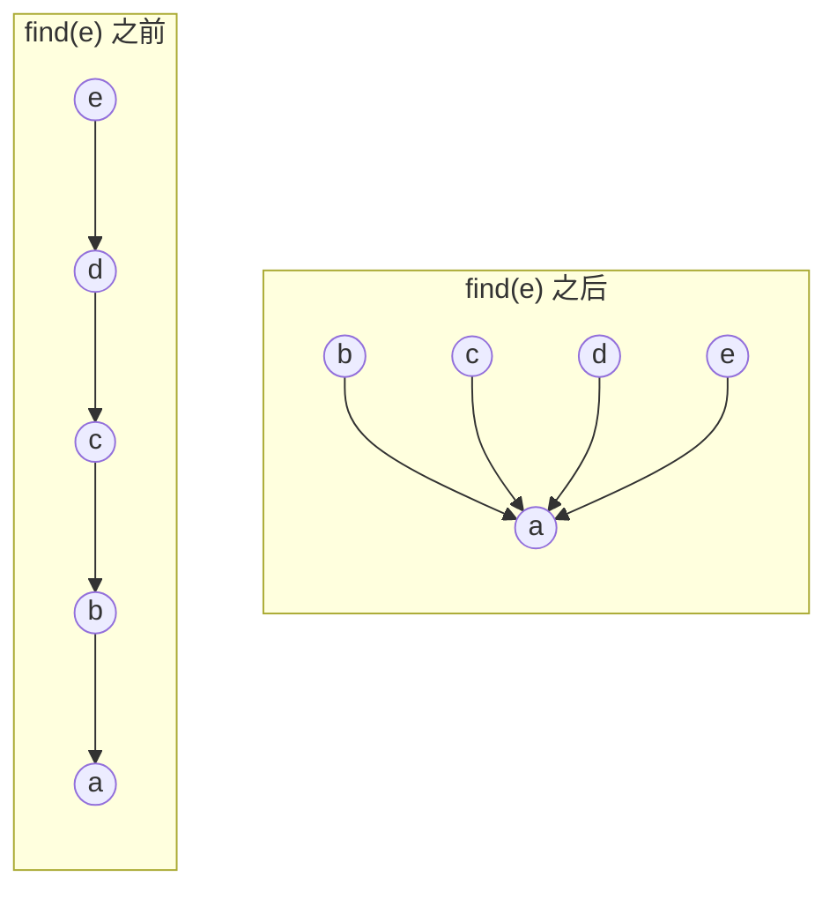
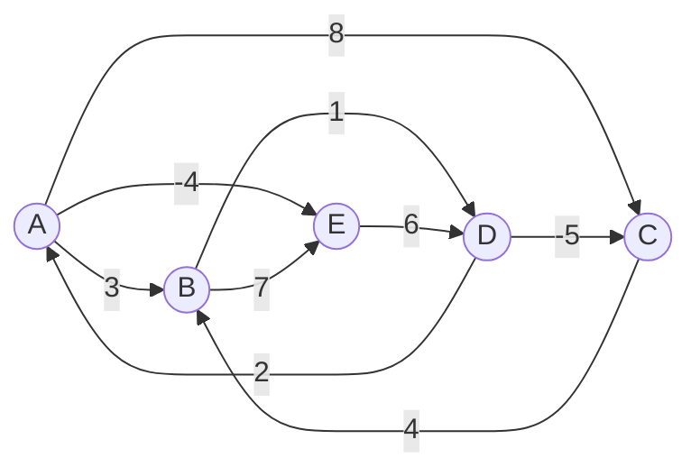

[4.3.10](/4.3.10) 讲了图的表示与两种基本遍历。本章在遍历的基础上解决几类经典问题。前两节直接利用 DFS 留下的信息：按完成时间的逆序就得到有向无环图的拓扑排序；借助回边能到达的最高祖先，就能在一趟 DFS 中找出无向图的全部关节点与双连通分量。第三节把 BFS、DFS 统一为优先级搜索：各种遍历的区别只在于下一个访问哪个顶点，而这由每个顶点的优先级决定；换用不同的优先级更新规则，同一个框架就给出求单源最短路径的 Dijkstra 算法和求最小生成树的 Prim 算法。最后两节介绍另外两种思路：Kruskal 算法按边权从小到大贪心地选边，它的效率依赖于并查集这一数据结构；Floyd–Warshall 算法用**动态规划**一次求出所有点对之间的最短路径。这些问题的数学背景（最短路、最小生成树的存在性与经典算法的步骤）已在 [1.4.2](/1.4.2)、[1.4.3](/1.4.3) 中讲过，这里着重于数据结构的实现、复杂度与正确性证明。

## 11.1. 拓扑排序

### 11.1.1. 有向无环图

很多问题中的依赖关系都没有环：课程之间的先修关系、软件包的依赖、类的继承关系、工程中各道工序的先后、电子表格中单元格的引用。若出现环路，就意味着循环定义或死锁，必须检查并报告。

**定义 11.1.1（有向无环图）** 不含环路的有向图称为**有向无环图**（DAG）。

**拓扑排序**（[1.4.2](/1.4.2)）是把有向图的全部顶点排成一个线性序列，使每条边 $(u, v)$ 都从序列中靠前的顶点指向靠后的顶点。我们要求算法：若原图存在环路，检查并报告；否则给出一个拓扑排序。从序的角度看，DAG 中的可达关系是顶点集上的**偏序关系**，拓扑排序就是构造一个与之相容的**全序关系**。

**引理 11.1.1** 任何非空的 DAG 中，必有一个入度为零的顶点（也必有一个出度为零的顶点）。

**证明** 若每个顶点的入度都不为零，从任一顶点出发，沿入边反向走，每一步都能继续；有限图中这样走 $n$ 步，必有顶点重复出现，得到一条环路，矛盾。出度的情形同理。$\square$

**定理 11.1.1** 有向图 $G$ 存在拓扑排序，当且仅当 $G$ 是 DAG。

**证明** 若 $G$ 有环路 $v_0, v_1, \dots, v_k = v_0$，在任何线性序列中，环路上必有一条边从后面的顶点指向前面的顶点，所以不存在拓扑排序。反之，对顶点数归纳：由引理 11.1.1，DAG $G$ 中有入度为零的顶点 $v$；删去 $v$ 及其关联边后得到的子图仍是 DAG，由归纳假设它有拓扑排序 $S$，于是 $v$ 后接 $S$ 就是 $G$ 的拓扑排序。$\square$

一般地，拓扑排序不唯一：每一步入度为零的顶点不止一个时，可以任选其一。拓扑排序唯一，当且仅当序列中每两个相邻顶点之间都有边，即 DAG 中存在一条经过全部顶点的路径。

### 11.1.2. 零入度算法

定理 11.1.1 的证明直接给出一个算法（Kahn，1962）：

1. 计算每个顶点的入度，把入度为零的顶点放入一个容器 $S$（**栈**、队列均可）；
2. 当 $S$ 非空时，取出一个顶点 $v$ 输出，并删除它的所有出边：$v$ 的每个邻点 $u$ 入度减一，减为零的 $u$ 放入 $S$；
3. $S$ 为空时，若已输出全部 $n$ 个顶点，输出序列就是拓扑排序；否则剩余的子图中每个顶点的入度都不为零，由引理 11.1.1 的证明，其中有环路，报告"不是 DAG"。

计算入度扫描全部边一次；每个顶点进出 $S$ 一次，删除出边时其**邻接表**被扫描一次，所以总时间为 $O(n + m)$。算法不必真的删除边，只需维护入度计数。

### 11.1.3. 零出度算法

另一个方向的想法是逆序输出：出度为零的顶点可以排在最后。DFS 恰好按这个次序让顶点访问完毕：一个顶点被标记为 `VISITED` 时，它的所有后继都已访问完毕。

**定理 11.1.2** 对 DAG 做全图 DFS，则对每条边 $(v, u)$ 有 $f(u) < f(v)$。因此按完成时间 $f$ 的逆序排列各顶点，就得到一个拓扑排序。

**证明** 考察边 $(v, u)$ 时，DFS($v$) 正在执行。$u$ 不可能为 `DISCOVERED`，否则 $(v, u)$ 是**回边**，由定理 10.5.5 图中有环路。若 $u$ 为 `UNDISCOVERED`，$u$ 成为 $v$ 的后代，由**括号引理** $f(u) < f(v)$；若 $u$ 为 `VISITED`，则 $f(u)$ 早于当前时刻，而 $f(v)$ 晚于当前时刻。$\square$

于是只需在 DFS 中每当一个顶点被标记为 `VISITED` 时把它压入栈，DFS 结束后依次弹出；一旦发现回边，就报告"不是 DAG"并退出。复杂度与 DFS 相同，为 $O(n + m)$。

### 11.1.4. 实现

下面的程序实现这两种算法。示例中的 6 门课程 A–F 有如下先修关系；随后加入边 $F \to B$，形成环路 $B \to D \to F \to B$。



```cpp tab
#include <algorithm>
#include <format>
#include <iostream>
#include <optional>
#include <string>
#include <vector>

using Graph = std::vector<std::vector<int>>;

// Zero in-degree algorithm (Kahn): repeatedly output a source and delete it.
std::optional<std::vector<int>> topo_kahn(const Graph& adj) {
    int n = static_cast<int>(adj.size());
    std::vector<int> indeg(n, 0), order, ready;
    for (const auto& out : adj) for (int u : out) ++indeg[u];
    for (int v = 0; v < n; ++v) if (indeg[v] == 0) ready.push_back(v);
    while (!ready.empty()) {                       // any bag works; a stack here
        int v = ready.back(); ready.pop_back();
        order.push_back(v);
        for (int u : adj[v]) if (--indeg[u] == 0) ready.push_back(u);   // delete v's edges
    }
    if (static_cast<int>(order.size()) < n) return std::nullopt;        // a cycle remains
    return order;
}

// Zero out-degree algorithm: DFS, output vertices in decreasing finishing time.
bool topo_dfs_visit(const Graph& adj, int v, std::vector<int>& status, std::vector<int>& finished) {
    status[v] = 1;                                 // 0 undiscovered, 1 discovered, 2 visited
    for (int u : adj[v]) {
        if (status[u] == 1) return false;          // backward edge: not a DAG
        if (status[u] == 0 && !topo_dfs_visit(adj, u, status, finished)) return false;
    }
    status[v] = 2;
    finished.push_back(v);                         // v has no unfinished successors left
    return true;
}
std::optional<std::vector<int>> topo_dfs(const Graph& adj) {
    std::vector<int> status(adj.size(), 0), finished;
    for (int s = 0; s < static_cast<int>(adj.size()); ++s)
        if (status[s] == 0 && !topo_dfs_visit(adj, s, status, finished)) return std::nullopt;
    std::reverse(finished.begin(), finished.end());
    return finished;
}

std::string show(const std::optional<std::vector<int>>& order) {
    if (!order) return "NOT_A_DAG";
    std::string s;
    for (int v : *order) s += char('A' + v);
    return s;
}

int main() {
    Graph g(6);                                    // A..F: prerequisites
    for (auto e : {"AC", "BC", "BD", "CE", "DE", "DF", "EF"}) g[e[0] - 'A'].push_back(e[1] - 'A');
    std::cout << std::format("kahn {} dfs {}\n", show(topo_kahn(g)), show(topo_dfs(g)));
    g[5].push_back(1);                             // add F -> B: cycle B -> D -> F -> B
    std::cout << std::format("kahn {} dfs {}\n", show(topo_kahn(g)), show(topo_dfs(g)));
}
```

```python tab
def topo_kahn(adj: list[list[int]]) -> list[int] | None:
    """Zero in-degree algorithm (Kahn): repeatedly output a source and delete it."""
    n = len(adj)
    indeg = [0] * n
    for out in adj:
        for u in out:
            indeg[u] += 1
    ready = [v for v in range(n) if indeg[v] == 0]
    order = []
    while ready:                                   # any bag works; a stack here
        v = ready.pop()
        order.append(v)
        for u in adj[v]:                           # delete v's edges
            indeg[u] -= 1
            if indeg[u] == 0:
                ready.append(u)
    return order if len(order) == n else None      # None: a cycle remains


def topo_dfs(adj: list[list[int]]) -> list[int] | None:
    """Zero out-degree algorithm: DFS, output in decreasing finishing time."""
    status = [0] * len(adj)                        # 0 undiscovered, 1 discovered, 2 visited
    finished: list[int] = []

    def visit(v: int) -> bool:
        status[v] = 1
        for u in adj[v]:
            if status[u] == 1:                     # backward edge: not a DAG
                return False
            if status[u] == 0 and not visit(u):
                return False
        status[v] = 2
        finished.append(v)                         # v has no unfinished successors left
        return True

    for s in range(len(adj)):
        if status[s] == 0 and not visit(s):
            return None
    return finished[::-1]


def show(order: list[int] | None) -> str:
    return "NOT_A_DAG" if order is None else "".join(chr(65 + v) for v in order)


g: list[list[int]] = [[] for _ in range(6)]       # A..F: prerequisites
for e in ["AC", "BC", "BD", "CE", "DE", "DF", "EF"]:
    g[ord(e[0]) - 65].append(ord(e[1]) - 65)
print("kahn", show(topo_kahn(g)), "dfs", show(topo_dfs(g)))
g[5].append(1)                                     # add F -> B: cycle B -> D -> F -> B
print("kahn", show(topo_kahn(g)), "dfs", show(topo_dfs(g)))
```

输出为：

```text
kahn BDACEF dfs BDACEF
kahn NOT_A_DAG dfs NOT_A_DAG
```

两种算法这里恰好给出同一个序列，一般并不如此：零入度算法用栈还是队列存放入度为零的顶点、DFS 从哪个顶点开始，都会影响结果，但给出的都是合法的拓扑排序。

## 11.2. 双连通分量

### 11.2.1. 关节点与双连通分量

在通信网、电网、交通网中，人们关心单个节点的失效会不会使网络断开。

无向图中，删除后使连通分量数增加的顶点是**关节点**，删除后使连通分量数增加的边是**桥**（[1.4.3](/1.4.3)、[1.4.6](/1.4.6)）。没有关节点的连通图称为双连通图，即 [1.4.6](/1.4.6) 中的**不可分图**。

**定义 11.2.1（双连通分量）** 无向图 $G$ 的极大的双连通子图称为 $G$ 的**双连通分量**（biconnected component，BCC），也就是 [1.4.6](/1.4.6) 中所说的块。单独一条边（两个顶点）也算作一个双连通分量。

双连通分量划分的是边而不是顶点：每条边恰好属于一个双连通分量，而一个关节点属于它所连接的每一个双连通分量。

蛮力的办法是对每个顶点 $v$，检查删去 $v$ 后图是否仍然连通，共需 $O(n(n + m))$ 时间；而且即使找出了关节点，各双连通分量仍需另行确定。Hopcroft 与 Tarjan（1973）给出了只需一趟 DFS 的线性时间算法。

### 11.2.2. 判定准则

从任一顶点出发构造 DFS 树。由定理 10.5.4，无向图的 DFS 只产生树边与**回边**，没有**跨边**，这使关节点可以由 DFS 树的形状和回边判定。

**定理 11.2.1** 设 $T$ 是连通无向图 $G$ 的一棵 DFS 树，根为 $r$。

1. $r$ 是关节点，当且仅当 $r$ 在 $T$ 中至少有两个孩子；
2. 非根顶点 $v$ 是关节点，当且仅当 $v$ 有某个孩子 $u$，使得以 $u$ 为根的子树 $\operatorname{subtree}(u)$ 中没有任何顶点经由回边连接到 $v$ 的真祖先。

特别地，叶节点绝不是关节点：删去它后，其余顶点仍由 $T$ 的其余部分连通。

**证明** (1) 由于没有跨边，$r$ 的不同子树之间只能经由 $r$ 相连。若 $r$ 有两个以上的孩子，删去 $r$ 后各子树互不连通；若只有一个孩子，删去 $r$ 后其余顶点仍由这棵子树连通。

(2) 从 $\operatorname{subtree}(u)$ 连出的边只有两种：$u$ 到父亲 $v$ 的**树边**，以及从子树中某顶点指向其祖先的回边（无跨边）；这些祖先在子树之外时，就是 $v$ 或 $v$ 的真祖先。若 $\operatorname{subtree}(u)$ 中没有回边指向 $v$ 的真祖先，删去 $v$ 后 $\operatorname{subtree}(u)$ 就与 $v$ 的父亲不再相连，$v$ 是关节点。反之，若 $v$ 的每个孩子的子树都有回边指向 $v$ 的真祖先，删去 $v$ 后每棵子树仍连到 $v$ 的父亲所在的部分，而 $T$ 中去掉 $\operatorname{subtree}(v)$ 后的部分本身是连通的，所以图仍连通。$\square$

为了在 DFS 中高效地检验条件 (2)，引入：

**定义 11.2.2（最高连通祖先）** 对 DFS 树中的顶点 $v$，令 $\operatorname{hca}(v)$ 为 $d(v)$ 以及从 $\operatorname{subtree}(v)$ 中的顶点经由一条回边所能到达的各顶点的发现时间中的最小值。由括号引理，祖先的发现时间早于后代，所以 $\operatorname{hca}(v)$ 越小，表示 $\operatorname{subtree}(v)$ 能经由回边到达的祖先辈分越高；称之为 $v$ 的**最高连通祖先**（highest connected ancestor）。

这个量在 Tarjan 的原始论文中称为 low 值。它满足递推关系：

$$
\operatorname{hca}(v) = \min\Bigl( d(v),\ \min_{(v, w)\text{ 为回边}} d(w),\ \min_{u\text{ 为 } v\text{ 的孩子}} \operatorname{hca}(u) \Bigr),
$$
因此可以在 DFS 的过程中自底向上地算出：发现 $v$ 时令 $\operatorname{hca}(v) = d(v)$；发现回边 $(v, w)$ 时用 $d(w)$ 更新；DFS($u$) 返回 $v$ 时用 $\operatorname{hca}(u)$ 更新。定理 11.2.1 的条件 (2) 就成为：$v$ 有孩子 $u$ 使

$$
\operatorname{hca}(u) \ge d(v).
$$
类似地，树边 $(v, u)$ 是桥，当且仅当 $\operatorname{hca}(u) > d(v)$：$\operatorname{subtree}(u)$ 连 $v$ 本身都无法经由回边到达。

### 11.2.3. 算法

算法在 DFS 的同时维护一个**栈**，顶点被发现时入栈。当 DFS($u$) 返回 $v$ 且 $\operatorname{hca}(u) \ge d(v)$ 时，$v$ 把 $\operatorname{subtree}(u)$ 与图的其余部分隔开，$\operatorname{subtree}(u)$ 中尚未归入其他分量的顶点正集中在栈顶（从 $u$ 往上）；把它们连同 $v$ 一起作为一个双连通分量，弹出栈中 $u$ 及其以上的顶点，$v$ 留在栈中，因为它还可能属于其他分量。

需要注意两点：

- 考察 $v$ 的邻点 $u$ 时，若 $u$ 已被发现且不是 $v$ 的父亲，$(v, u)$ 要么是回边，要么是从 $u$ 一侧已考察过的回边的反向；用 $d(u)$ 更新 $\operatorname{hca}(v)$，后一种情况下 $d(u) > d(v)$，更新不起作用，无需区分。父亲必须排除，否则树边会被误当作回边。
- 在有重边的图中，"不是父亲"应改为"不是来时的那条边"（按边的编号判断），因为两条平行边本身就构成一个双连通分量。



```cpp tab
#include <algorithm>
#include <format>
#include <iostream>
#include <string>
#include <vector>

// Biconnected components of an undirected simple graph (Hopcroft–Tarjan).
// hca[v]: smallest discovery time reachable from subtree(v) by one backward edge.
struct Bcc {
    const std::vector<std::vector<int>>& adj;
    std::vector<int> d, hca, parent, stack;
    std::vector<bool> articulation;
    std::vector<std::vector<int>> components;
    std::vector<std::pair<int, int>> bridges;
    int clock = 0;

    explicit Bcc(const std::vector<std::vector<int>>& g)
        : adj(g), d(g.size(), 0), hca(g.size(), 0), parent(g.size(), -1), articulation(g.size(), false) {
        for (int s = 0; s < static_cast<int>(g.size()); ++s)
            if (!d[s]) {
                articulation[s] = visit(s) >= 2;   // the root: at least two subtrees
                stack.clear();                     // only the root itself is left
            }
    }
    int visit(int v) {                             // returns the number of tree children
        int children = 0;
        d[v] = hca[v] = ++clock;
        stack.push_back(v);
        for (int u : adj[v]) {
            if (!d[u]) {                           // tree edge
                parent[u] = v;
                ++children;
                visit(u);
                if (hca[u] < d[v]) {               // subtree(u) climbs above v: v is no cut here
                    hca[v] = std::min(hca[v], hca[u]);
                } else {                           // v separates subtree(u): pop one BCC
                    if (parent[v] != -1) articulation[v] = true;
                    if (hca[u] > d[v]) bridges.emplace_back(v, u);
                    std::vector<int> comp{v};
                    int w;
                    do { w = stack.back(); stack.pop_back(); comp.push_back(w); } while (w != u);
                    components.push_back(comp);
                }
            } else if (u != parent[v]) {           // backward edge (or its reverse, harmless)
                hca[v] = std::min(hca[v], d[u]);
            }
        }
        return children;
    }
};

int main() {
    const std::string name = "ABCDEFGHIJ";
    std::vector<std::vector<int>> adj(name.size());
    for (auto e : {"AB", "BC", "CA", "CD", "DE", "EF", "FD", "FG", "GH", "HI", "IG", "HJ"}) {
        adj[e[0] - 'A'].push_back(e[1] - 'A');
        adj[e[1] - 'A'].push_back(e[0] - 'A');
    }
    Bcc r(adj);
    for (auto& c : r.components) {
        std::string s;
        for (int v : c) s += name[v];
        std::cout << s << ' ';
    }
    std::cout << "\narticulation points:";
    for (std::size_t v = 0; v < name.size(); ++v) if (r.articulation[v]) std::cout << ' ' << name[v];
    std::cout << "\nbridges:";
    for (auto [v, u] : r.bridges) std::cout << std::format(" {}{}", name[v], name[u]);
    std::cout << '\n';
}
```

```python tab
def biconnected(adj: list[list[int]]) -> tuple[list[list[int]], list[int], list[tuple[int, int]]]:
    """Biconnected components, articulation points and bridges (Hopcroft–Tarjan).

    hca[v]: smallest discovery time reachable from subtree(v) by one backward edge.
    """
    n = len(adj)
    d, hca, parent = [0] * n, [0] * n, [-1] * n
    stack: list[int] = []
    components: list[list[int]] = []
    articulation: set[int] = set()
    bridges: list[tuple[int, int]] = []
    clock = 0

    def visit(v: int) -> int:                      # returns the number of tree children
        nonlocal clock
        clock += 1
        d[v] = hca[v] = clock
        stack.append(v)
        children = 0
        for u in adj[v]:
            if not d[u]:                           # tree edge
                parent[u] = v
                children += 1
                visit(u)
                if hca[u] < d[v]:                  # subtree(u) climbs above v
                    hca[v] = min(hca[v], hca[u])
                else:                              # v separates subtree(u): pop one BCC
                    if parent[v] != -1:
                        articulation.add(v)
                    if hca[u] > d[v]:
                        bridges.append((v, u))
                    comp = [v]
                    while True:
                        w = stack.pop()
                        comp.append(w)
                        if w == u:
                            break
                    components.append(comp)
            elif u != parent[v]:                   # backward edge (or its reverse, harmless)
                hca[v] = min(hca[v], d[u])
        return children

    for s in range(n):
        if not d[s]:
            if visit(s) >= 2:                      # the root: at least two subtrees
                articulation.add(s)
            stack.clear()                          # only the root itself is left
    return components, sorted(articulation), bridges


names = "ABCDEFGHIJ"
adj: list[list[int]] = [[] for _ in names]
for e in ["AB", "BC", "CA", "CD", "DE", "EF", "FD", "FG", "GH", "HI", "IG", "HJ"]:
    v, u = names.index(e[0]), names.index(e[1])
    adj[v].append(u)
    adj[u].append(v)
comps, cut, bridges = biconnected(adj)
print(*("".join(names[v] for v in c) for c in comps))
print("articulation points:", *(names[v] for v in cut))
print("bridges:", *(names[v] + names[u] for v, u in bridges))
```

输出为：

```text
HJ GIH FG DFE CD ACB
articulation points: C D F G H
bridges: HJ FG CD
```

六个双连通分量按 DFS 回溯的次序依次弹出：三个三角形，以及三座桥各自构成的单边分量。

运行时间与 DFS 相同，为 $O(n + m)$：每个顶点恰好入栈、出栈一次（根在最后清空）。除原图外，栈至多容纳 $n$ 个顶点，递归另需 $O(n)$ 的调用栈空间。

**注 11.2.1** 有向图中与之对应的概念是强连通分量（strongly connected component）：极大的、其中任意两个顶点相互可达的子图。把每个强连通分量收缩为一个顶点，得到的图是 DAG。强连通分量也可以在线性时间内求出：Kosaraju 算法先对 $G$ 做 DFS，再按 $f$ 的逆序在反向图上做 DFS，第二趟的每棵 DFS 树就是一个强连通分量；Tarjan 算法则只用一趟 DFS，借助与 $\operatorname{hca}$ 同样的 low 值和一个顶点栈。

## 11.3. 优先级搜索

### 11.3.1. 统一框架

比较 BFS 与 DFS：二者都从起点出发，逐步把顶点和边加入遍历树，区别仅在于每一步选择哪个已发现的顶点继续扩展。BFS 优先选择更早被发现的顶点（**队列**），DFS 优先选择更晚被发现的顶点（**栈**）。把这一选择策略抽象出来：

**定义 11.3.1（优先级搜索）** 为每个顶点 $v$ 维护一个优先级数 $\operatorname{priority}(v)$，数值越小优先级越高（初值为 $\infty$，表示优先级最低）。从起点 $s$ 开始（$\operatorname{priority}(s) = 0$）反复执行以下两步的遍历框架，称为**优先级搜索**（priority-first search，PFS）：

1. 在尚未加入遍历树的顶点中，选出优先级数最小的顶点 $v$，把它连同边 $(\operatorname{parent}(v), v)$ 加入遍历树；
2. 对 $v$ 的每个尚未加入遍历树的邻点 $u$，按某种规则更新 $\operatorname{priority}(u)$；若更新成功，令 $\operatorname{parent}(u) = v$。

不同的算法只在第 2 步的"优先级更新器"上不同。例如令 $\operatorname{priority}(u)$ 为 $u$ 首次被发现时的序号（只在初次发现时更新），就得到 BFS；令新发现或重新遇到的顶点的优先级数为一个递减的计数（越晚遇到越优先），就得到 DFS 的次序。下面两节将看到 Dijkstra 算法与 Prim 算法的更新器：

| 算法 | 经 $v$ 更新邻点 $u$ 时的候选优先级 |
|---|---|
| Dijkstra（最短路径） | $\operatorname{priority}(v) + w(v, u)$：经 $v$ 到达 $u$ 的路径长度 |
| Prim（最小生成树） | $w(v, u)$：$u$ 经边 $(v, u)$ 连入树的代价 |

两者都是候选值更小时才更新。在 C++ 与 Python 中，更新器自然地写成一个**函数对象**或 **lambda 表达式**，作为参数传给通用的 PFS 函数。

### 11.3.2. 复杂度

执行时间消耗在两类操作上：每个顶点加入树之后更新其邻点（共 $O(n + m)$ 次更新，邻接矩阵则为 $O(n^2)$），以及每一步选出优先级最高的顶点（共 $n$ 次）。

- 用数组存放优先级数，每次选择线性扫描：选择累计 $O(n^2)$，总时间 $O(n^2)$。这对**稠密图**（$m = \Theta(n^2)$）已是最优，因为输入本身就有这么大。
- 用二叉堆作优先级队列（[4.3.12](/4.3.12)）：选择是一次删除最小元，更新是一次减小关键码，各 $O(\log n)$，总时间 $O((n + m) \log n)$。对**稀疏图**这是很大的改进；对稠密图反而退步。
- 实际编程中常用"懒惰"的写法：不在堆中修改元素，而是每次更新都压入一个新的 (优先级, 顶点) 对，旧的那个变为过期；弹出时若该顶点已在树中或优先级已过期就跳过。堆中至多 $m + 1$ 项，总时间 $O(m \log m) = O(m \log n)$，而且只用到标准库的 `std::priority_queue` 或 `heapq`（二者都不支持减小关键码）。
- 用 Fibonacci 堆（Fredman 与 Tarjan，1987），减小关键码的分摊时间为 $O(1)$，总时间 $O(m + n \log n)$。

### 11.3.3. 实现

下面是采用懒惰堆的通用 PFS。函数参数 `candidate(pv, w)` 给出 $u$ 经由树中顶点 $v$ 所能获得的优先级数（`pv` 为 $\operatorname{priority}(v)$，`w` 为边权）。同一个函数分别配上两个 lambda，就是 Dijkstra 算法与 Prim 算法，示例图如下（无向，边上的数为权重）：



```cpp tab
#include <format>
#include <functional>
#include <iostream>
#include <limits>
#include <queue>
#include <string>
#include <utility>
#include <vector>

struct Arc { int to; long long w; };
using WGraph = std::vector<std::vector<Arc>>;
constexpr long long INF = std::numeric_limits<long long>::max();

struct PfsTree { std::vector<long long> priority; std::vector<int> parent; };

// Priority-first search: repeatedly move the undiscovered vertex of smallest
// priority number into the tree; `candidate(priority(v), w(v, u))` is the
// priority that u would get through the tree vertex v.
template <typename Candidate>
PfsTree pfs(const WGraph& g, int s, Candidate candidate) {
    int n = static_cast<int>(g.size());
    PfsTree t{std::vector<long long>(n, INF), std::vector<int>(n, -1)};
    std::vector<bool> in_tree(n, false);
    using Item = std::pair<long long, int>;                    // (priority, vertex)
    std::priority_queue<Item, std::vector<Item>, std::greater<>> heap;   // min-heap
    t.priority[s] = 0;
    heap.push({0, s});
    while (!heap.empty()) {
        auto [p, v] = heap.top(); heap.pop();
        if (in_tree[v] || p != t.priority[v]) continue;        // stale copy: skip it
        in_tree[v] = true;                                     // v joins the PFS tree
        for (auto [u, w] : g[v]) {                             // update v's neighbours
            if (in_tree[u]) continue;
            if (long long c = candidate(t.priority[v], w); c < t.priority[u]) {
                t.priority[u] = c; t.parent[u] = v;
                heap.push({c, u});                             // the old copy becomes stale
            }
        }
    }
    return t;
}

int main() {
    const std::string name = "ABCDEFG";
    WGraph g(name.size());
    const std::pair<const char*, long long> edges[] = {
        {"AB", 4}, {"AC", 1}, {"BC", 2}, {"BD", 5}, {"CD", 8}, {"CE", 10},
        {"DE", 2}, {"DF", 6}, {"EF", 3}, {"FG", 1}, {"AE", 9}, {"EG", 7}};
    for (auto [e, w] : edges) {
        g[e[0] - 'A'].push_back({e[1] - 'A', w});
        g[e[1] - 'A'].push_back({e[0] - 'A', w});
    }
    auto dijkstra = pfs(g, 0, [](long long pv, long long w) { return pv + w; });  // path length
    auto prim = pfs(g, 0, [](long long, long long w) { return w; });               // edge length
    long long mst = 0;
    for (std::size_t v = 0; v < name.size(); ++v) {
        std::cout << std::format("{}: dist {:2} via {}   mst edge {}{}\n", name[v], dijkstra.priority[v],
                                 v ? name[dijkstra.parent[v]] : '-', v ? name[prim.parent[v]] : '-', name[v]);
        if (v) mst += prim.priority[v];
    }
    std::cout << std::format("MST weight {}\n", mst);
}
```

```python tab
import heapq
from collections.abc import Callable

INF = float("inf")
WGraph = list[list[tuple[int, int]]]              # v -> [(u, weight)]


def pfs(g: WGraph, s: int, candidate: Callable[[float, int], float]) -> tuple[list[float], list[int]]:
    """Priority-first search; candidate(priority(v), w(v, u)) is u's priority via v."""
    n = len(g)
    priority, parent = [INF] * n, [-1] * n
    in_tree = [False] * n
    priority[s] = 0
    heap = [(0, s)]                                # (priority, vertex), a min-heap
    while heap:
        p, v = heapq.heappop(heap)
        if in_tree[v] or p != priority[v]:         # stale copy: skip it
            continue
        in_tree[v] = True                          # v joins the PFS tree
        for u, w in g[v]:                          # update v's neighbours
            if not in_tree[u] and (c := candidate(priority[v], w)) < priority[u]:
                priority[u], parent[u] = c, v
                heapq.heappush(heap, (c, u))       # the old copy becomes stale
    return priority, parent


names = "ABCDEFG"
g: WGraph = [[] for _ in names]
for e, w in [("AB", 4), ("AC", 1), ("BC", 2), ("BD", 5), ("CD", 8), ("CE", 10),
             ("DE", 2), ("DF", 6), ("EF", 3), ("FG", 1), ("AE", 9), ("EG", 7)]:
    v, u = names.index(e[0]), names.index(e[1])
    g[v].append((u, w))
    g[u].append((v, w))
dist, spt = pfs(g, 0, lambda pv, w: pv + w)        # Dijkstra: path length
key, mst = pfs(g, 0, lambda pv, w: w)              # Prim: edge length
for v, c in enumerate(names):
    via = names[spt[v]] if v else "-"
    edge = names[mst[v]] + c if v else "-" + c
    print(f"{c}: dist {dist[v]:2} via {via}   mst edge {edge}")
print("MST weight", sum(key[1:]))
```

输出为：

```text
A: dist  0 via -   mst edge -A
B: dist  3 via C   mst edge CB
C: dist  1 via A   mst edge AC
D: dist  8 via B   mst edge BD
E: dist  9 via A   mst edge DE
F: dist 12 via E   mst edge EF
G: dist 13 via F   mst edge FG
MST weight 14
```

## 11.4. 最短路径：Dijkstra 算法

### 11.4.1. 问题

在带权网络中，路径的长度是其上各边权重之和，$\operatorname{dist}(s, v)$ 为从 $s$ 到 $v$ 的最短路径的长度。最短路径问题分为两类：单源最短路径（给定 $s$，求 $s$ 到其余各顶点的最短路径）与所有点对最短路径（§11.7）。本节假定所有边权非负。若允许负权边，可能出现总权重为负的环路，沿它绕圈可使路径任意短，最短路径无从定义；即使没有负环路，Dijkstra 算法也可能失效（例 11.4.1），这时要用 **Bellman–Ford 算法**（[1.4.2](/1.4.2)）。

**定理 11.4.1** 在非负权网络中，最短路径的任一前缀也是最短路径：若 $s, \dots, u, \dots, v$ 是 $s$ 到 $v$ 的最短路径，则其中 $s$ 到 $u$ 的一段是 $s$ 到 $u$ 的最短路径。

**证明** 若 $s$ 到 $u$ 另有一条更短的路径，用它替换原路径中 $s$ 到 $u$ 的一段，就得到一条更短的 $s$ 到 $v$ 的路径（若产生重复顶点，删去其间的环路，长度不会增加），矛盾。$\square$

这正是**最优子结构**。于是，为每个顶点 $v \ne s$ 选定其最短路径上的前驱 $\operatorname{parent}(v)$，这些边就构成一棵以 $s$ 为根的树：

**定义 11.4.1（最短路径树）** 以 $s$ 为根、从 $s$ 到每个可达顶点 $v$ 的树中路径都是 $\operatorname{dist}(s, v)$ 长的最短路径的支撑树，称为 $s$ 的**最短路径树**（shortest-path tree，SPT）。

若各点对之间的最短路径都唯一（总可以通过对权重做微小的扰动来保证，而不影响计算结果），所有最短路径的并本身就既连通又无环，这棵树也就唯一。

### 11.4.2. 算法与正确性

**Dijkstra 算法**（[1.4.2](/1.4.2)）按距离从近到远的顺序逐个确定各顶点。设已确定了离 $s$ 最近的 $k$ 个顶点构成的集合 $V_k$（$V_1 = \{s\}$）。由定理 11.4.1，第 $k + 1$ 近的顶点 $u$ 的最短路径上，除 $u$ 外的顶点都比 $u$ 更近，都在 $V_k$ 中；所以 $u$ 必定经由一条从 $V_k$ 连出的边 $(v, u)$ 到达，且

$$
\operatorname{dist}(s, u) = \min_{v \in V_k,\ (v, u) \in E} \bigl( \operatorname{dist}(s, v) + w(v, u) \bigr).
$$
这正是 PFS 的框架：$\operatorname{priority}(u)$ 记录目前所知的从 $s$ 经由树中顶点到 $u$ 的最短长度，每次把优先级数最小的顶点加入树，再用它更新邻点：

$$
\operatorname{priority}(u) \leftarrow \min\bigl( \operatorname{priority}(u),\ \operatorname{priority}(v) + w(v, u) \bigr).
$$
这一步称为对边 $(v, u)$ 做松弛（relaxation）：用"经过 $v$"这一新的可能性收紧 $u$ 的距离上界。

**定理 11.4.2** 设边权非负。Dijkstra 算法把每个顶点 $v$ 加入树时，$\operatorname{priority}(v) = \operatorname{dist}(s, v)$。

**证明** 在整个过程中 $\operatorname{priority}(v)$ 都是某条实际路径的长度，所以总有 $\operatorname{priority}(v) \ge \operatorname{dist}(s, v)$。假设结论不成立，设 $v$ 是第一个在加入树时 $\operatorname{priority}(v) > \operatorname{dist}(s, v)$ 的顶点（$v \ne s$）。取一条从 $s$ 到 $v$ 的最短路径，设 $y$ 是其上第一个尚未加入树的顶点，$x$ 是它的前驱（已在树中）。由 $v$ 的选取，$x$ 加入树时 $\operatorname{priority}(x) = \operatorname{dist}(s, x)$，随即松弛了 $(x, y)$，于是

$$
\operatorname{priority}(y) \le \operatorname{dist}(s, x) + w(x, y) = \operatorname{dist}(s, y) \le \operatorname{dist}(s, v) < \operatorname{priority}(v),
$$
其中第二个不等号用到了边权非负（$y$ 在 $s$ 到 $v$ 的最短路径上）。但算法此刻选择了 $v$ 而不是 $y$，应有 $\operatorname{priority}(v) \le \operatorname{priority}(y)$，矛盾。$\square$

**例 11.4.1** 负权边会破坏上述证明中的第二个不等号。设有向边 $A \to B$ 权 $2$，$A \to C$ 权 $3$，$C \to B$ 权 $-2$。Dijkstra 算法从 $A$ 出发，先把 $B$ 以距离 $2$ 加入树，此后不再修改；而实际上 $\operatorname{dist}(A, B) = 3 - 2 = 1$。

§11.3.3 的输出给出了示例图中 $A$ 到各顶点的距离与最短路径树：例如 $\operatorname{dist}(A, F) = 12$，最短路径为 $A \to E \to F$（经由权为 9 的边 $A$–$E$，而不是 $A \to C \to B \to D \to E \to F$ 的 13）。

**注 11.4.1** 用 Fibonacci 堆的 $O(m + n \log n)$ 长期被视为基于比较的 Dijkstra 算法的极限，因为它按距离的次序输出全部顶点，相当于排序。近年这方面有两项重要进展：Haeupler 等人（2024）证明了配合适当的堆，Dijkstra 算法在"每个图上"都达到最优（universal optimality）；Duan 等人（2025）给出了 $O(m \log^{2/3} n)$ 时间的有向图单源最短路径算法，首次在**稀疏图**上突破了这一"排序壁垒"，其方法不再按距离的次序逐个确定顶点。

## 11.5. 最小生成树：Prim 算法

### 11.5.1. 最小生成树

连通的带权无向图 $G = (V, E)$ 中，总权重最小的支撑树称为**最小生成树**（MST）。架设通信网、电网或芯片布线时，用最少的线路成本把所有站点连起来，就是这一问题；它也是许多优化问题的基本模型，例如可以为欧氏旅行商问题给出不差于最优解两倍的近似解。

蛮力枚举不可行：由 Cayley 公式，$n$ 个顶点的完全图有 $n^{n-2}$ 棵支撑树。经典的高效算法有 Borůvka（1926）、Jarník（1930）与 Prim（1957）、Kruskal（1956）；随机化的 Karger–Klein–Tarjan 算法（1995）期望线性时间，Chazelle（2000）的确定性算法为 $O(m\,\alpha(m, n))$。

几点说明：

- 边权可以为零或负数：所有支撑树都恰有 $n - 1$ 条边，给每条边加上同一个常数，各支撑树的总权重同增 $(n-1)$ 倍该常数，最小者不变。
- 最小生成树不一定唯一。若各边权重互不相同，则唯一。权重相同时，可以把边 $(u, v)$ 的权重扩展为 $(w(u, v), \min(u, v), \max(u, v))$ 按**字典序**比较，从而消除歧义。
- 最小生成树与最短路径树一般不同。§11.3.3 的示例中，最短路径树用了边 $A$–$E$（权 9），因为它给出 $A$ 到 $E$ 的最短路径；最小生成树则用权为 2 的边 $D$–$E$ 把 $E$ 连入，总权重 14。

### 11.5.2. 割性质与环路性质

把顶点集分为两个非空部分 $(U, V \setminus U)$，称为一个割；两端分属两部分的边称为该割的**跨边**。

**定理 11.5.1（割性质）** 设 $(U, V \setminus U)$ 是 $G$ 的一个割，$e = (u, v)$ 是该割的跨边中权重最小者之一。则存在一棵包含 $e$ 的最小生成树。若 $e$ 是唯一的最小跨边，则每棵最小生成树都包含 $e$。

**证明** 任取一棵最小生成树 $T$，设 $e \notin T$。把 $e$ 加入 $T$ 产生唯一的一条环路，它经过 $e$ 从 $U$ 一侧走到另一侧，必然还要经过该割的另一条跨边 $f \in T$ 才能回来。由 $e$ 的最小性，$w(e) \le w(f)$。删去 $f$ 后 $T - f + e$ 仍是支撑树，总权重不超过 $T$，所以也是最小生成树，且包含 $e$。若 $e$ 是唯一的最小跨边，则 $w(e) < w(f)$，$T - f + e$ 比 $T$ 更轻，与 $T$ 的最小性矛盾，故 $e \in T$。$\square$

**定理 11.5.2（环路性质）** 若 $f$ 是某条环路 $C$ 上唯一的权重最大的边，则 $f$ 不属于任何最小生成树。

**证明** 设最小生成树 $T$ 包含 $f$。删去 $f$，$T$ 分裂为两棵树，它们的顶点集构成一个割，$f$ 是其跨边。环路 $C$ 跨过这个割偶数次，所以 $C$ 上还有另一条跨边 $e$，$w(e) < w(f)$。$T - f + e$ 是更轻的支撑树，矛盾。$\square$

割性质是 Prim 算法的依据，环路性质与割性质共同说明了 Kruskal 算法（§11.6）的正确性。

### 11.5.3. 算法与正确性

**Prim 算法**从任一顶点 $s$ 出发，令 $T_1 = (\{s\}, \varnothing)$；第 $k$ 步把 $T_k$ 的顶点集 $V_k$ 视为一个割的一侧，选出该割的最小跨边 $(v, u)$（$v \in V_k$，$u \notin V_k$），令 $T_{k+1} = T_k + (v, u)$。$n - 1$ 步后 $T_n$ 就是最小生成树。

一个似是而非的论证是："由割性质，Prim 算法选出的每条边都属于某棵最小生成树，所以 $T_n$ 是最小生成树。"但"每条边都属于某棵最小生成树"并不推出"它们一起属于同一棵"。例如三角形 $A, B, C$ 中 $w(A, B) = 1$，$w(B, C) = w(A, C) = 2$，边 $B$–$C$ 与 $A$–$C$ 各自属于某棵最小生成树，而由它们组成的支撑树总权重为 4，并不是最小的（最小为 3）。正确的证明需要更强的归纳假设：

**定理 11.5.3** Prim 算法过程中的每个 $T_k$ 都是某棵最小生成树的子树。因此 $T_n$ 是最小生成树。

**证明** 对 $k$ 归纳。$T_1$ 只有一个顶点，显然。设 $T_k$ 包含于最小生成树 $T^*$，算法选出割 $(V_k, V \setminus V_k)$ 的最小跨边 $e$。若 $e \in T^*$，则 $T_{k+1} \subseteq T^*$。否则，同定理 11.5.1 的证明，$T^* + e$ 中的环路含有该割的另一条跨边 $f \in T^*$，$w(e) \le w(f)$，$T' = T^* - f + e$ 也是最小生成树。由于 $f$ 是跨边而 $T_k$ 的边都在 $V_k$ 内部，$f \notin T_k$，所以 $T_{k+1} = T_k + e \subseteq T'$。$\square$

作为 PFS，$\operatorname{priority}(u)$ 记录 $u$ 与当前树之间最短的边的权重，每次选出优先级数最小的顶点 $u$ 就是选出最小跨边；$u$ 加入树后，只有它的邻点的优先级数可能降低：

$$
\operatorname{priority}(u') \leftarrow \min\bigl( \operatorname{priority}(u'),\ w(u, u') \bigr).
$$
与 Dijkstra 算法相比，唯一的区别是候选值不再累加 $\operatorname{priority}(v)$。实现见 §11.3.3，复杂度也与 Dijkstra 算法相同：数组 $O(n^2)$，二叉堆 $O((n + m) \log n)$，Fibonacci 堆 $O(m + n \log n)$。

## 11.6. Kruskal 算法与并查集

### 11.6.1. Kruskal 算法

回顾 Prim 算法，最短的边迟早会被采用，次短的边也是，再次短的却未必：它可能与前两条构成环路。**Kruskal 算法**把这一观察变成贪心策略：按权重从小到大依次考察各边，只要加入后不构成环路，就采用它。

1. 维护一个森林 $F$，初始时包含 $n$ 棵单顶点的树、没有边；
2. 把所有边按权重非降序排列；
3. 依次考察每条边 $(u, v)$：若 $u$ 与 $v$ 属于 $F$ 中不同的树，就把边加入 $F$，合并这两棵树；否则舍弃它（它会与已选的边构成环路，且是该环路上最长的边）；
4. 选够 $n - 1$ 条边时停止。

每一步局部最优，全局也就最优吗？Kruskal 算法确实如此：

**定理 11.6.1** Kruskal 算法过程中的森林 $F$ 始终包含于某棵最小生成树。因此算法结束时 $F$ 是最小生成树。

**证明** 对加入的边数归纳。设 $F \subseteq T^*$，算法接着采用边 $e = (u, v)$，$u$ 所在的树的顶点集为 $C$。考察割 $(C, V \setminus C)$：比 $e$ 更早考察的边，要么已在 $F$ 中（在某棵树的内部，不跨割），要么因两端已在同一棵树中而被舍弃（两端此后仍在同一棵树中，也不跨割）。而此后才考察的边权重都不小于 $w(e)$，所以 $e$ 是该割的权重最小的跨边之一。同定理 11.5.3 的证明，可以用 $e$ 替换 $T^*$ 中该割的另一条跨边 $f$，得到包含 $F + e$ 的最小生成树；$f$ 跨割，不在 $F$ 中。$\square$

排序需要 $O(m \log m) = O(m \log n)$ 时间。剩下的问题是：怎样快速判断 $u$、$v$ 是否在同一棵树中，以及怎样合并两棵树？这需要一种专门的数据结构。

### 11.6.2. 并查集

**定义 11.6.1（并查集）** 维护集合 $\{0, 1, \dots, n-1\}$ 的一个划分（若干互不相交的子集，每个子集由其中一个成员作为代表），支持以下操作的数据结构称为**并查集**（union–find，或不相交集合）：

- `find(x)`：返回 $x$ 所在子集的代表；
- `union(x, y)`：合并 $x$ 与 $y$ 所在的子集。

初始时每个元素自成一个子集。$x$ 与 $y$ 在同一子集中，当且仅当 `find(x) == find(y)`。Kruskal 算法中，子集就是森林 $F$ 中各棵树的顶点集。

最直接的实现是 quick-find：用数组 `group[x]` 记录 $x$ 所属子集的编号，`find` 只需 $O(1)$，但 `union` 要把一个子集的全部成员改号，需要 $O(n)$。另一种是 quick-union：每个子集组织为一棵树，每个元素只记录其父亲，根就是代表；`union` 只需把一个根挂到另一个根之下，而 `find` 要沿父亲指针走到根，时间与树高成正比，最坏情况下树退化为长为 $n$ 的链。改进的关键有两点。

第一点是按大小合并（union by size）：合并时总把较小的树挂到较大的树之下。按秩合并（union by rank）则用一个秩（树高的上界）代替大小，把秩较小的根挂到秩较大的根之下，两者效果相同。

**定理 11.6.2** 按大小合并时，$n$ 个元素的并查集中每棵树的高度都不超过 $\log_2 n$。

**证明** 元素 $x$ 的深度只在它所在的树被挂到另一棵树之下时增加 1，而这时它所在的树至少不比另一棵大，合并后 $x$ 所在树的大小至少翻倍。大小不超过 $n$，所以 $x$ 的深度至多增加 $\log_2 n$ 次。$\square$

于是 `find` 与 `union` 都是 $O(\log n)$，Kruskal 算法的总时间为 $O(m \log n)$，由排序主导。

第二点是路径压缩（path compression）：`find(x)` 找到根之后，把从 $x$ 到根的路径上的每个节点都直接挂到根之下，此后再查找它们只需一步。下图是对元素 $e$ 执行 `find` 前后的情形：



路径压缩不改变任何元素所属的子集，只是让树变矮。一种只需一趟的变体是路径减半（path halving）：查找时让每个节点改指向它的祖父。

**定理 11.6.3（Tarjan，1975）** 同时采用按秩合并与路径压缩，对 $n$ 个元素执行 $m \ge n$ 次 `find` 与 `union` 操作的总时间为 $O(m\,\alpha(n))$，其中 $\alpha$ 是 Ackermann 函数的反函数。

$\alpha(n)$ 增长得极其缓慢：对实际中可能出现的任何 $n$（远超宇宙中原子的数目），$\alpha(n) \le 4$。所以每次操作的分摊时间实际上是常数。Fredman 与 Saks（1989）证明了这个界在一般模型中不可改进。证明较长，这里从略；一个较弱但容易证明的结论是 $O(m \log^* n)$（Hopcroft 与 Ullman，1973），其中 $\log^* n$ 是对 $n$ 反复取对数直到不超过 1 所需的次数。

### 11.6.3. 实现

下面的并查集采用按大小合并与路径压缩（两趟：先找到根，再把路径上的节点逐个挂到根下），并在示例图上运行 Kruskal 算法；最后用随机操作与 quick-find 对照，检验实现的正确性。

```cpp tab
#include <algorithm>
#include <format>
#include <iostream>
#include <numeric>
#include <random>
#include <string>
#include <tuple>
#include <utility>
#include <vector>

// Disjoint sets: union by size + path compression.
class UnionFind {
    std::vector<int> parent_, size_;
    int groups_;
public:
    explicit UnionFind(int n) : parent_(n), size_(n, 1), groups_(n) {
        std::iota(parent_.begin(), parent_.end(), 0);       // n singletons
    }
    int find(int x) {
        int root = x;
        while (parent_[root] != root) root = parent_[root];
        while (parent_[x] != root) {                        // path compression:
            int next = parent_[x];                          // hang every node on the path
            parent_[x] = root;                              // directly below the root
            x = next;
        }
        return root;
    }
    bool unite(int a, int b) {                              // false if already together
        a = find(a); b = find(b);
        if (a == b) return false;
        if (size_[a] < size_[b]) std::swap(a, b);           // the smaller tree goes below
        parent_[b] = a;
        size_[a] += size_[b];
        --groups_;
        return true;
    }
    int groups() const { return groups_; }
};

// Kruskal: scan edges by weight, keep those joining two different trees.
std::vector<std::tuple<long long, int, int>> kruskal(int n, std::vector<std::tuple<long long, int, int>> edges) {
    std::sort(edges.begin(), edges.end());
    UnionFind uf(n);
    std::vector<std::tuple<long long, int, int>> tree;
    for (auto [w, v, u] : edges)
        if (uf.unite(v, u)) {
            tree.emplace_back(w, v, u);
            if (static_cast<int>(tree.size()) == n - 1) break;
        }
    return tree;
}

int main() {
    const std::string name = "ABCDEFG";
    std::vector<std::tuple<long long, int, int>> edges;
    const std::pair<const char*, long long> list[] = {
        {"AB", 4}, {"AC", 1}, {"BC", 2}, {"BD", 5}, {"CD", 8}, {"CE", 10},
        {"DE", 2}, {"DF", 6}, {"EF", 3}, {"FG", 1}, {"AE", 9}, {"EG", 7}};
    for (auto [e, w] : list) edges.emplace_back(w, e[0] - 'A', e[1] - 'A');
    long long total = 0;
    for (auto [w, v, u] : kruskal(7, edges)) {
        std::cout << std::format("{}{}({}) ", name[v], name[u], w);
        total += w;
    }
    std::cout << std::format("weight {}\n", total);

    // Random self-test against quick-find (an explicit group label per element).
    std::mt19937 gen(11);
    const int n = 2000;
    UnionFind uf(n);
    std::vector<int> label(n);
    std::iota(label.begin(), label.end(), 0);
    for (int step = 0; step < 3000; ++step) {
        int a = gen() % n, b = gen() % n;
        if (gen() % 2) {
            bool merged = uf.unite(a, b);
            if (merged != (label[a] != label[b])) { std::cout << "unite mismatch\n"; return 1; }
            int old = label[b];
            for (int& l : label) if (l == old) l = label[a];
        } else if ((uf.find(a) == uf.find(b)) != (label[a] == label[b])) {
            std::cout << "find mismatch\n"; return 1;
        }
    }
    std::cout << std::format("ok: {} groups\n", uf.groups());
}
```

```python tab
import random


class UnionFind:
    """Disjoint sets: union by size + path compression."""

    def __init__(self, n: int) -> None:
        self.parent = list(range(n))               # n singletons
        self.size = [1] * n
        self.groups = n

    def find(self, x: int) -> int:
        root = x
        while self.parent[root] != root:
            root = self.parent[root]
        while self.parent[x] != root:              # path compression: hang every node
            self.parent[x], x = root, self.parent[x]   # on the path below the root
        return root

    def union(self, a: int, b: int) -> bool:       # False if already together
        a, b = self.find(a), self.find(b)
        if a == b:
            return False
        if self.size[a] < self.size[b]:            # the smaller tree goes below
            a, b = b, a
        self.parent[b] = a
        self.size[a] += self.size[b]
        self.groups -= 1
        return True


def kruskal(n: int, edges: list[tuple[int, int, int]]) -> list[tuple[int, int, int]]:
    """Scan edges (w, v, u) by weight, keep those joining two different trees."""
    uf, tree = UnionFind(n), []
    for w, v, u in sorted(edges):
        if uf.union(v, u):
            tree.append((w, v, u))
            if len(tree) == n - 1:
                break
    return tree


names = "ABCDEFG"
edges = [(w, names.index(e[0]), names.index(e[1])) for e, w in
         [("AB", 4), ("AC", 1), ("BC", 2), ("BD", 5), ("CD", 8), ("CE", 10),
          ("DE", 2), ("DF", 6), ("EF", 3), ("FG", 1), ("AE", 9), ("EG", 7)]]
tree = kruskal(7, edges)
print(*(f"{names[v]}{names[u]}({w})" for w, v, u in tree), "weight", sum(w for w, _, _ in tree))

# Random self-test against quick-find (an explicit group label per element).
rng, n = random.Random(11), 2000
uf, label = UnionFind(n), list(range(n))
for _ in range(3000):
    a, b = rng.randrange(n), rng.randrange(n)
    if rng.getrandbits(1):
        assert uf.union(a, b) == (label[a] != label[b])
        old = label[b]
        label = [label[a] if l == old else l for l in label]
    else:
        assert (uf.find(a) == uf.find(b)) == (label[a] == label[b])
print(f"ok: {uf.groups} groups")
```

输出的第一行为 `AC(1) FG(1) BC(2) DE(2) EF(3) BD(5) weight 14`，与 Prim 算法得到的最小生成树相同。

并查集的用途远不止 Kruskal 算法：在线地维护图的连通性（只加边时判断两点是否连通）、渗流模拟、图像中连通区域的标记、编译器类型推导中的**合一**、以及判断等价关系的闭包，都以它为核心。

## 11.7. 所有点对最短路径：Floyd–Warshall 算法

### 11.7.1. 问题

给定带权网络 $G$，求所有点对之间的最短距离。这是很多问题的基础，例如确定网络的中心：顶点 $s$ 的半径定义为各顶点到 $s$ 的最大距离，半径最小的顶点即为中心，是设置服务站的最佳位置。

直接的方法是以每个顶点为源点各做一次 Dijkstra 算法：采用数组时共 $O(n^3)$，采用二叉堆时共 $O(n(n + m) \log n)$。Floyd–Warshall 算法的时间同样是 $O(n^3)$，它的价值在于：形式简单，算法紧凑，易于实现，常数很小；而且允许负权边（仍不能有负权环路）。

### 11.7.2. 动态规划

$u$ 到 $v$ 的最短路径，要么不存在，要么是直接相连的一条边，要么经过某个中转顶点 $x$，由 $u$ 到 $x$ 与 $x$ 到 $v$ 的两段最短路径拼成。为了把问题按规模分解，把顶点任意编号为 $1, 2, \dots, n$，定义

$$
d^{(k)}(u, v) = \text{中途只经过前 } k \text{ 个顶点 } \{1, \dots, k\} \text{ 中转、从 } u \text{ 到 } v \text{ 的最短路径长度}.
$$
$d^{(0)}(u, v)$ 就是边 $(u, v)$ 的权重（无边时为 $\infty$，$u = v$ 时为 $0$），而 $d^{(n)}(u, v)$ 就是所求的距离。考虑允许经过顶点 $k$ 时的最短路径：它若不经过 $k$，长度为 $d^{(k-1)}(u, v)$；若经过 $k$（无负环路时可设只经过一次），则由 $u$ 到 $k$、$k$ 到 $v$ 两段组成，每段都只经过前 $k - 1$ 个顶点中转。所以

$$
d^{(k)}(u, v) = \min\Bigl( d^{(k-1)}(u, v),\ d^{(k-1)}(u, k) + d^{(k-1)}(k, v) \Bigr). \tag{11.1}
$$

直接按式 (11.1) 递归，每次调用产生三个子调用，时间为 $3^n$ 量级，其中有大量重复的递归调用：同一个 $d^{(k)}(u, v)$ 被反复计算。这正是**重叠子问题**，用**记忆化**维护一张表记录计算过的值即可避免。更简单的是**动态规划**：$d^{(k)}$ 只依赖于 $d^{(k-1)}$，按 $k = 1, 2, \dots, n$ 的次序逐层填表即可。

**算法 11.7.1（Floyd–Warshall 算法）** 设 $D$ 为 $n \times n$ 矩阵，初值 $D = d^{(0)}$。

```text
for k = 1 to n
    for u = 1 to n
        for v = 1 to n
            D[u][v] = min(D[u][v], D[u][k] + D[k][v])
```

结束时 $D[u][v] = \operatorname{dist}(u, v)$。时间 $O(n^3)$，空间 $O(n^2)$。

**定理 11.7.1** 设 $G$ 中没有负权环路，则算法 11.7.1 的第 $k$ 轮外循环结束时 $D = d^{(k)}$。

**证明** 对 $k$ 归纳。设第 $k$ 轮开始时 $D = d^{(k-1)}$。算法只用一个矩阵，第 $k$ 轮中读到的 $D[u][k]$、$D[k][v]$ 可能已在本轮被更新过；但由式 (11.1)，$d^{(k)}(u, k) = \min\bigl(d^{(k-1)}(u, k),\ d^{(k-1)}(u, k) + d^{(k-1)}(k, k)\bigr) = d^{(k-1)}(u, k)$，因为没有负环路时 $d^{(k-1)}(k, k) = 0$。同理 $d^{(k)}(k, v) = d^{(k-1)}(k, v)$。所以第 $k$ 行与第 $k$ 列在第 $k$ 轮中不会改变，就地更新与式 (11.1) 一致，本轮结束时 $D = d^{(k)}$。$\square$

为了还原路径，另维护矩阵 $\operatorname{next}[u][v]$，表示 $u$ 到 $v$ 的当前最短路径上 $u$ 之后的第一个顶点：初值为 $v$（有边时），每当 $D[u][v]$ 经由 $k$ 被改进，就令 $\operatorname{next}[u][v] = \operatorname{next}[u][k]$。从 $u$ 出发反复跳到 $\operatorname{next}[\cdot][v]$，即得路径。

算法也能检测负权环路：$G$ 中有负权环路，当且仅当算法结束时某个 $D[u][u] < 0$。（有负环路时中间值可能以指数速度减小，实现中要防止溢出；检测到负值即可提前停止。）

### 11.7.3. 实现

示例是一个含负权边、无负权环路的有向图：



```cpp tab
#include <algorithm>
#include <format>
#include <iostream>
#include <limits>
#include <optional>
#include <string>
#include <vector>

constexpr long long INF = std::numeric_limits<long long>::max() / 4;   // safe to add two

struct AllPairs { std::vector<std::vector<long long>> dist; std::vector<std::vector<int>> next; };

// Floyd–Warshall: after round k, dist[u][v] is the shortest u-v path whose
// intermediate vertices all lie in {0, ..., k}. next[u][v]: first hop on that path.
std::optional<AllPairs> floyd_warshall(int n, const std::vector<std::vector<long long>>& w) {
    AllPairs r{w, std::vector<std::vector<int>>(n, std::vector<int>(n, -1))};
    for (int u = 0; u < n; ++u) {
        r.dist[u][u] = std::min(r.dist[u][u], 0LL);
        for (int v = 0; v < n; ++v) if (w[u][v] < INF) r.next[u][v] = v;
    }
    for (int k = 0; k < n; ++k)                    // allow k as an intermediate vertex
        for (int u = 0; u < n; ++u) {
            if (r.dist[u][k] == INF) continue;
            for (int v = 0; v < n; ++v)
                if (r.dist[k][v] < INF && r.dist[u][k] + r.dist[k][v] < r.dist[u][v]) {
                    r.dist[u][v] = r.dist[u][k] + r.dist[k][v];
                    r.next[u][v] = r.next[u][k];
                }
        }
    for (int u = 0; u < n; ++u)
        if (r.dist[u][u] < 0) return std::nullopt; // u lies on a negative cycle
    return r;
}

int main() {
    const std::string name = "ABCDE";
    const int n = 5;
    std::vector<std::vector<long long>> w(n, std::vector<long long>(n, INF));
    auto add = [&](const char* e, long long x) { w[e[0] - 'A'][e[1] - 'A'] = x; };
    add("AB", 3); add("AC", 8); add("AE", -4); add("BD", 1); add("BE", 7);
    add("CB", 4); add("DA", 2); add("DC", -5); add("ED", 6);
    auto r = floyd_warshall(n, w);
    for (int u = 0; u < n; ++u) {
        for (int v = 0; v < n; ++v) std::cout << std::format("{:4}", r->dist[u][v]);
        std::cout << '\n';
    }
    std::string path = "A";                        // follow first hops from A to B
    for (int x = 0; x != 1; x = r->next[x][1]) path += std::format(" -> {}", name[r->next[x][1]]);
    std::cout << path << '\n';
    add("CB", -2);                                 // now B -> D -> C -> B has weight -6
    std::cout << std::format("negative cycle: {}\n", !floyd_warshall(n, w).has_value());
}
```

```python tab
INF = float("inf")


def floyd_warshall(w: list[list[float]]) -> tuple[list[list[float]], list[list[int]]] | None:
    """All-pairs shortest paths; None if there is a negative cycle.

    After round k, dist[u][v] is the shortest u-v path whose intermediate
    vertices all lie in {0, ..., k}; nxt[u][v] is the first hop on that path.
    """
    n = len(w)
    dist = [row[:] for row in w]
    nxt = [[v if w[u][v] < INF else -1 for v in range(n)] for u in range(n)]
    for u in range(n):
        dist[u][u] = min(dist[u][u], 0)
    for k in range(n):                             # allow k as an intermediate vertex
        dk = dist[k]
        for u in range(n):
            du = dist[u]
            if du[k] == INF:
                continue
            for v in range(n):
                if du[k] + dk[v] < du[v]:
                    du[v] = du[k] + dk[v]
                    nxt[u][v] = nxt[u][k]
    if any(dist[u][u] < 0 for u in range(n)):      # u lies on a negative cycle
        return None
    return dist, nxt


names = "ABCDE"
w = [[INF] * 5 for _ in range(5)]
for e, x in [("AB", 3), ("AC", 8), ("AE", -4), ("BD", 1), ("BE", 7),
             ("CB", 4), ("DA", 2), ("DC", -5), ("ED", 6)]:
    w[names.index(e[0])][names.index(e[1])] = x
dist, nxt = floyd_warshall(w)
for row in dist:
    print("".join(f"{x:4}" for x in row))
x, path = 0, ["A"]                                 # follow first hops from A to B
while x != 1:
    x = nxt[x][1]
    path.append(names[x])
print(" -> ".join(path))
w[2][1] = -2                                       # now B -> D -> C -> B has weight -6
print("negative cycle:", floyd_warshall(w) is None)
```

输出为距离矩阵（行、列依次为 A–E）、$A$ 到 $B$ 的最短路径，以及把 $C \to B$ 的权重改为 $-2$ 后的负环路检测：

```text
   0   1  -3   2  -4
   3   0  -4   1  -1
   7   4   0   5   3
   2  -1  -5   0  -2
   8   5   1   6   0
A -> E -> D -> C -> B
negative cycle: true
```

几点联系与比较：

- 若只关心可达性，把 $\min$ 换成逻辑或、$+$ 换成逻辑与，就是 [1.4.2](/1.4.2) 中求道路矩阵的 Warshall 算法。
- 式 (11.1) 可以看作 $(\min, +)$ 代数上的矩阵运算，与线性代数中的矩阵乘法有相同的结构。
- 对**稀疏图**，Johnson 算法先用 Bellman–Ford 算法给各顶点一个势函数，把所有边权变为非负，再从每个顶点做一次 Dijkstra 算法，总时间 $O(nm \log n)$，在 $m \ll n^2$ 时优于 $O(n^3)$。

## 小结

- 拓扑排序存在当且仅当图是 DAG。零入度算法反复输出入度为零的顶点；零出度算法按 DFS 完成时间的逆序输出，遇到**回边**即报告环路。二者都是 $O(n + m)$。
- 双连通分量：用一趟 DFS 计算最高连通祖先 $\operatorname{hca}$（low 值）。根是关节点当且仅当它至少有两个孩子；非根顶点 $v$ 是关节点当且仅当它有孩子 $u$ 满足 $\operatorname{hca}(u) \ge d(v)$；**树边** $(v, u)$ 是桥当且仅当 $\operatorname{hca}(u) > d(v)$。用顶点栈在回溯时弹出各分量，$O(n + m)$。
- 优先级搜索统一了各种遍历：每步把优先级最高的顶点加入遍历树，再更新其邻点的优先级。数组实现 $O(n^2)$，二叉堆 $O((n + m) \log n)$，Fibonacci 堆 $O(m + n \log n)$。

  | 算法 | 问题 | 更新规则 | 正确性的关键 |
  |---|---|---|---|
  | Dijkstra | 非负权的单源最短路径 | $\min(\operatorname{priority}(u), \operatorname{priority}(v) + w(v, u))$ | 最短路径的前缀仍最短；边权非负 |
  | Prim | 最小生成树 | $\min(\operatorname{priority}(u), w(v, u))$ | 割性质；$T_k$ 包含于某棵 MST |

- Kruskal 算法按边权递增贪心选边，正确性同样由割性质的归纳证明保证；用并查集判断环路，总时间 $O(m \log n)$。并查集按大小或按秩合并使树高 $O(\log n)$，再加路径压缩，分摊时间为 $O(\alpha(n))$。
- Floyd–Warshall 算法以"只经过前 $k$ 个顶点中转"为状态做动态规划，$O(n^3)$，允许负权边，并能检测负权环路。
