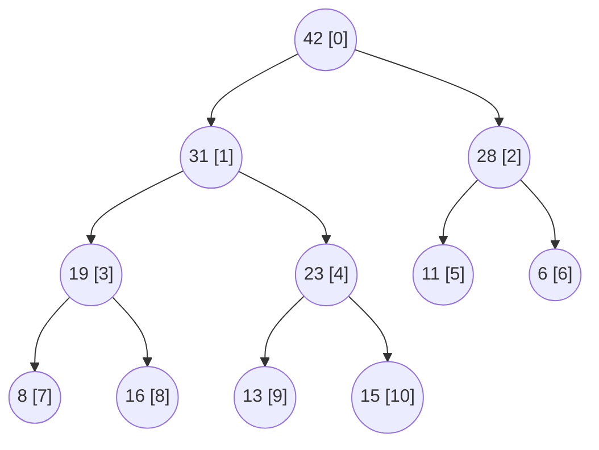
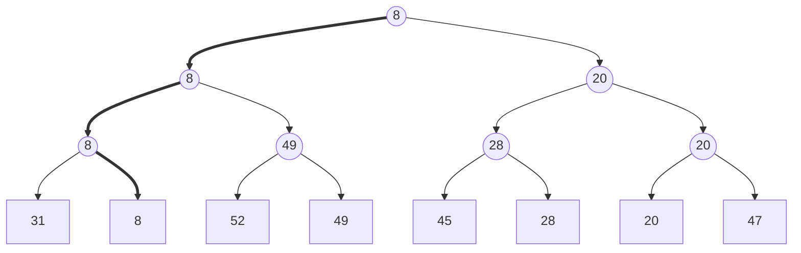

A **stack** and a **queue** access elements in the order of insertion, and a search tree accesses arbitrary elements by key; many problems care only about "the most important element at the moment": an operating system schedules the task of highest priority, a discrete-event simulation processes the earliest event, building a **Huffman tree** merges the two trees of smallest weight at each step, and **Dijkstra's algorithm** and **Prim's algorithm** repeatedly extract the nearest vertex. The priority queue serves this need for access by priority. This chapter first explains why it need not maintain a total order among its elements and a partial order suffices, which leads to the simple and efficient binary heap, to the $O(n)$ heap construction algorithm built on it, and to heapsort. It then discusses several variants suited to different situations: tournament trees (with loser trees for multiway merging), d-ary heaps (which speed up priority-first search on graphs), leftist heaps (which support efficient merging), and priority search trees (a combination of heap and search tree). The lower bound for comparison-based sorting (Theorem 2.5.3) also shows that the operations of a priority queue cannot be faster than $O(\log n)$.

## 12.1. The Interface and Basic Implementations

### 12.1.1. Access by Priority

**Definition 12.1.1 (Priority Queue)** A data structure that maintains a set of elements, each with a comparable priority, and supports the three basic operations of inserting an element (`insert`), reading the element of highest priority (`getMax`), and deleting the element of highest priority (`delMax`), is called a **priority queue**.

In this chapter "higher priority" means "larger key", that is, we consider maximum priority queues; a minimum priority queue simply reverses the comparison (Python's `heapq` is a min-heap). A **stack** and a **queue** can both be regarded as special cases of a priority queue: the priority is determined entirely by the insertion order, and the most recently inserted element (stack) or the earliest inserted element (queue) has the highest priority.

The use cases of priority queues share three features: the extreme element must be located repeatedly and quickly; the set itself changes dynamically; and the priorities of elements may also change dynamically (for example, the distances of vertices keep decreasing in Dijkstra's algorithm). Common applications include:

- scheduling: process scheduling and interrupt handling in operating systems, the event queue of a discrete-event simulation;
- greedy algorithms: **Huffman coding**, minimum spanning trees by Kruskal and Prim, Dijkstra's shortest paths;
- sorting: internal sorting (heapsort), multiway merging in external sorting, partial sorting when only the first $k$ results are needed;
- computational geometry: the event queue ordered by coordinate in plane-sweep algorithms.

### 12.1.2. Implementation with Existing Structures

The structures of the previous chapters give the following costs for the operations ($n$ is the number of elements):

| Implementation | `getMax` | `delMax` | `insert` |
|---|---|---|---|
| Unsorted vector | $O(n)$: traverse | $O(n)$: traverse, then delete | $O(1)$: insert at the end |
| Sorted vector (ascending) | $O(1)$: last element | $O(1)$: delete the last element | $O(n)$: binary search in $O(\log n)$, then shift elements |
| Unsorted list | $O(n)$ | $O(n)$ | $O(1)$ |
| Sorted list (descending) | $O(1)$: first node | $O(1)$ | $O(n)$: sequential search for the position |
| Balanced binary search tree | $O(\log n)$ | $O(\log n)$ | $O(\log n)$ |

A **balanced binary search tree** (AVL tree, red-black tree, splay tree) already achieves $O(\log n)$ for all three operations, but its functionality far exceeds what is needed: it maintains a total order among all elements, can search by any key and traverse in order, whereas a priority queue cares only about the maximum. When only the extreme element must be found, maintaining a partial order is enough. This suggests that a simpler implementation with a smaller constant exists, whose asymptotic complexity cannot be better than $O(\log n)$:

**Property 12.1.1** In the model where only keys can be compared, there is no priority queue for which both `insert` and `delMax` take $o(\log n)$ comparisons.

**Proof** If there were, inserting $n$ elements one by one and then performing $n$ consecutive `delMax` operations would sort them with $o(n \log n)$ comparisons, contradicting Theorem 2.5.3 (the lower bound for comparison-based sorting). $\square$

Note that the claim is that "both" cannot be fast: making `insert` alone $O(1)$ is possible (for example, the Fibonacci heap mentioned later has amortized $O(1)$ `insert` and $O(\log n)$ `delMax`).

## 12.2. The Binary Heap

### 12.2.1. Structure Property and Heap Property

After the nodes of a **complete binary tree** are numbered in **level-order traversal**, they can be stored compactly in a **vector**, with parent-child relations computed directly from ranks and no pointers. For a node of **rank** $i$ (ranks start from 0):

$$
\mathrm{Parent}(i) = \left\lfloor \frac{i-1}{2} \right\rfloor,\qquad
\mathrm{LChild}(i) = 2i + 1,\qquad
\mathrm{RChild}(i) = 2i + 2.
$$

A complete binary tree with $n$ nodes has height $\lfloor \log_2 n \rfloor$; the nodes of rank at least $\lfloor n/2 \rfloor$ are all leaves, and the maximum rank of an internal node is $\lfloor n/2 \rfloor - 1$.

**Definition 12.2.1 (Binary Heap)** A structure that is logically a complete binary tree, physically stored in level-order in a vector $H[0, n)$, and in which every node is no greater than its parent:

$$
H[i] \le H[\mathrm{Parent}(i)],\qquad 0 < i < n,
$$
is called a **binary heap**, or simply a **heap**. The inequality above is called the **heap property**.

By the heap property and transitivity, every node is no greater than all of its ancestors, so $H[0]$ is the global maximum and `getMax` takes only $O(1)$ time. The heap property constrains only the order between parent and child; there is no constraint between siblings or between different subtrees, which is exactly what "a partial order suffices" means. The figure below shows a heap with 11 nodes; the numbers in brackets are the ranks of the nodes, and the corresponding vector is `42 31 28 19 23 11 6 8 16 13 15`:



### 12.2.2. Insertion and Percolating Up

To insert a new element $e$, first append it to the end of the vector. The structure property still holds (the complete binary tree gains one leaf at the end), and the heap property can be violated only between $e$ and its parent. If $e$ is larger than its parent, swap the two; after the swap, $e$ may again be larger than its new parent, and we continue swapping until $e$ is no larger than its parent or reaches the root.

**Algorithm 12.2.1 (Percolate Up)** Suppose $H[0, i)$ satisfies the heap property and $H[i]$ is the newly appended element. Repeatedly compare $H[i]$ with $H[\mathrm{Parent}(i)]$: if the parent is smaller, swap the two and set $i \gets \mathrm{Parent}(i)$; otherwise stop. This procedure is called percolate up.

After each swap, all parent-child pairs except $e$ and its new parent satisfy the heap property (the old parent moved down is larger than all of its former descendants), so when percolating up ends the heap property holds again everywhere. Since $e$ is swapped only with ancestors, and there are at most $\lfloor \log_2 n \rfloor$ of them, the worst-case time of insertion is $O(\log n)$. In practice it is often much faster: when elements are inserted one by one from random input, an element rises on average only a bit more than one level (about 1.3 levels in experiments), because half of the nodes are on the bottom level and most elements belong near the bottom anyway.

An implementation need not swap at every level: take $e$ out first, move the smaller ancestors down one level one by one, and finally put $e$ into the vacated position. This costs one assignment per level, rather than the three assignments of a swap. The code below is written this way (the "hole" moves up).

### 12.2.3. Deletion and Percolating Down

To delete the top of the heap, fill the root with the last element $x$. The structure property still holds, and the heap property can be violated only between $x$ and its children. We then swap $x$ with the larger child (swapping with the smaller child would make the smaller one the parent of the larger one) and continue downward, until $x$ is no smaller than all its children or becomes a leaf.

**Algorithm 12.2.2 (Percolate Down)** Suppose the subtrees rooted at the two children of $H[i]$ are both heaps. Repeatedly compare $H[i]$ with its larger child $H[c]$: if $H[i] < H[c]$, swap the two and set $i \gets c$; otherwise stop. This procedure is called percolate down.

Each level that $x$ descends costs two comparisons (first the two children are compared, then $x$ with the larger one), and there are at most $\lfloor \log_2 n \rfloor$ levels, so the worst-case time of `delMax` is $O(\log n)$, with about $2\log_2 n$ comparisons. Unlike percolating up, the last element moved to the root comes from the bottom level and is usually small, so percolating down generally goes close to the bottom, and the average case is also close to $2\log_2 n$ comparisons.

A trick that reduces the comparisons (due to Floyd, and used by CPython's `heapq`): without comparing with $x$, push the hole along the path of "larger children" all the way down to a leaf, with one comparison per level; then place $x$ at the leaf and percolate it up. Since $x$ is usually small, percolating up goes only a few levels, and the total number of comparisons is about $\log_2 n + O(1)$.

### 12.2.4. Bulk Heap Construction

Given $n$ elements, we want to organize them into a heap. The most direct method is to insert them one by one (top-down percolating up): in the worst case every node percolates up to the root, at a cost proportional to its depth. The bottom level alone has about $n/2$ nodes, all of depth $\log_2 n$, so the total time is $\Theta(n \log n)$, long enough to do a complete sort.

**Algorithm 12.2.3 (Floyd's Heap Construction)** Put the $n$ elements into a vector in arbitrary order, then for each internal node $i = \lfloor n/2 \rfloor - 1, \dots, 1, 0$, in decreasing order of rank, perform percolate down (R. W. Floyd, 1964).

Correctness: each leaf is a heap by itself. When node $i$ is processed, its two subtrees are already heaps (their roots have larger ranks and have been processed), and percolating $H[i]$ down merges "two heaps plus a new root" into one heap. So the algorithm can be understood as merging subheaps level by level, and after the root is processed the heap property holds globally.

**Theorem 12.2.1** Floyd's heap construction uses at most $2n$ comparisons and runs in $O(n)$ time.

**Proof** The cost of percolating down node $i$ is proportional to its height (the distance to the deepest leaf): each level descended takes at most two comparisons, and at most as many levels are descended as the height. So the total number of comparisons is at most twice the sum of the heights of all nodes. Consider first a **perfect binary tree** of height $h$, with $n = 2^{h+1} - 1$: there are $2^k$ nodes of depth $k$, with height $h - k$, so the sum of heights is

$$
S(h) = \sum_{k=0}^{h} (h - k)\, 2^k = 2^{h+1} - h - 2 = n - \log_2(n + 1) < n.
$$

(The last sum can be computed as follows: let $j = h - k$, so $S(h) = 2^h \sum_{j=0}^{h} j\, 2^{-j}$, and $\sum_{j \ge 0} j\,2^{-j} = 2$; an exact computation gives the formula above.) For a general complete binary tree, induction on $n$ shows that the sum of heights is exactly $n - \nu(n)$, where $\nu(n)$ is the number of 1s in the binary representation of $n$; in any case it is less than $n$. So the number of comparisons is less than $2n$. $\square$

The two construction methods differ only in order, yet their costs differ substantially. The cost of percolating up is proportional to depth, and the cost of percolating down is proportional to height; in a complete binary tree most nodes are near the bottom, with large depth and small height. The top-down method makes the most nodes travel the longest paths, while the bottom-up method makes the most nodes travel the shortest paths. The figure below shows the average number of comparisons per element for the two methods:


Floyd's algorithm requires all elements at once, and does not apply when elements arrive one by one (online); then one can only insert them one by one, and each insertion is still $O(\log n)$.

### 12.2.5. Implementation

The code below combines the operations above. The C++ version is a class template and the Python version stores the elements in a list; in both, `top` and `pop` require the heap to be nonempty. At the end the program performs **differential testing** against directly computing the maximum:

```cpp tab
#include <algorithm>
#include <format>
#include <iostream>
#include <random>
#include <utility>
#include <vector>

// Binary max-heap stored in a vector: the children of i are 2i+1 and 2i+2.
template <typename T>
class MaxHeap {
public:
    MaxHeap() = default;
    explicit MaxHeap(std::vector<T> items) : a_(std::move(items)) {
        for (std::size_t i = a_.size() / 2; i-- > 0;) sift_down(i);  // Floyd
    }
    bool empty() const { return a_.empty(); }
    std::size_t size() const { return a_.size(); }
    const T& top() const { return a_.front(); }           // getMax; heap must be non-empty

    void push(T x) {                                       // insert
        a_.push_back(std::move(x));
        sift_up(a_.size() - 1);
    }
    T pop() {                                              // delMax; heap must be non-empty
        T top = std::move(a_.front());
        if (a_.size() > 1) a_.front() = std::move(a_.back());
        a_.pop_back();
        if (!a_.empty()) sift_down(0);
        return top;
    }

private:
    std::vector<T> a_;

    void sift_up(std::size_t i) {                          // percolate up
        T x = std::move(a_[i]);
        while (i > 0 && a_[(i - 1) / 2] < x) {             // the parent is smaller:
            a_[i] = std::move(a_[(i - 1) / 2]);            // move it down, the hole goes up
            i = (i - 1) / 2;
        }
        a_[i] = std::move(x);
    }
    void sift_down(std::size_t i) {                        // percolate down
        const std::size_t n = a_.size();
        T x = std::move(a_[i]);
        for (std::size_t c; (c = 2 * i + 1) < n; i = c) {
            if (c + 1 < n && a_[c] < a_[c + 1]) ++c;       // the larger child
            if (!(x < a_[c])) break;
            a_[i] = std::move(a_[c]);                      // move it up, the hole goes down
        }
        a_[i] = std::move(x);
    }
};

int main() {
    MaxHeap<int> h({15, 11, 28, 8, 31, 6, 19, 23, 16, 13});
    h.push(42);
    while (!h.empty()) std::cout << std::format("{} ", h.pop());
    std::cout << '\n';

    // Differential test against std::sort with random pushes and pops.
    std::mt19937 rng(1);
    for (int trial = 0; trial < 300; ++trial) {
        std::vector<int> init(rng() % 50);
        for (int& x : init) x = static_cast<int>(rng() % 100);
        MaxHeap<int> heap(init);
        std::vector<int> ref = init;                       // multiset kept as a vector
        for (int op = 0; op < 200; ++op) {
            if (rng() % 10 < 6 || ref.empty()) {
                int x = static_cast<int>(rng() % 100);
                heap.push(x);
                ref.push_back(x);
            } else {
                auto it = std::max_element(ref.begin(), ref.end());
                if (heap.pop() != *it) { std::cout << "mismatch\n"; return 1; }
                ref.erase(it);
            }
        }
    }
    std::cout << "random tests passed\n";
}
```

```python tab
import random


class MaxHeap:
    """Binary max-heap on a list: the children of i are 2i+1 and 2i+2."""

    def __init__(self, items=()):
        self._a = list(items)
        for i in reversed(range(len(self._a) // 2)):   # Floyd: bottom-up
            self._sift_down(i)

    def __len__(self) -> int:
        return len(self._a)

    def top(self):                                     # getMax
        return self._a[0]

    def push(self, x) -> None:                         # insert
        self._a.append(x)
        self._sift_up(len(self._a) - 1)

    def pop(self):                                     # delMax
        a = self._a
        last = a.pop()                                 # IndexError if empty
        if not a:
            return last
        top, a[0] = a[0], last
        self._sift_down(0)
        return top

    def _sift_up(self, i: int) -> None:                # percolate up
        a, x = self._a, self._a[i]
        while i > 0 and a[(i - 1) // 2] < x:           # move the parent down
            a[i] = a[(i - 1) // 2]
            i = (i - 1) // 2
        a[i] = x

    def _sift_down(self, i: int) -> None:              # percolate down
        a, n, x = self._a, len(self._a), self._a[i]
        while (c := 2 * i + 1) < n:
            if c + 1 < n and a[c] < a[c + 1]:          # the larger child
                c += 1
            if not x < a[c]:
                break
            a[i] = a[c]                                # move the child up
            i = c
        a[i] = x


h = MaxHeap([15, 11, 28, 8, 31, 6, 19, 23, 16, 13])
h.push(42)
print(*(h.pop() for _ in range(len(h))))

# Differential test against max() with random pushes and pops.
rng = random.Random(1)
for trial in range(300):
    init = [rng.randrange(100) for _ in range(rng.randrange(50))]
    heap, ref = MaxHeap(init), list(init)
    for op in range(200):
        if rng.random() < 0.6 or not ref:
            x = rng.randrange(100)
            heap.push(x)
            ref.append(x)
        else:
            m = max(ref)
            assert heap.pop() == m
            ref.remove(m)
print("random tests passed")
```

### 12.2.6. Extended Interface and Real-World Implementations

Besides the three basic operations, many algorithms also need to change the priority of an arbitrary element: after increasing a priority, percolate the element up; after decreasing it, percolate it down; and an arbitrary element can be deleted by first raising its priority to infinity and then calling `delMax`; all are $O(\log n)$. This requires being able to find the position of the element in the vector, so an extra "element → rank" index table must be maintained and updated whenever an element moves (an indexed heap).

Standard library implementations:

- C++'s `std::priority_queue<T, Container, Compare>` ([4.2.10](/4.2.10)) is a container adapter that by default maintains a max-heap on a `std::vector`, with the comparator defaulting to `std::less<T>`; using `std::greater<T>` gives a min-heap. It provides only `push`, `top` and `pop`, and does not support changing priorities. The underlying algorithms `std::make_heap` ($O(n)$ construction), `std::push_heap`, `std::pop_heap` and `std::sort_heap` can also be applied directly to any random-access range.
- Python's `heapq` module defines no new type but operates on an ordinary `list` as a min-heap: `heapify` (Floyd's algorithm), `heappush`, `heappop`, `heapreplace` (pop, then push), `heappushpop`, as well as `nlargest`, `nsmallest` and `merge`. Since Python 3.14 there are also max-heap versions (`heappush_max`, `heappop_max`, etc.); before that, the idiom was to negate the priorities. Elements are often written as tuples `(priority, count, item)`, where the increasing `count` makes elements of equal priority leave the queue in insertion order and also avoids comparing incomparable `item`s. `heapq` does not support changing priorities; the usual approach is **lazy deletion**: push a new entry and mark the old entry as invalid, skipping invalid entries when popping.

## 12.3. Heapsort

**Selection sort** selects the largest element from the unsorted part each time, and the selection takes $O(n)$ time; organizing the unsorted part as a heap reduces selection to $O(\log n)$. This is heapsort (J. W. J. Williams, 1964). Even better, it can be done in place: a heap is physically a prefix of a **vector**, each `delMax` frees a position at the end of the vector, and the deleted maximum is exactly what belongs there.

**Algorithm 12.3.1 (Heapsort)** For a vector $A[0, n)$: first build it into a heap with Floyd's algorithm; then repeatedly swap the top $A[0]$ with the last element of the heap, decrease the heap size by 1, and percolate the new top down, until only one element remains in the heap.

Throughout the process the vector consists of two segments: the prefix $H$ is a heap and the suffix $S$ is already sorted, and every element of $H$ is no greater than any element of $S$. Each swap amounts to inserting the maximum of the heap at the front of $S$ and deleting the top of $H$, so the invariant is preserved; in the end $H$ is empty and the whole vector is sorted. Take `4 2 5 1 3` as an example:

| Step | Heap $H$ | Sorted suffix $S$ | Description |
|---|---|---|---|
| Build | `5 3 4 1 2` | empty | percolate down ranks 1, 0 in turn |
| 1 | `4 3 2 1` | `5` | swap 5 and 2, percolate down 2 |
| 2 | `3 1 2` | `4 5` | swap 4 and 1, percolate down 1 |
| 3 | `2 1` | `3 4 5` | swap 3 and 2, percolate down 2 |
| 4 | `1` | `2 3 4 5` | swap 2 and 1 |

```cpp tab
#include <algorithm>
#include <format>
#include <iostream>
#include <random>
#include <utility>
#include <vector>

// Percolate a[i] down within the heap a[0, n).
template <typename T>
void sift_down(std::vector<T>& a, std::size_t n, std::size_t i) {
    T x = std::move(a[i]);
    for (std::size_t c; (c = 2 * i + 1) < n; i = c) {
        if (c + 1 < n && a[c] < a[c + 1]) ++c;
        if (!(x < a[c])) break;
        a[i] = std::move(a[c]);
    }
    a[i] = std::move(x);
}

template <typename T>
void heap_sort(std::vector<T>& a) {
    std::size_t n = a.size();
    for (std::size_t i = n / 2; i-- > 0;) sift_down(a, n, i);  // heapify: O(n)
    while (n > 1) {                     // a[0, n) is a heap, a[n, size) is sorted
        std::swap(a[0], a[--n]);        // the maximum joins the sorted suffix
        sift_down(a, n, 0);
    }
}

int main() {
    std::vector<int> a = {4, 2, 5, 1, 3};
    heap_sort(a);
    for (int x : a) std::cout << std::format("{} ", x);
    std::cout << '\n';

    std::mt19937 rng(2);                // differential test against std::sort
    for (int trial = 0; trial < 1000; ++trial) {
        std::vector<int> v(rng() % 200);
        for (int& x : v) x = static_cast<int>(rng() % 50);
        std::vector<int> ref = v;
        heap_sort(v);
        std::sort(ref.begin(), ref.end());
        if (v != ref) { std::cout << "mismatch\n"; return 1; }
    }
    std::cout << "random tests passed\n";
}
```

```python tab
import random


def sift_down(a: list, n: int, i: int) -> None:
    """Percolate a[i] down within the heap a[0:n]."""
    x = a[i]
    while (c := 2 * i + 1) < n:
        if c + 1 < n and a[c] < a[c + 1]:
            c += 1
        if not x < a[c]:
            break
        a[i] = a[c]
        i = c
    a[i] = x


def heap_sort(a: list) -> None:
    n = len(a)
    for i in reversed(range(n // 2)):   # heapify: O(n)
        sift_down(a, n, i)
    while n > 1:                        # a[:n] is a heap, a[n:] is sorted
        n -= 1
        a[0], a[n] = a[n], a[0]         # the maximum joins the sorted suffix
        sift_down(a, n, 0)


a = [4, 2, 5, 1, 3]
heap_sort(a)
print(a)

rng = random.Random(2)                  # differential test against sorted()
for trial in range(1000):
    v = [rng.randrange(50) for _ in range(rng.randrange(200))]
    ref = sorted(v)
    heap_sort(v)
    assert v == ref
print("random tests passed")
```

Construction takes $O(n)$ and the $n - 1$ percolations down take $O(\log n)$ each, so the total time is $O(n \log n)$, also in the worst case, using only $O(1)$ additional space. The number of comparisons is about $2n \log_2 n$ (with the trick of the previous section, first pushing the hole down and then percolating up, the average can be reduced to about $n \log_2 n$). Heapsort is not stable: swaps jump over intermediate elements. Its weakness is poor locality of reference: when percolating down, the ranks of parent and child differ by a factor of two, so for large data the cache hit rate is low, and in practice it is usually slower than quicksort. Its most important use is as a safety net: C++'s `std::sort` uses **introsort**, which switches to heapsort when the quicksort recursion becomes too deep, thereby guaranteeing $O(n \log n)$ in the worst case ([4.3.14](/4.3.14)); `std::partial_sort` is also based on heaps.

## 12.4. Tournament Trees

### 12.4.1. Winner Trees

The knockout tournament in sports gives another way to organize selection.

**Definition 12.4.1 (Tournament Tree)** A complete binary tree whose leaves are the competing elements and in which each internal node records the winner of the match between its two children (for example the one with the smaller key) is called a **tournament tree**, also called a **winner tree**.

The root is the global champion, playing a role similar to the top of a heap. Unlike a heap, the elements are stored only in the leaves; internal nodes record references to winners, and the same element may win consecutively along a path and appear in several internal nodes.

- Construction: $n$ leaves and $n - 1$ internal nodes, with $n - 1$ matches played bottom-up, in $O(n)$ time;
- Updating after the champion is taken out: the leaf of the champion withdraws (marked empty), and only the match results recorded at its ancestors can change, so it suffices to replay the matches level by level along the path from this leaf to the root, in $O(\log n)$ time.

Repeatedly taking out the champion and replaying gives *tournament sort*: the total time is $n \cdot O(\log n) = O(n \log n)$, meeting the lower bound for sorting. Compared with heapsort, only one comparison per level is needed, so the number of comparisons is about $n \log_2 n$, but $O(n)$ additional space is needed. The figure below is a winner tree on 8 elements (the smaller wins); after the champion 8 is taken out, only the three internal nodes on the bold path need to be recomputed:



The implementation below stores the $2n - 1$ nodes in $[1, 2n)$ of a **vector**: the children of node $v$ are $2v$ and $2v + 1$, and the leaves are exactly $n, \dots, 2n - 1$. These $2n - 1$ nodes form a complete binary tree, and $n$ need not be a power of 2.

```cpp tab
#include <algorithm>
#include <format>
#include <iostream>
#include <random>
#include <vector>

// Tournament sort with a winner tree. Node v has children 2v and 2v+1;
// leaf i is node n+i; w[v] is the index of the winner below v, or -1.
std::vector<int> tournament_sort(const std::vector<int>& a) {
    const long n = static_cast<long>(a.size());
    std::vector<int> out;
    if (n == 0) return out;
    std::vector<long> w(2 * n, -1);
    auto play = [&](long x, long y) {           // the smaller key wins
        if (x < 0) return y;
        if (y < 0) return x;
        return a[y] < a[x] ? y : x;
    };
    for (long i = 0; i < n; ++i) w[n + i] = i;
    for (long v = n - 1; v >= 1; --v) w[v] = play(w[2 * v], w[2 * v + 1]);  // n-1 matches
    for (long round = 0; round < n; ++round) {
        long champion = w[1];                   // the root holds the overall winner
        out.push_back(a[champion]);
        long v = n + champion;
        w[v] = -1;                              // deactivate its leaf
        for (v /= 2; v >= 1; v /= 2)            // replay along the path to the root
            w[v] = play(w[2 * v], w[2 * v + 1]);
    }
    return out;
}

int main() {
    std::vector<int> a = {31, 8, 52, 49, 45, 28, 20, 47};
    for (int x : tournament_sort(a)) std::cout << std::format("{} ", x);
    std::cout << '\n';

    std::mt19937 rng(3);                        // differential test against std::sort
    for (int trial = 0; trial < 1000; ++trial) {
        std::vector<int> v(rng() % 100);
        for (int& x : v) x = static_cast<int>(rng() % 30);
        std::vector<int> ref = v;
        std::sort(ref.begin(), ref.end());
        if (tournament_sort(v) != ref) { std::cout << "mismatch\n"; return 1; }
    }
    std::cout << "random tests passed\n";
}
```

```python tab
import random


def tournament_sort(a: list) -> list:
    """Winner tree: node v has children 2v, 2v+1; leaf i is node n+i."""
    n = len(a)
    if n == 0:
        return []
    w = [None] * (2 * n)                        # w[v]: index of the winner below v

    def play(x, y):                             # the smaller key wins
        if x is None:
            return y
        if y is None:
            return x
        return y if a[y] < a[x] else x

    w[n:] = range(n)
    for v in range(n - 1, 0, -1):               # n - 1 matches
        w[v] = play(w[2 * v], w[2 * v + 1])
    out = []
    for _ in range(n):
        champion = w[1]                         # the root holds the overall winner
        out.append(a[champion])
        v = n + champion
        w[v] = None                             # deactivate its leaf
        v //= 2
        while v >= 1:                           # replay along the path to the root
            w[v] = play(w[2 * v], w[2 * v + 1])
            v //= 2
    return out


print(tournament_sort([31, 8, 52, 49, 45, 28, 20, 47]))

rng = random.Random(3)                          # differential test against sorted()
for trial in range(1000):
    v = [rng.randrange(30) for _ in range(rng.randrange(100))]
    assert tournament_sort(v) == sorted(v)
print("random tests passed")
```

Tournament trees are particularly suitable for partial selection: to find the $k$ smallest of $n$ elements ($k \ll n$), initialization takes $n - 1$ comparisons, and each later step takes about $\log_2 n$, for $n - 1 + k \log_2 n$ in total. A min-heap also gives $O(n + k \log n)$, asymptotically comparable, but with different constant factors: percolating down in a heap needs two comparisons per level. This difference is most obvious when selecting the runner-up: a tournament tree finds the smallest and second smallest elements with only $n + \lceil \log_2 n \rceil - 2$ comparisons (the second smallest must be one of the $\lceil \log_2 n \rceil$ elements that lost to the champion), which is exactly optimal (Kislitsyn, 1964).

### 12.4.2. Loser Trees

Replaying matches in a winner tree has one inconvenience: when going up the path, at each level one must find the sibling of the current node and fetch the winner recorded there to compete with, so the access detours between the path and the siblings. The loser tree removes this detour by recording differently.

**Definition 12.4.2 (Loser Tree)** A tournament tree in which each internal node records the loser of the match held there, with an extra node above the root recording the champion, is called a **loser tree**.

After the key of the leaf of the champion is updated, we go up the path from it: at each node the new element plays against the loser recorded at that node; the loser stays and the winner continues upward; when the top is reached, the winner is the new champion. Each level requires visiting only one node on the path and making one comparison, with no access to siblings. The losers originally recorded on the path are exactly the opponents the old champion defeated along the way, so this gives the same result as replaying in the winner tree.

A typical use of loser trees is $k$-way merging in external sorting: each leaf represents a sorted run, with the key being the current first element of the run; after each output of the champion, its run advances by one element, and a single $O(\log k)$ replay suffices. The implementation below initializes all internal nodes with a "sentinel" leaf $k$ (an imaginary negative infinity) and then lets each leaf go up in turn, which builds the initial loser tree; a run that has been exhausted counts as positive infinity and always loses.

```cpp tab
#include <algorithm>
#include <format>
#include <iostream>
#include <random>
#include <utility>
#include <vector>

// k-way merge of sorted runs with a loser tree.
// Leaf i (run i) is node k+i; internal node t (1 <= t < k) stores the loser
// of the match played there, and node 0 stores the overall winner.
std::vector<int> kway_merge(const std::vector<std::vector<int>>& runs) {
    const int k = static_cast<int>(runs.size());
    std::vector<int> out;
    if (k == 0) return out;
    std::vector<std::size_t> pos(k, 0);           // the head of each run
    auto beats = [&](int i, int j) {              // does leaf i beat leaf j?
        if (j == k) return false;                 // k is a sentinel that beats everyone
        if (i == k) return true;
        bool ei = pos[i] == runs[i].size(), ej = pos[j] == runs[j].size();
        if (ei || ej) return !ei;                 // an exhausted run always loses
        return runs[i][pos[i]] < runs[j][pos[j]];
    };
    std::vector<int> tree(k, k);                  // all nodes start with the sentinel
    auto replay = [&](int s) {                    // leaf s has a new key
        for (int t = (s + k) / 2; t > 0; t /= 2)
            if (beats(tree[t], s)) std::swap(s, tree[t]);  // s lost: it stays here
        tree[0] = s;                              // the winner goes on
    };
    for (int i = k - 1; i >= 0; --i) replay(i);   // build
    for (;;) {
        int w = tree[0];
        if (pos[w] == runs[w].size()) break;      // the winner is exhausted: all are
        out.push_back(runs[w][pos[w]++]);
        replay(w);                                // only the winner's path is replayed
    }
    return out;
}

int main() {
    std::vector<std::vector<int>> runs = {{8, 31}, {49, 52}, {28, 45}, {20, 47}, {5}};
    for (int x : kway_merge(runs)) std::cout << std::format("{} ", x);
    std::cout << '\n';

    std::mt19937 rng(4);                          // differential test against std::sort
    for (int trial = 0; trial < 1000; ++trial) {
        std::vector<std::vector<int>> rs(rng() % 9);
        std::vector<int> ref;
        for (auto& r : rs) {
            r.resize(rng() % 20);
            for (int& x : r) x = static_cast<int>(rng() % 50);
            std::sort(r.begin(), r.end());
            ref.insert(ref.end(), r.begin(), r.end());
        }
        std::sort(ref.begin(), ref.end());
        if (kway_merge(rs) != ref) { std::cout << "mismatch\n"; return 1; }
    }
    std::cout << "random tests passed\n";
}
```

```python tab
import random


def kway_merge(runs: list[list]) -> list:
    """Loser tree: leaf i is node k+i; node t < k keeps the loser played
    there, node 0 the overall winner."""
    k = len(runs)
    if k == 0:
        return []
    pos = [0] * k                                 # the head of each run

    def beats(i: int, j: int) -> bool:            # does leaf i beat leaf j?
        if j == k:                                # k is a sentinel that beats everyone
            return False
        if i == k:
            return True
        ei, ej = pos[i] == len(runs[i]), pos[j] == len(runs[j])
        if ei or ej:                              # an exhausted run always loses
            return not ei
        return runs[i][pos[i]] < runs[j][pos[j]]

    tree = [k] * k                                # all nodes start with the sentinel

    def replay(s: int) -> None:                   # leaf s has a new key
        t = (s + k) // 2
        while t > 0:
            if beats(tree[t], s):                 # s lost: it stays here
                s, tree[t] = tree[t], s
            t //= 2
        tree[0] = s                               # the winner goes on

    for i in reversed(range(k)):                  # build
        replay(i)
    out = []
    while pos[w := tree[0]] < len(runs[w]):       # stop when the winner is exhausted
        out.append(runs[w][pos[w]])
        pos[w] += 1
        replay(w)                                 # only the winner's path is replayed
    return out


print(kway_merge([[8, 31], [49, 52], [28, 45], [20, 47], [5]]))

rng = random.Random(4)                            # differential test against sorted()
for trial in range(1000):
    rs = [sorted(rng.randrange(50) for _ in range(rng.randrange(20)))
          for _ in range(rng.randrange(9))]
    assert kway_merge(rs) == sorted(x for r in rs for x in r)
print("random tests passed")
```

## 12.5. d-ary Heaps

### 12.5.1. Heaps in Priority-First Search

**Priority-first search** (PFS) on graphs is a unified framework for algorithms such as BFS, DFS, Prim and Dijkstra ([4.3.11](/4.3.11)): the algorithms differ only in how the priorities of vertices are updated. Whenever a vertex joins the traversal tree, two kinds of operations are needed: updating the priorities of its neighbors outside the tree, and selecting the vertex of highest priority outside the tree. If we use adjacency lists with selection by scanning, selection costs $O(n^2)$ in total and updates cost $O(e)$ in total, for $O(n^2 + e)$ ($n$ is the number of vertices and $e$ the number of edges).

Organize the vertices outside the tree as a priority queue: initial construction takes $O(n)$; there are $n$ `delMax` operations at $O(\log n)$ each; and each edge causes at most one priority increase (`increase`, i.e., percolating up), $e$ in total, at $O(\log n)$ each. The total time is $O((n + e)\log n)$. This is good for a **sparse graph** ($e = O(n)$) and worse than the conventional $O(n^2)$ implementation for a **dense graph** ($e = \Theta(n^2)$). The problem is that the two kinds of operations are unbalanced in number: `increase` may occur as many as $e$ times, `delMax` only $n$ times, yet the binary heap makes them cost the same.

### 12.5.2. d-ary Heaps

**Definition 12.5.1 (d-ary Heap)** A structure obtained by replacing the binary tree of the binary heap by a complete $d$-ary tree ($d \ge 2$), still stored in level-order in a vector and satisfying the heap property, is called a $d$-ary heap, collectively **d-ary heaps**.

The ranks of parents and children can still be converted simply:

$$
\mathrm{Parent}(i) = \left\lfloor \frac{i - 1}{d} \right\rfloor,\qquad
\mathrm{Child}_k(i) = d\,i + k,\quad 1 \le k \le d.
$$

When $d$ is not a power of 2 shifts cannot be used for speed, but this is only a difference in constants. The height drops to $\log_d n$: percolating up needs one comparison per level, so its cost drops to $O(\log_d n)$; percolating down must select the largest among $d$ children at each level, so its cost rises to $O(d \log_d n)$. It is truly "easy uphill, hard downhill": the cost of percolating down is proportional to $d \log_d n = (d/\ln d)\ln n$, and $d/\ln d$ attains its minimum at $d = \mathrm{e}$: at $d = 3$ percolating down is slightly faster than in a binary heap, at $d = 4$ it is the same, and only for $d > 4$ is it slower.

Thus the total time of PFS is $O(n \cdot d \log_d n + e \log_d n) = O((n d + e)\log_d n)$. Choosing $d \approx e/n$ (at least 2) balances the two terms and gives

$$
O\!\left(e \log_{e/n + 2} n\right).
$$

For a sparse graph ($e = O(n)$) this is $O(n \log n)$, the same as with a binary heap; for a dense graph ($e = \Theta(n^2)$), $\log_{n} n = 1$ and the bound is $O(n^2)$, the same as the conventional implementation; graphs in between adaptively obtain a good result. Going further, the Fibonacci heap (Fredman and Tarjan, 1987) reduces the amortized time of `increase` to $O(1)$, so that Dijkstra's algorithm achieves $O(e + n \log n)$. In practice the constants of Fibonacci heaps are too large, and 4-ary heaps are more commonly used: the tree is shorter, and the 4 children of a node are adjacent in memory, which is cache friendly.

```cpp tab
#include <algorithm>
#include <format>
#include <iostream>
#include <random>
#include <utility>
#include <vector>

// d-ary max-heap: the parent of i is (i-1)/d, its children are d*i+1 .. d*i+d.
template <typename T>
class DHeap {
public:
    explicit DHeap(std::size_t d, std::vector<T> items = {}) : d_(d), a_(std::move(items)) {
        if (a_.size() > 1)
            for (std::size_t i = (a_.size() - 2) / d_ + 1; i-- > 0;) sift_down(i);
    }
    bool empty() const { return a_.empty(); }
    const T& top() const { return a_.front(); }

    void push(T x) {                       // O(log_d n): one comparison per level
        a_.push_back(std::move(x));
        std::size_t i = a_.size() - 1;
        T y = std::move(a_[i]);
        while (i > 0 && a_[(i - 1) / d_] < y) {
            a_[i] = std::move(a_[(i - 1) / d_]);
            i = (i - 1) / d_;
        }
        a_[i] = std::move(y);
    }
    T pop() {                              // O(d log_d n): d comparisons per level
        T top = std::move(a_.front());
        if (a_.size() > 1) a_.front() = std::move(a_.back());
        a_.pop_back();
        if (!a_.empty()) sift_down(0);
        return top;
    }

private:
    std::size_t d_;
    std::vector<T> a_;

    void sift_down(std::size_t i) {
        const std::size_t n = a_.size();
        T x = std::move(a_[i]);
        for (std::size_t first; (first = d_ * i + 1) < n;) {
            std::size_t c = first;         // the largest of the (at most d) children
            for (std::size_t j = first + 1; j < std::min(first + d_, n); ++j)
                if (a_[c] < a_[j]) c = j;
            if (!(x < a_[c])) break;
            a_[i] = std::move(a_[c]);
            i = c;
        }
        a_[i] = std::move(x);
    }
};

int main() {
    DHeap<int> h(3, {15, 11, 28, 8, 31, 6, 19, 23, 16, 13});
    h.push(42);
    while (!h.empty()) std::cout << std::format("{} ", h.pop());
    std::cout << '\n';

    std::mt19937 rng(5);                   // differential test against std::sort
    for (int trial = 0; trial < 1000; ++trial) {
        std::size_t d = 2 + rng() % 7;
        std::vector<int> v(rng() % 100);
        for (int& x : v) x = static_cast<int>(rng() % 40);
        DHeap<int> heap(d, std::vector<int>(v.begin(), v.begin() + v.size() / 2));
        for (std::size_t i = v.size() / 2; i < v.size(); ++i) heap.push(v[i]);
        std::vector<int> out;
        while (!heap.empty()) out.push_back(heap.pop());
        std::sort(v.begin(), v.end(), std::greater<>());
        if (out != v) { std::cout << "mismatch\n"; return 1; }
    }
    std::cout << "random tests passed\n";
}
```

```python tab
import random


class DHeap:
    """d-ary max-heap: the parent of i is (i-1)//d, its children d*i+1 .. d*i+d."""

    def __init__(self, d: int, items=()):
        self.d, self._a = d, list(items)
        if len(self._a) > 1:
            for i in reversed(range((len(self._a) - 2) // d + 1)):
                self._sift_down(i)

    def __len__(self) -> int:
        return len(self._a)

    def top(self):
        return self._a[0]

    def push(self, x) -> None:             # O(log_d n): one comparison per level
        a, d = self._a, self.d
        a.append(x)
        i = len(a) - 1
        while i > 0 and a[(i - 1) // d] < x:
            a[i] = a[(i - 1) // d]
            i = (i - 1) // d
        a[i] = x

    def pop(self):                         # O(d log_d n): d comparisons per level
        a = self._a
        last = a.pop()
        if not a:
            return last
        top, a[0] = a[0], last
        self._sift_down(0)
        return top

    def _sift_down(self, i: int) -> None:
        a, d, n, x = self._a, self.d, len(self._a), self._a[i]
        while (first := d * i + 1) < n:
            c = max(range(first, min(first + d, n)), key=a.__getitem__)  # largest child
            if not x < a[c]:
                break
            a[i] = a[c]
            i = c
        a[i] = x


h = DHeap(3, [15, 11, 28, 8, 31, 6, 19, 23, 16, 13])
h.push(42)
print(*(h.pop() for _ in range(len(h))))

rng = random.Random(5)                     # differential test against sorted()
for trial in range(1000):
    v = [rng.randrange(40) for _ in range(rng.randrange(100))]
    heap = DHeap(rng.randrange(2, 9), v[: len(v) // 2])
    for x in v[len(v) // 2:]:
        heap.push(x)
    assert [heap.pop() for _ in range(len(heap))] == sorted(v, reverse=True)
print("random tests passed")
```

## 12.6. Leftist Heaps

### 12.6.1. Merging Heaps

Many applications need to merge two priority queues into one: $H = \mathrm{merge}(A, B)$, with $\lvert A \rvert = n \ge m = \lvert B \rvert$. With binary heaps there are two direct methods: insert the elements of $B$ into $A$ one by one, which takes $O(m \log(n + m))$ time; or concatenate the two vectors and rebuild the heap, which takes $O(n + m)$ time. Both are far from satisfactory; we would like to merge in $O(\log n)$ time.

Merging two heaps can be compared with merging two sorted sequences: compare the two tops, the larger becomes the root of the new heap, and one of its subtrees is merged recursively with the other heap. If the right subtree is always the one chosen for merging, the merge proceeds only along the "right chains" of the two heaps, at a cost proportional to the sum of the lengths of the two right chains. The question is how to control the length of the right chain.

The approach of C. A. Crane (1972) is to keep the heap property and add a "one-sided tilting" condition, so that nodes are distributed as far as possible on the left and merging involves only the right side. Such a tree is in general no longer a **complete binary tree**, so the structure property cannot be guaranteed, the tree cannot be stored in a vector, and nodes are linked by pointers as in a binary tree. This shows that the structure property is not an essential requirement of a heap; the heap property is.

### 12.6.2. Null Path Length

To characterize "tilting", we fill all empty child positions with external nodes, making the tree a **proper binary tree**.

**Definition 12.6.1 (Null Path Length)** The null path length of an external node is 0; the **null path length** of an internal node $x$ is

$$
\operatorname{npl}(x) = 1 + \min\{\operatorname{npl}(\mathrm{lc}(x)),\ \operatorname{npl}(\mathrm{rc}(x))\}.
$$

$\operatorname{npl}(x)$ is the distance from $x$ to the nearest external node, and also equals the height of the largest perfect subtree rooted at $x$ plus 1 (that is, the number of levels of this perfect subtree).

**Definition 12.6.2 (Leftist Heap)** A binary tree that satisfies the heap property and in which every internal node $x$ satisfies

$$
\operatorname{npl}(\mathrm{lc}(x)) \ge \operatorname{npl}(\mathrm{rc}(x))
$$
is called a **leftist heap**.

It follows immediately from the definition that $\operatorname{npl}(x) = 1 + \operatorname{npl}(\mathrm{rc}(x))$, that subheaps of a leftist heap are also leftist heaps, and that the leftist property does not conflict with the heap property. A leftist heap tends to distribute more nodes on the left, but this does not mean that the left subheap is necessarily larger or taller than the right one: npl describes only the "nearest external node", and a left subtree can be very sparse.

The path obtained by going from a node $x$ always along right branches is called the right chain of $x$. In a leftist heap, the npl of each node on the right chain is 1 less than that of the previous one, so the end of the right chain of the root $r$ is exactly the shallowest external node of the whole heap, and the length of the right chain (the number of internal nodes) is $d = \operatorname{npl}(r)$.

**Theorem 12.6.1** A leftist heap whose right chain has length $d$ has at least $2^d - 1$ internal nodes; conversely, the right chain of a leftist heap with $n$ nodes has length at most $\log_2(n + 1)$.

**Proof** $\operatorname{npl}(r) = d$ means that there is no external node within $d - 1$ levels of the root, that is, there is a perfect binary subtree rooted at $r$ with $d$ levels, which has $2^d - 1$ internal nodes. So $n \ge 2^d - 1$ and $d \le \log_2(n + 1)$. $\square$

### 12.6.3. Merging, Insertion and Deletion

**Algorithm 12.6.1 (Merging Leftist Heaps)** Merge the leftist heaps rooted at $a$ and $b$:

1. If one of them is empty, return the other;
2. Preprocessing: if $a < b$, swap $a$ and $b$, ensuring that the root of $a$ is the larger;
3. Recursively merge the right subheap of $a$ with $b$, and make the result the new right subheap of $a$;
4. Postprocessing: if now $\operatorname{npl}(\mathrm{lc}(a)) < \operatorname{npl}(\mathrm{rc}(a))$, swap the left and right subheaps of $a$; then update $\operatorname{npl}(a) = 1 + \operatorname{npl}(\mathrm{rc}(a))$; return $a$.

The heap property is guaranteed by step 2: the root of $a$ is no smaller than the root of $b$ and no smaller than its own right subheap, so it is no smaller than the merged right subheap. The leftist property is guaranteed by step 4. Each level of the recursion advances one step along the right chain of $a$ or $b$, so the recursion depth is at most the sum of the lengths of the two right chains, and by Theorem 12.6.1 the merge takes $O(\log n + \log m)$ time. The recursion can be rewritten as iteration: first perform a two-way merge from top to bottom along the right chains, then go back along the same path from bottom to top, checking and swapping the left and right subheaps and updating npl.

Insertion and deletion both reduce to merging: inserting an element $e$ is merging with the single-node heap containing only $e$; deleting the top is removing the root and then merging its left and right subheaps. Both are $O(\log n)$.

```cpp tab
#include <algorithm>
#include <format>
#include <iostream>
#include <memory>
#include <random>
#include <utility>
#include <vector>

// Leftist max-heap: npl(left) >= npl(right) at every node.
template <typename T>
class LeftistHeap {
    struct Node {
        T key;
        int npl = 1;                                   // npl(nullptr) = 0
        std::unique_ptr<Node> left, right;
        explicit Node(T k) : key(std::move(k)) {}
    };
    using Ptr = std::unique_ptr<Node>;
    Ptr root_;
    std::size_t size_ = 0;

    static int npl(const Ptr& p) { return p ? p->npl : 0; }

    static Ptr merge(Ptr a, Ptr b) {                   // O(log |a| + log |b|)
        if (!a) return b;
        if (!b) return a;
        if (a->key < b->key) std::swap(a, b);          // a has the larger root
        a->right = merge(std::move(a->right), std::move(b));  // along the right chain
        if (npl(a->left) < npl(a->right))              // restore leftism
            std::swap(a->left, a->right);
        a->npl = npl(a->right) + 1;
        return a;
    }

public:
    LeftistHeap() = default;
    LeftistHeap(LeftistHeap&&) = default;
    LeftistHeap& operator=(LeftistHeap&&) = default;
    ~LeftistHeap() {                                   // iterative: the left chain may be long
        std::vector<Ptr> stack;
        if (root_) stack.push_back(std::move(root_));
        while (!stack.empty()) {
            Ptr p = std::move(stack.back());
            stack.pop_back();
            if (p->left) stack.push_back(std::move(p->left));
            if (p->right) stack.push_back(std::move(p->right));
        }
    }
    bool empty() const { return !root_; }
    std::size_t size() const { return size_; }
    const T& top() const { return root_->key; }

    void push(T x) {
        root_ = merge(std::move(root_), std::make_unique<Node>(std::move(x)));
        ++size_;
    }
    T pop() {                                          // heap must be non-empty
        T top = std::move(root_->key);
        root_ = merge(std::move(root_->left), std::move(root_->right));
        --size_;
        return top;
    }
    void absorb(LeftistHeap& other) {                  // merge other into *this
        root_ = merge(std::move(root_), std::move(other.root_));
        size_ += other.size_;
        other.size_ = 0;
    }
};

int main() {
    LeftistHeap<int> a, b;
    for (int x : {17, 13, 6, 8, 5}) a.push(x);
    for (int x : {15, 10, 12, 7, 3}) b.push(x);
    a.absorb(b);
    while (!a.empty()) std::cout << std::format("{} ", a.pop());
    std::cout << '\n';

    std::mt19937 rng(6);                               // differential test against std::sort
    for (int trial = 0; trial < 500; ++trial) {
        LeftistHeap<int> h1, h2;
        std::vector<int> ref;
        for (int i = 0, n = static_cast<int>(rng() % 60); i < n; ++i) {
            int x = static_cast<int>(rng() % 40);
            (rng() % 2 ? h1 : h2).push(x);
            ref.push_back(x);
        }
        h1.absorb(h2);
        std::vector<int> out;
        while (!h1.empty()) out.push_back(h1.pop());
        std::sort(ref.begin(), ref.end(), std::greater<>());
        if (out != ref) { std::cout << "mismatch\n"; return 1; }
    }
    LeftistHeap<int> big;                              // increasing keys: a long left chain
    for (int i = 0; i < 200000; ++i) big.push(i);
    std::cout << std::format("random tests passed; top = {}\n", big.top());
}
```

```python tab
import random


class Node:
    __slots__ = ("key", "npl", "left", "right")

    def __init__(self, key):
        self.key, self.npl, self.left, self.right = key, 1, None, None


def npl(p) -> int:
    return p.npl if p else 0                   # npl(None) = 0


def merge(a, b):
    """Merge two leftist max-heaps; O(log |a| + log |b|)."""
    if a is None:
        return b
    if b is None:
        return a
    if a.key < b.key:                          # a has the larger root
        a, b = b, a
    a.right = merge(a.right, b)                # along the right chain
    if npl(a.left) < npl(a.right):             # restore leftism
        a.left, a.right = a.right, a.left
    a.npl = npl(a.right) + 1
    return a


class LeftistHeap:
    def __init__(self):
        self.root, self.size = None, 0

    def __len__(self) -> int:
        return self.size

    def top(self):
        return self.root.key

    def push(self, x) -> None:
        self.root = merge(self.root, Node(x))
        self.size += 1

    def pop(self):
        top = self.root.key                    # AttributeError if empty
        self.root = merge(self.root.left, self.root.right)
        self.size -= 1
        return top

    def absorb(self, other: "LeftistHeap") -> None:
        self.root = merge(self.root, other.root)
        self.size += other.size
        other.root, other.size = None, 0


a, b = LeftistHeap(), LeftistHeap()
for x in (17, 13, 6, 8, 5):
    a.push(x)
for x in (15, 10, 12, 7, 3):
    b.push(x)
a.absorb(b)
print(*(a.pop() for _ in range(len(a))))

rng = random.Random(6)                         # differential test against sorted()
for trial in range(500):
    h1, h2, ref = LeftistHeap(), LeftistHeap(), []
    for _ in range(rng.randrange(60)):
        x = rng.randrange(40)
        (h1 if rng.random() < 0.5 else h2).push(x)
        ref.append(x)
    h1.absorb(h2)
    assert [h1.pop() for _ in range(len(h1))] == sorted(ref, reverse=True)
print("random tests passed")
```

In the example above, inserting elements in increasing order makes the left chain of the leftist heap as long as $n$. This does not affect the efficiency of the operations (only the right chain needs to be short), but the default destructor would free nodes recursively along the left chain and might cause a stack overflow, so the C++ version frees the nodes one by one with an explicit stack instead.

The leftist heap is the simplest representative of mergeable heaps. Removing npl and unconditionally swapping the left and right subheaps at every merge gives the skew heap, which is also $O(\log n)$ in the amortized sense; binomial heaps, pairing heaps and Fibonacci heaps further reduce the cost of insertion or priority change to $O(1)$ (amortized).

## 12.7. Priority Search Trees

### 12.7.1. Three-Sided Range Queries

Given $n$ points in the plane, report all points in the region $(-\infty, x_0] \times [y_1, y_2]$. This region has only three sides, the fourth being "grounded" at $-\infty$, hence the name three-sided range query or grounded range query. General rectangular range queries can be solved with a **range tree** or a k-d tree ([4.3.7](/4.3.7)), but they require $O(n \log n)$ space (range trees) or $O(\sqrt{n} + r)$ query time (k-d trees). For three-sided queries there is a structure that needs only $O(n)$ space and $O(r + \log n)$ query time, where $r$ is the number of points output.

### 12.7.2. Structure and Queries

**Definition 12.7.1 (Priority Search Tree)** A binary tree in which each node stores a point and which satisfies the following two conditions is called a **priority search tree** (E. M. McCreight, 1985):

1. it satisfies the heap property with respect to the $x$ coordinate: the point of each node has the smallest $x$ in its subtree (a min-heap);
2. it resembles a search tree with respect to the $y$ coordinate: each node also records a splitting value $y_m$, and, apart from the point of this node, the remaining points of the subtree are divided roughly evenly between the left and right subtrees according to $y \le y_m$ and $y \ge y_m$.

Construction: sort the points by $y$, take the point with the smallest $x$ as the root, split the remaining points into two halves at the median of $y$, and construct the left and right subtrees recursively. The tree has height $O(\log n)$, each point is stored exactly once, the space is $O(n)$, and the construction time is $O(n \log n)$.

To query $(-\infty, x_0] \times [y_1, y_2]$, start from the root:

- if the node is empty or the $x$ of its point exceeds $x_0$, then by the heap property all $x$ in the whole subtree exceed $x_0$, and the subtree is pruned (pruning by $x$);
- otherwise, if the $y$ of the point lies in $[y_1, y_2]$, report it;
- if $y_1 \le y_m$, query the left subtree recursively; if $y_m \le y_2$, query the right subtree recursively (otherwise prune by $y$).

Analysis of the query time: the visited nodes fall into three classes. Exactly $r$ nodes report points. For the nodes whose point has $y$ outside the range, the subtree partially intersects $[y_1, y_2]$, like the two paths searching for $y_1$ and $y_2$ in a one-dimensional search tree, with at most two per level, $O(\log n)$ in total. For a node visited and pruned by $x$, its parent belongs to the first two classes, and each node has only two children, so there are $O(r + \log n)$ such nodes. The total is $O(r + \log n)$.

```cpp tab
#include <algorithm>
#include <format>
#include <iostream>
#include <memory>
#include <random>
#include <vector>

struct Point { int x, y; };

// Priority search tree: a min-heap on x and, below each node, a split on y.
struct PSTNode {
    Point p;                              // the point with the smallest x in this subtree
    int ym;                               // left subtree: y <= ym; right subtree: y >= ym
    std::unique_ptr<PSTNode> lc, rc;
};

// pts must be sorted by y. O(n log n) in total.
std::unique_ptr<PSTNode> build(std::vector<Point> pts) {
    if (pts.empty()) return nullptr;
    auto it = std::min_element(pts.begin(), pts.end(),
                               [](const Point& a, const Point& b) { return a.x < b.x; });
    auto v = std::make_unique<PSTNode>();
    v->p = *it;
    pts.erase(it);                        // the rest stays sorted by y
    std::size_t mid = (pts.size() + 1) / 2;
    v->ym = pts.empty() ? v->p.y : pts[mid - 1].y;
    v->lc = build({pts.begin(), pts.begin() + mid});
    v->rc = build({pts.begin() + mid, pts.end()});
    return v;
}

// Report all points with x <= x0 and y1 <= y <= y2 in O(r + log n) time.
void query(const PSTNode* v, int x0, int y1, int y2, std::vector<Point>& out) {
    if (!v || v->p.x > x0) return;        // pruned: everything below has x > x0
    if (y1 <= v->p.y && v->p.y <= y2) out.push_back(v->p);
    if (y1 <= v->ym) query(v->lc.get(), x0, y1, y2, out);
    if (v->ym <= y2) query(v->rc.get(), x0, y1, y2, out);
}

int main() {
    std::vector<Point> pts = {{3, 1}, {1, 4}, {6, 2}, {5, 6}, {2, 7}, {7, 3}, {4, 5}};
    std::sort(pts.begin(), pts.end(), [](const Point& a, const Point& b) { return a.y < b.y; });
    auto root = build(pts);
    std::vector<Point> out;
    query(root.get(), 4, 2, 6, out);      // x <= 4 and 2 <= y <= 6
    for (auto [x, y] : out) std::cout << std::format("({}, {}) ", x, y);
    std::cout << '\n';

    std::mt19937 rng(7);                  // differential test against a linear scan
    auto by_y = [](const Point& a, const Point& b) { return a.y < b.y; };
    auto sorted_pairs = [](const std::vector<Point>& v) {
        std::vector<std::pair<int, int>> r;
        for (auto [x, y] : v) r.emplace_back(x, y);
        std::sort(r.begin(), r.end());
        return r;
    };
    for (int trial = 0; trial < 300; ++trial) {
        std::vector<Point> ps(rng() % 80);
        for (auto& p : ps) p = {static_cast<int>(rng() % 30), static_cast<int>(rng() % 30)};
        std::sort(ps.begin(), ps.end(), by_y);
        auto t = build(ps);
        for (int q = 0; q < 20; ++q) {
            int x0 = rng() % 32 - 1, y1 = rng() % 32 - 1, y2 = rng() % 32 - 1;
            std::vector<Point> got, ref;
            query(t.get(), x0, y1, y2, got);
            for (auto& p : ps)
                if (p.x <= x0 && y1 <= p.y && p.y <= y2) ref.push_back(p);
            if (sorted_pairs(got) != sorted_pairs(ref)) { std::cout << "mismatch\n"; return 1; }
        }
    }
    std::cout << "random tests passed\n";
}
```

```python tab
import random


class PSTNode:
    """A min-heap on x; below each node, a split on y."""
    __slots__ = ("p", "ym", "lc", "rc")

    def __init__(self, p, ym, lc, rc):
        self.p, self.ym, self.lc, self.rc = p, ym, lc, rc


def build(pts: list[tuple[int, int]]):
    """pts must be sorted by y; O(n log n) in total."""
    if not pts:
        return None
    i = min(range(len(pts)), key=lambda k: pts[k][0])   # the smallest x goes on top
    p, rest = pts[i], pts[:i] + pts[i + 1:]             # rest is still sorted by y
    mid = (len(rest) + 1) // 2
    ym = rest[mid - 1][1] if rest else p[1]             # left: y <= ym, right: y >= ym
    return PSTNode(p, ym, build(rest[:mid]), build(rest[mid:]))


def query(v, x0: int, y1: int, y2: int, out: list) -> None:
    """Report the points with x <= x0 and y1 <= y <= y2; O(r + log n)."""
    if v is None or v.p[0] > x0:                        # pruned: everything below has x > x0
        return
    if y1 <= v.p[1] <= y2:
        out.append(v.p)
    if y1 <= v.ym:
        query(v.lc, x0, y1, y2, out)
    if v.ym <= y2:
        query(v.rc, x0, y1, y2, out)


pts = [(3, 1), (1, 4), (6, 2), (5, 6), (2, 7), (7, 3), (4, 5)]
root = build(sorted(pts, key=lambda p: p[1]))
out: list = []
query(root, 4, 2, 6, out)                               # x <= 4 and 2 <= y <= 6
print(out)

rng = random.Random(7)                                  # differential test against a scan
for trial in range(300):
    ps = sorted(((rng.randrange(30), rng.randrange(30)) for _ in range(rng.randrange(80))),
                key=lambda p: p[1])
    t = build(ps)
    for q in range(20):
        x0, y1, y2 = (rng.randrange(-1, 31) for _ in range(3))
        got: list = []
        query(t, x0, y1, y2, got)
        ref = [p for p in ps if p[0] <= x0 and y1 <= p[1] <= y2]
        assert sorted(got) == sorted(ref)
print("random tests passed")
```

The priority search tree combines a heap and a search tree in one structure: the heap dimension provides "one-sided" pruning and the search-tree dimension provides "two-sided" pruning. It can also support insertion and deletion of points, and is used in sweep-line algorithms in computational geometry (such as rectangle intersection).

## Summary

| Structure | `getMax` | `delMax` | `insert` | Merge | Key points |
|---|---|---|---|---|---|
| Binary heap | $O(1)$ | $O(\log n)$ | $O(\log n)$, average $O(1)$ | $O(n)$ | Stored in a vector; Floyd construction $O(n)$ |
| Tournament tree | $O(1)$ | $O(\log n)$ replay | — | — | One comparison per level; loser tree avoids visiting siblings |
| $d$-ary heap | $O(1)$ | $O(d \log_d n)$ | $O(\log_d n)$ | $O(n)$ | Balances the two kinds of operations in PFS |
| Leftist heap | $O(1)$ | $O(\log n)$ | $O(\log n)$ | $O(\log n)$ | npl tilts left; merge only along right chains |

- A priority queue needs to maintain only a partial order; in the comparison model, `insert` and `delMax` cannot both be faster than $O(\log n)$.
- The cost of percolating up is proportional to depth and the cost of percolating down to height; hence bottom-up Floyd construction takes only $O(n)$ time.
- Heapsort is in place, $O(n \log n)$ in the worst case and unstable, has poor locality, and often serves as the safety net of **introsort**.
- A priority search tree supports $O(r + \log n)$ three-sided range queries with $O(n)$ space.
