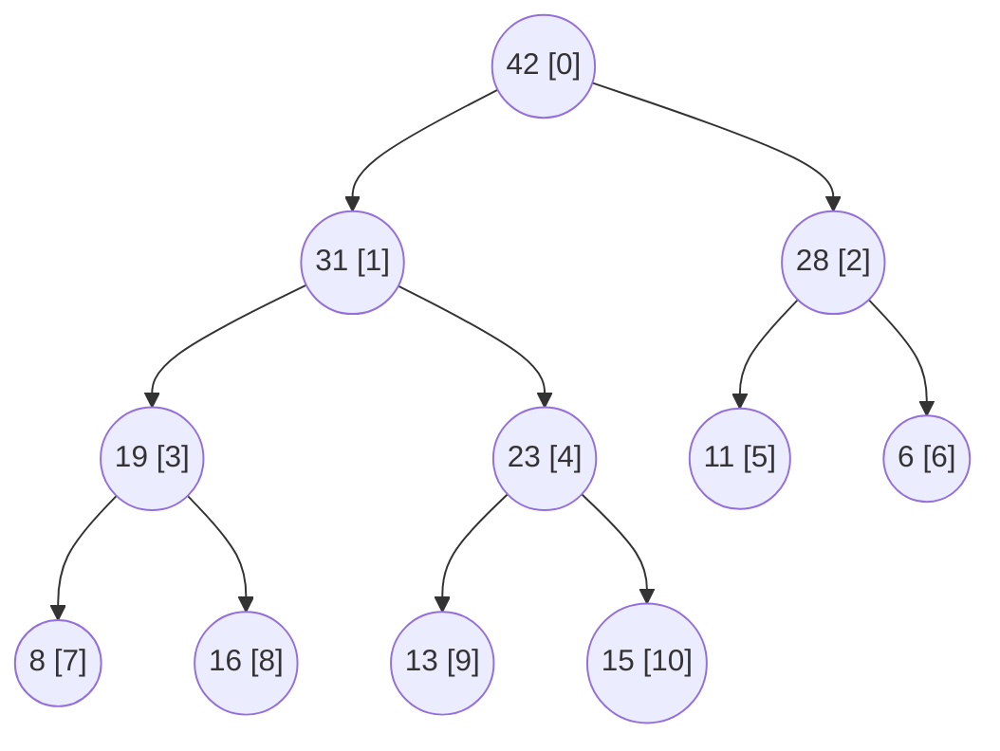
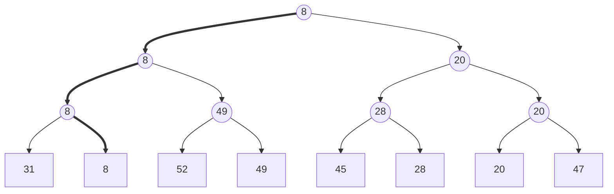

栈和队列按插入次序访问元素，搜索树按关键码访问任意元素；许多问题只关心"当前最重要的那一个"：操作系统调度优先级最高的任务，离散事件模拟处理最早发生的事件，构造 **Huffman 树**时每次合并权值最小的两棵树，**Dijkstra 算法**与 **Prim 算法**每次取出距离最近的顶点。这类按优先级访问的需求由优先级队列满足。本章先说明为什么它不必维护元素之间的全序、只需偏序，由此得到结构简单而高效的完全二叉堆，以及以它为基础的 $O(n)$ 建堆算法和堆排序；然后讨论几种适合不同场合的变体：锦标赛树（败者树用于多路归并）、多叉堆（加速图的优先级搜索）、左式堆（支持高效合并）和优先级搜索树（堆与搜索树的结合）。基于比较的排序的下界（定理 2.5.3）同时说明了优先级队列的操作不可能比 $O(\log n)$ 更快。

## 12.1. 接口与基本实现

### 12.1.1. 循优先级访问

**定义 12.1.1（优先级队列）** 维护一个元素集合、每个元素带有可比较的优先级，支持插入元素（`insert`）、读取优先级最高的元素（`getMax`）和删除优先级最高的元素（`delMax`）三种基本操作的数据结构，称为**优先级队列**。

本章约定"优先级高"就是"关键码大"，即最大优先级队列；最小优先级队列只需把比较反过来（Python 的 `heapq` 就是最小堆）。栈和队列都可以看成优先级队列的特例：优先级完全由插入次序决定，后插入者（栈）或先插入者（队列）优先级最高。

优先级队列的使用场景有三个共同特点：极值元素需要反复、快速地定位；集合本身动态变化；元素的优先级也可能动态变化（如 Dijkstra 算法中顶点的距离不断缩短）。常见的应用包括：

- 调度：操作系统的进程调度与中断处理、离散事件模拟的事件队列；
- 贪心算法：Huffman 编码、Kruskal 与 Prim 的最小生成树、Dijkstra 最短路径；
- 排序：内部排序（堆排序）、外部排序的多路归并、只需要前 $k$ 个结果的不完全排序；
- 计算几何：平面扫描算法中按坐标排列的事件队列。

### 12.1.2. 用已有结构实现

用前几章的结构实现优先级队列，各操作的代价如下（$n$ 为元素个数）：

| 实现 | `getMax` | `delMax` | `insert` |
|---|---|---|---|
| 无序向量 | $O(n)$：遍历 | $O(n)$：遍历后删除 | $O(1)$：插在末尾 |
| 有序向量（升序） | $O(1)$：末元素 | $O(1)$：删除末元素 | $O(n)$：二分查找 $O(\log n)$ 后移动元素 |
| 无序列表 | $O(n)$ | $O(n)$ | $O(1)$ |
| 有序列表（降序） | $O(1)$：首节点 | $O(1)$ | $O(n)$：顺序查找位置 |
| 平衡二叉搜索树 | $O(\log n)$ | $O(\log n)$ | $O(\log n)$ |

平衡二叉搜索树（AVL 树、红黑树、伸展树）已经让三种操作都达到 $O(\log n)$，但它的功能远远超出需要：它维护了全部元素之间的全序，可以按任意关键码查找、按次序遍历，而优先级队列只关心最大元素。只需找到极值时，维护一个偏序就够了。这提示我们存在更简单、常数更小的实现，而且它的渐近复杂度不会比 $O(\log n)$ 更好：

**性质 12.1.1** 在只能比较关键码的模型中，不存在 `insert` 与 `delMax` 都只需 $o(\log n)$ 次比较的优先级队列。

**证明** 若存在，则把 $n$ 个元素逐个插入，再连续执行 $n$ 次 `delMax`，就以 $o(n \log n)$ 次比较完成了排序，与定理 2.5.3（基于比较的排序的下界）矛盾。$\square$

注意这里说的是两者"都"快：单独让 `insert` 为 $O(1)$ 是可能的（例如后面提到的 Fibonacci 堆，分摊意义下 `insert` 为 $O(1)$、`delMax` 为 $O(\log n)$）。

## 12.2. 完全二叉堆

### 12.2.1. 结构性与堆序性

完全二叉树的节点按层次遍历的次序编号后，可以紧凑地存放在一个向量中，父子关系由秩直接算出，无需指针。对秩为 $i$ 的节点（秩从 0 开始）：

$$
\mathrm{Parent}(i) = \left\lfloor \frac{i-1}{2} \right\rfloor,\qquad
\mathrm{LChild}(i) = 2i + 1,\qquad
\mathrm{RChild}(i) = 2i + 2.
$$

$n$ 个节点的完全二叉树高度为 $\lfloor \log_2 n \rfloor$，秩不小于 $\lfloor n/2 \rfloor$ 的节点都是叶节点，内部节点的最大秩为 $\lfloor n/2 \rfloor - 1$。

**定义 12.2.1（完全二叉堆）** 逻辑上是一棵完全二叉树、物理上以层次遍历次序存放在向量 $H[0, n)$ 中，并且每个节点都不大于其父节点：

$$
H[i] \le H[\mathrm{Parent}(i)],\qquad 0 < i < n,
$$
这样的结构称为**完全二叉堆**，简称**堆**（二叉堆）。上式称为**堆序性**。

由堆序性和传递性，每个节点都不大于它的所有祖先，所以 $H[0]$ 是全局最大者，`getMax` 只需 $O(1)$ 时间。堆序性只约束父子之间的次序，兄弟之间、不同子树之间没有任何约束，这正是"偏序足矣"的含义。下图是一个有 11 个节点的堆，方括号中是节点的秩，对应的向量是 `42 31 28 19 23 11 6 8 16 13 15`：



### 12.2.2. 插入与上滤

插入新元素 $e$ 时，先把它接在向量末尾。结构性仍然满足（完全二叉树的末尾多了一个叶节点），堆序性只可能在 $e$ 与其父亲之间被破坏。若 $e$ 大于父亲，就交换二者；交换后 $e$ 可能又大于新的父亲，继续交换，直到 $e$ 不大于父亲或到达根为止。

**算法 12.2.1（上滤）** 设 $H[0, i)$ 满足堆序性，$H[i]$ 是新接入的元素。反复比较 $H[i]$ 与 $H[\mathrm{Parent}(i)]$：若父亲更小，则交换二者并令 $i \gets \mathrm{Parent}(i)$；否则停止。这一过程称为上滤。

每次交换后，除 $e$ 与它新的父亲之外，所有父子对都满足堆序性（被换下来的原父亲比原来的所有后代都大），所以上滤结束时整体恢复堆序性。$e$ 只与祖先交换，祖先不超过 $\lfloor \log_2 n \rfloor$ 个，插入的最坏时间为 $O(\log n)$。实际效率往往高得多：在随机输入下逐个插入，元素平均只上升一层多（实验约 1.3 层），因为一半的节点在最底层、大部分元素本来就应该待在底层附近。

实现时不必每层都交换：先把 $e$ 取出，把比它小的祖先逐个下移一层，最后把 $e$ 放进空出的位置。这样每层只有一次赋值，而不是一次交换的三次赋值。下面的代码就是这样写的（"空位"上移）。

### 12.2.3. 删除与下滤

删除堆顶时，用末元素 $x$ 填补根的位置，结构性仍然满足，堆序性只可能在 $x$ 与它的孩子之间被破坏。此时让 $x$ 与较大的孩子交换（与较小的孩子交换会让较小者成为较大者的父亲），并继续向下，直到 $x$ 不小于所有孩子或成为叶节点。

**算法 12.2.2（下滤）** 设以 $H[i]$ 的两个孩子为根的子树都是堆。反复比较 $H[i]$ 与它较大的孩子 $H[c]$：若 $H[i] < H[c]$，则交换二者并令 $i \gets c$；否则停止。这一过程称为下滤。

$x$ 每下降一层需要两次比较（先比较两个孩子，再与较大者比较），层数不超过 $\lfloor \log_2 n \rfloor$，所以 `delMax` 的最坏时间为 $O(\log n)$，比较次数约为 $2\log_2 n$。与上滤不同，被换到根的末元素来自最底层，通常很小，下滤一般要走到接近底层，平均情况也接近 $2\log_2 n$ 次比较。

一个减少比较的技巧（Floyd 提出，CPython 的 `heapq` 就这样实现）：先不与 $x$ 比较，沿"较大孩子"的路径一直把空位推到叶节点，每层只需一次比较；再把 $x$ 放在叶节点处做一次上滤。因为 $x$ 通常很小，上滤只走很少几层，总比较次数约为 $\log_2 n + O(1)$。

### 12.2.4. 批量建堆

给定 $n$ 个元素，要把它们组织成一个堆。最直接的方法是逐个插入（自上而下的上滤）：最坏情况下每个节点都要上滤到根，代价与深度成正比。仅最底层就有约 $n/2$ 个节点，深度都是 $\log_2 n$，总时间为 $\Theta(n \log n)$，这样长的时间足以完成全排序。

**算法 12.2.3（Floyd 建堆算法）** 把 $n$ 个元素按任意次序放入向量，再按秩从大到小，对每个内部节点 $i = \lfloor n/2 \rfloor - 1, \dots, 1, 0$ 执行下滤（R. W. Floyd，1964）。

正确性：叶节点各自是一个堆。处理节点 $i$ 时，它的两棵子树已经是堆（它们的根的秩更大，已经处理过），对 $H[i]$ 下滤恰好把"两个堆加一个新根"合并为一个堆。所以算法可以理解为子堆的逐层合并，处理完根之后整体满足堆序性。

**定理 12.2.1** Floyd 建堆算法的比较次数不超过 $2n$，时间为 $O(n)$。

**证明** 对节点 $i$ 下滤的代价与它的高度（到最深叶节点的距离）成正比：每下降一层至多两次比较，至多下降其高度那么多层。所以总比较次数不超过所有节点高度之和的 2 倍。先看高度为 $h$ 的满二叉树，$n = 2^{h+1} - 1$：深度为 $k$ 的节点有 $2^k$ 个，高度为 $h - k$，高度之和为

$$
S(h) = \sum_{k=0}^{h} (h - k)\, 2^k = 2^{h+1} - h - 2 = n - \log_2(n + 1) < n.
$$

（最后的求和可以这样算：令 $j = h - k$，$S(h) = 2^h \sum_{j=0}^{h} j\, 2^{-j}$，而 $\sum_{j \ge 0} j\,2^{-j} = 2$，精确计算即得上式。）对一般的完全二叉树，可以对 $n$ 归纳证明高度之和恰为 $n - \nu(n)$，其中 $\nu(n)$ 是 $n$ 的二进制表示中 1 的个数；无论如何它小于 $n$。所以比较次数小于 $2n$。$\square$

两种建堆方法只是次序相反，代价却有实质差别。上滤的代价正比于深度，下滤的代价正比于高度；完全二叉树中大多数节点都在底层附近，深度大而高度小。自上而下的方法让最多的节点走最长的路，自下而上的方法则让最多的节点走最短的路。下图统计了两种方法每个元素平均的比较次数：


Floyd 算法要求一次性得到全部元素，不适用于元素逐个到达（在线）的场合；那时只能逐个插入，单次插入仍为 $O(\log n)$。

### 12.2.5. 实现

把上面的操作合在一起。C++ 版本是类模板，Python 版本用列表存放元素；两者的 `top` 与 `pop` 都要求堆非空。程序最后与直接求最大值的结果**对拍**：

```cpp tab
#include <algorithm>
#include <format>
#include <iostream>
#include <random>
#include <utility>
#include <vector>

// Binary max-heap stored in a vector: the children of i are 2i+1 and 2i+2.
template <typename T>
class MaxHeap {
public:
    MaxHeap() = default;
    explicit MaxHeap(std::vector<T> items) : a_(std::move(items)) {
        for (std::size_t i = a_.size() / 2; i-- > 0;) sift_down(i);  // Floyd
    }
    bool empty() const { return a_.empty(); }
    std::size_t size() const { return a_.size(); }
    const T& top() const { return a_.front(); }           // getMax; heap must be non-empty

    void push(T x) {                                       // insert
        a_.push_back(std::move(x));
        sift_up(a_.size() - 1);
    }
    T pop() {                                              // delMax; heap must be non-empty
        T top = std::move(a_.front());
        if (a_.size() > 1) a_.front() = std::move(a_.back());
        a_.pop_back();
        if (!a_.empty()) sift_down(0);
        return top;
    }

private:
    std::vector<T> a_;

    void sift_up(std::size_t i) {                          // percolate up
        T x = std::move(a_[i]);
        while (i > 0 && a_[(i - 1) / 2] < x) {             // the parent is smaller:
            a_[i] = std::move(a_[(i - 1) / 2]);            // move it down, the hole goes up
            i = (i - 1) / 2;
        }
        a_[i] = std::move(x);
    }
    void sift_down(std::size_t i) {                        // percolate down
        const std::size_t n = a_.size();
        T x = std::move(a_[i]);
        for (std::size_t c; (c = 2 * i + 1) < n; i = c) {
            if (c + 1 < n && a_[c] < a_[c + 1]) ++c;       // the larger child
            if (!(x < a_[c])) break;
            a_[i] = std::move(a_[c]);                      // move it up, the hole goes down
        }
        a_[i] = std::move(x);
    }
};

int main() {
    MaxHeap<int> h({15, 11, 28, 8, 31, 6, 19, 23, 16, 13});
    h.push(42);
    while (!h.empty()) std::cout << std::format("{} ", h.pop());
    std::cout << '\n';

    // Differential test against std::sort with random pushes and pops.
    std::mt19937 rng(1);
    for (int trial = 0; trial < 300; ++trial) {
        std::vector<int> init(rng() % 50);
        for (int& x : init) x = static_cast<int>(rng() % 100);
        MaxHeap<int> heap(init);
        std::vector<int> ref = init;                       // multiset kept as a vector
        for (int op = 0; op < 200; ++op) {
            if (rng() % 10 < 6 || ref.empty()) {
                int x = static_cast<int>(rng() % 100);
                heap.push(x);
                ref.push_back(x);
            } else {
                auto it = std::max_element(ref.begin(), ref.end());
                if (heap.pop() != *it) { std::cout << "mismatch\n"; return 1; }
                ref.erase(it);
            }
        }
    }
    std::cout << "random tests passed\n";
}
```

```python tab
import random


class MaxHeap:
    """Binary max-heap on a list: the children of i are 2i+1 and 2i+2."""

    def __init__(self, items=()):
        self._a = list(items)
        for i in reversed(range(len(self._a) // 2)):   # Floyd: bottom-up
            self._sift_down(i)

    def __len__(self) -> int:
        return len(self._a)

    def top(self):                                     # getMax
        return self._a[0]

    def push(self, x) -> None:                         # insert
        self._a.append(x)
        self._sift_up(len(self._a) - 1)

    def pop(self):                                     # delMax
        a = self._a
        last = a.pop()                                 # IndexError if empty
        if not a:
            return last
        top, a[0] = a[0], last
        self._sift_down(0)
        return top

    def _sift_up(self, i: int) -> None:                # percolate up
        a, x = self._a, self._a[i]
        while i > 0 and a[(i - 1) // 2] < x:           # move the parent down
            a[i] = a[(i - 1) // 2]
            i = (i - 1) // 2
        a[i] = x

    def _sift_down(self, i: int) -> None:              # percolate down
        a, n, x = self._a, len(self._a), self._a[i]
        while (c := 2 * i + 1) < n:
            if c + 1 < n and a[c] < a[c + 1]:          # the larger child
                c += 1
            if not x < a[c]:
                break
            a[i] = a[c]                                # move the child up
            i = c
        a[i] = x


h = MaxHeap([15, 11, 28, 8, 31, 6, 19, 23, 16, 13])
h.push(42)
print(*(h.pop() for _ in range(len(h))))

# Differential test against max() with random pushes and pops.
rng = random.Random(1)
for trial in range(300):
    init = [rng.randrange(100) for _ in range(rng.randrange(50))]
    heap, ref = MaxHeap(init), list(init)
    for op in range(200):
        if rng.random() < 0.6 or not ref:
            x = rng.randrange(100)
            heap.push(x)
            ref.append(x)
        else:
            m = max(ref)
            assert heap.pop() == m
            ref.remove(m)
print("random tests passed")
```

### 12.2.6. 扩充接口与现实中的实现

除了三个基本操作，许多算法还需要修改任意元素的优先级：增大优先级后对它上滤，减小后对它下滤，删除任意元素可以先把它的优先级增大到无穷再 `delMax`，都是 $O(\log n)$。前提是能找到这个元素在向量中的位置，因此需要另外维护一张"元素 → 秩"的索引表，并在每次移动元素时更新它（索引堆）。

标准库的实现：

- C++ 的 `std::priority_queue<T, Container, Compare>`（[4.2.10](/4.2.10)）是一个容器适配器，默认在 `std::vector` 上维护最大堆，比较器默认为 `std::less<T>`，改用 `std::greater<T>` 得到最小堆。它只提供 `push`、`top`、`pop`，不支持修改优先级。底层算法 `std::make_heap`（$O(n)$ 建堆）、`std::push_heap`、`std::pop_heap`、`std::sort_heap` 也可以直接作用于任何随机访问区间。
- Python 的 `heapq` 模块不定义新类型，而是把普通的 `list` 当作最小堆操作：`heapify`（Floyd 算法）、`heappush`、`heappop`、`heapreplace`（先弹出再压入）、`heappushpop`，以及 `nlargest`、`nsmallest`、`merge`。Python 3.14 起也提供了最大堆版本（`heappush_max`、`heappop_max` 等）；此前的惯用法是把优先级取负。元素常写成元组 `(priority, count, item)`，递增的 `count` 让优先级相同的元素按插入次序出队，也避免比较不可比较的 `item`。`heapq` 不支持修改优先级，通常的做法是"惰性删除"：压入一个新的条目，并把旧条目标记为作废，弹出时跳过作废的条目。

## 12.3. 堆排序

选择排序每次从未排序部分选出最大元素，选取要花 $O(n)$ 时间；把未排序部分组织成堆，选取就只需 $O(\log n)$。这就是堆排序（J. W. J. Williams，1964）。更妙的是它可以就地进行：堆在物理上就是向量的前缀，每次 `delMax` 都会空出向量末尾的一个位置，而被删除的最大元素恰好应该放在那里。

**算法 12.3.1（堆排序）** 对向量 $A[0, n)$：先用 Floyd 算法把它建成堆；然后反复交换堆顶 $A[0]$ 与堆的末元素，堆的规模减 1，再对新的堆顶下滤，直到堆中只剩一个元素。

整个过程中向量分为两段：前缀 $H$ 是堆，后缀 $S$ 已经有序，并且 $H$ 中的元素都不大于 $S$ 中的元素。每一步交换相当于 $S$ 的最前端插入堆中的最大元素、$H$ 删除堆顶，所以上述不变性得以保持；最后 $H$ 为空，整个向量有序。以 `4 2 5 1 3` 为例：

| 步骤 | 堆 $H$ | 有序后缀 $S$ | 说明 |
|---|---|---|---|
| 建堆 | `5 3 4 1 2` | 空 | 依次对秩 1、0 下滤 |
| 1 | `4 3 2 1` | `5` | 交换 5 与 2，下滤 2 |
| 2 | `3 1 2` | `4 5` | 交换 4 与 1，下滤 1 |
| 3 | `2 1` | `3 4 5` | 交换 3 与 2，下滤 2 |
| 4 | `1` | `2 3 4 5` | 交换 2 与 1 |

```cpp tab
#include <algorithm>
#include <format>
#include <iostream>
#include <random>
#include <utility>
#include <vector>

// Percolate a[i] down within the heap a[0, n).
template <typename T>
void sift_down(std::vector<T>& a, std::size_t n, std::size_t i) {
    T x = std::move(a[i]);
    for (std::size_t c; (c = 2 * i + 1) < n; i = c) {
        if (c + 1 < n && a[c] < a[c + 1]) ++c;
        if (!(x < a[c])) break;
        a[i] = std::move(a[c]);
    }
    a[i] = std::move(x);
}

template <typename T>
void heap_sort(std::vector<T>& a) {
    std::size_t n = a.size();
    for (std::size_t i = n / 2; i-- > 0;) sift_down(a, n, i);  // heapify: O(n)
    while (n > 1) {                     // a[0, n) is a heap, a[n, size) is sorted
        std::swap(a[0], a[--n]);        // the maximum joins the sorted suffix
        sift_down(a, n, 0);
    }
}

int main() {
    std::vector<int> a = {4, 2, 5, 1, 3};
    heap_sort(a);
    for (int x : a) std::cout << std::format("{} ", x);
    std::cout << '\n';

    std::mt19937 rng(2);                // differential test against std::sort
    for (int trial = 0; trial < 1000; ++trial) {
        std::vector<int> v(rng() % 200);
        for (int& x : v) x = static_cast<int>(rng() % 50);
        std::vector<int> ref = v;
        heap_sort(v);
        std::sort(ref.begin(), ref.end());
        if (v != ref) { std::cout << "mismatch\n"; return 1; }
    }
    std::cout << "random tests passed\n";
}
```

```python tab
import random


def sift_down(a: list, n: int, i: int) -> None:
    """Percolate a[i] down within the heap a[0:n]."""
    x = a[i]
    while (c := 2 * i + 1) < n:
        if c + 1 < n and a[c] < a[c + 1]:
            c += 1
        if not x < a[c]:
            break
        a[i] = a[c]
        i = c
    a[i] = x


def heap_sort(a: list) -> None:
    n = len(a)
    for i in reversed(range(n // 2)):   # heapify: O(n)
        sift_down(a, n, i)
    while n > 1:                        # a[:n] is a heap, a[n:] is sorted
        n -= 1
        a[0], a[n] = a[n], a[0]         # the maximum joins the sorted suffix
        sift_down(a, n, 0)


a = [4, 2, 5, 1, 3]
heap_sort(a)
print(a)

rng = random.Random(2)                  # differential test against sorted()
for trial in range(1000):
    v = [rng.randrange(50) for _ in range(rng.randrange(200))]
    ref = sorted(v)
    heap_sort(v)
    assert v == ref
print("random tests passed")
```

建堆 $O(n)$，$n - 1$ 次下滤各 $O(\log n)$，总时间 $O(n \log n)$，最坏情况也是如此；只用 $O(1)$ 的附加空间。比较次数约为 $2n \log_2 n$（用上一节先推空位、再上滤的技巧，平均可降到约 $n \log_2 n$）。堆排序不稳定：交换会越过中间的元素。它的弱点是访问内存的局部性差，下滤时父子的秩相差一倍，大规模数据下缓存命中率低，因此实际中通常比快速排序慢。它最重要的用途是作为保底：C++ 的 `std::sort` 采用内省排序，快速排序的递归过深时改用堆排序，从而保证最坏 $O(n \log n)$（[4.3.14](/4.3.14)）；`std::partial_sort` 也基于堆。

## 12.4. 锦标赛树

### 12.4.1. 胜者树

体育比赛的淘汰赛给出了另一种组织选取的方式。

**定义 12.4.1（锦标赛树）** 一棵完全二叉树，叶节点是参赛的元素，每个内部节点记录其两个孩子比赛的胜者（如关键码较小者），这样的树称为**锦标赛树**，也称**胜者树**。

树根就是全局冠军，作用类似于堆顶。与堆不同的是，元素只存放在叶节点，内部节点记录的是胜者的引用，同一个元素可能沿路连胜、出现在多个内部节点中。

- 创建：$n$ 个叶节点、$n - 1$ 个内部节点，自底向上进行 $n - 1$ 场比赛，$O(n)$ 时间；
- 取出冠军后更新：冠军所在叶节点退出（标记为空），只有它的祖先所记录的比赛结果可能改变，所以只需从这个叶节点出发，沿到根的路径逐层重赛，$O(\log n)$ 时间。

反复取出冠军并重赛，就得到锦标赛排序（tournament sort）：总时间 $n \cdot O(\log n) = O(n \log n)$，达到排序的下界。与堆排序相比，每层只需一次比较，比较次数约为 $n \log_2 n$，但需要 $O(n)$ 的附加空间。下图是 8 个元素的胜者树（小者胜），取出冠军 8 之后，只需重新计算粗线路径上的三个内部节点：



下面的实现把 $2n - 1$ 个节点存放在向量的 $[1, 2n)$ 中：节点 $v$ 的孩子是 $2v$ 与 $2v + 1$，叶节点恰好是 $n, \dots, 2n - 1$。这样的 $2n - 1$ 个节点构成一棵完全二叉树，$n$ 不必是 2 的幂。

```cpp tab
#include <algorithm>
#include <format>
#include <iostream>
#include <random>
#include <vector>

// Tournament sort with a winner tree. Node v has children 2v and 2v+1;
// leaf i is node n+i; w[v] is the index of the winner below v, or -1.
std::vector<int> tournament_sort(const std::vector<int>& a) {
    const long n = static_cast<long>(a.size());
    std::vector<int> out;
    if (n == 0) return out;
    std::vector<long> w(2 * n, -1);
    auto play = [&](long x, long y) {           // the smaller key wins
        if (x < 0) return y;
        if (y < 0) return x;
        return a[y] < a[x] ? y : x;
    };
    for (long i = 0; i < n; ++i) w[n + i] = i;
    for (long v = n - 1; v >= 1; --v) w[v] = play(w[2 * v], w[2 * v + 1]);  // n-1 matches
    for (long round = 0; round < n; ++round) {
        long champion = w[1];                   // the root holds the overall winner
        out.push_back(a[champion]);
        long v = n + champion;
        w[v] = -1;                              // deactivate its leaf
        for (v /= 2; v >= 1; v /= 2)            // replay along the path to the root
            w[v] = play(w[2 * v], w[2 * v + 1]);
    }
    return out;
}

int main() {
    std::vector<int> a = {31, 8, 52, 49, 45, 28, 20, 47};
    for (int x : tournament_sort(a)) std::cout << std::format("{} ", x);
    std::cout << '\n';

    std::mt19937 rng(3);                        // differential test against std::sort
    for (int trial = 0; trial < 1000; ++trial) {
        std::vector<int> v(rng() % 100);
        for (int& x : v) x = static_cast<int>(rng() % 30);
        std::vector<int> ref = v;
        std::sort(ref.begin(), ref.end());
        if (tournament_sort(v) != ref) { std::cout << "mismatch\n"; return 1; }
    }
    std::cout << "random tests passed\n";
}
```

```python tab
import random


def tournament_sort(a: list) -> list:
    """Winner tree: node v has children 2v, 2v+1; leaf i is node n+i."""
    n = len(a)
    if n == 0:
        return []
    w = [None] * (2 * n)                        # w[v]: index of the winner below v

    def play(x, y):                             # the smaller key wins
        if x is None:
            return y
        if y is None:
            return x
        return y if a[y] < a[x] else x

    w[n:] = range(n)
    for v in range(n - 1, 0, -1):               # n - 1 matches
        w[v] = play(w[2 * v], w[2 * v + 1])
    out = []
    for _ in range(n):
        champion = w[1]                         # the root holds the overall winner
        out.append(a[champion])
        v = n + champion
        w[v] = None                             # deactivate its leaf
        v //= 2
        while v >= 1:                           # replay along the path to the root
            w[v] = play(w[2 * v], w[2 * v + 1])
            v //= 2
    return out


print(tournament_sort([31, 8, 52, 49, 45, 28, 20, 47]))

rng = random.Random(3)                          # differential test against sorted()
for trial in range(1000):
    v = [rng.randrange(30) for _ in range(rng.randrange(100))]
    assert tournament_sort(v) == sorted(v)
print("random tests passed")
```

锦标赛树特别适合不完全选取：从 $n$ 个元素中找出最小的 $k$ 个（$k \ll n$），初始化需要 $n - 1$ 次比较，之后每步约 $\log_2 n$ 次，共 $n - 1 + k \log_2 n$ 次。用小顶堆也是 $O(n + k \log n)$，渐近意义上相当，但常系数不同：堆的下滤在每层要做两次比较。这一差别在选取第二名时最为明显：用锦标赛树找出最小和次小元素只需 $n + \lceil \log_2 n \rceil - 2$ 次比较（次小元素一定是输给冠军的 $\lceil \log_2 n \rceil$ 个元素之一），这恰好是最优的（Kislitsyn，1964）。

### 12.4.2. 败者树

胜者树的重赛有一个不便之处：沿路径上行时，每一层都要找到当前节点的兄弟，取出兄弟所记录的胜者来比赛，访问在路径与兄弟之间来回迂回。败者树换一种记录方式消除了这种迂回。

**定义 12.4.2（败者树）** 内部节点记录其所在比赛的败者，另设一个位于根之上的节点记录冠军，这样的锦标赛树称为**败者树**。

冠军所在叶节点的关键码更新后，从它出发沿路径上行：在每个节点，新元素与该节点记录的败者比赛，败者留下，胜者继续上行；到达顶端时胜者就是新的冠军。每一层只需访问路径上的一个节点、做一次比较，不需要访问兄弟。路径上原来记录的败者，恰好就是原冠军一路击败的对手，所以这样做与胜者树的重赛结果相同。

败者树的典型用途是外部排序中的 $k$ 路归并：每个叶节点代表一个已排序的归并段，关键码是该段的当前首元素；每次输出冠军后，它所在的段前进一个元素，只需一次 $O(\log k)$ 的重赛。下面的实现用一个"哨兵"叶节点 $k$（假想的负无穷）初始化所有内部节点，再依次让各叶节点上行，就建成了初始的败者树；已经耗尽的段视为正无穷，总是败者。

```cpp tab
#include <algorithm>
#include <format>
#include <iostream>
#include <random>
#include <utility>
#include <vector>

// k-way merge of sorted runs with a loser tree.
// Leaf i (run i) is node k+i; internal node t (1 <= t < k) stores the loser
// of the match played there, and node 0 stores the overall winner.
std::vector<int> kway_merge(const std::vector<std::vector<int>>& runs) {
    const int k = static_cast<int>(runs.size());
    std::vector<int> out;
    if (k == 0) return out;
    std::vector<std::size_t> pos(k, 0);           // the head of each run
    auto beats = [&](int i, int j) {              // does leaf i beat leaf j?
        if (j == k) return false;                 // k is a sentinel that beats everyone
        if (i == k) return true;
        bool ei = pos[i] == runs[i].size(), ej = pos[j] == runs[j].size();
        if (ei || ej) return !ei;                 // an exhausted run always loses
        return runs[i][pos[i]] < runs[j][pos[j]];
    };
    std::vector<int> tree(k, k);                  // all nodes start with the sentinel
    auto replay = [&](int s) {                    // leaf s has a new key
        for (int t = (s + k) / 2; t > 0; t /= 2)
            if (beats(tree[t], s)) std::swap(s, tree[t]);  // s lost: it stays here
        tree[0] = s;                              // the winner goes on
    };
    for (int i = k - 1; i >= 0; --i) replay(i);   // build
    for (;;) {
        int w = tree[0];
        if (pos[w] == runs[w].size()) break;      // the winner is exhausted: all are
        out.push_back(runs[w][pos[w]++]);
        replay(w);                                // only the winner's path is replayed
    }
    return out;
}

int main() {
    std::vector<std::vector<int>> runs = {{8, 31}, {49, 52}, {28, 45}, {20, 47}, {5}};
    for (int x : kway_merge(runs)) std::cout << std::format("{} ", x);
    std::cout << '\n';

    std::mt19937 rng(4);                          // differential test against std::sort
    for (int trial = 0; trial < 1000; ++trial) {
        std::vector<std::vector<int>> rs(rng() % 9);
        std::vector<int> ref;
        for (auto& r : rs) {
            r.resize(rng() % 20);
            for (int& x : r) x = static_cast<int>(rng() % 50);
            std::sort(r.begin(), r.end());
            ref.insert(ref.end(), r.begin(), r.end());
        }
        std::sort(ref.begin(), ref.end());
        if (kway_merge(rs) != ref) { std::cout << "mismatch\n"; return 1; }
    }
    std::cout << "random tests passed\n";
}
```

```python tab
import random


def kway_merge(runs: list[list]) -> list:
    """Loser tree: leaf i is node k+i; node t < k keeps the loser played
    there, node 0 the overall winner."""
    k = len(runs)
    if k == 0:
        return []
    pos = [0] * k                                 # the head of each run

    def beats(i: int, j: int) -> bool:            # does leaf i beat leaf j?
        if j == k:                                # k is a sentinel that beats everyone
            return False
        if i == k:
            return True
        ei, ej = pos[i] == len(runs[i]), pos[j] == len(runs[j])
        if ei or ej:                              # an exhausted run always loses
            return not ei
        return runs[i][pos[i]] < runs[j][pos[j]]

    tree = [k] * k                                # all nodes start with the sentinel

    def replay(s: int) -> None:                   # leaf s has a new key
        t = (s + k) // 2
        while t > 0:
            if beats(tree[t], s):                 # s lost: it stays here
                s, tree[t] = tree[t], s
            t //= 2
        tree[0] = s                               # the winner goes on

    for i in reversed(range(k)):                  # build
        replay(i)
    out = []
    while pos[w := tree[0]] < len(runs[w]):       # stop when the winner is exhausted
        out.append(runs[w][pos[w]])
        pos[w] += 1
        replay(w)                                 # only the winner's path is replayed
    return out


print(kway_merge([[8, 31], [49, 52], [28, 45], [20, 47], [5]]))

rng = random.Random(4)                            # differential test against sorted()
for trial in range(1000):
    rs = [sorted(rng.randrange(50) for _ in range(rng.randrange(20)))
          for _ in range(rng.randrange(9))]
    assert kway_merge(rs) == sorted(x for r in rs for x in r)
print("random tests passed")
```

## 12.5. 多叉堆

### 12.5.1. 优先级搜索中的堆

图的优先级搜索（PFS）是 BFS、DFS、Prim 和 Dijkstra 等算法的统一框架（[4.3.11](/4.3.11)）：各算法的差别仅在于如何更新顶点的优先级。每当一个顶点加入遍历树，都要做两类操作：更新树外邻居的优先级，并选出优先级最高的树外顶点。若用邻接表加上逐个扫描的方式选取，选取累计 $O(n^2)$，更新累计 $O(e)$，共 $O(n^2 + e)$（$n$ 为顶点数，$e$ 为边数）。

把树外顶点组织成优先级队列：初始建堆 $O(n)$；共 $n$ 次 `delMax`，各 $O(\log n)$；每条边至多引起一次优先级提升（`increase`，即上滤），共 $e$ 次，各 $O(\log n)$。总时间为 $O((n + e)\log n)$。这对稀疏图（$e = O(n)$）很好，对稠密图（$e = \Theta(n^2)$）反而不如 $O(n^2)$ 的常规实现。问题在于两类操作的次数不平衡：`increase` 可能多达 $e$ 次，`delMax` 只有 $n$ 次，而二叉堆让它们代价相同。

### 12.5.2. d 叉堆

**定义 12.5.1（多叉堆）** 把完全二叉堆中的二叉树换成完全 $d$ 叉树（$d \ge 2$），仍以层次遍历次序存放在向量中、满足堆序性，这样的结构称为 $d$ 叉堆，统称**多叉堆**。

父子的秩仍可简单地换算：

$$
\mathrm{Parent}(i) = \left\lfloor \frac{i - 1}{d} \right\rfloor,\qquad
\mathrm{Child}_k(i) = d\,i + k,\quad 1 \le k \le d.
$$

$d$ 不是 2 的幂时不能用移位加速，但这只是常数上的差别。堆高降为 $\log_d n$：上滤每层一次比较，代价降为 $O(\log_d n)$；下滤每层要在 $d$ 个孩子中选出最大者，代价升为 $O(d \log_d n)$。真正的"上山容易下山难"：下滤成本正比于 $d \log_d n = (d/\ln d)\ln n$，而 $d/\ln d$ 在 $d = \mathrm{e}$ 处取最小值：$d = 3$ 时下滤略快于二叉堆，$d = 4$ 时与之相同，$d > 4$ 时才变慢。

于是 PFS 的总时间为 $O(n \cdot d \log_d n + e \log_d n) = O((n d + e)\log_d n)$。取 $d \approx e/n$（至少为 2）使两项平衡，得到

$$
O\!\left(e \log_{e/n + 2} n\right).
$$

稀疏图（$e = O(n)$）时为 $O(n \log n)$，与二叉堆相同；稠密图（$e = \Theta(n^2)$）时 $\log_{n} n = 1$，为 $O(n^2)$，与常规实现相同；介于两者之间的图会自适应地取得较好的结果。更进一步，Fibonacci 堆（Fredman 与 Tarjan，1987）让 `increase` 的分摊时间降为 $O(1)$，Dijkstra 算法因而达到 $O(e + n \log n)$。实际中 Fibonacci 堆的常数太大，4 叉堆更为常用：树更矮，同一节点的 4 个孩子在内存中相邻，对缓存友好。

```cpp tab
#include <algorithm>
#include <format>
#include <iostream>
#include <random>
#include <utility>
#include <vector>

// d-ary max-heap: the parent of i is (i-1)/d, its children are d*i+1 .. d*i+d.
template <typename T>
class DHeap {
public:
    explicit DHeap(std::size_t d, std::vector<T> items = {}) : d_(d), a_(std::move(items)) {
        if (a_.size() > 1)
            for (std::size_t i = (a_.size() - 2) / d_ + 1; i-- > 0;) sift_down(i);
    }
    bool empty() const { return a_.empty(); }
    const T& top() const { return a_.front(); }

    void push(T x) {                       // O(log_d n): one comparison per level
        a_.push_back(std::move(x));
        std::size_t i = a_.size() - 1;
        T y = std::move(a_[i]);
        while (i > 0 && a_[(i - 1) / d_] < y) {
            a_[i] = std::move(a_[(i - 1) / d_]);
            i = (i - 1) / d_;
        }
        a_[i] = std::move(y);
    }
    T pop() {                              // O(d log_d n): d comparisons per level
        T top = std::move(a_.front());
        if (a_.size() > 1) a_.front() = std::move(a_.back());
        a_.pop_back();
        if (!a_.empty()) sift_down(0);
        return top;
    }

private:
    std::size_t d_;
    std::vector<T> a_;

    void sift_down(std::size_t i) {
        const std::size_t n = a_.size();
        T x = std::move(a_[i]);
        for (std::size_t first; (first = d_ * i + 1) < n;) {
            std::size_t c = first;         // the largest of the (at most d) children
            for (std::size_t j = first + 1; j < std::min(first + d_, n); ++j)
                if (a_[c] < a_[j]) c = j;
            if (!(x < a_[c])) break;
            a_[i] = std::move(a_[c]);
            i = c;
        }
        a_[i] = std::move(x);
    }
};

int main() {
    DHeap<int> h(3, {15, 11, 28, 8, 31, 6, 19, 23, 16, 13});
    h.push(42);
    while (!h.empty()) std::cout << std::format("{} ", h.pop());
    std::cout << '\n';

    std::mt19937 rng(5);                   // differential test against std::sort
    for (int trial = 0; trial < 1000; ++trial) {
        std::size_t d = 2 + rng() % 7;
        std::vector<int> v(rng() % 100);
        for (int& x : v) x = static_cast<int>(rng() % 40);
        DHeap<int> heap(d, std::vector<int>(v.begin(), v.begin() + v.size() / 2));
        for (std::size_t i = v.size() / 2; i < v.size(); ++i) heap.push(v[i]);
        std::vector<int> out;
        while (!heap.empty()) out.push_back(heap.pop());
        std::sort(v.begin(), v.end(), std::greater<>());
        if (out != v) { std::cout << "mismatch\n"; return 1; }
    }
    std::cout << "random tests passed\n";
}
```

```python tab
import random


class DHeap:
    """d-ary max-heap: the parent of i is (i-1)//d, its children d*i+1 .. d*i+d."""

    def __init__(self, d: int, items=()):
        self.d, self._a = d, list(items)
        if len(self._a) > 1:
            for i in reversed(range((len(self._a) - 2) // d + 1)):
                self._sift_down(i)

    def __len__(self) -> int:
        return len(self._a)

    def top(self):
        return self._a[0]

    def push(self, x) -> None:             # O(log_d n): one comparison per level
        a, d = self._a, self.d
        a.append(x)
        i = len(a) - 1
        while i > 0 and a[(i - 1) // d] < x:
            a[i] = a[(i - 1) // d]
            i = (i - 1) // d
        a[i] = x

    def pop(self):                         # O(d log_d n): d comparisons per level
        a = self._a
        last = a.pop()
        if not a:
            return last
        top, a[0] = a[0], last
        self._sift_down(0)
        return top

    def _sift_down(self, i: int) -> None:
        a, d, n, x = self._a, self.d, len(self._a), self._a[i]
        while (first := d * i + 1) < n:
            c = max(range(first, min(first + d, n)), key=a.__getitem__)  # largest child
            if not x < a[c]:
                break
            a[i] = a[c]
            i = c
        a[i] = x


h = DHeap(3, [15, 11, 28, 8, 31, 6, 19, 23, 16, 13])
h.push(42)
print(*(h.pop() for _ in range(len(h))))

rng = random.Random(5)                     # differential test against sorted()
for trial in range(1000):
    v = [rng.randrange(40) for _ in range(rng.randrange(100))]
    heap = DHeap(rng.randrange(2, 9), v[: len(v) // 2])
    for x in v[len(v) // 2:]:
        heap.push(x)
    assert [heap.pop() for _ in range(len(heap))] == sorted(v, reverse=True)
print("random tests passed")
```

## 12.6. 左式堆

### 12.6.1. 堆的合并

许多应用需要把两个优先级队列合二为一：$H = \mathrm{merge}(A, B)$，设 $\lvert A \rvert = n \ge m = \lvert B \rvert$。用完全二叉堆有两种直接的方法：把 $B$ 的元素逐个插入 $A$，需要 $O(m \log(n + m))$ 时间；把两个向量拼接后重新建堆，需要 $O(n + m)$ 时间。两者都远不能令人满意，我们希望在 $O(\log n)$ 时间内完成合并。

合并两个堆，可以类比合并两个有序序列：比较两个堆顶，较大者成为新堆的根，它的一棵子树再与另一个堆递归地合并。若总是选择右子树参与合并，合并过程就只沿着两个堆的"右侧链"进行，代价正比于两条右侧链的长度之和。问题是如何控制右侧链的长度。

C. A. Crane（1972）的办法是：保持堆序性，另加一个"单侧倾斜"的条件，让节点尽量分布在左侧，合并只涉及右侧。这样的树一般不再是完全二叉树，结构性无法保证，不能用向量存放，要像二叉树那样用指针连接。这说明结构性并不是堆的本质要求，堆序性才是。

### 12.6.2. 空节点路径长度

为了刻画"倾斜"，把所有空的孩子位置补上外部节点，使树成为真二叉树。

**定义 12.6.1（空节点路径长度）** 外部节点的空节点路径长度为 0；内部节点 $x$ 的**空节点路径长度**为

$$
\operatorname{npl}(x) = 1 + \min\{\operatorname{npl}(\mathrm{lc}(x)),\ \operatorname{npl}(\mathrm{rc}(x))\}.
$$

$\operatorname{npl}(x)$ 就是从 $x$ 到最近的外部节点的距离，也等于以 $x$ 为根的最大满子树的高度加 1（即这棵满子树的层数）。

**定义 12.6.2（左式堆）** 满足堆序性，并且每个内部节点 $x$ 都满足

$$
\operatorname{npl}(\mathrm{lc}(x)) \ge \operatorname{npl}(\mathrm{rc}(x))
$$
的二叉树称为**左式堆**。

由定义立即得到 $\operatorname{npl}(x) = 1 + \operatorname{npl}(\mathrm{rc}(x))$，左式堆的子堆也是左式堆，而左倾性与堆序性互不冲突。左式堆倾向于让更多节点分布在左侧，但这并不意味着左子堆的规模或高度一定大于右子堆：npl 只描述"最近的外部节点"，一棵左子树可以很稀疏。

从节点 $x$ 出发一直沿右分支前进得到的路径称为 $x$ 的右侧链。在左式堆中，右侧链的每个节点的 npl 都比上一个小 1，所以根 $r$ 的右侧链的终点恰是全堆最浅的外部节点，右侧链的长度（内部节点数）为 $d = \operatorname{npl}(r)$。

**定理 12.6.1** 右侧链长度为 $d$ 的左式堆至少有 $2^d - 1$ 个内部节点；反之，$n$ 个节点的左式堆的右侧链长度不超过 $\log_2(n + 1)$。

**证明** $\operatorname{npl}(r) = d$ 意味着从根出发 $d - 1$ 层之内都没有外部节点，即存在一棵以 $r$ 为根、共 $d$ 层的满二叉子树，它有 $2^d - 1$ 个内部节点。于是 $n \ge 2^d - 1$，$d \le \log_2(n + 1)$。$\square$

### 12.6.3. 合并、插入与删除

**算法 12.6.1（左式堆的合并）** 合并以 $a$、$b$ 为根的左式堆：

1. 若其中之一为空，返回另一个；
2. 前处理：若 $a < b$，交换 $a$ 与 $b$，保证 $a$ 的根较大；
3. 递归地把 $a$ 的右子堆与 $b$ 合并，结果作为 $a$ 的新右子堆；
4. 后处理：若此时 $\operatorname{npl}(\mathrm{lc}(a)) < \operatorname{npl}(\mathrm{rc}(a))$，交换 $a$ 的左右子堆；然后更新 $\operatorname{npl}(a) = 1 + \operatorname{npl}(\mathrm{rc}(a))$；返回 $a$。

堆序性由第 2 步保证：$a$ 的根不小于 $b$ 的根，也不小于自己的右子堆，所以不小于合并后的右子堆。左倾性由第 4 步保证。每层递归都沿 $a$ 或 $b$ 的右侧链前进一步，递归深度不超过两条右侧链长度之和，由定理 12.6.1，合并的时间为 $O(\log n + \log m)$。递归可以改写为迭代：先沿右侧链自上而下做二路归并，再沿原路自下而上地检查和交换左右子堆、更新 npl。

插入与删除都归结为合并：插入元素 $e$ 就是与只含 $e$ 的单节点堆合并；删除堆顶就是摘除根，再合并它的左右子堆。两者都是 $O(\log n)$。

```cpp tab
#include <algorithm>
#include <format>
#include <iostream>
#include <memory>
#include <random>
#include <utility>
#include <vector>

// Leftist max-heap: npl(left) >= npl(right) at every node.
template <typename T>
class LeftistHeap {
    struct Node {
        T key;
        int npl = 1;                                   // npl(nullptr) = 0
        std::unique_ptr<Node> left, right;
        explicit Node(T k) : key(std::move(k)) {}
    };
    using Ptr = std::unique_ptr<Node>;
    Ptr root_;
    std::size_t size_ = 0;

    static int npl(const Ptr& p) { return p ? p->npl : 0; }

    static Ptr merge(Ptr a, Ptr b) {                   // O(log |a| + log |b|)
        if (!a) return b;
        if (!b) return a;
        if (a->key < b->key) std::swap(a, b);          // a has the larger root
        a->right = merge(std::move(a->right), std::move(b));  // along the right chain
        if (npl(a->left) < npl(a->right))              // restore leftism
            std::swap(a->left, a->right);
        a->npl = npl(a->right) + 1;
        return a;
    }

public:
    LeftistHeap() = default;
    LeftistHeap(LeftistHeap&&) = default;
    LeftistHeap& operator=(LeftistHeap&&) = default;
    ~LeftistHeap() {                                   // iterative: the left chain may be long
        std::vector<Ptr> stack;
        if (root_) stack.push_back(std::move(root_));
        while (!stack.empty()) {
            Ptr p = std::move(stack.back());
            stack.pop_back();
            if (p->left) stack.push_back(std::move(p->left));
            if (p->right) stack.push_back(std::move(p->right));
        }
    }
    bool empty() const { return !root_; }
    std::size_t size() const { return size_; }
    const T& top() const { return root_->key; }

    void push(T x) {
        root_ = merge(std::move(root_), std::make_unique<Node>(std::move(x)));
        ++size_;
    }
    T pop() {                                          // heap must be non-empty
        T top = std::move(root_->key);
        root_ = merge(std::move(root_->left), std::move(root_->right));
        --size_;
        return top;
    }
    void absorb(LeftistHeap& other) {                  // merge other into *this
        root_ = merge(std::move(root_), std::move(other.root_));
        size_ += other.size_;
        other.size_ = 0;
    }
};

int main() {
    LeftistHeap<int> a, b;
    for (int x : {17, 13, 6, 8, 5}) a.push(x);
    for (int x : {15, 10, 12, 7, 3}) b.push(x);
    a.absorb(b);
    while (!a.empty()) std::cout << std::format("{} ", a.pop());
    std::cout << '\n';

    std::mt19937 rng(6);                               // differential test against std::sort
    for (int trial = 0; trial < 500; ++trial) {
        LeftistHeap<int> h1, h2;
        std::vector<int> ref;
        for (int i = 0, n = static_cast<int>(rng() % 60); i < n; ++i) {
            int x = static_cast<int>(rng() % 40);
            (rng() % 2 ? h1 : h2).push(x);
            ref.push_back(x);
        }
        h1.absorb(h2);
        std::vector<int> out;
        while (!h1.empty()) out.push_back(h1.pop());
        std::sort(ref.begin(), ref.end(), std::greater<>());
        if (out != ref) { std::cout << "mismatch\n"; return 1; }
    }
    LeftistHeap<int> big;                              // increasing keys: a long left chain
    for (int i = 0; i < 200000; ++i) big.push(i);
    std::cout << std::format("random tests passed; top = {}\n", big.top());
}
```

```python tab
import random


class Node:
    __slots__ = ("key", "npl", "left", "right")

    def __init__(self, key):
        self.key, self.npl, self.left, self.right = key, 1, None, None


def npl(p) -> int:
    return p.npl if p else 0                   # npl(None) = 0


def merge(a, b):
    """Merge two leftist max-heaps; O(log |a| + log |b|)."""
    if a is None:
        return b
    if b is None:
        return a
    if a.key < b.key:                          # a has the larger root
        a, b = b, a
    a.right = merge(a.right, b)                # along the right chain
    if npl(a.left) < npl(a.right):             # restore leftism
        a.left, a.right = a.right, a.left
    a.npl = npl(a.right) + 1
    return a


class LeftistHeap:
    def __init__(self):
        self.root, self.size = None, 0

    def __len__(self) -> int:
        return self.size

    def top(self):
        return self.root.key

    def push(self, x) -> None:
        self.root = merge(self.root, Node(x))
        self.size += 1

    def pop(self):
        top = self.root.key                    # AttributeError if empty
        self.root = merge(self.root.left, self.root.right)
        self.size -= 1
        return top

    def absorb(self, other: "LeftistHeap") -> None:
        self.root = merge(self.root, other.root)
        self.size += other.size
        other.root, other.size = None, 0


a, b = LeftistHeap(), LeftistHeap()
for x in (17, 13, 6, 8, 5):
    a.push(x)
for x in (15, 10, 12, 7, 3):
    b.push(x)
a.absorb(b)
print(*(a.pop() for _ in range(len(a))))

rng = random.Random(6)                         # differential test against sorted()
for trial in range(500):
    h1, h2, ref = LeftistHeap(), LeftistHeap(), []
    for _ in range(rng.randrange(60)):
        x = rng.randrange(40)
        (h1 if rng.random() < 0.5 else h2).push(x)
        ref.append(x)
    h1.absorb(h2)
    assert [h1.pop() for _ in range(len(h1))] == sorted(ref, reverse=True)
print("random tests passed")
```

上例中递增地插入元素会让左式堆的左侧链长达 $n$。这不影响操作的效率（只有右侧链才需要短），但默认的析构函数会沿左侧链递归释放节点，可能导致栈溢出，所以 C++ 版本改用显式栈逐个释放。

左式堆是可合并堆的最简单的代表。去掉 npl、每次合并都无条件交换左右子堆，得到斜堆（skew heap），它在分摊意义下也是 $O(\log n)$；二项堆、配对堆、Fibonacci 堆则进一步把插入或修改优先级的代价降为 $O(1)$（分摊）。

## 12.7. 优先级搜索树

### 12.7.1. 三边范围查询

平面上有 $n$ 个点，查询落在区域 $(-\infty, x_0] \times [y_1, y_2]$ 中的所有点。这个区域只有三条边，第四边"接地"于 $-\infty$，因此称为三边范围查询或接地范围查询（grounded range query）。一般的矩形范围查询可以用范围树或 kd 树解决（[4.3.7](/4.3.7)），但它们需要 $O(n \log n)$ 的空间（范围树）或 $O(\sqrt{n} + r)$ 的查询时间（kd 树）。对三边查询，有一种只需 $O(n)$ 空间、$O(r + \log n)$ 查询时间的结构，其中 $r$ 是输出的点数。

### 12.7.2. 结构与查询

**定义 12.7.1（优先级搜索树）** 每个节点存放一个点、并满足以下两个条件的二叉树称为**优先级搜索树**（E. M. McCreight，1985）：
1. 对 $x$ 坐标满足堆序性：每个节点的点在其子树中 $x$ 最小（最小堆）；
2. 对 $y$ 坐标形似搜索树：每个节点另记一个分割值 $y_m$，除本节点的点之外，子树中其余的点按 $y \le y_m$ 与 $y \ge y_m$ 大致均分到左右子树。

构造：把点按 $y$ 排序，取 $x$ 最小的点作为根，其余的点按 $y$ 的中位数分成两半，递归构造左右子树。树高为 $O(\log n)$，每个点恰好存放一次，空间 $O(n)$，构造时间 $O(n \log n)$。

查询 $(-\infty, x_0] \times [y_1, y_2]$ 时，从根开始：

- 若节点为空或其点的 $x > x_0$，由堆序性，整棵子树的 $x$ 都大于 $x_0$，剪去（因 $x$ 剪枝）；
- 否则，若该点的 $y \in [y_1, y_2]$，报告它；
- 若 $y_1 \le y_m$，递归查询左子树；若 $y_m \le y_2$，递归查询右子树（否则因 $y$ 剪枝）。

查询时间的分析：被访问的节点分为三类。报告了点的节点恰有 $r$ 个。点的 $y$ 不在范围内的节点，其子树与 $[y_1, y_2]$ 部分相交，就像在一维搜索树中查找 $y_1$ 与 $y_2$ 的两条路径，每层至多两个，共 $O(\log n)$ 个。因 $x$ 剪枝而访问的节点，它的父亲属于前两类，而每个节点只有两个孩子，所以这类节点有 $O(r + \log n)$ 个。总计 $O(r + \log n)$。

```cpp tab
#include <algorithm>
#include <format>
#include <iostream>
#include <memory>
#include <random>
#include <vector>

struct Point { int x, y; };

// Priority search tree: a min-heap on x and, below each node, a split on y.
struct PSTNode {
    Point p;                              // the point with the smallest x in this subtree
    int ym;                               // left subtree: y <= ym; right subtree: y >= ym
    std::unique_ptr<PSTNode> lc, rc;
};

// pts must be sorted by y. O(n log n) in total.
std::unique_ptr<PSTNode> build(std::vector<Point> pts) {
    if (pts.empty()) return nullptr;
    auto it = std::min_element(pts.begin(), pts.end(),
                               [](const Point& a, const Point& b) { return a.x < b.x; });
    auto v = std::make_unique<PSTNode>();
    v->p = *it;
    pts.erase(it);                        // the rest stays sorted by y
    std::size_t mid = (pts.size() + 1) / 2;
    v->ym = pts.empty() ? v->p.y : pts[mid - 1].y;
    v->lc = build({pts.begin(), pts.begin() + mid});
    v->rc = build({pts.begin() + mid, pts.end()});
    return v;
}

// Report all points with x <= x0 and y1 <= y <= y2 in O(r + log n) time.
void query(const PSTNode* v, int x0, int y1, int y2, std::vector<Point>& out) {
    if (!v || v->p.x > x0) return;        // pruned: everything below has x > x0
    if (y1 <= v->p.y && v->p.y <= y2) out.push_back(v->p);
    if (y1 <= v->ym) query(v->lc.get(), x0, y1, y2, out);
    if (v->ym <= y2) query(v->rc.get(), x0, y1, y2, out);
}

int main() {
    std::vector<Point> pts = {{3, 1}, {1, 4}, {6, 2}, {5, 6}, {2, 7}, {7, 3}, {4, 5}};
    std::sort(pts.begin(), pts.end(), [](const Point& a, const Point& b) { return a.y < b.y; });
    auto root = build(pts);
    std::vector<Point> out;
    query(root.get(), 4, 2, 6, out);      // x <= 4 and 2 <= y <= 6
    for (auto [x, y] : out) std::cout << std::format("({}, {}) ", x, y);
    std::cout << '\n';

    std::mt19937 rng(7);                  // differential test against a linear scan
    auto by_y = [](const Point& a, const Point& b) { return a.y < b.y; };
    auto sorted_pairs = [](const std::vector<Point>& v) {
        std::vector<std::pair<int, int>> r;
        for (auto [x, y] : v) r.emplace_back(x, y);
        std::sort(r.begin(), r.end());
        return r;
    };
    for (int trial = 0; trial < 300; ++trial) {
        std::vector<Point> ps(rng() % 80);
        for (auto& p : ps) p = {static_cast<int>(rng() % 30), static_cast<int>(rng() % 30)};
        std::sort(ps.begin(), ps.end(), by_y);
        auto t = build(ps);
        for (int q = 0; q < 20; ++q) {
            int x0 = rng() % 32 - 1, y1 = rng() % 32 - 1, y2 = rng() % 32 - 1;
            std::vector<Point> got, ref;
            query(t.get(), x0, y1, y2, got);
            for (auto& p : ps)
                if (p.x <= x0 && y1 <= p.y && p.y <= y2) ref.push_back(p);
            if (sorted_pairs(got) != sorted_pairs(ref)) { std::cout << "mismatch\n"; return 1; }
        }
    }
    std::cout << "random tests passed\n";
}
```

```python tab
import random


class PSTNode:
    """A min-heap on x; below each node, a split on y."""
    __slots__ = ("p", "ym", "lc", "rc")

    def __init__(self, p, ym, lc, rc):
        self.p, self.ym, self.lc, self.rc = p, ym, lc, rc


def build(pts: list[tuple[int, int]]):
    """pts must be sorted by y; O(n log n) in total."""
    if not pts:
        return None
    i = min(range(len(pts)), key=lambda k: pts[k][0])   # the smallest x goes on top
    p, rest = pts[i], pts[:i] + pts[i + 1:]             # rest is still sorted by y
    mid = (len(rest) + 1) // 2
    ym = rest[mid - 1][1] if rest else p[1]             # left: y <= ym, right: y >= ym
    return PSTNode(p, ym, build(rest[:mid]), build(rest[mid:]))


def query(v, x0: int, y1: int, y2: int, out: list) -> None:
    """Report the points with x <= x0 and y1 <= y <= y2; O(r + log n)."""
    if v is None or v.p[0] > x0:                        # pruned: everything below has x > x0
        return
    if y1 <= v.p[1] <= y2:
        out.append(v.p)
    if y1 <= v.ym:
        query(v.lc, x0, y1, y2, out)
    if v.ym <= y2:
        query(v.rc, x0, y1, y2, out)


pts = [(3, 1), (1, 4), (6, 2), (5, 6), (2, 7), (7, 3), (4, 5)]
root = build(sorted(pts, key=lambda p: p[1]))
out: list = []
query(root, 4, 2, 6, out)                               # x <= 4 and 2 <= y <= 6
print(out)

rng = random.Random(7)                                  # differential test against a scan
for trial in range(300):
    ps = sorted(((rng.randrange(30), rng.randrange(30)) for _ in range(rng.randrange(80))),
                key=lambda p: p[1])
    t = build(ps)
    for q in range(20):
        x0, y1, y2 = (rng.randrange(-1, 31) for _ in range(3))
        got: list = []
        query(t, x0, y1, y2, got)
        ref = [p for p in ps if p[0] <= x0 and y1 <= p[1] <= y2]
        assert sorted(got) == sorted(ref)
print("random tests passed")
```

优先级搜索树把堆和搜索树结合在一个结构中：堆的维度提供"单侧"的剪枝，搜索树的维度提供"两侧"的剪枝。它也可以支持点的插入与删除，用于计算几何中的扫描线算法（如矩形相交）。

## 小结

| 结构 | `getMax` | `delMax` | `insert` | 合并 | 要点 |
|---|---|---|---|---|---|
| 完全二叉堆 | $O(1)$ | $O(\log n)$ | $O(\log n)$，平均 $O(1)$ | $O(n)$ | 向量存放；Floyd 建堆 $O(n)$ |
| 锦标赛树 | $O(1)$ | $O(\log n)$ 重赛 | — | — | 每层一次比较；败者树免去访问兄弟 |
| $d$ 叉堆 | $O(1)$ | $O(d \log_d n)$ | $O(\log_d n)$ | $O(n)$ | 平衡 PFS 中两类操作 |
| 左式堆 | $O(1)$ | $O(\log n)$ | $O(\log n)$ | $O(\log n)$ | npl 左倾，只沿右侧链合并 |

- 优先级队列只需维护偏序；在比较模型中，`insert` 与 `delMax` 不可能都快于 $O(\log n)$。
- 上滤的代价正比于深度，下滤的代价正比于高度；所以自下而上的 Floyd 建堆只需 $O(n)$ 时间。
- 堆排序就地、最坏 $O(n \log n)$、不稳定，局部性差，常作为内省排序的保底。
- 优先级搜索树以 $O(n)$ 空间支持 $O(r + \log n)$ 的三边范围查询。
