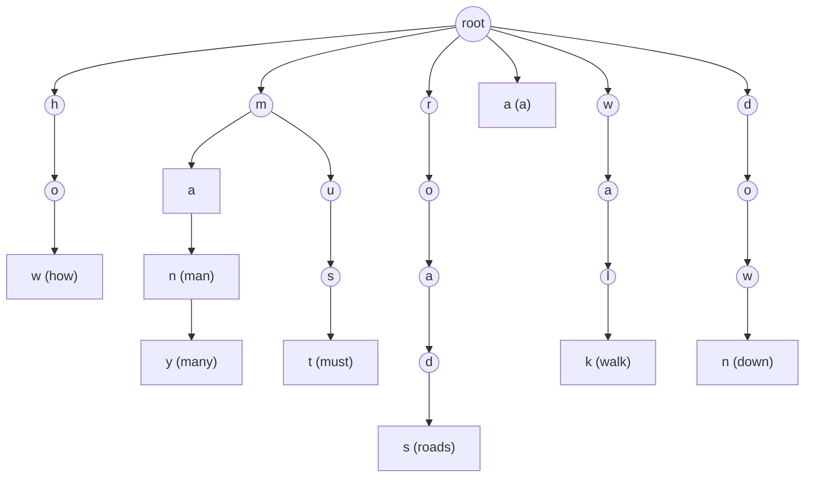

A **string** is a finite sequence of characters over a finite alphabet; its basic representation and operations were discussed in [4.1.7](/4.1.7) and [4.2.11](/4.2.11). Unlike a **vector** or a list, a string can be very long (a book, a genome) while the alphabet is usually small (binary, the four bases of DNA, ASCII), and the most common way of access is neither **call-by-rank** nor access by key but "access by pattern": finding in a long string the places that equal a given short string. This chapter is organized around this string matching problem: we first see why the brute-force algorithm is slow, then present three classical ideas for improvement, namely the KMP algorithm, which uses the information of the part already matched so that the text pointer never moves back; the BM algorithm, which compares from right to left and jumps far ahead using the mismatched character; and the Karp–Rabin algorithm, which regards strings as numbers and quickly rules out positions by hash values. Finally we discuss tries, which handle a set of strings. A **regular expression** ([4.2.11](/4.2.11)) describes a class of strings rather than a single string, and matching it requires finite automata, see [4.8](/4.8); the KMP algorithm can be viewed as a special case.

## 13.1. Strings and String Matching

### 13.1.1. Terminology

Let the alphabet $\Sigma$ have $s = \lvert \Sigma \rvert$ characters, and let $S = S[0]S[1]\cdots S[n-1]$ be a string of length $n$. In this chapter substrings are written with half-open interval notation:

- substring $S[i, i+k)$: the $k$ consecutive characters starting from $S[i]$;
- prefix $S[0, k)$: the foremost of the substrings of length $k$; suffix $S[n-k, n)$: the last one;
- the empty string is a substring, prefix and suffix of every string; a prefix or suffix not equal to $S$ itself is called a proper prefix or proper suffix.

The **abstract data type** of strings and its correspondence in the two languages are as follows:

| Operation | Meaning | C++ `std::string` | Python `str` |
|---|---|---|---|
| `length()` | length | `s.size()` | `len(s)` |
| `charAt(i)` | the $i$-th character | `s[i]` | `s[i]` |
| `substr(i, k)` | substring $S[i, i+k)$ | `s.substr(i, k)` | `s[i:i+k]` |
| `prefix(k)` / `suffix(k)` | prefix, suffix | `s.substr(0, k)` / `s.substr(n-k)` | `s[:k]` / `s[n-k:]` |
| `concat(T)` | concatenation | `s + t` | `s + t` |
| `equal(T)` | equality test | `s == t` | `s == t` |
| `indexOf(P)` | position of the first occurrence of the pattern | `s.find(p)` | `s.find(p)` |

For example, in `"data structures and algorithms"` the string `"algorithm"` first occurs at position 20, while `"string"` does not occur (the result is $-1$). The other operations are trivial, and below we concentrate on `indexOf`.

### 13.1.2. The String Matching Problem

**Definition 13.1.1 (String Matching)** Given a **text string** $T$ of length $n$ and a **pattern string** $P$ of length $m$ (usually $m \ll n$), the problems of deciding whether $P$ occurs in $T$, finding the position of its first occurrence, or counting or listing all of its occurrences are collectively called **string matching** (pattern matching).

String matching underlies the search of text editors, `grep`, network intrusion detection, sequence alignment in bioinformatics, and more. When designing and testing string matching algorithms, note the following feature: randomly generated $T$ and $P$ almost always fail to match (the probability that $P$ occurs in $T$ is tiny), so testing only on random input is heavily biased toward the failing case; for successful cases, $P$ should be taken as a random substring of $T$. All algorithms below return the position of the first occurrence, and $-1$ if there is none, the same convention as `find`.

## 13.2. The Brute-Force Algorithm

The most direct method aligns $P$ with every position of $T$ in turn and compares characters one by one from left to right: upon a mismatch, shift $P$ right by one character and compare again from the beginning; if all characters match, an occurrence has been found.

```cpp tab
#include <format>
#include <iostream>
#include <random>
#include <string>
#include <string_view>

// Return the first position where p occurs in t, or -1 if there is none.
long brute_force(std::string_view t, std::string_view p) {
    const long n = static_cast<long>(t.size()), m = static_cast<long>(p.size());
    for (long i = 0; i + m <= n; ++i) {           // align p[0] with t[i]
        long j = 0;
        while (j < m && t[i + j] == p[j]) ++j;    // compare left to right
        if (j == m) return i;                     // full match
    }
    return -1;
}

int main() {
    std::cout << std::format("{} {}\n", brute_force("data structures and algorithms", "algorithm"),
                             brute_force("data structures and algorithms", "string"));
    std::mt19937 rng(8);                          // differential test against std::string::find
    for (int trial = 0; trial < 20000; ++trial) {
        std::string t(rng() % 30, 'a'), p(rng() % 5, 'a');
        for (char& c : t) c = static_cast<char>('a' + rng() % 2);
        for (char& c : p) c = static_cast<char>('a' + rng() % 2);
        auto pos = t.find(p);
        long ref = pos == std::string::npos ? -1 : static_cast<long>(pos);
        if (brute_force(t, p) != ref) { std::cout << "mismatch\n"; return 1; }
    }
    std::cout << "random tests passed\n";
}
```

```python tab
import random


def brute_force(t: str, p: str) -> int:
    """Return the first position where p occurs in t, or -1."""
    n, m = len(t), len(p)
    for i in range(n - m + 1):                    # align p[0] with t[i]
        j = 0
        while j < m and t[i + j] == p[j]:         # compare left to right
            j += 1
        if j == m:                                # full match
            return i
    return -1


print(brute_force("data structures and algorithms", "algorithm"),
      brute_force("data structures and algorithms", "string"))

rng = random.Random(8)                            # differential test against str.find
for trial in range(20000):
    t = "".join(rng.choice("ab") for _ in range(rng.randrange(30)))
    p = "".join(rng.choice("ab") for _ in range(rng.randrange(5)))
    assert brute_force(t, p) == t.find(p)
print("random tests passed")
```

In the worst case, every alignment position is compared up to the last character of $P$ before failing, for example $T = \texttt{000}\cdots\texttt{0}$ and $P = \texttt{00001}$: there are $n - m + 1$ alignment positions with $m$ comparisons each, $O(nm)$ in total. On random text, however, the expected number of comparisons per alignment position is $1 + 1/s + 1/s^2 + \cdots < s/(s-1) \le 2$, so the average case is $O(n)$; the smaller the alphabet, the larger the probability $1/s$ that a single comparison succeeds, and the slower the brute-force algorithm.

The root of the brute-force algorithm's inefficiency is its "forgetfulness": after each mismatch, the comparison position in $T$ goes back to the character after the one where this alignment began, $P$ returns to its beginning, and all the information gained from the successful comparisons is thrown away.

## 13.3. The KMP Algorithm

### 13.3.1. Memory: The Part Already Matched

Suppose that at some moment $T[i]$ and $P[j]$ mismatch. The earlier comparisons have already told us that

$$
T[i-j, i) = P[0, j),
$$
that is, we know these $j$ characters of $T$ completely, and they depend only on $P$. We can therefore compute in advance the next alignment worth trying: it should align some prefix $P[0, t)$ of $P$ with $T[i-t, i)$, which requires $P[0, t)$ to be exactly the suffix of length $t$ of $P[0, j)$. Then:

- $T[i - t, i)$ need not be compared again, and we continue directly by comparing $T[i]$ with $P[t]$, so $i$ never has to move back;
- $P$ shifts right by $j - t$ characters; in order not to miss any possible match, the shift should be as small as possible, that is, $t$ should be as large as possible.

A string that is both a proper prefix and a proper suffix of $X$ is called a border of $X$. The $t$ above is the length of the longest border of $P[0, j)$. If a smaller shift $j - t'$ ($t' > t$) also gave a match, then $P[0, t')$ would be a longer border of $P[0, j)$, a contradiction; so taking the longest border misses no match.

### 13.3.2. The Failure Function

There are only $m$ possible mismatch positions $j$, namely $0, 1, \dots, m-1$, so $t$ can be prepared in advance for each of them and tabulated.

**Definition 13.3.1 (Failure Function)** For a pattern string $P$, let $\mathit{next}[0] = -1$, and for $1 \le j \le m$ let

$$
\mathit{next}[j] = \max\{\, t : 0 \le t < j,\ P[0, t) = P[j - t, j) \,\},
$$
the length of the longest border of $P[0, j)$. This table is called the **failure function** of $P$, also called the **next table**.

The value $\mathit{next}[0] = -1$ can be understood as follows: before $P[0]$ there is a "wildcard" $P[-1]$ that matches every character. On a mismatch at $P[0]$, the wildcard is aligned with $T[i]$ and necessarily matches, so $i$ and $j$ advance together, which amounts to shifting $P$ right by one position. This way the main loop need not treat the case $j = 0$ separately. The value $\mathit{next}[m]$ is used when reporting all occurrences: after a match is found, set $j \gets \mathit{next}[m]$ and continue.

**Algorithm 13.3.1 (KMP Algorithm)** Maintain $T[i-j, i) = P[0, j)$. If $j < 0$ or $T[i] = P[j]$, increase both $i$ and $j$ by 1; otherwise set $j \gets \mathit{next}[j]$. When $j = m$ the match succeeds, at position $i - m$; when $i = n$ the search fails (D. E. Knuth, J. H. Morris, V. R. Pratt, 1977).

Constructing the next table is itself a string matching problem: $P$ is matched against itself. Using decrease and conquer, we compute $\mathit{next}[j+1]$ from $\mathit{next}[0], \dots, \mathit{next}[j]$. A border of $P[0, j+1)$ with its last character removed is a border of $P[0, j)$, so the longest border of $P$ at $j+1$ is at most one character longer than at $j$: let $t = \mathit{next}[j]$; if $P[t] = P[j]$ then $\mathit{next}[j+1] = t + 1$; otherwise try the next longest borders in turn, $t \gets \mathit{next}[t]$ (the lengths of all borders of $P[0, j)$ are exactly the decreasing chain $\mathit{next}[j], \mathit{next}[\mathit{next}[j]], \dots$), until $P[t] = P[j]$ or $t = -1$.

Take $P = \texttt{chinchilla}$ as an example:

| $j$ | 0 | 1 | 2 | 3 | 4 | 5 | 6 | 7 | 8 | 9 | 10 |
|---|---|---|---|---|---|---|---|---|---|---|---|
| $P[j]$ | c | h | i | n | c | h | i | l | l | a | |
| $\mathit{next}[j]$ | $-1$ | 0 | 0 | 0 | 0 | 1 | 2 | 3 | 0 | 0 | 0 |
| improved $\mathit{next}[j]$ | $-1$ | 0 | 0 | 0 | $-1$ | 0 | 0 | 3 | 0 | 0 | 0 |

For example $\mathit{next}[7] = 3$: the longest border of $P[0, 7) = \texttt{chinchi}$ is $\texttt{chi}$. If a mismatch occurs at $P[7] = \texttt{l}$, we compare $P[3] = \texttt{n}$ with $T[i]$, and the preceding $\texttt{chi}$ need not be compared again. The last row of the table is explained in §13.3.4.

```cpp tab
#include <format>
#include <iostream>
#include <random>
#include <string>
#include <string_view>
#include <vector>

// next[j] = length of the longest proper border of p[0, j); next[0] = -1.
// With improved = true, a shift that would compare the same character again is skipped.
std::vector<long> build_next(std::string_view p, bool improved = false) {
    const long m = static_cast<long>(p.size());
    std::vector<long> next(m + 1);
    long j = 0, t = next[0] = -1;                 // invariant: t = next[j]
    while (j < m) {
        if (t < 0 || p[t] == p[j]) {              // the border grows by one character
            ++t, ++j;
            next[j] = (improved && j < m && p[j] == p[t]) ? next[t] : t;
        } else {
            t = next[t];                          // try the next shorter border
        }
    }
    return next;
}

long kmp(std::string_view t, std::string_view p, const std::vector<long>& next) {
    const long n = static_cast<long>(t.size()), m = static_cast<long>(p.size());
    long i = 0, j = 0;                            // invariant: t[i-j, i) == p[0, j)
    while (j < m && i < n) {
        if (j < 0 || t[i] == p[j]) ++i, ++j;      // match (or the wildcard p[-1])
        else j = next[j];                         // p shifts right; i never moves back
    }
    return j == m ? i - j : -1;
}

int main() {
    for (std::string_view p : {"chinchilla", "aaaab"}) {
        std::cout << std::format("{:>10}:", p);
        for (long x : build_next(p)) std::cout << std::format("{:3}", x);
        std::cout << "\n  improved:";
        for (long x : build_next(p, true)) std::cout << std::format("{:3}", x);
        std::cout << '\n';
    }
    std::cout << kmp("a chinchilla eats", "chinchilla", build_next("chinchilla")) << '\n';

    std::mt19937 rng(9);                          // differential test against std::string::find
    for (int trial = 0; trial < 20000; ++trial) {
        std::string t(rng() % 40, 'a'), p(rng() % 6, 'a');
        for (char& c : t) c = static_cast<char>('a' + rng() % 2);
        for (char& c : p) c = static_cast<char>('a' + rng() % 2);
        auto pos = t.find(p);
        long ref = pos == std::string::npos ? -1 : static_cast<long>(pos);
        if (kmp(t, p, build_next(p)) != ref || kmp(t, p, build_next(p, true)) != ref) {
            std::cout << "mismatch\n";
            return 1;
        }
    }
    std::cout << "random tests passed\n";
}
```

```python tab
import random


def build_next(p: str, improved: bool = False) -> list[int]:
    """next[j] = length of the longest proper border of p[:j]; next[0] = -1.
    With improved=True, a shift that would compare the same character again is skipped."""
    m = len(p)
    nxt = [-1] * (m + 1)
    j, t = 0, -1                                  # invariant: t == nxt[j]
    while j < m:
        if t < 0 or p[t] == p[j]:                 # the border grows by one character
            t, j = t + 1, j + 1
            nxt[j] = nxt[t] if improved and j < m and p[j] == p[t] else t
        else:
            t = nxt[t]                            # try the next shorter border
    return nxt


def kmp(t: str, p: str, nxt: list[int]) -> int:
    n, m = len(t), len(p)
    i = j = 0                                     # invariant: t[i-j:i] == p[:j]
    while j < m and i < n:
        if j < 0 or t[i] == p[j]:                 # match (or the wildcard p[-1])
            i, j = i + 1, j + 1
        else:
            j = nxt[j]                            # p shifts right; i never moves back
    return i - j if j == m else -1


for p in ("chinchilla", "aaaab"):
    print(f"{p:>10}:", *build_next(p))
    print("  improved:", *build_next(p, True))
print(kmp("a chinchilla eats", "chinchilla", build_next("chinchilla")))

rng = random.Random(9)                            # differential test against str.find
for trial in range(20000):
    t = "".join(rng.choice("ab") for _ in range(rng.randrange(40)))
    p = "".join(rng.choice("ab") for _ in range(rng.randrange(6)))
    assert kmp(t, p, build_next(p)) == kmp(t, p, build_next(p, True)) == t.find(p)
print("random tests passed")
```

### 13.3.3. Amortized Analysis

Each $T[i]$ may go through many failed comparisons ($j$ decreases again and again along the next chain), up to $O(m)$ of them; if there really were $O(n)$ such $T[i]$, the total time would be $O(nm)$. A more careful analysis shows that this cannot happen.

**Theorem 13.3.1** The main loop of the KMP algorithm iterates at most $2n$ times, the construction of the next table at most $2m$ times, and the total time is $O(n + m)$.

**Proof** Consider the quantity $k = 2i - j$. Initially $i = j = 0$ and $k = 0$. In each iteration: if the characters match (or $j < 0$), $i$ and $j$ both increase by 1 and $k$ increases by exactly 1; otherwise $j \gets \mathit{next}[j] < j$ while $i$ stays unchanged, so $k$ increases by at least 1. Hence $k$ is strictly increasing with the iterations, and the number of iterations does not exceed the final value of $k$. When the loop ends, $i \le n$ and $j \ge -1$, so $k \le 2n + 1$; more carefully, before the last iteration $i \le n - 1$, so there are at most $2n$ iterations. In the loop constructing the next table, $2j - t$ plays the same role, and likewise there are at most $2m$ iterations. $\square$

This is a typical example of **amortized analysis**: the cost of a single character may be high, but the total cost is controlled by a monotonically changing "potential". It can also be understood in the style of accounting: the successful comparisons cover $T$ exactly once, $O(n)$ in total; each failed comparison shifts $P$ right by at least one position, and the alignment position of $P$ can shift right at most $n$ times, so there are also only $O(n)$ failed comparisons.

The text pointer of the KMP algorithm only moves forward, so the algorithm is particularly suitable for sequential storage media (such as tapes and network data streams) and need not buffer text already read. But its average performance differs little from brute force: on random text over a large alphabet, a single comparison succeeds with very small probability, and the brute-force algorithm already fails at the first character almost every time. The smaller the alphabet (such as binary strings or DNA), the more pronounced the advantage of KMP.

### 13.3.4. The Improved Next Table

The next table uses only past successful comparisons (experience) and does not yet use failed comparisons (lessons). Let $P = \texttt{aaaab}$, and suppose $T[i] = \texttt{x}$ mismatches $P[3]$. The original next table makes $T[i]$ be compared in turn with $P[2]$, $P[1]$ and $P[0]$, and all three comparisons necessarily fail, because they are the same as $P[3]$, namely $\texttt{a}$, and we already know that $T[i] \ne \texttt{a}$.

The improvement is as follows: when constructing the next table, if $P[j] = P[\mathit{next}[j]]$, set $\mathit{next}[j] \gets \mathit{next}[\mathit{next}[j]]$. Since the table is constructed in increasing order of $j$, $\mathit{next}[\mathit{next}[j]]$ is already an improved value, and one substitution suffices. The branch with `improved = true` in the code above does exactly this. The next table of $P = \texttt{aaaab}$ changes from $-1, 0, 1, 2, 3$ to $-1, -1, -1, -1, 3$: after a mismatch at $P[3]$, $P$ is moved directly past $T[i]$. The improvement does not affect the analysis of Theorem 13.3.1 (we still have $\mathit{next}[j] < j$), but it reduces the actual number of comparisons.

### 13.3.5. The Pattern as an Automaton

The next table turns the pattern into a machine: state $j$ means "$P[0, j)$ has been matched"; if the character read equals $P[j]$ we advance to state $j+1$, otherwise we transition along the next chain; reaching state $m$ reports a match. For a given $P$ one can even generate a dedicated piece of matching code automatically, one line per state. This is exactly the idea of finite automata ([4.8](/4.8)): the KMP algorithm is a compact automaton with "failure transitions" built for a single pattern. A complete deterministic finite automaton stores a transition for every state and every character, requiring $O(ms)$ space but only one transition per character; KMP stores only one failure transition per state, in $O(m)$ space. Generalizing this idea to a set of patterns gives the Aho–Corasick algorithm: organize all patterns into a trie (§13.6) and add a failure pointer to each node, and all occurrences of all patterns can be found in one scan, in time $O(n + \text{total length of the patterns} + \text{number of occurrences})$.

## 13.4. The BM Algorithm

### 13.4.1. Starting from the End

For a large alphabet, mismatches are far more common than matches. Rather than using the information provided by matches, it is better to obtain the information provided by mismatches as early as possible, because each mismatch may rule out many alignment positions. Comparing from the last character of $P$ from right to left detects mismatches early, and the mismatched character may tell us that $P$ can shift far to the right. This is the starting point of the BM algorithm of R. S. Boyer and J. S. Moore (1977):

**Algorithm 13.4.1 (Boyer–Moore Algorithm)** Precompute from $P$ the bad character table $\mathit{bc}$ and the good suffix table $\mathit{gs}$. At each alignment position, compare characters from right to left to find the maximal matching suffix; if it matches completely, return the position; otherwise shift $P$ to the right by the larger of the shifts given by the two tables, and compare again from right to left.

### 13.4.2. Bad Characters

Suppose $P$ is aligned with $T[i, i+m)$ and the comparison stops at $P[j] \ne T[i+j] = X$; $X$ is called the *bad character*. The next alignment must align some $X$ of $P$ with $T[i+j]$ (otherwise it will necessarily mismatch here again). In order not to miss a match, we should choose the rightmost $X$ in $P[0, j)$.

In preprocessing, for each character $c$ of the alphabet, let $\mathit{bc}[c]$ be the position of the last occurrence of $c$ in $P$, or $-1$ if it does not occur. It suffices to scan $P$ in increasing order of position, with later occurrences overwriting earlier ones (the "painter's algorithm"), in time $O(s + m)$. The shift upon mismatch is

$$
j - \mathit{bc}[X]:
$$

- if $X$ does not occur in $P$, then $\mathit{bc}[X] = -1$ and $P$ passes $T[i+j]$ entirely, shifting right by $j + 1$ positions;
- if the last occurrence of $X$ is to the left of $P[j]$, the two are aligned after the shift;
- if the last occurrence of $X$ is to the right of $P[j]$ ($\mathit{bc}[X] > j$), the shift is negative, and we can only conservatively shift by 1 position (one can also store a two-dimensional table recording the nearest $X$ to the left of each position, at a cost of $O(sm)$ space).

Using only bad characters, in the best case a single comparison allows a shift of $m$ positions (no character of $P$ occurs in $T$), so only $O(n/m)$ comparisons are needed in total, fewer than $n$, and the longer the pattern the better the effect. This is common in real text over large alphabets (ASCII, Unicode). In the worst case the algorithm degenerates to brute force, for example $T = \texttt{000}\cdots\texttt{0}$ and $P = \texttt{10000}$: each time the whole of $P$ is scanned before the mismatch at $P[0]$, and the bad character $\texttt{0}$ has its last occurrence on the right, so the shift is only 1 position, $O(nm)$ in total. The performance on small alphabets (bitmaps, DNA) is close to this case.

### 13.4.3. Good Suffixes

Bad characters use only the mismatch (a lesson). By analogy with KMP, the suffix already matched during the right-to-left comparison (experience) is equally useful. Suppose the comparison fails at $P[j]$; then $U = P(j, m) = P[j+1, m)$ has already matched, and is called the *good suffix*. The next alignment must satisfy:

1. $U$ matches again some substring $V(k) = P(k, m + k - j)$ of $P$ (experience);
2. and $P[k] \ne P[j]$, because $P[j]$ has just mismatched (lesson).

If such a $V(k)$ exists in $P$, take the one with the largest $k$ (the rightmost), so that the shift $\mathit{gs}[j] = j - k$ is the smallest; otherwise, among all prefixes of $P$, take the longest $P[0, t)$ that matches some suffix of $U$, and the shift is $\mathit{gs}[j] = m - t$ ($t$ may be 0, in which case $P$ passes the current alignment position entirely). In either case, the shift depends only on $j$ and $P$ itself, and can be precomputed into a table.

Computing $\mathit{gs}$ directly from the definition takes $O(m^2)$ or even $O(m^3)$ time. An efficient method uses an intermediate table: let $\mathit{ss}[j]$ be the length of the longest suffix of $P[0, j]$ that matches some suffix of $P$, that is, the largest value satisfying $P(j - \mathit{ss}[j], j] = P[m - \mathit{ss}[j], m)$. The table $\mathit{ss}$ implies all the information of the table $\mathit{gs}$, in just two cases:

- if $\mathit{ss}[j] = j + 1$, that is, the whole prefix $P[0, j]$ is a suffix of $P$, then for every $i < m - j - 1$, $m - j - 1$ is a candidate for $\mathit{gs}[i]$ (corresponding to the "prefix" case above);
- if $\mathit{ss}[j] \le j$, then $m - j - 1$ is a candidate for $\mathit{gs}[m - \mathit{ss}[j] - 1]$: on a mismatch at $P[m - \mathit{ss}[j] - 1]$, the good suffix $P[m - \mathit{ss}[j], m)$ occurs again at $P(j - \mathit{ss}[j], j]$, and by the maximality of $\mathit{ss}[j]$ the characters preceding the two occurrences differ, which exactly satisfies condition 2.

$\mathit{gs}[i]$ takes the smallest of all candidates, and `build_gs` below achieves this by arranging the scan order. The table $\mathit{ss}$ itself can be computed in $O(m)$ time by one scan from back to front: maintain a window $P(\mathit{lo}, \mathit{hi}]$ known to match a suffix of $P$; positions inside the window can directly use earlier results, only the part beyond the window needs explicit comparison, and the left end of the window only moves left monotonically, similar to the analysis of KMP. Take $P = \texttt{ICED RICE PRICE}$ ($m = 15$, ␣ denotes a space) as an example:

| $j$ | 0 | 1 | 2 | 3 | 4 | 5 | 6 | 7 | 8 | 9 | 10 | 11 | 12 | 13 | 14 |
|---|---|---|---|---|---|---|---|---|---|---|---|---|---|---|---|
| $P[j]$ | I | C | E | D | ␣ | R | I | C | E | ␣ | P | R | I | C | E |
| $\mathit{ss}[j]$ | 0 | 0 | 3 | 0 | 0 | 0 | 0 | 0 | 4 | 0 | 0 | 0 | 0 | 0 | 15 |
| $\mathit{gs}[j]$ | 12 | 12 | 12 | 12 | 12 | 12 | 12 | 12 | 12 | 12 | 6 | 12 | 15 | 15 | 1 |

For example, on a mismatch at $P[10] = \texttt{P}$, the good suffix $\texttt{RICE}$ occurs again at $P[5, 9)$, preceded by a space rather than $\texttt{P}$, so the shift is $10 - 4 = 6$ positions; on a mismatch at $P[12]$, the good suffix $\texttt{CE}$ occurs at two other places in $P$, both preceded by $\texttt{I}$, the same as the mismatched $P[12]$, so it would necessarily mismatch again, and $P$ has no prefix ending in $\texttt{E}$, so the shift is 15 positions.

```cpp tab
#include <algorithm>
#include <format>
#include <iostream>
#include <random>
#include <string>
#include <string_view>
#include <vector>

// Bad character: bc[c] = the last position of c in p, or -1 ("painter's algorithm").
std::vector<long> build_bc(std::string_view p) {
    std::vector<long> bc(256, -1);
    for (long j = 0; j < static_cast<long>(p.size()); ++j)
        bc[static_cast<unsigned char>(p[j])] = j;  // later positions overwrite earlier ones
    return bc;
}

// ss[j] = length of the longest common suffix of p[0, j] and p. O(m) in total.
std::vector<long> build_ss(std::string_view p) {
    const long m = static_cast<long>(p.size());
    std::vector<long> ss(m);
    ss[m - 1] = m;
    for (long lo = m - 1, hi = m - 1, j = lo - 1; j >= 0; --j) {
        if (lo < j && ss[m - hi + j - 1] < j - lo) {
            ss[j] = ss[m - hi + j - 1];             // reuse: inside the known window
        } else {
            hi = j;
            lo = std::min(lo, hi);
            while (lo >= 0 && p[lo] == p[m - hi + lo - 1]) --lo;  // extend explicitly
            ss[j] = hi - lo;
        }
    }
    return ss;
}

// Good suffix: gs[j] = the shift after a mismatch at p[j] (p(j, m) has matched).
std::vector<long> build_gs(std::string_view p) {
    const long m = static_cast<long>(p.size());
    std::vector<long> ss = build_ss(p), gs(m, m);
    for (long i = 0, j = m - 1; j >= 0; --j)        // case 1: a prefix of p is a suffix of p
        if (j + 1 == ss[j])
            while (i < m - j - 1) gs[i++] = m - j - 1;
    for (long j = 0; j < m - 1; ++j)                // case 2: the good suffix reoccurs inside p
        gs[m - ss[j] - 1] = m - j - 1;
    return gs;
}

long boyer_moore(std::string_view t, std::string_view p) {
    const long n = static_cast<long>(t.size()), m = static_cast<long>(p.size());
    if (m == 0) return 0;
    std::vector<long> bc = build_bc(p), gs = build_gs(p);
    for (long i = 0; i + m <= n;) {                 // p[0] is aligned with t[i]
        long j = m - 1;
        while (j >= 0 && p[j] == t[i + j]) --j;     // compare right to left
        if (j < 0) return i;
        i += std::max(gs[j], j - bc[static_cast<unsigned char>(t[i + j])]);
    }
    return -1;
}

int main() {
    std::cout << boyer_moore("here is a simple example", "example") << '\n';

    std::mt19937 rng(10);                           // differential test against std::string::find
    for (int trial = 0; trial < 30000; ++trial) {
        int s = 1 + static_cast<int>(rng() % 3);    // alphabet size 1..3
        std::string t(rng() % 40, 'a'), p(rng() % 7, 'a');
        for (char& c : t) c = static_cast<char>('a' + rng() % s);
        for (char& c : p) c = static_cast<char>('a' + rng() % s);
        auto pos = t.find(p);
        long ref = pos == std::string::npos ? -1 : static_cast<long>(pos);
        if (boyer_moore(t, p) != ref) { std::cout << "mismatch\n"; return 1; }
    }
    std::cout << "random tests passed\n";
}
```

```python tab
import random


def build_bc(p: str) -> dict[str, int]:
    """Bad character: bc[c] = the last position of c in p (absent: -1)."""
    bc = {}
    for j, c in enumerate(p):                     # later positions overwrite earlier ones
        bc[c] = j
    return bc


def build_ss(p: str) -> list[int]:
    """ss[j] = length of the longest common suffix of p[:j+1] and p; O(m)."""
    m = len(p)
    ss = [0] * m
    ss[m - 1] = m
    lo = hi = m - 1
    for j in range(m - 2, -1, -1):
        if lo < j and ss[m - hi + j - 1] < j - lo:
            ss[j] = ss[m - hi + j - 1]            # reuse: inside the known window
        else:
            hi, lo = j, min(lo, j)
            while lo >= 0 and p[lo] == p[m - hi + lo - 1]:
                lo -= 1                           # extend explicitly
            ss[j] = hi - lo
    return ss


def build_gs(p: str) -> list[int]:
    """Good suffix: gs[j] = the shift after a mismatch at p[j]."""
    m = len(p)
    ss, gs = build_ss(p), [m] * m
    i = 0
    for j in range(m - 1, -1, -1):                # case 1: a prefix of p is a suffix of p
        if j + 1 == ss[j]:
            while i < m - j - 1:
                gs[i] = m - j - 1
                i += 1
    for j in range(m - 1):                        # case 2: the good suffix reoccurs inside p
        gs[m - ss[j] - 1] = m - j - 1
    return gs


def boyer_moore(t: str, p: str) -> int:
    n, m = len(t), len(p)
    if m == 0:
        return 0
    bc, gs = build_bc(p), build_gs(p)
    i = 0                                         # p[0] is aligned with t[i]
    while i + m <= n:
        j = m - 1
        while j >= 0 and p[j] == t[i + j]:        # compare right to left
            j -= 1
        if j < 0:
            return i
        i += max(gs[j], j - bc.get(t[i + j], -1))
    return -1


print(boyer_moore("here is a simple example", "example"))

rng = random.Random(10)                           # differential test against str.find
for trial in range(30000):
    alphabet = "abc"[: rng.randint(1, 3)]
    t = "".join(rng.choice(alphabet) for _ in range(rng.randrange(40)))
    p = "".join(rng.choice(alphabet) for _ in range(rng.randrange(7)))
    assert boyer_moore(t, p) == t.find(p)
print("random tests passed")
```

### 13.4.4. Overall Performance

Both the space and the preprocessing time of the BM algorithm are $O(s + m)$. With bad characters only, the best case is $O(n/m)$ and the worst case $O(nm)$; when good suffixes are used as well, the worst case drops to $O(n + m)$ (for finding the first occurrence; the proof is much more complicated than for KMP, and the upper bound on the number of comparisons was improved successively by Knuth, by Guibas and Odlyzko, and by Cole to about $3n$), and the best case is still $O(n/m)$. To report all occurrences, the Galil rule (skipping repeated comparisons using a known period) is also needed to remain linear.

The key factor determining performance is the probability that a single comparison succeeds, which for random text is usually $1/s$. For a very small alphabet this probability is close to 1, and the worst-case guarantees of KMP and BM are the most valuable; for a very large alphabet the probability is close to 0, and the bad character strategy makes BM much faster than the other algorithms. The figure below shows the average number of comparisons per text character for the four methods when finding all occurrences in random text:


In practice simplified versions of BM are commonly used. R. N. Horspool (1980) keeps only the bad character table and always looks up the last character $T[i + m - 1]$ of the alignment window to decide the shift; the code is very short and fast on large alphabets.

## 13.5. The Karp–Rabin Algorithm

### 13.5.1. Strings as Numbers

Another, completely different idea comes from "all is number". Gödel encoded the formulas of a logical system as natural numbers, and Cantor encoded finite strings as natural numbers and infinite strings as decimals in $[0, 1)$. The most natural encoding for strings is to number the characters of the alphabet $0, 1, \dots, d - 1$ and regard a string of length $m$ as an $m$-digit number in base $d$. For example, strings of decimal digits can be directly regarded as natural numbers: $P = \texttt{82818}$ occurs in $T = \texttt{2718281828459045}$ if and only if some substring of $T$ of length 5 equals 82818 as a number.

This is already an algorithm: compare two numbers instead of comparing characters one by one. But the problem is overflow. Regarding an ASCII string ($d = 128 = 2^7$) as a number, as soon as $m > 9$ its value exceeds $2^{63}$ and cannot be stored in a machine word; comparing two such big numbers takes $O(m)$ time, and the total time is back to $O(nm)$.

### 13.5.2. Fingerprints and Rolling Hashes

The remedy is hash compression: compare only the values of these big numbers modulo a prime $M$.

**Definition 13.5.1 (Fingerprint)** For a string $S[0, m)$, a base $d$ and a modulus $M$, the quantity

$$
h(S) = \left(\sum_{k=0}^{m-1} S[k]\, d^{\,m-1-k}\right) \bmod M
$$
is called the **fingerprint** of $S$, where $S[k]$ denotes the number of the character.

Two strings with different fingerprints are necessarily different, so a single fingerprint comparison rules out most alignment positions; when the fingerprints are equal the strings need not be equal (a **hash collision**), and the characters must still be compared one by one to confirm. For example, take $M = 97$: $h(\texttt{82818}) = 77$, and the substrings $\texttt{27182}$, $\texttt{71828}$, $\texttt{18281}$ of $T$ have fingerprints 22, 48, 45, and only the fourth substring $\texttt{82818}$ has fingerprint 77; but if the pattern were $\texttt{18284}$, its fingerprint would be 48, colliding with $\texttt{71828}$.

Recomputing the fingerprint of a substring of length $m$ each time takes $O(m)$ time. Fortunately, fingerprints of adjacent substrings are strongly related: going from $T[i, i+m)$ to $T[i+1, i+m+1)$, we merely drop the highest digit $T[i]$, shift everything left by one position and append $T[i+m]$ as the lowest digit:

$$
h(T[i+1, i+m+1)) = \Bigl(\bigl(h(T[i, i+m)) - T[i]\, d^{\,m-1}\bigr)\, d + T[i+m]\Bigr) \bmod M.
$$

After $d^{\,m-1} \bmod M$ has been precomputed, each new fingerprint takes only $O(1)$ time. This is the *rolling hash*, which lets the Karp–Rabin algorithm (R. M. Karp, M. O. Rabin, 1987) run in $O(n + m)$ time when no collision occurs.

**Algorithm 13.5.1 (Karp–Rabin Algorithm)** Compute $h(P)$ and $h(T[0, m))$; for $i = 0, 1, \dots, n - m$ in turn: if $h(T[i, i+m)) = h(P)$, confirm by comparing the characters one by one and return $i$ on success; then compute the fingerprint of the next substring by the rolling hash.

### 13.5.3. The Probability of Collisions

A collision costs one $O(m)$ confirmation. As long as the hash function is chosen appropriately, the probability of a collision can be kept within an acceptable range. A fixed $d$ and $M$ carry a hidden danger: an adversary can construct inputs with many collisions for them, making the algorithm degenerate to $O(nm)$. The countermeasure is to choose the base at random:

**Theorem 13.5.1** Let $M$ be a prime and let the base $d$ be chosen uniformly at random from $\{0, 1, \dots, M - 1\}$. For any two different strings $A \ne B$ of length $m$ (with all character numbers less than $M$),

$$
\mathbb{P}\bigl(h(A) = h(B)\bigr) \le \frac{m - 1}{M}.
$$

**Proof** $h(A) - h(B) \equiv \sum_{k} (A[k] - B[k])\, d^{\,m-1-k} \pmod M$ is a polynomial in the indeterminate $d$ of degree at most $m - 1$, with coefficients in the **finite field** $\mathbb{F}_M$, not all zero ($A \ne B$). A nonzero polynomial has at most as many roots in a field as its degree, so at most $m - 1$ values of $d$ give $h(A) = h(B)$. $\square$

Hence among the $n - m + 1$ alignment positions, the expected number of collisions is at most $n(m-1)/M$, and the expected total time is $O(n + m + nm^2/M)$. Taking $M$ much larger than $nm$ (in practice a Mersenne prime such as $M = 2^{61} - 1$ is often used, with multiplication in 128-bit integers), collisions practically never occur. The version that confirms collisions always gives the correct answer, and only the running time is random; the version that omits confirmation and trusts the fingerprint always runs in linear time but errs with tiny probability. The value of the Karp–Rabin algorithm lies not in the speed of single-pattern matching (it is usually inferior to KMP and BM) but in its generalizations: searching for many patterns of equal length at once (putting their fingerprints into a **hash table**), two-dimensional pattern matching, detecting repeated or plagiarized passages in documents, and deciding whether two files are identical without transmitting the whole text.

```cpp tab
#include <cstdint>
#include <format>
#include <iostream>
#include <random>
#include <string>
#include <string_view>

using u64 = std::uint64_t;
constexpr u64 M = 1'000'000'007;                 // a prime modulus

u64 power_mod(u64 a, u64 n) {                    // a^n mod M by repeated squaring
    u64 result = 1;
    for (a %= M; n > 0; n >>= 1, a = a * a % M)
        if (n & 1) result = result * a % M;
    return result;
}

// Karp-Rabin with a random base: verify on every fingerprint hit (Las Vegas).
long karp_rabin(std::string_view t, std::string_view p, u64 base) {
    const std::size_t n = t.size(), m = p.size();
    if (m == 0) return 0;
    if (m > n) return -1;
    auto code = [](char c) { return static_cast<u64>(static_cast<unsigned char>(c)); };
    u64 hp = 0, ht = 0;
    for (std::size_t k = 0; k < m; ++k) {        // Horner's rule
        hp = (hp * base + code(p[k])) % M;
        ht = (ht * base + code(t[k])) % M;
    }
    const u64 high = power_mod(base, m - 1);     // the weight of the first character
    for (std::size_t i = 0;; ++i) {              // ht is the fingerprint of t[i, i+m)
        if (ht == hp && t.substr(i, m) == p) return static_cast<long>(i);
        if (i + m == n) return -1;
        ht = (ht + M - code(t[i]) * high % M) % M;     // drop t[i]
        ht = (ht * base + code(t[i + m])) % M;         // append t[i+m]
    }
}

int main() {
    std::mt19937_64 rng(11);
    const u64 base = 256 + rng() % (M - 256);    // chosen at random, unknown to an adversary
    std::cout << karp_rabin("2718281828459045", "82818", base) << '\n';

    for (int trial = 0; trial < 20000; ++trial) { // differential test against std::string::find
        std::string t(rng() % 40, 'a'), p(rng() % 6, 'a');
        for (char& c : t) c = static_cast<char>('a' + rng() % 2);
        for (char& c : p) c = static_cast<char>('a' + rng() % 2);
        auto pos = t.find(p);
        long ref = pos == std::string::npos ? -1 : static_cast<long>(pos);
        if (karp_rabin(t, p, base) != ref) { std::cout << "mismatch\n"; return 1; }
    }
    std::cout << "random tests passed\n";
}
```

```python tab
import random

M = 1_000_000_007                                  # a prime modulus


def power_mod(a: int, n: int) -> int:
    """a**n mod M by repeated squaring: O(log n) multiplications."""
    result, a = 1, a % M
    while n > 0:
        if n & 1:
            result = result * a % M
        a = a * a % M
        n >>= 1
    return result


def karp_rabin(t: str, p: str, base: int) -> int:
    """Verify on every fingerprint hit, so the answer is always correct."""
    n, m = len(t), len(p)
    if m == 0:
        return 0
    if m > n:
        return -1
    hp = ht = 0
    for k in range(m):                             # Horner's rule
        hp = (hp * base + ord(p[k])) % M
        ht = (ht * base + ord(t[k])) % M
    high = power_mod(base, m - 1)                  # the weight of the first character
    for i in range(n - m + 1):                     # ht is the fingerprint of t[i:i+m]
        if ht == hp and t[i:i + m] == p:
            return i
        if i + m < n:
            ht = ((ht - ord(t[i]) * high) * base + ord(t[i + m])) % M
    return -1


rng = random.Random(11)
base = rng.randrange(256, M)                       # chosen at random, unknown to an adversary
print(karp_rabin("2718281828459045", "82818", base))

for trial in range(20000):                         # differential test against str.find
    t = "".join(rng.choice("ab") for _ in range(rng.randrange(40)))
    p = "".join(rng.choice("ab") for _ in range(rng.randrange(6)))
    assert karp_rabin(t, p, base) == t.find(p)
print("random tests passed")
```

### 13.5.4. Exponentiation by Squaring and the Cost Criterion

The $d^{\,m-1} \bmod M$ in the preprocessing is computed by *exponentiation by squaring*: write the exponent $m - 1$ in binary, scan from the low bit to the high bit, square the base repeatedly, and whenever a bit is 1 multiply the current base into the result; for example $a^{13} = a^{8} \cdot a^{4} \cdot a^{1}$. The number of multiplications is $O(\log m)$, whereas repeated multiplication needs $m - 1$.

There is a detail worth noting here: the input size of a problem should be the space needed to describe the input, which for numerical computation is the number of binary digits $r = \log_2 n$ of the number, not the value $n$ itself. The $O(n)$ multiplications of repeated multiplication look linear but are in fact $O(2^r)$, an exponential function of the input size; such complexity is called pseudo-polynomial. The $O(\log n) = O(r)$ of exponentiation by squaring is truly linear.

Conversely, when computing $a^n$ without a modulus, "$O(\log n)$ multiplications" does not mean $O(\log n)$ time: the binary representation of $a^n$ is $n \log_2 a$ bits long, and even printing it takes at least $\Omega(n)$ time. The contradiction lies in the computational model: the constant cost criterion of the **random-access machine** model assumes that every arithmetic operation takes $O(1)$ time, which is reasonable only when values do not exceed the machine word length; when values can be arbitrarily large the logarithmic cost criterion should be used, in which the cost of an operation is proportional to the number of bits of the operands. The Karp–Rabin algorithm always works modulo $M$ precisely so that every fingerprint fits into a machine word, and the constant cost criterion can be used legitimately.

## 13.6. Tries

### 13.6.1. Structure

The algorithms so far handle a single pattern. To maintain a set of strings (a dictionary) and query it repeatedly, we can use a tree structure designed specially for strings.

**Definition 13.6.1 (Trie)** A rooted tree in which every edge is labeled with a character, the characters labeling the outgoing edges of a node are pairwise distinct, each node corresponds to the string formed by the characters on the path from the root to it, and the nodes representing the strings of a given set are marked, is called a **trie**, also called a digital tree or prefix tree.

The name is taken from the middle of the word "retrieval" (E. Fredkin, 1960). Strings with a common prefix share the same path from the root, so a trie is also a compact representation of all prefixes of this set of strings. The figure below is the trie of the set {how, many, roads, must, a, man, walk, down}, with the string ending at a node given in parentheses:



Searching for or inserting a string of length $m$ takes only $m$ steps along a path, independent of the number $N$ of strings in the dictionary; storing the strings in a balanced search tree needs $O(\log N)$ string comparisons, each costing up to $O(m)$. A trie also naturally supports queries by prefix (autocompletion in input methods and search boxes) and longest prefix matching (routers forwarding packets by IP address prefix).

The children of each node can be stored in an array of length $s$, with $O(1)$ per step but $O(Ls)$ space ($L$ is the total length of all strings), which wastes a great deal for large alphabets; they can also be stored in a **hash table** or a balanced search tree, with $O(L)$ space and a slightly higher cost per step. The implementation below stores the children in an ordered map (C++) and a dictionary (Python).

```cpp tab
#include <algorithm>
#include <format>
#include <iostream>
#include <map>
#include <memory>
#include <random>
#include <set>
#include <string>
#include <string_view>
#include <vector>

class Trie {
    struct Node {
        bool terminal = false;                     // does a key end here?
        std::map<char, std::unique_ptr<Node>> child;
    };
    Node root_;

    const Node* find(std::string_view s) const {   // the node of prefix s, or nullptr
        const Node* v = &root_;
        for (char c : s) {
            auto it = v->child.find(c);
            if (it == v->child.end()) return nullptr;
            v = it->second.get();
        }
        return v;
    }
    static void collect(const Node* v, std::string& path, std::vector<std::string>& out) {
        if (v->terminal) out.push_back(path);
        for (const auto& [c, w] : v->child) {      // children in character order
            path.push_back(c);
            collect(w.get(), path, out);
            path.pop_back();
        }
    }

public:
    void insert(std::string_view s) {              // O(|s|) map operations
        Node* v = &root_;
        for (char c : s) {
            auto& w = v->child[c];
            if (!w) w = std::make_unique<Node>();
            v = w.get();
        }
        v->terminal = true;
    }
    bool contains(std::string_view s) const {
        const Node* v = find(s);
        return v && v->terminal;
    }
    std::vector<std::string> with_prefix(std::string_view s) const {  // in lexicographic order
        std::vector<std::string> out;
        if (const Node* v = find(s)) {
            std::string path(s);
            collect(v, path, out);
        }
        return out;
    }
};

int main() {
    Trie trie;
    for (std::string_view w : {"how", "many", "roads", "must", "a", "man", "walk", "down"})
        trie.insert(w);
    std::cout << std::format("{} {}\n", trie.contains("man"), trie.contains("ma"));
    for (const auto& w : trie.with_prefix("m")) std::cout << w << ' ';
    std::cout << '\n';

    std::mt19937 rng(12);                          // differential test against std::set
    for (int trial = 0; trial < 300; ++trial) {
        Trie tr;
        std::set<std::string> ref;
        auto word = [&] {
            std::string s(rng() % 5, 'a');
            for (char& c : s) c = static_cast<char>('a' + rng() % 3);
            return s;
        };
        for (int k = 0; k < 30; ++k) { auto s = word(); tr.insert(s); ref.insert(s); }
        for (int q = 0; q < 30; ++q) {
            auto s = word();
            std::vector<std::string> expect;
            for (const auto& w : ref)
                if (w.starts_with(s)) expect.push_back(w);
            if (tr.contains(s) != ref.contains(s) || tr.with_prefix(s) != expect) {
                std::cout << "mismatch\n";
                return 1;
            }
        }
    }
    std::cout << "random tests passed\n";
}
```

```python tab
import random


class Node:
    __slots__ = ("terminal", "child")

    def __init__(self):
        self.terminal = False                      # does a key end here?
        self.child: dict[str, Node] = {}


class Trie:
    def __init__(self):
        self.root = Node()

    def insert(self, s: str) -> None:              # O(|s|) dict operations
        v = self.root
        for c in s:
            v = v.child.setdefault(c, Node())
        v.terminal = True

    def _find(self, s: str) -> Node | None:        # the node of prefix s
        v = self.root
        for c in s:
            if (v := v.child.get(c)) is None:
                return None
        return v

    def contains(self, s: str) -> bool:
        v = self._find(s)
        return v is not None and v.terminal

    def with_prefix(self, s: str) -> list[str]:    # children in insertion order
        out: list[str] = []

        def collect(v: Node, path: str) -> None:
            if v.terminal:
                out.append(path)
            for c, w in v.child.items():
                collect(w, path + c)

        if (v := self._find(s)) is not None:
            collect(v, s)
        return out


trie = Trie()
for w in "how many roads must a man walk down".split():
    trie.insert(w)
print(trie.contains("man"), trie.contains("ma"), trie.with_prefix("m"))

rng = random.Random(12)                            # differential test against a set
for trial in range(300):
    tr, ref = Trie(), set()
    word = lambda: "".join(rng.choice("abc") for _ in range(rng.randrange(5)))
    for _ in range(30):
        s = word()
        tr.insert(s)
        ref.add(s)
    for _ in range(30):
        s = word()
        assert tr.contains(s) == (s in ref)
        assert sorted(tr.with_prefix(s)) == sorted(w for w in ref if w.startswith(s))
print("random tests passed")
```

### 13.6.2. Variants

- *Radix tree*: a trie often has long single chains (such as roads in the figure above); compressing each chain whose nodes have only one child into a single edge labeled with a substring makes the number of nodes proportional to the number of strings only. The PATRICIA tree of D. R. Morrison (1968) is its binary version, widely used in IP routing tables and operating system kernels.
- *Ternary search tree* (J. Bentley and R. Sedgewick, 1997): each node stores a character and three children pointing to smaller, equal and larger characters respectively, which amounts to organizing the children of each trie node into a binary search tree. Its space efficiency is close to that of a binary search tree, and it retains the character-by-character advance of a trie.
- *Suffix tree*: the compressed trie of all suffixes of a text. It can be built in $O(n)$ time (Weiner, 1973; McCreight, 1976; Ukkonen, 1995), after which the search for any pattern takes only $O(m)$, independent of the text length; the *suffix array* (Manber and Myers, 1990) is its more space-efficient alternative and has become the basis of genome indexing in bioinformatics.

## 13.7. String Matching in Standard Libraries

- C++'s `std::string::find` and `std::string_view::find` ([4.2.11](/4.2.11)) are essentially brute force in mainstream implementations: a function such as `memchr` quickly locates the first character of $P$ and the rest is compared one by one, which is already fast on ordinary text. C++17's `std::search` accepts a searcher; `std::boyer_moore_searcher` and `std::boyer_moore_horspool_searcher` (header `<functional>`) implement the BM and Horspool algorithms respectively, and suit repeated searches with the same long pattern.
- CPython's `str.find`, `in`, `str.count` and `str.replace` share one "fast search" code base: for short patterns it uses a simplified combination of the Boyer–Moore–Horspool and Sunday algorithms, with a bit mask to quickly decide whether a character occurs in the pattern; since 3.10, for longer patterns and texts it switches to the Crochemore–Perrin Two-Way algorithm, which guarantees $O(n + m)$ worst-case time with only constant extra space, avoiding the earlier $O(nm)$ on pathological inputs.
- Regular expression engines ([4.2.11](/4.2.11)) handle more general patterns; even for patterns without metacharacters, many engines first identify a literal substring that must occur and use the fast algorithms above to locate candidate positions.

## Summary

| Algorithm | Preprocessing | Matching: best | Matching: worst | Key points |
|---|---|---|---|---|
| Brute force | — | $O(n)$ | $O(nm)$ | Average $O(n)$ on random text |
| KMP | $O(m)$ | $O(n)$ | $O(n)$ | Text pointer never moves back; the next table is the longest border |
| BM (bad character) | $O(s + m)$ | $O(n/m)$ | $O(nm)$ | Right to left; extremely fast on large alphabets |
| BM (bad character + good suffix) | $O(s + m)$ | $O(n/m)$ | $O(n)$ | Uses both experience and lessons |
| Karp–Rabin | $O(m)$ | $O(n)$ | Expected $O(n + m)$ | Fingerprint plus rolling hash; random base prevents collision attacks |

- A successful comparison provides "experience" (what this segment of the text is), and a mismatch provides a "lesson" (what this character of the text is not); KMP uses the former, the bad character rule of BM uses the latter, and the good suffix rule and the improved next table use both.
- **Amortized analysis**: the monotonic increase of $k = 2i - j$ proves the linear time of KMP.
- The input size is the number of bits describing the input; exponentiation by squaring turns the pseudo-polynomial $O(n)$ into a truly $O(\log n)$.
- A trie makes the search time depend only on the string length; compressing single chains gives the PATRICIA tree, and organizing all suffixes gives the suffix tree.
