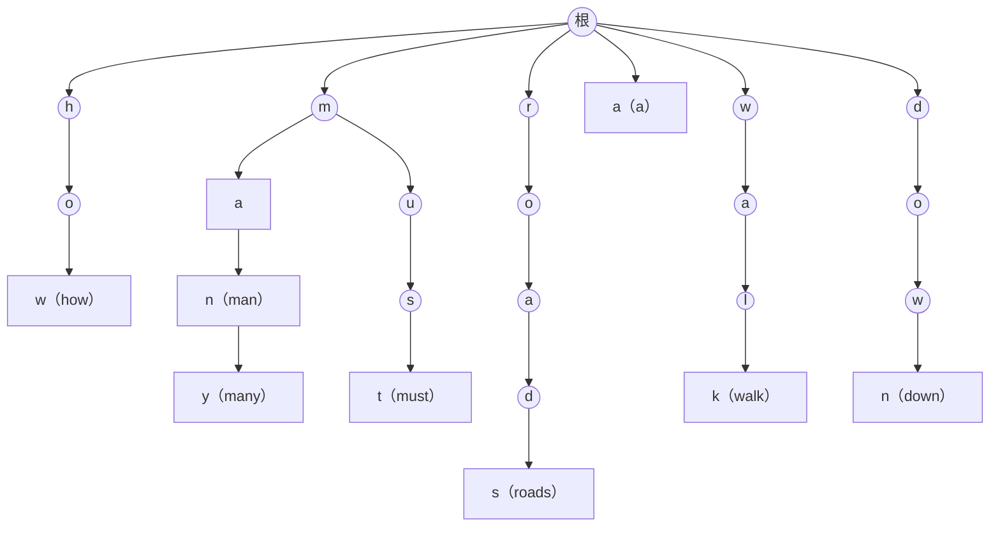

**字符串**（简称串）是由有限字母表中的字符组成的有限序列，它的基本表示与操作已在 [4.1.7](/4.1.7) 和 [4.2.11](/4.2.11) 中讨论。与向量、列表不同，串的长度可以很大（一本书、一个基因组），而字母表通常很小（二进制、DNA 的四个碱基、ASCII），并且最常见的访问方式既不是循秩访问，也不是循关键码访问，而是"循模式访问"：在一个长串中找出与给定短串相同的部分。本章围绕这个串匹配问题展开：先看蛮力算法为什么慢，再讲三种经典的改进思路——KMP 算法利用已经匹配的信息让文本串"绝不回退"，BM 算法自右向左比对、利用失配的字符大步跳跃，Karp–Rabin 算法把串看作数、用散列值快速排除；最后讨论处理一组串的 Trie。**正则表达式**（[4.2.11](/4.2.11)）描述的是一类串而不是一个串，它的匹配要用到有限自动机，见 [4.8](/4.8)；KMP 算法可以看作它的一个特例。

## 13.1. 串与串匹配

### 13.1.1. 术语

设字母表 $\Sigma$ 有 $s = \lvert \Sigma \rvert$ 个字符，长度为 $n$ 的串 $S = S[0]S[1]\cdots S[n-1]$。本章用左闭右开的区间记号表示子串：

- 子串 $S[i, i+k)$：从 $S[i]$ 起连续的 $k$ 个字符；
- 前缀 $S[0, k)$：长度为 $k$ 的子串中最靠前者；后缀 $S[n-k, n)$：最靠后者；
- 空串是任何串的子串、前缀和后缀；不等于 $S$ 本身的前缀、后缀称为真前缀、真后缀。

串的抽象数据类型与两种语言的对应如下：

| 操作 | 含义 | C++ `std::string` | Python `str` |
|---|---|---|---|
| `length()` | 长度 | `s.size()` | `len(s)` |
| `charAt(i)` | 第 $i$ 个字符 | `s[i]` | `s[i]` |
| `substr(i, k)` | 子串 $S[i, i+k)$ | `s.substr(i, k)` | `s[i:i+k]` |
| `prefix(k)` / `suffix(k)` | 前缀、后缀 | `s.substr(0, k)` / `s.substr(n-k)` | `s[:k]` / `s[n-k:]` |
| `concat(T)` | 连接 | `s + t` | `s + t` |
| `equal(T)` | 判等 | `s == t` | `s == t` |
| `indexOf(P)` | 模式串首次出现的位置 | `s.find(p)` | `s.find(p)` |

例如 `"data structures and algorithms"` 中 `"algorithm"` 首次出现在位置 20，而 `"string"` 不出现（返回 $-1$）。其他操作都是平凡的，下面集中讨论 `indexOf`。

### 13.1.2. 串匹配问题

**定义 13.1.1（串匹配）** 给定长度为 $n$ 的**文本串** $T$ 和长度为 $m$ 的**模式串** $P$（通常 $m \ll n$），判断 $P$ 是否在 $T$ 中出现、找出它首次出现的位置、统计或列出它的所有出现位置，这类问题统称为**串匹配**（模式匹配）。

串匹配是文本编辑器的查找、`grep`、网络入侵检测、生物信息学中的序列比对等的基础操作。设计和测试串匹配算法时要注意它的特点：随机生成的 $T$ 和 $P$ 几乎总是匹配失败（$P$ 在 $T$ 中出现的概率极小），所以只测随机输入会严重偏向失败的情况；成功的情况应当从 $T$ 中随机截取子串作为 $P$ 来测试。下面的算法都返回首次出现的位置，不出现时返回 $-1$，与 `find` 的约定相同。

## 13.2. 蛮力算法

最直接的方法是把 $P$ 依次与 $T$ 的每个位置对齐，自左向右逐个比对字符：一旦失配，就把 $P$ 右移一个字符，从头再比；全部字符都匹配，就找到了一处出现。

```cpp tab
#include <format>
#include <iostream>
#include <random>
#include <string>
#include <string_view>

// Return the first position where p occurs in t, or -1 if there is none.
long brute_force(std::string_view t, std::string_view p) {
    const long n = static_cast<long>(t.size()), m = static_cast<long>(p.size());
    for (long i = 0; i + m <= n; ++i) {           // align p[0] with t[i]
        long j = 0;
        while (j < m && t[i + j] == p[j]) ++j;    // compare left to right
        if (j == m) return i;                     // full match
    }
    return -1;
}

int main() {
    std::cout << std::format("{} {}\n", brute_force("data structures and algorithms", "algorithm"),
                             brute_force("data structures and algorithms", "string"));
    std::mt19937 rng(8);                          // differential test against std::string::find
    for (int trial = 0; trial < 20000; ++trial) {
        std::string t(rng() % 30, 'a'), p(rng() % 5, 'a');
        for (char& c : t) c = static_cast<char>('a' + rng() % 2);
        for (char& c : p) c = static_cast<char>('a' + rng() % 2);
        auto pos = t.find(p);
        long ref = pos == std::string::npos ? -1 : static_cast<long>(pos);
        if (brute_force(t, p) != ref) { std::cout << "mismatch\n"; return 1; }
    }
    std::cout << "random tests passed\n";
}
```

```python tab
import random


def brute_force(t: str, p: str) -> int:
    """Return the first position where p occurs in t, or -1."""
    n, m = len(t), len(p)
    for i in range(n - m + 1):                    # align p[0] with t[i]
        j = 0
        while j < m and t[i + j] == p[j]:         # compare left to right
            j += 1
        if j == m:                                # full match
            return i
    return -1


print(brute_force("data structures and algorithms", "algorithm"),
      brute_force("data structures and algorithms", "string"))

rng = random.Random(8)                            # differential test against str.find
for trial in range(20000):
    t = "".join(rng.choice("ab") for _ in range(rng.randrange(30)))
    p = "".join(rng.choice("ab") for _ in range(rng.randrange(5)))
    assert brute_force(t, p) == t.find(p)
print("random tests passed")
```

最坏情况下，每个对齐位置都要比对到 $P$ 的最后一个字符才失配，例如 $T = \texttt{000}\cdots\texttt{0}$、$P = \texttt{00001}$：共有 $n - m + 1$ 个对齐位置，每个位置 $m$ 次比较，总计 $O(nm)$。不过在随机文本上，每个对齐位置的期望比较次数是 $1 + 1/s + 1/s^2 + \cdots < s/(s-1) \le 2$，所以平均情况为 $O(n)$；字母表越小，单次比对成功的概率 $1/s$ 越大，蛮力算法就越慢。

蛮力算法低效的根源在于"健忘"：每次失配后，$T$ 的比对位置回退到这次对齐的下一个字符，$P$ 回到开头，之前比对成功所获得的信息全部丢掉了。

## 13.3. KMP 算法

### 13.3.1. 记忆：已经匹配的部分

设在某一时刻 $T[i]$ 与 $P[j]$ 失配。此前的比对已经告诉我们

$$
T[i-j, i) = P[0, j),
$$
即 $T$ 中这 $j$ 个字符我们已经完全知道，而且它们只取决于 $P$。于是可以事先算出：下一个值得尝试的对齐位置应让 $P$ 的某个前缀 $P[0, t)$ 与 $T[i-t, i)$ 对齐，这要求 $P[0, t)$ 恰好等于 $P[0, j)$ 的长度为 $t$ 的后缀。这样一来：

- $T[i - t, i)$ 不必再比，直接从 $T[i]$ 与 $P[t]$ 继续比对，$i$ 永远不必回退；
- $P$ 右移 $j - t$ 个字符；为了不错过任何可能的匹配，右移量应尽可能小，即 $t$ 应尽可能大。

一个串既是 $X$ 的真前缀又是 $X$ 的真后缀，称为 $X$ 的一个自匹配（border）。上面的 $t$ 就是 $P[0, j)$ 的最长自匹配的长度。若存在更短的右移 $j - t'$（$t' > t$）也能匹配，那么 $P[0, t')$ 必是 $P[0, j)$ 的更长的自匹配，矛盾；所以取最长自匹配不会错过任何匹配。

### 13.3.2. next 表

失配位置 $j$ 只有 $0, 1, \dots, m-1$ 这 $m$ 种情况，可以为每种情况预先准备好 $t$，制成一张表。

**定义 13.3.1（next 表）** 对模式串 $P$，令 $\mathit{next}[0] = -1$，并对 $1 \le j \le m$ 令

$$
\mathit{next}[j] = \max\{\, t : 0 \le t < j,\ P[0, t) = P[j - t, j) \,\},
$$
即 $P[0, j)$ 的最长自匹配的长度。这张表称为 $P$ 的 **next 表**，又称**失效函数**。

$\mathit{next}[0] = -1$ 可以理解为在 $P[0]$ 之前有一个与任何字符都匹配的"通配符"$P[-1]$：在 $P[0]$ 处失配时，让通配符与 $T[i]$ 对齐，它必然匹配，于是 $i$ 与 $j$ 同时前进，相当于 $P$ 整体右移一位。这样主循环中就不必单独处理 $j = 0$ 的情况。$\mathit{next}[m]$ 在报告全部出现位置时使用：找到一处匹配后令 $j \gets \mathit{next}[m]$ 继续。

**算法 13.3.1（KMP 算法）** 维护 $T[i-j, i) = P[0, j)$。若 $j < 0$ 或 $T[i] = P[j]$，则 $i$、$j$ 同时加 1；否则令 $j \gets \mathit{next}[j]$。当 $j = m$ 时匹配成功，位置为 $i - m$；当 $i = n$ 时失败（D. E. Knuth、J. H. Morris、V. R. Pratt，1977）。

构造 next 表本身也是一个串匹配：$P$ 与自己匹配。用减治的思路，由 $\mathit{next}[0], \dots, \mathit{next}[j]$ 求 $\mathit{next}[j+1]$。$P[0, j+1)$ 的自匹配去掉最后一个字符后，必是 $P[0, j)$ 的自匹配，所以 $P$ 在 $j+1$ 处的最长自匹配至多比在 $j$ 处的多一个字符：令 $t = \mathit{next}[j]$，若 $P[t] = P[j]$，则 $\mathit{next}[j+1] = t + 1$；否则依次尝试次长的自匹配 $t \gets \mathit{next}[t]$（$P[0, j)$ 的所有自匹配的长度恰是 $\mathit{next}[j], \mathit{next}[\mathit{next}[j]], \dots$ 这条递减的链），直到 $P[t] = P[j]$ 或 $t = -1$。

以 $P = \texttt{chinchilla}$ 为例：

| $j$ | 0 | 1 | 2 | 3 | 4 | 5 | 6 | 7 | 8 | 9 | 10 |
|---|---|---|---|---|---|---|---|---|---|---|---|
| $P[j]$ | c | h | i | n | c | h | i | l | l | a | |
| $\mathit{next}[j]$ | $-1$ | 0 | 0 | 0 | 0 | 1 | 2 | 3 | 0 | 0 | 0 |
| 改进的 $\mathit{next}[j]$ | $-1$ | 0 | 0 | 0 | $-1$ | 0 | 0 | 3 | 0 | 0 | 0 |

例如 $\mathit{next}[7] = 3$：$P[0, 7) = \texttt{chinchi}$ 的最长自匹配是 $\texttt{chi}$。若在 $P[7] = \texttt{l}$ 处失配，就让 $P[3] = \texttt{n}$ 与 $T[i]$ 比对，前面的 $\texttt{chi}$ 不必再比。表的最后一行见 13.3.4 节。

```cpp tab
#include <format>
#include <iostream>
#include <random>
#include <string>
#include <string_view>
#include <vector>

// next[j] = length of the longest proper border of p[0, j); next[0] = -1.
// With improved = true, a shift that would compare the same character again is skipped.
std::vector<long> build_next(std::string_view p, bool improved = false) {
    const long m = static_cast<long>(p.size());
    std::vector<long> next(m + 1);
    long j = 0, t = next[0] = -1;                 // invariant: t = next[j]
    while (j < m) {
        if (t < 0 || p[t] == p[j]) {              // the border grows by one character
            ++t, ++j;
            next[j] = (improved && j < m && p[j] == p[t]) ? next[t] : t;
        } else {
            t = next[t];                          // try the next shorter border
        }
    }
    return next;
}

long kmp(std::string_view t, std::string_view p, const std::vector<long>& next) {
    const long n = static_cast<long>(t.size()), m = static_cast<long>(p.size());
    long i = 0, j = 0;                            // invariant: t[i-j, i) == p[0, j)
    while (j < m && i < n) {
        if (j < 0 || t[i] == p[j]) ++i, ++j;      // match (or the wildcard p[-1])
        else j = next[j];                         // p shifts right; i never moves back
    }
    return j == m ? i - j : -1;
}

int main() {
    for (std::string_view p : {"chinchilla", "aaaab"}) {
        std::cout << std::format("{:>10}:", p);
        for (long x : build_next(p)) std::cout << std::format("{:3}", x);
        std::cout << "\n  improved:";
        for (long x : build_next(p, true)) std::cout << std::format("{:3}", x);
        std::cout << '\n';
    }
    std::cout << kmp("a chinchilla eats", "chinchilla", build_next("chinchilla")) << '\n';

    std::mt19937 rng(9);                          // differential test against std::string::find
    for (int trial = 0; trial < 20000; ++trial) {
        std::string t(rng() % 40, 'a'), p(rng() % 6, 'a');
        for (char& c : t) c = static_cast<char>('a' + rng() % 2);
        for (char& c : p) c = static_cast<char>('a' + rng() % 2);
        auto pos = t.find(p);
        long ref = pos == std::string::npos ? -1 : static_cast<long>(pos);
        if (kmp(t, p, build_next(p)) != ref || kmp(t, p, build_next(p, true)) != ref) {
            std::cout << "mismatch\n";
            return 1;
        }
    }
    std::cout << "random tests passed\n";
}
```

```python tab
import random


def build_next(p: str, improved: bool = False) -> list[int]:
    """next[j] = length of the longest proper border of p[:j]; next[0] = -1.
    With improved=True, a shift that would compare the same character again is skipped."""
    m = len(p)
    nxt = [-1] * (m + 1)
    j, t = 0, -1                                  # invariant: t == nxt[j]
    while j < m:
        if t < 0 or p[t] == p[j]:                 # the border grows by one character
            t, j = t + 1, j + 1
            nxt[j] = nxt[t] if improved and j < m and p[j] == p[t] else t
        else:
            t = nxt[t]                            # try the next shorter border
    return nxt


def kmp(t: str, p: str, nxt: list[int]) -> int:
    n, m = len(t), len(p)
    i = j = 0                                     # invariant: t[i-j:i] == p[:j]
    while j < m and i < n:
        if j < 0 or t[i] == p[j]:                 # match (or the wildcard p[-1])
            i, j = i + 1, j + 1
        else:
            j = nxt[j]                            # p shifts right; i never moves back
    return i - j if j == m else -1


for p in ("chinchilla", "aaaab"):
    print(f"{p:>10}:", *build_next(p))
    print("  improved:", *build_next(p, True))
print(kmp("a chinchilla eats", "chinchilla", build_next("chinchilla")))

rng = random.Random(9)                            # differential test against str.find
for trial in range(20000):
    t = "".join(rng.choice("ab") for _ in range(rng.randrange(40)))
    p = "".join(rng.choice("ab") for _ in range(rng.randrange(6)))
    assert kmp(t, p, build_next(p)) == kmp(t, p, build_next(p, True)) == t.find(p)
print("random tests passed")
```

### 13.3.3. 分摊分析

每个 $T[i]$ 都可能经历多次失败的比对（$j$ 沿 next 链一次次减小），最多可达 $O(m)$ 次；若真有 $O(n)$ 个这样的 $T[i]$，总时间就是 $O(nm)$。但更细致的分析表明这不可能发生。

**定理 13.3.1** KMP 算法的主循环至多迭代 $2n$ 次，构造 next 表至多迭代 $2m$ 次，总时间为 $O(n + m)$。

**证明** 考查量 $k = 2i - j$。初始时 $i = j = 0$，$k = 0$。每次迭代：若匹配（或 $j < 0$），$i$、$j$ 各加 1，$k$ 恰好加 1；否则 $j \gets \mathit{next}[j] < j$，$i$ 不变，$k$ 至少加 1。所以 $k$ 随迭代严格递增，迭代次数不超过 $k$ 的终值。循环结束时 $i \le n$、$j \ge -1$，故 $k \le 2n + 1$；更仔细地看，最后一次迭代前 $i \le n - 1$，因而迭代至多 $2n$ 次。构造 next 表的循环中，$2j - t$ 起着同样的作用，同理至多 $2m$ 次。$\square$

这是分摊分析的一个典型例子：单个字符的代价可能很高，但总代价被一个单调变化的"势"所控制。也可以用记账的方式理解：成功的比对恰好覆盖 $T$ 一遍，共 $O(n)$ 次；每次失败的比对都使 $P$ 右移至少一位，而 $P$ 的对齐位置至多右移 $n$ 次，所以失败的比对也只有 $O(n)$ 次。

KMP 算法的文本指针只进不退，因此特别适合顺序存储介质（如磁带、网络数据流），不需要缓存已读过的文本。但它的平均性能与蛮力算法相差无几：在大字母表的随机文本上，单次比对成功的概率很小，蛮力算法本来就几乎总是第一个字符就失配。字母表越小（如二进制串、DNA），KMP 的优势越明显。

### 13.3.4. 改进的 next 表

next 表只利用了以往成功的比对（经验），还没有利用失败的比对（教训）。设 $P = \texttt{aaaab}$，$T[i] = \texttt{x}$ 与 $P[3]$ 失配。原 next 表依次让 $T[i]$ 与 $P[2]$、$P[1]$、$P[0]$ 比对，三次都必然失败，因为它们与 $P[3]$ 相同，都是 $\texttt{a}$，而我们已经知道 $T[i] \ne \texttt{a}$。

改进的办法是：构造 next 表时，若 $P[j] = P[\mathit{next}[j]]$，则令 $\mathit{next}[j] \gets \mathit{next}[\mathit{next}[j]]$。由于表是按 $j$ 递增的次序构造的，$\mathit{next}[\mathit{next}[j]]$ 已经是改进过的值，一次替换就够了。上面代码中 `improved = true` 的分支就是这样做的。$P = \texttt{aaaab}$ 的 next 表由 $-1, 0, 1, 2, 3$ 变为 $-1, -1, -1, -1, 3$：在 $P[3]$ 处失配后直接把 $P$ 移到 $T[i]$ 之后。改进不影响定理 13.3.1 的分析（仍有 $\mathit{next}[j] < j$），但能减少实际的比较次数。

### 13.3.5. 模式串即自动机

next 表把模式串变成了一台机器：状态 $j$ 表示"已经匹配了 $P[0, j)$"；读入的字符与 $P[j]$ 相同时前进到状态 $j+1$，否则沿 next 链转移；到达状态 $m$ 即报告匹配。对给定的 $P$，甚至可以自动生成一段专用的匹配代码，每个状态一行。这正是有限自动机（[4.8](/4.8)）的思想：KMP 算法是为单个模式串构造的、带"失效转移"的紧凑自动机。完整的确定型有限自动机为每个状态和每个字符都存一个转移，需要 $O(ms)$ 的空间，但每个字符只需一次转移；KMP 只为每个状态存一个失效转移，空间 $O(m)$。把这一思想推广到一组模式串，就是 Aho–Corasick 算法：把所有模式串组织成 Trie（13.6 节），再为每个节点加上失效指针，可以在一趟扫描中找出所有模式串的所有出现，时间为 $O(n + \text{模式串总长} + \text{出现次数})$。

## 13.4. BM 算法

### 13.4.1. 以终为始

对大字母表，失配远比匹配常见。与其利用匹配所提供的信息，不如尽早获得失配所提供的信息，因为每一次失配都可能排除很多对齐位置。从 $P$ 的末字符开始、自右向左比对，可以尽早发现失配，而失配的字符又可能告诉我们 $P$ 可以大步右移。这是 R. S. Boyer 与 J. S. Moore（1977）的 BM 算法的出发点：

**算法 13.4.1（BM 算法）** 预先根据 $P$ 构造坏字符表 $\mathit{bc}$ 和好后缀表 $\mathit{gs}$。每个对齐位置都自右向左比对字符，找到极长的匹配后缀；若完全匹配，返回位置；否则按两张表给出的右移量中较大者右移 $P$，再重新自右向左比对。

### 13.4.2. 坏字符

设 $P$ 与 $T[i, i+m)$ 对齐，比对在 $P[j] \ne T[i+j] = X$ 处中断，$X$ 称为坏字符（bad character）。下一个对齐位置必须让 $P$ 中的某个 $X$ 与 $T[i+j]$ 对齐（否则必然再次在这里失配）。为了不错过匹配，应选 $P[0, j)$ 中最靠右的 $X$。

预处理时，对字母表中的每个字符 $c$，记 $\mathit{bc}[c]$ 为 $c$ 在 $P$ 中最后一次出现的位置，不出现时记为 $-1$。按位置从小到大扫描 $P$、后出现者覆盖先出现者即可（"画家算法"），用时 $O(s + m)$。失配时的右移量为

$$
j - \mathit{bc}[X]:
$$

- 若 $X$ 不在 $P$ 中出现，$\mathit{bc}[X] = -1$，$P$ 整体越过 $T[i+j]$，右移 $j + 1$ 位；
- 若 $X$ 最后一次出现在 $P[j]$ 的左侧，右移后两者对齐；
- 若 $X$ 最后一次出现在 $P[j]$ 的右侧（$\mathit{bc}[X] > j$），右移量为负，此时只能保守地右移 1 位（也可以另存一张二维表，记录每个位置左侧最近的 $X$，代价是 $O(sm)$ 的空间）。

只用坏字符时，最好情况下每次只比较一次就能右移 $m$ 位（$P$ 的字符都不在 $T$ 中出现），总共只需 $O(n/m)$ 次比较，比 $n$ 还少，模式串越长效果越好。这在大字母表（ASCII、Unicode）的实际文本中很常见。最坏情况下则退化为蛮力算法，例如 $T = \texttt{000}\cdots\texttt{0}$、$P = \texttt{10000}$：每次都要扫过整个 $P$ 才在 $P[0]$ 处失配，而坏字符 $\texttt{0}$ 最后一次出现在右侧，只能右移 1 位，总计 $O(nm)$。小字母表（位图、DNA）的性能就接近这一情形。

### 13.4.3. 好后缀

坏字符只利用了失配（教训）。类比 KMP，自右向左比对时已经匹配的后缀（经验）同样有用。设比对在 $P[j]$ 处失配，此时 $U = P(j, m) = P[j+1, m)$ 已经匹配，称为好后缀（good suffix）。下一个对齐位置必须满足：

1. $U$ 重新与 $P$ 中的某个子串 $V(k) = P(k, m + k - j)$ 匹配（经验）；
2. 并且 $P[k] \ne P[j]$，因为 $P[j]$ 刚刚失配（教训）。

若 $P$ 中存在这样的 $V(k)$，取其中 $k$ 最大者（最靠右），右移量 $\mathit{gs}[j] = j - k$ 最小；否则，在 $P$ 的所有前缀中，取与 $U$ 的某个后缀匹配的最长者 $P[0, t)$，右移量为 $\mathit{gs}[j] = m - t$（$t$ 可以为 0，此时 $P$ 整体越过当前对齐位置）。无论哪种情况，右移量只取决于 $j$ 和 $P$ 本身，可以预先计算成表。

直接按定义计算 $\mathit{gs}$ 需要 $O(m^2)$ 甚至 $O(m^3)$ 时间。高效的方法借助一张中间表：令 $\mathit{ss}[j]$ 为 $P[0, j]$ 的所有后缀中与 $P$ 的某个后缀匹配的最长者的长度，即满足 $P(j - \mathit{ss}[j], j] = P[m - \mathit{ss}[j], m)$ 的最大值。$\mathit{ss}$ 表蕴含了 $\mathit{gs}$ 表的全部信息，无非两种情况：

- 若 $\mathit{ss}[j] = j + 1$，即整个前缀 $P[0, j]$ 是 $P$ 的后缀，那么对任何 $i < m - j - 1$，$m - j - 1$ 都是 $\mathit{gs}[i]$ 的一个候选（对应上面的"前缀"情形）；
- 若 $\mathit{ss}[j] \le j$，那么 $m - j - 1$ 是 $\mathit{gs}[m - \mathit{ss}[j] - 1]$ 的一个候选：在 $P[m - \mathit{ss}[j] - 1]$ 处失配时，好后缀 $P[m - \mathit{ss}[j], m)$ 在 $P(j - \mathit{ss}[j], j]$ 处再次出现，并且由 $\mathit{ss}[j]$ 的极大性，二者前面的字符不同，恰好满足条件 2。

$\mathit{gs}[i]$ 取所有候选中的最小者，下面的 `build_gs` 通过安排扫描次序做到了这一点。$\mathit{ss}$ 表本身可以自后向前一趟扫描在 $O(m)$ 时间内算出：维护一个已知与 $P$ 的后缀匹配的窗口 $P(\mathit{lo}, \mathit{hi}]$，窗口内的位置可以直接利用此前的结果，只有越出窗口的部分才需要显式比对，而窗口的左端只会单调左移，与 KMP 的分析类似。以 $P = \texttt{ICED RICE PRICE}$（$m = 15$，␣ 表示空格）为例：

| $j$ | 0 | 1 | 2 | 3 | 4 | 5 | 6 | 7 | 8 | 9 | 10 | 11 | 12 | 13 | 14 |
|---|---|---|---|---|---|---|---|---|---|---|---|---|---|---|---|
| $P[j]$ | I | C | E | D | ␣ | R | I | C | E | ␣ | P | R | I | C | E |
| $\mathit{ss}[j]$ | 0 | 0 | 3 | 0 | 0 | 0 | 0 | 0 | 4 | 0 | 0 | 0 | 0 | 0 | 15 |
| $\mathit{gs}[j]$ | 12 | 12 | 12 | 12 | 12 | 12 | 12 | 12 | 12 | 12 | 6 | 12 | 15 | 15 | 1 |

例如在 $P[10] = \texttt{P}$ 处失配时，好后缀 $\texttt{RICE}$ 在 $P[5, 9)$ 处再次出现，前面是空格而不是 $\texttt{P}$，所以右移 $10 - 4 = 6$ 位；在 $P[12]$ 处失配时，好后缀 $\texttt{CE}$ 在 $P$ 中另外两处出现的前面都是 $\texttt{I}$，与失配的 $P[12]$ 相同，必然再次失配，而 $P$ 也没有以 $\texttt{E}$ 结尾的前缀，所以整体右移 15 位。

```cpp tab
#include <algorithm>
#include <format>
#include <iostream>
#include <random>
#include <string>
#include <string_view>
#include <vector>

// Bad character: bc[c] = the last position of c in p, or -1 ("painter's algorithm").
std::vector<long> build_bc(std::string_view p) {
    std::vector<long> bc(256, -1);
    for (long j = 0; j < static_cast<long>(p.size()); ++j)
        bc[static_cast<unsigned char>(p[j])] = j;  // later positions overwrite earlier ones
    return bc;
}

// ss[j] = length of the longest common suffix of p[0, j] and p. O(m) in total.
std::vector<long> build_ss(std::string_view p) {
    const long m = static_cast<long>(p.size());
    std::vector<long> ss(m);
    ss[m - 1] = m;
    for (long lo = m - 1, hi = m - 1, j = lo - 1; j >= 0; --j) {
        if (lo < j && ss[m - hi + j - 1] < j - lo) {
            ss[j] = ss[m - hi + j - 1];             // reuse: inside the known window
        } else {
            hi = j;
            lo = std::min(lo, hi);
            while (lo >= 0 && p[lo] == p[m - hi + lo - 1]) --lo;  // extend explicitly
            ss[j] = hi - lo;
        }
    }
    return ss;
}

// Good suffix: gs[j] = the shift after a mismatch at p[j] (p(j, m) has matched).
std::vector<long> build_gs(std::string_view p) {
    const long m = static_cast<long>(p.size());
    std::vector<long> ss = build_ss(p), gs(m, m);
    for (long i = 0, j = m - 1; j >= 0; --j)        // case 1: a prefix of p is a suffix of p
        if (j + 1 == ss[j])
            while (i < m - j - 1) gs[i++] = m - j - 1;
    for (long j = 0; j < m - 1; ++j)                // case 2: the good suffix reoccurs inside p
        gs[m - ss[j] - 1] = m - j - 1;
    return gs;
}

long boyer_moore(std::string_view t, std::string_view p) {
    const long n = static_cast<long>(t.size()), m = static_cast<long>(p.size());
    if (m == 0) return 0;
    std::vector<long> bc = build_bc(p), gs = build_gs(p);
    for (long i = 0; i + m <= n;) {                 // p[0] is aligned with t[i]
        long j = m - 1;
        while (j >= 0 && p[j] == t[i + j]) --j;     // compare right to left
        if (j < 0) return i;
        i += std::max(gs[j], j - bc[static_cast<unsigned char>(t[i + j])]);
    }
    return -1;
}

int main() {
    std::cout << boyer_moore("here is a simple example", "example") << '\n';

    std::mt19937 rng(10);                           // differential test against std::string::find
    for (int trial = 0; trial < 30000; ++trial) {
        int s = 1 + static_cast<int>(rng() % 3);    // alphabet size 1..3
        std::string t(rng() % 40, 'a'), p(rng() % 7, 'a');
        for (char& c : t) c = static_cast<char>('a' + rng() % s);
        for (char& c : p) c = static_cast<char>('a' + rng() % s);
        auto pos = t.find(p);
        long ref = pos == std::string::npos ? -1 : static_cast<long>(pos);
        if (boyer_moore(t, p) != ref) { std::cout << "mismatch\n"; return 1; }
    }
    std::cout << "random tests passed\n";
}
```

```python tab
import random


def build_bc(p: str) -> dict[str, int]:
    """Bad character: bc[c] = the last position of c in p (absent: -1)."""
    bc = {}
    for j, c in enumerate(p):                     # later positions overwrite earlier ones
        bc[c] = j
    return bc


def build_ss(p: str) -> list[int]:
    """ss[j] = length of the longest common suffix of p[:j+1] and p; O(m)."""
    m = len(p)
    ss = [0] * m
    ss[m - 1] = m
    lo = hi = m - 1
    for j in range(m - 2, -1, -1):
        if lo < j and ss[m - hi + j - 1] < j - lo:
            ss[j] = ss[m - hi + j - 1]            # reuse: inside the known window
        else:
            hi, lo = j, min(lo, j)
            while lo >= 0 and p[lo] == p[m - hi + lo - 1]:
                lo -= 1                           # extend explicitly
            ss[j] = hi - lo
    return ss


def build_gs(p: str) -> list[int]:
    """Good suffix: gs[j] = the shift after a mismatch at p[j]."""
    m = len(p)
    ss, gs = build_ss(p), [m] * m
    i = 0
    for j in range(m - 1, -1, -1):                # case 1: a prefix of p is a suffix of p
        if j + 1 == ss[j]:
            while i < m - j - 1:
                gs[i] = m - j - 1
                i += 1
    for j in range(m - 1):                        # case 2: the good suffix reoccurs inside p
        gs[m - ss[j] - 1] = m - j - 1
    return gs


def boyer_moore(t: str, p: str) -> int:
    n, m = len(t), len(p)
    if m == 0:
        return 0
    bc, gs = build_bc(p), build_gs(p)
    i = 0                                         # p[0] is aligned with t[i]
    while i + m <= n:
        j = m - 1
        while j >= 0 and p[j] == t[i + j]:        # compare right to left
            j -= 1
        if j < 0:
            return i
        i += max(gs[j], j - bc.get(t[i + j], -1))
    return -1


print(boyer_moore("here is a simple example", "example"))

rng = random.Random(10)                           # differential test against str.find
for trial in range(30000):
    alphabet = "abc"[: rng.randint(1, 3)]
    t = "".join(rng.choice(alphabet) for _ in range(rng.randrange(40)))
    p = "".join(rng.choice(alphabet) for _ in range(rng.randrange(7)))
    assert boyer_moore(t, p) == t.find(p)
print("random tests passed")
```

### 13.4.4. 综合性能

BM 算法的空间与预处理时间都是 $O(s + m)$。只用坏字符时最好 $O(n/m)$、最坏 $O(nm)$；同时使用好后缀后，最坏情况降为 $O(n + m)$（指查找首次出现；证明比 KMP 复杂得多，比较次数的上界先后由 Knuth、Guibas 与 Odlyzko、Cole 改进到约 $3n$），最好情况仍为 $O(n/m)$。若要报告全部出现位置，还需要 Galil 规则（利用已知的周期跳过重复比对）才能保持线性。

决定性能的关键因素是单次比对成功的概率，对随机文本通常为 $1/s$。字母表很小时这一概率接近 1，KMP 与 BM 的最坏情况保证最有价值；字母表很大时概率接近 0，坏字符策略让 BM 远快于其他算法。下图统计了四种方法在随机文本上找出全部出现位置时，每个文本字符平均的比较次数：


实际中常用的是 BM 的简化版本。R. N. Horspool（1980）只保留坏字符表，并且总是以对齐窗口的最后一个字符 $T[i + m - 1]$ 查表决定右移量，代码极短，在大字母表上很快。

## 13.5. Karp–Rabin 算法

### 13.5.1. 串即是数

另一种完全不同的思路来自"凡物皆数"。Gödel 把逻辑系统中的公式编码为自然数，Cantor 把有限长的串编码为自然数、无限长的串编码为 $[0, 1)$ 中的小数。对串来说最自然的编码是：给字母表中的字符编号 $0, 1, \dots, d - 1$，把长度为 $m$ 的串看作一个 $m$ 位的 $d$ 进制数。例如十进制数字串可以直接看作自然数：$P = \texttt{82818}$ 在 $T = \texttt{2718281828459045}$ 中出现，当且仅当 $T$ 的某个长度为 5 的子串作为数等于 82818。

这已经是一个算法了：比较两个数而不是逐个比较字符。但问题在于数位溢出。把 ASCII 串（$d = 128 = 2^7$）看作数，只要 $m > 9$，它的值就超过 $2^{63}$，无法存放在一个机器字中；比较两个这样的大数需要 $O(m)$ 时间，总时间又回到 $O(nm)$。

### 13.5.2. 指纹与滚动散列

解决的办法是散列压缩：只比较这些大数对一个素数 $M$ 取模后的值。

**定义 13.5.1（指纹）** 对串 $S[0, m)$ 和基数 $d$、模数 $M$，称

$$
h(S) = \left(\sum_{k=0}^{m-1} S[k]\, d^{\,m-1-k}\right) \bmod M
$$
为 $S$ 的**指纹**（fingerprint），其中 $S[k]$ 表示字符的编号。

指纹不同的两个串必然不同，所以比较一次指纹就能排除大部分对齐位置；指纹相同时串却未必相同（散列冲突），还必须逐个比对字符确认。例如取 $M = 97$，$h(\texttt{82818}) = 77$，而 $T$ 中的子串 $\texttt{27182}$、$\texttt{71828}$、$\texttt{18281}$ 的指纹分别为 22、48、45，第四个子串 $\texttt{82818}$ 的指纹才是 77；但若模式串是 $\texttt{18284}$，它的指纹是 48，与 $\texttt{71828}$ 冲突。

每次重新计算一个长度为 $m$ 的子串的指纹需要 $O(m)$ 时间。好在相邻子串的指纹之间有极强的相关性：由 $T[i, i+m)$ 到 $T[i+1, i+m+1)$，只是去掉最高位 $T[i]$、整体左移一位、在最低位补上 $T[i+m]$：

$$
h(T[i+1, i+m+1)) = \Bigl(\bigl(h(T[i, i+m)) - T[i]\, d^{\,m-1}\bigr)\, d + T[i+m]\Bigr) \bmod M.
$$

预先算出 $d^{\,m-1} \bmod M$ 之后，每个新指纹只需 $O(1)$ 时间。这就是滚动散列（rolling hash），它使 Karp–Rabin 算法（R. M. Karp、M. O. Rabin，1987）在不发生冲突时只需 $O(n + m)$ 时间。

**算法 13.5.1（Karp–Rabin 算法）** 计算 $h(P)$ 与 $h(T[0, m))$；依次对 $i = 0, 1, \dots, n - m$：若 $h(T[i, i+m)) = h(P)$，则逐个比对字符确认，成功即返回 $i$；然后用滚动散列计算下一个子串的指纹。

### 13.5.3. 冲突的概率

冲突的代价是一次 $O(m)$ 的确认。只要散列函数选得适当，冲突的概率就可以控制在可接受的范围内。固定的 $d$ 与 $M$ 有一个隐患：对手可以针对它们构造大量冲突的输入，让算法退化为 $O(nm)$。对策是随机选取基数：

**定理 13.5.1** 设 $M$ 是素数，基数 $d$ 从 $\{0, 1, \dots, M - 1\}$ 中均匀随机选取。对任意两个不同的长度为 $m$ 的串 $A \ne B$（字符编号都小于 $M$），

$$
\mathbb{P}\bigl(h(A) = h(B)\bigr) \le \frac{m - 1}{M}.
$$

**证明** $h(A) - h(B) \equiv \sum_{k} (A[k] - B[k])\, d^{\,m-1-k} \pmod M$ 是以 $d$ 为未定元、次数不超过 $m - 1$ 的多项式，系数在**有限域** $\mathbb{F}_M$ 中且不全为零（$A \ne B$）。非零多项式在域中的根不超过其次数个，所以使 $h(A) = h(B)$ 的 $d$ 至多 $m - 1$ 个。$\square$

于是在 $n - m + 1$ 个对齐位置中，期望的冲突次数不超过 $n(m-1)/M$，期望总时间为 $O(n + m + nm^2/M)$。取 $M$ 远大于 $nm$（实际中常用 $M = 2^{61} - 1$ 这样的 Mersenne 素数，乘法用 128 位整数），冲突几乎不会发生。确认冲突的版本总是给出正确答案，只有运行时间是随机的；省去确认、直接相信指纹的版本总是线性时间，但有极小的概率出错。Karp–Rabin 算法的价值不在于单模式匹配的速度（它通常不如 KMP 和 BM），而在于它的推广：同时查找许多等长的模式串（把它们的指纹放进散列表）、二维模式匹配、检测文档中重复或抄袭的片段，以及判断两个文件是否相同而不必传输全文。

```cpp tab
#include <cstdint>
#include <format>
#include <iostream>
#include <random>
#include <string>
#include <string_view>

using u64 = std::uint64_t;
constexpr u64 M = 1'000'000'007;                 // a prime modulus

u64 power_mod(u64 a, u64 n) {                    // a^n mod M by repeated squaring
    u64 result = 1;
    for (a %= M; n > 0; n >>= 1, a = a * a % M)
        if (n & 1) result = result * a % M;
    return result;
}

// Karp-Rabin with a random base: verify on every fingerprint hit (Las Vegas).
long karp_rabin(std::string_view t, std::string_view p, u64 base) {
    const std::size_t n = t.size(), m = p.size();
    if (m == 0) return 0;
    if (m > n) return -1;
    auto code = [](char c) { return static_cast<u64>(static_cast<unsigned char>(c)); };
    u64 hp = 0, ht = 0;
    for (std::size_t k = 0; k < m; ++k) {        // Horner's rule
        hp = (hp * base + code(p[k])) % M;
        ht = (ht * base + code(t[k])) % M;
    }
    const u64 high = power_mod(base, m - 1);     // the weight of the first character
    for (std::size_t i = 0;; ++i) {              // ht is the fingerprint of t[i, i+m)
        if (ht == hp && t.substr(i, m) == p) return static_cast<long>(i);
        if (i + m == n) return -1;
        ht = (ht + M - code(t[i]) * high % M) % M;     // drop t[i]
        ht = (ht * base + code(t[i + m])) % M;         // append t[i+m]
    }
}

int main() {
    std::mt19937_64 rng(11);
    const u64 base = 256 + rng() % (M - 256);    // chosen at random, unknown to an adversary
    std::cout << karp_rabin("2718281828459045", "82818", base) << '\n';

    for (int trial = 0; trial < 20000; ++trial) { // differential test against std::string::find
        std::string t(rng() % 40, 'a'), p(rng() % 6, 'a');
        for (char& c : t) c = static_cast<char>('a' + rng() % 2);
        for (char& c : p) c = static_cast<char>('a' + rng() % 2);
        auto pos = t.find(p);
        long ref = pos == std::string::npos ? -1 : static_cast<long>(pos);
        if (karp_rabin(t, p, base) != ref) { std::cout << "mismatch\n"; return 1; }
    }
    std::cout << "random tests passed\n";
}
```

```python tab
import random

M = 1_000_000_007                                  # a prime modulus


def power_mod(a: int, n: int) -> int:
    """a**n mod M by repeated squaring: O(log n) multiplications."""
    result, a = 1, a % M
    while n > 0:
        if n & 1:
            result = result * a % M
        a = a * a % M
        n >>= 1
    return result


def karp_rabin(t: str, p: str, base: int) -> int:
    """Verify on every fingerprint hit, so the answer is always correct."""
    n, m = len(t), len(p)
    if m == 0:
        return 0
    if m > n:
        return -1
    hp = ht = 0
    for k in range(m):                             # Horner's rule
        hp = (hp * base + ord(p[k])) % M
        ht = (ht * base + ord(t[k])) % M
    high = power_mod(base, m - 1)                  # the weight of the first character
    for i in range(n - m + 1):                     # ht is the fingerprint of t[i:i+m]
        if ht == hp and t[i:i + m] == p:
            return i
        if i + m < n:
            ht = ((ht - ord(t[i]) * high) * base + ord(t[i + m])) % M
    return -1


rng = random.Random(11)
base = rng.randrange(256, M)                       # chosen at random, unknown to an adversary
print(karp_rabin("2718281828459045", "82818", base))

for trial in range(20000):                         # differential test against str.find
    t = "".join(rng.choice("ab") for _ in range(rng.randrange(40)))
    p = "".join(rng.choice("ab") for _ in range(rng.randrange(6)))
    assert karp_rabin(t, p, base) == t.find(p)
print("random tests passed")
```

### 13.5.4. 快速幂与代价准则

预处理中的 $d^{\,m-1} \bmod M$ 用快速幂（exponentiation by squaring）计算：把指数 $m - 1$ 写成二进制，从低位到高位扫描，底数不断平方，遇到 1 的位就把当前的底数乘进结果，例如 $a^{13} = a^{8} \cdot a^{4} \cdot a^{1}$。乘法次数为 $O(\log m)$，而逐次相乘需要 $m - 1$ 次。

这里有一个值得注意的细节：问题的输入规模应当是描述输入所需的空间，对数值计算而言就是数的二进制位数 $r = \log_2 n$，而不是数值 $n$ 本身。逐次相乘的 $O(n)$ 次乘法看似线性，实际上是 $O(2^r)$，是输入规模的指数函数，这类复杂度称为伪多项式的；快速幂的 $O(\log n) = O(r)$ 才是真正的线性。

反过来，不取模地计算 $a^n$ 时，"$O(\log n)$ 次乘法"并不等于 $O(\log n)$ 时间：$a^n$ 的二进制表示长达 $n \log_2 a$ 位，即使只是把它打印出来，也至少需要 $\Omega(n)$ 时间。矛盾出在计算模型：RAM 模型的常数代价准则假定任何算术运算都只需 $O(1)$ 时间，这只在数值不超过机器字长时才合理；数值可以任意大时应采用对数代价准则，运算的代价正比于操作数的位数。Karp–Rabin 算法始终取模，正是为了让每个指纹都装进一个机器字，从而名正言顺地使用常数代价准则。

## 13.6. Trie

### 13.6.1. 结构

前面的算法都处理单个模式串。若要维护一组串（一部词典）并反复查询，可以用一种专门为串设计的树结构。

**定义 13.6.1（Trie）** 一棵有根树，每条边标有一个字符，同一节点的出边所标的字符互不相同；每个节点对应从根到它的路径上的字符依次连成的串，表示一组串中每个串的节点都作了标记。这样的树称为 **Trie**，也称**字典树**或前缀树。

名称取自 retrieval（检索）一词的中间部分（E. Fredkin，1960）。具有公共前缀的串共享从根出发的同一段路径，所以 Trie 也是这组串的所有前缀的一种紧凑表示。下图是串集 {how, many, roads, must, a, man, walk, down} 的 Trie，括号中是在该节点结束的串：



查找、插入一个长度为 $m$ 的串都只需沿路径走 $m$ 步，与词典中串的数目 $N$ 无关；用平衡搜索树存放这些串则需要 $O(\log N)$ 次串比较，每次比较最多 $O(m)$。Trie 还天然支持按前缀查询（输入法与搜索框的自动补全）以及最长前缀匹配（路由器按 IP 地址前缀转发分组）。

每个节点的孩子可以用长度为 $s$ 的数组存放，每步 $O(1)$，但空间为 $O(Ls)$（$L$ 为所有串的总长），对大字母表浪费严重；也可以用散列表或平衡搜索树存放，空间 $O(L)$，每步的代价略高。下面的实现用有序映射（C++）与字典（Python）存放孩子。

```cpp tab
#include <algorithm>
#include <format>
#include <iostream>
#include <map>
#include <memory>
#include <random>
#include <set>
#include <string>
#include <string_view>
#include <vector>

class Trie {
    struct Node {
        bool terminal = false;                     // does a key end here?
        std::map<char, std::unique_ptr<Node>> child;
    };
    Node root_;

    const Node* find(std::string_view s) const {   // the node of prefix s, or nullptr
        const Node* v = &root_;
        for (char c : s) {
            auto it = v->child.find(c);
            if (it == v->child.end()) return nullptr;
            v = it->second.get();
        }
        return v;
    }
    static void collect(const Node* v, std::string& path, std::vector<std::string>& out) {
        if (v->terminal) out.push_back(path);
        for (const auto& [c, w] : v->child) {      // children in character order
            path.push_back(c);
            collect(w.get(), path, out);
            path.pop_back();
        }
    }

public:
    void insert(std::string_view s) {              // O(|s|) map operations
        Node* v = &root_;
        for (char c : s) {
            auto& w = v->child[c];
            if (!w) w = std::make_unique<Node>();
            v = w.get();
        }
        v->terminal = true;
    }
    bool contains(std::string_view s) const {
        const Node* v = find(s);
        return v && v->terminal;
    }
    std::vector<std::string> with_prefix(std::string_view s) const {  // in lexicographic order
        std::vector<std::string> out;
        if (const Node* v = find(s)) {
            std::string path(s);
            collect(v, path, out);
        }
        return out;
    }
};

int main() {
    Trie trie;
    for (std::string_view w : {"how", "many", "roads", "must", "a", "man", "walk", "down"})
        trie.insert(w);
    std::cout << std::format("{} {}\n", trie.contains("man"), trie.contains("ma"));
    for (const auto& w : trie.with_prefix("m")) std::cout << w << ' ';
    std::cout << '\n';

    std::mt19937 rng(12);                          // differential test against std::set
    for (int trial = 0; trial < 300; ++trial) {
        Trie tr;
        std::set<std::string> ref;
        auto word = [&] {
            std::string s(rng() % 5, 'a');
            for (char& c : s) c = static_cast<char>('a' + rng() % 3);
            return s;
        };
        for (int k = 0; k < 30; ++k) { auto s = word(); tr.insert(s); ref.insert(s); }
        for (int q = 0; q < 30; ++q) {
            auto s = word();
            std::vector<std::string> expect;
            for (const auto& w : ref)
                if (w.starts_with(s)) expect.push_back(w);
            if (tr.contains(s) != ref.contains(s) || tr.with_prefix(s) != expect) {
                std::cout << "mismatch\n";
                return 1;
            }
        }
    }
    std::cout << "random tests passed\n";
}
```

```python tab
import random


class Node:
    __slots__ = ("terminal", "child")

    def __init__(self):
        self.terminal = False                      # does a key end here?
        self.child: dict[str, Node] = {}


class Trie:
    def __init__(self):
        self.root = Node()

    def insert(self, s: str) -> None:              # O(|s|) dict operations
        v = self.root
        for c in s:
            v = v.child.setdefault(c, Node())
        v.terminal = True

    def _find(self, s: str) -> Node | None:        # the node of prefix s
        v = self.root
        for c in s:
            if (v := v.child.get(c)) is None:
                return None
        return v

    def contains(self, s: str) -> bool:
        v = self._find(s)
        return v is not None and v.terminal

    def with_prefix(self, s: str) -> list[str]:    # children in insertion order
        out: list[str] = []

        def collect(v: Node, path: str) -> None:
            if v.terminal:
                out.append(path)
            for c, w in v.child.items():
                collect(w, path + c)

        if (v := self._find(s)) is not None:
            collect(v, s)
        return out


trie = Trie()
for w in "how many roads must a man walk down".split():
    trie.insert(w)
print(trie.contains("man"), trie.contains("ma"), trie.with_prefix("m"))

rng = random.Random(12)                            # differential test against a set
for trial in range(300):
    tr, ref = Trie(), set()
    word = lambda: "".join(rng.choice("abc") for _ in range(rng.randrange(5)))
    for _ in range(30):
        s = word()
        tr.insert(s)
        ref.add(s)
    for _ in range(30):
        s = word()
        assert tr.contains(s) == (s in ref)
        assert sorted(tr.with_prefix(s)) == sorted(w for w in ref if w.startswith(s))
print("random tests passed")
```

### 13.6.2. 变体

- 基数树（radix tree）：Trie 中常有长长的单链（如上图的 roads），把每条只有一个孩子的链压缩成一条边、边上标一个子串，节点数就只与串的数目成正比。D. R. Morrison（1968）的 PATRICIA 树是它的二进制版本，广泛用于 IP 路由表和操作系统内核。
- 三叉搜索树（ternary search tree，J. Bentley 与 R. Sedgewick，1997）：每个节点存一个字符和三个孩子，分别指向较小、相等、较大的字符，相当于把 Trie 中每个节点的孩子组织成一棵二叉搜索树。它的空间效率接近二叉搜索树，又保留了 Trie 按字符逐步前进的特点。
- 后缀树（suffix tree）：一个文本串的所有后缀构成的压缩 Trie。它可以在 $O(n)$ 时间内构造（Weiner，1973；McCreight，1976；Ukkonen，1995），此后任何模式串的查找都只需 $O(m)$，与文本长度无关；后缀数组（suffix array，Manber 与 Myers，1990）是它更节省空间的替代，已成为生物信息学中基因组索引的基础。

## 13.7. 标准库中的串匹配

- C++ 的 `std::string::find` 与 `std::string_view::find`（[4.2.11](/4.2.11)）在主流实现中基本是蛮力算法：用 `memchr` 一类的函数快速定位 $P$ 的首字符，再逐个比较，对普通文本已经很快。C++17 的 `std::search` 可以接受一个搜索器，`std::boyer_moore_searcher` 与 `std::boyer_moore_horspool_searcher`（头文件 `<functional>`）分别实现 BM 与 Horspool 算法，适合用同一个长模式串反复查找。
- CPython 的 `str.find`、`in`、`str.count`、`str.replace` 共用一套"快速搜索"代码：短模式串使用 Boyer–Moore–Horspool 与 Sunday 算法的一个简化组合，配合一个位掩码快速判断字符是否在模式串中出现；从 3.10 起，对较长的模式串和文本改用 Crochemore–Perrin 的双向（Two-Way）算法，它保证最坏 $O(n + m)$ 时间并且只需常数额外空间，避免了原先在病态输入上的 $O(nm)$。
- 正则表达式引擎（[4.2.11](/4.2.11)）处理的是更一般的模式；即使是不含元字符的模式，许多引擎也会先识别出必须出现的字面子串，用上面的快速算法定位候选位置。

## 小结

| 算法 | 预处理 | 匹配：最好 | 匹配：最坏 | 要点 |
|---|---|---|---|---|
| 蛮力 | — | $O(n)$ | $O(nm)$ | 随机文本上平均 $O(n)$ |
| KMP | $O(m)$ | $O(n)$ | $O(n)$ | 文本指针绝不回退；next 表即最长自匹配 |
| BM（坏字符） | $O(s + m)$ | $O(n/m)$ | $O(nm)$ | 自右向左；大字母表上极快 |
| BM（坏字符 + 好后缀） | $O(s + m)$ | $O(n/m)$ | $O(n)$ | 同时利用经验与教训 |
| Karp–Rabin | $O(m)$ | $O(n)$ | 期望 $O(n + m)$ | 指纹 + 滚动散列；随机基数防止冲突攻击 |

- 匹配成功的比对提供"经验"（文本的这一段是什么），失配的比对提供"教训"（文本的这个字符不是什么）；KMP 用前者，BM 的坏字符用后者，好后缀与改进的 next 表两者兼用。
- 分摊分析：$k = 2i - j$ 单调递增，证明了 KMP 的线性时间。
- 输入规模是描述输入的位数；快速幂把伪多项式的 $O(n)$ 变为真正的 $O(\log n)$。
- Trie 让查找时间只取决于串长；压缩单链得到 PATRICIA 树，组织所有后缀得到后缀树。
