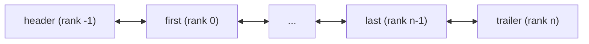
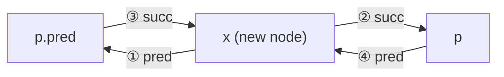

The elements of a **vector** are stored contiguously in physical memory, and call-by-rank access takes only $O(1)$ time, at the cost that insertion and deletion must move many elements. The list in this chapter takes a different road: each element lives in an individually allocated node, and nodes are linked to one another by pointers, so insertion and deletion only modify a few local pointers, at the cost of losing random access. [4.1.9](/4.1.9) already wrote a singly linked list with a C++ struct; this chapter gives a complete implementation of a doubly linked list with sentinels, and on it discusses search, deduplication and three sorting algorithms (selection, insertion, merge). The analysis of sorting leads to inversions, a tool for measuring how disordered a sequence is, which ties together the costs of bubble sort and insertion sort. Finally we compare the various sequences in the C++ and Python standard libraries.

## 3.1. From Vectors to Lists

### 3.1.1. Static and Dynamic

According to whether they modify the data structure, operations fall roughly into two classes: static operations only read, and generally leave the contents and composition of the data structure unchanged, such as `get` and `search`; dynamic operations write, and change the data structure locally or globally, such as `put`, `insert` and `remove`. Correspondingly, there are two ways to store and organize data elements:

| | Static storage | Dynamic storage |
|---|---|---|
| Space | Created or destroyed as a whole | Allocated and reclaimed per element |
| Physical order | Strictly consistent with the logical order | Unrelated to the logical order; adjacent elements record each other's addresses |
| Strength | Static operations: call-by-rank access $O(1)$ | Dynamic operations: insertion and deletion $O(1)$ |
| Example | Vector | List |

### 3.1.2. Lists

**Definition 3.1.1 (List)** A linear sequence that uses a dynamic storage strategy is called a **list**. Its elements are called nodes; they are linked to one another by pointers or references and logically form a linear sequence $L = \{a_0, a_1, \dots, a_{n-1}\}$. Adjacent nodes are called each other's predecessor and successor, and the node with no predecessor or no successor is called the first node or the last node, respectively.

The physical address of each element of a list is no longer determined by the logical order, dynamic operations can be completed locally, and their complexity can hopefully be kept at $O(1)$. Accordingly, the way elements are accessed must change: we can no longer find an element directly by rank, but can only start from some known node and advance one by one along the predecessor or successor references until we reach the target. This is called *call-by-position* access. If we access nodes consecutively in logical order, each step takes only $O(1)$ time.

This chapter implements a *doubly linked list*: each node records both its predecessor and its successor, so it can be traversed in both directions, and any given node can be deleted in $O(1)$ time (deleting a node from a singly **linked list** requires first finding its predecessor).

## 3.2. Interface and Implementation

### 3.2.1. Interface

List nodes must first be encapsulated independently: a node is to a list what a carriage is to a train. A node stores its data `data`, and the positions of its predecessor and successor, `pred` and `succ`. The list interface is as follows ($p$ denotes the position of a node, that is, a pointer to the node):

| Operation | Function | Applies to |
|---|---|---|
| `size()` / `empty()` | Number of nodes / whether empty | List |
| `first()` / `last()` | Position of the first / last node | List |
| `insert_first(e)` / `insert_last(e)` | Insert $e$ as the first / last node | List |
| `insert_before(p, e)` / `insert_after(p, e)` | Insert $e$ as the immediate predecessor / successor of node $p$ | List |
| `remove(p)` | Delete node $p$ and return its data | List |
| `sort()` | Sort | List |
| `find(e, n, p)` / `search(e, n, p)` | Look up $e$ among the $n$ predecessors of $p$ | List / sorted list |
| `dedup()` / `uniquify()` | Remove duplicate nodes | List / sorted list |
| `traverse(visit)` | Traverse | List |

### 3.2.2. Sentinels

**Definition 3.2.1 (Sentinel Node)** A node that stores no data and is invisible from outside, placed before the first node and after the last node of a list, is called the header and the trailer respectively; together they are called **sentinel nodes**.



The ranks of the header, the first node, the last node and the trailer can be understood as $-1$, $0$, $n-1$ and $n$ respectively. An empty list also has two sentinels, with `header.succ == trailer`. The role of sentinels is to eliminate boundary cases: with them, every real node has both a predecessor and a successor, and insertion and deletion use the same code whether they occur at the first node, the last node or in the middle, with no special handling. This is a common technique that trades constant space for simplicity and correctness of code, and later structures such as binary trees and skip lists use it too.

### 3.2.3. Implementation

Below is the core of the list. All insertions reduce to the private operation `link_before(p, x)`, which attaches a free node $x$ before $p$; deletion reduces to `unlink(p)`, which detaches $p$ from the chain. The sorting algorithms later move nodes directly with these two operations, rather than deleting and reallocating. In the C++ version, the destructor of the list frees all nodes one by one; to save space, copy assignment is disabled (only the copy constructor is kept), and a complete implementation should be filled out according to the **rule of three** ([4.2.6](/4.2.6)).

```cpp tab
#include <cstddef>
#include <format>
#include <iostream>
#include <utility>

using Rank = std::ptrdiff_t;

template <typename T>
struct ListNode {
    T data{};
    ListNode* pred = nullptr;
    ListNode* succ = nullptr;
};

template <typename T>
class List {
public:
    using Posi = ListNode<T>*;                 // the position of a node

    List() { init(); }
    List(const List& other) {                  // copy all nodes of other
        init();
        for (Posi p = other.first(); p != other.trailer_; p = p->succ) insert_last(p->data);
    }
    List& operator=(const List&) = delete;
    ~List() { clear(); delete header_; delete trailer_; }

    Rank size() const { return size_; }
    bool empty() const { return size_ == 0; }
    Posi first() const { return header_->succ; }      // trailer_ if the list is empty
    Posi last() const { return trailer_->pred; }      // header_ if the list is empty
    Posi end() const { return trailer_; }
    bool valid(Posi p) const { return p && p != header_ && p != trailer_; }
    Posi operator[](Rank r) const {                   // O(r): walk r steps from first()
        Posi p = first();
        while (r-- > 0) p = p->succ;
        return p;
    }

    Posi insert_before(Posi p, const T& e) { return link_before(p, new ListNode<T>{e}); }
    Posi insert_after(Posi p, const T& e) { return link_before(p->succ, new ListNode<T>{e}); }
    Posi insert_first(const T& e) { return insert_after(header_, e); }
    Posi insert_last(const T& e) { return insert_before(trailer_, e); }
    T remove(Posi p) {                                // p must be valid
        T e = std::move(p->data);
        delete unlink(p);
        return e;
    }
    Rank clear() {
        Rank old_size = size_;
        while (size_ > 0) remove(first());
        return old_size;
    }

    Posi find(const T& e, Rank n, Posi p) const;      // Section 3.3
    Posi find(const T& e) const { return find(e, size_, trailer_); }
    Rank dedup();
    template <typename Visit> void traverse(Visit&& visit);
    Rank uniquify();                                  // Section 3.4
    Posi search(const T& e, Rank n, Posi p) const;
    Posi search(const T& e) const { return search(e, size_, trailer_); }
    void selection_sort(Posi p, Rank n);              // Sections 3.5-3.7
    void insertion_sort(Posi p, Rank n);
    Posi merge_sort(Posi p, Rank n);
    void sort() { merge_sort(first(), size_); }

private:
    Rank size_ = 0;
    Posi header_ = nullptr, trailer_ = nullptr;       // sentinels: ranks -1 and n

    void init() {
        header_ = new ListNode<T>;
        trailer_ = new ListNode<T>;
        header_->succ = trailer_;
        trailer_->pred = header_;
        size_ = 0;
    }
    Posi link_before(Posi p, Posi x) {                // put the detached node x before p
        x->pred = p->pred;
        x->succ = p;
        p->pred->succ = x;                            // the order of these two
        p->pred = x;                                  // assignments matters
        ++size_;
        return x;
    }
    Posi unlink(Posi p) {                             // detach p, keep the node alive
        p->pred->succ = p->succ;
        p->succ->pred = p->pred;
        --size_;
        return p;
    }
    Posi select_max(Posi p, Rank n);
    Posi merge(Posi p, Rank n, Posi q, Rank m);
};

template <typename T>
void print(const List<T>& list) {
    for (auto p = list.first(); p != list.end(); p = p->succ)
        std::cout << std::format("{} ", p->data);
    std::cout << '\n';
}

int main() {
    List<int> list;
    for (int x : {3, 1, 4, 1, 5}) list.insert_last(x);   // 3 1 4 1 5
    auto p = list[2];                                       // the node holding 4
    list.insert_before(p, 9);                               // 3 1 9 4 1 5
    list.insert_after(p, 2);                                // 3 1 9 4 2 1 5
    list.remove(list.first());                              // 1 9 4 2 1 5
    list.insert_first(7);                                   // 7 1 9 4 2 1 5
    print(list);
    List<int> copy(list);
    copy.remove(copy.last());
    std::cout << std::format("size {} and {}\n", list.size(), copy.size());   // 7 and 6
}
```

```python tab
from collections.abc import Callable, Iterable, Iterator
from typing import Any


class ListNode:
    __slots__ = ("data", "pred", "succ")

    def __init__(self, data: Any = None) -> None:
        self.data = data
        self.pred: ListNode | None = None
        self.succ: ListNode | None = None


class List:
    """A doubly linked list with two sentinels: header (rank -1) and trailer (rank n)."""

    def __init__(self, items: Iterable[Any] = ()) -> None:
        self._header, self._trailer = ListNode(), ListNode()
        self._header.succ, self._trailer.pred = self._trailer, self._header
        self._size = 0
        for e in items:
            self.insert_last(e)

    def __len__(self) -> int:
        return self._size

    def first(self) -> ListNode:                   # trailer if the list is empty
        return self._header.succ

    def last(self) -> ListNode:                    # header if the list is empty
        return self._trailer.pred

    def end(self) -> ListNode:
        return self._trailer

    def valid(self, p: ListNode | None) -> bool:
        return p is not None and p is not self._header and p is not self._trailer

    def __getitem__(self, r: int) -> ListNode:     # O(r): walk r steps from first()
        p = self.first()
        for _ in range(r):
            p = p.succ
        return p

    def __iter__(self) -> Iterator[Any]:
        p = self.first()
        while p is not self._trailer:
            yield p.data
            p = p.succ

    def __repr__(self) -> str:
        return f"List([{', '.join(map(repr, self))}])"

    def _link_before(self, p: ListNode, x: ListNode) -> ListNode:
        x.pred, x.succ = p.pred, p                 # put the detached node x before p
        p.pred.succ = x                            # the order of these two
        p.pred = x                                 # assignments matters
        self._size += 1
        return x

    def _unlink(self, p: ListNode) -> ListNode:    # detach p, keep the node alive
        p.pred.succ, p.succ.pred = p.succ, p.pred
        self._size -= 1
        return p

    def insert_before(self, p: ListNode, e: Any) -> ListNode:
        return self._link_before(p, ListNode(e))

    def insert_after(self, p: ListNode, e: Any) -> ListNode:
        return self._link_before(p.succ, ListNode(e))

    def insert_first(self, e: Any) -> ListNode:
        return self.insert_after(self._header, e)

    def insert_last(self, e: Any) -> ListNode:
        return self.insert_before(self._trailer, e)

    def remove(self, p: ListNode) -> Any:          # p must be valid
        self._unlink(p)
        p.pred = p.succ = None                     # help catch use of a removed node
        return p.data


lst = List([3, 1, 4, 1, 5])
p = lst[2]                                         # the node holding 4
lst.insert_before(p, 9)                            # 3 1 9 4 1 5
lst.insert_after(p, 2)                             # 3 1 9 4 2 1 5
lst.remove(lst.first())                            # 1 9 4 2 1 5
lst.insert_first(7)                                # 7 1 9 4 2 1 5
print(lst)
copy = List(lst)
copy.remove(copy.last())
print(f"size {len(lst)} and {len(copy)}")          # 7 and 6
```

Insertion `link_before(p, x)` modifies 4 pointers: the predecessor and successor of $x$, the successor of the original predecessor, and the predecessor of $p$.



Step ③ must come before step ④: ③ finds the original predecessor through `p.pred`, and once ④ is executed, `p.pred` is already $x$. Deletion `unlink(p)` links the predecessor and successor of $p$ directly to each other (a "short circuit"), modifying only 2 pointers. Thanks to the sentinels, neither needs to test whether $p$ is the first or last node, and both are $O(1)$.

A list can still imitate a vector and provide access by rank `L[r]`: starting from the first node, advance $r$ steps, taking $O(r)$ time. If $r$ is uniformly distributed in $[0, n)$, the expected time is $O(n)$, so although this interface is convenient it should not be used much; traversing the whole list by rank (`for r in range(n): L[r]`) takes $\Theta(n^2)$ time. The copy constructor copies nodes one by one and `clear()` deletes the first node repeatedly, both $O(n)$.

In the Python version, the node class uses `__slots__` to fix its attributes and save memory per node. Python has **garbage collection**, so deleted nodes need not be freed manually; `remove` sets the pointers of the deleted node to null only so that code misusing a deleted node fails as early as possible.

## 3.3. Unsorted Lists

### 3.3.1. Search

`find(e, n, p)` searches from back to front among the $n$ proper predecessors of node $p$ ($p$ may be the trailer) and returns the last node equal to $e$; on failure it returns a null pointer. Searching the whole list is `find(e, size, trailer)`.

```cpp tab
template <typename T>   // the last node holding e among the n predecessors of p
typename List<T>::Posi List<T>::find(const T& e, Rank n, Posi p) const {
    while (n-- > 0)
        if ((p = p->pred)->data == e) return p;
    return nullptr;                              // not found
}
```

```python tab
class List:  # continued: more methods of the class in Section 3.2
    def find(self, e: Any, n: int | None = None, p: ListNode | None = None) -> ListNode | None:
        """The last node holding e among the n predecessors of p (default: whole list)."""
        if p is None:
            n, p = self._size, self._trailer
        for _ in range(n):
            p = p.pred
            if p.data == e:
                return p
        return None                                # not found
```

Like `find` for a **vector**, it is $O(1)$ in the best case and $O(n)$ in the worst case, and is **input-sensitive**.

### 3.3.2. Deduplication and Traversal

```cpp tab
template <typename T>
Rank List<T>::dedup() {
    Rank old_size = size_, r = 0;                // the r nodes before p are distinct
    for (Posi p = first(); p != trailer_; p = p->succ)
        if (Posi q = find(p->data, r, p)) remove(q);   // an earlier copy: remove it
        else ++r;
    return old_size - size_;
}
```

```python tab
class List:  # continued: more methods of the class in Section 3.2
    def dedup(self) -> int:
        old_size, r = self._size, 0                # the r nodes before p are distinct
        p = self.first()
        while p is not self._trailer:
            q = self.find(p.data, r, p)
            if q is not None:
                self.remove(q)                     # an earlier copy: remove it
            else:
                r += 1
            p = p.succ
        return old_size - self._size
```

Invariant: the $r$ nodes before the current node $p$ are pairwise distinct. In each round we look for the data of $p$ among these $r$ nodes: if found, we delete that earlier copy (so there are still $r$ distinct nodes before $p$); otherwise $r$ increases by one. Unlike `dedup` for vectors, deleting a node from a list takes only $O(1)$, but the search is still $O(r)$, so the total time is still $O(n^2)$. Note that what is kept here is the last occurrence in each group of equal elements.

Traversal is the same as for vectors, except that it advances along successors:

```cpp tab
template <typename T>
template <typename Visit>
void List<T>::traverse(Visit&& visit) {
    for (Posi p = first(); p != trailer_; p = p->succ) visit(p->data);
}
```

```python tab
class List:  # continued: more methods of the class in Section 3.2
    def traverse(self, visit: Callable[[Any], Any]) -> None:
        p = self.first()
        while p is not self._trailer:
            visit(p.data)
            p = p.succ
```

## 3.4. Sorted Lists

### 3.4.1. Uniquification

Equal nodes in a sorted list are necessarily adjacent. We repeatedly examine adjacent pairs of nodes $(p, q)$: if their data differ, we move to the next pair; if they are equal, we delete the latter, $q$, directly. Unlike for vectors, deletion takes only $O(1)$, so there is no need to proceed indirectly with two pointers as in Section 2.4.2; a single scan suffices, for a total of $O(n)$ time.

```cpp tab
template <typename T>
Rank List<T>::uniquify() {                       // the list must be sorted
    Rank old_size = size_;
    if (size_ < 2) return 0;
    for (Posi p = first(), q; (q = p->succ) != trailer_;)
        if (p->data != q->data) p = q;           // a new value: move on
        else remove(q);                          // a duplicate: remove it at once
    return old_size - size_;
}
```

```python tab
class List:  # continued: more methods of the class in Section 3.2
    def uniquify(self) -> int:                     # the list must be sorted
        old_size = self._size
        if old_size < 2:
            return 0
        p = self.first()
        while (q := p.succ) is not self._trailer:
            if p.data != q.data:
                p = q                              # a new value: move on
            else:
                self.remove(q)                     # a duplicate: remove it at once
        return old_size - self._size
```

### 3.4.2. Search

`search(e, n, p)` finds, among the $n$ proper predecessors of $p$, from back to front, the last node not greater than $e$; on failure it returns the predecessor of the left boundary of the search range (possibly the header). The semantics of the return value agree with `search` (version C) for **vectors**, so after `L.insert_after(L.search(e), e)` the list is still sorted, and the new node is placed after the nodes equal to it.

```cpp tab
template <typename T>   // sorted: the last node with data <= e among the n predecessors of p
typename List<T>::Posi List<T>::search(const T& e, Rank n, Posi p) const {
    do {
        p = p->pred;
        --n;
    } while (n >= 0 && e < p->data);             // from right to left
    return p;                    // on failure, the node just before the range (maybe header_)
}
```

```python tab
class List:  # continued: more methods of the class in Section 3.2
    def search(self, e: Any, n: int | None = None, p: ListNode | None = None) -> ListNode:
        """Sorted: the last node with data <= e among the n predecessors of p.
        On failure, the node just before the range (maybe the header)."""
        if p is None:
            n, p = self._size, self._trailer
        while True:                                # from right to left
            p, n = p.pred, n - 1
            if n < 0 or not e < p.data:
                return p
```

It is $O(1)$ in the best case and $O(n)$ in the worst case; with equal probabilities the average is $O(n)$, proportional to the length of the range. Sortedness brings no asymptotic improvement at all. This is not a poor implementation but a limitation of call-by-position access itself: binary search needs to jump to the midpoint of the interval in $O(1)$ time, whereas in a list any node can be reached only from a known node by following references one at a time, so jumping to the midpoint takes $\Theta(n)$ steps. Since physical addresses are unrelated to the logical order, random access by **rank** cannot be implemented efficiently. To search in logarithmic time in a linked structure, a different organization is needed: a skip list adds several levels of "express lanes" on top of a list ([4.3.9](/4.3.9)), and a search tree turns the linear structure into a tree ([4.3.6](/4.3.6)).

## 3.5. Selection Sort

### 3.5.1. The Algorithm

Recall **bubble sort** ([4.3.2](/4.3.2)): each pass does $O(n)$ comparisons and $O(n)$ swaps, but its net effect is only to find the current maximum element $M$ and move it to the end. If so, once $M$ has been determined with $O(n)$ comparisons, a single move is enough.

**Algorithm 3.5.1 (Selection Sort)** Divide the sequence into an unsorted prefix and a sorted suffix, where every element of the suffix is no smaller than any element of the prefix; initially the suffix is empty. Repeatedly select the maximum from the prefix and move it to the front of the suffix, until only one element remains in the prefix.

In a list, "moving to the front of the suffix" only requires detaching the node and attaching it again, $O(1)$, with no swapping of data and no moving of other elements; in a **vector** one can swap it with the last element of the prefix (the swap method), or shift it together with the elements after it (the shift method).

```cpp tab
template <typename T>   // the last maximum among the n nodes starting at p
typename List<T>::Posi List<T>::select_max(Posi p, Rank n) {
    Posi max = p;
    for (Posi cur = p; n > 1; --n)
        if (!((cur = cur->succ)->data < max->data)) max = cur;   // ties: the later one wins
    return max;
}

template <typename T>
void List<T>::selection_sort(Posi p, Rank n) {   // sort the n nodes starting at p
    Posi head = p->pred, tail = p;
    for (Rank i = 0; i < n; ++i) tail = tail->succ;   // unsorted (head, tail), sorted [tail, ...)
    while (n > 1) {
        Posi m = select_max(head->succ, n);
        if (m != tail->pred) {                   // move the maximum to the front of the
            unlink(m);                           // sorted part, by relinking: O(1)
            link_before(tail, m);
        }
        tail = tail->pred;
        --n;
    }
}
```

```python tab
class List:  # continued: more methods of the class in Section 3.2
    def _select_max(self, p: ListNode, n: int) -> ListNode:
        """The last maximum among the n nodes starting at p."""
        best, cur = p, p
        for _ in range(n - 1):
            cur = cur.succ
            if not cur.data < best.data:           # ties: the later one wins
                best = cur
        return best

    def selection_sort(self, p: ListNode | None = None, n: int | None = None) -> None:
        if p is None:
            p, n = self.first(), self._size
        head, tail = p.pred, p
        for _ in range(n):                         # unsorted (head, tail), sorted [tail, ...)
            tail = tail.succ
        while n > 1:
            m = self._select_max(head.succ, n)
            if m is not tail.pred:                 # move the maximum to the front of the
                self._unlink(m)                    # sorted part, by relinking: O(1)
                self._link_before(tail, m)
            tail, n = tail.pred, n - 1
```

Now consider stability. When there are several maximum elements, `select_max` returns the last of them (the comparison condition is "update if not smaller than the current maximum"). The last one is moved to the front of the suffix first, then the one before it is selected, and so on, so equal elements keep their input order in the suffix. For example, in $2, 6_a, 4, 6_b, 3, 0, 6_c, 1, 5, 7, 8, 9$, the three 6s are selected in the order $6_c, 6_b, 6_a$, and the final order is $6_a, 6_b, 6_c$. So selection sort on a list, implemented by moving nodes, is stable; whereas with the swap method on a vector, the last element of the prefix swapped to the back may jump over elements equal to it, and the sort is therefore unstable.

As for complexity, there are $n - 1$ iterations; in iteration $k$, `select_max` takes $\Theta(n - k)$ time and moving a node takes $O(1)$, so the total time is the arithmetic series $\Theta(n^2)$, independent of the input, even in the best case. Even so, elements are moved only $O(n)$ times, far fewer than in bubble sort; the $\Theta(n^2)$ comes from comparisons, and a comparison usually costs less than a move. Can the maximum be found each time in $o(n)$ time? Yes: maintain the unsorted prefix with a heap ([4.3.12](/4.3.12)), reducing `select_max` to $O(\log n)$, and we obtain the $O(n \log n)$ heapsort.

### 3.5.2. Permutation Cycles

When selection sort is implemented by the swap method, sometimes the maximum element is already in place and no swap is needed. How often does this happen? Viewing the input as a **permutation** answers the question.

Let the elements of the sequence $A[0, n)$ be pairwise distinct, and let $S[0, n)$ be the sorted result. Let $r(x)$ be the rank of element $x$ in $S$, that is, its final position. Starting from any element $A[k]$, look at the element at position $r(A[k])$, then at its final position, and so on; we necessarily return to $A[k]$, and the elements passed through form a cycle (that is, a **cyclic permutation** of the permutation). Every sequence decomposes uniquely into pairwise disjoint cycles.

| Rank | 0 | 1 | 2 | 3 | 4 | 5 | 6 | 7 |
|---|---|---|---|---|---|---|---|---|
| $A$ | D | A | G | B | C | E | H | F |
| $r(A[k])$ | 3 | 0 | 6 | 1 | 2 | 4 | 7 | 5 |

Starting from D: D belongs at position 3, the B there belongs at position 1, the A there belongs at position 0, and we return to D, giving the cycle $(D, B, A)$; the remaining one is $(G, H, F, E, C)$.

**Theorem 3.5.1** Suppose the input sequence has $c$ cycles. Selection sort implemented by the swap method performs exactly $n - c$ actual swaps (the cases where $M$ is not in place), and in the other $c - 1$ iterations $M$ is already in place.

**Proof** If $M$ is not in place, after swapping it with the element at its final position, $M$ leaves its original cycle and forms a cycle of length 1 by itself, the length of the original cycle decreases by exactly one, and the other cycles are unchanged, so the total number of cycles increases by one. If $M$ is already in place, it is itself a cycle of length 1 and no swap is needed. When sorting is complete every element is a cycle by itself, $n$ in all; initially there are $c$, and each swap adds one, so exactly $n - c$ swaps occur. There are $n - 1$ iterations in all, and the other $c - 1$ need no swap. $\square$

There are at most $n$ cycles (when the input is already sorted), in which case no swap is needed. For a uniformly random permutation, the expected number of cycles is the **harmonic series** $H_n = \sum_{k=1}^n \frac1k \approx \ln n$: when constructing the cycles one by one, if $k$ elements are not yet assigned to any cycle, the probability that the current cycle closes at the next step is $1/k$, and the total number of cycles is the number of closings, whose expectation is $\sum_{k=1}^{n} \frac1k$. So on average only about $\ln n$ swaps can be saved, and a special check to skip them does not pay off.

## 3.6. Insertion Sort

### 3.6.1. The Algorithm

**Algorithm 3.6.1 (Insertion Sort)** Divide the sequence into a sorted prefix $S[0, r)$ and an unsorted suffix $U[r, n)$, with $r = 0$ initially. Repeatedly take the first element $e = A[r]$ of the suffix, find a suitable position in the prefix, insert $e$ there, and increase $r$ by one, until $r = n$.

This is the method of arranging a hand of cards when playing cards. It differs from selection sort in that the elements in the sorted part of selection sort are already final, whereas the sorted prefix of insertion sort is sorted only with respect to the elements taken so far. Take $5, 2, 7, 4, 6, 3, 1$ as an example:

| Iteration | Sorted prefix | Current element | Unsorted suffix |
|---|---|---|---|
| 0 | (empty) | 5 | 2 7 4 6 3 1 |
| 1 | 5 | 2 | 7 4 6 3 1 |
| 2 | 2 5 | 7 | 4 6 3 1 |
| 3 | 2 5 7 | 4 | 6 3 1 |
| 4 | 2 4 5 7 | 6 | 3 1 |
| 5 | 2 4 5 6 7 | 3 | 1 |
| 6 | 2 3 4 5 6 7 | 1 | (empty) |
| 7 | 1 2 3 4 5 6 7 | | |

```cpp tab
template <typename T>
void List<T>::insertion_sort(Posi p, Rank n) {   // sort the n nodes starting at p
    for (Rank r = 0; r < n; ++r) {               // the r nodes before p are sorted
        Posi next = p->succ;
        Posi q = search(p->data, r, p);          // the last of them with data <= p->data
        if (q != p->pred) {                      // move p right after q
            unlink(p);
            link_before(q->succ, p);
        }
        p = next;
    }
}
```

```python tab
class List:  # continued: more methods of the class in Section 3.2
    def insertion_sort(self, p: ListNode | None = None, n: int | None = None) -> None:
        if p is None:
            p, n = self.first(), self._size
        for r in range(n):                         # the r nodes before p are sorted
            nxt = p.succ
            q = self.search(p.data, r, p)          # the last of them with data <= p.data
            if q is not p.pred:                    # move p right after q
                self._unlink(p)
                self._link_before(q.succ, p)
            p = nxt
```

Thanks to the semantics of the return value of `search`, the prefix is always sorted, and equal elements are arranged in order of insertion, so insertion sort is stable. It uses only $O(1)$ auxiliary space and is an **in-place algorithm**. Note the role of the sentinels: the prefix containing an element equal to $p$, $p$ being smaller than every element of the prefix (`search` returns the header, and the element is inserted at the very front), and the prefix being empty all need no special handling.

### 3.6.2. Performance

In iteration $r$, `search` takes $O(r + 1)$ time and insertion takes only $O(1)$. In the best case (the input is already sorted), each `search` hits in one step, for $O(n)$ in all; in the worst case (the input is completely reversed), each search covers the whole prefix, for $\sum_r (r + 1) = \Theta(n^2)$ in all. The two differ substantially, and insertion sort is **input-sensitive**. (The best and worst cases of selection sort are both $\Theta(n^2)$.)

For the average case we use backward analysis: assume the elements are distinct and the input is a uniformly random permutation. Consider the prefix $[0, r]$ just after iteration $r$ ends, and ask which of its elements was inserted last. By symmetry, each of these $r + 1$ elements is the last inserted with equal probability $\frac{1}{r+1}$, so its rank in the prefix is also uniformly distributed, and the expected number of steps to find it by searching from right to left is about $\frac{r}{2} + 1$. Summing over $r$, the expected total time is about $\frac{n^2}{4} = \Theta(n^2)$.

Insertion sort can also be done in a **vector**. Search can then use binary search, reducing the number of comparisons to $O(n \log n)$, but insertion still has to shift elements back, so the number of moves is still $\Theta(n^2)$ in the worst case.

### 3.6.3. Online Behavior

In everyday card games everyone uses insertion sort. With any other algorithm, one would have to wait until all cards were dealt before starting to arrange them; insertion sort can arrange while cards are dealt, and the hand is sorted as soon as dealing ends. An algorithm that can begin computing before the data is fully available, handling each input as it arrives, is called an *online algorithm*. At every moment, insertion sort maintains a sorted sequence of "all the elements received so far", whereas selection sort must see all the input before it can pick the maximum.

## 3.7. Merge Sort

**Merge sort** ([4.3.2](/4.3.2)) accesses data only sequentially and so also suits lists: advance $n/2$ steps along the successors to find the midpoint, split the list evenly into two segments, sort each recursively, and then do a two-way merge. The two-way merge of lists is done in place, with no auxiliary space: compare the current first nodes $p$ and $q$ of the two segments; if $p$ is not greater than $q$, $p$ simply advances; otherwise detach $q$ and attach it before $p$.

```cpp tab
template <typename T>   // merge the sorted runs of n nodes from p and m nodes from q,
typename List<T>::Posi List<T>::merge(Posi p, Rank n, Posi q, Rank m) {   // q follows p's run
    Posi head = p->pred;                         // remember it: p may stop being the first
    while (m > 0 && q != p)
        if (n > 0 && !(q->data < p->data)) {     // p is not larger: it stays (stability)
            p = p->succ;
            --n;
        } else {                                 // q is smaller: move it before p
            Posi x = q;
            q = q->succ;
            unlink(x);
            link_before(p, x);
            --m;
        }
    return head->succ;                           // the new first node
}

template <typename T>
typename List<T>::Posi List<T>::merge_sort(Posi p, Rank n) {   // returns the new first node
    if (n < 2) return p;
    Rank m = n / 2;
    Posi q = p;
    for (Rank i = 0; i < m; ++i) q = q->succ;    // split in the middle: O(n)
    p = merge_sort(p, m);                        // q still follows the first half
    q = merge_sort(q, n - m);
    return merge(p, m, q, n - m);
}
```

```python tab
class List:  # continued: more methods of the class in Section 3.2
    def _merge(self, p: ListNode, n: int, q: ListNode, m: int) -> ListNode:
        """Merge the sorted runs of n nodes from p and m nodes from q (q follows p's run)."""
        head = p.pred                              # remember it: p may stop being the first
        while m > 0 and q is not p:
            if n > 0 and not q.data < p.data:      # p is not larger: it stays (stability)
                p, n = p.succ, n - 1
            else:                                  # q is smaller: move it before p
                x, q = q, q.succ
                self._unlink(x)
                self._link_before(p, x)
                m -= 1
        return head.succ                           # the new first node

    def merge_sort(self, p: ListNode | None = None, n: int | None = None) -> ListNode:
        if p is None:
            p, n = self.first(), self._size
        if n < 2:
            return p
        m = n // 2
        q = p
        for _ in range(m):                         # split in the middle: O(n)
            q = q.succ
        p = self.merge_sort(p, m)                  # q still follows the first half
        q = self.merge_sort(q, n - m)
        return self._merge(p, m, q, n - m)
```

The main program below sorts the same data with each of the three algorithms (following the class definitions above):

```cpp tab
int main() {
    List<int> a, b, c;
    for (int x : {5, 2, 7, 4, 6, 3, 1}) {
        a.insert_last(x);
        b.insert_last(x);
        c.insert_last(x);
    }
    a.selection_sort(a.first(), a.size());
    b.insertion_sort(b.first(), b.size());
    c.sort();                                    // merge sort
    print(a);                                    // 1 2 3 4 5 6 7, three times
    print(b);
    print(c);
}
```

```python tab
data = [5, 2, 7, 4, 6, 3, 1]
a, b, c = List(data), List(data), List(data)
a.selection_sort()
b.insertion_sort()
c.merge_sort()
print(a, b, c, sep="\n")                           # List([1, 2, 3, 4, 5, 6, 7]), three times
```

In each iteration of the merge, either $p$ advances or a node moves from the $q$ side to before $p$; both take only $O(1)$ time, and there are at most $n + m$ steps in all, so the two-way merge is $O(n + m)$. Splitting the list evenly takes $O(n)$ time (only $O(1)$ in a **vector**), but this does not change the form of the recurrence, $T(n) = 2T(n/2) + O(n)$, and the total time is still $O(n \log n)$. A node on the $q$ side moves to the front only when it is strictly smaller than $p$, so merge sort on lists is stable. The auxiliary space is only the $O(\log n)$ of the recursion stack.

C++'s `std::list::sort` is a (bottom-up) merge sort: `std::sort` requires random-access iterators and cannot be used on lists ([4.2.10](/4.2.10)).

## 3.8. Inversions

### 3.8.1. Definition

**Definition 3.8.1 (Inversion)** Let the elements of the sequence $A[0, n)$ be comparable. If $0 \leq i < j < n$ and $A[i] > A[j]$, then $(i, j)$ is called an **inversion**.

For ease of counting, we charge each inversion to the latter element: let $I(j)$ be the number of predecessors that form an inversion with $A[j]$, so the total number of inversions is $I = \sum_j I(j)$. For example, $\{5, 3, 1, 4, 2\}$ has $0 + 1 + 2 + 1 + 3 = 7$ inversions, $\{1, 2, 3, 4, 5\}$ has 0, and $\{5, 4, 3, 2, 1\}$ has $0 + 1 + 2 + 3 + 4 = 10$. Clearly $0 \leq I \leq \binom{n}{2}$, with the lower and upper bounds attained when the sequence is sorted and completely reversed. The total number of inversions is a natural measure of how disordered a sequence is; when the sequence is a permutation of $0, 1, \dots, n-1$, it is the number of inversions of the permutation in algebra.

### 3.8.2. Inversions and the Cost of Sorting

**Theorem 3.8.1** (1) Swapping a pair of adjacent inverted elements decreases the total number of inversions by exactly one; hence the number of swaps of bubble sort equals exactly the total number of inversions $I$ of the input sequence. (2) When insertion sort processes $A[j]$, it makes exactly $I(j)$ or $I(j) + 1$ comparisons, so the total number of comparisons is $I + O(n)$ and the running time is $O(n + I)$.

**Proof** (1) After swapping adjacent $A[i] > A[i+1]$, this pair is no longer inverted; the relative order of any other pair of elements is unchanged (only these two elements swap positions, and their before-and-after relations with the other elements do not change). Bubble sort swaps only adjacent inverted pairs, each decreasing $I$ by one, and at the end $I = 0$. (2) When inserting $A[j]$, `search` passes from right to left over the elements of the prefix greater than $A[j]$, of which there are exactly $I(j)$, plus one comparison at the point where it stops (none if it passed the entire prefix). $\square$

Hence the running time of insertion sort can be characterized exactly as $O(n + I)$: for nearly sorted input ($I = O(n)$) it is linear. This is the **input sensitivity** of insertion sort, and the reason that practical sorting algorithms (such as introsort and Timsort) switch to insertion sort on small ranges or nearly sorted data.

In a uniformly random permutation, any pair of elements is inverted with probability $\frac12$, so the expected total number of inversions is $\frac12 \binom{n}{2} = \frac{n(n-1)}{4}$. Combined with Theorem 3.8.1 (1), any sorting algorithm that swaps only adjacent elements needs $\Omega(n^2)$ swaps on average. To be faster, an algorithm must be able to eliminate several inversions at once, for example by swapping elements that are far apart (Shell sort, quicksort, [4.3.14](/4.3.14)).

### 3.8.3. Counting Inversions

Given an arbitrary sequence, how do we count the total number of inversions? The brute-force algorithm checks every pair of elements and takes $\Theta(n^2)$ time. With the help of merge sort it takes only $O(n \log n)$: inversions fall into three classes, with both elements in the left half, both in the right half (counted recursively), or one in each. The last class is counted exactly during the two-way merge: whenever an element $c$ of the right half is taken first because it is strictly smaller than the current first element of the left half, all the elements not yet taken from the left half are greater than $c$, and the inversions they form with $c$ are counted at once.

```cpp tab
#include <cstddef>
#include <format>
#include <iostream>
#include <memory>
#include <span>
#include <utility>

// Sort a by merge sort and return the number of inversions in it.
template <typename T>
long long count_inversions(std::span<T> a, T* buf) {
    if (a.size() < 2) return 0;
    const std::size_t mi = a.size() / 2, lb = mi, lc = a.size() - mi;
    long long count = count_inversions(a.first(mi), buf) + count_inversions(a.subspan(mi), buf);
    for (std::size_t j = 0; j < lb; ++j) buf[j] = std::move(a[j]);
    T* c = a.data() + mi;
    std::size_t i = 0, j = 0, k = 0;
    while (j < lb && k < lc)
        if (c[k] < buf[j]) {               // c[k] is smaller than all of buf[j, lb):
            count += lb - j;               // lb - j inversions end at c[k]
            a[i++] = std::move(c[k++]);
        } else {
            a[i++] = std::move(buf[j++]);
        }
    while (j < lb) a[i++] = std::move(buf[j++]);
    return count;
}

template <typename T>
long long count_inversions(std::span<T> a) {
    auto buf = std::make_unique<T[]>(a.size() / 2);
    return count_inversions(a, buf.get());
}

int main() {
    int a[] = {5, 3, 1, 4, 2}, b[] = {1, 2, 3, 4, 5}, c[] = {5, 4, 3, 2, 1};
    std::cout << std::format("{} {} {}\n", count_inversions(std::span<int>(a)),
                             count_inversions(std::span<int>(b)),
                             count_inversions(std::span<int>(c)));   // 7 0 10
}
```

```python tab
def count_inversions(a: list, lo: int = 0, hi: int | None = None) -> int:
    """Sort a[lo:hi] by merge sort and return the number of inversions in it."""
    if hi is None:
        hi = len(a)
    if hi - lo < 2:
        return 0
    mi = (lo + hi) // 2
    count = count_inversions(a, lo, mi) + count_inversions(a, mi, hi)
    b = a[lo:mi]
    i, j, k = lo, 0, mi
    while j < len(b) and k < hi:
        if a[k] < b[j]:                    # a[k] is smaller than all of b[j:]:
            count += len(b) - j            # len(b) - j inversions end at a[k]
            a[i], k = a[k], k + 1
        else:
            a[i], j = b[j], j + 1
        i += 1
    while j < len(b):
        a[i], i, j = b[j], i + 1, j + 1
    return count

print(count_inversions([5, 3, 1, 4, 2]), count_inversions([1, 2, 3, 4, 5]),
      count_inversions([5, 4, 3, 2, 1]))   # 7 0 10
```

## 3.9. The Cursor Implementation

Some languages do not support pointers; even where they do, frequent dynamic allocation hurts efficiency. In that case an array can simulate a list: the array `elem[]` stores the data, and `link[]` stores the rank of the cell holding the successor ($-1$ means no successor). All cells are divided into two logically complementary lists: the data list that stores data and the free list formed by the free cells, each represented by the rank of its first cell. To insert, take a cell from free and attach it to data; to delete, detach the cell from data and return it to free. This implementation, which uses ranks instead of pointers, is called the cursor implementation (also called a static linked list).

```cpp tab
#include <array>
#include <cstddef>
#include <format>
#include <iostream>

using Rank = std::ptrdiff_t;

// A singly linked list simulated in two arrays: elem[i] holds the data of slot i,
// link[i] the rank of its successor (-1 for none). Free slots form a second list.
template <typename T, std::size_t N>
class CursorList {
public:
    CursorList() {
        for (std::size_t i = 0; i < N; ++i) link_[i] = (i + 1 < N) ? Rank(i + 1) : -1;
    }
    bool insert(const T& e) {                    // insert e at the front of the data list
        if (free_ < 0) return false;             // no free slot
        Rank i = free_;
        free_ = link_[i];                        // take the first free slot
        elem_[i] = e;
        link_[i] = data_;
        data_ = i;
        return true;
    }
    bool remove(const T& e) {                    // remove the first node holding e
        for (Rank prev = -1, i = data_; i >= 0; prev = i, i = link_[i])
            if (elem_[i] == e) {
                (prev < 0 ? data_ : link_[prev]) = link_[i];   // unlink it from data
                link_[i] = free_;                // and return the slot to free
                free_ = i;
                return true;
            }
        return false;
    }
    void print() const {
        std::cout << "data:";
        for (Rank i = data_; i >= 0; i = link_[i]) std::cout << std::format(" {}@{}", elem_[i], i);
        std::cout << "  free:";
        for (Rank i = free_; i >= 0; i = link_[i]) std::cout << std::format(" {}", i);
        std::cout << '\n';
    }

private:
    std::array<T, N> elem_{};
    std::array<Rank, N> link_{};
    Rank data_ = -1, free_ = 0;                  // heads of the two lists
};

int main() {
    CursorList<char, 7> list;
    for (char c : {'A', 'B', 'C', 'D'}) list.insert(c);
    list.print();                                // data: D@3 C@2 B@1 A@0  free: 4 5 6
    list.remove('A');
    list.remove('C');
    list.print();                                // data: D@3 B@1  free: 2 0 4 5 6
    list.insert('E');
    list.print();                                // data: E@2 D@3 B@1  free: 0 4 5 6
}
```

```python tab
class CursorList:
    """A singly linked list simulated in two arrays: elem[i] holds the data of slot i,
    link[i] the rank of its successor (-1 for none). Free slots form a second list."""

    def __init__(self, capacity: int) -> None:
        self._elem = [None] * capacity
        self._link = [i + 1 if i + 1 < capacity else -1 for i in range(capacity)]
        self._data, self._free = -1, 0             # heads of the two lists

    def insert(self, e) -> bool:                   # insert e at the front of the data list
        if self._free < 0:
            return False                           # no free slot
        i = self._free
        self._free = self._link[i]                 # take the first free slot
        self._elem[i], self._link[i], self._data = e, self._data, i
        return True

    def remove(self, e) -> bool:                   # remove the first node holding e
        prev, i = -1, self._data
        while i >= 0:
            if self._elem[i] == e:
                if prev < 0:                       # unlink it from data
                    self._data = self._link[i]
                else:
                    self._link[prev] = self._link[i]
                self._link[i], self._free = self._free, i   # return the slot to free
                return True
            prev, i = i, self._link[i]
        return False

    def _walk(self, i: int):
        while i >= 0:
            yield i
            i = self._link[i]

    def __repr__(self) -> str:
        data = " ".join(f"{self._elem[i]}@{i}" for i in self._walk(self._data))
        free = " ".join(str(i) for i in self._walk(self._free))
        return f"data: {data}  free: {free}"

lst = CursorList(7)
for c in "ABCD":
    lst.insert(c)
print(lst)                                         # data: D@3 C@2 B@1 A@0  free: 4 5 6
lst.remove("A")
lst.remove("C")
print(lst)                                         # data: D@3 B@1  free: 2 0 4 5 6
lst.insert("E")
print(lst)                                         # data: E@2 D@3 B@1  free: 0 4 5 6
```

The cursor implementation turns dynamic allocation into managing free cells inside a preallocated array. This is one of the basic ideas of memory allocators (**dynamic memory allocation**) and also the approach of object pools. Using ranks instead of pointers has another benefit: the whole array can be copied directly, written to a file or sent over a network, and the "pointers" in it remain valid.

## 3.10. Sequences in the Standard Libraries

| Structure | Implementation | Insertion/removal at the ends | Insertion/removal in the middle | Access by rank |
|---|---|---|---|---|
| `std::vector`, Python `list` | Dynamic array | Amortized $O(1)$ at the tail, $O(n)$ at the head | $O(n)$ | $O(1)$ |
| `std::deque` | Segmented array | $O(1)$ | $O(n)$ | $O(1)$ |
| `std::list` | Doubly linked list with sentinel | $O(1)$ | $O(1)$ given the position | $O(n)$ |
| `std::forward_list` | Singly linked list | $O(1)$ at the head | $O(1)$ given the predecessor | $O(n)$ |
| Python `collections.deque` | Doubly linked list of fixed-size blocks | $O(1)$ | $O(n)$ | $O(1)$ near the ends, $O(n)$ in the middle |

The structure of `std::list` is the same as the `List` of this chapter (libstdc++ uses a single sentinel node to serve as both header and trailer, forming a ring). Its `splice` can move one node or a run of nodes from one position to another in $O(1)$ time, which is the standard form of `unlink` plus `link_before` in this chapter's sorting algorithms; on insertion and deletion, **iterators** pointing to other nodes are not invalidated.

Python has no built-in linked list. The `list` is a dynamic array ([4.3.2](/4.3.2)), so code written in the "by position" style may be slow on it. Compare two ways of reversing a list in place:

```python
def reverse_1(a: list) -> list:      # call by rank: n/2 swaps, O(n)
    lo, hi = 0, len(a) - 1
    while lo < hi:
        a[lo], a[hi] = a[hi], a[lo]
        lo, hi = lo + 1, hi - 1
    return a

def reverse_2(a: list) -> list:      # move the last element to rank i: O(n^2) in total
    for i in range(len(a)):
        a.insert(i, a.pop())
    return a
```

`reverse_2` is linear on a linked list, but on a Python `list` each `insert(i, ...)` shifts $n - i$ elements, for $\Theta(n^2)$ in all. When frequent insertion and deletion at both ends are needed, Python's choice is `collections.deque`: CPython implements it as a chain of doubly linked blocks, each holding 64 elements, and `append`, `appendleft`, `pop` and `popleft` at the two ends are all $O(1)$, while access by index must advance block by block from the nearer end ([4.3.4](/4.3.4)).

The asymptotic advantage of linked lists is often cancelled by constant factors in practice: nodes are scattered across memory, so traversal has a low cache hit rate, and every node must additionally store two pointers. Unless one really needs frequent insertion and deletion at known positions, or needs the addresses of elements to stay unchanged under insertion and deletion, a vector is usually the better choice ([4.2.10](/4.2.10)).

## Summary

| Topic | Key points |
|---|---|
| List | Dynamic storage, call-by-position access; insertion and deletion $O(1)$, access by rank $O(r)$ |
| Sentinels | The header and trailer eliminate boundary cases; insertion and deletion need not distinguish the first and last nodes |
| Search and deduplication | Unsorted: search $O(n)$, deduplication $O(n^2)$; sorted: uniquification $O(n)$, search still $O(n)$ (binary search is impossible) |
| Selection sort | Always $\Theta(n^2)$ comparisons, $O(n)$ moves; stable on lists; number of swaps $= n - {}$ number of cycles |
| Insertion sort | $O(n + I)$, best $O(n)$, average and worst $\Theta(n^2)$; stable, in-place, online |
| Merge sort | In-place merging on lists, $O(n \log n)$, stable |
| Inversions | Swaps of bubble sort $= I$; expected $I = n(n-1)/4$; counted in $O(n \log n)$ with merge sort |
| Standard libraries | `std::list` has the same structure as this chapter; Python's `list` is an array, use `deque` for operations at the ends |
