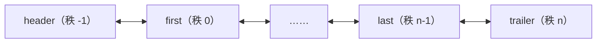
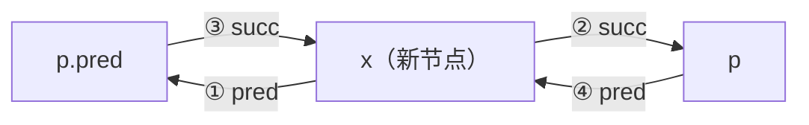

向量的元素在物理上连续存放，循秩访问只需 $O(1)$ 时间，代价是插入与删除要移动大量元素。本章的列表走另一条路：元素各自存放在独立分配的节点中，靠指针彼此联接，插入与删除只需修改局部的几个指针，代价是失去了随机访问。[4.1.9](/4.1.9) 已经用 C++ 结构体写过单向链表；本章给出带哨兵的双向链表的完整实现，并在其上讨论查找、去重和三种排序（选择、插入、归并）。排序的分析引出了逆序对这一度量"紊乱程度"的工具，它把起泡排序与插入排序的成本联系起来。最后比较 C++ 与 Python 标准库中的各种序列。

## 3.1. 从向量到列表

### 3.1.1. 静态与动态

按照是否修改数据结构，所有操作大致分为两类：静态操作只读取，数据结构的内容和组成一般不变，如 `get`、`search`；动态操作需要写入，数据结构的局部或整体将会改变，如 `put`、`insert`、`remove`。与之相对应，数据元素的存储与组织方式也分为两种：

| | 静态存储 | 动态存储 |
|---|---|---|
| 空间 | 整体创建或销毁 | 为每个元素动态地分配与回收 |
| 物理次序 | 与逻辑次序严格一致 | 与逻辑次序无关，相邻元素记录彼此的地址 |
| 擅长 | 静态操作：循秩访问 $O(1)$ | 动态操作：插入、删除 $O(1)$ |
| 例子 | 向量 | 列表 |

### 3.1.2. 列表

**定义 3.1.1（列表）** 采用动态存储策略的线性序列称为**列表**（list）。其中的元素称为节点（node），通过指针或引用彼此联接，在逻辑上构成一个线性序列 $L = \{a_0, a_1, \dots, a_{n-1}\}$；相邻的节点彼此互称前驱（predecessor）与后继（successor），没有前驱、后继的节点分别称为首节点与末节点。

列表中各元素的物理地址不再由逻辑次序决定，动态操作可以在局部完成，复杂度有望控制在 $O(1)$。相应地，访问元素的方式也要改变：不能再按秩直接找到元素，只能从某个已知的节点出发，沿着前驱或后继的引用逐个前进，"顺藤摸瓜"地找到目标，称为循位置访问（call-by-position）。若按逻辑次序连续访问，每一步只需 $O(1)$ 时间。

本章实现的是双向链表（doubly linked list）：每个节点同时记录前驱与后继，可以双向遍历，也可以在 $O(1)$ 时间内删除任一给定的节点（单向**链表**删除节点时需要先找到它的前驱）。

## 3.2. 接口与实现

### 3.2.1. 接口

列表节点首先需要独立地封装：节点之于列表，犹如车厢之于列车。节点存放数据 `data`，以及前驱、后继的位置 `pred`、`succ`。列表的接口如下（$p$ 表示节点的位置，即指向节点的指针）：

| 操作 | 功能 | 适用对象 |
|---|---|---|
| `size()` / `empty()` | 节点总数 / 是否为空 | 列表 |
| `first()` / `last()` | 首 / 末节点的位置 | 列表 |
| `insert_first(e)` / `insert_last(e)` | 把 $e$ 作为首 / 末节点插入 | 列表 |
| `insert_before(p, e)` / `insert_after(p, e)` | 把 $e$ 作为节点 $p$ 的直接前驱 / 后继插入 | 列表 |
| `remove(p)` | 删除节点 $p$，返回其数据 | 列表 |
| `sort()` | 排序 | 列表 |
| `find(e, n, p)` / `search(e, n, p)` | 在 $p$ 的 $n$ 个前驱中查找 $e$ | 列表 / 有序列表 |
| `dedup()` / `uniquify()` | 剔除重复的节点 | 列表 / 有序列表 |
| `traverse(visit)` | 遍历 | 列表 |

### 3.2.2. 哨兵

**定义 3.2.1（哨兵节点）** 在列表的首节点之前和末节点之后各设置一个不存放数据、对外不可见的节点，分别称为头哨兵（header）与尾哨兵（trailer），统称**哨兵节点**。



头哨兵、首节点、末节点、尾哨兵的秩可以分别理解为 $-1$、$0$、$n-1$、$n$。空列表也有两个哨兵，此时 `header.succ == trailer`。哨兵的作用是消除边界情况：有了它们，每个真实节点都同时有前驱和后继，插入与删除无论发生在首、末还是中间，都用同一段代码，不必特殊处理。这是一种以常数空间换取代码简洁与正确性的常用技巧，后面的二叉树、跳表等结构也会用到。

### 3.2.3. 实现

下面是列表的核心部分。所有插入都归结为私有操作 `link_before(p, x)`：把一个游离的节点 $x$ 接到 $p$ 之前；删除则归结为 `unlink(p)`：把 $p$ 从链中摘下。后面的排序算法都直接用这两个操作移动节点，而不是删除后重新分配。C++ 版本中，列表析构时逐个释放所有节点；为节省篇幅禁止了拷贝赋值（只保留拷贝构造），完整的实现应按**三法则**补全（[4.2.6](/4.2.6)）。

```cpp tab
#include <cstddef>
#include <format>
#include <iostream>
#include <utility>

using Rank = std::ptrdiff_t;

template <typename T>
struct ListNode {
    T data{};
    ListNode* pred = nullptr;
    ListNode* succ = nullptr;
};

template <typename T>
class List {
public:
    using Posi = ListNode<T>*;                 // the position of a node

    List() { init(); }
    List(const List& other) {                  // copy all nodes of other
        init();
        for (Posi p = other.first(); p != other.trailer_; p = p->succ) insert_last(p->data);
    }
    List& operator=(const List&) = delete;
    ~List() { clear(); delete header_; delete trailer_; }

    Rank size() const { return size_; }
    bool empty() const { return size_ == 0; }
    Posi first() const { return header_->succ; }      // trailer_ if the list is empty
    Posi last() const { return trailer_->pred; }      // header_ if the list is empty
    Posi end() const { return trailer_; }
    bool valid(Posi p) const { return p && p != header_ && p != trailer_; }
    Posi operator[](Rank r) const {                   // O(r): walk r steps from first()
        Posi p = first();
        while (r-- > 0) p = p->succ;
        return p;
    }

    Posi insert_before(Posi p, const T& e) { return link_before(p, new ListNode<T>{e}); }
    Posi insert_after(Posi p, const T& e) { return link_before(p->succ, new ListNode<T>{e}); }
    Posi insert_first(const T& e) { return insert_after(header_, e); }
    Posi insert_last(const T& e) { return insert_before(trailer_, e); }
    T remove(Posi p) {                                // p must be valid
        T e = std::move(p->data);
        delete unlink(p);
        return e;
    }
    Rank clear() {
        Rank old_size = size_;
        while (size_ > 0) remove(first());
        return old_size;
    }

    Posi find(const T& e, Rank n, Posi p) const;      // Section 3.3
    Posi find(const T& e) const { return find(e, size_, trailer_); }
    Rank dedup();
    template <typename Visit> void traverse(Visit&& visit);
    Rank uniquify();                                  // Section 3.4
    Posi search(const T& e, Rank n, Posi p) const;
    Posi search(const T& e) const { return search(e, size_, trailer_); }
    void selection_sort(Posi p, Rank n);              // Sections 3.5-3.7
    void insertion_sort(Posi p, Rank n);
    Posi merge_sort(Posi p, Rank n);
    void sort() { merge_sort(first(), size_); }

private:
    Rank size_ = 0;
    Posi header_ = nullptr, trailer_ = nullptr;       // sentinels: ranks -1 and n

    void init() {
        header_ = new ListNode<T>;
        trailer_ = new ListNode<T>;
        header_->succ = trailer_;
        trailer_->pred = header_;
        size_ = 0;
    }
    Posi link_before(Posi p, Posi x) {                // put the detached node x before p
        x->pred = p->pred;
        x->succ = p;
        p->pred->succ = x;                            // the order of these two
        p->pred = x;                                  // assignments matters
        ++size_;
        return x;
    }
    Posi unlink(Posi p) {                             // detach p, keep the node alive
        p->pred->succ = p->succ;
        p->succ->pred = p->pred;
        --size_;
        return p;
    }
    Posi select_max(Posi p, Rank n);
    Posi merge(Posi p, Rank n, Posi q, Rank m);
};

template <typename T>
void print(const List<T>& list) {
    for (auto p = list.first(); p != list.end(); p = p->succ)
        std::cout << std::format("{} ", p->data);
    std::cout << '\n';
}

int main() {
    List<int> list;
    for (int x : {3, 1, 4, 1, 5}) list.insert_last(x);   // 3 1 4 1 5
    auto p = list[2];                                       // the node holding 4
    list.insert_before(p, 9);                               // 3 1 9 4 1 5
    list.insert_after(p, 2);                                // 3 1 9 4 2 1 5
    list.remove(list.first());                              // 1 9 4 2 1 5
    list.insert_first(7);                                   // 7 1 9 4 2 1 5
    print(list);
    List<int> copy(list);
    copy.remove(copy.last());
    std::cout << std::format("size {} and {}\n", list.size(), copy.size());   // 7 and 6
}
```

```python tab
from collections.abc import Callable, Iterable, Iterator
from typing import Any


class ListNode:
    __slots__ = ("data", "pred", "succ")

    def __init__(self, data: Any = None) -> None:
        self.data = data
        self.pred: ListNode | None = None
        self.succ: ListNode | None = None


class List:
    """A doubly linked list with two sentinels: header (rank -1) and trailer (rank n)."""

    def __init__(self, items: Iterable[Any] = ()) -> None:
        self._header, self._trailer = ListNode(), ListNode()
        self._header.succ, self._trailer.pred = self._trailer, self._header
        self._size = 0
        for e in items:
            self.insert_last(e)

    def __len__(self) -> int:
        return self._size

    def first(self) -> ListNode:                   # trailer if the list is empty
        return self._header.succ

    def last(self) -> ListNode:                    # header if the list is empty
        return self._trailer.pred

    def end(self) -> ListNode:
        return self._trailer

    def valid(self, p: ListNode | None) -> bool:
        return p is not None and p is not self._header and p is not self._trailer

    def __getitem__(self, r: int) -> ListNode:     # O(r): walk r steps from first()
        p = self.first()
        for _ in range(r):
            p = p.succ
        return p

    def __iter__(self) -> Iterator[Any]:
        p = self.first()
        while p is not self._trailer:
            yield p.data
            p = p.succ

    def __repr__(self) -> str:
        return f"List([{', '.join(map(repr, self))}])"

    def _link_before(self, p: ListNode, x: ListNode) -> ListNode:
        x.pred, x.succ = p.pred, p                 # put the detached node x before p
        p.pred.succ = x                            # the order of these two
        p.pred = x                                 # assignments matters
        self._size += 1
        return x

    def _unlink(self, p: ListNode) -> ListNode:    # detach p, keep the node alive
        p.pred.succ, p.succ.pred = p.succ, p.pred
        self._size -= 1
        return p

    def insert_before(self, p: ListNode, e: Any) -> ListNode:
        return self._link_before(p, ListNode(e))

    def insert_after(self, p: ListNode, e: Any) -> ListNode:
        return self._link_before(p.succ, ListNode(e))

    def insert_first(self, e: Any) -> ListNode:
        return self.insert_after(self._header, e)

    def insert_last(self, e: Any) -> ListNode:
        return self.insert_before(self._trailer, e)

    def remove(self, p: ListNode) -> Any:          # p must be valid
        self._unlink(p)
        p.pred = p.succ = None                     # help catch use of a removed node
        return p.data


lst = List([3, 1, 4, 1, 5])
p = lst[2]                                         # the node holding 4
lst.insert_before(p, 9)                            # 3 1 9 4 1 5
lst.insert_after(p, 2)                             # 3 1 9 4 2 1 5
lst.remove(lst.first())                            # 1 9 4 2 1 5
lst.insert_first(7)                                # 7 1 9 4 2 1 5
print(lst)
copy = List(lst)
copy.remove(copy.last())
print(f"size {len(lst)} and {len(copy)}")          # 7 and 6
```

插入 `link_before(p, x)` 修改 4 个指针：$x$ 的前驱与后继、原前驱的后继、$p$ 的前驱。



其中 ③ 必须在 ④ 之前：③ 要通过 `p.pred` 找到原前驱，④ 一旦执行，`p.pred` 就已经是 $x$ 了。删除 `unlink(p)` 把 $p$ 的前驱与后继直接联接起来（"短路"），也只修改 2 个指针。得益于哨兵，二者都不需要判断 $p$ 是否为首、末节点，都是 $O(1)$。

列表仍可以模仿向量提供按秩访问 `L[r]`：从首节点出发前进 $r$ 步，时间为 $O(r)$。若 $r$ 在 $[0, n)$ 中均匀分布，期望时间为 $O(n)$，所以这一接口虽然方便，却不宜多用；循秩遍历整个列表（`for r in range(n): L[r]`）需要 $\Theta(n^2)$ 时间。拷贝构造逐个复制节点，`clear()` 逐个删除首节点，都是 $O(n)$。

Python 版本中，节点类用 `__slots__` 固定属性，节省每个节点的内存。Python 有**垃圾回收**，删除节点后不需要手动释放；`remove` 把被删节点的指针置空，只是为了让误用已删除节点的代码尽早出错。

## 3.3. 无序列表

### 3.3.1. 查找

`find(e, n, p)` 在节点 $p$ 的 $n$ 个真前驱中（$p$ 可以是尾哨兵）自后向前查找，返回等于 $e$ 的最后一个节点；失败时返回空指针。整个列表中查找即 `find(e, size, trailer)`。

```cpp tab
template <typename T>   // the last node holding e among the n predecessors of p
typename List<T>::Posi List<T>::find(const T& e, Rank n, Posi p) const {
    while (n-- > 0)
        if ((p = p->pred)->data == e) return p;
    return nullptr;                              // not found
}
```

```python tab
class List:  # continued: more methods of the class in Section 3.2
    def find(self, e: Any, n: int | None = None, p: ListNode | None = None) -> ListNode | None:
        """The last node holding e among the n predecessors of p (default: whole list)."""
        if p is None:
            n, p = self._size, self._trailer
        for _ in range(n):
            p = p.pred
            if p.data == e:
                return p
        return None                                # not found
```

与向量的 `find` 一样，最好 $O(1)$、最坏 $O(n)$，是输入敏感的。

### 3.3.2. 去重与遍历

```cpp tab
template <typename T>
Rank List<T>::dedup() {
    Rank old_size = size_, r = 0;                // the r nodes before p are distinct
    for (Posi p = first(); p != trailer_; p = p->succ)
        if (Posi q = find(p->data, r, p)) remove(q);   // an earlier copy: remove it
        else ++r;
    return old_size - size_;
}
```

```python tab
class List:  # continued: more methods of the class in Section 3.2
    def dedup(self) -> int:
        old_size, r = self._size, 0                # the r nodes before p are distinct
        p = self.first()
        while p is not self._trailer:
            q = self.find(p.data, r, p)
            if q is not None:
                self.remove(q)                     # an earlier copy: remove it
            else:
                r += 1
            p = p.succ
        return old_size - self._size
```

不变式：当前节点 $p$ 之前的 $r$ 个节点互不相同。每轮在这 $r$ 个节点中查找 $p$ 的数据：若找到，删除那个更早的副本（于是 $p$ 之前仍是 $r$ 个互异的节点）；否则 $r$ 加一。与向量的 `dedup` 不同，列表删除节点只需 $O(1)$，但查找仍是 $O(r)$，总时间仍为 $O(n^2)$。注意这里保留的是每组相等元素中最后出现的一个。

遍历与向量相同，只是沿着后继前进：

```cpp tab
template <typename T>
template <typename Visit>
void List<T>::traverse(Visit&& visit) {
    for (Posi p = first(); p != trailer_; p = p->succ) visit(p->data);
}
```

```python tab
class List:  # continued: more methods of the class in Section 3.2
    def traverse(self, visit: Callable[[Any], Any]) -> None:
        p = self.first()
        while p is not self._trailer:
            visit(p.data)
            p = p.succ
```

## 3.4. 有序列表

### 3.4.1. 唯一化

有序列表中相等的节点必然紧邻。反复考察相邻的节点对 $(p, q)$：若数据不同，则转向下一对；若相同，则直接删除后者 $q$。与向量不同，删除只需 $O(1)$，不必像 2.4.2 节那样用双指针间接地完成，一趟扫描即可，总时间 $O(n)$。

```cpp tab
template <typename T>
Rank List<T>::uniquify() {                       // the list must be sorted
    Rank old_size = size_;
    if (size_ < 2) return 0;
    for (Posi p = first(), q; (q = p->succ) != trailer_;)
        if (p->data != q->data) p = q;           // a new value: move on
        else remove(q);                          // a duplicate: remove it at once
    return old_size - size_;
}
```

```python tab
class List:  # continued: more methods of the class in Section 3.2
    def uniquify(self) -> int:                     # the list must be sorted
        old_size = self._size
        if old_size < 2:
            return 0
        p = self.first()
        while (q := p.succ) is not self._trailer:
            if p.data != q.data:
                p = q                              # a new value: move on
            else:
                self.remove(q)                     # a duplicate: remove it at once
        return old_size - self._size
```

### 3.4.2. 查找

`search(e, n, p)` 在 $p$ 的 $n$ 个真前驱中，自后向前找出不大于 $e$ 的最后一个节点；失败时返回查找区间左边界的前驱（可能就是头哨兵）。返回值的语义与向量的 `search`（版本 C）一致，所以 `L.insert_after(L.search(e), e)` 插入后列表仍然有序，并且新节点排在与它相等的节点之后。

```cpp tab
template <typename T>   // sorted: the last node with data <= e among the n predecessors of p
typename List<T>::Posi List<T>::search(const T& e, Rank n, Posi p) const {
    do {
        p = p->pred;
        --n;
    } while (n >= 0 && e < p->data);             // from right to left
    return p;                    // on failure, the node just before the range (maybe header_)
}
```

```python tab
class List:  # continued: more methods of the class in Section 3.2
    def search(self, e: Any, n: int | None = None, p: ListNode | None = None) -> ListNode:
        """Sorted: the last node with data <= e among the n predecessors of p.
        On failure, the node just before the range (maybe the header)."""
        if p is None:
            n, p = self._size, self._trailer
        while True:                                # from right to left
            p, n = p.pred, n - 1
            if n < 0 or not e < p.data:
                return p
```

最好 $O(1)$，最坏 $O(n)$；等概率时平均 $O(n)$，与区间长度成正比。有序性并没有带来任何渐近的改进。这不是实现不当，而是循位置访问本身的局限：二分查找需要在 $O(1)$ 时间内跳到区间的中点，而列表中任何节点都只能从已知节点出发沿着引用逐个到达，跳到中点就要 $\Theta(n)$ 步。物理地址与逻辑次序无关，按秩的随机访问就无法高效实现。要在链式结构中实现对数时间的查找，需要换一种组织方式：跳表在列表之上加若干层"快速通道"（[4.3.9](/4.3.9)），搜索树则把线性结构改为树形结构（[4.3.6](/4.3.6)）。

## 3.5. 选择排序

### 3.5.1. 算法

回顾**起泡排序**（[4.3.2](/4.3.2)）：每趟扫描交换要做 $O(n)$ 次比较和 $O(n)$ 次交换，其实质效果只是找出当前的最大元素 $M$ 并把它移到末尾。既然如此，经 $O(n)$ 次比较确定 $M$ 之后，只需一次移动就够了。

**算法 3.5.1（选择排序）** 把序列分为无序的前缀与有序的后缀，后缀中的元素都不小于前缀中的元素，初始时后缀为空。反复地从前缀中选出最大者，把它移到后缀的最前端，直到前缀只剩一个元素。

在列表中，"移到后缀最前端"只需把节点摘下再接上，$O(1)$，不需要交换数据，也不需要移动其他元素；在向量中则可以与前缀的末元素交换（交换法），或把它与后面的元素整体平移（平移法）。

```cpp tab
template <typename T>   // the last maximum among the n nodes starting at p
typename List<T>::Posi List<T>::select_max(Posi p, Rank n) {
    Posi max = p;
    for (Posi cur = p; n > 1; --n)
        if (!((cur = cur->succ)->data < max->data)) max = cur;   // ties: the later one wins
    return max;
}

template <typename T>
void List<T>::selection_sort(Posi p, Rank n) {   // sort the n nodes starting at p
    Posi head = p->pred, tail = p;
    for (Rank i = 0; i < n; ++i) tail = tail->succ;   // unsorted (head, tail), sorted [tail, ...)
    while (n > 1) {
        Posi m = select_max(head->succ, n);
        if (m != tail->pred) {                   // move the maximum to the front of the
            unlink(m);                           // sorted part, by relinking: O(1)
            link_before(tail, m);
        }
        tail = tail->pred;
        --n;
    }
}
```

```python tab
class List:  # continued: more methods of the class in Section 3.2
    def _select_max(self, p: ListNode, n: int) -> ListNode:
        """The last maximum among the n nodes starting at p."""
        best, cur = p, p
        for _ in range(n - 1):
            cur = cur.succ
            if not cur.data < best.data:           # ties: the later one wins
                best = cur
        return best

    def selection_sort(self, p: ListNode | None = None, n: int | None = None) -> None:
        if p is None:
            p, n = self.first(), self._size
        head, tail = p.pred, p
        for _ in range(n):                         # unsorted (head, tail), sorted [tail, ...)
            tail = tail.succ
        while n > 1:
            m = self._select_max(head.succ, n)
            if m is not tail.pred:                 # move the maximum to the front of the
                self._unlink(m)                    # sorted part, by relinking: O(1)
                self._link_before(tail, m)
            tail, n = tail.pred, n - 1
```

再看稳定性。有多个最大元素时，`select_max` 返回其中最靠后者（比较条件是"不小于当前最大者就更新"）。最靠后的那个先被移到后缀的最前端，再选出前一个……于是相等的元素在后缀中保持输入时的相对次序。例如 $2, 6_a, 4, 6_b, 3, 0, 6_c, 1, 5, 7, 8, 9$ 中，先后被选出的三个 6 依次是 $6_c, 6_b, 6_a$，最终次序为 $6_a, 6_b, 6_c$。所以在列表上用移动节点实现的选择排序是稳定的；而在向量上用交换法实现时，被换到后面的前缀末元素可能越过与它相等的元素，因而不稳定。

复杂度方面，共迭代 $n - 1$ 次，第 $k$ 次迭代中 `select_max` 需要 $\Theta(n - k)$ 时间，移动节点 $O(1)$，总时间为算术级数 $\Theta(n^2)$，并且与输入无关，最好情况也是如此。尽管如此，元素的移动只有 $O(n)$ 次，远远少于起泡排序；$\Theta(n^2)$ 来自比较，而比较的成本通常低于移动。能否每次只用 $o(n)$ 时间找出最大元素？可以：用堆（[4.3.12](/4.3.12)）维护无序的前缀，`select_max` 降到 $O(\log n)$，就得到 $O(n \log n)$ 的堆排序。

### 3.5.2. 循环节

用交换法实现选择排序时，有时最大元素已经就位、无需交换。这种情况会出现多少次？把输入看作一个**置换**就能回答。

设序列 $A[0, n)$ 的元素互不相同，排序后为 $S[0, n)$。记 $r(x)$ 为元素 $x$ 在 $S$ 中的秩，即它的最终位置。从任一元素 $A[k]$ 出发，看位置 $r(A[k])$ 上的元素，再看它的最终位置……如此必然回到 $A[k]$，经过的元素构成一个循环节（即置换的一个**轮换**）。任何序列都可以唯一地分解为若干个互不相交的循环节。

| 秩 | 0 | 1 | 2 | 3 | 4 | 5 | 6 | 7 |
|---|---|---|---|---|---|---|---|---|
| $A$ | D | A | G | B | C | E | H | F |
| $r(A[k])$ | 3 | 0 | 6 | 1 | 2 | 4 | 7 | 5 |

这里从 D 出发：D 应在位置 3，那里的 B 应在位置 1，那里的 A 应在位置 0，回到 D，得到循环节 $(D, B, A)$；其余为 $(G, H, F, E, C)$。

**定理 3.5.1** 设输入序列含 $c$ 个循环节。用交换法实现的选择排序恰好进行 $n - c$ 次实际的交换（$M$ 未就位的情形），其余 $c - 1$ 次迭代中 $M$ 已经就位。

**证明** 若 $M$ 未就位，把它与它的最终位置上的元素交换后，$M$ 脱离原来的循环节、自成一个长度为 1 的循环节，原循环节的长度恰好减一，其余循环节不变，所以循环节总数加一。若 $M$ 已经就位，它本身就是一个长度为 1 的循环节，不需要交换。排序完成时每个元素自成循环节，共 $n$ 个；初始有 $c$ 个，每次交换增加一个，故恰好交换 $n - c$ 次。共 $n - 1$ 次迭代，其余 $c - 1$ 次无需交换。$\square$

循环节最多 $n$ 个（输入已有序），此时无需任何交换。对均匀随机的排列，循环节个数的期望为**调和级数** $H_n = \sum_{k=1}^n \frac1k \approx \ln n$：逐个构造循环节时，若尚有 $k$ 个元素未归入任何循环节，则当前循环节恰在下一步闭合的概率为 $1/k$，循环节总数就是闭合的次数，其期望为 $\sum_{k=1}^{n} \frac1k$。所以平均只有约 $\ln n$ 次交换可以省去，跳过它们的特判并不划算。

## 3.6. 插入排序

### 3.6.1. 算法

**算法 3.6.1（插入排序）** 把序列分为有序的前缀 $S[0, r)$ 与待排序的后缀 $U[r, n)$，初始时 $r = 0$。反复地取后缀的首元素 $e = A[r]$，在前缀中查找适当的位置插入 $e$，并令 $r$ 加一，直到 $r = n$。

这是打牌时整理手牌的方法。与选择排序的区别在于：选择排序的有序部分中的元素已经是最终的，插入排序的有序前缀只对已经取出的元素有序。以 $5, 2, 7, 4, 6, 3, 1$ 为例：

| 迭代 | 有序前缀 | 当前元素 | 待排序后缀 |
|---|---|---|---|
| 0 | （空） | 5 | 2 7 4 6 3 1 |
| 1 | 5 | 2 | 7 4 6 3 1 |
| 2 | 2 5 | 7 | 4 6 3 1 |
| 3 | 2 5 7 | 4 | 6 3 1 |
| 4 | 2 4 5 7 | 6 | 3 1 |
| 5 | 2 4 5 6 7 | 3 | 1 |
| 6 | 2 3 4 5 6 7 | 1 | （空） |
| 7 | 1 2 3 4 5 6 7 | | |

```cpp tab
template <typename T>
void List<T>::insertion_sort(Posi p, Rank n) {   // sort the n nodes starting at p
    for (Rank r = 0; r < n; ++r) {               // the r nodes before p are sorted
        Posi next = p->succ;
        Posi q = search(p->data, r, p);          // the last of them with data <= p->data
        if (q != p->pred) {                      // move p right after q
            unlink(p);
            link_before(q->succ, p);
        }
        p = next;
    }
}
```

```python tab
class List:  # continued: more methods of the class in Section 3.2
    def insertion_sort(self, p: ListNode | None = None, n: int | None = None) -> None:
        if p is None:
            p, n = self.first(), self._size
        for r in range(n):                         # the r nodes before p are sorted
            nxt = p.succ
            q = self.search(p.data, r, p)          # the last of them with data <= p.data
            if q is not p.pred:                    # move p right after q
                self._unlink(p)
                self._link_before(q.succ, p)
            p = nxt
```

得益于 `search` 的返回值语义，前缀总是有序的，而且相等的元素按插入的次序排列，插入排序是稳定的。它只使用 $O(1)$ 的辅助空间，是就地算法。体会哨兵的作用：前缀中有与 $p$ 相等的元素、$p$ 比前缀中所有元素都小（`search` 返回头哨兵，插到最前面）、前缀为空，这些情况都无需特殊处理。

### 3.6.2. 性能

第 $r$ 次迭代中，`search` 需要 $O(r + 1)$ 时间，插入只需 $O(1)$。最好情况（输入已经有序）每次 `search` 一步命中，共 $O(n)$；最坏情况（输入完全逆序）每次都要查遍整个前缀，共 $\sum_r (r + 1) = \Theta(n^2)$。两者有实质的差异，插入排序是输入敏感的。（选择排序的最好与最坏情况都是 $\Theta(n^2)$。）

平均情况用后向分析：设各元素互不相同，输入是均匀随机的排列。考察第 $r$ 次迭代刚结束时的前缀 $[0, r]$，问其中哪个元素是最后插入的。由对称性，这 $r + 1$ 个元素中每一个都以相等的概率 $\frac{1}{r+1}$ 是最后插入的那个，它在前缀中的秩也就均匀分布，从右向左查找它所需的步数期望约为 $\frac{r}{2} + 1$。对 $r$ 求和，期望总时间约为 $\frac{n^2}{4} = \Theta(n^2)$。

向量中也可以做插入排序。查找可以改用二分查找，比较次数降为 $O(n \log n)$，但插入时仍要后移元素，最坏情况下移动次数仍为 $\Theta(n^2)$。

### 3.6.3. 在线

日常打牌时，人人都用插入排序。若改用其他算法，就要等发牌完毕才能开始理牌；而插入排序可以边发边理，发完即理好。这种在数据完全就绪之前就能开始计算、每到来一个输入就处理一个的算法，称为在线算法（online algorithm）。插入排序在任何时刻都维护着"迄今收到的全部元素"的有序序列，选择排序则必须先看到全部输入才能选出最大者。

## 3.7. 归并排序

**归并排序**（[4.3.2](/4.3.2)）只顺序地访问数据，同样适用于列表：先沿着后继前进 $n/2$ 步找到中点，把列表均分为两段，分别递归排序，再二路归并。列表的二路归并就地完成，不需要辅助空间：比较两段的当前首节点 $p$、$q$，若 $p$ 不大于 $q$，$p$ 直接后移；否则把 $q$ 摘下、接到 $p$ 之前。

```cpp tab
template <typename T>   // merge the sorted runs of n nodes from p and m nodes from q,
typename List<T>::Posi List<T>::merge(Posi p, Rank n, Posi q, Rank m) {   // q follows p's run
    Posi head = p->pred;                         // remember it: p may stop being the first
    while (m > 0 && q != p)
        if (n > 0 && !(q->data < p->data)) {     // p is not larger: it stays (stability)
            p = p->succ;
            --n;
        } else {                                 // q is smaller: move it before p
            Posi x = q;
            q = q->succ;
            unlink(x);
            link_before(p, x);
            --m;
        }
    return head->succ;                           // the new first node
}

template <typename T>
typename List<T>::Posi List<T>::merge_sort(Posi p, Rank n) {   // returns the new first node
    if (n < 2) return p;
    Rank m = n / 2;
    Posi q = p;
    for (Rank i = 0; i < m; ++i) q = q->succ;    // split in the middle: O(n)
    p = merge_sort(p, m);                        // q still follows the first half
    q = merge_sort(q, n - m);
    return merge(p, m, q, n - m);
}
```

```python tab
class List:  # continued: more methods of the class in Section 3.2
    def _merge(self, p: ListNode, n: int, q: ListNode, m: int) -> ListNode:
        """Merge the sorted runs of n nodes from p and m nodes from q (q follows p's run)."""
        head = p.pred                              # remember it: p may stop being the first
        while m > 0 and q is not p:
            if n > 0 and not q.data < p.data:      # p is not larger: it stays (stability)
                p, n = p.succ, n - 1
            else:                                  # q is smaller: move it before p
                x, q = q, q.succ
                self._unlink(x)
                self._link_before(p, x)
                m -= 1
        return head.succ                           # the new first node

    def merge_sort(self, p: ListNode | None = None, n: int | None = None) -> ListNode:
        if p is None:
            p, n = self.first(), self._size
        if n < 2:
            return p
        m = n // 2
        q = p
        for _ in range(m):                         # split in the middle: O(n)
            q = q.succ
        p = self.merge_sort(p, m)                  # q still follows the first half
        q = self.merge_sort(q, n - m)
        return self._merge(p, m, q, n - m)
```

下面的主程序用三种算法分别对同一组数据排序（接在前面的类定义之后）：

```cpp tab
int main() {
    List<int> a, b, c;
    for (int x : {5, 2, 7, 4, 6, 3, 1}) {
        a.insert_last(x);
        b.insert_last(x);
        c.insert_last(x);
    }
    a.selection_sort(a.first(), a.size());
    b.insertion_sort(b.first(), b.size());
    c.sort();                                    // merge sort
    print(a);                                    // 1 2 3 4 5 6 7, three times
    print(b);
    print(c);
}
```

```python tab
data = [5, 2, 7, 4, 6, 3, 1]
a, b, c = List(data), List(data), List(data)
a.selection_sort()
b.insertion_sort()
c.merge_sort()
print(a, b, c, sep="\n")                           # List([1, 2, 3, 4, 5, 6, 7]), three times
```

归并的每一步迭代中，要么 $p$ 后移、要么一个节点从 $q$ 一侧移到 $p$ 之前，两者都只需 $O(1)$ 时间，并且合计至多 $n + m$ 步，所以二路归并是 $O(n + m)$ 的。均分列表需要 $O(n)$ 时间（向量中只需 $O(1)$），但不影响递推式的形式：$T(n) = 2T(n/2) + O(n)$，总时间仍为 $O(n \log n)$。$q$ 一侧的节点只在严格小于 $p$ 时才移到前面，所以列表的归并排序是稳定的。辅助空间只有递归栈的 $O(\log n)$。

C++ 的 `std::list::sort` 就是一种（自底向上的）归并排序：`std::sort` 要求随机访问迭代器，不能用于列表（[4.2.10](/4.2.10)）。

## 3.8. 逆序对

### 3.8.1. 定义

**定义 3.8.1（逆序对）** 设序列 $A[0, n)$ 的元素之间可以比较大小。若 $0 \leq i < j < n$ 且 $A[i] > A[j]$，则称 $(i, j)$ 为一个**逆序对**。

为便于统计，把每个逆序对记到后者的账上：记 $I(j)$ 为与 $A[j]$ 构成逆序对的前驱的个数，则逆序对总数 $I = \sum_j I(j)$。例如 $\{5, 3, 1, 4, 2\}$ 中共有 $0 + 1 + 2 + 1 + 3 = 7$ 个逆序对，$\{1, 2, 3, 4, 5\}$ 中有 0 个，$\{5, 4, 3, 2, 1\}$ 中有 $0 + 1 + 2 + 3 + 4 = 10$ 个。显然 $0 \leq I \leq \binom{n}{2}$，上下界分别在有序和完全逆序时取到。逆序对总数是度量序列紊乱程度的自然指标；当序列是 $0, 1, \dots, n-1$ 的排列时，它就是代数中置换的逆序数。

### 3.8.2. 逆序对与排序的成本

**定理 3.8.1** (1) 交换一对紧邻的逆序元素，逆序对总数恰好减一；因此起泡排序的交换次数恰好等于输入序列的逆序对总数 $I$。(2) 插入排序处理 $A[j]$ 时恰好比较 $I(j)$ 次或 $I(j) + 1$ 次，因此总的比较次数为 $I + O(n)$，运行时间为 $O(n + I)$。

**证明** (1) 交换相邻的 $A[i] > A[i+1]$ 后，这一对不再逆序；任何其他一对元素的相对次序都不变（只有这两个元素交换了位置，而它们与其余元素的前后关系不变）。起泡排序只交换紧邻的逆序对，每次使 $I$ 减一，结束时 $I = 0$。(2) 插入 $A[j]$ 时，`search` 从右向左依次越过前缀中大于 $A[j]$ 的元素，这样的元素恰有 $I(j)$ 个，再加上停下时的一次比较（若越过了整个前缀则没有这一次）。$\square$

由此，插入排序的运行时间可以精确地刻画为 $O(n + I)$：对于基本有序（$I = O(n)$）的输入，它是线性的。这就是插入排序的输入敏感性，也是实用的排序算法（如内省排序、Timsort）在小区间或接近有序的数据上改用插入排序的原因。

均匀随机的排列中，任何一对元素以 $\frac12$ 的概率逆序，所以逆序对总数的期望为 $\frac12 \binom{n}{2} = \frac{n(n-1)}{4}$。结合定理 3.8.1 (1) 可知：任何每次只交换相邻元素的排序算法，平均都需要 $\Omega(n^2)$ 次交换。要更快，必须能一次消除多个逆序对，例如交换相距较远的元素（希尔排序、快速排序，[4.3.14](/4.3.14)）。

### 3.8.3. 统计逆序对

任意给定一个序列，怎样统计其中逆序对的总数？蛮力算法检查每一对元素，需要 $\Theta(n^2)$ 时间。借助归并排序只需 $O(n \log n)$：逆序对分为三类，两个元素都在左半段、都在右半段（递归统计），或者一左一右。最后一类恰好在二路归并时统计：每当右半段的元素 $c$ 严格小于左半段的当前首元素而先被取出时，左半段中尚未取出的元素都大于 $c$，它们与 $c$ 构成的逆序对一次性计入。

```cpp tab
#include <cstddef>
#include <format>
#include <iostream>
#include <memory>
#include <span>
#include <utility>

// Sort a by merge sort and return the number of inversions in it.
template <typename T>
long long count_inversions(std::span<T> a, T* buf) {
    if (a.size() < 2) return 0;
    const std::size_t mi = a.size() / 2, lb = mi, lc = a.size() - mi;
    long long count = count_inversions(a.first(mi), buf) + count_inversions(a.subspan(mi), buf);
    for (std::size_t j = 0; j < lb; ++j) buf[j] = std::move(a[j]);
    T* c = a.data() + mi;
    std::size_t i = 0, j = 0, k = 0;
    while (j < lb && k < lc)
        if (c[k] < buf[j]) {               // c[k] is smaller than all of buf[j, lb):
            count += lb - j;               // lb - j inversions end at c[k]
            a[i++] = std::move(c[k++]);
        } else {
            a[i++] = std::move(buf[j++]);
        }
    while (j < lb) a[i++] = std::move(buf[j++]);
    return count;
}

template <typename T>
long long count_inversions(std::span<T> a) {
    auto buf = std::make_unique<T[]>(a.size() / 2);
    return count_inversions(a, buf.get());
}

int main() {
    int a[] = {5, 3, 1, 4, 2}, b[] = {1, 2, 3, 4, 5}, c[] = {5, 4, 3, 2, 1};
    std::cout << std::format("{} {} {}\n", count_inversions(std::span<int>(a)),
                             count_inversions(std::span<int>(b)),
                             count_inversions(std::span<int>(c)));   // 7 0 10
}
```

```python tab
def count_inversions(a: list, lo: int = 0, hi: int | None = None) -> int:
    """Sort a[lo:hi] by merge sort and return the number of inversions in it."""
    if hi is None:
        hi = len(a)
    if hi - lo < 2:
        return 0
    mi = (lo + hi) // 2
    count = count_inversions(a, lo, mi) + count_inversions(a, mi, hi)
    b = a[lo:mi]
    i, j, k = lo, 0, mi
    while j < len(b) and k < hi:
        if a[k] < b[j]:                    # a[k] is smaller than all of b[j:]:
            count += len(b) - j            # len(b) - j inversions end at a[k]
            a[i], k = a[k], k + 1
        else:
            a[i], j = b[j], j + 1
        i += 1
    while j < len(b):
        a[i], i, j = b[j], i + 1, j + 1
    return count

print(count_inversions([5, 3, 1, 4, 2]), count_inversions([1, 2, 3, 4, 5]),
      count_inversions([5, 4, 3, 2, 1]))   # 7 0 10
```

## 3.9. 游标实现

某些语言不支持指针；即使支持，频繁的动态分配也会影响效率。此时可以用数组模拟列表：数组 `elem[]` 存放数据，`link[]` 存放后继所在单元的秩（$-1$ 表示没有后继）。所有单元分成逻辑上互补的两个列表：存放数据的 data 列表和空闲单元组成的 free 列表，各由一个首单元的秩表示。插入时从 free 取出一个单元，接入 data；删除时把单元从 data 摘下，归还 free。这种用秩代替指针的实现称为游标实现（也称静态链表）。

```cpp tab
#include <array>
#include <cstddef>
#include <format>
#include <iostream>

using Rank = std::ptrdiff_t;

// A singly linked list simulated in two arrays: elem[i] holds the data of slot i,
// link[i] the rank of its successor (-1 for none). Free slots form a second list.
template <typename T, std::size_t N>
class CursorList {
public:
    CursorList() {
        for (std::size_t i = 0; i < N; ++i) link_[i] = (i + 1 < N) ? Rank(i + 1) : -1;
    }
    bool insert(const T& e) {                    // insert e at the front of the data list
        if (free_ < 0) return false;             // no free slot
        Rank i = free_;
        free_ = link_[i];                        // take the first free slot
        elem_[i] = e;
        link_[i] = data_;
        data_ = i;
        return true;
    }
    bool remove(const T& e) {                    // remove the first node holding e
        for (Rank prev = -1, i = data_; i >= 0; prev = i, i = link_[i])
            if (elem_[i] == e) {
                (prev < 0 ? data_ : link_[prev]) = link_[i];   // unlink it from data
                link_[i] = free_;                // and return the slot to free
                free_ = i;
                return true;
            }
        return false;
    }
    void print() const {
        std::cout << "data:";
        for (Rank i = data_; i >= 0; i = link_[i]) std::cout << std::format(" {}@{}", elem_[i], i);
        std::cout << "  free:";
        for (Rank i = free_; i >= 0; i = link_[i]) std::cout << std::format(" {}", i);
        std::cout << '\n';
    }

private:
    std::array<T, N> elem_{};
    std::array<Rank, N> link_{};
    Rank data_ = -1, free_ = 0;                  // heads of the two lists
};

int main() {
    CursorList<char, 7> list;
    for (char c : {'A', 'B', 'C', 'D'}) list.insert(c);
    list.print();                                // data: D@3 C@2 B@1 A@0  free: 4 5 6
    list.remove('A');
    list.remove('C');
    list.print();                                // data: D@3 B@1  free: 2 0 4 5 6
    list.insert('E');
    list.print();                                // data: E@2 D@3 B@1  free: 0 4 5 6
}
```

```python tab
class CursorList:
    """A singly linked list simulated in two arrays: elem[i] holds the data of slot i,
    link[i] the rank of its successor (-1 for none). Free slots form a second list."""

    def __init__(self, capacity: int) -> None:
        self._elem = [None] * capacity
        self._link = [i + 1 if i + 1 < capacity else -1 for i in range(capacity)]
        self._data, self._free = -1, 0             # heads of the two lists

    def insert(self, e) -> bool:                   # insert e at the front of the data list
        if self._free < 0:
            return False                           # no free slot
        i = self._free
        self._free = self._link[i]                 # take the first free slot
        self._elem[i], self._link[i], self._data = e, self._data, i
        return True

    def remove(self, e) -> bool:                   # remove the first node holding e
        prev, i = -1, self._data
        while i >= 0:
            if self._elem[i] == e:
                if prev < 0:                       # unlink it from data
                    self._data = self._link[i]
                else:
                    self._link[prev] = self._link[i]
                self._link[i], self._free = self._free, i   # return the slot to free
                return True
            prev, i = i, self._link[i]
        return False

    def _walk(self, i: int):
        while i >= 0:
            yield i
            i = self._link[i]

    def __repr__(self) -> str:
        data = " ".join(f"{self._elem[i]}@{i}" for i in self._walk(self._data))
        free = " ".join(str(i) for i in self._walk(self._free))
        return f"data: {data}  free: {free}"

lst = CursorList(7)
for c in "ABCD":
    lst.insert(c)
print(lst)                                         # data: D@3 C@2 B@1 A@0  free: 4 5 6
lst.remove("A")
lst.remove("C")
print(lst)                                         # data: D@3 B@1  free: 2 0 4 5 6
lst.insert("E")
print(lst)                                         # data: E@2 D@3 B@1  free: 0 4 5 6
```

游标实现把动态分配变成了在一个预先分配的数组中管理空闲单元，这正是内存分配器（**动态内存分配**）的基本思想之一，也是对象池的做法。用秩代替指针还有一个好处：数组整体可以直接复制、写入文件或通过网络发送，其中的"指针"仍然有效。

## 3.10. 标准库中的序列

| 结构 | 实现 | 头尾插入删除 | 中间插入删除 | 按秩访问 |
|---|---|---|---|---|
| `std::vector`、Python `list` | 动态数组 | 尾部分摊 $O(1)$，头部 $O(n)$ | $O(n)$ | $O(1)$ |
| `std::deque` | 分段的数组 | $O(1)$ | $O(n)$ | $O(1)$ |
| `std::list` | 带哨兵的双向链表 | $O(1)$ | 给定位置时 $O(1)$ | $O(n)$ |
| `std::forward_list` | 单向链表 | 头部 $O(1)$ | 给定前驱时 $O(1)$ | $O(n)$ |
| Python `collections.deque` | 由定长块组成的双向链表 | $O(1)$ | $O(n)$ | 两端附近 $O(1)$，中间 $O(n)$ |

`std::list` 的结构与本章的 `List` 一致（libstdc++ 用一个哨兵节点同时充当头、尾哨兵，组成一个环）。它的 `splice` 可以在 $O(1)$ 时间内把一个节点或一段节点从一个位置移到另一个位置，这就是本章排序算法中 `unlink` 加 `link_before` 的标准形式；插入删除时，指向其他节点的**迭代器**都不失效。

Python 没有内置的链表。`list` 是动态数组（[4.3.2](/4.3.2)），所以"循位置"风格的写法在它上面可能很慢。比较两种原地倒置列表的写法：

```python
def reverse_1(a: list) -> list:      # call by rank: n/2 swaps, O(n)
    lo, hi = 0, len(a) - 1
    while lo < hi:
        a[lo], a[hi] = a[hi], a[lo]
        lo, hi = lo + 1, hi - 1
    return a

def reverse_2(a: list) -> list:      # move the last element to rank i: O(n^2) in total
    for i in range(len(a)):
        a.insert(i, a.pop())
    return a
```

`reverse_2` 在链表上是线性的，但在 Python 的 `list` 上，每次 `insert(i, ...)` 都要后移 $n - i$ 个元素，总共 $\Theta(n^2)$。需要在两端频繁插入删除时，Python 的选择是 `collections.deque`：CPython 把它实现为一串双向链接的块，每块存放 64 个元素，两端的 `append`、`appendleft`、`pop`、`popleft` 都是 $O(1)$，按下标访问需要从较近的一端逐块前进（[4.3.4](/4.3.4)）。

链表的渐近优势在实践中常被常数抵消：节点分散在内存各处，遍历时缓存命中率低，每个节点还要额外存放两个指针。除非确实需要在已知位置频繁插入删除、或者需要元素的地址在插入删除时保持不变，向量通常是更好的选择（[4.2.10](/4.2.10)）。

## 小结

| 主题 | 要点 |
|---|---|
| 列表 | 动态存储，循位置访问；插入、删除 $O(1)$，按秩访问 $O(r)$ |
| 哨兵 | 头、尾哨兵消除边界情况，插入删除不必区分首末节点 |
| 查找与去重 | 无序：查找 $O(n)$，去重 $O(n^2)$；有序：唯一化 $O(n)$，查找仍为 $O(n)$（无法二分） |
| 选择排序 | 总是 $\Theta(n^2)$ 次比较，$O(n)$ 次移动；列表上稳定；交换次数 $= n - $ 循环节数 |
| 插入排序 | $O(n + I)$，最好 $O(n)$、平均与最坏 $\Theta(n^2)$；稳定、就地、在线 |
| 归并排序 | 列表上就地归并，$O(n \log n)$，稳定 |
| 逆序对 | 起泡排序的交换次数 $= I$；期望 $I = n(n-1)/4$；用归并排序 $O(n \log n)$ 统计 |
| 标准库 | `std::list` 与本章结构一致；Python 的 `list` 是数组，两端操作用 `deque` |
