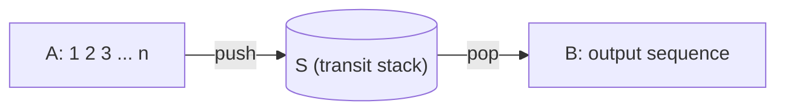

Stacks and queues are restricted sequences: a stack allows insertion and deletion at one end only, and a queue allows insertion at one end and deletion at the other. The restriction buys simplicity and efficiency: all operations are $O(1)$. More importantly, the structure of many problems is exactly "last in, first out" or "first in, first out": function calls and returns, nesting of parentheses, operator precedence in expressions and the path in a backtracking search are all last in, first out; waiting in line, serving in turn and searches that expand level by level are all first in, first out. This chapter first implements the stack, explains how the call stack supports recursion and how to rewrite recursion as iteration, and then discusses several classic applications of stacks. It then implements queues and double-ended queues. Finally, it uses a queue made of two stacks to introduce the three methods of amortized analysis systematically, and discusses monotonic stacks, stacks and queues that support retrieving the maximum, and backtracking implemented with a stack. [4.1.12](/4.1.12) and [4.1.14](/4.1.14) already covered backtracking and search using recursion and `std::queue`; this chapter treats the structures themselves.

## 4.1. Stacks

### 4.1.1. Interface

**Definition 4.1.1 (Stack)** A linear sequence in which elements can be inserted and deleted only at one end is called a **stack**. The end where operations are allowed is called the top, and the other end the bottom. The elements of a stack obey last in, first out (LIFO) order: the later an element is inserted, the earlier it is deleted.

| Operation | Function |
|---|---|
| `size()` / `empty()` | Number of elements / whether empty |
| `push(e)` | Insert $e$ at the top (push) |
| `pop()` | Delete and return the top element (pop) |
| `top()` | Return the top element without deleting it (peek) |

For example, on an empty stack, execute `push(E)`, `push(C)`, `pop()`, `push(G)`, `push(C)` in turn; the stack holds $E, G, C$ from bottom to top, and `top()` returns $C$; popping repeatedly then yields $C, G, E$.

### 4.1.2. Implementation

A stack is a special case of a sequence and can be implemented directly on a **vector** or a list. On a vector, take the end of the vector as the top: `push` and `pop` both act at the end and need not move other elements, and by capacity doubling ([4.3.2](/4.3.2)) they are amortized $O(1)$. If instead the front were the top, every operation would move all the elements, taking $O(n)$. On a linked list, take the first node as the top; `push` and `pop` are then strictly $O(1)$, with one node allocated or freed per operation. The C++ version below is based on a dynamic array, and the Python version on a singly linked list whose nodes are pairs `(data, next)`:

```cpp tab
#include <cstddef>
#include <format>
#include <iostream>
#include <memory>
#include <stdexcept>
#include <utility>

using Rank = std::ptrdiff_t;

// A stack on a dynamic array: the top is the last element.
template <typename T>
class Stack {
public:
    Rank size() const { return size_; }
    bool empty() const { return size_ == 0; }
    void push(const T& e) {
        if (size_ == capacity_) reallocate(capacity_ == 0 ? 4 : 2 * capacity_);
        elem_[size_++] = e;
    }
    T pop() {
        if (empty()) throw std::out_of_range("pop from an empty stack");
        return std::move(elem_[--size_]);
    }
    T& top() { return elem_[size_ - 1]; }               // the stack must not be empty
    const T& top() const { return elem_[size_ - 1]; }

private:
    Rank size_ = 0, capacity_ = 0;
    std::unique_ptr<T[]> elem_;

    void reallocate(Rank c) {
        auto old = std::move(elem_);
        elem_ = std::make_unique<T[]>(capacity_ = c);
        for (Rank i = 0; i < size_; ++i) elem_[i] = std::move(old[i]);
    }
};
int main() {
    Stack<char> s;
    for (char c : {'E', 'C'}) s.push(c);           // E C
    s.pop();                                        // E
    for (char c : {'G', 'C'}) s.push(c);           // E G C
    std::cout << std::format("top = {}, size = {}\n", s.top(), s.size());   // C, 3
    while (!s.empty()) std::cout << s.pop();       // C G E: last in, first out
    std::cout << '\n';
}
```

```python tab
from typing import Any


class Stack:
    """A stack on singly linked nodes: the top is the first node.
    Each node is a pair (data, next)."""

    def __init__(self) -> None:
        self._top: tuple[Any, Any] | None = None
        self._size = 0

    def __len__(self) -> int:
        return self._size

    def empty(self) -> bool:
        return self._size == 0

    def push(self, e: Any) -> None:
        self._top = (e, self._top)                  # the new node points to the old top
        self._size += 1

    def pop(self) -> Any:
        if self._top is None:
            raise IndexError("pop from an empty stack")
        e, self._top = self._top
        self._size -= 1
        return e

    def top(self) -> Any:                           # the stack must not be empty
        return self._top[0]


s = Stack()
for c in "EC":
    s.push(c)                                       # E C
s.pop()                                             # E
for c in "GC":
    s.push(c)                                       # E G C
print(f"top = {s.top()}, size = {len(s)}")          # C, 3
print("".join(s.pop() for _ in range(len(s))))      # CGE: last in, first out
```

The remaining programs in this chapter all use this `Stack`. In practice, C++ uses `std::stack`, a **container** adapter built by default on `std::deque`, and one may also specify `std::stack<T, std::vector<T>>` ([4.2.10](/4.2.10)); Python uses a `list` directly with `append` and `pop()` as a stack, both amortized $O(1)$ ([4.3.2](/4.3.2)), and uses `queue.LifoQueue` to pass data between threads.

## 4.2. The Call Stack and Recursion Elimination

### 4.2.1. The Call Stack

Function calls are last in, first out: the function called last returns first. While a program runs, the **call stack** ([4.1.4](/4.1.4)) saves one **stack frame** per call, recording the arguments, local variables and return address; frames are pushed on a call and popped on a return, and the top is always the function being executed. Each recursion instance of a recursive function has its own stack frame, so recursion is feasible precisely because there is a stack.

This allows us to analyze the **space complexity** of recursive algorithms: the stack frames on the call stack at any moment are exactly the chain of calls from the main function to the current instance, so the space needed by a recursion depends mainly on the maximum recursion depth, not on the total number of recursion instances. For example, the binary recursion `fib(n)` for Fibonacci numbers produces $\Theta(\phi^n)$ recursion instances in all ([4.3.1](/4.3.1)), but its recursion depth is only $n$, so its space complexity is $O(n)$. As another example, the three mutually calling functions below compute the hailstone sequence, and the recursion depth equals the length of the sequence:

```cpp
void even(int n);
void odd(int n);
void hailstone(int n) { if (n > 1) (n % 2) ? odd(n) : even(n); }
void even(int n) { hailstone(n / 2); }
void odd(int n) { hailstone(3 * n + 1); }
```

The call stack is maintained implicitly by the system and has limited capacity (usually a few MB), so excessively deep recursion causes **stack overflow**; each call also incurs time overhead for saving the context, jumping and returning. To save space and time, one can maintain a stack explicitly, or simply rewrite the recursion as iteration.

### 4.2.2. Tail Recursion

**Definition 4.2.1 (Tail Recursion)** A recursive call that is the last operation a function performs before returning is called **tail recursion**.

An example is the decrease-and-conquer algorithm for reversing an array ([4.3.1](/4.3.1)): after swapping the first and last elements, the last step is to reverse the middle part. Once a tail recursion reaches the base case, it triggers a chain of returns with no computation between them, all to the same return address; so the stack frames on the call stack need not be kept at all. It is the simplest recursion pattern and can be mechanically rewritten as iteration:

```cpp
void reverse(int* a, int n) {          // tail recursion: O(n) time, O(n) space
    if (n < 2) return;
    std::swap(a[0], a[n - 1]);
    reverse(a + 1, n - 2);
}

void reverse(int* a, int n) {          // the same with goto: O(n) time, O(1) space
next:
    if (n < 2) return;
    std::swap(a[0], a[n - 1]);
    a++; n -= 2;
    goto next;                         // instead of the recursive call
}

void reverse(int* a, int n) {          // tidied up into a loop
    for (; n >= 2; a++, n -= 2) std::swap(a[0], a[n - 1]);
}
```

After the rewrite, the **time complexity** improves by a constant factor, and the space complexity drops from $O(n)$ to $O(1)$, an asymptotic improvement. Many compilers recognize tail calls automatically and perform this rewrite (tail call optimization): GCC and Clang usually do so at `-O2`, but the C++ standard does not guarantee it; the Python interpreter never performs tail call optimization, so in Python a tail recursion that may be very deep should be rewritten by hand as a loop ([4.1.10](/4.1.10)).

Recursion can also be eliminated from functions that are not tail recursive. Sometimes eliminating recursion only optimizes space by a constant factor (the recursive factorial needs $O(n)$ space, the iterative one only $O(1)$), but it can also bring substantial improvement: the binary recursion for Fibonacci numbers needs exponential time, and after conversion to iteration it needs only $O(n)$ time and $O(1)$ space ([4.3.1](/4.3.1)).

### 4.2.3. Maintaining a Stack Explicitly

Recursion in general can always be rewritten as iteration with the help of an explicit stack, in which "work still to be done" is stored. Take the Tower of Hanoi ([4.1.10](/4.1.10)) as an example: "move $n$ disks from `from` to `to` via `via`" consists of three steps: move $n - 1$ disks to `via` using `to`, move the $n$-th disk, and move $n - 1$ disks to `to` using `from`. Pushing these three steps onto the stack in reverse order, and each time popping the work on top and doing it, simulates the execution order of the recursion.

```cpp tab
// Stack<T> and its #includes as in Section 4.1.
#include <string>

// Towers of Hanoi without recursion: the stack holds the pending tasks.
// A task is either "move n discs from -> to via" (n > 0) or a single move (n = 0).
struct Task { int n; char from, via, to; };

std::string hanoi(int n) {
    std::string moves;
    Stack<Task> pending;
    pending.push({n, 'A', 'B', 'C'});
    while (!pending.empty()) {
        Task t = pending.pop();
        if (t.n == 0) {                            // a single move of the top disc
            moves += std::format("{}{} ", t.from, t.to);
        } else {                                   // push the three steps in reverse order
            if (t.n > 1) pending.push({t.n - 1, t.via, t.from, t.to});
            pending.push({0, t.from, t.via, t.to});
            if (t.n > 1) pending.push({t.n - 1, t.from, t.to, t.via});
        }
    }
    return moves;
}

int main() { std::cout << hanoi(3) << '\n'; }      // AC AB CB AC BA BC AC
```

```python tab
# Stack as in Section 4.1.

def hanoi(n: int) -> str:
    """Towers of Hanoi without recursion: the stack holds the pending tasks.
    A task (n, src, via, dst) moves n discs; n = 0 means a single move."""
    moves = []
    pending = Stack()
    pending.push((n, "A", "B", "C"))
    while not pending.empty():
        k, src, via, dst = pending.pop()
        if k == 0:                                 # a single move of the top disc
            moves.append(src + dst)
        else:                                      # push the three steps in reverse order
            if k > 1:
                pending.push((k - 1, via, src, dst))
            pending.push((0, src, via, dst))
            if k > 1:
                pending.push((k - 1, src, dst, via))
    return " ".join(moves)

print(hanoi(3))                                    # AC AB CB AC BA BC AC
```

At most $2n$ items of work exist in the stack at the same time, comparable to the $O(n)$ stack frames of the recursive version; but the explicit stack is allocated on the heap, is not limited by the capacity of the system call stack, and is also convenient to inspect and interrupt at any time. The iterative traversal of binary trees ([4.3.5](/4.3.5)) and the depth-first search of graphs later will use this technique.

## 4.3. Classic Applications of Stacks

Classic applications of stacks fall into four classes: reversed output (the output order is the reverse of the processing order, as in base conversion), recursive nesting (self-similar problems, as in parenthesis matching and stack permutations), delayed buffering (in a linear scan, a sufficiently long suffix must be read before the earlier processing can be decided, as in expression evaluation), and stack-based computation (computation models built on a stack, as in reverse Polish notation).

### 4.3.1. Base Conversion

To convert a nonnegative decimal integer $n$ to base $\beta$: repeatedly divide by $\beta$, and the remainders are, in order, the digits of the base-$\beta$ representation from low to high. For example $12345 = 30071_{(8)}$:

$$
12345 = 8 \times 1543 + 1,\quad 1543 = 8 \times 192 + 7,\quad 192 = 8 \times 24 + 0,\quad 24 = 8 \times 3 + 0,\quad 3 = 8 \times 0 + 3.
$$
The difficulty is that the digits are obtained from low to high but must be output from high to low, and the number of digits cannot easily be determined in advance. Recording the remainders on a stack and popping them at the end outputs them in reverse order naturally, with exactly enough space.

```cpp tab
// Stack<T> and its #includes as in Section 4.1.
#include <string>

// Write n in base 2..36: the digits come out from low to high, the stack reverses them.
std::string convert(unsigned long long n, int base) {
    static constexpr char digit[] = "0123456789ABCDEFGHIJKLMNOPQRSTUVWXYZ";
    Stack<char> s;
    do {
        s.push(digit[n % base]);                   // the remainder is the next digit
        n /= base;                                 // continue with the quotient
    } while (n > 0);
    std::string out;
    while (!s.empty()) out += s.pop();             // from high to low
    return out;
}

int main() {
    std::cout << std::format("{} {} {}\n", convert(12345, 8), convert(2024, 2), convert(0, 16));
}   // 30071 11111101000 0
```

```python tab
# Stack as in Section 4.1.

def convert(n: int, base: int) -> str:
    """Write n >= 0 in base 2..36; the digits come out from low to high,
    so a stack reverses them."""
    digits = "0123456789ABCDEFGHIJKLMNOPQRSTUVWXYZ"
    s = Stack()
    while True:
        n, r = divmod(n, base)
        s.push(digits[r])                          # the remainder is the next digit
        if n == 0:
            break
    return "".join(s.pop() for _ in range(len(s)))   # from high to low

print(convert(12345, 8), convert(2024, 2), convert(0, 16))   # 30071 11111101000 0
```

### 4.3.2. Parenthesis Matching

Decide whether the parentheses in an expression match; for example, `(a[i-1][j+1])+a[i+1][j-1])*2` does not match, and `(a[i-1][j+1]+a[i+1][j-1])*2` does. Apart from the parentheses, all other symbols can be ignored.

Consider first one kind of parenthesis only. An outside-in approach does not work well: "if $E$ matches then $(E)$ matches" and "if $E$ and $F$ both match then $EF$ matches" are only sufficient conditions, and `(()())()` can be viewed either as $(E)F$ or as $EF$, so we cannot simplify effectively on that basis. To simplify the problem we need a necessary and sufficient condition. Inside-out: removing an adjacent pair of left and right parentheses does not affect the global matching decision, that is, $L\,()\,R$ matches if and only if $LR$ matches. So we scan the expression sequentially and use a stack to record the left parentheses scanned but not yet matched: on a left parenthesis, push it; on a right parenthesis, if the stack is nonempty, pop a left parenthesis to match it (which is exactly removing an adjacent pair), otherwise the right parenthesis is surplus; when the scan ends, the expression matches if and only if the stack is empty.

With one kind of parenthesis, the stack only needs to record the number of left parentheses, and a counter suffices: the moment the counter goes negative is a mismatch, and only returning to zero at the end means a match. But the counter does not generalize to several kinds of parentheses: in `[(])` the count of each kind is right, yet it does not match. Recording the kinds of left parentheses on the stack and checking that the kind corresponds when popping solves it. This method also works for tags such as `<body>` and `</body>` in HTML and XML, whose kinds are not fixed in advance.

```cpp tab
// Stack<T> and its #includes as in Section 4.1.
#include <string_view>

// Are the brackets ( ) [ ] { } in exp properly matched? Other characters are ignored.
bool paren(std::string_view exp) {
    Stack<char> s;                                 // the left brackets not yet matched
    for (char c : exp)
        switch (c) {
            case '(': case '[': case '{': s.push(c); break;
            case ')': if (s.empty() || s.pop() != '(') return false; break;
            case ']': if (s.empty() || s.pop() != '[') return false; break;
            case '}': if (s.empty() || s.pop() != '{') return false; break;
            default: break;
        }
    return s.empty();                              // no left bracket left over
}

int main() {
    for (auto e : {"(a[i-1][j+1])+a[i+1][j-1])*2", "(a[i-1][j+1]+a[i+1][j-1])*2", "[(])"})
        std::cout << std::format("{:30} {}\n", e, paren(e));   // false true false
}
```

```python tab
# Stack as in Section 4.1.

def paren(exp: str) -> bool:
    """Are the brackets ( ) [ ] { } in exp properly matched? Other characters are ignored."""
    match = {")": "(", "]": "[", "}": "{"}
    s = Stack()                                    # the left brackets not yet matched
    for c in exp:
        if c in "([{":
            s.push(c)
        elif c in match:
            if s.empty() or s.pop() != match[c]:
                return False
    return s.empty()                               # no left bracket left over

for e in ("(a[i-1][j+1])+a[i+1][j-1])*2", "(a[i-1][j+1]+a[i+1][j-1])*2", "[(])"):
    print(f"{e:30} {paren(e)}")                    # False True False
```

### 4.3.3. Stack Permutations

**Definition 4.3.1 (Stack Permutation)** Suppose there are three stacks $A$, $S$, $B$: $A = \langle a_1, a_2, \dots, a_n]$ ($a_1$ at the top), with $S$ and $B$ empty. Only two operations are allowed: pop the top element of $A$ and push it onto $S$, or pop the top element of $S$ and push it onto $B$. If after a sequence of such operations all elements of $A$ have been moved to $B$, the resulting sequence in $B$ is called a **stack permutation** of $A$.



Write the input as $1, 2, \dots, n$. The same input can have many stack permutations: $1, 2, 3, 4$ (each element is popped immediately after it is pushed), $4, 3, 2, 1$ (all are pushed and then all popped), $3, 2, 4, 1$, and so on. Clearly the total number of stack permutations satisfies $\mathrm{SP}(n) \leq n!$. More precisely, consider the moment when element 1 is popped from $S$: then $S$ is empty again; if $k - 1$ elements (namely $2, \dots, k$) have entered and left $S$ before this, they form a stack permutation of length $k - 1$, placed before 1; the remaining $n - k$ elements form a stack permutation of length $n - k$, placed after 1. Hence

$$
\mathrm{SP}(0) = 1, \qquad \mathrm{SP}(n) = \sum_{k=1}^{n} \mathrm{SP}(k - 1)\,\mathrm{SP}(n - k),
$$
which is exactly the **recurrence relation** of the *Catalan numbers*, with solution $\mathrm{SP}(n) = \frac{1}{n+1}\binom{2n}{n}$: $1, 1, 2, 5, 14, 42, 132, 429, \dots$

Another view: every stack permutation corresponds to a sequence of $n$ pushes and $n$ pops on $S$ in which every prefix contains at least as many pushes as pops, and conversely. Writing push as a left parenthesis and pop as a right parenthesis gives a matching of $n$ pairs of parentheses. So stack permutations of $n$ elements are in one-to-one correspondence with matchings of $n$ pairs of parentheses, and the number of both is a Catalan number.

Which permutations are stack permutations? For $n = 3$ there are $3! = 6$ permutations but only 5 stack permutations; the missing one is $3, 1, 2$: 3 is output first, which means 1 and 2 have both been pushed onto $S$, and 2 is above 1, so 1 cannot be output before 2.

**Theorem 4.3.1 (Knuth, 1968)** A permutation $B$ of $1, 2, \dots, n$ is a stack permutation if and only if there are no $i < j < k$ such that in $B$, $k$ precedes $i$ and $i$ precedes $j$ (that is, $B$ does not contain the "312" pattern $\dots, k, \dots, i, \dots, j, \dots$).

**Proof** Necessity: if $k$ is output before $i$ and $j$, then when $k$ is popped, the smaller $i$ and $j$ have both been pushed and not yet popped, and $j$, pushed later, is above $i$, so $j$ must be popped before $i$, a contradiction. Sufficiency: simulate greedily in the order of $B$: to output $x$, if $x$ is still in $A$, push onto $S$ all elements of $A$ up to $x$; if $x$ is at the top of $S$, pop it. The simulation can fail in only one situation: $x$ is in $S$, but the top is another element $y$. Since $y$ was pushed after $x$, we have $x < y$; $y$ was pushed onto $S$ because some $k \geq y$ was to be output earlier while $y$ was still in $S$, so $k > y$. Then $k$ is output before $x$, $x$ before $y$, and $x < y < k$, forming a "312" pattern. So the simulation necessarily succeeds when the pattern is absent. $\square$

The proof of sufficiency is itself an $O(n)$ decision algorithm: simulate the permutation process directly, with each element pushed and popped at most once. The program below enumerates all permutations for $n = 1, \dots, 7$ and counts the stack permutations, which are exactly the Catalan numbers:

```cpp tab
// Stack<T> and its #includes as in Section 4.1.
#include <algorithm>
#include <numeric>
#include <span>
#include <vector>

// Is b a stack permutation of 1, 2, ..., n? Simulate: push from the input until the
// wanted element is on top of S, then pop it; if it is buried in S, b is impossible.
bool is_stack_permutation(std::span<const int> b) {
    Stack<int> s;
    int next = 1;                                  // the input is next, next + 1, ..., n
    for (int x : b) {
        while (next <= x) s.push(next++);          // bring x onto the top of S
        if (s.empty() || s.top() != x) return false;   // x is buried below the top
        s.pop();                                   // move x to the output
    }
    return true;
}

int main() {
    for (int n = 1; n <= 7; ++n) {                 // count over all n! permutations
        std::vector<int> b(n);
        std::iota(b.begin(), b.end(), 1);
        int count = 0;
        do count += is_stack_permutation(b);
        while (std::next_permutation(b.begin(), b.end()));
        std::cout << count << ' ';                 // 1 2 5 14 42 132 429
    }
    std::cout << '\n';
}
```

```python tab
# Stack as in Section 4.1.
from itertools import permutations

def is_stack_permutation(b: list[int]) -> bool:
    """Is b a stack permutation of 1, 2, ..., n? Simulate: push from the input until
    the wanted element is on top of S, then pop it; if it is buried, b is impossible."""
    s = Stack()
    nxt = 1                                        # the input is nxt, nxt + 1, ..., n
    for x in b:
        while nxt <= x:                            # bring x onto the top of S
            s.push(nxt)
            nxt += 1
        if s.empty() or s.top() != x:              # x is buried below the top
            return False
        s.pop()                                    # move x to the output
    return True

# count over all n! permutations: 1 2 5 14 42 132 429
print(*(sum(map(is_stack_permutation, permutations(range(1, n + 1)))) for n in range(1, 8)))
```

## 4.4. Expression Evaluation

### 4.4.1. Evaluating Infix Expressions

Given a syntactically correct arithmetic expression, compute its value. In the **infix notation** used in everyday writing, the order of operations is determined jointly by operator precedence and parentheses: in $1 + 2 \times 3$ the multiplication is performed first, and in $(1 + 2) \times 3$ the addition inside the parentheses is performed first. The idea of evaluation is decrease and conquer: the part with higher precedence is computed first and replaced by its result, the operators decrease step by step, until only one value remains.

The difficulty is that a prefix of the expression alone does not suffice to determine the order of evaluation of its operators. On reading `1 + 2` we cannot yet compute, because `* 3` may follow; only after reading more of what follows can we determine which earlier operators can be executed. This requires a delayed buffering mechanism: two stacks record the part already scanned, the operand stack holding operands and intermediate results and the operator stack holding operators not yet executed. Scan the expression from left to right; push each operand onto the operand stack; on reading an operator $c$, compare its precedence with the operator $t$ on top of the operator stack:

- if $t$ has lower precedence than $c$ (written `<` in the table), $t$ cannot be executed yet, and $c$ is pushed to wait for its moment;
- if $t$ has higher precedence than $c$ (`>`), $t$ can now be executed: pop $t$ and the operands it needs, compute, and push the result onto the operand stack; then $c$ is compared with the new top;
- if $t$ and $c$ are a matching pair of parentheses, or the start and end markers of the expression (`~`), pop $t$, strip the parentheses, and continue scanning.

For uniform handling, a start marker is pushed onto the bottom of the operator stack in advance, and the end of the expression is also treated as an end marker (the C++ version uses `'\0'`, the Python version `'$'`); evaluation ends when the two meet, and the only element left on the operand stack is the result. The precedence between operators is described by a table (rows are the operator on top of the stack, columns the current operator, `!` is the unary factorial, and a blank denotes a syntax error):

| Stack top \ Current | `+` | `-` | `*` | `/` | `^` | `!` | `(` | `)` | End |
|---|---|---|---|---|---|---|---|---|---|
| `+` `-` | > | > | < | < | < | < | < | > | > |
| `*` `/` | > | > | > | > | < | < | < | > | > |
| `^` | > | > | > | > | < | < | < | > | > |
| `!` | > | > | > | > | > | > | | > | > |
| `(` | < | < | < | < | < | < | < | ~ | |
| Start | < | < | < | < | < | < | < | | ~ |

The pattern in the table is easy to understand: "multiplication and division before addition and subtraction" shows up as `<` when `+` meets `*` and `>` when `*` meets `+`; operators of the same level are left-associative, so `+` meeting `+` is `>` and the left one is executed first; exponentiation is right-associative ($2^{3^2} = 2^9$), so `^` meeting `^` is `<`; a left parenthesis outside the stack has the highest precedence and is always pushed, and inside the stack it has the lowest precedence, so any operator can be pushed on top of it; a right parenthesis outside the stack has the lowest precedence, forcing the operators in the stack to be executed one by one until the matching left parenthesis is met.

```cpp tab
// Stack<T> and its #includes as in Section 4.1.
#include <cctype>
#include <charconv>
#include <cmath>
#include <string>
#include <string_view>

// Operators in the order of the table: + - * / ^ ! ( ) and the end marker '\0'.
constexpr std::string_view kOps{"+-*/^!()\0", 9};
// kPri[top][current]: '<' push the current operator, '>' apply the top one first,
// '~' a matching pair: pop it, ' ' a syntax error.
constexpr const char* kPri[9] = {
    //     + - * / ^ ! ( ) \0
    /* + */ ">><<<<<>>",
    /* - */ ">><<<<<>>",
    /* * */ ">>>><<<>>",
    /* / */ ">>>><<<>>",
    /* ^ */ ">>>><<<>>",           // ^ after ^ is '<': right associative
    /* ! */ ">>>>>> >>",
    /* ( */ "<<<<<<<~ ",
    /* ) */ "         ",
    /* \0*/ "<<<<<<< ~",
};

char priority(char top, char current) {
    auto i = kOps.find(top), j = kOps.find(current);
    if (i == kOps.npos || j == kOps.npos) throw std::invalid_argument("unknown character");
    return kPri[i][j];
}

double apply(double a, char op, double b) {
    switch (op) {
        case '+': return a + b;
        case '-': return a - b;
        case '*': return a * b;
        case '/': return a / b;
        default: return std::pow(a, b);           // '^'
    }
}

double factorial(double x) {
    double f = 1;
    for (int k = 2; k <= int(x); ++k) f *= k;
    return f;
}

// Evaluate an infix expression; also write it in reverse Polish notation into rpn.
double evaluate(std::string_view s, std::string& rpn) {
    Stack<double> opnd;                            // operands and intermediate results
    Stack<char> optr;                              // operators waiting to be applied
    optr.push('\0');                               // sentinel: the beginning of the text
    std::size_t i = 0;
    while (!optr.empty()) {
        char c = i < s.size() ? s[i] : '\0';       // '\0' marks the end of the text
        if (c == ' ') { ++i; continue; }
        if (std::isdigit(static_cast<unsigned char>(c))) {   // read a number
            double x = 0;
            auto [end, ec] = std::from_chars(s.data() + i, s.data() + s.size(), x);
            i = end - s.data();
            opnd.push(x);
            rpn += std::format("{} ", x);
            continue;
        }
        switch (priority(optr.top(), c)) {
            case '<':                              // the top operator must wait
                optr.push(c);
                ++i;
                break;
            case '~':                              // a pair of parentheses, or the end
                optr.pop();
                ++i;
                break;
            case '>': {                            // apply the top operator now
                char op = optr.pop();
                rpn += std::format("{} ", op);
                if (op == '!') {
                    opnd.push(factorial(opnd.pop()));
                } else {
                    double b = opnd.pop(), a = opnd.pop();   // the order matters
                    opnd.push(apply(a, op, b));
                }
                break;
            }
            default: throw std::invalid_argument("syntax error");
        }
    }
    return opnd.pop();
}

int main() {
    for (auto e : {"(0!+1)*2^(3!+4)-(5!-67-(8+9))", "2^3^2", "(1+2)*3.5/0.5"}) {
        std::string rpn;
        double v = evaluate(e, rpn);
        std::cout << std::format("{} = {}\n  RPN: {}\n", e, v, rpn);
    }
}
```

```python tab
# Stack as in Section 4.1.
import math

OPS = "+-*/^!()$"                  # '$' marks the beginning and the end of the text
# PRI[top][current]: '<' push the current operator, '>' apply the top one first,
# '~' a matching pair: pop it, ' ' a syntax error.
PRI = dict(zip(OPS, (
    # +-*/^!()$
    ">><<<<<>>",                   # +
    ">><<<<<>>",                   # -
    ">>>><<<>>",                   # *
    ">>>><<<>>",                   # /
    ">>>><<<>>",                   # ^   (^ after ^ is '<': right associative)
    ">>>>>> >>",                   # !
    "<<<<<<<~ ",                   # (
    "         ",                   # )
    "<<<<<<< ~",                   # $
)))

def apply(a: float, op: str, b: float) -> float:
    match op:
        case "+": return a + b
        case "-": return a - b
        case "*": return a * b
        case "/": return a / b
        case _: return a ** b      # '^'

def evaluate(s: str) -> tuple[float, str]:
    """Evaluate an infix expression; also return it in reverse Polish notation."""
    opnd, optr, rpn = Stack(), Stack(), []
    optr.push("$")                 # sentinel: the beginning of the text
    s += "$"                       # and the end of the text
    i = 0
    while not optr.empty():
        c = s[i]
        if c == " ":
            i += 1
            continue
        if c.isdigit():            # read a number
            j = i
            while s[j].isdigit() or s[j] == ".":
                j += 1
            x = float(s[i:j])
            opnd.push(x)
            rpn.append(f"{x:g}")
            i = j
            continue
        if c not in PRI:
            raise ValueError(f"unknown character {c!r}")
        match PRI[optr.top()][OPS.index(c)]:
            case "<":              # the top operator must wait
                optr.push(c)
                i += 1
            case "~":              # a pair of parentheses, or the end
                optr.pop()
                i += 1
            case ">":              # apply the top operator now
                op = optr.pop()
                rpn.append(op)
                if op == "!":
                    opnd.push(float(math.factorial(int(opnd.pop()))))
                else:
                    b, a = opnd.pop(), opnd.pop()   # the order matters
                    opnd.push(apply(a, op, b))
            case _:
                raise ValueError("syntax error")
    return opnd.pop(), " ".join(rpn)

for e in ("(0!+1)*2^(3!+4)-(5!-67-(8+9))", "2^3^2", "(1+2)*3.5/0.5"):
    v, rpn = evaluate(e)
    print(f"{e} = {v:g}\n  RPN: {rpn}")
```

When executing a binary operation, the right operand is popped first and the left operand second, and the order must not be reversed (for subtraction, division and exponentiation). Take $(0! + 1) \times 2^{(3! + 4)} - (5! - 67 - (8 + 9))$ as an example; the evaluation of the first half proceeds as follows (stacks run from bottom to top left to right, and `$` is the start marker):

| Current character | Operator stack | Operand stack | Action |
|---|---|---|---|
| `(` | `$ (` | | Push `(` |
| `0` | `$ (` | `0` | Push operand |
| `!` | `$ ( !` | `0` | Push `!` |
| `+` | `$ (` | `1` | Pop `!` and execute |
| `+` | `$ ( +` | `1` | Push `+` |
| `1` | `$ ( +` | `1 1` | Push operand |
| `)` | `$ (` | `2` | Pop `+` and execute |
| `)` | `$` | `2` | Pop the left parenthesis |
| `*` | `$ *` | `2` | Push `*` |
| `2` | `$ *` | `2 2` | Push operand |
| `^` | `$ * ^` | `2 2` | Push `^` |
| `(` ... `)` | `$ * ^` | `2 2 10` | Likewise obtain $3! + 4 = 10$ inside the parentheses |
| `-` | `$ *` | `2 1024` | Pop `^` and execute |
| `-` | `$` | `2048` | Pop `*` and execute |
| `-` | `$ -` | `2048` | Push `-` |

After this, $5! - 67 - (8 + 9) = 36$ is obtained likewise, and finally the subtraction is performed, giving 2012. The whole algorithm scans the expression only once, with each operator pushed and popped at most once, so the time is $O(n)$. This way of handling precedence with an operator stack is the idea of the *shunting-yard algorithm* proposed by Dijkstra in 1961.

### 4.4.2. Reverse Polish Notation

**Reverse Polish notation** ([1.1.1](/1.1.1)) writes each operator after its operands; for example, $(1 + 2) \times 3$ is written `1 2 + 3 *` and $1 + 2 \times 3$ is written `1 2 3 * +`. It can express operations with precedence without using parentheses; in compensation, a separating metacharacter (such as a space) must be introduced, so it is not necessarily shorter than the original expression. It is obtained by reversing **Polish notation** (prefix notation), and in contrast to infix notation it is also called postfix notation.

Evaluating a reverse Polish expression needs only one stack and need not consider precedence at all: process the items one by one; if an item is an operand, push it onto the stack; if it is an operator, pop from the stack the number of operands it needs, perform the computation, and push the result onto the stack. As long as the input is syntactically correct, exactly one element is left on the stack at the end, namely the value of the expression.

```cpp tab
// Stack<T> and its #includes as in Section 4.1.
#include <charconv>
#include <cmath>
#include <sstream>
#include <string>

// Evaluate an expression in reverse Polish notation whose tokens are separated by spaces.
double eval_rpn(const std::string& rpn) {
    Stack<double> s;                               // operands only: no priorities needed
    std::istringstream in(rpn);
    for (std::string t; in >> t;) {
        if (t == "!") {                            // unary: n!
            double f = 1;
            for (int k = 2, n = int(s.pop()); k <= n; ++k) f *= k;
            s.push(f);
        } else if (t == "+" || t == "-" || t == "*" || t == "/" || t == "^") {
            double b = s.pop(), a = s.pop();       // binary: pop two operands
            switch (t[0]) {
                case '+': s.push(a + b); break;
                case '-': s.push(a - b); break;
                case '*': s.push(a * b); break;
                case '/': s.push(a / b); break;
                default: s.push(std::pow(a, b)); break;
            }
        } else {                                   // an operand
            double x = 0;
            std::from_chars(t.data(), t.data() + t.size(), x);
            s.push(x);
        }
    }
    return s.pop();                                // the only element left
}

int main() {
    std::cout << eval_rpn("0 ! 1 + 2 3 ! 4 + ^ * 5 ! 67 - 8 9 + - -") << '\n';   // 2012
}
```

```python tab
# Stack as in Section 4.1.
import math

def eval_rpn(rpn: str) -> float:
    """Evaluate an expression in reverse Polish notation; tokens are separated by spaces."""
    s = Stack()                                    # operands only: no priorities needed
    for t in rpn.split():
        match t:
            case "!":                              # unary: n!
                s.push(float(math.factorial(int(s.pop()))))
            case "+" | "-" | "*" | "/" | "^":      # binary: pop two operands
                b, a = s.pop(), s.pop()
                s.push(a + b if t == "+" else a - b if t == "-" else
                       a * b if t == "*" else a / b if t == "/" else a ** b)
            case _:                                # an operand
                s.push(float(t))
    return s.pop()                                 # the only element left

print(f"{eval_rpn('0 ! 1 + 2 3 ! 4 + ^ * 5 ! 67 - 8 9 + - -'):g}")   # 2012
```

How do we convert an infix expression to reverse Polish notation? Manual conversion takes two steps: first add parentheses to every operation according to the order of evaluation, then move each operator to the position of its corresponding right parenthesis and remove all parentheses. For example, $(0! + 1) \times 2^{(3! + 4)} - (5! - 67 - (8 + 9))$ fully parenthesized is

```text
( ( (0 !) + 1 ) * ( 2 ^ ( (3 !) + 4 ) ) ) - ( ( (5 !) - 67 ) - ( 8 + 9 ) )
```

Moving the operators and removing the parentheses gives `0 ! 1 + 2 3 ! 4 + ^ * 5 ! 67 - 8 9 + - -`. Automatic conversion needs only a slight modification of the evaluation algorithm of the previous section: when an operand is read, append it to the reverse Polish expression; when an operator is popped for execution, append it too. The program of the previous section already does this, and its RPN output line is the result of the conversion. We see that the order in which operators appear in the reverse Polish expression is exactly the order in which they are executed, and the structure of the original expression is fully embodied in this order.

Stack-based computation models are still widely used today. The syntax of PostScript, the page description language born in 1985, is reverse Polish (`4 4 mul 5 5 mul add`), and its interpreter maintains five stacks, including the operand stack. The bytecode of the Java virtual machine and of CPython is also stack-based: using the `dis` module to inspect the compilation of `(a + b) * c - d` gives `LOAD a`, `LOAD b`, `BINARY_OP +`, `LOAD c`, `BINARY_OP *`, `LOAD d`, `BINARY_OP -` in turn, which is exactly the reverse Polish expression `a b + c * d -`.

## 4.5. Queues

### 4.5.1. Interface

**Definition 4.5.1 (Queue)** A linear sequence in which elements can be inserted only at one end (the rear) and deleted only at the other end (the front) is called a **queue**. The elements of a queue obey first in, first out (FIFO) order.

| Operation | Function |
|---|---|
| `size()` / `empty()` | Number of elements / whether empty |
| `enqueue(e)` | Insert $e$ at the rear (enqueue) |
| `dequeue()` | Delete and return the front element (dequeue) |
| `front()` / `rear()` | Return the front / rear element |

A queue can be implemented on a list: take the first node as the front and the last node as the rear, so enqueue is `insert_last` and dequeue is `remove(first())`, both $O(1)$. On a vector, if the first element is the front, dequeue must move all the elements and takes $O(n)$; the remedy is not to move elements but to let the position of the front move backward, and to treat the array as a ring joined end to end.

### 4.5.2. Circular Buffers and Double-Ended Queues

**Definition 4.5.2 (Double-Ended Queue)** A linear sequence in which elements can be inserted and deleted at both ends is called a **double-ended queue** (deque).

Stacks and queues are both special cases of the double-ended queue: using only one end gives a stack, and insertion at one end with deletion at the other gives a queue. A double-ended queue can be implemented efficiently with a *circular buffer*: the elements are stored in an array of capacity $c$ as $\mathit{elem}[h], \mathit{elem}[h+1], \dots, \mathit{elem}[h + n - 1]$, with all indices taken modulo $c$. Insertion at the rear writes to $\mathit{elem}[(h + n) \bmod c]$; insertion at the front sets $h \gets (h - 1) \bmod c$ and then writes; deletion at either end only moves $h$ or changes $n$. When the array is full, the capacity is doubled as for a **vector**, and the elements are moved in order to the beginning of the new array. Thus insertion and deletion at both ends are amortized $O(1)$, and access by rank $\mathit{elem}[(h + r) \bmod c]$ is $O(1)$. A queue is just an adapter on a double-ended queue, just as `std::queue` is built by default on `std::deque` (the **adapter pattern**, [4.2.13](/4.2.13)):

```cpp tab
// Rank and the #includes as in Section 4.1.
// A double-ended queue on a circular array. The elements are
// elem[head], elem[head + 1], ..., elem[head + size - 1], indices modulo the capacity.
template <typename T>
class Deque {
public:
    Rank size() const { return size_; }
    bool empty() const { return size_ == 0; }
    T& operator[](Rank r) { return elem_[(head_ + r) % capacity_]; }   // 0 <= r < size()
    T& front() { return elem_[head_]; }
    T& back() { return (*this)[size_ - 1]; }

    void push_back(const T& e) {
        if (size_ == capacity_) grow();
        elem_[(head_ + size_) % capacity_] = e;
        ++size_;
    }
    void push_front(const T& e) {
        if (size_ == capacity_) grow();
        head_ = (head_ + capacity_ - 1) % capacity_;   // one step back, wrapping around
        elem_[head_] = e;
        ++size_;
    }
    T pop_front() {
        if (empty()) throw std::out_of_range("pop from an empty deque");
        T e = std::move(elem_[head_]);
        head_ = (head_ + 1) % capacity_;
        --size_;
        return e;
    }
    T pop_back() {
        if (empty()) throw std::out_of_range("pop from an empty deque");
        --size_;
        return std::move(elem_[(head_ + size_) % capacity_]);
    }

private:
    Rank head_ = 0, size_ = 0, capacity_ = 0;
    std::unique_ptr<T[]> elem_;

    void grow() {                                  // double the capacity, unwrap the elements
        Rank c = capacity_ == 0 ? 4 : 2 * capacity_;
        auto fresh = std::make_unique<T[]>(c);
        for (Rank i = 0; i < size_; ++i) fresh[i] = std::move((*this)[i]);
        elem_ = std::move(fresh);
        capacity_ = c;
        head_ = 0;
    }
};

// A queue is a deque used at two ends only, like std::queue on top of std::deque.
template <typename T>
class Queue {
public:
    Rank size() const { return d_.size(); }
    bool empty() const { return d_.empty(); }
    void enqueue(const T& e) { d_.push_back(e); }  // insert at the rear
    T dequeue() { return d_.pop_front(); }         // remove at the front
    T& front() { return d_.front(); }
    T& rear() { return d_.back(); }

private:
    Deque<T> d_;
};
int main() {
    Queue<char> q;                                 // first in, first out
    for (char c : {'E', 'C'}) q.enqueue(c);
    q.dequeue();                                   // E leaves first
    for (char c : {'G', 'C', 'K', 'F'}) q.enqueue(c);
    std::cout << std::format("front {}, rear {}, size {}\n", q.front(), q.rear(), q.size());
    Deque<int> d;
    for (int i = 1; i <= 6; ++i)                   // 5 3 1 2 4 6
        if (i % 2) d.push_front(i); else d.push_back(i);
    d.pop_back();
    d.push_front(0);
    for (Rank r = 0; r < d.size(); ++r) std::cout << d[r] << ' ';   // 0 5 3 1 2 4
    std::cout << '\n';
}
```

```python tab
from typing import Any

class Deque:
    """A double-ended queue on a circular array. The elements are
    elem[head], elem[head + 1], ..., elem[head + size - 1], indices modulo the capacity."""

    def __init__(self) -> None:
        self._elem: list[Any] = [None] * 4
        self._head = self._size = 0

    def __len__(self) -> int:
        return self._size

    def empty(self) -> bool:
        return self._size == 0

    def __getitem__(self, r: int) -> Any:          # 0 <= r < size
        return self._elem[(self._head + r) % len(self._elem)]

    def front(self) -> Any:
        return self._elem[self._head]

    def back(self) -> Any:
        return self[self._size - 1]

    def _grow(self) -> None:                       # double the capacity, unwrap the elements
        fresh = [None] * (2 * len(self._elem))
        for i in range(self._size):
            fresh[i] = self[i]
        self._elem, self._head = fresh, 0

    def push_back(self, e: Any) -> None:
        if self._size == len(self._elem):
            self._grow()
        self._elem[(self._head + self._size) % len(self._elem)] = e
        self._size += 1

    def push_front(self, e: Any) -> None:
        if self._size == len(self._elem):
            self._grow()
        self._head = (self._head - 1) % len(self._elem)   # one step back, wrapping around
        self._elem[self._head] = e
        self._size += 1

    def pop_front(self) -> Any:
        if self._size == 0:
            raise IndexError("pop from an empty deque")
        e, self._elem[self._head] = self._elem[self._head], None
        self._head = (self._head + 1) % len(self._elem)
        self._size -= 1
        return e

    def pop_back(self) -> Any:
        if self._size == 0:
            raise IndexError("pop from an empty deque")
        self._size -= 1
        i = (self._head + self._size) % len(self._elem)
        e, self._elem[i] = self._elem[i], None
        return e


class Queue:
    """A queue is a deque used at two ends only."""

    def __init__(self) -> None:
        self._d = Deque()

    def __len__(self) -> int:
        return len(self._d)

    def empty(self) -> bool:
        return self._d.empty()

    def enqueue(self, e: Any) -> None:             # insert at the rear
        self._d.push_back(e)

    def dequeue(self) -> Any:                      # remove at the front
        return self._d.pop_front()

    def front(self) -> Any:
        return self._d.front()

    def rear(self) -> Any:
        return self._d.back()


q = Queue()                                        # first in, first out
for c in "EC":
    q.enqueue(c)
q.dequeue()                                        # E leaves first
for c in "GCKF":
    q.enqueue(c)
print(f"front {q.front()}, rear {q.rear()}, size {len(q)}")
d = Deque()
for i in range(1, 7):                              # 5 3 1 2 4 6
    if i % 2:
        d.push_front(i)
    else:
        d.push_back(i)
d.pop_back()
d.push_front(0)
print(*(d[r] for r in range(len(d))))              # 0 5 3 1 2 4
```

### 4.5.3. Queues in the Standard Libraries

In Python, using a `list` as a queue is a common mistake: `pop(0)` moves all the elements and is $O(n)$ ([4.3.2](/4.3.2)). One should use `collections.deque`. CPython implements it as a chain of doubly linked blocks, each holding 64 elements: `append`, `appendleft`, `pop` and `popleft` at the two ends are all strictly $O(1)$ and need no wholesale copying; indexing `d[i]` must advance block by block from the nearer end and is $O(n)$ near the middle; a `maxlen` can be specified at construction, after which old elements are automatically discarded from the other end when full, commonly used to keep "the most recent $k$ items". For producer-consumer queues between threads, use `queue.Queue`.

C++'s `std::deque` is a different segmented structure: an array of pointers (the map) points to several fixed-size blocks, insertion at an end adds a new block before the first or after the last block, and only when the map itself is full must it be copied wholesale (pointers, not elements), so insertion at both ends is $O(1)$ and access by rank is also $O(1)$ (first locate the block, then the offset within it). `std::queue` and `std::stack` are adapters built on it ([4.2.10](/4.2.10)).

| Need | C++ | Python |
|---|---|---|
| Stack | `std::stack` (by default on `deque`) | `append` / `pop()` of `list` |
| Queue | `std::queue` (by default on `deque`) | `append` / `popleft()` of `collections.deque` |
| Double-ended queue | `std::deque` | `collections.deque` |
| Thread-safe queue | None (add locking yourself) | `queue.Queue`, `queue.LifoQueue` |
| Priority queue | `std::priority_queue` | `heapq` ([4.3.12](/4.3.12)) |

### 4.5.4. Applications of Queues

A classic application of queues is the fair allocation of resources. When a group of clients shares one resource (several programs sharing a CPU, several people sharing a printer), put all clients in a queue and repeatedly let the client at the front dequeue, receive one time slice of service, and enqueue again. This is *round robin*, the basis of process scheduling in operating systems ([4.11](/4.11)).

```text
RoundRobin(clients):
    Q = Queue(clients)
    while the service is open:
        e = Q.dequeue()          # the client at the front
        serve(e)                 # for one time slice
        Q.enqueue(e)             # back to the rear
```

Simulating bank service is another example: $k$ windows each have a queue, at each moment a new customer with a random service time arrives and automatically joins the shortest queue; at each moment the customer at the front of each queue is served and leaves the queue when finished, replaced by the next customer. Measuring the average waiting time then tells whether the number of windows is appropriate. The theoretical analysis of such discrete-event simulations belongs to queueing theory.

In graphs and state spaces, **breadth-first search** uses a queue to hold the nodes to be expanded, so that nodes closer to the start are expanded first ([4.1.14](/4.1.14), [4.3.10](/4.3.10)).

## 4.6. Monotonic Stacks and the Largest Rectangle in a Histogram

**Example 4.6.1** Given a histogram $H[0, n)$ of nonnegative integers (the $r$-th bar has width 1 and height $H[r]$), find the rectangle of largest area in it. For example, in $H = \{2, 1, 5, 6, 2, 3\}$ the largest rectangle is supported by the two bars of heights 5 and 6, has height 5, and has area 10.

The height of the largest rectangle must equal the height $H[r]$ of some bar $r$ it covers. For each bar $r$, the maximal rectangle with that height extends left to $s(r)$ and right to $t(r)$:

$$
s(r) = 1 + \max\{\, k < r : H[k] < H[r] \,\}, \qquad t(r) = \min\{\, k > r : H[k] < H[r] \,\},
$$
(taking $0$ and $n$ respectively when the set is empty), with area $H[r] \cdot (t(r) - s(r))$. The largest rectangle is necessarily one of these $n$ maximal rectangles. Scanning to both sides bar by bar to find $s(r)$ and $t(r)$ takes $O(n^2)$ time in the worst case.

In fact a single linear scan can find all $s(r)$ and $t(r)$: maintain a stack that holds, from bottom to top, the **ranks** of the bars whose right boundary is not yet determined, and whose heights are nondecreasing from bottom to top. When the scan reaches bar $t$, every bar in the stack taller than $H[t]$ has met here the first shorter bar to its right, that is, $t(r) = t$, and these are popped in turn; for a popped bar $r$, the new stack top $l$ is the nearest bar to the left of $r$ that is not taller than it, so its rectangle covers $[l + 1, t)$. Then $t$ is pushed onto the stack, and the monotonicity of the stack is preserved. When the scan ends (treating $t = n$ as a bar of height 0), the right boundary of every bar left in the stack is $n$.

**Definition 4.6.1 (Monotonic Stack)** A stack in which, before a new element is pushed, all top elements that would destroy monotonicity are popped, so that the elements of the stack (with respect to some key) are always monotone from bottom to top, is called a **monotonic stack**.

```cpp tab
// Stack<T> and its #includes as in Section 4.1.
#include <algorithm>
#include <span>

// The largest rectangle under the histogram h, in one scan with a monotonic stack.
// The ranks in the stack increase from bottom to top, their heights never decrease.
long long max_rectangle(std::span<const int> h) {
    const Rank n = std::ssize(h);
    Stack<Rank> s;
    long long best = 0;
    for (Rank t = 0; t <= n; ++t) {                // t == n acts as a bar of height 0
        while (!s.empty() && (t == n || h[s.top()] > h[t])) {
            Rank r = s.pop();                      // the bar r cannot extend past t:
            Rank left = s.empty() ? 0 : s.top() + 1;   // its rectangle spans [left, t)
            best = std::max(best, 1LL * h[r] * (t - left));
        }
        if (t < n) s.push(t);
    }
    return best;
}

int main() {
    const int h[] = {2, 1, 5, 6, 2, 3};
    const int g[] = {3, 5, 1, 7, 5, 9, 9, 3, 4, 2};
    std::cout << std::format("{} {}\n", max_rectangle(h), max_rectangle(g));   // 10 20
}
```

```python tab
# Stack as in Section 4.1.

def max_rectangle(h: list[int]) -> int:
    """The largest rectangle under the histogram h, in one scan with a monotonic stack.
    The ranks in the stack increase from bottom to top, their heights never decrease."""
    n, s, best = len(h), Stack(), 0
    for t in range(n + 1):                         # t == n acts as a bar of height 0
        while not s.empty() and (t == n or h[s.top()] > h[t]):
            r = s.pop()                            # the bar r cannot extend past t:
            left = 0 if s.empty() else s.top() + 1   # its rectangle spans [left, t)
            best = max(best, h[r] * (t - left))
        if t < n:
            s.push(t)
    return best

print(max_rectangle([2, 1, 5, 6, 2, 3]),
      max_rectangle([3, 5, 1, 7, 5, 9, 9, 3, 4, 2]))   # 10 20
```

Correctness: if the bar heights are distinct, when $r$ is popped, $H[t] < H[r]$ while everything scanned before is no lower than $H[r]$, so $t = t(r)$; if the $l$ below $r$ in the stack were taller than $H[r]$ it would have been popped long ago, so $H[l] < H[r]$, and the bars between $l$ and $r$ have all been popped and are all taller than $H[r]$, so $l + 1 = s(r)$. When there are equal heights, the left boundary computed for some bar may be too far right, but the maximal rectangle of the leftmost bar in a group of equal-height bars is always computed exactly, so the maximum is unaffected. Complexity: each bar is pushed exactly once and popped at most once, so the total number of iterations of the inner `while` loop is at most $n$, and the total time is $O(n)$. This is again an amortized argument: a single scan step may pop many elements, but the total number of pops is bounded by the total number of pushes.

The typical use of a monotonic stack is to find, for each element, "the first smaller (larger) element to its left (right)"; replacing the stack by a monotonic queue that can delete at both ends gives the maximum in a sliding window in $O(n)$ time (see the Queap in Section 4.8).

## 4.7. Three Methods of Amortized Analysis

### 4.7.1. A Queue from Two Stacks

A queue can be implemented with two stacks: stack $R$ receives new elements and stack $F$ serves dequeues. Enqueue pushes onto $R$; for dequeue, if $F$ is empty, pop the elements of $R$ one by one and push them onto $F$ (so the earliest enqueued element ends up on top of $F$), then pop the top of $F$.

```cpp tab
// Stack<T> and its #includes as in Section 4.1.

// A queue made of two stacks: R receives new elements, F serves the front.
template <typename T>
class StackQueue {
public:
    Rank size() const { return r_.size() + f_.size(); }
    bool empty() const { return size() == 0; }
    void enqueue(const T& e) { r_.push(e); }
    T dequeue() {                                  // the queue must not be empty
        if (f_.empty())                            // reverse R into F: the oldest on top
            while (!r_.empty()) f_.push(r_.pop());
        return f_.pop();
    }

private:
    Stack<T> r_, f_;
};

int main() {
    StackQueue<int> q;
    for (int i = 1; i <= 3; ++i) q.enqueue(i);
    std::cout << q.dequeue() << ' ';               // 1 (moves 3, 2, 1 into F)
    q.enqueue(4);
    while (!q.empty()) std::cout << q.dequeue() << ' ';   // 2 3 4
    std::cout << '\n';
}
```

```python tab
# Stack as in Section 4.1.

class StackQueue:
    """A queue made of two stacks: R receives new elements, F serves the front."""

    def __init__(self) -> None:
        self._r, self._f = Stack(), Stack()

    def __len__(self) -> int:
        return len(self._r) + len(self._f)

    def enqueue(self, e) -> None:
        self._r.push(e)

    def dequeue(self):                             # the queue must not be empty
        if self._f.empty():                        # reverse R into F: the oldest on top
            while not self._r.empty():
                self._f.push(self._r.pop())
        return self._f.pop()

q = StackQueue()
for i in range(1, 4):
    q.enqueue(i)
print(q.dequeue(), end=" ")                        # 1 (moves 3, 2, 1 into F)
q.enqueue(4)
print(*(q.dequeue() for _ in range(len(q))))       # 2 3 4
```

Dequeue is $O(1)$ in the best case and $O(n)$ in the worst case (the whole of $R$ must be moved). But the worst case cannot occur repeatedly: after one $O(n)$ transfer, the next $n$ dequeues each take only $O(1)$. Below we prove with three methods that the amortized cost of each operation is $O(1)$, taking one push or pop as the unit of cost. The general definition of **amortized analysis** is in [4.3.2](/4.3.2).

**Definition 4.7.1 (Aggregate Analysis)** For an arbitrary operation sequence of length $m$, directly estimate an upper bound on the total cost $T(m)$, and take $T(m)/m$ as the amortized cost of each operation. This method is called **aggregate analysis**.

**Definition 4.7.2 (Accounting Method)** Assign each kind of operation an amortized cost $\hat c_i$ (which may differ from the actual cost $c_i$); when $\hat c_i > c_i$ the excess is stored as credit on specific objects in the data structure, and when $\hat c_i < c_i$ the credit pays the difference. As long as the total credit is never negative at any time, that is, $\sum_{i=1}^{k} \hat c_i \geq \sum_{i=1}^{k} c_i$ for every $k$, the sum of the amortized costs is an upper bound on the actual total cost. This method is called the **accounting method**.

**Definition 4.7.3 (Potential Method)** Define a real-valued potential $\Phi(D)$ for each state $D$ of the data structure, satisfying $\Phi(D_k) \geq \Phi(D_0)$ for all $k$, and let the amortized cost of the $i$-th operation be $\hat c_i = c_i + \Phi(D_i) - \Phi(D_{i-1})$. Since

$$
\sum_{i=1}^{m} c_i = \sum_{i=1}^{m} \hat c_i - \bigl(\Phi(D_m) - \Phi(D_0)\bigr) \leq \sum_{i=1}^{m} \hat c_i,
$$
the sum of the amortized costs is an upper bound on the actual total cost. This method is called the **potential method**.

The three methods analyze the two-stack queue as follows.

1. Aggregate: each element goes through at most four operations in its lifetime: pushed onto $R$, popped from $R$, pushed onto $F$, popped from $F$. If the operation sequence has $e$ enqueues and $d$ dequeues ($d \leq e$), the total cost is at most $4e \leq 4(e + d)$, so the amortized cost of each operation is at most 4.
2. Accounting: when each new element is enqueued, 4 coins are prepaid: 1 pays for the push onto $R$, 2 are kept for the later move from $R$ to $F$, and the last 1 is kept for the dequeue from $F$. So the amortized cost of enqueue is 4 and of dequeue is 0; each element holds 3 coins while in $R$ and 1 coin while in $F$, the credit is never negative, and all operations are prepaid.
3. Potential: take $\Phi = 2|R|$ (twice the number of elements in $R$), which is 0 initially and never negative. Enqueue: actual cost 1, potential increases by 2, amortized cost 3. Dequeue with $F$ nonempty: actual cost 1, potential unchanged, amortized cost 1. Dequeue with $F$ empty and $|R| = k$: actual cost $2k + 1$, potential decreases by $2k$, amortized cost 1. So the amortized cost of every operation is at most 3.

The three methods are essentially the same: the total credit in the accounting method is a kind of potential. Here the total credit is $3|R| + |F| = 2|R| + (|R| + |F|)$, which exceeds $\Phi = 2|R|$ by the length of the queue $|R| + |F|$, corresponding to the 1 coin each element prepays for its final dequeue: the accounting method pays the cost of the dequeue in advance, at enqueue time. The aggregate method is the most direct and suits cases where the costs of all operations can be estimated uniformly; the potential method is the most general, and the analysis of splay trees later ([4.3.8](/4.3.8)) will use it.

### 4.7.2. Vector Expansion Revisited

Let us reprove the conclusion on capacity doubling in [4.3.2](/4.3.2) with the potential method: take $\Phi = 2 \cdot \mathit{size} - \mathit{capacity}$. Initially $\mathit{size} = 0$ and $\Phi(D_0) = -\mathit{capacity}$; before the first expansion the capacity is unchanged and $\mathit{size}$ only increases, and afterward always $\mathit{size} > \mathit{capacity}/2$ and $\Phi > 0$, so $\Phi(D_k) \geq \Phi(D_0)$ always holds (only insertions are considered here). An insertion without expansion: actual cost 1, potential increases by 2, amortized cost 3. An insertion that triggers expansion ($\mathit{size} = \mathit{capacity} = k$): actual cost $k + 1$ (copy $k$ elements and write 1), the potential changes from $2k - k = k$ to $2(k + 1) - 2k = 2$, and the amortized cost is $(k + 1) + (2 - k) = 3$. So the amortized cost of every insertion is 3, consistent with the conclusion of aggregate analysis.

## 4.8. Steap and Queap

### 4.8.1. A Stack Supporting Maximum Queries

Besides the stack interface, also support `get_max()`, which returns the largest element in the stack, with all operations required to be $O(1)$. The way is to push and pop another stack $P$ in step with $S$, where each element of $P$ is the maximum of the corresponding prefix of $S$: when $e$ is pushed, push $\max(e, P.\mathrm{top}())$ onto $P$; on pop, pop both stacks together; `get_max()` is the top of $P$. Such a structure may be called a Steap (stack + heap).

$P$ often contains many repeated elements. They can be removed: $P$ records only each change of the prefix maximum, plus a counter recording how many consecutive levels this maximum has been held. When an element not exceeding the current maximum is pushed, only the count increases; on pop the count decreases, and the top of $P$ is popped only when the count reaches zero.

### 4.8.2. A Queue Supporting Maximum Queries

The queue case is harder: dequeue deletes the earliest element, whose departure may change the maximum. Observe the suffix maximum $m(i) = \max Q[i, n)$ of each element $Q[i]$ of the queue: the maximum of the queue is $m(\text{front})$; $m$ is nonincreasing from front to rear; when $e$ is enqueued, all positions with $m(i) \leq e$ become $e$, and they form a suffix of $m$; dequeue just deletes the first entry of $m$. So we store $m$ in segments in a double-ended queue $P$: each segment records a value and the number of times it occurs consecutively, strictly decreasing from front to rear. To enqueue $e$, pop from the tail of $P$ all segments not greater than $e$, add up their counts, merge them with the new element into one segment $e$, and push it at the tail; to dequeue, decrease the count of the front segment by one and pop it when it reaches zero; `get_max()` is the front of $P$. Such a structure may be called a Queap (queue + heap). $P$ is a monotonic queue.

```cpp tab
// Stack<T>, Deque<T>, Queue<T> and their #includes as in Sections 4.1 and 4.5.

// Steap = stack + max. P holds the prefix maxima of S, each with a repetition count.
template <typename T>
class Steap {
public:
    bool empty() const { return s_.empty(); }
    void push(const T& e) {
        s_.push(e);
        if (p_.empty() || p_.top().max < e) p_.push({e, 1});   // a new maximum
        else ++p_.top().count;                                // the maximum is unchanged
    }
    T pop() {
        if (--p_.top().count == 0) p_.pop();
        return s_.pop();
    }
    const T& get_max() const { return p_.top().max; }        // O(1)

private:
    struct Run { T max; Rank count; };
    Stack<T> s_;
    Stack<Run> p_;
};

// Queap = queue + max. P holds the suffix maxima of Q as runs (max, count),
// non-increasing from front to back; its front is the maximum of the whole queue.
template <typename T>
class Queap {
public:
    bool empty() const { return q_.empty(); }
    void enqueue(const T& e) {
        q_.enqueue(e);
        Rank count = 1;
        while (!p_.empty() && !(e < p_.back().max))   // runs not larger than e merge into e
            count += p_.pop_back().count;
        p_.push_back({e, count});
    }
    T dequeue() {
        if (--p_.front().count == 0) p_.pop_front();
        return q_.dequeue();
    }
    const T& get_max() { return p_.front().max; }            // O(1)

private:
    struct Run { T max; Rank count; };
    Queue<T> q_;
    Deque<Run> p_;
};

int main() {
    Steap<int> s;
    for (int x : {3, 1, 4, 1, 5}) s.push(x);
    while (!s.empty()) {
        std::cout << std::format("{} ", s.get_max());         // 5 4 4 3 3
        s.pop();
    }
    std::cout << '\n';
    Queap<int> q;
    for (int x : {3, 1, 4, 1, 5, 9, 2, 6}) q.enqueue(x);
    while (!q.empty()) {
        std::cout << std::format("{} ", q.get_max());         // 9 9 9 9 9 9 6 6
        q.dequeue();
    }
    std::cout << '\n';
}
```

```python tab
# Stack, Deque and Queue as in Sections 4.1 and 4.5.

class Steap:
    """Stack + max. P holds the prefix maxima of S as [max, count] runs."""

    def __init__(self) -> None:
        self._s, self._p = Stack(), Stack()

    def empty(self) -> bool:
        return self._s.empty()

    def push(self, e) -> None:
        self._s.push(e)
        if self._p.empty() or self._p.top()[0] < e:
            self._p.push([e, 1])                   # a new maximum
        else:
            self._p.top()[1] += 1                  # the maximum is unchanged

    def pop(self):
        run = self._p.top()
        run[1] -= 1
        if run[1] == 0:
            self._p.pop()
        return self._s.pop()

    def get_max(self):                             # O(1)
        return self._p.top()[0]


class Queap:
    """Queue + max. P holds the suffix maxima of Q as [max, count] runs,
    non-increasing from front to back; its front is the maximum of the whole queue."""

    def __init__(self) -> None:
        self._q, self._p = Queue(), Deque()

    def empty(self) -> bool:
        return self._q.empty()

    def enqueue(self, e) -> None:
        self._q.enqueue(e)
        count = 1
        while not self._p.empty() and not e < self._p.back()[0]:
            count += self._p.pop_back()[1]         # runs not larger than e merge into e
        self._p.push_back([e, count])

    def dequeue(self):
        run = self._p.front()
        run[1] -= 1
        if run[1] == 0:
            self._p.pop_front()
        return self._q.dequeue()

    def get_max(self):                             # O(1)
        return self._p.front()[0]


s = Steap()
for x in (3, 1, 4, 1, 5):
    s.push(x)
out = []
while not s.empty():
    out.append(s.get_max())
    s.pop()
print(*out)                                        # 5 4 4 3 3
q = Queap()
for x in (3, 1, 4, 1, 5, 9, 2, 6):
    q.enqueue(x)
out = []
while not q.empty():
    out.append(q.get_max())
    q.dequeue()
print(*out)                                        # 9 9 9 9 9 9 6 6
```

Every operation of Steap is $O(1)$, like an ordinary stack. In Queap, dequeue and the maximum query are $O(1)$; enqueue may pop many segments from $P$ and is $O(n)$ in the worst case; but each segment is created by some enqueue and popped at most once, and taking the number of segments in $P$ as the potential proves that the amortized cost of enqueue is $O(1)$. Maintaining a sliding window with a Queap (enqueue at the right end, dequeue at the left end) gives the maxima of all windows of length $k$ in a sequence of length $n$ in $O(n)$ time, independent of $k$.

## 4.9. Trial and Backtracking

**Backtracking** ([4.1.12](/4.1.12)) builds a solution to a problem step by step: at each step try one choice; if it can continue, advance one step; if there is no way forward, return to the previous step, undo the choice just made, and try the next. "Advancing" and "returning" are exactly push and pop, so backtracking naturally suits implementation with a stack: the stack holds the path from the start to the current state, and the top is the choice of the most recent step. Backtracking implemented recursively borrows the call stack; with an explicit stack, the same search becomes a loop.

**Example 4.9.1 ($n$-Queens Problem)** Place $n$ queens on an $n \times n$ board so that no two share a row, a column or a diagonal, and count the placements. The stack holds, in turn, the columns of the queens in rows $0, 1, \dots$. If the current row (row $|S|$) still has a column not under attack, place the queen in the leftmost such column, push it, and move on to the next row; if there is none, pop, return to the previous row, and move the queen there right to the next feasible column. Three boolean arrays record which columns, which diagonals ($r - c$ constant) and which anti-diagonals ($r + c$ constant) are occupied, so each check takes only $O(1)$ time; skipping the columns under attack is **pruning**.

```cpp tab
// Stack<T> and its #includes as in Section 4.1.
#include <vector>

// Count the placements of n queens by backtracking with an explicit stack.
// The stack holds the columns of the queens in rows 0, 1, ..., size() - 1.
long long queens(int n) {
    Stack<int> s;
    std::vector<bool> col(n), diag(2 * n), anti(2 * n);   // occupied lines
    auto mark = [&](int r, int c, bool v) { col[c] = diag[r - c + n] = anti[r + c] = v; };
    long long count = 0;
    int c = 0;                                     // the next column to try in row s.size()
    while (true) {
        int r = int(s.size());
        while (r < n && c < n && (col[c] || diag[r - c + n] || anti[r + c]))
            ++c;                                   // prune the attacked columns
        if (r < n && c < n) {                      // probe: place a queen, go one row down
            s.push(c);
            mark(r, c, true);
            c = 0;
            if (r + 1 == n) ++count;               // a full placement
        } else {                                   // dead end (or row n): backtrack
            if (s.empty()) break;
            c = s.pop();
            mark(r - 1, c, false);
            ++c;                                   // try the next column in that row
        }
    }
    return count;
}

int main() {
    for (int n = 1; n <= 10; ++n) std::cout << queens(n) << ' ';
    std::cout << '\n';                             // 1 0 0 2 10 4 40 92 352 724
}
```

```python tab
# Stack as in Section 4.1.

def queens(n: int) -> int:
    """Count the placements of n queens by backtracking with an explicit stack.
    The stack holds the columns of the queens in rows 0, 1, ..., len(s) - 1."""
    s = Stack()
    col, diag, anti = [False] * n, [False] * (2 * n), [False] * (2 * n)   # occupied lines
    count, c = 0, 0                                # c: the next column to try in row len(s)
    while True:
        r = len(s)
        while r < n and c < n and (col[c] or diag[r - c + n] or anti[r + c]):
            c += 1                                 # prune the attacked columns
        if r < n and c < n:                        # probe: place a queen, go one row down
            s.push(c)
            col[c] = diag[r - c + n] = anti[r + c] = True
            c = 0
            if r + 1 == n:
                count += 1                         # a full placement
        else:                                      # dead end (or row n): backtrack
            if s.empty():
                break
            c = s.pop()
            col[c] = diag[r - 1 - c + n] = anti[r - 1 + c] = False
            c += 1                                 # try the next column in that row
    return count

print(*(queens(n) for n in range(1, 11)))          # 1 0 0 2 10 4 40 92 352 724
```

The 8-queens problem has 92 placements. Backtracking is still exponential in the worst case, and pruning only greatly narrows the range actually searched; for the $n$-queens problem, no polynomial-time counting algorithm is known to this day. The benefit of implementing backtracking with an explicit stack is that the state of the search is fully saved in the stack, so it can be paused and resumed at any time and is not limited by the depth of the call stack; maze solving, Sudoku solving and depth-first search of graphs can all be implemented in the same framework.

## Summary

| Topic | Key points |
|---|---|
| Stack | Last in, first out; on a vector (end as top) or a linked list (first node as top), all operations $O(1)$ |
| Call stack | Space of a recursion = maximum recursion depth; tail recursion can be mechanically converted to iteration; general recursion can be rewritten with an explicit stack |
| Applications of stacks | Reversed output (base conversion), recursive nesting (parenthesis matching, stack permutations), delayed buffering (infix evaluation), stack-based computation (RPN) |
| Stack permutations | Their number is the Catalan number $\frac{1}{n+1}\binom{2n}{n}$; avoid the "312" pattern; $O(n)$ simulation decides membership |
| Expressions | Two stacks + a precedence table, $O(n)$ evaluation with simultaneous conversion to RPN; RPN needs only one stack and no precedence |
| Queue | First in, first out; double-ended queue on a circular buffer with amortized $O(1)$ operations at both ends; Python uses `collections.deque` |
| Monotonic stack | Each element enters and leaves at most once; largest rectangle in a histogram in $O(n)$ |
| Amortized analysis | Aggregate (total cost / number of operations), accounting (prepaid credit never negative), potential ($\hat c_i = c_i + \Delta\Phi$) |
| Steap / Queap | An auxiliary stack or monotonic queue records the maximum in segments; `get_max` is $O(1)$ |
| Backtracking | Advance = push, return = pop; pruning narrows the search, still exponential in the worst case |
