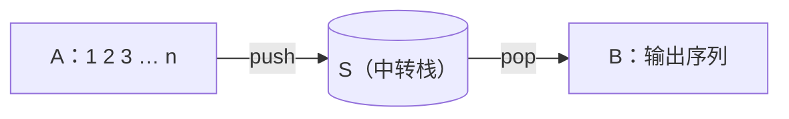

栈与队列是受限的序列：栈只允许在一端插入和删除，队列只允许在一端插入、另一端删除。限制换来了简单与高效：所有操作都是 $O(1)$。更重要的是，许多问题的结构恰好是"后进先出"或"先进先出"的：函数调用与返回、括号的嵌套、表达式中运算符的优先级、回溯搜索中的路径，都是后进先出；排队等候、轮流服务、逐层扩展的搜索，都是先进先出。本章先实现栈，说明调用栈怎样支撑递归、怎样把递归改写为迭代，再讨论栈的几个经典应用；然后实现队列与双端队列；最后用双栈队列系统地介绍分摊分析的三种方法，并讨论单调栈、支持取最大值的栈与队列，以及用栈实现的回溯。[4.1.12](/4.1.12) 与 [4.1.14](/4.1.14) 已经用递归与 `std::queue` 讲过回溯与搜索，本章讲这些结构本身。

## 4.1. 栈

### 4.1.1. 接口

**定义 4.1.1（栈）** 只能在一端插入和删除元素的线性序列称为**栈**（stack）。允许操作的一端称为栈顶（top），另一端称为栈底（bottom）。栈中的元素遵循后进先出（last in, first out，LIFO）的次序：越晚插入的元素越早被删除。

| 操作 | 功能 |
|---|---|
| `size()` / `empty()` | 元素总数 / 是否为空 |
| `push(e)` | 把 $e$ 插入栈顶（入栈） |
| `pop()` | 删除并返回栈顶元素（出栈） |
| `top()` | 返回栈顶元素，不删除（查顶） |

例如对空栈依次执行 `push(E)`、`push(C)`、`pop()`、`push(G)`、`push(C)`，栈中自底向顶为 $E, G, C$，`top()` 返回 $C$；再连续出栈，依次得到 $C, G, E$。

### 4.1.2. 实现

栈是序列的特例，可以直接基于向量或列表实现。基于向量时，以向量的末端为栈顶：`push` 与 `pop` 都在末端进行，不需要移动其他元素，由容量倍增（[4.3.2](/4.3.2)）可知是分摊 $O(1)$。若反过来以首端为栈顶，每次操作都要移动全部元素，需要 $O(n)$。基于链表时，以首节点为栈顶，`push` 与 `pop` 都是严格的 $O(1)$，每次操作都要分配或释放一个节点。下面的 C++ 版本基于动态数组，Python 版本基于单向链表，每个节点是一个二元组 `(data, next)`：

```cpp tab
#include <cstddef>
#include <format>
#include <iostream>
#include <memory>
#include <stdexcept>
#include <utility>

using Rank = std::ptrdiff_t;

// A stack on a dynamic array: the top is the last element.
template <typename T>
class Stack {
public:
    Rank size() const { return size_; }
    bool empty() const { return size_ == 0; }
    void push(const T& e) {
        if (size_ == capacity_) reallocate(capacity_ == 0 ? 4 : 2 * capacity_);
        elem_[size_++] = e;
    }
    T pop() {
        if (empty()) throw std::out_of_range("pop from an empty stack");
        return std::move(elem_[--size_]);
    }
    T& top() { return elem_[size_ - 1]; }               // the stack must not be empty
    const T& top() const { return elem_[size_ - 1]; }

private:
    Rank size_ = 0, capacity_ = 0;
    std::unique_ptr<T[]> elem_;

    void reallocate(Rank c) {
        auto old = std::move(elem_);
        elem_ = std::make_unique<T[]>(capacity_ = c);
        for (Rank i = 0; i < size_; ++i) elem_[i] = std::move(old[i]);
    }
};
int main() {
    Stack<char> s;
    for (char c : {'E', 'C'}) s.push(c);           // E C
    s.pop();                                        // E
    for (char c : {'G', 'C'}) s.push(c);           // E G C
    std::cout << std::format("top = {}, size = {}\n", s.top(), s.size());   // C, 3
    while (!s.empty()) std::cout << s.pop();       // C G E: last in, first out
    std::cout << '\n';
}
```

```python tab
from typing import Any


class Stack:
    """A stack on singly linked nodes: the top is the first node.
    Each node is a pair (data, next)."""

    def __init__(self) -> None:
        self._top: tuple[Any, Any] | None = None
        self._size = 0

    def __len__(self) -> int:
        return self._size

    def empty(self) -> bool:
        return self._size == 0

    def push(self, e: Any) -> None:
        self._top = (e, self._top)                  # the new node points to the old top
        self._size += 1

    def pop(self) -> Any:
        if self._top is None:
            raise IndexError("pop from an empty stack")
        e, self._top = self._top
        self._size -= 1
        return e

    def top(self) -> Any:                           # the stack must not be empty
        return self._top[0]


s = Stack()
for c in "EC":
    s.push(c)                                       # E C
s.pop()                                             # E
for c in "GC":
    s.push(c)                                       # E G C
print(f"top = {s.top()}, size = {len(s)}")          # C, 3
print("".join(s.pop() for _ in range(len(s))))      # CGE: last in, first out
```

本章其余的程序都用这个 `Stack`。实际编程中，C++ 用 `std::stack`，它是一个**容器**适配器，默认建立在 `std::deque` 之上，也可以指定 `std::stack<T, std::vector<T>>`（[4.2.10](/4.2.10)）；Python 直接用 `list` 的 `append` 与 `pop()` 作为栈，二者都是分摊 $O(1)$（[4.3.2](/4.3.2)），多线程之间传递数据时用 `queue.LifoQueue`。

## 4.2. 调用栈与消除递归

### 4.2.1. 调用栈

函数调用是后进先出的：最后被调用的函数最先返回。程序运行时，**调用栈**（[4.1.4](/4.1.4)）为每次调用保存一个**栈帧**，记录参数、局部变量和返回地址；调用时压入，返回时弹出，栈顶总是正在执行的函数。递归函数的每个递归实例都有自己的栈帧，所以递归之所以可行，正是因为有一个栈。

由此可以分析递归算法的空间复杂度：同一时刻调用栈中的栈帧，恰好是从主函数到当前实例的那条调用链，所以递归所需的空间主要取决于最大递归深度，而不是递归实例的总数。例如 Fibonacci 数列的二分递归 `fib(n)` 共产生 $\Theta(\phi^n)$ 个递归实例（[4.3.1](/4.3.1)），但递归深度只有 $n$，空间复杂度为 $O(n)$。又如下面互相调用的三个函数计算 Hailstone 序列，递归深度等于序列的长度：

```cpp
void even(int n);
void odd(int n);
void hailstone(int n) { if (n > 1) (n % 2) ? odd(n) : even(n); }
void even(int n) { hailstone(n / 2); }
void odd(int n) { hailstone(3 * n + 1); }
```

调用栈由系统隐式地维护，容量有限（通常几 MB），递归过深会导致**栈溢出**；每次调用还有保存现场、跳转、返回的时间开销。为了节省空间和时间，可以显式地维护一个栈，或者干脆把递归改写为迭代。

### 4.2.2. 尾递归

**定义 4.2.1（尾递归）** 若递归调用是函数在返回之前执行的最后一个操作，则称之为**尾递归**。

例如倒置数组的减治算法（[4.3.1](/4.3.1)）：交换首末元素之后，最后一步是倒置中间部分。尾递归一旦抵达递归基，就会引发一连串的返回，而且这些返回之间不再有任何计算，返回地址也都相同；所以调用栈中的这些栈帧其实都不必保存。它是最简单的递归模式，可以机械地改写为迭代：

```cpp
void reverse(int* a, int n) {          // tail recursion: O(n) time, O(n) space
    if (n < 2) return;
    std::swap(a[0], a[n - 1]);
    reverse(a + 1, n - 2);
}

void reverse(int* a, int n) {          // the same with goto: O(n) time, O(1) space
next:
    if (n < 2) return;
    std::swap(a[0], a[n - 1]);
    a++; n -= 2;
    goto next;                         // instead of the recursive call
}

void reverse(int* a, int n) {          // tidied up into a loop
    for (; n >= 2; a++, n -= 2) std::swap(a[0], a[n - 1]);
}
```

改写之后，时间复杂度有常数意义上的改进，空间复杂度则从 $O(n)$ 降到 $O(1)$，有渐近的改进。很多编译器能自动识别尾调用并完成这种改写（尾调用优化）：GCC 与 Clang 在 `-O2` 下通常会这样做，但 C++ 标准并不保证；Python 解释器则从不做尾调用优化，所以在 Python 中，深度可能很大的尾递归应当手工改写为循环（[4.1.10](/4.1.10)）。

不是尾递归的函数也可以消除递归。有时消除递归只是在常数意义上优化了空间（阶乘的递归版本需要 $O(n)$ 空间，迭代版本只要 $O(1)$），但也可能带来实质的改进：Fibonacci 数列的二分递归需要指数时间，改为迭代后只需 $O(n)$ 时间、$O(1)$ 空间（[4.3.1](/4.3.1)）。

### 4.2.3. 显式地维护栈

一般的递归总可以借助一个显式的栈改写为迭代：栈中存放"尚待完成的工作"。以汉诺塔（[4.1.10](/4.1.10)）为例，"借助 via 把 $n$ 个盘从 from 移到 to"由三步组成：借助 to 把 $n - 1$ 个盘移到 via，移动第 $n$ 个盘，借助 from 把 $n - 1$ 个盘移到 to。把这三步按相反的次序压入栈中，每次弹出栈顶的工作去做，就模拟了递归的执行次序。

```cpp tab
// Stack<T> and its #includes as in Section 4.1.
#include <string>

// Towers of Hanoi without recursion: the stack holds the pending tasks.
// A task is either "move n discs from -> to via" (n > 0) or a single move (n = 0).
struct Task { int n; char from, via, to; };

std::string hanoi(int n) {
    std::string moves;
    Stack<Task> pending;
    pending.push({n, 'A', 'B', 'C'});
    while (!pending.empty()) {
        Task t = pending.pop();
        if (t.n == 0) {                            // a single move of the top disc
            moves += std::format("{}{} ", t.from, t.to);
        } else {                                   // push the three steps in reverse order
            if (t.n > 1) pending.push({t.n - 1, t.via, t.from, t.to});
            pending.push({0, t.from, t.via, t.to});
            if (t.n > 1) pending.push({t.n - 1, t.from, t.to, t.via});
        }
    }
    return moves;
}

int main() { std::cout << hanoi(3) << '\n'; }      // AC AB CB AC BA BC AC
```

```python tab
# Stack as in Section 4.1.

def hanoi(n: int) -> str:
    """Towers of Hanoi without recursion: the stack holds the pending tasks.
    A task (n, src, via, dst) moves n discs; n = 0 means a single move."""
    moves = []
    pending = Stack()
    pending.push((n, "A", "B", "C"))
    while not pending.empty():
        k, src, via, dst = pending.pop()
        if k == 0:                                 # a single move of the top disc
            moves.append(src + dst)
        else:                                      # push the three steps in reverse order
            if k > 1:
                pending.push((k - 1, via, src, dst))
            pending.push((0, src, via, dst))
            if k > 1:
                pending.push((k - 1, src, dst, via))
    return " ".join(moves)

print(hanoi(3))                                    # AC AB CB AC BA BC AC
```

栈中同时存在的工作不超过 $2n$ 项，与递归版本的 $O(n)$ 栈帧相当；但显式栈在堆上分配，不受系统调用栈容量的限制，也便于随时检查与中断。后面二叉树的迭代遍历（[4.3.5](/4.3.5)）、图的深度优先搜索都会用到这一技巧。

## 4.3. 栈的典型应用

栈的典型应用有四类：逆序输出（输出的次序与处理的次序相反，如进制转换）、递归嵌套（具有自相似性的问题，如括号匹配、栈混洗）、延迟缓冲（线性扫描时，要读到足够长的后缀才能确定前面的处理，如表达式求值）、栈式计算（基于栈结构的计算模型，如逆波兰表达式）。

### 4.3.1. 进制转换

把十进制非负整数 $n$ 转换为 $\beta$ 进制：反复用 $\beta$ 去除，余数依次是 $\beta$ 进制表示自低向高的各位。例如 $12345 = 30071_{(8)}$：

$$
12345 = 8 \times 1543 + 1,\quad 1543 = 8 \times 192 + 7,\quad 192 = 8 \times 24 + 0,\quad 24 = 8 \times 3 + 0,\quad 3 = 8 \times 0 + 3.
$$
难点在于各位是自低向高得到的，输出却要自高向低；位数事先也不能简便地确定。用栈记录余数，最后依次出栈，就自然地逆序输出，空间也恰好够用。

```cpp tab
// Stack<T> and its #includes as in Section 4.1.
#include <string>

// Write n in base 2..36: the digits come out from low to high, the stack reverses them.
std::string convert(unsigned long long n, int base) {
    static constexpr char digit[] = "0123456789ABCDEFGHIJKLMNOPQRSTUVWXYZ";
    Stack<char> s;
    do {
        s.push(digit[n % base]);                   // the remainder is the next digit
        n /= base;                                 // continue with the quotient
    } while (n > 0);
    std::string out;
    while (!s.empty()) out += s.pop();             // from high to low
    return out;
}

int main() {
    std::cout << std::format("{} {} {}\n", convert(12345, 8), convert(2024, 2), convert(0, 16));
}   // 30071 11111101000 0
```

```python tab
# Stack as in Section 4.1.

def convert(n: int, base: int) -> str:
    """Write n >= 0 in base 2..36; the digits come out from low to high,
    so a stack reverses them."""
    digits = "0123456789ABCDEFGHIJKLMNOPQRSTUVWXYZ"
    s = Stack()
    while True:
        n, r = divmod(n, base)
        s.push(digits[r])                          # the remainder is the next digit
        if n == 0:
            break
    return "".join(s.pop() for _ in range(len(s)))   # from high to low

print(convert(12345, 8), convert(2024, 2), convert(0, 16))   # 30071 11111101000 0
```

### 4.3.2. 括号匹配

判断表达式中的括号是否匹配，例如 `(a[i-1][j+1])+a[i+1][j-1])*2` 不匹配，`(a[i-1][j+1]+a[i+1][j-1])*2` 匹配。除了括号，其余符号都可以忽略。

先只考虑一种括号。由外而内的思路不好用："若 $E$ 匹配则 $(E)$ 匹配""若 $E$、$F$ 都匹配则 $EF$ 匹配"都只是充分条件，而 `(()())()` 既可以看成 $(E)F$ 也可以看成 $EF$，无法据此有效地化简。要化简问题，需要一个必要且充分的条件。由内而外：消去一对紧邻的左右括号，不影响全局的匹配判断，即 $L\,()\,R$ 匹配当且仅当 $LR$ 匹配。于是顺序扫描表达式，用栈记录已扫描而尚未匹配的左括号：遇到左括号就入栈；遇到右括号，若栈非空就弹出一个左括号与之匹配（这正是消去了一对紧邻的括号），否则右括号多余；扫描结束时栈为空，当且仅当匹配。

只有一种括号时，栈中只需记录左括号的个数，一个计数器足矣：计数器一旦变负就是失配，最后归零才是匹配。但计数器无法推广到多种括号：`[(])` 中每种括号各自的个数都对，却不匹配。用栈记录左括号的种类，弹出时检查种类是否对应即可。这个方法也适用于 HTML、XML 中 `<body>` 与 `</body>` 一类不预先固定种类的标签。

```cpp tab
// Stack<T> and its #includes as in Section 4.1.
#include <string_view>

// Are the brackets ( ) [ ] { } in exp properly matched? Other characters are ignored.
bool paren(std::string_view exp) {
    Stack<char> s;                                 // the left brackets not yet matched
    for (char c : exp)
        switch (c) {
            case '(': case '[': case '{': s.push(c); break;
            case ')': if (s.empty() || s.pop() != '(') return false; break;
            case ']': if (s.empty() || s.pop() != '[') return false; break;
            case '}': if (s.empty() || s.pop() != '{') return false; break;
            default: break;
        }
    return s.empty();                              // no left bracket left over
}

int main() {
    for (auto e : {"(a[i-1][j+1])+a[i+1][j-1])*2", "(a[i-1][j+1]+a[i+1][j-1])*2", "[(])"})
        std::cout << std::format("{:30} {}\n", e, paren(e));   // false true false
}
```

```python tab
# Stack as in Section 4.1.

def paren(exp: str) -> bool:
    """Are the brackets ( ) [ ] { } in exp properly matched? Other characters are ignored."""
    match = {")": "(", "]": "[", "}": "{"}
    s = Stack()                                    # the left brackets not yet matched
    for c in exp:
        if c in "([{":
            s.push(c)
        elif c in match:
            if s.empty() or s.pop() != match[c]:
                return False
    return s.empty()                               # no left bracket left over

for e in ("(a[i-1][j+1])+a[i+1][j-1])*2", "(a[i-1][j+1]+a[i+1][j-1])*2", "[(])"):
    print(f"{e:30} {paren(e)}")                    # False True False
```

### 4.3.3. 栈混洗

**定义 4.3.1（栈混洗）** 设有三个栈 $A$、$S$、$B$：$A = \langle a_1, a_2, \dots, a_n]$（$a_1$ 在栈顶），$S$ 与 $B$ 为空。只允许两种操作：把 $A$ 的栈顶元素弹出并压入 $S$，或把 $S$ 的栈顶元素弹出并压入 $B$。若经过一系列这样的操作后，$A$ 中的元素全部转入 $B$，则称 $B$ 中所得的序列为 $A$ 的一个**栈混洗**（stack permutation）。



把输入记为 $1, 2, \dots, n$。同一输入可以有多种栈混洗：$1, 2, 3, 4$（每个元素入栈后立即出栈）、$4, 3, 2, 1$（全部入栈后再全部出栈）、$3, 2, 4, 1$……显然栈混洗的总数 $\mathrm{SP}(n) \leq n!$。更准确地，考察元素 1 从 $S$ 中弹出的时刻：此时 $S$ 再次变空，若在此之前已有 $k - 1$ 个元素（即 $2, \dots, k$）进出过 $S$，它们构成长度为 $k - 1$ 的栈混洗，排在 1 之前；其余 $n - k$ 个元素构成长度为 $n - k$ 的栈混洗，排在 1 之后。于是

$$
\mathrm{SP}(0) = 1, \qquad \mathrm{SP}(n) = \sum_{k=1}^{n} \mathrm{SP}(k - 1)\,\mathrm{SP}(n - k),
$$
这正是 Catalan 数（Catalan number）的递推式，解为 $\mathrm{SP}(n) = \frac{1}{n+1}\binom{2n}{n}$：$1, 1, 2, 5, 14, 42, 132, 429, \dots$

另一种看法：每个栈混洗都对应于 $S$ 的 $n$ 次 push 与 $n$ 次 pop 构成的一个序列，并且任何前缀中 push 的次数都不少于 pop 的次数；反之亦然。把 push 记作左括号、pop 记作右括号，就得到 $n$ 对括号的一个匹配。所以 $n$ 个元素的栈混洗与 $n$ 对括号的匹配一一对应，二者的个数都是 Catalan 数。

哪些排列是栈混洗？$n = 3$ 时共有 $3! = 6$ 个排列，但只有 5 个栈混洗，缺少的是 $3, 1, 2$：3 最先输出，说明 1、2 都已压入 $S$，而 2 在 1 之上，1 不可能先于 2 输出。

**定理 4.3.1（Knuth，1968）** $1, 2, \dots, n$ 的排列 $B$ 是栈混洗，当且仅当不存在 $i < j < k$，使得在 $B$ 中 $k$ 位于 $i$ 之前、$i$ 位于 $j$ 之前（即 $B$ 不含"312"模式 $\dots, k, \dots, i, \dots, j, \dots$）。

**证明** 必要性：若 $k$ 先于 $i$、$j$ 输出，则 $k$ 出栈时，比它小的 $i$、$j$ 都已入栈而尚未出栈，并且后入栈的 $j$ 位于 $i$ 之上，所以 $j$ 必先于 $i$ 出栈，矛盾。充分性：按 $B$ 的次序贪心地模拟——要输出 $x$ 时，若 $x$ 尚在 $A$ 中，就把 $A$ 中直到 $x$ 的元素都压入 $S$；若 $x$ 在 $S$ 的栈顶，就弹出它。模拟只会在一种情况下失败：$x$ 在 $S$ 中，而栈顶是另一个元素 $y$。$y$ 比 $x$ 后入栈，所以 $x < y$；$y$ 之所以被压入 $S$，是因为此前要输出某个 $k \geq y$，而 $y$ 仍在 $S$ 中，故 $k > y$。于是 $k$ 先于 $x$ 输出，$x$ 先于 $y$ 输出，且 $x < y < k$，构成"312"模式。所以不含该模式时模拟必定成功。$\square$

充分性的证明本身就是一个 $O(n)$ 的判定算法：直接模拟混洗的过程，每个元素至多入栈、出栈各一次。下面的程序对 $n = 1, \dots, 7$ 枚举全部排列，统计栈混洗的个数，恰为 Catalan 数：

```cpp tab
// Stack<T> and its #includes as in Section 4.1.
#include <algorithm>
#include <numeric>
#include <span>
#include <vector>

// Is b a stack permutation of 1, 2, ..., n? Simulate: push from the input until the
// wanted element is on top of S, then pop it; if it is buried in S, b is impossible.
bool is_stack_permutation(std::span<const int> b) {
    Stack<int> s;
    int next = 1;                                  // the input is next, next + 1, ..., n
    for (int x : b) {
        while (next <= x) s.push(next++);          // bring x onto the top of S
        if (s.empty() || s.top() != x) return false;   // x is buried below the top
        s.pop();                                   // move x to the output
    }
    return true;
}

int main() {
    for (int n = 1; n <= 7; ++n) {                 // count over all n! permutations
        std::vector<int> b(n);
        std::iota(b.begin(), b.end(), 1);
        int count = 0;
        do count += is_stack_permutation(b);
        while (std::next_permutation(b.begin(), b.end()));
        std::cout << count << ' ';                 // 1 2 5 14 42 132 429
    }
    std::cout << '\n';
}
```

```python tab
# Stack as in Section 4.1.
from itertools import permutations

def is_stack_permutation(b: list[int]) -> bool:
    """Is b a stack permutation of 1, 2, ..., n? Simulate: push from the input until
    the wanted element is on top of S, then pop it; if it is buried, b is impossible."""
    s = Stack()
    nxt = 1                                        # the input is nxt, nxt + 1, ..., n
    for x in b:
        while nxt <= x:                            # bring x onto the top of S
            s.push(nxt)
            nxt += 1
        if s.empty() or s.top() != x:              # x is buried below the top
            return False
        s.pop()                                    # move x to the output
    return True

# count over all n! permutations: 1 2 5 14 42 132 429
print(*(sum(map(is_stack_permutation, permutations(range(1, n + 1)))) for n in range(1, 8)))
```

## 4.4. 表达式求值

### 4.4.1. 中缀表达式求值

给定语法正确的算术表达式，计算它的值。日常书写的**中缀表达式**中，运算的次序由运算符的优先级与括号共同决定：$1 + 2 \times 3$ 中先算乘法，$(1 + 2) \times 3$ 中先算括号内的加法。求值的思路是减而治之：优先级高的局部先执行计算，并以计算的结果代替，运算符逐步减少，直至只剩一个数值。

难点在于：仅根据表达式的前缀，不足以确定其中各运算符的计算次序。读到 `1 + 2` 时还不能计算，因为后面可能是 `* 3`；只有读到更多的后续信息，才能确定前面的哪些运算符可以执行。这需要一种延迟缓冲的机制：用两个栈记录已扫描的部分，运算数栈存放操作数和中间结果，运算符栈存放尚未执行的运算符。自左向右扫描表达式，读到操作数就压入运算数栈；读到运算符 $c$ 时，比较它与运算符栈的栈顶 $t$ 的优先级：

- 若 $t$ 的优先级低于 $c$（表中记为 `<`），则 $t$ 还不能执行，$c$ 入栈，静待时机；
- 若 $t$ 的优先级高于 $c$（`>`），则 $t$ 可以执行了：弹出 $t$ 和它所需的操作数，计算，结果压入运算数栈；然后 $c$ 再与新的栈顶比较；
- 若 $t$ 与 $c$ 是一对匹配的括号，或是表达式的起始与结束标识（`~`），则弹出 $t$，脱去括号，继续扫描。

为统一处理，在运算符栈底预先压入一个起始标识，表达式末尾也视为一个结束标识（C++ 版本用 `'\0'`，Python 版本用 `'$'`），二者相遇时求值结束，运算数栈中剩下的唯一元素就是结果。运算符之间的优先级用一张表描述（行为栈顶运算符，列为当前运算符，`!` 是一元的阶乘，空格表示语法错误）：

| 栈顶 \ 当前 | `+` | `-` | `*` | `/` | `^` | `!` | `(` | `)` | 结束 |
|---|---|---|---|---|---|---|---|---|---|
| `+` `-` | > | > | < | < | < | < | < | > | > |
| `*` `/` | > | > | > | > | < | < | < | > | > |
| `^` | > | > | > | > | < | < | < | > | > |
| `!` | > | > | > | > | > | > | | > | > |
| `(` | < | < | < | < | < | < | < | ~ | |
| 起始 | < | < | < | < | < | < | < | | ~ |

表中的规律很容易理解："先乘除后加减"体现为 `+` 遇到 `*` 时为 `<`、`*` 遇到 `+` 时为 `>`；同级的运算符左结合，所以 `+` 遇到 `+` 为 `>`，先执行左边的；乘方右结合（$2^{3^2} = 2^9$），所以 `^` 遇到 `^` 为 `<`；左括号在栈外时优先级最高，一律入栈，在栈内时优先级最低，任何运算符都可以压在它上面；右括号在栈外时优先级最低，迫使栈中的运算符一一执行，直到遇见与之匹配的左括号。

```cpp tab
// Stack<T> and its #includes as in Section 4.1.
#include <cctype>
#include <charconv>
#include <cmath>
#include <string>
#include <string_view>

// Operators in the order of the table: + - * / ^ ! ( ) and the end marker '\0'.
constexpr std::string_view kOps{"+-*/^!()\0", 9};
// kPri[top][current]: '<' push the current operator, '>' apply the top one first,
// '~' a matching pair: pop it, ' ' a syntax error.
constexpr const char* kPri[9] = {
    //     + - * / ^ ! ( ) \0
    /* + */ ">><<<<<>>",
    /* - */ ">><<<<<>>",
    /* * */ ">>>><<<>>",
    /* / */ ">>>><<<>>",
    /* ^ */ ">>>><<<>>",           // ^ after ^ is '<': right associative
    /* ! */ ">>>>>> >>",
    /* ( */ "<<<<<<<~ ",
    /* ) */ "         ",
    /* \0*/ "<<<<<<< ~",
};

char priority(char top, char current) {
    auto i = kOps.find(top), j = kOps.find(current);
    if (i == kOps.npos || j == kOps.npos) throw std::invalid_argument("unknown character");
    return kPri[i][j];
}

double apply(double a, char op, double b) {
    switch (op) {
        case '+': return a + b;
        case '-': return a - b;
        case '*': return a * b;
        case '/': return a / b;
        default: return std::pow(a, b);           // '^'
    }
}

double factorial(double x) {
    double f = 1;
    for (int k = 2; k <= int(x); ++k) f *= k;
    return f;
}

// Evaluate an infix expression; also write it in reverse Polish notation into rpn.
double evaluate(std::string_view s, std::string& rpn) {
    Stack<double> opnd;                            // operands and intermediate results
    Stack<char> optr;                              // operators waiting to be applied
    optr.push('\0');                               // sentinel: the beginning of the text
    std::size_t i = 0;
    while (!optr.empty()) {
        char c = i < s.size() ? s[i] : '\0';       // '\0' marks the end of the text
        if (c == ' ') { ++i; continue; }
        if (std::isdigit(static_cast<unsigned char>(c))) {   // read a number
            double x = 0;
            auto [end, ec] = std::from_chars(s.data() + i, s.data() + s.size(), x);
            i = end - s.data();
            opnd.push(x);
            rpn += std::format("{} ", x);
            continue;
        }
        switch (priority(optr.top(), c)) {
            case '<':                              // the top operator must wait
                optr.push(c);
                ++i;
                break;
            case '~':                              // a pair of parentheses, or the end
                optr.pop();
                ++i;
                break;
            case '>': {                            // apply the top operator now
                char op = optr.pop();
                rpn += std::format("{} ", op);
                if (op == '!') {
                    opnd.push(factorial(opnd.pop()));
                } else {
                    double b = opnd.pop(), a = opnd.pop();   // the order matters
                    opnd.push(apply(a, op, b));
                }
                break;
            }
            default: throw std::invalid_argument("syntax error");
        }
    }
    return opnd.pop();
}

int main() {
    for (auto e : {"(0!+1)*2^(3!+4)-(5!-67-(8+9))", "2^3^2", "(1+2)*3.5/0.5"}) {
        std::string rpn;
        double v = evaluate(e, rpn);
        std::cout << std::format("{} = {}\n  RPN: {}\n", e, v, rpn);
    }
}
```

```python tab
# Stack as in Section 4.1.
import math

OPS = "+-*/^!()$"                  # '$' marks the beginning and the end of the text
# PRI[top][current]: '<' push the current operator, '>' apply the top one first,
# '~' a matching pair: pop it, ' ' a syntax error.
PRI = dict(zip(OPS, (
    # +-*/^!()$
    ">><<<<<>>",                   # +
    ">><<<<<>>",                   # -
    ">>>><<<>>",                   # *
    ">>>><<<>>",                   # /
    ">>>><<<>>",                   # ^   (^ after ^ is '<': right associative)
    ">>>>>> >>",                   # !
    "<<<<<<<~ ",                   # (
    "         ",                   # )
    "<<<<<<< ~",                   # $
)))

def apply(a: float, op: str, b: float) -> float:
    match op:
        case "+": return a + b
        case "-": return a - b
        case "*": return a * b
        case "/": return a / b
        case _: return a ** b      # '^'

def evaluate(s: str) -> tuple[float, str]:
    """Evaluate an infix expression; also return it in reverse Polish notation."""
    opnd, optr, rpn = Stack(), Stack(), []
    optr.push("$")                 # sentinel: the beginning of the text
    s += "$"                       # and the end of the text
    i = 0
    while not optr.empty():
        c = s[i]
        if c == " ":
            i += 1
            continue
        if c.isdigit():            # read a number
            j = i
            while s[j].isdigit() or s[j] == ".":
                j += 1
            x = float(s[i:j])
            opnd.push(x)
            rpn.append(f"{x:g}")
            i = j
            continue
        if c not in PRI:
            raise ValueError(f"unknown character {c!r}")
        match PRI[optr.top()][OPS.index(c)]:
            case "<":              # the top operator must wait
                optr.push(c)
                i += 1
            case "~":              # a pair of parentheses, or the end
                optr.pop()
                i += 1
            case ">":              # apply the top operator now
                op = optr.pop()
                rpn.append(op)
                if op == "!":
                    opnd.push(float(math.factorial(int(opnd.pop()))))
                else:
                    b, a = opnd.pop(), opnd.pop()   # the order matters
                    opnd.push(apply(a, op, b))
            case _:
                raise ValueError("syntax error")
    return opnd.pop(), " ".join(rpn)

for e in ("(0!+1)*2^(3!+4)-(5!-67-(8+9))", "2^3^2", "(1+2)*3.5/0.5"):
    v, rpn = evaluate(e)
    print(f"{e} = {v:g}\n  RPN: {rpn}")
```

执行二元运算时，先弹出的是右操作数，后弹出的是左操作数，次序不能颠倒（对减法、除法和乘方而言）。以 $(0! + 1) \times 2^{(3! + 4)} - (5! - 67 - (8 + 9))$ 为例，前半部分的求值过程如下（栈自左向右为自底向顶，`$` 为起始标识）：

| 当前字符 | 运算符栈 | 运算数栈 | 动作 |
|---|---|---|---|
| `(` | `$ (` | | `(` 入栈 |
| `0` | `$ (` | `0` | 操作数入栈 |
| `!` | `$ ( !` | `0` | `!` 入栈 |
| `+` | `$ (` | `1` | `!` 出栈并执行 |
| `+` | `$ ( +` | `1` | `+` 入栈 |
| `1` | `$ ( +` | `1 1` | 操作数入栈 |
| `)` | `$ (` | `2` | `+` 出栈并执行 |
| `)` | `$` | `2` | 左括号出栈 |
| `*` | `$ *` | `2` | `*` 入栈 |
| `2` | `$ *` | `2 2` | 操作数入栈 |
| `^` | `$ * ^` | `2 2` | `^` 入栈 |
| `(` … `)` | `$ * ^` | `2 2 10` | 同理求出括号内的 $3! + 4 = 10$ |
| `-` | `$ *` | `2 1024` | `^` 出栈并执行 |
| `-` | `$` | `2048` | `*` 出栈并执行 |
| `-` | `$ -` | `2048` | `-` 入栈 |

此后同理求出 $5! - 67 - (8 + 9) = 36$，最后执行减法，结果为 2012。整个算法只扫描表达式一遍，每个运算符至多入栈、出栈各一次，时间为 $O(n)$。这种借助运算符栈处理优先级的方法，就是 Dijkstra 于 1961 年提出的调度场算法（shunting-yard algorithm）的思想。

### 4.4.2. 逆波兰表达式

**逆波兰表达式**（[1.1.1](/1.1.1)）把运算符写在它的操作数之后，例如 $(1 + 2) \times 3$ 写作 `1 2 + 3 *`，$1 + 2 \times 3$ 写作 `1 2 3 * +`。它不使用括号，就能表示带优先级的运算关系；作为补偿，需要引入一个起分隔作用的元字符（如空格），所以未必比原表达式更短。它由**波兰表达式**（前缀式）倒转而来，相对于中缀式也称为后缀式。

逆波兰表达式的求值只需一个栈，而且完全不必顾及优先级：逐个处理各项，若是操作数就压入栈中；若是运算符，就从栈中弹出它所需数目的操作数，执行计算，把结果压入栈中。只要输入语法正确，最后栈中恰好剩下一个元素，就是表达式的值。

```cpp tab
// Stack<T> and its #includes as in Section 4.1.
#include <charconv>
#include <cmath>
#include <sstream>
#include <string>

// Evaluate an expression in reverse Polish notation whose tokens are separated by spaces.
double eval_rpn(const std::string& rpn) {
    Stack<double> s;                               // operands only: no priorities needed
    std::istringstream in(rpn);
    for (std::string t; in >> t;) {
        if (t == "!") {                            // unary: n!
            double f = 1;
            for (int k = 2, n = int(s.pop()); k <= n; ++k) f *= k;
            s.push(f);
        } else if (t == "+" || t == "-" || t == "*" || t == "/" || t == "^") {
            double b = s.pop(), a = s.pop();       // binary: pop two operands
            switch (t[0]) {
                case '+': s.push(a + b); break;
                case '-': s.push(a - b); break;
                case '*': s.push(a * b); break;
                case '/': s.push(a / b); break;
                default: s.push(std::pow(a, b)); break;
            }
        } else {                                   // an operand
            double x = 0;
            std::from_chars(t.data(), t.data() + t.size(), x);
            s.push(x);
        }
    }
    return s.pop();                                // the only element left
}

int main() {
    std::cout << eval_rpn("0 ! 1 + 2 3 ! 4 + ^ * 5 ! 67 - 8 9 + - -") << '\n';   // 2012
}
```

```python tab
# Stack as in Section 4.1.
import math

def eval_rpn(rpn: str) -> float:
    """Evaluate an expression in reverse Polish notation; tokens are separated by spaces."""
    s = Stack()                                    # operands only: no priorities needed
    for t in rpn.split():
        match t:
            case "!":                              # unary: n!
                s.push(float(math.factorial(int(s.pop()))))
            case "+" | "-" | "*" | "/" | "^":      # binary: pop two operands
                b, a = s.pop(), s.pop()
                s.push(a + b if t == "+" else a - b if t == "-" else
                       a * b if t == "*" else a / b if t == "/" else a ** b)
            case _:                                # an operand
                s.push(float(t))
    return s.pop()                                 # the only element left

print(f"{eval_rpn('0 ! 1 + 2 3 ! 4 + ^ * 5 ! 67 - 8 9 + - -'):g}")   # 2012
```

怎样把中缀表达式转换为逆波兰表达式？手工转换可以分两步：先按运算的次序为每个运算添加括号，再把每个运算符移到与它对应的右括号的位置，清除所有括号。例如 $(0! + 1) \times 2^{(3! + 4)} - (5! - 67 - (8 + 9))$ 完全加括号后为

```text
( ( (0 !) + 1 ) * ( 2 ^ ( (3 !) + 4 ) ) ) - ( ( (5 !) - 67 ) - ( 8 + 9 ) )
```

移动运算符、清除括号后得到 `0 ! 1 + 2 3 ! 4 + ^ * 5 ! 67 - 8 9 + - -`。自动转换则只需对上一节的求值算法稍加修改：读到操作数时，把它接入逆波兰表达式；运算符出栈执行时，也把它接入。上一节的程序已经这样做了，输出的 RPN 一行就是转换的结果。可见运算符在逆波兰表达式中出现的次序，恰好就是它们执行的次序，原表达式的结构完全体现在这一次序之中。

基于栈的计算模型至今广泛使用。1985 年诞生的页面描述语言 PostScript 的语法就是逆波兰式（`4 4 mul 5 5 mul add`），其解释器维护操作数栈等五个栈。Java 虚拟机和 CPython 的字节码也是栈式的：用 `dis` 模块查看 `(a + b) * c - d` 编译的结果，依次是 `LOAD a`、`LOAD b`、`BINARY_OP +`、`LOAD c`、`BINARY_OP *`、`LOAD d`、`BINARY_OP -`，正是逆波兰表达式 `a b + c * d -`。

## 4.5. 队列

### 4.5.1. 接口

**定义 4.5.1（队列）** 只能在一端（队尾，rear）插入、在另一端（队头，front）删除元素的线性序列称为**队列**（queue）。队列中的元素遵循先进先出（first in, first out，FIFO）的次序。

| 操作 | 功能 |
|---|---|
| `size()` / `empty()` | 元素总数 / 是否为空 |
| `enqueue(e)` | 把 $e$ 插入队尾（入队） |
| `dequeue()` | 删除并返回队头元素（出队） |
| `front()` / `rear()` | 返回队头 / 队尾元素 |

队列可以基于列表实现：以首节点为队头、末节点为队尾，入队即 `insert_last`，出队即 `remove(first())`，都是 $O(1)$。基于向量时，若以首元素为队头，出队要移动全部元素，需要 $O(n)$；解决办法是不移动元素，而是让队头的位置向后移动，并把数组首尾相接看成一个环。

### 4.5.2. 循环数组与双端队列

**定义 4.5.2（双端队列）** 两端都可以插入和删除元素的线性序列称为**双端队列**（double-ended queue，deque）。

栈和队列都是双端队列的特例：只用一端就是栈，一端只进、另一端只出就是队列。用循环数组（circular buffer）可以高效地实现双端队列：元素存放在容量为 $c$ 的数组中的 $\mathit{elem}[h], \mathit{elem}[h+1], \dots, \mathit{elem}[h + n - 1]$，下标一律对 $c$ 取模。在队尾插入，就写入 $\mathit{elem}[(h + n) \bmod c]$；在队头插入，就令 $h \gets (h - 1) \bmod c$ 后写入；两端删除也只需移动 $h$ 或改变 $n$。数组满时，与向量一样把容量加倍，并把元素按次序搬到新数组的开头。于是两端的插入与删除都是分摊 $O(1)$，按秩访问 $\mathit{elem}[(h + r) \bmod c]$ 是 $O(1)$。队列只是双端队列上的一个适配器，正如 `std::queue` 默认建立在 `std::deque` 之上（**适配器模式**，[4.2.13](/4.2.13)）：

```cpp tab
// Rank and the #includes as in Section 4.1.
// A double-ended queue on a circular array. The elements are
// elem[head], elem[head + 1], ..., elem[head + size - 1], indices modulo the capacity.
template <typename T>
class Deque {
public:
    Rank size() const { return size_; }
    bool empty() const { return size_ == 0; }
    T& operator[](Rank r) { return elem_[(head_ + r) % capacity_]; }   // 0 <= r < size()
    T& front() { return elem_[head_]; }
    T& back() { return (*this)[size_ - 1]; }

    void push_back(const T& e) {
        if (size_ == capacity_) grow();
        elem_[(head_ + size_) % capacity_] = e;
        ++size_;
    }
    void push_front(const T& e) {
        if (size_ == capacity_) grow();
        head_ = (head_ + capacity_ - 1) % capacity_;   // one step back, wrapping around
        elem_[head_] = e;
        ++size_;
    }
    T pop_front() {
        if (empty()) throw std::out_of_range("pop from an empty deque");
        T e = std::move(elem_[head_]);
        head_ = (head_ + 1) % capacity_;
        --size_;
        return e;
    }
    T pop_back() {
        if (empty()) throw std::out_of_range("pop from an empty deque");
        --size_;
        return std::move(elem_[(head_ + size_) % capacity_]);
    }

private:
    Rank head_ = 0, size_ = 0, capacity_ = 0;
    std::unique_ptr<T[]> elem_;

    void grow() {                                  // double the capacity, unwrap the elements
        Rank c = capacity_ == 0 ? 4 : 2 * capacity_;
        auto fresh = std::make_unique<T[]>(c);
        for (Rank i = 0; i < size_; ++i) fresh[i] = std::move((*this)[i]);
        elem_ = std::move(fresh);
        capacity_ = c;
        head_ = 0;
    }
};

// A queue is a deque used at two ends only, like std::queue on top of std::deque.
template <typename T>
class Queue {
public:
    Rank size() const { return d_.size(); }
    bool empty() const { return d_.empty(); }
    void enqueue(const T& e) { d_.push_back(e); }  // insert at the rear
    T dequeue() { return d_.pop_front(); }         // remove at the front
    T& front() { return d_.front(); }
    T& rear() { return d_.back(); }

private:
    Deque<T> d_;
};
int main() {
    Queue<char> q;                                 // first in, first out
    for (char c : {'E', 'C'}) q.enqueue(c);
    q.dequeue();                                   // E leaves first
    for (char c : {'G', 'C', 'K', 'F'}) q.enqueue(c);
    std::cout << std::format("front {}, rear {}, size {}\n", q.front(), q.rear(), q.size());
    Deque<int> d;
    for (int i = 1; i <= 6; ++i)                   // 5 3 1 2 4 6
        if (i % 2) d.push_front(i); else d.push_back(i);
    d.pop_back();
    d.push_front(0);
    for (Rank r = 0; r < d.size(); ++r) std::cout << d[r] << ' ';   // 0 5 3 1 2 4
    std::cout << '\n';
}
```

```python tab
from typing import Any

class Deque:
    """A double-ended queue on a circular array. The elements are
    elem[head], elem[head + 1], ..., elem[head + size - 1], indices modulo the capacity."""

    def __init__(self) -> None:
        self._elem: list[Any] = [None] * 4
        self._head = self._size = 0

    def __len__(self) -> int:
        return self._size

    def empty(self) -> bool:
        return self._size == 0

    def __getitem__(self, r: int) -> Any:          # 0 <= r < size
        return self._elem[(self._head + r) % len(self._elem)]

    def front(self) -> Any:
        return self._elem[self._head]

    def back(self) -> Any:
        return self[self._size - 1]

    def _grow(self) -> None:                       # double the capacity, unwrap the elements
        fresh = [None] * (2 * len(self._elem))
        for i in range(self._size):
            fresh[i] = self[i]
        self._elem, self._head = fresh, 0

    def push_back(self, e: Any) -> None:
        if self._size == len(self._elem):
            self._grow()
        self._elem[(self._head + self._size) % len(self._elem)] = e
        self._size += 1

    def push_front(self, e: Any) -> None:
        if self._size == len(self._elem):
            self._grow()
        self._head = (self._head - 1) % len(self._elem)   # one step back, wrapping around
        self._elem[self._head] = e
        self._size += 1

    def pop_front(self) -> Any:
        if self._size == 0:
            raise IndexError("pop from an empty deque")
        e, self._elem[self._head] = self._elem[self._head], None
        self._head = (self._head + 1) % len(self._elem)
        self._size -= 1
        return e

    def pop_back(self) -> Any:
        if self._size == 0:
            raise IndexError("pop from an empty deque")
        self._size -= 1
        i = (self._head + self._size) % len(self._elem)
        e, self._elem[i] = self._elem[i], None
        return e


class Queue:
    """A queue is a deque used at two ends only."""

    def __init__(self) -> None:
        self._d = Deque()

    def __len__(self) -> int:
        return len(self._d)

    def empty(self) -> bool:
        return self._d.empty()

    def enqueue(self, e: Any) -> None:             # insert at the rear
        self._d.push_back(e)

    def dequeue(self) -> Any:                      # remove at the front
        return self._d.pop_front()

    def front(self) -> Any:
        return self._d.front()

    def rear(self) -> Any:
        return self._d.back()


q = Queue()                                        # first in, first out
for c in "EC":
    q.enqueue(c)
q.dequeue()                                        # E leaves first
for c in "GCKF":
    q.enqueue(c)
print(f"front {q.front()}, rear {q.rear()}, size {len(q)}")
d = Deque()
for i in range(1, 7):                              # 5 3 1 2 4 6
    if i % 2:
        d.push_front(i)
    else:
        d.push_back(i)
d.pop_back()
d.push_front(0)
print(*(d[r] for r in range(len(d))))              # 0 5 3 1 2 4
```

### 4.5.3. 标准库中的队列

Python 中，用 `list` 做队列是常见的错误：`pop(0)` 要移动全部元素，是 $O(n)$ 的（[4.3.2](/4.3.2)）。应当使用 `collections.deque`。CPython 把它实现为一串双向链接的块，每块存放 64 个元素：两端的 `append`、`appendleft`、`pop`、`popleft` 都是严格的 $O(1)$，而且不需要整体复制；按下标访问 `d[i]` 要从较近的一端逐块前进，靠近中间时为 $O(n)$；构造时可以指定 `maxlen`，满了以后从另一端自动丢弃旧元素，常用于保存"最近的 $k$ 项"。多线程之间的生产者—消费者队列用 `queue.Queue`。

C++ 的 `std::deque` 是另一种分段的结构：一个指针数组（map）指向若干个定长的块，两端插入时在首块之前或末块之后添加新块，只有 map 本身满时才要整体复制（指针而不是元素），所以两端插入是 $O(1)$，按秩访问也是 $O(1)$（先定位块，再定位块内的偏移）。`std::queue` 与 `std::stack` 是建立在它之上的适配器（[4.2.10](/4.2.10)）。

| 需求 | C++ | Python |
|---|---|---|
| 栈 | `std::stack`（默认基于 `deque`） | `list` 的 `append` / `pop()` |
| 队列 | `std::queue`（默认基于 `deque`） | `collections.deque` 的 `append` / `popleft()` |
| 双端队列 | `std::deque` | `collections.deque` |
| 线程安全的队列 | 无（需自行加锁） | `queue.Queue`、`queue.LifoQueue` |
| 优先级队列 | `std::priority_queue` | `heapq`（[4.3.12](/4.3.12)） |

### 4.5.4. 队列的应用

队列的典型应用是公平地分配资源。一组客户共享同一资源（多个程序共享 CPU、多人共享打印机）时，让所有客户组成一个队列，反复地令队头的客户出队、接受一个时间片的服务，再重新入队，这就是循环分配（round robin），操作系统的进程调度以它为基础（[4.11](/4.11)）。

```text
RoundRobin(clients):
    Q = Queue(clients)
    while the service is open:
        e = Q.dequeue()          # the client at the front
        serve(e)                 # for one time slice
        Q.enqueue(e)             # back to the rear
```

银行服务的模拟是另一个例子：$k$ 个窗口各有一个队列，每个时刻到达一位服务时长随机的新顾客，自动加入最短的队列；每个时刻各队列的队头顾客接受服务，服务完毕则出队，由后继顾客接替。统计平均等待时间，就可以评估窗口的数量是否合适。这类离散事件模拟的理论分析属于排队论。

在图与状态空间中，**广度优先搜索**用队列保存待扩展的节点，使得离起点近的节点先被扩展（[4.1.14](/4.1.14)、[4.3.10](/4.3.10)）。

## 4.6. 单调栈：直方图中的最大矩形

**例 4.6.1** 给定由非负整数组成的直方图 $H[0, n)$（第 $r$ 根立柱的宽度为 1、高度为 $H[r]$），求其中面积最大的矩形。例如 $H = \{2, 1, 5, 6, 2, 3\}$ 中的最大矩形由高度为 5、6 的两根立柱支撑，高为 5，面积为 10。

最大矩形的高度必定等于它所覆盖的某根立柱 $r$ 的高度 $H[r]$。对每根立柱 $r$，以它为高的极大矩形向左延伸到 $s(r)$，向右延伸到 $t(r)$：

$$
s(r) = 1 + \max\{\, k < r : H[k] < H[r] \,\}, \qquad t(r) = \min\{\, k > r : H[k] < H[r] \,\},
$$
（集合为空时分别取 $0$ 与 $n$），面积为 $H[r] \cdot (t(r) - s(r))$。最大矩形必是这 $n$ 个极大矩形之一。逐个向两侧扫描求 $s(r)$、$t(r)$，最坏需要 $O(n^2)$ 时间。

实际上一趟线性扫描就能求出全部 $s(r)$ 与 $t(r)$：维护一个栈，自底向顶存放尚未确定右边界的立柱的秩，它们的高度自底向顶不减。扫描到立柱 $t$ 时，栈中所有高于 $H[t]$ 的立柱都在此遇到了右侧第一根更矮的立柱，即 $t(r) = t$，把它们依次弹出；对弹出的立柱 $r$，新的栈顶 $l$ 是 $r$ 左侧不比它高的最近的立柱，于是它的矩形覆盖 $[l + 1, t)$。然后把 $t$ 压入栈中，栈的单调性依然保持。扫描结束时（把 $t = n$ 视为一根高度为 0 的立柱），栈中剩下的立柱的右边界都是 $n$。

**定义 4.6.1（单调栈）** 在压入新元素之前，先弹出所有会破坏单调性的栈顶元素，从而使栈中元素（按某个关键码）自底向顶始终单调的栈，称为**单调栈**（monotonic stack）。

```cpp tab
// Stack<T> and its #includes as in Section 4.1.
#include <algorithm>
#include <span>

// The largest rectangle under the histogram h, in one scan with a monotonic stack.
// The ranks in the stack increase from bottom to top, their heights never decrease.
long long max_rectangle(std::span<const int> h) {
    const Rank n = std::ssize(h);
    Stack<Rank> s;
    long long best = 0;
    for (Rank t = 0; t <= n; ++t) {                // t == n acts as a bar of height 0
        while (!s.empty() && (t == n || h[s.top()] > h[t])) {
            Rank r = s.pop();                      // the bar r cannot extend past t:
            Rank left = s.empty() ? 0 : s.top() + 1;   // its rectangle spans [left, t)
            best = std::max(best, 1LL * h[r] * (t - left));
        }
        if (t < n) s.push(t);
    }
    return best;
}

int main() {
    const int h[] = {2, 1, 5, 6, 2, 3};
    const int g[] = {3, 5, 1, 7, 5, 9, 9, 3, 4, 2};
    std::cout << std::format("{} {}\n", max_rectangle(h), max_rectangle(g));   // 10 20
}
```

```python tab
# Stack as in Section 4.1.

def max_rectangle(h: list[int]) -> int:
    """The largest rectangle under the histogram h, in one scan with a monotonic stack.
    The ranks in the stack increase from bottom to top, their heights never decrease."""
    n, s, best = len(h), Stack(), 0
    for t in range(n + 1):                         # t == n acts as a bar of height 0
        while not s.empty() and (t == n or h[s.top()] > h[t]):
            r = s.pop()                            # the bar r cannot extend past t:
            left = 0 if s.empty() else s.top() + 1   # its rectangle spans [left, t)
            best = max(best, h[r] * (t - left))
        if t < n:
            s.push(t)
    return best

print(max_rectangle([2, 1, 5, 6, 2, 3]),
      max_rectangle([3, 5, 1, 7, 5, 9, 9, 3, 4, 2]))   # 10 20
```

正确性：若各立柱高度互不相同，弹出 $r$ 时 $H[t] < H[r]$ 而此前扫描的都不低于 $H[r]$，所以 $t = t(r)$；栈中位于 $r$ 之下的 $l$ 高于 $H[r]$ 的话早已被弹出，所以 $H[l] < H[r]$，而 $(l, r)$ 之间的立柱都已被弹出、都高于 $H[r]$，所以 $l + 1 = s(r)$。有相等的高度时，对某根立柱算出的左边界可能偏右，但同高的一组立柱中最靠左的那一根的极大矩形总会被准确算出，所以最大值不受影响。复杂度：每根立柱恰好入栈一次、至多出栈一次，内层 `while` 循环的总迭代次数不超过 $n$，所以总时间为 $O(n)$。这又是一个分摊的论证：单次扫描步可能弹出很多元素，但弹出的总数受入栈总数的限制。

单调栈的典型用途是为每个元素求"左（右）侧第一个比它小（大）的元素"；把栈换成两端都能删除的单调队列，就能在 $O(n)$ 时间内求出滑动窗口中的最大值（见 4.8 节的 Queap）。

## 4.7. 分摊分析的三种方法

### 4.7.1. 双栈队列

用两个栈可以实现队列：栈 $R$ 接收新元素，栈 $F$ 负责出队。入队时压入 $R$；出队时若 $F$ 为空，就把 $R$ 中的元素逐个弹出、压入 $F$（于是最早入队的元素到了 $F$ 的栈顶），再弹出 $F$ 的栈顶。

```cpp tab
// Stack<T> and its #includes as in Section 4.1.

// A queue made of two stacks: R receives new elements, F serves the front.
template <typename T>
class StackQueue {
public:
    Rank size() const { return r_.size() + f_.size(); }
    bool empty() const { return size() == 0; }
    void enqueue(const T& e) { r_.push(e); }
    T dequeue() {                                  // the queue must not be empty
        if (f_.empty())                            // reverse R into F: the oldest on top
            while (!r_.empty()) f_.push(r_.pop());
        return f_.pop();
    }

private:
    Stack<T> r_, f_;
};

int main() {
    StackQueue<int> q;
    for (int i = 1; i <= 3; ++i) q.enqueue(i);
    std::cout << q.dequeue() << ' ';               // 1 (moves 3, 2, 1 into F)
    q.enqueue(4);
    while (!q.empty()) std::cout << q.dequeue() << ' ';   // 2 3 4
    std::cout << '\n';
}
```

```python tab
# Stack as in Section 4.1.

class StackQueue:
    """A queue made of two stacks: R receives new elements, F serves the front."""

    def __init__(self) -> None:
        self._r, self._f = Stack(), Stack()

    def __len__(self) -> int:
        return len(self._r) + len(self._f)

    def enqueue(self, e) -> None:
        self._r.push(e)

    def dequeue(self):                             # the queue must not be empty
        if self._f.empty():                        # reverse R into F: the oldest on top
            while not self._r.empty():
                self._f.push(self._r.pop())
        return self._f.pop()

q = StackQueue()
for i in range(1, 4):
    q.enqueue(i)
print(q.dequeue(), end=" ")                        # 1 (moves 3, 2, 1 into F)
q.enqueue(4)
print(*(q.dequeue() for _ in range(len(q))))       # 2 3 4
```

出队的最好情况是 $O(1)$，最坏情况是 $O(n)$（要搬运整个 $R$）。但最坏情况不可能接连发生：一次 $O(n)$ 的搬运之后，接下来的 $n$ 次出队都只需 $O(1)$。下面用三种方法证明每次操作的分摊成本是 $O(1)$。以一次 push 或 pop 为一个单位的成本。分摊分析的一般定义见 [4.3.2](/4.3.2)。

**定义 4.7.1（聚合分析）** 对任意长度为 $m$ 的操作序列，直接估计总成本 $T(m)$ 的上界，把 $T(m)/m$ 作为每次操作的分摊成本，这种方法称为**聚合分析**（aggregate analysis）。

**定义 4.7.2（记账法）** 为每种操作规定一个分摊成本 $\hat c_i$（可以不同于实际成本 $c_i$）；$\hat c_i > c_i$ 时多收的部分作为存款存放在数据结构中的特定对象上，$\hat c_i < c_i$ 时用存款支付差额。只要在任何时刻存款总额都不为负，即对任意 $k$ 都有 $\sum_{i=1}^{k} \hat c_i \geq \sum_{i=1}^{k} c_i$，分摊成本之和就是实际总成本的上界。这种方法称为**记账法**（accounting method）。

**定义 4.7.3（势能法）** 为数据结构的每个状态 $D$ 定义一个实数势能 $\Phi(D)$，满足 $\Phi(D_k) \geq \Phi(D_0)$ 对所有 $k$ 成立，令第 $i$ 次操作的分摊成本为 $\hat c_i = c_i + \Phi(D_i) - \Phi(D_{i-1})$。由于

$$
\sum_{i=1}^{m} c_i = \sum_{i=1}^{m} \hat c_i - \bigl(\Phi(D_m) - \Phi(D_0)\bigr) \leq \sum_{i=1}^{m} \hat c_i,
$$
分摊成本之和就是实际总成本的上界。这种方法称为**势能法**（potential method）。

三种方法对双栈队列的分析如下。

1. 聚合：每个元素在其生命周期中至多经历四次操作：压入 $R$、从 $R$ 弹出、压入 $F$、从 $F$ 弹出。设操作序列中共有 $e$ 次入队、$d$ 次出队（$d \leq e$），总成本不超过 $4e \leq 4(e + d)$，每次操作的分摊成本不超过 4。
2. 记账：每个新元素入队时预付 4 枚硬币：1 枚支付压入 $R$，2 枚留待将来从 $R$ 搬到 $F$，最后 1 枚留待从 $F$ 出队。于是入队的分摊成本为 4，出队为 0；每个元素在 $R$ 中时存有 3 枚、在 $F$ 中时存有 1 枚，存款永不为负，所有操作都已预付。
3. 势能：取 $\Phi = 2|R|$（$R$ 中元素个数的两倍），初始为 0，且永不为负。入队：实际成本 1，势能增加 2，分摊成本 3。出队时 $F$ 非空：实际成本 1，势能不变，分摊成本 1。出队时 $F$ 为空、$|R| = k$：实际成本 $2k + 1$，势能减少 $2k$，分摊成本 1。所以每次操作的分摊成本都不超过 3。

三种方法本质相同：记账法中的存款总额就是一种势能。这里存款总额为 $3|R| + |F| = 2|R| + (|R| + |F|)$，比 $\Phi = 2|R|$ 多出队列的长度 $|R| + |F|$，它对应于每个元素为最后出队预付的那 1 枚硬币：记账法把出队的成本提前到入队时支付了。聚合法最直接，适合所有操作的成本可以统一估计的场合；势能法最一般，后面伸展树（[4.3.8](/4.3.8)）的分析就要用到它。

### 4.7.2. 再看向量的扩容

用势能法重新证明 [4.3.2](/4.3.2) 中容量倍增的结论：取 $\Phi = 2 \cdot \mathit{size} - \mathit{capacity}$。初始时 $\mathit{size} = 0$，$\Phi(D_0) = -\mathit{capacity}$；第一次扩容之前容量不变、$\mathit{size}$ 只增不减，之后总有 $\mathit{size} > \mathit{capacity}/2$、$\Phi > 0$，所以 $\Phi(D_k) \geq \Phi(D_0)$ 总成立（这里只考虑插入）。不扩容的插入：实际成本 1，势能增加 2，分摊成本 3。插入时恰好扩容（$\mathit{size} = \mathit{capacity} = k$）：实际成本 $k + 1$（复制 $k$ 个元素再写入 1 个），势能从 $2k - k = k$ 变为 $2(k + 1) - 2k = 2$，分摊成本为 $(k + 1) + (2 - k) = 3$。所以每次插入的分摊成本都是 3，与聚合分析的结论一致。

## 4.8. Steap 与 Queap

### 4.8.1. 支持取最大值的栈

在栈的接口之外再支持 `get_max()`，返回栈中的最大元素，并且要求所有操作都是 $O(1)$。办法是用另一个栈 $P$ 与 $S$ 同步地入栈、出栈，$P$ 中的每个元素是 $S$ 中对应前缀的最大值：压入 $e$ 时，向 $P$ 压入 $\max(e, P.\mathrm{top}())$；出栈时两个栈一起弹出；`get_max()` 就是 $P$ 的栈顶。这样的结构不妨称为 Steap（stack + heap）。

$P$ 中常有大量重复的元素。可以去重：$P$ 中只记录前缀最大值的每一次变化，外加一个计数器，记录这个最大值连续保持了多少层。压入不超过当前最大值的元素时只增加计数，弹出时减少计数，计数归零才弹出 $P$ 的栈顶。

### 4.8.2. 支持取最大值的队列

队列的情形难一些：出队删除的是最早的元素，它的离开可能改变最大值。观察队列中每个元素 $Q[i]$ 的后缀最大值 $m(i) = \max Q[i, n)$：队列的最大值是 $m(\text{队头})$；$m$ 自队头向队尾不增；入队 $e$ 时，所有 $m(i) \leq e$ 的位置都变为 $e$，它们构成 $m$ 的一个后缀；出队只是删除 $m$ 的第一项。所以用一个双端队列 $P$ 按段存放 $m$：每段记录一个值和它连续出现的次数，自队头向队尾严格递减。入队 $e$ 时，从 $P$ 的尾部弹出所有不大于 $e$ 的段，把它们的次数累加，与新元素合并为一段 $e$ 压入尾部；出队时队头的段次数减一，归零则弹出；`get_max()` 是 $P$ 的队头。这样的结构不妨称为 Queap（queue + heap）。$P$ 就是一个单调队列。

```cpp tab
// Stack<T>, Deque<T>, Queue<T> and their #includes as in Sections 4.1 and 4.5.

// Steap = stack + max. P holds the prefix maxima of S, each with a repetition count.
template <typename T>
class Steap {
public:
    bool empty() const { return s_.empty(); }
    void push(const T& e) {
        s_.push(e);
        if (p_.empty() || p_.top().max < e) p_.push({e, 1});   // a new maximum
        else ++p_.top().count;                                // the maximum is unchanged
    }
    T pop() {
        if (--p_.top().count == 0) p_.pop();
        return s_.pop();
    }
    const T& get_max() const { return p_.top().max; }        // O(1)

private:
    struct Run { T max; Rank count; };
    Stack<T> s_;
    Stack<Run> p_;
};

// Queap = queue + max. P holds the suffix maxima of Q as runs (max, count),
// non-increasing from front to back; its front is the maximum of the whole queue.
template <typename T>
class Queap {
public:
    bool empty() const { return q_.empty(); }
    void enqueue(const T& e) {
        q_.enqueue(e);
        Rank count = 1;
        while (!p_.empty() && !(e < p_.back().max))   // runs not larger than e merge into e
            count += p_.pop_back().count;
        p_.push_back({e, count});
    }
    T dequeue() {
        if (--p_.front().count == 0) p_.pop_front();
        return q_.dequeue();
    }
    const T& get_max() { return p_.front().max; }            // O(1)

private:
    struct Run { T max; Rank count; };
    Queue<T> q_;
    Deque<Run> p_;
};

int main() {
    Steap<int> s;
    for (int x : {3, 1, 4, 1, 5}) s.push(x);
    while (!s.empty()) {
        std::cout << std::format("{} ", s.get_max());         // 5 4 4 3 3
        s.pop();
    }
    std::cout << '\n';
    Queap<int> q;
    for (int x : {3, 1, 4, 1, 5, 9, 2, 6}) q.enqueue(x);
    while (!q.empty()) {
        std::cout << std::format("{} ", q.get_max());         // 9 9 9 9 9 9 6 6
        q.dequeue();
    }
    std::cout << '\n';
}
```

```python tab
# Stack, Deque and Queue as in Sections 4.1 and 4.5.

class Steap:
    """Stack + max. P holds the prefix maxima of S as [max, count] runs."""

    def __init__(self) -> None:
        self._s, self._p = Stack(), Stack()

    def empty(self) -> bool:
        return self._s.empty()

    def push(self, e) -> None:
        self._s.push(e)
        if self._p.empty() or self._p.top()[0] < e:
            self._p.push([e, 1])                   # a new maximum
        else:
            self._p.top()[1] += 1                  # the maximum is unchanged

    def pop(self):
        run = self._p.top()
        run[1] -= 1
        if run[1] == 0:
            self._p.pop()
        return self._s.pop()

    def get_max(self):                             # O(1)
        return self._p.top()[0]


class Queap:
    """Queue + max. P holds the suffix maxima of Q as [max, count] runs,
    non-increasing from front to back; its front is the maximum of the whole queue."""

    def __init__(self) -> None:
        self._q, self._p = Queue(), Deque()

    def empty(self) -> bool:
        return self._q.empty()

    def enqueue(self, e) -> None:
        self._q.enqueue(e)
        count = 1
        while not self._p.empty() and not e < self._p.back()[0]:
            count += self._p.pop_back()[1]         # runs not larger than e merge into e
        self._p.push_back([e, count])

    def dequeue(self):
        run = self._p.front()
        run[1] -= 1
        if run[1] == 0:
            self._p.pop_front()
        return self._q.dequeue()

    def get_max(self):                             # O(1)
        return self._p.front()[0]


s = Steap()
for x in (3, 1, 4, 1, 5):
    s.push(x)
out = []
while not s.empty():
    out.append(s.get_max())
    s.pop()
print(*out)                                        # 5 4 4 3 3
q = Queap()
for x in (3, 1, 4, 1, 5, 9, 2, 6):
    q.enqueue(x)
out = []
while not q.empty():
    out.append(q.get_max())
    q.dequeue()
print(*out)                                        # 9 9 9 9 9 9 6 6
```

Steap 的各操作与普通的栈一样都是 $O(1)$。Queap 的出队与取最大值是 $O(1)$，入队可能要从 $P$ 中弹出很多段，最坏 $O(n)$；但每一段都是某次入队时创建的，至多被弹出一次，取势能为 $P$ 中的段数即可证明入队的分摊成本为 $O(1)$。用 Queap 维护一个滑动窗口（右端入队、左端出队），就能在 $O(n)$ 时间内求出长度为 $n$ 的序列中所有长度为 $k$ 的窗口的最大值，与 $k$ 无关。

## 4.9. 试探与回溯

**回溯**（[4.1.12](/4.1.12)）逐步构造问题的解：每一步试探一种选择，若能继续就前进一步，若无路可走就退回上一步，撤销刚才的选择，改试下一种。"前进"与"退回"恰好是入栈与出栈，所以回溯天然地适合用栈来实现：栈中保存从起点到当前状态的路径，栈顶是最近一步的选择。递归实现的回溯借用的是调用栈；改用显式的栈，同样的搜索就成了一个循环。

**例 4.9.1（$n$ 皇后问题）** 在 $n \times n$ 的棋盘上放置 $n$ 个皇后，使任意两个都不在同一行、同一列或同一条斜线上，求放法的总数。栈中依次存放第 $0, 1, \dots$ 行的皇后所在的列。若当前行（第 $|S|$ 行）还有不受攻击的列，就把皇后放在其中最左的一列并入栈，转入下一行；若没有，就出栈，回到上一行，把那里的皇后右移到下一个可行的列。三个布尔数组记录哪些列、哪些对角线（$r - c$ 为常数）和反对角线（$r + c$ 为常数）已被占用，每次检查只需 $O(1)$ 时间；跳过受攻击的列，就是**剪枝**。

```cpp tab
// Stack<T> and its #includes as in Section 4.1.
#include <vector>

// Count the placements of n queens by backtracking with an explicit stack.
// The stack holds the columns of the queens in rows 0, 1, ..., size() - 1.
long long queens(int n) {
    Stack<int> s;
    std::vector<bool> col(n), diag(2 * n), anti(2 * n);   // occupied lines
    auto mark = [&](int r, int c, bool v) { col[c] = diag[r - c + n] = anti[r + c] = v; };
    long long count = 0;
    int c = 0;                                     // the next column to try in row s.size()
    while (true) {
        int r = int(s.size());
        while (r < n && c < n && (col[c] || diag[r - c + n] || anti[r + c]))
            ++c;                                   // prune the attacked columns
        if (r < n && c < n) {                      // probe: place a queen, go one row down
            s.push(c);
            mark(r, c, true);
            c = 0;
            if (r + 1 == n) ++count;               // a full placement
        } else {                                   // dead end (or row n): backtrack
            if (s.empty()) break;
            c = s.pop();
            mark(r - 1, c, false);
            ++c;                                   // try the next column in that row
        }
    }
    return count;
}

int main() {
    for (int n = 1; n <= 10; ++n) std::cout << queens(n) << ' ';
    std::cout << '\n';                             // 1 0 0 2 10 4 40 92 352 724
}
```

```python tab
# Stack as in Section 4.1.

def queens(n: int) -> int:
    """Count the placements of n queens by backtracking with an explicit stack.
    The stack holds the columns of the queens in rows 0, 1, ..., len(s) - 1."""
    s = Stack()
    col, diag, anti = [False] * n, [False] * (2 * n), [False] * (2 * n)   # occupied lines
    count, c = 0, 0                                # c: the next column to try in row len(s)
    while True:
        r = len(s)
        while r < n and c < n and (col[c] or diag[r - c + n] or anti[r + c]):
            c += 1                                 # prune the attacked columns
        if r < n and c < n:                        # probe: place a queen, go one row down
            s.push(c)
            col[c] = diag[r - c + n] = anti[r + c] = True
            c = 0
            if r + 1 == n:
                count += 1                         # a full placement
        else:                                      # dead end (or row n): backtrack
            if s.empty():
                break
            c = s.pop()
            col[c] = diag[r - 1 - c + n] = anti[r - 1 + c] = False
            c += 1                                 # try the next column in that row
    return count

print(*(queens(n) for n in range(1, 11)))          # 1 0 0 2 10 4 40 92 352 724
```

8 皇后共有 92 种放法。回溯在最坏情况下仍是指数时间的，剪枝只是大大缩小了实际搜索的范围；对 $n$ 皇后问题，至今没有已知的多项式时间的计数算法。用显式栈实现回溯的好处是：搜索的状态完整地保存在栈中，可以随时暂停、恢复，也不受调用栈深度的限制；迷宫寻径、数独求解、图的深度优先搜索都可以用同样的框架实现。

## 小结

| 主题 | 要点 |
|---|---|
| 栈 | 后进先出；基于向量（末端为顶）或链表（首节点为顶），各操作 $O(1)$ |
| 调用栈 | 递归的空间 = 最大递归深度；尾递归可机械地改为迭代；一般递归可借显式栈改写 |
| 栈的应用 | 逆序输出（进制转换）、递归嵌套（括号匹配、栈混洗）、延迟缓冲（中缀求值）、栈式计算（RPN） |
| 栈混洗 | 个数为 Catalan 数 $\frac{1}{n+1}\binom{2n}{n}$；不含"312"模式；$O(n)$ 模拟判定 |
| 表达式 | 两个栈 + 优先级表，$O(n)$ 求值并同时转换为 RPN；RPN 只需一个栈、无需优先级 |
| 队列 | 先进先出；循环数组实现的双端队列两端操作分摊 $O(1)$；Python 用 `collections.deque` |
| 单调栈 | 每个元素至多进出一次；直方图最大矩形 $O(n)$ |
| 分摊分析 | 聚合法（总成本 / 次数）、记账法（预付存款不为负）、势能法（$\hat c_i = c_i + \Delta\Phi$） |
| Steap / Queap | 辅助栈或单调队列按段记录最大值，`get_max` 为 $O(1)$ |
| 回溯 | 前进 = 入栈，退回 = 出栈；剪枝缩小搜索范围，最坏仍为指数时间 |
