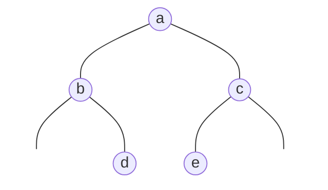
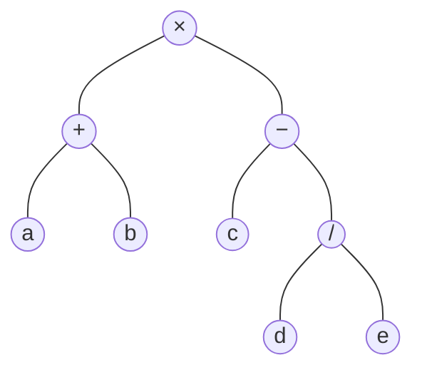

A **vector** ([4.3.2](/4.3.2)) lets us access an element by **rank** in constant time, but insertion and deletion must move many elements; a **list** ([4.3.3](/4.3.3)) supports insertion and deletion in constant time, but access by rank must count from the head. Trees combine the strengths of both: as long as a tree is "short" enough, search, insertion and deletion all take only logarithmic time. Trees are also the natural tool for representing hierarchical relations: expressions, file systems, URLs and the syntactic structure of programs are all trees. A tree is not a linear structure, but once an access order (a traversal) is fixed it acquires linear features, which is why it is called a semilinear structure.

This chapter first builds the terminology of rooted trees on the basis of graph theory ([1.4.3](/1.4.3)), and then focuses on binary trees: their properties, implementation, the four traversals and their iterative algorithms, and reconstructing a binary tree from traversal sequences. The next two sections are two applications of binary trees: Huffman coding trees, and the use of decision trees to prove lower bounds on the complexity of problems. Binary trees are the foundation of the following chapters: binary search trees and balanced trees ([4.3.6](/4.3.6)–[4.3.8](/4.3.8)), heaps ([4.3.12](/4.3.12)) and tries ([4.3.13](/4.3.13)) are all variants of binary or multiway trees.

## 5.1. Trees

### 5.1.1. Rooted Trees and Ordered Trees

In graph theory, a connected graph without cycles is called a tree ([1.4.3](/1.4.3)): a tree with $n$ nodes has exactly $n - 1$ edges, it is a minimal connected graph and also a maximal acyclic graph, and there is a unique path between any two nodes. Almost all trees used in data structures designate one node as the starting point; in graph theory these are the rooted trees, or **arborescence**s in the terminology of graph theory.

**Definition 5.1.1 (Rooted Tree)** Designating a node $r$ of a tree, called the **root** of the tree, gives a rooted tree. For any node $v$, write the unique path from the root to $v$ as $\operatorname{path}(v)$:

- The length (number of edges) of the path, $\lvert\operatorname{path}(v)\rvert$, is called the **depth** of $v$, written $\operatorname{depth}(v)$; the depth of the root is $0$.
- The nodes on $\operatorname{path}(v)$ are all **ancestors** of $v$, and $v$ is their **descendant**; ancestors and descendants other than $v$ itself are called proper ancestors and proper descendants.
- If $u$ is an ancestor of $v$ and $\operatorname{depth}(u) = \operatorname{depth}(v) - 1$, then $u$ is the **parent** of $v$ and $v$ is a **child** of $u$; children of the same parent are **siblings** of one another. The number of children of a node is called its **degree**.
- A node with no children is called a **leaf node**, and the other nodes are called internal nodes. A node $v$ together with all its descendants forms the **subtree** rooted at $v$, written $\operatorname{subtree}(v)$.
- The maximum depth (relative to $v$) of the leaf nodes in the subtree is called the **height** $\operatorname{height}(v)$ of $v$; the height $\operatorname{height}(T)$ of the whole tree is the height of the root. By convention the height of the empty tree is $-1$.

Every node except the root has exactly one parent, and every edge joins exactly one node to its parent, so the sum of the degrees of all nodes equals the number of edges, $n - 1$. When measuring the complexity of algorithms on trees, the number of nodes $n$ and the number of edges are of the same order.

At any depth, an ancestor of a node $v$, if it exists, is unique, whereas descendants need not be; this is the meaning of "semilinear." For every node $v$,

$$
\operatorname{depth}(v) + \operatorname{height}(v) \le \operatorname{height}(T),
$$

with equality if and only if $v$ lies on a path from the root to some deepest leaf node.

**Definition 5.1.2 (Ordered Tree)** A rooted tree in which an order is specified among the children of each node (the 1st child, the 2nd child, ...) is called an **ordered tree**. The first child is also called the eldest child.

### 5.1.2. Representations of Trees

As an **abstract data type**, a tree should support at least the following operations:

| Operation | Function |
|---|---|
| `root()` | The root node |
| `parent(v)` | The parent node |
| `firstChild(v)` | The first child |
| `nextSibling(v)` | The next sibling |
| `insert(v, i, e)` | Insert $e$ as the $i$-th child of $v$ |
| `remove(v, i)` | Delete the $i$-th child of $v$ together with its descendants |
| `traverse()` | Traverse |

There are three common representations:

- Parent representation: store the nodes in a sequence, each recording only its data and the rank of its parent (the parent of the root is recorded as itself or null). `parent()` takes only $O(1)$ time and the space is the smallest, but finding children requires scanning the whole sequence, taking $O(n)$ time.
- Children representation: each node records all its children in a sequence (a **vector** or a **list**), and the length of the sequence is its degree. Finding children is fast, but `parent()` takes $O(n)$ time.
- Parent + children representation: both together, so every operation is fast, but the child sequences have uneven lengths and storage and maintenance are irregular.

The left-child right-sibling representation of the next section unifies arbitrary ordered trees into binary trees and removes this irregularity.

## 5.2. Binary Trees

### 5.2.1. Definition and the Left-Child Right-Sibling Representation

An ordered tree in which every node has degree at most $2$ and the children are distinguished as left and right is called a **binary tree**: the two children (two subtrees) of a node $v$ are called the left child `lc` (left subtree) and the right child `rc` (right subtree). Compared with the definition in graph theory ([1.4.3](/1.4.3)), the emphasis here is on "left differs from right": even if a node has only one child, we must say whether it is the left child or the right child, and the two give different binary trees.

**Definition 5.2.1 (Left-Child Right-Sibling Representation)** For an ordered tree, let the first child of each node be its left child and its next sibling be its right child; this gives a binary tree, in which `firstChild()` corresponds to `lc()` and `nextSibling()` corresponds to `rc()`. This representation is called the **left-child right-sibling representation**.

Hence any ordered tree (and any forest of ordered trees) can be represented as a binary tree, and studying binary trees suffices to cover general ordered trees.

### 5.2.2. Basic Properties

**Property 5.2.1** Let a binary tree have $n_0$, $n_1$, $n_2$ nodes of degree $0$, $1$, $2$ respectively. Then $n_0 = n_2 + 1$.

**Proof** Every node except the root corresponds to exactly one edge pointing to it from its parent, so the number of edges is $e = n - 1 = n_0 + n_1 + n_2 - 1$. On the other hand, nodes of degree $1$ and $2$ emit $1$ and $2$ edges respectively, so $e = n_1 + 2n_2$. Subtracting the two gives the claim. $\square$

In particular, $n_1$ is unrelated to $n_0$; when $n_1 = 0$, $e = 2n_2$ and $n_0 = n_2 + 1 = (n+1)/2$.

**Property 5.2.2** A binary tree has at most $2^k$ nodes of depth $k$; a binary tree with $n$ nodes and height $h$ satisfies

$$
h + 1 \le n \le 2^{h+1} - 1,
$$

and hence $h \ge \lceil \log_2(n+1) \rceil - 1 = \lfloor \log_2 n \rfloor$.

**Proof** Each level has at most twice as many nodes as the previous one, so depth $k$ has at most $2^k$ nodes. Each of the $h+1$ levels has at least one node and at most $2^k$; summing gives the two inequalities. $\square$

At the lower bound $n = h + 1$ the binary tree degenerates into a single chain, and the case of the upper bound is the perfect binary tree below. The height of a tree determines the cost of most operations on it, and the balanced trees of the following chapters are all designed to keep the height as close as possible to the lower bound $\lfloor \log_2 n \rfloor$.

**Definition 5.2.2 (Perfect Binary Tree)** A binary tree of height $h$ with exactly $2^{h+1} - 1$ nodes is called a **perfect binary tree**: all internal nodes have two children and all leaf nodes are on the bottom level.

**Definition 5.2.3 (Proper Binary Tree)** A binary tree in which every node has degree $0$ or $2$ is called a **proper binary tree**.

**Definition 5.2.4 (Complete Binary Tree)** A binary tree of height $h$ in which all levels of depth less than $h$ are full and the nodes of the bottom level are all as far left as possible is called a **complete binary tree**. Equivalently, number the nodes of a perfect binary tree by level, from left to right; a complete binary tree is then the tree formed by the first $n$ of these nodes.

These three terms are used very inconsistently across the literature, so take care when reading:

| Term here | Names common in the literature | Meaning |
|---|---|---|
| perfect binary tree | perfect binary tree (some older literature also says full) | Every level is full |
| proper binary tree | full binary tree, proper binary tree | Every node has degree $0$ or $2$; the graph theory chapter ([1.4.3](/1.4.3)) calls it a "complete binary tree" |
| complete binary tree | complete binary tree | Full except for the bottom level, which is filled from the left |

**Proposition 5.2.3** Adding the missing children to every node of degree less than $2$ in a binary tree (the added nodes are called external nodes, and the original nodes internal nodes) gives a proper binary tree; $n$ internal nodes require exactly $n + 1$ external nodes.

**Proof** After the addition, all the original $n$ nodes have degree $2$, and the added nodes are all leaf nodes. By Property 5.2.1, the number of leaf nodes is $n + 1$. $\square$

External nodes are usually just null pointers in a program and are not actually allocated. Once null pointers are regarded as nodes, every internal node has exactly two children, which makes the description and analysis of many algorithms tidy: red-black trees ([4.3.8](/4.3.8)) treat external nodes as black nodes, and B-trees regard them as the positions of failed searches.

### 5.2.3. Implementation

A node of a binary tree records its data, its parent, its left and right children, and the additional information needed in different trees, such as height (AVL trees), color (red-black trees) and null path length (leftist heaps). In the implementation below, each node stores its own height: after inserting a new node, only the heights of its ancestors can change, so we update them one by one along the parent pointers, in $O(\operatorname{depth}(v))$ time. This is an "eager" strategy: additional information is maintained immediately after each modification, so that queries take only $O(1)$. `size()`, by contrast, uses a "lazy" strategy: it counts recursively only when needed, taking time proportional to the size of the subtree.

```cpp tab
#include <algorithm>
#include <format>
#include <iostream>

template <typename T>
struct BinNode {
    T data;
    BinNode* parent = nullptr;
    BinNode* lc = nullptr;
    BinNode* rc = nullptr;
    int height = 0;                                 // a leaf has height 0

    explicit BinNode(T e, BinNode* p = nullptr) : data(std::move(e)), parent(p) {}
    ~BinNode() { delete lc; delete rc; }            // deleting a node frees its subtree

    BinNode* insert_lc(T e) { lc = new BinNode(std::move(e), this); lc->update_height_above(); return lc; }
    BinNode* insert_rc(T e) { rc = new BinNode(std::move(e), this); rc->update_height_above(); return rc; }

    static int stature(const BinNode* x) { return x ? x->height : -1; }  // empty tree: -1
    void update_height_above() {                    // O(depth): refresh this node and its ancestors
        for (BinNode* x = this; x; x = x->parent)
            x->height = 1 + std::max(stature(x->lc), stature(x->rc));
    }
    int size() const { return 1 + (lc ? lc->size() : 0) + (rc ? rc->size() : 0); }
};

int main() {
    auto* root = new BinNode<char>('a');
    auto* b = root->insert_lc('b');
    root->insert_rc('c');
    b->insert_rc('d')->insert_lc('e');
    std::cout << std::format("size = {}, height = {}, height(b) = {}\n",
                             root->size(), root->height, b->height);
    delete root;
}
```

```python tab
from __future__ import annotations


class BinNode[T]:
    def __init__(self, data: T, parent: BinNode[T] | None = None) -> None:
        self.data = data
        self.parent = parent
        self.lc: BinNode[T] | None = None
        self.rc: BinNode[T] | None = None
        self.height = 0                            # a leaf has height 0

    def insert_lc(self, e: T) -> BinNode[T]:
        self.lc = BinNode(e, self)
        self.lc.update_height_above()
        return self.lc

    def insert_rc(self, e: T) -> BinNode[T]:
        self.rc = BinNode(e, self)
        self.rc.update_height_above()
        return self.rc

    def update_height_above(self) -> None:         # O(depth)
        x: BinNode[T] | None = self
        while x:
            x.height = 1 + max(stature(x.lc), stature(x.rc))
            x = x.parent

    def size(self) -> int:
        return 1 + (self.lc.size() if self.lc else 0) + (self.rc.size() if self.rc else 0)


def stature(x: BinNode | None) -> int:
    return x.height if x else -1                   # empty tree: -1


root = BinNode("a")
b = root.insert_lc("b")
root.insert_rc("c")
b.insert_rc("d").insert_lc("e")
print(f"size = {root.size()}, height = {root.height}, height(b) = {b.height}")
```

In the C++ version, deleting a node recursively frees the whole subtree through the destructor; real library code usually manages children with `std::unique_ptr` (see the implementation in [4.3.6](/4.3.6)), but here raw pointers are used to work together with the parent pointers.

## 5.3. Traversal

### 5.3.1. Preorder, Inorder and Postorder

**Definition 5.3.1 (Traversal)** Visiting the nodes of a tree in some order so that each node is visited exactly once is called a **traversal** of the tree. Write a binary tree as $T = L \cup \{x\} \cup R$, where $x$ is the root and $L$, $R$ are the left and right subtrees. According to when the root is visited relative to the subtrees, there are three recursively defined traversals:

- **Preorder traversal**: visit the root $x$ first, then traverse $L$ in preorder, and finally traverse $R$ in preorder ($x \mid L \mid R$);
- **inorder traversal**: traverse $L$ in inorder first, then visit $x$, and finally traverse $R$ in inorder ($L \mid x \mid R$);
- **postorder traversal**: traverse $L$ in postorder first, then $R$ in postorder, and finally visit $x$ ($L \mid R \mid x$).

The result of a traversal is a linear sequence, which is exactly what "semilinear" means: once a traversal order is fixed, the nodes of the tree have predecessors and successors.

**Example 5.3.1** Consider the following binary tree ($d$ is the right child of $b$, and $e$ is the left child of $c$):



The preorder sequence is $a\,b\,d\,c\,e$, the inorder sequence is $b\,d\,a\,e\,c$, the postorder sequence is $d\,b\,e\,c\,a$, and the level-order sequence ([5.3.6](#sec-5.3.6)) is $a\,b\,c\,d\,e$.

Each of the three traversals has typical applications. Preorder traversal outputs a file tree in the order "directory first, then contents"; inorder traversal is the soul of binary search trees ([4.3.6](/4.3.6)): the inorder sequence of a binary search tree is the sorted arrangement of all its keys; postorder traversal handles the subtrees before the root and suits computing the result for a whole tree from the results of its subtrees, for example computing height and size, or freeing a whole subtree.

**Example 5.3.2** An arithmetic expression can be represented as a binary tree: the leaf nodes are operands, the internal nodes are operators, and their left and right subtrees are the two operands. The expression tree of $(a + b) \times (c - d / e)$ is



Its inorder sequence (with the necessary parentheses added) is the usual infix expression, its preorder sequence `× + a b − c / d e` is the prefix expression (Polish notation), and its postorder sequence `a b + c d e / − ×` is the postfix expression (reverse Polish notation). A postfix expression needs no parentheses and can be evaluated with a single stack ([4.3.4](/4.3.4)): a postorder traversal of the expression tree is exactly the process of evaluation.

The recursive implementations of the three traversals take only a few lines each (see `pre_rec`, `in_rec` and `post_rec` in [5.3.7](#sec-5.3.7)), with running time $T(n) = T(\lvert L\rvert) + T(\lvert R\rvert) + O(1) = O(n)$. But **recursion** relies on the system's **call stack**, with recursion depth equal to the height of the tree, and a degenerate tree (such as a long chain) causes **stack overflow**: the default stack on Linux is usually only 8 MB, and Python's default recursion depth limit is only 1000. More importantly, the iterative versions let us see the structure of the traversal process. Below, with the help of an explicit **stack**, we give iterative algorithms for the three traversals.

### 5.3.2. Iterative Preorder Traversal

Starting from the root and going down along left children, the nodes passed form a path, called the left chain. The process of a preorder traversal can be decomposed along this chain into two phases: first visit the nodes $L_0, L_1, \dots, L_d$ on the chain from top to bottom, then traverse their right subtrees $T_d, \dots, T_1, T_0$ from bottom to top. The traversals of the right subtrees are independent of one another, and each is again a preorder traversal problem of smaller size.

**Algorithm 5.3.1 (Iterative Preorder Traversal)** Maintain a stack. Starting from the current node, go down along the left chain; at each node visit it and push its right child (if any) onto the stack; on reaching the end of the chain, pop a node from the stack as the new current node and repeat; stop when the stack is empty.

The right subtrees are pushed in the order of descent and popped in the opposite order, which matches the requirement "traverse the right subtrees from bottom to top." Each node is pushed and popped at most once, so the total time is $O(n)$.

### 5.3.3. Iterative Inorder Traversal

Inorder traversal is likewise decomposed along the left chain: nodes are not visited on the way down, and after reaching the end $L_d$ of the chain, we proceed from the bottom up, "visiting $L_k$, then traversing in inorder the right subtree $T_k$ of $L_k$."

**Algorithm 5.3.2 (Iterative Inorder Traversal)** Maintain a stack. Starting from the current node, go down along the left chain, pushing the nodes passed onto the stack one by one; then pop the top node $x$ and visit it (at this point the left subtree of $x$ is either empty or fully traversed), then take the right child of $x$ as the current node and repeat; stop when the stack is empty.

**Proposition 5.3.1** Algorithm 5.3.2 correctly performs an inorder traversal, and its running time is $O(n)$.

**Proof** We prove correctness by induction on the size $n$. Suppose the algorithm is correct for all trees of size at most $n$, and consider a tree of size $n + 1$ with root $x$. Let $t$ be the end of the left chain and $y$ the right child of $t$. The algorithm executes in turn: (X1) push the left chain of $x$; (T) pop and visit $t$; (Y) process the subtree $T_y$ rooted at $y$; (X2) continue to process the remaining nodes in the stack. Since $t$ has no left child, (T) visits the first node of the inorder traversal. Phase (Y) starts from $y$, and the nodes originally in the stack are not popped during it, so it is exactly a complete run of the algorithm on $T_y$, which by the induction hypothesis traverses $T_y$ correctly. When (Y) ends, what remains in the stack is exactly the nodes pushed in (X1) other than $t$, exactly as if $t$ and $T_y$ had never existed, so (X2) correctly traverses the tree with $t$ and $T_y$ removed. The three segments joined together form the inorder sequence of the whole tree.

Complexity: a single descent along the left chain may push $\Theta(n)$ nodes, and there may be $\Theta(n)$ descents, so the total time seems to be $O(n^2)$. But looking at the whole process, each node is pushed exactly once and popped exactly once, the numbers of pushes over all descents sum to $n$, and the total time of the algorithm is of the same order as the total number of pushes and pops, namely $O(n)$. $\square$

What is used here is **aggregate analysis**: instead of estimating the cost of each step separately, we count the total cost of the whole process, which amortizes to only $O(1)$ per step. General methods of **amortized analysis** are in [4.3.2](/4.3.2).

### 5.3.4. Inorder Successor

In the inorder traversal sequence, the node after $x$ is called its immediate successor. With parent pointers, the successor can be found directly without a stack, which allows a concise traversal such as `for (t = first(); t; t = succ(t))`:

- If $x$ has a right child, the successor is the leftmost node in the right subtree: starting from the right child, go left as far as possible.
- Otherwise, the successor is the node that has $x$ as its immediate predecessor, that is, "the lowest ancestor that contains $x$ in its left subtree": go up along parent pointers, continuing as long as the current node is the right child of its parent, and then go up one more step; if we go up past the root, $x$ is the last node of the sequence.

In the two cases the running times are at most the height and the depth of $x$ respectively, that is, $O(h)$. Finding successors repeatedly from the first node completes the whole traversal, with each edge walked at most once downward and once upward, so the total time is still $O(n)$. Finding the successor is part of the deletion algorithm of binary search trees ([4.3.6](/4.3.6)).

### 5.3.5. Iterative Postorder Traversal

The first node visited in a postorder traversal is the leaf node reached by going down from the root "as far left as possible, and right only when there is no other way," that is, the leftmost leaf node in inorder (the place where `visit` first executes in the recursive version).

**Algorithm 5.3.3 (Iterative Postorder Traversal)** The stack holds the nodes to be visited; initially it contains only the root. Repeat: if the stack top is not the parent of the last visited node $x$ (but the right sibling of $x$), go down from the top node to the leftmost leaf node of its subtree, and for each node along the way, if it has a left child, first push its right child (if any) and then its left child, otherwise push its right child; then pop the top and visit it. Stop when the stack is empty.

If the stack top is the parent of $x$, both subtrees of the parent have been visited and it is time to visit the parent itself; if the stack top is the right sibling of $x$, the subtree of the right sibling must be traversed first. Each node is pushed and popped once, for a total time of $O(n)$.

### 5.3.6. Level-Order Traversal

**Definition 5.3.2 (Level-Order Traversal)** Visiting the nodes in order of increasing depth, and from left to right within the same depth, is called **level-order traversal**.

In a level-order traversal, a node visited earlier has its children visited earlier too; this is the first in, first out pattern, so it is implemented with a queue: enqueue the root; repeatedly take the front node and visit it, then enqueue its left and right children in turn; stop when the **queue** is empty. It is the special case on trees of **breadth-first search** of graphs ([4.3.10](/4.3.10)).

Complete binary trees are especially closely related to level-order traversal: a complete binary tree has no "gaps" in its level-order sequence, so its nodes can be stored in a **vector** in level order. Let the rank of the root be $0$; then the left and right children of the node of rank $i$ have ranks $2i + 1$ and $2i + 2$, and its parent has rank $\lfloor (i-1)/2 \rfloor$, with no pointers needed at all. This compact representation is the basis of the binary heap ([4.3.12](/4.3.12)).

**Property 5.3.2** Let a complete binary tree have $n$ nodes. Then

1. its height is $\lfloor \log_2 n \rfloor$, and leaf nodes appear only on the bottom two levels;
2. there are $\lceil n/2 \rceil$ leaf nodes and $\lfloor n/2 \rfloor$ internal nodes, that is, leaf nodes are no fewer than internal nodes and exceed them by at most one; there is at most one node of degree $1$;
3. during level-order traversal the size of the auxiliary queue first grows and then shrinks, with maximum $\lceil n/2 \rceil$.

**Proof** (1) By definition the first $h$ levels are full, so $2^h \le n \le 2^{h+1} - 1$. (2) In terms of rank, the node of rank $i$ is internal if and only if $2i + 1 \le n - 1$, that is, $i \le \lfloor n/2 \rfloor - 1$, so there are $\lfloor n/2 \rfloor$ internal nodes; only the node of rank $n/2 - 1$ (when $n$ is even) has degree $1$. (3) After the first $k$ nodes have been visited, the number of nodes enqueued is $1$ plus the number of children of these $k$ nodes. The first $\lfloor (n-1)/2 \rfloor$ nodes all have two children, so the queue size is then $k + 1$ and grows step by step; afterwards each step only dequeues (or, when $n$ is even, once dequeues one and enqueues one), and the size no longer increases. The maximum is $\lfloor (n-1)/2 \rfloor + 1 = \lceil n/2 \rceil$. $\square$

### 5.3.7. Implementation

The program below implements the traversals above and compares the results of the iterative versions with the recursive versions one by one on a large number of randomly generated binary trees (**differential testing**). The traversal functions accept any callable object `visit`, a common idiom of C++ templates and Python first-class functions.

```cpp tab
#include <format>
#include <iostream>
#include <queue>
#include <random>
#include <stack>
#include <vector>

template <typename T>
struct Node {
    T data;
    Node* parent = nullptr;
    Node* lc = nullptr;
    Node* rc = nullptr;
    Node(T e, Node* p) : data(e), parent(p) {}
    ~Node() { delete lc; delete rc; }
};

// Recursive traversals: visit is any callable taking T
template <typename T, typename F> void pre_rec(Node<T>* x, F&& visit) {
    if (!x) return;
    visit(x->data); pre_rec(x->lc, visit); pre_rec(x->rc, visit);
}
template <typename T, typename F> void in_rec(Node<T>* x, F&& visit) {
    if (!x) return;
    in_rec(x->lc, visit); visit(x->data); in_rec(x->rc, visit);
}
template <typename T, typename F> void post_rec(Node<T>* x, F&& visit) {
    if (!x) return;
    post_rec(x->lc, visit); post_rec(x->rc, visit); visit(x->data);
}

// Iterative preorder: walk down the left vine, visiting nodes and stacking right subtrees
template <typename T, typename F> void pre_iter(Node<T>* x, F&& visit) {
    std::stack<Node<T>*> s;
    while (true) {
        for (; x; x = x->lc) {                      // along the vine
            visit(x->data);
            if (x->rc) s.push(x->rc);               // to be traversed later, in reverse order
        }
        if (s.empty()) break;
        x = s.top(); s.pop();
    }
}

// Iterative inorder: push the left vine; pop, visit, then turn to the right subtree
template <typename T, typename F> void in_iter(Node<T>* x, F&& visit) {
    std::stack<Node<T>*> s;
    while (true) {
        for (; x; x = x->lc) s.push(x);             // go along the vine
        if (s.empty()) break;
        x = s.top(); s.pop();                       // its left subtree is done
        visit(x->data);
        x = x->rc;
    }
}

// Inorder successor using parent pointers, O(h)
template <typename T> Node<T>* succ(Node<T>* x) {
    if (x->rc) {                                    // leftmost node of the right subtree
        x = x->rc;
        while (x->lc) x = x->lc;
        return x;
    }
    while (x->parent && x == x->parent->rc) x = x->parent;  // climb while x is a right child
    return x->parent;                               // the lowest ancestor having x on its left
}

// Iterative postorder: the stack holds nodes still to be visited
template <typename T, typename F> void post_iter(Node<T>* x, F&& visit) {
    std::stack<Node<T>*> s;
    if (x) s.push(x);
    while (!s.empty()) {
        if (s.top() != x->parent) {                 // top is the right sibling of x:
            while (Node<T>* t = s.top()) {          // go to the leftmost leaf of its subtree
                if (t->lc) { if (t->rc) s.push(t->rc); s.push(t->lc); }
                else s.push(t->rc);                 // may push nullptr, which ends the loop
            }
            s.pop();                                // discard the nullptr
        }
        x = s.top(); s.pop();
        visit(x->data);
    }
}

template <typename T, typename F> void level(Node<T>* root, F&& visit) {
    std::queue<Node<T>*> q;
    if (root) q.push(root);
    while (!q.empty()) {
        Node<T>* x = q.front(); q.pop();
        visit(x->data);
        if (x->lc) q.push(x->lc);
        if (x->rc) q.push(x->rc);
    }
}

int main() {
    std::mt19937 rng(2024);
    for (int round = 0; round < 1000; ++round) {      // random trees: attach new nodes at random free slots
        int n = 1 + rng() % 60;
        auto* root = new Node<int>(0, nullptr);
        std::vector<Node<int>*> nodes{root};
        for (int k = 1; k < n; ++k) {
            Node<int>* p = nodes[rng() % nodes.size()];
            Node<int>*& slot = (rng() % 2) ? p->lc : p->rc;
            if (slot) { --k; continue; }
            slot = new Node<int>(k, p);
            nodes.push_back(slot);
        }
        std::vector<int> a, b;
        auto into = [](std::vector<int>& v) { return [&v](int e) { v.push_back(e); }; };
        pre_rec(root, into(a));  pre_iter(root, into(b));  if (a != b) return 1;
        a.clear(); b.clear();
        in_rec(root, into(a));   in_iter(root, into(b));   if (a != b) return 2;
        b.clear();
        Node<int>* first = root;
        while (first->lc) first = first->lc;
        for (Node<int>* t = first; t; t = succ(t)) b.push_back(t->data);
        if (a != b) return 3;
        a.clear(); b.clear();
        post_rec(root, into(a)); post_iter(root, into(b)); if (a != b) return 4;
        delete root;
    }
    // Example: a has children b, c; d is the right child of b; e is the left child of c
    auto* r = new Node<char>('a', nullptr);
    r->lc = new Node<char>('b', r); r->rc = new Node<char>('c', r);
    r->lc->rc = new Node<char>('d', r->lc); r->rc->lc = new Node<char>('e', r->rc);
    auto show = [](char c) { std::cout << std::format("{} ", c); };
    pre_iter(r, show);  std::cout << "| ";
    in_iter(r, show);   std::cout << "| ";
    post_iter(r, show); std::cout << "| ";
    level(r, show);     std::cout << '\n';
    delete r;
}
```

```python tab
from __future__ import annotations

import random
from collections import deque
from collections.abc import Callable, Iterator


class Node[T]:
    def __init__(self, data: T, parent: Node[T] | None = None) -> None:
        self.data, self.parent = data, parent
        self.lc: Node[T] | None = None
        self.rc: Node[T] | None = None


def pre_rec(x: Node | None, visit: Callable) -> None:
    if x:
        visit(x.data); pre_rec(x.lc, visit); pre_rec(x.rc, visit)


def in_rec(x: Node | None, visit: Callable) -> None:
    if x:
        in_rec(x.lc, visit); visit(x.data); in_rec(x.rc, visit)


def post_rec(x: Node | None, visit: Callable) -> None:
    if x:
        post_rec(x.lc, visit); post_rec(x.rc, visit); visit(x.data)


def pre_iter(x: Node | None, visit: Callable) -> None:
    stack: list[Node] = []
    while True:
        while x:                                   # along the left vine
            visit(x.data)
            if x.rc:
                stack.append(x.rc)                 # right subtrees, popped in reverse order
            x = x.lc
        if not stack:
            break
        x = stack.pop()


def in_iter(x: Node | None, visit: Callable) -> None:
    stack: list[Node] = []
    while True:
        while x:                                   # push the left vine
            stack.append(x)
            x = x.lc
        if not stack:
            break
        x = stack.pop()                            # its left subtree is done
        visit(x.data)
        x = x.rc


def succ(x: Node) -> Node | None:
    """Inorder successor via parent pointers, O(h)."""
    if x.rc:                                       # leftmost node of the right subtree
        x = x.rc
        while x.lc:
            x = x.lc
        return x
    while x.parent and x is x.parent.rc:           # climb while x is a right child
        x = x.parent
    return x.parent


def post_iter(x: Node | None, visit: Callable) -> None:
    stack: list[Node | None] = [x] if x else []
    while stack:
        if stack[-1] is not x.parent:              # top is the right sibling of x
            while (t := stack[-1]) is not None:    # go to the leftmost leaf of its subtree
                if t.lc:
                    if t.rc:
                        stack.append(t.rc)
                    stack.append(t.lc)
                else:
                    stack.append(t.rc)             # may push None, which ends the loop
            stack.pop()                            # discard the None
        x = stack.pop()
        visit(x.data)


def level(root: Node | None, visit: Callable) -> None:
    q = deque([root] if root else [])
    while q:
        x = q.popleft()
        visit(x.data)
        if x.lc:
            q.append(x.lc)
        if x.rc:
            q.append(x.rc)


def collect(trav: Callable, root: Node) -> list:
    out: list = []
    trav(root, out.append)
    return out


def inorder_by_succ(root: Node) -> Iterator:
    t = root
    while t.lc:
        t = t.lc
    while t:
        yield t.data
        t = succ(t)


rng = random.Random(2024)
for _ in range(1000):                              # random trees
    nodes = [Node(0)]
    n = rng.randint(1, 60)
    while len(nodes) < n:
        p = rng.choice(nodes)
        side = rng.choice(("lc", "rc"))
        if getattr(p, side) is None:
            setattr(p, side, Node(len(nodes), p))
            nodes.append(getattr(p, side))
    r = nodes[0]
    assert collect(pre_rec, r) == collect(pre_iter, r)
    assert collect(in_rec, r) == collect(in_iter, r) == list(inorder_by_succ(r))
    assert collect(post_rec, r) == collect(post_iter, r)

# Example: a has children b, c; d is the right child of b; e is the left child of c
a = Node("a"); a.lc = Node("b", a); a.rc = Node("c", a)
a.lc.rc = Node("d", a.lc); a.rc.lc = Node("e", a.rc)
for trav in (pre_iter, in_iter, post_iter, level):
    print(*collect(trav, a), end=" | " if trav is not level else "\n")
```

## 5.4. Reconstruction

Given a traversal sequence of a binary tree, can we conversely determine the tree uniquely? Assume that the data of all nodes are distinct.

**Theorem 5.4.1** A binary tree is uniquely determined by its inorder sequence together with its preorder sequence (or its inorder sequence together with its postorder sequence).

**Proof** By induction on the number of nodes $n$; the case $n = 0$ is obvious. Let the preorder sequence be $x \mid \mathrm{pre}(L) \mid \mathrm{pre}(R)$; its first element $x$ is the root. Find $x$ in the inorder sequence $\mathrm{in}(L) \mid x \mid \mathrm{in}(R)$: the part to its left is the inorder sequence of the left subtree, which gives the size $\lvert L\rvert$ of the left subtree; then the $\lvert L\rvert$ elements after $x$ in the preorder sequence are the preorder sequence of the left subtree, and the rest is the preorder sequence of the right subtree. Both subtrees have size less than $n$, so by the induction hypothesis they are uniquely determined, and so is the whole tree. The case of the postorder sequence is symmetric (the root is the last element). $\square$

The proof itself is a reconstruction algorithm: use a hash table to record the position of each datum in the inorder sequence, so each node is handled in $O(1)$ time and the total time is $O(n)$.

Preorder and postorder sequences together, however, do not suffice to determine a binary tree. For example, when the root $a$ has only one child $b$, whether $b$ is the left or the right child, the preorder sequence is $a\,b$ and the postorder sequence is $b\,a$: the roots at the two ends alone cannot tell where the subsequences divide. If the tree is known to be proper, though, the element after the root in the preorder sequence must be the left child, and finding it in the postorder sequence divides the left and right subtrees, so the reconstruction is still unique.

Another way is to augment the traversal sequence: during traversal, output each null pointer as a node too (written ^). In the augmented preorder or postorder sequence, any subtree still corresponds to a contiguous subsequence, in which the number of ^ is exactly one more than the number of real nodes (Proposition 5.2.3). Hence it suffices to read the augmented preorder sequence from left to right and construct recursively: on reading ^ return the empty tree, otherwise create the root and then construct the left and right subtrees in turn. For example

```text
preorder : i d c a ^ b ^ ^ ^ h f e ^ ^ g ^ ^ ^ l j ^ k ^ ^ n m ^ ^ p o ^ ^ ^
inorder  : ^ a ^ b ^ c ^ d ^ e ^ f ^ g ^ h ^ i ^ j ^ k ^ l ^ m ^ n ^ o ^ p ^
postorder: ^ ^ ^ b a ^ c ^ ^ e ^ ^ g f ^ h d ^ ^ ^ k j ^ ^ m ^ ^ o ^ p n l i
```

The augmented preorder sequence (or the augmented postorder sequence) alone determines the binary tree, and this is the most common serialization format for binary trees; the augmented inorder sequence does not, and the inorder sequence above is unrelated to the shape of the tree.

```cpp tab
#include <format>
#include <iostream>
#include <memory>
#include <optional>
#include <string>
#include <unordered_map>
#include <vector>

template <typename T>
struct Node {
    T data;
    std::unique_ptr<Node> lc, rc;
    explicit Node(T e) : data(std::move(e)) {}
};
template <typename T> using Tree = std::unique_ptr<Node<T>>;

// Rebuild from preorder + inorder (keys must be distinct), O(n) with a hash map
template <typename T> class Rebuilder {
    const std::vector<T>& pre;
    std::unordered_map<T, int> pos;                 // key -> index in the inorder sequence
    int next = 0;                                   // next unused preorder index
    Tree<T> build(int lo, int hi) {                 // subtree whose inorder is in[lo, hi)
        if (lo >= hi) return nullptr;
        auto x = std::make_unique<Node<T>>(pre[next++]);  // the root comes first in preorder
        int mid = pos.at(x->data);                  // splits inorder into L | root | R
        x->lc = build(lo, mid);
        x->rc = build(mid + 1, hi);
        return x;
    }
public:
    Rebuilder(const std::vector<T>& p, const std::vector<T>& in) : pre(p) {
        for (int i = 0; i < static_cast<int>(in.size()); ++i) pos[in[i]] = i;
    }
    Tree<T> run() { return build(0, static_cast<int>(pos.size())); }
};

// Rebuild from an augmented preorder sequence in which nullopt marks an empty subtree
template <typename T> Tree<T> deserialize(const std::vector<std::optional<T>>& seq, std::size_t& i) {
    if (!seq.at(i)) { ++i; return nullptr; }
    auto x = std::make_unique<Node<T>>(*seq[i++]);
    x->lc = deserialize(seq, i);
    x->rc = deserialize(seq, i);
    return x;
}

template <typename T> void postorder(const Tree<T>& x, std::string& out) {
    if (!x) return;
    postorder(x->lc, out); postorder(x->rc, out); out += std::format("{} ", x->data);
}

int main() {
    std::vector<char> pre{'i', 'd', 'c', 'a', 'b', 'h', 'f', 'e', 'g', 'l', 'j', 'k', 'n', 'm', 'p', 'o'};
    std::vector<char> in{'a', 'b', 'c', 'd', 'e', 'f', 'g', 'h', 'i', 'j', 'k', 'l', 'm', 'n', 'o', 'p'};
    auto t = Rebuilder<char>(pre, in).run();
    std::string s;
    postorder(t, s);
    std::cout << std::format("postorder: {}\n", s);

    std::vector<std::optional<char>> aug;           // "i d c a ^ b ^ ^ ^ h f e ^ ^ g ^ ^ ^ ..."
    for (char c : std::string("idca^b^^^hfe^^g^^^lj^k^^nm^^po^^^"))
        aug.push_back(c == '^' ? std::nullopt : std::optional<char>(c));
    std::size_t i = 0;
    auto u = deserialize(aug, i);
    std::string s2;
    postorder(u, s2);
    std::cout << std::format("same tree: {}\n", s == s2);
}
```

```python tab
from __future__ import annotations

from collections.abc import Iterator


class Node[T]:
    def __init__(self, data: T) -> None:
        self.data = data
        self.lc: Node[T] | None = None
        self.rc: Node[T] | None = None


def rebuild[T](pre: list[T], inorder: list[T]) -> Node[T] | None:
    """Rebuild from preorder + inorder (distinct keys), O(n)."""
    pos = {key: i for i, key in enumerate(inorder)}
    it = iter(pre)                                 # roots are consumed in preorder

    def build(lo: int, hi: int) -> Node[T] | None:  # subtree whose inorder is inorder[lo:hi]
        if lo >= hi:
            return None
        x = Node(next(it))
        mid = pos[x.data]                          # splits inorder into L | root | R
        x.lc = build(lo, mid)
        x.rc = build(mid + 1, hi)
        return x

    return build(0, len(inorder))


def deserialize[T](seq: Iterator[T | None]) -> Node[T] | None:
    """Rebuild from an augmented preorder sequence; None marks an empty subtree."""
    key = next(seq)
    if key is None:
        return None
    x = Node(key)
    x.lc = deserialize(seq)
    x.rc = deserialize(seq)
    return x


def postorder(x: Node | None) -> list:
    return postorder(x.lc) + postorder(x.rc) + [x.data] if x else []


t = rebuild(list("idcabhfegljknmpo"), list("abcdefghijklmnop"))
print("postorder:", *postorder(t))
u = deserialize(iter(None if c == "^" else c for c in "idca^b^^^hfe^^g^^^lj^k^^nm^^po^^^"))
print("same tree:", postorder(t) == postorder(u))
```

## 5.5. Huffman Coding

### 5.5.1. Prefix Codes and Coding Trees

In communication and storage, text composed of characters from an alphabet $\Sigma$ must be converted into a binary string (encoding), and the receiver converts the binary string back into text (decoding). The simplest scheme is fixed-length coding, such as ASCII; if the characters have codes of different lengths, ambiguity in decoding must be prevented: if the code of character $X$ is `01010`, and the code `0101` of character $Y$ is a prefix of it, then on reading `0101` we cannot tell whether to cut there.

**Definition 5.5.1 (Prefix Code)** A code in which no character's codeword is a prefix of another character's codeword is called a **prefix code**.

Prefix codes correspond one-to-one to binary trees. Place each character $x$ on a leaf node $v(x)$ of a binary tree; on the path from the root to $v(x)$, write `0` for each step left and `1` for each step right, and take the resulting bit string as the code of $x$. Since all characters are on leaf nodes, no root path is a prefix of another, so the code obtained is always a prefix code; conversely, the codewords of any prefix code can be arranged in this way into a coding tree. To decode, start from the root and go left or right according to the bit string; on reaching a leaf node, output one character and return to the root.

The efficiency of a code depends on code lengths. The code length of a character $x$ is the depth $\operatorname{depth}(v(x))$ of its leaf node. If the frequency of each character is $w(x)$, the total length of the encoded text is

$$
\operatorname{wald}(T) = \sum_{x \in \Sigma} w(x) \operatorname{depth}(v(x)),
$$

which is the weighted path length WPL of the graph theory chapter ([1.4.3](/1.4.3)). When all characters are equally frequent, it is proportional to the average depth of the leaf nodes. A coding tree that minimizes $\operatorname{wald}(T)$ is called an optimal coding tree, namely a **Huffman tree** (an optimal binary tree).

An optimal coding tree has the following features:

1. Two children: an optimal coding tree is a proper binary tree. If some internal node has only one child, replacing the node by this child decreases the depth of all leaf nodes in its subtree by $1$, and the code lengths can only become shorter.
2. Layering: if a node has smaller depth than another node, its frequency should not be lower; otherwise swapping the two decreases $\operatorname{wald}$ by $(d_1 - d_2)(w_1 - w_2) \le 0$. In particular, with equal frequencies leaf nodes can appear only on the bottom two levels, and a complete proper binary tree is optimal; but when the character frequencies differ, a complete binary tree is not necessarily optimal. For example, in `mammamia` the frequencies of m, a, i are $4, 3, 1$; fixed-length coding needs $16$ bits, whereas the code with $1$ bit for m and $2$ bits for a and i needs only $4 \cdot 1 + 3 \cdot 2 + 1 \cdot 2 = 12$ bits.

### 5.5.2. Huffman's Algorithm

**Algorithm 5.5.1 (Huffman's Algorithm)** Create a single-node tree for each character, with weight equal to the frequency of the character, forming a forest $F$. As long as $F$ contains more than one tree, take out the two trees $T_1$, $T_2$ of smallest weight, merge them into a new tree with them as left and right subtrees, give the root of the new tree weight equal to the sum of the two, and put it back into $F$. The last remaining tree is the Huffman coding tree.

The prefix code obtained from this tree is called *Huffman coding*. The algorithm is greedy: characters with low frequency are merged first and hence end up deeper. A greedy strategy generally does not guarantee optimality, but Huffman's algorithm does always give an optimal coding tree ([Theorem 3.6.1](/1.4.3#thm-3.6.1)). The key points of the proof are:

1. The two characters $x$, $y$ of lowest frequency are, in some optimal coding tree, on the bottom level and siblings of each other (take any optimal tree and swap a pair of siblings on the bottom level with $x$, $y$; $\operatorname{wald}$ does not increase);
2. Merge $x$, $y$ into a new character $z$ of frequency $w(x) + w(y)$, giving the alphabet $\Sigma'$. In any coding tree $T'$ of $\Sigma'$, adding $x$, $y$ as children of $z$ gives a coding tree $T$ of $\Sigma$, with $\operatorname{wald}(T) = \operatorname{wald}(T') + w(x) + w(y)$, a difference independent of the shape of $T'$;
3. Hence when $T'$ is an optimal coding tree of $\Sigma'$, $T$ is also one of the optimal coding trees of $\Sigma$. Each step of Huffman's algorithm is exactly the passage from $\Sigma$ to $\Sigma'$, and induction on $\lvert\Sigma\rvert$ completes the proof.

An optimal tree is generally not unique: swapping the left and right subtrees of any internal node leaves $\operatorname{wald}$ unchanged, and when frequencies are equal the merging order can also differ. In practice one often stipulates "the weight of the left subtree is not greater than that of the right," or uses canonical Huffman codes determined uniquely by the code lengths, so that transmitting only the code lengths suffices to recover the code table.

Information theory gives a lower limit on code length. Let the probability of a character be $p(x) = w(x) / \sum w$; the average code length $\bar\ell$ of a Huffman code satisfies

$$
H \le \bar\ell < H + 1, \qquad H = -\sum_{x} p(x) \log_2 p(x),
$$

where $H$ is the entropy of the source. Huffman coding is optimal among character-by-character codes; to approach the entropy further, one must encode several characters together or use methods such as arithmetic coding and ANS. DEFLATE (gzip, PNG) and JPEG use Huffman coding, while Zstandard uses both Huffman coding and ANS.

### 5.5.3. Implementation and Complexity

The efficiency of the algorithm depends on how we repeatedly "take out the two trees of smallest weight." Let $n = \lvert\Sigma\rvert$:

| Organization of the forest | Initialization | Taking out two and inserting one back | Total time |
|---|---|---|---|
| Unsorted list, traversed each time to find the minimum | $O(n)$ | $O(n)$ | $O(n^2)$ |
| Sorted vector (nonincreasing, take from the end) | $O(n \log n)$ | Take $O(1)$, ordered insertion $O(n)$ | $O(n^2)$ |
| Priority queue (heap, [4.3.12](/4.3.12)) | $O(n)$ | $O(\log n)$ | $O(n \log n)$ |
| Presort + two queues | $O(n \log n)$ | $O(1)$ | $O(n \log n)$ |

The last method is clever: sort the leaf nodes by weight and put them in the first **queue**; put the new trees obtained by merging, in order, into the second queue. Since the two trees merged earlier both have weight no greater than those merged later, new trees are produced in nondecreasing order of weight, and the second queue is always sorted. Comparing the two fronts is then enough to take out the global minimum. The part after sorting takes only $O(n)$ time; if the characters are already sorted by frequency, the whole algorithm is linear. The implementation below uses this method, and the code table is generated by one preorder traversal.

```cpp tab
#include <algorithm>
#include <cstddef>
#include <format>
#include <iostream>
#include <map>
#include <queue>
#include <string>
#include <vector>

class Huffman {
    struct Node { std::size_t weight; char ch; int lc = -1, rc = -1; };
    std::vector<Node> nodes;                        // node pool; children are indices
    int root = -1;
    std::map<char, std::string> table;

    void make_table(int v, std::string& code) {    // root path: left = 0, right = 1
        if (nodes[v].lc < 0) { table[nodes[v].ch] = code.empty() ? "0" : code; return; }
        code.push_back('0'); make_table(nodes[v].lc, code); code.pop_back();
        code.push_back('1'); make_table(nodes[v].rc, code); code.pop_back();
    }

public:
    explicit Huffman(const std::string& text) {
        std::map<char, std::size_t> freq;
        for (char c : text) ++freq[c];
        for (auto [c, w] : freq) nodes.push_back({w, c});
        std::ranges::sort(nodes, {}, &Node::weight);  // leaves by weight (preprocessing)
        // Two FIFO queues: sorted leaves, and merged trees (created in nondecreasing weight)
        std::queue<int> leaves, merged;
        for (int i = 0; i < static_cast<int>(nodes.size()); ++i) leaves.push(i);
        auto pop_min = [&] {
            bool use_leaf = !leaves.empty() &&
                (merged.empty() || nodes[leaves.front()].weight <= nodes[merged.front()].weight);
            std::queue<int>& q = use_leaf ? leaves : merged;
            int v = q.front(); q.pop();
            return v;
        };
        while (leaves.size() + merged.size() > 1) {  // each round: one tree fewer
            int a = pop_min(), b = pop_min();
            nodes.push_back({nodes[a].weight + nodes[b].weight, '\0', a, b});
            merged.push(static_cast<int>(nodes.size()) - 1);
        }
        root = leaves.empty() ? merged.front() : leaves.front();
        std::string code;
        make_table(root, code);
    }
    std::string encode(const std::string& text) const {
        std::string bits;
        for (char c : text) bits += table.at(c);
        return bits;
    }
    std::string decode(const std::string& bits) const {
        std::string out;
        int v = root;
        for (char b : bits) {
            if (nodes[v].lc >= 0) v = (b == '0') ? nodes[v].lc : nodes[v].rc;
            if (nodes[v].lc < 0) { out += nodes[v].ch; v = root; }  // reached a leaf
        }
        return out;
    }
    const std::map<char, std::string>& codes() const { return table; }
};

int main() {
    std::string text = "mammamia";
    Huffman h(text);
    for (auto& [c, code] : h.codes()) std::cout << std::format("{}: {}\n", c, code);
    std::string bits = h.encode(text);
    std::cout << std::format("{} bits: {}, decoded: {}\n", bits.size(), bits, h.decode(bits));
}
```

```python tab
from collections import Counter, deque
from dataclasses import dataclass


@dataclass
class Node:
    weight: int
    ch: str = ""
    lc: "Node | None" = None
    rc: "Node | None" = None


class Huffman:
    def __init__(self, text: str) -> None:
        leaves = deque(sorted((Node(w, c) for c, w in Counter(text).items()),
                              key=lambda v: v.weight))     # preprocessing: sort the leaves
        merged: deque[Node] = deque()              # merged trees appear in nondecreasing weight

        def pop_min() -> Node:
            if leaves and (not merged or leaves[0].weight <= merged[0].weight):
                return leaves.popleft()
            return merged.popleft()

        while len(leaves) + len(merged) > 1:       # each round: one tree fewer
            a, b = pop_min(), pop_min()
            merged.append(Node(a.weight + b.weight, lc=a, rc=b))
        self.root = (leaves or merged)[0]
        self.table: dict[str, str] = {}
        self._make_table(self.root, "")

    def _make_table(self, v: Node, code: str) -> None:  # left = 0, right = 1
        if v.lc is None:
            self.table[v.ch] = code or "0"
            return
        self._make_table(v.lc, code + "0")
        self._make_table(v.rc, code + "1")

    def encode(self, text: str) -> str:
        return "".join(self.table[c] for c in text)

    def decode(self, bits: str) -> str:
        out, v = [], self.root
        for b in bits:
            if v.lc is not None:
                v = v.lc if b == "0" else v.rc
            if v.lc is None:                       # reached a leaf
                out.append(v.ch)
                v = self.root
        return "".join(out)


text = "mammamia"
h = Huffman(text)
for c, code in sorted(h.table.items()):
    print(f"{c}: {code}")
bits = h.encode(text)
print(f"{len(bits)} bits: {bits}, decoded: {h.decode(bits)}")
```

With standard libraries, C++ can use `std::priority_queue` and Python the `heapq` module; both are binary heaps.

## 5.6. Lower Bounds: Algebraic Decision Trees

### 5.6.1. The Difficulty of a Problem

Different algorithms for the same problem can differ greatly in complexity. If a problem has an algorithm, the lowest complexity among all algorithms is called the difficulty of the problem. Determining the difficulty has two sides: designing algorithms of lower complexity (upper bounds) and proving that no algorithm can be faster (lower bounds). Once an algorithm's complexity reaches the lower bound of the problem, it is optimal in the big $O$ sense. There are several ways to estimate complexity: best, worst, average and amortized; the worst-case estimate is the most conservative and reliable, so we first care about worst-case optimal algorithms.

To discuss lower bounds we must first fix a model of computation. The most commonly used is the comparison model:

**Definition 5.6.1 (Comparison-Based Algorithm)** An algorithm whose course of execution depends only on the results of a series of comparisons (of size or equality) of the input data is called a **comparison-based algorithm**. Binary search, bubble sort and merge sort earlier, and the various search trees later, are all comparison-based algorithms.

**Definition 5.6.2 (Algebraic Decision Tree)** Given an input size, draw the decisions made by the algorithm over all possible inputs as a tree: each internal node corresponds to a decision, that is, computing some polynomial of bounded degree in the input variables and going to different children according to the sign of its value ($+$, $0$, $-$); each leaf node corresponds to an output. This tree is called the **algebraic decision tree** of the algorithm. An algebraic decision tree in which all the polynomials have the form $K_i - K_j$ is called a **comparison tree**, and it describes comparison-based algorithms.

Each run corresponds to a path from the root to a leaf node, and the path length is the number of decisions made in that run. Hence the height of the tree is the number of decisions of the algorithm in the worst case, the average depth of the leaf nodes is the number of decisions in the average case, and a lower bound on the height is a lower bound on the complexity of all algorithms of this kind.

**Theorem 5.6.1** Any comparison-based sorting algorithm needs at least $\Omega(n \log n)$ comparisons in the worst case.

**Proof** $n$ distinct elements have $n!$ permutations, and each permutation requires a different output (the permutation that makes it sorted), so the **comparison tree** has at least $n!$ leaf nodes. Each internal node of the comparison tree has at most three branches, and a ternary tree of height $h$ has at most $3^h$ leaf nodes, so

$$
h \ge \log_3 n! \ge \log_3 \left(\frac{n}{2}\right)^{n/2} = \Omega(n \log n).
$$

$\square$

When only comparisons of size are considered, the comparison tree is binary and the lower bound is $\lceil \log_2 n! \rceil = n \log_2 n - n \log_2 \mathrm{e} + O(\log n)$. Since the average depth of the leaf nodes is also at least of the order of $\log_3 n!$, this lower bound holds for the average case too. The worst case of merge sort is $O(n \log n)$, so it is worst-case optimal; to break through this lower bound one must use operations other than comparison, for example bucket sort and radix sort ([4.3.9](/4.3.9)) use the numerical values of the keys.

### 5.6.2. Reductions

Besides decision trees, reduction is also a powerful tool for determining lower bounds.

**Definition 5.6.3 (Linear-Time Reduction)** If every input of problem $A$ can be converted into an input of problem $B$ in $O(n)$ time, and the output of $B$ can be converted into the output of $A$ in $O(n)$ time, then $A$ is said to have a **linear-time reduction** to $B$, written $A \le_N B$.

If $A \le_N B$ and the lower bound of $A$ is $\Omega(f(n))$ (with $f(n) = \Omega(n)$), then the lower bound of $B$ is also $\Omega(f(n))$: otherwise, joining a fast algorithm for $B$ with the two linear conversions would give a faster algorithm for $A$. Polynomial-time reduction in complexity theory (NP-completeness) is the use of the same idea on a coarser scale.

**Example 5.6.1** The element uniqueness problem: given $n$ real numbers, decide whether any two are equal. Ben-Or (1983) proved that it needs $\Omega(n \log n)$ time in the algebraic decision tree model, so the $O(n \log n)$ algorithm that sorts first and then checks adjacent elements is optimal. The closest pair problem in the plane (find the two closest among $n$ points) can be reduced from it: regard each real number $x_i$ as the point $(x_i, 0)$ in the plane, and the distance of the closest pair is $0$ if and only if some elements are equal. So the closest pair problem also needs $\Omega(n \log n)$ time.

## Summary

| Topic | Key points |
|---|---|
| Rooted trees (Definitions 5.1.1, 5.1.2) | Depth, height (the empty tree has height $-1$), ancestors and descendants; parent, child, and parent + child representations |
| Left-child right-sibling representation (Definition 5.2.1) | Every ordered tree and forest can be represented as a binary tree |
| Properties of binary trees | $n_0 = n_2 + 1$ (Property 5.2.1); $h + 1 \le n \le 2^{h+1} - 1$, so $h \ge \lfloor \log_2 n \rfloor$ (Property 5.2.2); adding external nodes gives a proper binary tree, with $n + 1$ external nodes for $n$ internal ones (Proposition 5.2.3) |
| Perfect, proper and complete binary trees (Definitions 5.2.2–5.2.4) | Every level full / every degree $0$ or $2$ / only the bottom level incomplete and filled from the left; a complete binary tree can be stored in a vector in level order, the children of rank $i$ having ranks $2i + 1$ and $2i + 2$ (Property 5.3.2) |
| Preorder, inorder and postorder traversal (Definition 5.3.1) | Recursive versions in $O(n)$; iterative versions decompose along the left chain with a stack, each node pushed and popped once, $O(n)$ (Algorithms 5.3.1–5.3.3, Proposition 5.3.1); inorder successor in $O(h)$ |
| Level-order traversal (Definition 5.3.2) | Uses a queue: breadth-first search on a tree |
| Reconstruction (Theorem 5.4.1) | Inorder + preorder (or postorder) determines the binary tree uniquely, in $O(n)$; preorder + postorder does not; an augmented preorder sequence alone does |
| Huffman coding (Definition 5.5.1, Algorithm 5.5.1) | Prefix codes = coding trees with characters at the leaves; greedily merging the two lightest trees gives an optimal coding tree; implemented with a heap or "sort + two queues" in $O(n \log n)$; average code length $H \le \bar\ell < H + 1$ |
| Lower bounds (Definitions 5.6.1–5.6.3) | The height of an algebraic decision tree is a worst-case lower bound: comparison-based sorting needs $\Omega(n \log n)$ comparisons (Theorem 5.6.1); linear reductions transfer lower bounds to other problems (Example 5.6.1) |
