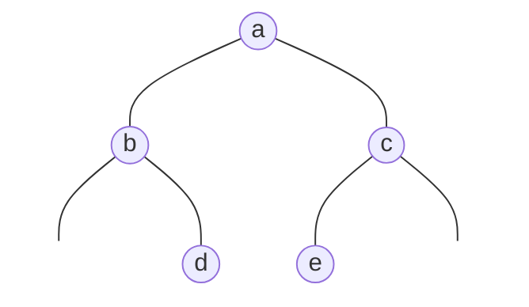
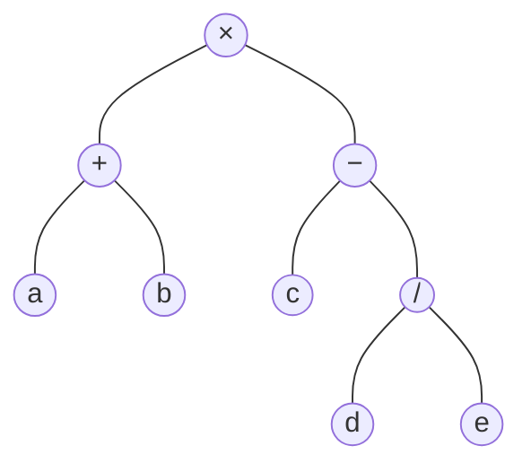

**向量**（[4.3.2](/4.3.2)）可以按**秩**在常数时间内访问元素，但插入和删除要移动大量元素；**列表**（[4.3.3](/4.3.3)）插入和删除只需常数时间，按秩访问却要从头数起。树把两者的长处结合起来：只要树足够"矮"，查找、插入、删除都只需对数时间。树还是表示层次关系的天然工具，表达式、文件系统、URL、程序的语法结构都是树。树不是线性结构，但在规定了某种访问次序（遍历）之后又具有线性的特征，所以称为半线性结构。

本章先在图论的基础上（[1.4.3](/1.4.3)）建立有根树的术语，再集中讨论二叉树：它的性质、实现、四种遍历及其迭代算法，以及由遍历序列重构二叉树。随后的两节是二叉树的两个应用：Huffman 编码树，以及用判定树证明问题的复杂度下界。二叉树是后面几章的基础：二叉搜索树与平衡树（[4.3.6](/4.3.6)–[4.3.8](/4.3.8)）、堆（[4.3.12](/4.3.12)）、Trie（[4.3.13](/4.3.13)）都是二叉树或多叉树的变形。

## 5.1. 树

### 5.1.1. 有根树与有序树

图论中，不含回路的连通图称为树（[1.4.3](/1.4.3)）：$n$ 个节点的树恰有 $n - 1$ 条边，它是极小连通图，也是极大无环图，任意两个节点之间有唯一的路径。数据结构中用到的树几乎都指定了一个节点作为出发点，也就是图论中的**根树**。

**定义 5.1.1（有根树）** 在一棵树中指定一个节点 $r$，称为树的**根**（root），就得到一棵有根树。对任一节点 $v$，记从根到 $v$ 的唯一路径为 $\operatorname{path}(v)$：

- 路径的长度（边数）$\lvert\operatorname{path}(v)\rvert$ 称为 $v$ 的**深度**，记作 $\operatorname{depth}(v)$；根的深度为 $0$。
- $\operatorname{path}(v)$ 上的节点都是 $v$ 的**祖先**，$v$ 是它们的**后代**；除 $v$ 本身以外的祖先、后代称为真祖先、真后代。
- 若 $u$ 是 $v$ 的祖先且 $\operatorname{depth}(u) = \operatorname{depth}(v) - 1$，则 $u$ 是 $v$ 的**父亲**，$v$ 是 $u$ 的**孩子**；同一父亲的孩子互为**兄弟**。节点的孩子数称为它的**度**。
- 没有孩子的节点称为**叶节点**，其余节点称为内部节点。$v$ 及其全部后代构成以 $v$ 为根的**子树**，记作 $\operatorname{subtree}(v)$。
- 子树中叶节点深度（相对于 $v$）的最大值称为 $v$ 的**高度** $\operatorname{height}(v)$；全树的高度 $\operatorname{height}(T)$ 即根的高度。约定空树的高度为 $-1$。

除根以外每个节点恰有一个父亲，每条边恰好连接一个节点与它的父亲，所以所有节点的度数之和等于边数 $n - 1$。衡量树上算法的复杂度时，节点数 $n$ 与边数是同阶的。

在任一深度上，节点 $v$ 的祖先若存在则唯一，后代却未必唯一，这就是"半线性"的含义。对任一节点 $v$ 都有

$$
\operatorname{depth}(v) + \operatorname{height}(v) \le \operatorname{height}(T),
$$

等号成立当且仅当 $v$ 位于从根到某个最深叶节点的路径上。

**定义 5.1.2（有序树）** 若有根树中每个节点的孩子之间规定了次序（第 $1$ 个孩子、第 $2$ 个孩子……），则称为**有序树**。第一个孩子又称长子。

### 5.1.2. 树的表示

作为**抽象数据类型**，树至少应支持以下操作：

| 操作 | 功能 |
|---|---|
| `root()` | 根节点 |
| `parent(v)` | 父节点 |
| `firstChild(v)` | 长子 |
| `nextSibling(v)` | 下一个兄弟 |
| `insert(v, i, e)` | 将 $e$ 作为 $v$ 的第 $i$ 个孩子插入 |
| `remove(v, i)` | 删除 $v$ 的第 $i$ 个孩子及其后代 |
| `traverse()` | 遍历 |

常见的表示方法有三种：

- 父节点表示：把节点存成一个序列，每个节点只记录数据和父节点的秩（根的父节点记为它自己或空）。`parent()` 只需 $O(1)$ 时间，空间也最省；但查找孩子要扫描整个序列，需 $O(n)$ 时间。
- 孩子表示：每个节点用一个序列（**向量**或**列表**）记录它的全部孩子，序列长度就是度数。查找孩子很快，`parent()` 却要 $O(n)$ 时间。
- 父节点 + 孩子表示：两者兼有，各项操作都快，但孩子序列的长度参差不齐，存储与维护都不规整。

下一节的长子-兄弟表示法把任意有序树统一为二叉树，消除了这种不规整。

## 5.2. 二叉树

### 5.2.1. 定义与长子-兄弟表示法

每个节点的度数不超过 $2$、且孩子区分左右的有序树称为**二叉树**：节点 $v$ 的两个孩子（两棵子树）分别称为左孩子 `lc`（左子树）和右孩子 `rc`（右子树）。与图论中的定义（[1.4.3](/1.4.3)）相比，这里强调"左右有别"：即使只有一个孩子，也要说明它是左孩子还是右孩子，两者是不同的二叉树。

**定义 5.2.1（长子-兄弟表示法）** 对一棵有序树，令每个节点的长子作为它的左孩子、下一个兄弟作为它的右孩子，就得到一棵二叉树：`firstChild()` 对应 `lc()`，`nextSibling()` 对应 `rc()`。这种表示称为**长子-兄弟表示法**。

由此，任何有序树（以及若干棵有序树组成的森林）都可以表示为二叉树，研究二叉树就足以涵盖一般的有序树。

### 5.2.2. 基本性质

**性质 5.2.1** 设二叉树中度为 $0$、$1$、$2$ 的节点分别有 $n_0$、$n_1$、$n_2$ 个，则 $n_0 = n_2 + 1$。

**证明** 除根以外，每个节点恰好对应一条从父亲指向它的边，所以边数 $e = n - 1 = n_0 + n_1 + n_2 - 1$。另一方面，度为 $1$ 和 $2$ 的节点分别发出 $1$ 条和 $2$ 条边，$e = n_1 + 2n_2$。两式相减即得。$\square$

特别地，$n_1$ 与 $n_0$ 无关；当 $n_1 = 0$ 时，$e = 2n_2$，$n_0 = n_2 + 1 = (n+1)/2$。

**性质 5.2.2** 二叉树中深度为 $k$ 的节点至多 $2^k$ 个；$n$ 个节点、高度为 $h$ 的二叉树满足

$$
h + 1 \le n \le 2^{h+1} - 1,
$$

从而 $h \ge \lceil \log_2(n+1) \rceil - 1 = \lfloor \log_2 n \rfloor$。

**证明** 每层节点数至多是上一层的两倍，故深度 $k$ 至多 $2^k$ 个节点。$h+1$ 层中每层至少一个节点、至多 $2^k$ 个，求和即得两个不等式。$\square$

下界 $n = h + 1$ 时二叉树退化为一条单链，上界的情形是下面的满二叉树。树的高度决定了大多数树上操作的代价，后面几章的平衡树都是为了让高度尽量接近下界 $\lfloor \log_2 n \rfloor$。

**定义 5.2.2（满二叉树）** 高度为 $h$ 且恰有 $2^{h+1} - 1$ 个节点的二叉树称为**满二叉树**：所有内部节点都有两个孩子，所有叶节点都在最底层。

**定义 5.2.3（真二叉树）** 每个节点的度数都是 $0$ 或 $2$ 的二叉树称为**真二叉树**。

**定义 5.2.4（完全二叉树）** 高度为 $h$ 的二叉树，若深度小于 $h$ 的各层都是满的，并且最底层的节点都集中在最左侧，则称为**完全二叉树**。等价地，把满二叉树的节点按层次、自左向右编号，完全二叉树就是由其中前 $n$ 个节点构成的树。

这三个术语在不同文献中的叫法很不统一，阅读时要注意：

| 本站 | 英文文献中常见的叫法 | 含义 |
|---|---|---|
| 满二叉树 | perfect binary tree（部分中文教材译作"满树"，英文旧文献也有称 full 的） | 每层都满 |
| 真二叉树 | full binary tree，proper binary tree | 节点度数为 $0$ 或 $2$；图论一章（[1.4.3](/1.4.3)）称之为"完全二叉树" |
| 完全二叉树 | complete binary tree | 除最底层外都满，最底层靠左 |

**命题 5.2.3** 为二叉树中每个度数不足 $2$ 的节点补上空缺的孩子（称为外部节点，原有节点称为内部节点），就得到一棵真二叉树；$n$ 个内部节点恰好需要 $n + 1$ 个外部节点。

**证明** 补上之后，原有的 $n$ 个节点度数都是 $2$，新增节点都是叶节点。由性质 5.2.1，叶节点数为 $n + 1$。$\square$

外部节点通常就是程序中的空指针，并不真正分配。把空指针看作节点后，每个内部节点都恰有两个孩子，许多算法的描述和分析都因此变得整齐：红黑树（[4.3.8](/4.3.8)）把外部节点当作黑色节点，B 树把它们看作查找失败的位置。

### 5.2.3. 实现

二叉树的节点记录数据、父亲、左右孩子，以及在不同的树中需要的附加信息，如高度（AVL 树）、颜色（红黑树）、零路径长度（左式堆）。下面的实现中，节点保存自己的高度：插入一个新节点后，只有它的祖先的高度可能变化，因此沿父指针逐个更新，用时 $O(\operatorname{depth}(v))$。这是"勤奋"的策略：每次修改后立即维护附加信息，使查询只需 $O(1)$。`size()` 则采用"懒惰"的策略：需要时才递归统计，用时与子树规模成正比。

```cpp tab
#include <algorithm>
#include <format>
#include <iostream>

template <typename T>
struct BinNode {
    T data;
    BinNode* parent = nullptr;
    BinNode* lc = nullptr;
    BinNode* rc = nullptr;
    int height = 0;                                 // a leaf has height 0

    explicit BinNode(T e, BinNode* p = nullptr) : data(std::move(e)), parent(p) {}
    ~BinNode() { delete lc; delete rc; }            // deleting a node frees its subtree

    BinNode* insert_lc(T e) { lc = new BinNode(std::move(e), this); lc->update_height_above(); return lc; }
    BinNode* insert_rc(T e) { rc = new BinNode(std::move(e), this); rc->update_height_above(); return rc; }

    static int stature(const BinNode* x) { return x ? x->height : -1; }  // empty tree: -1
    void update_height_above() {                    // O(depth): refresh this node and its ancestors
        for (BinNode* x = this; x; x = x->parent)
            x->height = 1 + std::max(stature(x->lc), stature(x->rc));
    }
    int size() const { return 1 + (lc ? lc->size() : 0) + (rc ? rc->size() : 0); }
};

int main() {
    auto* root = new BinNode<char>('a');
    auto* b = root->insert_lc('b');
    root->insert_rc('c');
    b->insert_rc('d')->insert_lc('e');
    std::cout << std::format("size = {}, height = {}, height(b) = {}\n",
                             root->size(), root->height, b->height);
    delete root;
}
```

```python tab
from __future__ import annotations


class BinNode[T]:
    def __init__(self, data: T, parent: BinNode[T] | None = None) -> None:
        self.data = data
        self.parent = parent
        self.lc: BinNode[T] | None = None
        self.rc: BinNode[T] | None = None
        self.height = 0                            # a leaf has height 0

    def insert_lc(self, e: T) -> BinNode[T]:
        self.lc = BinNode(e, self)
        self.lc.update_height_above()
        return self.lc

    def insert_rc(self, e: T) -> BinNode[T]:
        self.rc = BinNode(e, self)
        self.rc.update_height_above()
        return self.rc

    def update_height_above(self) -> None:         # O(depth)
        x: BinNode[T] | None = self
        while x:
            x.height = 1 + max(stature(x.lc), stature(x.rc))
            x = x.parent

    def size(self) -> int:
        return 1 + (self.lc.size() if self.lc else 0) + (self.rc.size() if self.rc else 0)


def stature(x: BinNode | None) -> int:
    return x.height if x else -1                   # empty tree: -1


root = BinNode("a")
b = root.insert_lc("b")
root.insert_rc("c")
b.insert_rc("d").insert_lc("e")
print(f"size = {root.size()}, height = {root.height}, height(b) = {b.height}")
```

C++ 版本中，删除一个节点会通过析构函数递归释放整棵子树；实际的库代码通常用 `std::unique_ptr` 管理孩子（见 [4.3.6](/4.3.6) 的实现），这里为了与父指针配合使用了原始指针。

## 5.3. 遍历

### 5.3.1. 先序、中序与后序

**定义 5.3.1（遍历）** 按照某种次序访问树中的节点，使每个节点恰好被访问一次，称为树的**遍历**。把二叉树写成 $T = L \cup \{x\} \cup R$，其中 $x$ 是根，$L$、$R$ 是左右子树。按根相对于子树的访问次序，有三种递归定义的遍历：

- **先序遍历**：先访问根 $x$，再先序遍历 $L$，最后先序遍历 $R$（$x \mid L \mid R$）；
- **中序遍历**：先中序遍历 $L$，再访问 $x$，最后中序遍历 $R$（$L \mid x \mid R$）；
- **后序遍历**：先后序遍历 $L$，再后序遍历 $R$，最后访问 $x$（$L \mid R \mid x$）。

遍历的结果是一个线性序列，这正是"半线性"的意思：规定了遍历次序，树中的节点就有了前驱和后继。

**例 5.3.1** 对下面这棵二叉树（$d$ 是 $b$ 的右孩子，$e$ 是 $c$ 的左孩子）：



先序序列为 $a\,b\,d\,c\,e$，中序序列为 $b\,d\,a\,e\,c$，后序序列为 $d\,b\,e\,c\,a$，层次序列（[5.3.6](#sec-5.3.6)）为 $a\,b\,c\,d\,e$。

三种遍历各有典型应用。先序遍历按"先目录、后内容"的次序输出文件树；中序遍历是二叉搜索树的灵魂（[4.3.6](/4.3.6)）：二叉搜索树的中序序列就是全部关键码的有序排列；后序遍历先处理子树、再处理根，适合"由子树的结果算出整棵树的结果"，例如计算高度和规模、释放整棵子树。

**例 5.3.2** 算术表达式可以表示为二叉树：叶节点是操作数，内部节点是运算符，其左右子树是两个运算对象。表达式 $(a + b) \times (c - d / e)$ 对应的表达式树为



它的中序序列（加上必要的括号）就是通常的中缀表达式，先序序列 `× + a b − c / d e` 是前缀表达式（波兰表达式），后序序列 `a b + c d e / − ×` 是后缀表达式（逆波兰表达式）。后缀表达式不需要括号，用一个栈就能求值（[4.3.4](/4.3.4)）：对表达式树做后序遍历，恰好就是求值的过程。

三种遍历的递归实现都只有几行（见 [5.3.7](#sec-5.3.7) 中的 `pre_rec`、`in_rec`、`post_rec`），运行时间 $T(n) = T(\lvert L\rvert) + T(\lvert R\rvert) + O(1) = O(n)$。但**递归**依赖系统的**调用栈**，递归深度等于树高，退化的树（如一条长链）会导致**栈溢出**：Linux 默认的栈通常只有 8 MB，Python 默认的递归深度上限只有 1000。更重要的是，迭代版本能让我们看清遍历过程的结构。下面借助显式的**栈**，给出三种遍历的迭代算法。

### 5.3.2. 迭代先序遍历

从根出发，沿左孩子一路向下，经过的节点构成一条路径，称为左侧链（藤）。先序遍历的过程可以沿这条链分解为两个阶段：先自上而下访问链上的节点 $L_0, L_1, \dots, L_d$，再自下而上依次遍历它们的右子树 $T_d, \dots, T_1, T_0$。各右子树的遍历彼此独立，各自又是一个规模更小的先序遍历问题。

**算法 5.3.1（迭代先序遍历）** 维护一个栈。从当前节点出发沿左侧链下行，每到一个节点就访问它，并把它的右孩子（若存在）压入栈；到达链的末端后，从栈中弹出一个节点作为新的当前节点，重复上述过程；栈空时结束。

右子树按下行的次序入栈，按相反的次序出栈，恰好符合"自下而上遍历各右子树"的要求。每个节点至多入栈、出栈各一次，总时间为 $O(n)$。

### 5.3.3. 迭代中序遍历

中序遍历同样沿左侧链分解：沿链下行时并不访问节点，到达链的末端 $L_d$ 后，自底而上地依次"访问 $L_k$，再中序遍历 $L_k$ 的右子树 $T_k$"。

**算法 5.3.2（迭代中序遍历）** 维护一个栈。从当前节点出发沿左侧链下行，把经过的节点逐个压入栈；然后弹出栈顶节点 $x$ 并访问它（此时 $x$ 的左子树或者为空，或者已经遍历完毕），再以 $x$ 的右孩子为当前节点，重复上述过程；栈空时结束。

**命题 5.3.1** 算法 5.3.2 正确地完成中序遍历，且运行时间为 $O(n)$。

**证明** 正确性对规模 $n$ 归纳。设算法对规模不超过 $n$ 的树都正确，考察规模为 $n + 1$ 的树，其根为 $x$。记左侧链的末端为 $t$、$t$ 的右孩子为 $y$。算法依次执行：(X1) 沿 $x$ 的左侧链入栈；(T) 弹出并访问 $t$；(Y) 处理以 $y$ 为根的子树 $T_y$；(X2) 继续处理栈中剩余的节点。$t$ 没有左孩子，所以 (T) 是中序遍历中第一个被访问的节点。(Y) 阶段从 $y$ 出发，栈中原有的节点在此期间不会被弹出，因此它恰好是算法在 $T_y$ 上的完整运行，由归纳假设正确遍历了 $T_y$。(Y) 结束时栈中剩下的恰好是 (X1) 压入的除 $t$ 之外的节点，与 $t$ 和 $T_y$ 从未存在过的情形完全相同，所以 (X2) 正确遍历了删去 $t$ 和 $T_y$ 后的树。三段连起来就是整棵树的中序序列。

复杂度：一次沿左侧链下行可能压入 $\Theta(n)$ 个节点，下行又可能发生 $\Theta(n)$ 次，看起来总时间是 $O(n^2)$。但从整个过程看，每个节点恰好入栈一次、出栈一次，所有下行过程的入栈次数之和就是 $n$，算法的总时间与入栈、出栈的总次数同阶，为 $O(n)$。$\square$

这里用的是**聚合分析**：不逐次估计每一步的代价，而是统计整个过程中的总代价，分摊到每一步只是 $O(1)$。**分摊分析**的一般方法见 [4.3.2](/4.3.2)。

### 5.3.4. 中序后继

中序遍历序列中，节点 $x$ 的下一个节点称为它的直接后继。有了父指针，不用栈也能直接求出后继，从而写出 `for (t = first(); t; t = succ(t))` 这样的简明遍历：

- 若 $x$ 有右孩子，后继是右子树中最靠左的节点：从右孩子出发，沿左孩子走到底。
- 否则，后继是以 $x$ 为直接前驱的节点，即"把 $x$ 包含在左子树中的最低祖先"：沿父指针上行，只要当前节点是其父亲的右孩子就继续上行，最后再上行一步；若一直走到根之上，则 $x$ 是序列的最后一个节点。

两种情形下的运行时间分别不超过 $x$ 的高度和深度，即 $O(h)$。从第一个节点出发反复求后继完成整个遍历，每条边至多被向下、向上各走一次，总时间仍为 $O(n)$。求后继是二叉搜索树删除算法的一部分（[4.3.6](/4.3.6)）。

### 5.3.5. 迭代后序遍历

后序遍历中第一个被访问的节点，是从根出发"尽可能向左、实在不行才向右"一路下行到达的叶节点，即中序次序下最靠左的叶节点（递归版本中 `visit` 首次执行的位置）。

**算法 5.3.3（迭代后序遍历）** 栈中保存待访问的节点，初始时只有根。反复执行：若栈顶不是上一个被访问节点 $x$ 的父亲（而是 $x$ 的右兄弟），则从栈顶节点出发下行到它的子树中最靠左的叶节点，沿途对每个节点，若有左孩子，就先压入右孩子（若存在）、再压入左孩子，否则压入右孩子；然后弹出栈顶并访问它。栈空时结束。

栈顶若是 $x$ 的父亲，说明父亲的两棵子树都已访问完毕，正该访问父亲本身；栈顶若是 $x$ 的右兄弟，说明还要先遍历右兄弟的子树。每个节点入栈、出栈各一次，总时间 $O(n)$。

### 5.3.6. 层次遍历

**定义 5.3.2（层次遍历）** 按深度从小到大、同一深度内自左向右的次序访问节点，称为**层次遍历**。

层次遍历先访问的节点，其孩子也先访问，这是"先进先出"的规律，因此用队列实现：根入队；反复取出队首节点并访问，再把它的左、右孩子依次入队；**队列**为空时结束。它就是图的**广度优先搜索**在树上的特例（[4.3.10](/4.3.10)）。

完全二叉树与层次遍历的关系特别紧密：完全二叉树的层次序列中没有"空位"，所以可以把节点按层次序列存入一个**向量**。设根的秩为 $0$，则秩为 $i$ 的节点的左右孩子的秩分别为 $2i + 1$ 和 $2i + 2$，父亲的秩为 $\lfloor (i-1)/2 \rfloor$，完全不需要指针。这种紧凑表示是二叉堆的基础（[4.3.12](/4.3.12)）。

**性质 5.3.2** 设完全二叉树有 $n$ 个节点，则

1. 高度为 $\lfloor \log_2 n \rfloor$，叶节点只出现在最底部两层；
2. 叶节点有 $\lceil n/2 \rceil$ 个、内部节点有 $\lfloor n/2 \rfloor$ 个，即叶节点不少于内部节点、至多多一个；度数为 $1$ 的节点至多一个；
3. 层次遍历过程中，辅助队列的规模先增后减，最大为 $\lceil n/2 \rceil$。

**证明** (1) 由定义，前 $h$ 层是满的，所以 $2^h \le n \le 2^{h+1} - 1$。(2) 按秩来看，秩为 $i$ 的节点是内部节点当且仅当 $2i + 1 \le n - 1$，即 $i \le \lfloor n/2 \rfloor - 1$，故内部节点有 $\lfloor n/2 \rfloor$ 个；只有秩为 $n/2 - 1$ 的节点（$n$ 为偶数时）度数为 $1$。(3) 访问完前 $k$ 个节点后，入队的节点数为 $1$ 加上这 $k$ 个节点的孩子数。前 $\lfloor (n-1)/2 \rfloor$ 个节点都有两个孩子，故此时队列规模为 $k + 1$，逐步增大；此后每次只出不入（或在 $n$ 为偶数时有一次出一入一），规模不再增加。最大值为 $\lfloor (n-1)/2 \rfloor + 1 = \lceil n/2 \rceil$。$\square$

### 5.3.7. 实现

下面的程序实现了上述各种遍历，并在大量随机生成的二叉树上把迭代版本与递归版本的结果逐一比较（**对拍**）。遍历函数接受任意可调用对象 `visit`，这是 C++ 模板与 Python 一等函数的常见用法。

```cpp tab
#include <format>
#include <iostream>
#include <queue>
#include <random>
#include <stack>
#include <vector>

template <typename T>
struct Node {
    T data;
    Node* parent = nullptr;
    Node* lc = nullptr;
    Node* rc = nullptr;
    Node(T e, Node* p) : data(e), parent(p) {}
    ~Node() { delete lc; delete rc; }
};

// Recursive traversals: visit is any callable taking T
template <typename T, typename F> void pre_rec(Node<T>* x, F&& visit) {
    if (!x) return;
    visit(x->data); pre_rec(x->lc, visit); pre_rec(x->rc, visit);
}
template <typename T, typename F> void in_rec(Node<T>* x, F&& visit) {
    if (!x) return;
    in_rec(x->lc, visit); visit(x->data); in_rec(x->rc, visit);
}
template <typename T, typename F> void post_rec(Node<T>* x, F&& visit) {
    if (!x) return;
    post_rec(x->lc, visit); post_rec(x->rc, visit); visit(x->data);
}

// Iterative preorder: walk down the left vine, visiting nodes and stacking right subtrees
template <typename T, typename F> void pre_iter(Node<T>* x, F&& visit) {
    std::stack<Node<T>*> s;
    while (true) {
        for (; x; x = x->lc) {                      // along the vine
            visit(x->data);
            if (x->rc) s.push(x->rc);               // to be traversed later, in reverse order
        }
        if (s.empty()) break;
        x = s.top(); s.pop();
    }
}

// Iterative inorder: push the left vine; pop, visit, then turn to the right subtree
template <typename T, typename F> void in_iter(Node<T>* x, F&& visit) {
    std::stack<Node<T>*> s;
    while (true) {
        for (; x; x = x->lc) s.push(x);             // go along the vine
        if (s.empty()) break;
        x = s.top(); s.pop();                       // its left subtree is done
        visit(x->data);
        x = x->rc;
    }
}

// Inorder successor using parent pointers, O(h)
template <typename T> Node<T>* succ(Node<T>* x) {
    if (x->rc) {                                    // leftmost node of the right subtree
        x = x->rc;
        while (x->lc) x = x->lc;
        return x;
    }
    while (x->parent && x == x->parent->rc) x = x->parent;  // climb while x is a right child
    return x->parent;                               // the lowest ancestor having x on its left
}

// Iterative postorder: the stack holds nodes still to be visited
template <typename T, typename F> void post_iter(Node<T>* x, F&& visit) {
    std::stack<Node<T>*> s;
    if (x) s.push(x);
    while (!s.empty()) {
        if (s.top() != x->parent) {                 // top is the right sibling of x:
            while (Node<T>* t = s.top()) {          // go to the leftmost leaf of its subtree
                if (t->lc) { if (t->rc) s.push(t->rc); s.push(t->lc); }
                else s.push(t->rc);                 // may push nullptr, which ends the loop
            }
            s.pop();                                // discard the nullptr
        }
        x = s.top(); s.pop();
        visit(x->data);
    }
}

template <typename T, typename F> void level(Node<T>* root, F&& visit) {
    std::queue<Node<T>*> q;
    if (root) q.push(root);
    while (!q.empty()) {
        Node<T>* x = q.front(); q.pop();
        visit(x->data);
        if (x->lc) q.push(x->lc);
        if (x->rc) q.push(x->rc);
    }
}

int main() {
    std::mt19937 rng(2024);
    for (int round = 0; round < 1000; ++round) {      // random trees: attach new nodes at random free slots
        int n = 1 + rng() % 60;
        auto* root = new Node<int>(0, nullptr);
        std::vector<Node<int>*> nodes{root};
        for (int k = 1; k < n; ++k) {
            Node<int>* p = nodes[rng() % nodes.size()];
            Node<int>*& slot = (rng() % 2) ? p->lc : p->rc;
            if (slot) { --k; continue; }
            slot = new Node<int>(k, p);
            nodes.push_back(slot);
        }
        std::vector<int> a, b;
        auto into = [](std::vector<int>& v) { return [&v](int e) { v.push_back(e); }; };
        pre_rec(root, into(a));  pre_iter(root, into(b));  if (a != b) return 1;
        a.clear(); b.clear();
        in_rec(root, into(a));   in_iter(root, into(b));   if (a != b) return 2;
        b.clear();
        Node<int>* first = root;
        while (first->lc) first = first->lc;
        for (Node<int>* t = first; t; t = succ(t)) b.push_back(t->data);
        if (a != b) return 3;
        a.clear(); b.clear();
        post_rec(root, into(a)); post_iter(root, into(b)); if (a != b) return 4;
        delete root;
    }
    // Example: a has children b, c; d is the right child of b; e is the left child of c
    auto* r = new Node<char>('a', nullptr);
    r->lc = new Node<char>('b', r); r->rc = new Node<char>('c', r);
    r->lc->rc = new Node<char>('d', r->lc); r->rc->lc = new Node<char>('e', r->rc);
    auto show = [](char c) { std::cout << std::format("{} ", c); };
    pre_iter(r, show);  std::cout << "| ";
    in_iter(r, show);   std::cout << "| ";
    post_iter(r, show); std::cout << "| ";
    level(r, show);     std::cout << '\n';
    delete r;
}
```

```python tab
from __future__ import annotations

import random
from collections import deque
from collections.abc import Callable, Iterator


class Node[T]:
    def __init__(self, data: T, parent: Node[T] | None = None) -> None:
        self.data, self.parent = data, parent
        self.lc: Node[T] | None = None
        self.rc: Node[T] | None = None


def pre_rec(x: Node | None, visit: Callable) -> None:
    if x:
        visit(x.data); pre_rec(x.lc, visit); pre_rec(x.rc, visit)


def in_rec(x: Node | None, visit: Callable) -> None:
    if x:
        in_rec(x.lc, visit); visit(x.data); in_rec(x.rc, visit)


def post_rec(x: Node | None, visit: Callable) -> None:
    if x:
        post_rec(x.lc, visit); post_rec(x.rc, visit); visit(x.data)


def pre_iter(x: Node | None, visit: Callable) -> None:
    stack: list[Node] = []
    while True:
        while x:                                   # along the left vine
            visit(x.data)
            if x.rc:
                stack.append(x.rc)                 # right subtrees, popped in reverse order
            x = x.lc
        if not stack:
            break
        x = stack.pop()


def in_iter(x: Node | None, visit: Callable) -> None:
    stack: list[Node] = []
    while True:
        while x:                                   # push the left vine
            stack.append(x)
            x = x.lc
        if not stack:
            break
        x = stack.pop()                            # its left subtree is done
        visit(x.data)
        x = x.rc


def succ(x: Node) -> Node | None:
    """Inorder successor via parent pointers, O(h)."""
    if x.rc:                                       # leftmost node of the right subtree
        x = x.rc
        while x.lc:
            x = x.lc
        return x
    while x.parent and x is x.parent.rc:           # climb while x is a right child
        x = x.parent
    return x.parent


def post_iter(x: Node | None, visit: Callable) -> None:
    stack: list[Node | None] = [x] if x else []
    while stack:
        if stack[-1] is not x.parent:              # top is the right sibling of x
            while (t := stack[-1]) is not None:    # go to the leftmost leaf of its subtree
                if t.lc:
                    if t.rc:
                        stack.append(t.rc)
                    stack.append(t.lc)
                else:
                    stack.append(t.rc)             # may push None, which ends the loop
            stack.pop()                            # discard the None
        x = stack.pop()
        visit(x.data)


def level(root: Node | None, visit: Callable) -> None:
    q = deque([root] if root else [])
    while q:
        x = q.popleft()
        visit(x.data)
        if x.lc:
            q.append(x.lc)
        if x.rc:
            q.append(x.rc)


def collect(trav: Callable, root: Node) -> list:
    out: list = []
    trav(root, out.append)
    return out


def inorder_by_succ(root: Node) -> Iterator:
    t = root
    while t.lc:
        t = t.lc
    while t:
        yield t.data
        t = succ(t)


rng = random.Random(2024)
for _ in range(1000):                              # random trees
    nodes = [Node(0)]
    n = rng.randint(1, 60)
    while len(nodes) < n:
        p = rng.choice(nodes)
        side = rng.choice(("lc", "rc"))
        if getattr(p, side) is None:
            setattr(p, side, Node(len(nodes), p))
            nodes.append(getattr(p, side))
    r = nodes[0]
    assert collect(pre_rec, r) == collect(pre_iter, r)
    assert collect(in_rec, r) == collect(in_iter, r) == list(inorder_by_succ(r))
    assert collect(post_rec, r) == collect(post_iter, r)

# Example: a has children b, c; d is the right child of b; e is the left child of c
a = Node("a"); a.lc = Node("b", a); a.rc = Node("c", a)
a.lc.rc = Node("d", a.lc); a.rc.lc = Node("e", a.rc)
for trav in (pre_iter, in_iter, post_iter, level):
    print(*collect(trav, a), end=" | " if trav is not level else "\n")
```

## 5.4. 重构

给出一棵二叉树的遍历序列，能否反过来唯一地确定这棵树？假设各节点的数据互不相同。

**定理 5.4.1** 二叉树由它的中序序列与先序序列（或者中序序列与后序序列）唯一确定。

**证明** 对节点数 $n$ 归纳，$n = 0$ 时显然。设先序序列为 $x \mid \mathrm{pre}(L) \mid \mathrm{pre}(R)$，它的首元素 $x$ 就是根。在中序序列 $\mathrm{in}(L) \mid x \mid \mathrm{in}(R)$ 中找到 $x$，它左边的部分就是左子树的中序序列，由此知道左子树的规模 $\lvert L\rvert$；于是先序序列中 $x$ 之后的 $\lvert L\rvert$ 个元素是左子树的先序序列，其余是右子树的先序序列。两棵子树的规模都小于 $n$，由归纳假设它们被唯一确定，整棵树也就唯一确定。后序序列的情形对称（根是末元素）。$\square$

证明本身就是重构算法：用一个散列表记录每个数据在中序序列中的位置，每个节点的处理只需 $O(1)$ 时间，总时间 $O(n)$。

先序序列与后序序列却不足以确定二叉树。例如，根 $a$ 只有一个孩子 $b$ 时，无论 $b$ 是左孩子还是右孩子，先序序列都是 $a\,b$、后序序列都是 $b\,a$：仅凭两端的根无法判断子序列从哪里分界。不过，若已知是真二叉树，则先序序列中根之后的元素必是左孩子，在后序序列中找到它，就能划分出左右子树，重构仍是唯一的。

另一种办法是增强遍历序列：遍历时把每个空指针也当作一个节点输出（记作 ^）。在增强的先序或后序序列中，任一子树仍对应一个连续的子序列，并且其中的 ^ 恰好比真实节点多一个（命题 5.2.3）。因此，只需从左到右读取增强先序序列并递归地构造：读到 ^ 就返回空树，否则建立根，再依次构造左、右子树。例如

```text
preorder : i d c a ^ b ^ ^ ^ h f e ^ ^ g ^ ^ ^ l j ^ k ^ ^ n m ^ ^ p o ^ ^ ^
inorder  : ^ a ^ b ^ c ^ d ^ e ^ f ^ g ^ h ^ i ^ j ^ k ^ l ^ m ^ n ^ o ^ p ^
postorder: ^ ^ ^ b a ^ c ^ ^ e ^ ^ g f ^ h d ^ ^ ^ k j ^ ^ m ^ ^ o ^ p n l i
```

增强先序序列（或增强后序序列）单独就确定了二叉树，这就是二叉树最常用的序列化格式；增强中序序列则不行，上面的中序序列与树的形状无关。

```cpp tab
#include <format>
#include <iostream>
#include <memory>
#include <optional>
#include <string>
#include <unordered_map>
#include <vector>

template <typename T>
struct Node {
    T data;
    std::unique_ptr<Node> lc, rc;
    explicit Node(T e) : data(std::move(e)) {}
};
template <typename T> using Tree = std::unique_ptr<Node<T>>;

// Rebuild from preorder + inorder (keys must be distinct), O(n) with a hash map
template <typename T> class Rebuilder {
    const std::vector<T>& pre;
    std::unordered_map<T, int> pos;                 // key -> index in the inorder sequence
    int next = 0;                                   // next unused preorder index
    Tree<T> build(int lo, int hi) {                 // subtree whose inorder is in[lo, hi)
        if (lo >= hi) return nullptr;
        auto x = std::make_unique<Node<T>>(pre[next++]);  // the root comes first in preorder
        int mid = pos.at(x->data);                  // splits inorder into L | root | R
        x->lc = build(lo, mid);
        x->rc = build(mid + 1, hi);
        return x;
    }
public:
    Rebuilder(const std::vector<T>& p, const std::vector<T>& in) : pre(p) {
        for (int i = 0; i < static_cast<int>(in.size()); ++i) pos[in[i]] = i;
    }
    Tree<T> run() { return build(0, static_cast<int>(pos.size())); }
};

// Rebuild from an augmented preorder sequence in which nullopt marks an empty subtree
template <typename T> Tree<T> deserialize(const std::vector<std::optional<T>>& seq, std::size_t& i) {
    if (!seq.at(i)) { ++i; return nullptr; }
    auto x = std::make_unique<Node<T>>(*seq[i++]);
    x->lc = deserialize(seq, i);
    x->rc = deserialize(seq, i);
    return x;
}

template <typename T> void postorder(const Tree<T>& x, std::string& out) {
    if (!x) return;
    postorder(x->lc, out); postorder(x->rc, out); out += std::format("{} ", x->data);
}

int main() {
    std::vector<char> pre{'i', 'd', 'c', 'a', 'b', 'h', 'f', 'e', 'g', 'l', 'j', 'k', 'n', 'm', 'p', 'o'};
    std::vector<char> in{'a', 'b', 'c', 'd', 'e', 'f', 'g', 'h', 'i', 'j', 'k', 'l', 'm', 'n', 'o', 'p'};
    auto t = Rebuilder<char>(pre, in).run();
    std::string s;
    postorder(t, s);
    std::cout << std::format("postorder: {}\n", s);

    std::vector<std::optional<char>> aug;           // "i d c a ^ b ^ ^ ^ h f e ^ ^ g ^ ^ ^ ..."
    for (char c : std::string("idca^b^^^hfe^^g^^^lj^k^^nm^^po^^^"))
        aug.push_back(c == '^' ? std::nullopt : std::optional<char>(c));
    std::size_t i = 0;
    auto u = deserialize(aug, i);
    std::string s2;
    postorder(u, s2);
    std::cout << std::format("same tree: {}\n", s == s2);
}
```

```python tab
from __future__ import annotations

from collections.abc import Iterator


class Node[T]:
    def __init__(self, data: T) -> None:
        self.data = data
        self.lc: Node[T] | None = None
        self.rc: Node[T] | None = None


def rebuild[T](pre: list[T], inorder: list[T]) -> Node[T] | None:
    """Rebuild from preorder + inorder (distinct keys), O(n)."""
    pos = {key: i for i, key in enumerate(inorder)}
    it = iter(pre)                                 # roots are consumed in preorder

    def build(lo: int, hi: int) -> Node[T] | None:  # subtree whose inorder is inorder[lo:hi]
        if lo >= hi:
            return None
        x = Node(next(it))
        mid = pos[x.data]                          # splits inorder into L | root | R
        x.lc = build(lo, mid)
        x.rc = build(mid + 1, hi)
        return x

    return build(0, len(inorder))


def deserialize[T](seq: Iterator[T | None]) -> Node[T] | None:
    """Rebuild from an augmented preorder sequence; None marks an empty subtree."""
    key = next(seq)
    if key is None:
        return None
    x = Node(key)
    x.lc = deserialize(seq)
    x.rc = deserialize(seq)
    return x


def postorder(x: Node | None) -> list:
    return postorder(x.lc) + postorder(x.rc) + [x.data] if x else []


t = rebuild(list("idcabhfegljknmpo"), list("abcdefghijklmnop"))
print("postorder:", *postorder(t))
u = deserialize(iter(None if c == "^" else c for c in "idca^b^^^hfe^^g^^^lj^k^^nm^^po^^^"))
print("same tree:", postorder(t) == postorder(u))
```

## 5.5. Huffman 编码

### 5.5.1. 前缀码与编码树

在通信与存储中，要把由字符集 $\Sigma$ 中的字符组成的文本转换为二进制位串（编码），接收方再把位串还原为文本（译码）。最简单的是等长编码，如 ASCII 码；若各字符的编码长度不同，就要防止译码时的歧义：若字符 $X$ 的编码是 `01010`，而字符 $Y$ 的编码 `0101` 恰是它的前缀，读到 `0101` 时就无法判断是否该断开。

**定义 5.5.1（前缀码）** 若一种编码中任何字符的编码都不是另一字符的编码的前缀，则称为**前缀码**。

前缀码与二叉树一一对应。把每个字符 $x$ 放在一棵二叉树的叶节点 $v(x)$ 上，从根到 $v(x)$ 的路径上向左记 `0`、向右记 `1`，得到的位串作为 $x$ 的编码。由于字符都在叶节点上，没有一条根路径是另一条的前缀，这样得到的总是前缀码；反之，任一前缀码的码字都可以这样排成一棵编码树。译码时从根出发，按位串向左或向右走，到达叶节点就输出一个字符并回到根。

编码的效率取决于编码长度。字符 $x$ 的编码长度就是叶节点的深度 $\operatorname{depth}(v(x))$。若各字符出现的频率为 $w(x)$，则编码后的文本总长度为

$$
\operatorname{wald}(T) = \sum_{x \in \Sigma} w(x) \operatorname{depth}(v(x)),
$$

即图论一章中的带权路径长度 WPL（[1.4.3](/1.4.3)）。各字符等频时，它与叶节点的平均深度成正比。使 $\operatorname{wald}(T)$ 最小的编码树称为最优编码树，就是 **Huffman 树**（即最优二叉树）。

最优编码树有以下特征：

1. 双子性：最优编码树是真二叉树。若某个内部节点只有一个孩子，用这个孩子代替它，其子树中所有叶节点的深度都减 $1$，编码长度只会更短。
2. 层次性：任一节点的深度若小于另一节点，它的频率就不应更低；否则交换两者，$\operatorname{wald}$ 减少 $(d_1 - d_2)(w_1 - w_2) \le 0$。特别地，等频时叶节点只能出现在最底部两层，真完全二叉树就是最优的；但各字符频率不同时，完全二叉树不一定最优。例如 `mammamia` 中 m、a、i 的频率为 $4, 3, 1$，等长编码需要 $16$ 位，而 m 用 $1$ 位、a 和 i 用 $2$ 位的编码只需 $4 \cdot 1 + 3 \cdot 2 + 1 \cdot 2 = 12$ 位。

### 5.5.2. Huffman 算法

**算法 5.5.1（Huffman 算法）** 为每个字符建立一棵单节点的树，其权重为该字符的频率，组成森林 $F$。只要 $F$ 中的树多于一棵，就取出权重最小的两棵树 $T_1$、$T_2$，以它们为左、右子树合并成一棵新树，新树根的权重为两者之和，放回 $F$。最后剩下的那棵树就是 Huffman 编码树。

由这棵树得到的前缀码称为 Huffman 编码（Huffman coding）。算法是贪心的：频率低的字符优先合并，因而位置更深。贪心策略一般不保证最优，但 Huffman 算法确实总是给出最优编码树（[定理 3.6.1](/1.4.3#thm-3.6.1)）。证明的要点是：

1. 频率最低的两个字符 $x$、$y$ 必在某棵最优编码树中处于最底层且互为兄弟（任取一棵最优树，把最底层的一对兄弟与 $x$、$y$ 交换，$\operatorname{wald}$ 不增）；
2. 把 $x$、$y$ 合并为一个频率为 $w(x) + w(y)$ 的新字符 $z$，得到字符集 $\Sigma'$。$\Sigma'$ 的任一编码树 $T'$ 中给 $z$ 添上孩子 $x$、$y$，就得到 $\Sigma$ 的一棵编码树 $T$，且 $\operatorname{wald}(T) = \operatorname{wald}(T') + w(x) + w(y)$，差值与 $T'$ 的形状无关；
3. 因此 $T'$ 是 $\Sigma'$ 的最优编码树时，$T$ 也是 $\Sigma$ 的最优编码树之一。Huffman 算法的每一步恰好就是从 $\Sigma$ 转入 $\Sigma'$，对 $\lvert\Sigma\rvert$ 归纳即得。

最优树一般不唯一：交换任一内部节点的左右子树，$\operatorname{wald}$ 不变；频率相等时合并的次序也可以不同。实际应用中常规定"左子树的权重不大于右子树"，或改用由码长唯一确定的规范 Huffman 编码，以便只传输码长就能还原编码表。

信息论给出了编码长度的下限。设字符的出现概率为 $p(x) = w(x) / \sum w$，Huffman 编码的平均码长 $\bar\ell$ 满足

$$
H \le \bar\ell < H + 1, \qquad H = -\sum_{x} p(x) \log_2 p(x),
$$

其中 $H$ 是信源的熵。Huffman 编码是逐字符编码中最优的；要进一步逼近熵，需要把多个字符合并编码，或使用算术编码、ANS 等方法。DEFLATE（gzip、PNG）与 JPEG 使用 Huffman 编码，Zstandard 则同时使用 Huffman 编码与 ANS。

### 5.5.3. 实现与复杂度

算法的效率取决于怎样反复"取出权重最小的两棵树"。设 $n = \lvert\Sigma\rvert$：

| 森林的组织方式 | 初始化 | 每次取出两棵、插回一棵 | 总时间 |
|---|---|---|---|
| 无序列表，每次遍历找最小者 | $O(n)$ | $O(n)$ | $O(n^2)$ |
| 有序向量（非增序，从末端取） | $O(n \log n)$ | 取 $O(1)$，有序插入 $O(n)$ | $O(n^2)$ |
| 优先级队列（堆，[4.3.12](/4.3.12)） | $O(n)$ | $O(\log n)$ | $O(n \log n)$ |
| 预先排序 + 两个队列 | $O(n \log n)$ | $O(1)$ | $O(n \log n)$ |

最后一种方法很巧妙：把叶节点按权重排序后放入第一个**队列**；合并得到的新树依次放入第二个队列。由于先合并的两棵树的权重都不大于后合并的，新树按权重非降的次序产生，第二个队列始终有序。每次只需比较两个队首，就能取出全局最小者。排序之后的部分只需 $O(n)$ 时间；若字符已按频率排好序，整个算法就是线性的。下面的实现采用这种方法，编码表由一次先序遍历生成。

```cpp tab
#include <algorithm>
#include <cstddef>
#include <format>
#include <iostream>
#include <map>
#include <queue>
#include <string>
#include <vector>

class Huffman {
    struct Node { std::size_t weight; char ch; int lc = -1, rc = -1; };
    std::vector<Node> nodes;                        // node pool; children are indices
    int root = -1;
    std::map<char, std::string> table;

    void make_table(int v, std::string& code) {    // root path: left = 0, right = 1
        if (nodes[v].lc < 0) { table[nodes[v].ch] = code.empty() ? "0" : code; return; }
        code.push_back('0'); make_table(nodes[v].lc, code); code.pop_back();
        code.push_back('1'); make_table(nodes[v].rc, code); code.pop_back();
    }

public:
    explicit Huffman(const std::string& text) {
        std::map<char, std::size_t> freq;
        for (char c : text) ++freq[c];
        for (auto [c, w] : freq) nodes.push_back({w, c});
        std::ranges::sort(nodes, {}, &Node::weight);  // leaves by weight (preprocessing)
        // Two FIFO queues: sorted leaves, and merged trees (created in nondecreasing weight)
        std::queue<int> leaves, merged;
        for (int i = 0; i < static_cast<int>(nodes.size()); ++i) leaves.push(i);
        auto pop_min = [&] {
            bool use_leaf = !leaves.empty() &&
                (merged.empty() || nodes[leaves.front()].weight <= nodes[merged.front()].weight);
            std::queue<int>& q = use_leaf ? leaves : merged;
            int v = q.front(); q.pop();
            return v;
        };
        while (leaves.size() + merged.size() > 1) {  // each round: one tree fewer
            int a = pop_min(), b = pop_min();
            nodes.push_back({nodes[a].weight + nodes[b].weight, '\0', a, b});
            merged.push(static_cast<int>(nodes.size()) - 1);
        }
        root = leaves.empty() ? merged.front() : leaves.front();
        std::string code;
        make_table(root, code);
    }
    std::string encode(const std::string& text) const {
        std::string bits;
        for (char c : text) bits += table.at(c);
        return bits;
    }
    std::string decode(const std::string& bits) const {
        std::string out;
        int v = root;
        for (char b : bits) {
            if (nodes[v].lc >= 0) v = (b == '0') ? nodes[v].lc : nodes[v].rc;
            if (nodes[v].lc < 0) { out += nodes[v].ch; v = root; }  // reached a leaf
        }
        return out;
    }
    const std::map<char, std::string>& codes() const { return table; }
};

int main() {
    std::string text = "mammamia";
    Huffman h(text);
    for (auto& [c, code] : h.codes()) std::cout << std::format("{}: {}\n", c, code);
    std::string bits = h.encode(text);
    std::cout << std::format("{} bits: {}, decoded: {}\n", bits.size(), bits, h.decode(bits));
}
```

```python tab
from collections import Counter, deque
from dataclasses import dataclass


@dataclass
class Node:
    weight: int
    ch: str = ""
    lc: "Node | None" = None
    rc: "Node | None" = None


class Huffman:
    def __init__(self, text: str) -> None:
        leaves = deque(sorted((Node(w, c) for c, w in Counter(text).items()),
                              key=lambda v: v.weight))     # preprocessing: sort the leaves
        merged: deque[Node] = deque()              # merged trees appear in nondecreasing weight

        def pop_min() -> Node:
            if leaves and (not merged or leaves[0].weight <= merged[0].weight):
                return leaves.popleft()
            return merged.popleft()

        while len(leaves) + len(merged) > 1:       # each round: one tree fewer
            a, b = pop_min(), pop_min()
            merged.append(Node(a.weight + b.weight, lc=a, rc=b))
        self.root = (leaves or merged)[0]
        self.table: dict[str, str] = {}
        self._make_table(self.root, "")

    def _make_table(self, v: Node, code: str) -> None:  # left = 0, right = 1
        if v.lc is None:
            self.table[v.ch] = code or "0"
            return
        self._make_table(v.lc, code + "0")
        self._make_table(v.rc, code + "1")

    def encode(self, text: str) -> str:
        return "".join(self.table[c] for c in text)

    def decode(self, bits: str) -> str:
        out, v = [], self.root
        for b in bits:
            if v.lc is not None:
                v = v.lc if b == "0" else v.rc
            if v.lc is None:                       # reached a leaf
                out.append(v.ch)
                v = self.root
        return "".join(out)


text = "mammamia"
h = Huffman(text)
for c, code in sorted(h.table.items()):
    print(f"{c}: {code}")
bits = h.encode(text)
print(f"{len(bits)} bits: {bits}, decoded: {h.decode(bits)}")
```

用标准库实现时，C++ 可以用 `std::priority_queue`，Python 可以用 `heapq` 模块，它们都是二叉堆。

## 5.6. 下界：代数判定树

### 5.6.1. 问题的难度

同一问题的不同算法，复杂度可能相差悬殊。若一个问题存在算法，则所有算法中最低的复杂度称为这个问题的难度。确定难度要从两方面着手：设计复杂度更低的算法（上界），以及证明任何算法都不可能更快（下界）。一旦算法的复杂度达到了问题的下界，就说明它在大 $O$ 的意义下已经是最优的。估计复杂度有最好、最坏、平均、分摊等几种口径，其中最坏情况的估计最保守、最可靠，所以首先关心最坏情况最优（worst-case optimal）的算法。

讨论下界必须先确定计算模型。最常用的是比较模型：

**定义 5.6.1（基于比较的算法）** 若算法的执行进程只取决于对输入数据的一系列比较（大小或相等）的结果，则称为**基于比较的算法**。前面的二分查找、起泡排序、归并排序，后面的各种搜索树都是基于比较的算法。

**定义 5.6.2（代数判定树）** 给定输入规模，把算法对所有可能输入所做的判定画成一棵树：每个内部节点对应一次判定，即以输入为变量计算某个次数有界的多项式，按其值的符号（$+$、$0$、$-$）走向不同的孩子；每个叶节点对应一个输出。这棵树称为算法的**代数判定树**。多项式都形如 $K_i - K_j$ 的代数判定树称为**比较树**，它刻画基于比较的算法。

每次运行对应一条从根到叶节点的路径，路径长度就是这次运行所做的判定次数。因此，树高是算法在最坏情况下的判定次数，叶节点的平均深度是平均情况下的判定次数，而树高的下界就是所有这类算法的复杂度下界。

**定理 5.6.1** 任何基于比较的排序算法，在最坏情况下都至少需要 $\Omega(n \log n)$ 次比较。

**证明** $n$ 个互异元素有 $n!$ 种排列，每种排列都需要不同的输出（把它变为有序的那个置换），所以**比较树**至少有 $n!$ 个叶节点。比较树的每个内部节点至多三个分支，高度为 $h$ 的三叉树至多 $3^h$ 个叶节点，故

$$
h \ge \log_3 n! \ge \log_3 \left(\frac{n}{2}\right)^{n/2} = \Omega(n \log n).
$$

$\square$

只考虑大小比较时比较树是二叉的，下界为 $\lceil \log_2 n! \rceil = n \log_2 n - n \log_2 \mathrm{e} + O(\log n)$。由于叶节点的平均深度也至少是 $\log_3 n!$ 的量级，这个下界对平均情况同样成立。归并排序的最坏情况为 $O(n \log n)$，所以它是最坏情况最优的；要突破这一下界，必须使用比较以外的操作，例如桶排序与基数排序（[4.3.9](/4.3.9)）利用了关键码的数值。

### 5.6.2. 归约

除了判定树，归约也是确定下界的有力工具。

**定义 5.6.3（线性归约）** 若问题 $A$ 的任一输入都能在 $O(n)$ 时间内转换为问题 $B$ 的输入，并且 $B$ 的输出能在 $O(n)$ 时间内转换为 $A$ 的输出，则称 $A$ 可以**线性归约**到 $B$，记作 $A \le_N B$。

若 $A \le_N B$，而 $A$ 的下界是 $\Omega(f(n))$（$f(n) = \Omega(n)$），则 $B$ 的下界也是 $\Omega(f(n))$：否则把 $B$ 的快速算法与两次线性转换连起来，就得到 $A$ 的更快的算法。复杂性理论中的多项式时间归约（NP 完全性）是同一思想在更粗的尺度上的运用。

**例 5.6.1** 元素唯一性问题：任给 $n$ 个实数，判断其中是否有相等者。Ben-Or（1983）证明了它在代数判定树模型下需要 $\Omega(n \log n)$ 时间，因此先排序、再检查相邻元素的 $O(n \log n)$ 算法是最优的。平面最近点对问题（求 $n$ 个点中距离最近的两点）可以由它归约而来：把实数 $x_i$ 看作平面上的点 $(x_i, 0)$，最近点对的距离为 $0$ 当且仅当有相等的元素。所以最近点对问题也需要 $\Omega(n \log n)$ 时间。

## 小结

| 主题 | 要点 |
|---|---|
| 有根树（定义 5.1.1、5.1.2） | 深度、高度（空树为 $-1$）、祖先与后代；父节点、孩子、父节点 + 孩子三种表示 |
| 长子-兄弟表示法（定义 5.2.1） | 任何有序树与森林都可表示为二叉树 |
| 二叉树的性质 | $n_0 = n_2 + 1$（性质 5.2.1）；$h + 1 \le n \le 2^{h+1} - 1$，$h \ge \lfloor \log_2 n \rfloor$（性质 5.2.2）；补上外部节点得到真二叉树，$n$ 个内部节点对应 $n + 1$ 个外部节点（命题 5.2.3） |
| 满、真、完全二叉树（定义 5.2.2–5.2.4） | 每层都满 / 度数为 $0$ 或 $2$ / 只有最底层不满且靠左；完全二叉树可按层次序列存入向量，秩为 $i$ 的节点的孩子秩为 $2i + 1$、$2i + 2$（性质 5.3.2） |
| 先序、中序、后序遍历（定义 5.3.1） | 递归 $O(n)$；迭代版本沿左侧链分解，借助栈，每个节点入栈、出栈各一次，$O(n)$（算法 5.3.1–5.3.3，命题 5.3.1）；中序后继 $O(h)$ |
| 层次遍历（定义 5.3.2） | 用队列，即树上的广度优先搜索 |
| 重构（定理 5.4.1） | 中序 + 先序（或后序）唯一确定二叉树，$O(n)$；先序 + 后序不够；增强先序序列单独确定二叉树 |
| Huffman 编码（定义 5.5.1，算法 5.5.1） | 前缀码 = 叶节点上放字符的编码树；贪心地合并权重最小的两棵树得到最优编码树；用堆或"排序 + 两个队列"实现，$O(n \log n)$；平均码长 $H \le \bar\ell < H + 1$ |
| 下界（定义 5.6.1–5.6.3） | 代数判定树的高度给出最坏情况下界：基于比较的排序需要 $\Omega(n \log n)$ 次比较（定理 5.6.1）；线性归约把下界传递给其他问题（例 5.6.1） |
