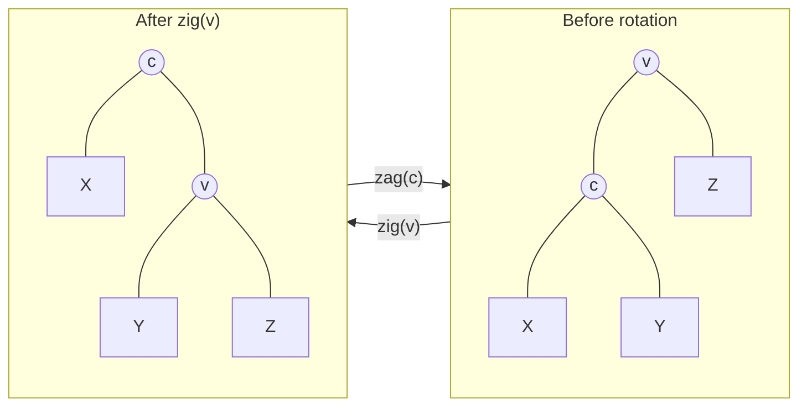
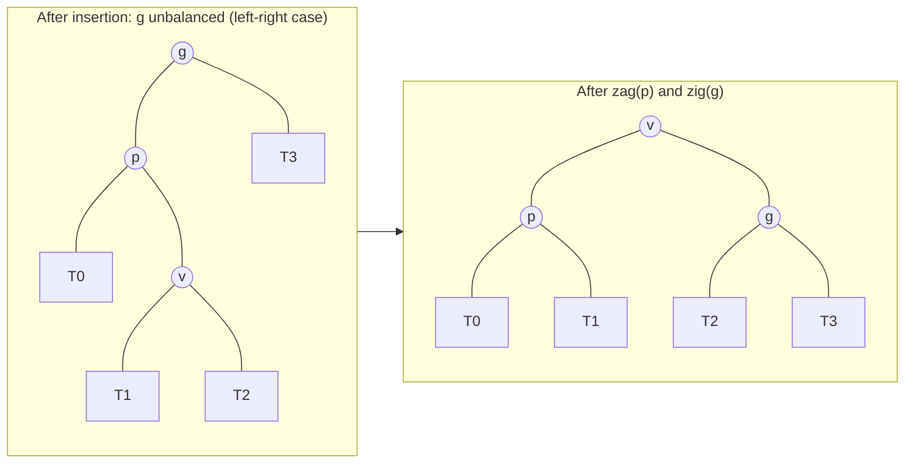
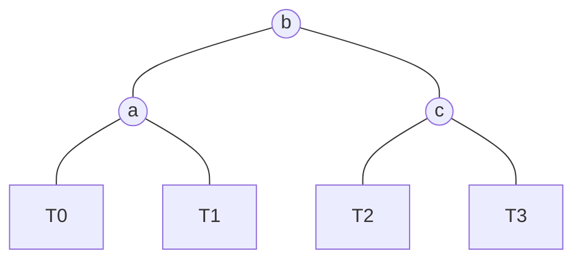

**Vectors** and lists both organize data by position (**rank**), so neither supports efficient search and efficient modification at once. A sorted vector admits **binary search**, but insertion and deletion take $O(n)$ time; a list supports insertion and deletion in $O(1)$ time, but search takes $O(n)$. The binary search trees of this chapter organize data by key and carry the idea of binary search over to binary trees: as long as the height stays $O(\log n)$, search, insertion and deletion all take only $O(\log n)$ time.

We first define binary search trees and their three basic operations, whose costs all depend on the height. We then analyze the height under randomness, which shows why the height must be controlled actively, introduce the notion of balance and the basic tool of rotation, and finally present the first balanced binary search tree, the AVL tree. The next chapter applies search trees to geometric queries, and [4.3.8](/4.3.8) covers splay trees, B-trees and red-black trees. The C++ containers `std::map` and `std::set` are balanced binary search trees implemented as red-black trees ([4.2.10](/4.2.10)).

## 6.1. Access by Key

### 6.1.1. Entries and Keys

| Structure | Search | Insertion, deletion |
|---|---|---|
| Unsorted vector | $O(n)$ | $O(n)$ |
| Sorted vector | $O(\log n)$ | $O(n)$ |
| Unsorted list | $O(n)$ | $O(1)$ (given the position) |
| Sorted list | $O(n)$ | $O(n)$ |

None of the structures in the table supports both static search and dynamic modification. Let us look at the problem differently: instead of accessing data by position (call-by-rank), we distinguish data items by the keys they carry and access them by key (call-by-key). For this, keys must support both comparison and equality testing. Data items are represented uniformly as entries, that is, pairs of a key and a value, and comparing entries means comparing their keys. The element type `std::pair<const Key, T>` of `std::map` in the C++ standard library and the pairs produced by `dict.items()` in Python are entries. For brevity, we write only the keys below.

### 6.1.2. The Ordering Property

**Definition 6.1.1 (Binary Search Tree)** A binary tree in which the key of every node is no less than all keys in its left subtree and no greater than all keys in its right subtree is called a **binary search tree** (BST). This condition is called the ordering property.

Note that the ordering property constrains a node against all of its descendants, not only its two children: the condition "every node is no less than its left child and no greater than its right child" is weaker and does not guarantee global order. To simplify the discussion, we assume in this chapter that keys are pairwise distinct. Duplicate keys are natural in applications and not hard to handle algorithmically (for example, by the convention that equal keys go to the right subtree, or by keeping a count in each node); `std::multiset` is a container of this kind.

The ordering property is purely local, yet it yields a global characterization:

**Theorem 6.1.1** A binary tree is a binary search tree if and only if its inorder traversal sequence is monotonically nondecreasing.

**Proof** Necessity, by induction on the height: let the root be $x$ and let both subtrees be binary search trees. By the induction hypothesis, their inorder sequences are each monotone. The inorder sequence is $\mathrm{in}(L) \mid x \mid \mathrm{in}(R)$; by the ordering property, all elements of $\mathrm{in}(L)$ are at most $x$ and all elements of $\mathrm{in}(R)$ are at least $x$, so the whole sequence is monotone. Sufficiency: if the inorder sequence is monotone, then for any node $x$, all nodes of its left subtree precede $x$ in the inorder sequence and all nodes of its right subtree follow $x$, so they are at most and at least $x$, respectively. $\square$

A binary search tree can therefore be viewed as another representation of a sorted vector: the inorder sequence is the sorted sequence, and nodes, entries and keys are in one-to-one correspondence.

## 6.2. Search, Insertion and Deletion

### 6.2.1. Search

To search for a key $e$, we start at the root and compare $e$ with the current node. If they are equal, the search succeeds; if $e$ is smaller, we descend into the left subtree; if larger, into the right subtree; reaching an empty tree means failure. This is **decrease and conquer**: every comparison eliminates one subtree. In terms of the inorder sequence, the whole process imitates the **binary search** on a sorted vector, except that the "midpoint" is determined by the shape of the tree rather than by rank.

In the implementation, the search returns a "position": on success it refers to the target node; on failure it refers to the empty position to which the search last tried to turn. We may imagine this empty position as a **sentinel node** with key $e$; it is exactly where $e$ should be inserted. The search also records the parent $\mathit{hot}$ of this position, which both insertion and deletion need. In C++, a position is a reference to a `std::unique_ptr` (the link that owns a subtree), and assigning to it modifies the tree directly. Python has no such references, so the search returns the parent $\mathit{hot}$, which modifies its child.

The search time is proportional to the depth of the returned position, hence $O(h)$ in the worst case, where $h$ is the height of the tree.

### 6.2.2. Insertion

To insert $e$, we first search for $e$. If it is already present, nothing is inserted; otherwise the empty position returned by the search is where the new node is created, and its parent is $\mathit{hot}$. The new node is always a leaf. If the tree stores auxiliary information such as node heights, the heights of all ancestors of the new node must be updated. The time is again $O(h)$.

### 6.2.3. Deletion

To delete $e$, we first locate the target node $x$ and then distinguish two cases:

1. One branch: if some subtree of $x$ is empty, we replace $x$ directly by the other subtree (which may also be empty). The parent $\mathit{hot}$ of the deleted node now points to this subtree, and the ordering property clearly persists.
2. Two branches: if both subtrees of $x$ are nonempty, we find the immediate successor $w$ of $x$ in inorder, that is, the leftmost node of the right subtree ([4.3.5](/4.3.5)). The node $w$ necessarily has no left child. We swap the data of $x$ and $w$, which reduces the problem to deleting $w$, case 1. The ordering property is temporarily violated after the swap but restored once $w$ is deleted.

The time of deletion is spent on the search and on finding the successor, which together descend along a single path, so the total is $O(h)$.

### 6.2.4. Implementation

In the implementation below, search, insertion and deletion are all iterative. The test program performs two hundred thousand random operations and compares each result against a standard-library ordered set (`std::set` in C++, a Python `set` together with sorting).

```cpp tab
#include <algorithm>
#include <format>
#include <iostream>
#include <memory>
#include <random>
#include <set>
#include <vector>

template <typename K>
class BST {
    struct Node {
        K key;
        std::unique_ptr<Node> lc, rc;
        explicit Node(K k) : key(std::move(k)) {}
    };
    using Link = std::unique_ptr<Node>;             // a "position": the link that owns a subtree
    Link root;
    std::size_t n = 0;

    // Return the link where key is, or where it would be inserted (an empty link)
    Link& search_in(const K& key) {
        Link* v = &root;
        while (*v && (*v)->key != key)
            v = (key < (*v)->key) ? &(*v)->lc : &(*v)->rc;
        return *v;
    }
    static int height(const Link& x) {
        return x ? 1 + std::max(height(x->lc), height(x->rc)) : -1;
    }
    static void inorder(const Link& x, std::vector<K>& out) {
        if (!x) return;
        inorder(x->lc, out); out.push_back(x->key); inorder(x->rc, out);
    }

public:
    bool contains(const K& key) { return search_in(key) != nullptr; }

    bool insert(const K& key) {
        Link& v = search_in(key);
        if (v) return false;                        // already present
        v = std::make_unique<Node>(key);            // the new node is always a leaf
        ++n;
        return true;
    }

    bool remove(const K& key) {
        Link& v = search_in(key);
        if (!v) return false;
        if (v->lc && v->rc) {                       // two children: take the successor's key
            Link* w = &v->rc;
            while ((*w)->lc) w = &(*w)->lc;         // leftmost node of the right subtree
            v->key = std::move((*w)->key);
            *w = std::move((*w)->rc);               // the successor has no left child
        } else {                                    // at most one child: splice it in
            v = std::move(v->lc ? v->lc : v->rc);
        }
        --n;
        return true;
    }

    std::size_t size() const { return n; }
    int height() const { return height(root); }
    std::vector<K> keys() const { std::vector<K> out; inorder(root, out); return out; }
};

int main() {
    std::mt19937 rng(1);
    BST<int> t;
    std::set<int> ref;                              // reference implementation
    for (int step = 0; step < 200000; ++step) {
        int key = static_cast<int>(rng() % 2000);
        switch (rng() % 3) {
            case 0: if (t.insert(key) != ref.insert(key).second) return 1; break;
            case 1: if (t.remove(key) != (ref.erase(key) == 1)) return 2; break;
            default: if (t.contains(key) != ref.contains(key)) return 3;
        }
    }
    if (t.keys() != std::vector<int>(ref.begin(), ref.end())) return 4;
    std::cout << std::format("ok: {} keys, height {}\n", t.size(), t.height());
}
```

```python tab
from __future__ import annotations

import random


class Node[K]:
    __slots__ = ("key", "lc", "rc")

    def __init__(self, key: K) -> None:
        self.key = key
        self.lc: Node[K] | None = None
        self.rc: Node[K] | None = None


class BST[K]:
    def __init__(self) -> None:
        self.root: Node[K] | None = None
        self.size = 0

    def _search(self, key: K) -> tuple[Node[K] | None, Node[K] | None]:
        """Return (hot, v): v holds key (or is None), hot is the parent of v."""
        hot, v = None, self.root
        while v and v.key != key:
            hot, v = v, (v.lc if key < v.key else v.rc)
        return hot, v

    def _relink(self, parent: Node[K] | None, old: Node[K], new: Node[K] | None) -> None:
        if parent is None:
            self.root = new
        elif parent.lc is old:
            parent.lc = new
        else:
            parent.rc = new

    def __contains__(self, key: K) -> bool:
        return self._search(key)[1] is not None

    def insert(self, key: K) -> bool:
        hot, v = self._search(key)
        if v:
            return False                           # already present
        x = Node(key)                              # the new node is always a leaf
        if hot is None:
            self.root = x
        elif key < hot.key:
            hot.lc = x
        else:
            hot.rc = x
        self.size += 1
        return True

    def remove(self, key: K) -> bool:
        hot, v = self._search(key)
        if v is None:
            return False
        if v.lc and v.rc:                          # two children: take the successor's key
            hot, w = v, v.rc
            while w.lc:                            # leftmost node of the right subtree
                hot, w = w, w.lc
            v.key = w.key
            self._relink(hot, w, w.rc)             # the successor has no left child
        else:                                      # at most one child: splice it in
            self._relink(hot, v, v.lc or v.rc)
        self.size -= 1
        return True

    def keys(self) -> list[K]:
        out: list[K] = []
        stack: list[Node[K]] = []
        x = self.root
        while stack or x:                          # iterative inorder traversal
            while x:
                stack.append(x)
                x = x.lc
            x = stack.pop()
            out.append(x.key)
            x = x.rc
        return out


rng = random.Random(1)
t, ref = BST[int](), set()
for _ in range(200_000):
    key, op = rng.randrange(2000), rng.randrange(3)
    if op == 0:
        assert t.insert(key) == (key not in ref); ref.add(key)
    elif op == 1:
        assert t.remove(key) == (key in ref); ref.discard(key)
    else:
        assert (key in t) == (key in ref)
assert t.keys() == sorted(ref)
print(f"ok: {t.size} keys")
```

## 6.3. Tree Height

### 6.3.1. The Worst Case and Two Notions of Randomness

The times of search, insertion and deletion are proportional to the height, so a binary search tree has no advantage unless its height can be controlled. In the worst case (for instance, when keys are inserted in increasing order), it degenerates completely into a **list** of height $n - 1$, and because of its more complex structure its constant factor is even larger than that of a list. What is the height "on average"? That depends on how "random" is interpreted.

The random-insertion model: $n$ distinct keys are inserted one by one in a random order, with all $n!$ orders equally likely.

**Theorem 6.3.1** In a binary search tree built by random insertion, the expected average depth of a node is

$$
2\left(1 + \frac{1}{n}\right) H_n - 4 = 2 \ln n + O(1) \approx 1.386 \log_2 n,
$$

where $H_n = \sum_{k=1}^{n} 1/k$ is the harmonic number.

**Proof** Let $D(n)$ be the expected sum of the depths of all nodes (the internal path length). The first inserted key becomes the root, and it is the $k$-th smallest with probability $1/n$; the left and right subtrees are then randomly built trees on $k - 1$ and $n - k$ keys, and the other $n - 1$ nodes are one level deeper than they are in their subtrees. Hence

$$
D(n) = n - 1 + \frac{1}{n}\sum_{k=1}^{n} \bigl(D(k-1) + D(n-k)\bigr) = n - 1 + \frac{2}{n}\sum_{k=0}^{n-1} D(k).
$$

Multiplying both sides by $n$ and subtracting the same identity for $n - 1$ gives $nD(n) - (n+1)D(n-1) = 2(n - 1)$. Dividing by $n(n+1)$ and summing term by term yields $D(n) = 2(n+1)H_n - 4n$, and dividing by $n$ gives the claim. $\square$

This **recurrence relation** is identical to the one for the expected number of comparisons of randomized quicksort ([4.1.11](/4.1.11), [4.3.14](/4.3.14)): the comparison with the root during insertion corresponds exactly to the comparison with the pivot in quicksort. The analysis of the height (the depth of the deepest node) is much harder:

**Theorem 6.3.2** In a binary search tree built by random insertion, the expected height is $O(\log n)$. More precisely, Devroye (1986) proved that the expected height is asymptotic to $\alpha \ln n \approx 4.311 \ln n$, where $\alpha$ is the root greater than $2$ of the equation $\alpha \ln(2\mathrm{e}/\alpha) = 1$.

**Proof** (the $O(\log n)$ part) Let $Y_n = 2^{h_n}$, where $h_n$ is the height of the tree, with the conventions $Y_0 = 0$ and $Y_1 = 1$. If the root is the $k$-th smallest, then $Y_n = 2\max(Y_{k-1}, Y_{n-k}) \le 2(Y_{k-1} + Y_{n-k})$, and taking expectations gives $\mathbb{E}[Y_n] \le \frac{4}{n}\sum_{k=0}^{n-1}\mathbb{E}[Y_k]$. Induction on $n$ verifies that $\mathbb{E}[Y_n] \le \frac{1}{4}\binom{n+3}{3}$ (using $\sum_{k=0}^{n-1}\binom{k+3}{3} = \binom{n+3}{4}$). The function $2^x$ is convex, so by Jensen's inequality $2^{\mathbb{E}[h_n]} \le \mathbb{E}[Y_n] = O(n^3)$, and hence $\mathbb{E}[h_n] \le 3\log_2 n + O(1)$. $\square$

The random-shape model: every binary search tree that can be formed from $n$ distinct keys is regarded as equally likely. Since the inorder sequence is fixed, such trees correspond one-to-one to the shapes of binary trees with $n$ nodes, and there are

$$
S(n) = \sum_{k=1}^{n} S(k-1)\,S(n-k) = \frac{1}{n+1}\binom{2n}{n}
$$

of them, a **Catalan number** (the root is the $k$-th smallest key, and the left and right subtrees are formed independently). Flajolet and Odlyzko (1982) proved that in this model the expected height is asymptotic to $2\sqrt{\pi n}$.


### 6.3.2. Why Balance Is Needed

The two models give very different average heights: $\Theta(\log n)$ versus $\Theta(\sqrt{n})$. The random-insertion model is closer to how trees are actually built, but it counts shorter trees multiple times (a given shape can arise from several insertion orders, and the shorter the tree, the more orders produce it), and so it is optimistic; the random-shape model is pessimistic. More fundamentally, ideal randomness rarely occurs in practice: real data often exhibit locality, correlation, piecewise monotonicity or periodicity; for instance, data inserted by timestamp or auto-incremented ID are almost sorted. Deletion also destroys randomness: always replacing the deleted node by its successor makes the tree gradually lean to the left, and after a long run of random insertions and deletions the average depth can grow to the order of $\Theta(\sqrt{n})$ (a model analysis by Culberson and Munro); alternating randomly between predecessor and successor mitigates this.

It is therefore no surprise that tall, even very tall, binary search trees occur frequently. To guarantee worst-case performance, the height must be controlled actively during modifications.

## 6.4. Balance and Equivalence Transformations

### 6.4.1. Ideal Balance and Asymptotic Balance

For a fixed number of nodes, the closer the heights of sibling subtrees, the shorter the whole tree. By Property 5.2.2, a binary tree with $n$ nodes has height at least $\lfloor \log_2 n \rfloor$ ([4.3.5](/4.3.5)); a tree attaining this lower bound is called ideally balanced, which is roughly the same as a **complete binary tree**. Ideal balance is too demanding: maintaining it after every insertion or deletion may require large changes to the structure, which is too expensive. We therefore relax the requirement: it suffices that the height is asymptotically $O(\log n)$.

**Definition 6.4.1 (Balanced Binary Search Tree)** A class of binary search trees in which a tree with $n$ nodes always has height $O(\log n)$ is called asymptotically balanced, and its members are called **balanced binary search trees** (BBST).

Each kind of balanced binary search tree is a subset of the binary search trees satisfying a carefully designed constraint; for example, AVL trees limit the height difference of sibling subtrees, and red-black trees limit the distribution of red and black nodes along paths ([4.3.8](/4.3.8)). The key points of the design are:

1. After a single insertion or deletion, at most $O(\log n)$ places locally violate the constraint (possibly one after another rather than all at once);
2. These places, and hence the whole tree, can be made to satisfy the constraint again in $O(\log n)$ time.

The tool for the second point is the equivalence transformation below.

### 6.4.2. Equivalence Transformations and Rotations

**Definition 6.4.2 (Equivalence Transformation)** Two binary search trees with the same inorder sequence are called **equivalent**. Turning a binary search tree into another equivalent one is called an **equivalence transformation**.

Equivalent binary search trees are "variable vertically and fixed horizontally": the parent-child relations among nodes may differ, and ancestor-descendant relations may even be reversed, but the inorder is exactly the same. The most basic equivalence transformation is the rotation.

**Definition 6.4.3 (Rotation)** Let a node $v$ have a left child $c$. Let $c$ take the place of $v$, let $v$ become the right child of $c$, and let the former right subtree of $c$ become the left subtree of $v$. This operation is called a clockwise **rotation** about $v$, written $\mathrm{zig}(v)$ (right rotation). Symmetrically, when $v$ has a right child, the counterclockwise rotation about $v$ is written $\mathrm{zag}(v)$ (left rotation).



The inorder sequence on both sides is $X \mid c \mid Y \mid v \mid Z$, so a rotation is an equivalence transformation. It involves only a constant number of nodes and modifies only a constant number of pointers, so it is a local operation taking $O(1)$ time. After the rotation, the depth of $c$ decreases by $1$ and the depth of $v$ increases by $1$; the subtree $X$ as a whole rises one level and $Z$ as a whole drops one level, and the height of the subtree (and of the whole tree) changes by at most $1$.

**Proposition 6.4.1** Any two binary search trees on the same set of keys can be transformed into each other by at most $2n - 2$ rotations.

**Proof** We first show that any tree can be turned into a "right chain" (every node has no left child) by at most $n - 1$ right rotations. Consider the path that starts at the root and keeps going right: if some node on it has a left child, we rotate right about that node, so that the left child rises onto this path and the length of the path increases by $1$. Each right rotation adds one node to the right path, which has at most $n$ nodes, so at most $n - 1$ rotations are needed. The right chain is uniquely determined by the inorder sequence, so two equivalent trees can both be turned into the same right chain; reversing the rotation sequence of one of them (the inverse of a right rotation is a left rotation) gives a transformation from one tree to the other. $\square$

Hence a binary search tree that has just become unbalanced can always be restored to balance by equivalence transformations. The point of balanced binary search trees is that $O(\log n)$, or even $O(1)$, rotations suffice.

## 6.5. AVL Trees

### 6.5.1. Balance Factor and Height

**Definition 6.5.1 (AVL Tree)** The **balance factor** of a node $v$ is the height difference of its left and right subtrees

$$
\operatorname{balFac}(v) = \operatorname{height}(\operatorname{lc}(v)) - \operatorname{height}(\operatorname{rc}(v)),
$$
where the height of an empty tree is taken to be $-1$. A binary search tree in which every node satisfies $\lvert\operatorname{balFac}(v)\rvert \le 1$ is called an **AVL tree** (G. Adelson-Velsky and E. Landis, 1962).

An AVL tree need not be ideally balanced, but it is always asymptotically balanced:

**Theorem 6.5.1** An AVL tree of height $h$ has at least $\operatorname{fib}(h+3) - 1$ nodes, where $\operatorname{fib}(0) = 0$ and $\operatorname{fib}(1) = 1$ define the Fibonacci numbers. Consequently, the height of an AVL tree with $n$ nodes satisfies

$$
h \le \log_\varphi(n+1) - 1 < 1.4405 \log_2 (n+1), \qquad \varphi = \frac{1+\sqrt5}{2}.
$$

**Proof** Let $S(h)$ be the minimum number of nodes of an AVL tree of height $h$. Then $S(-1) = 0$ and $S(0) = 1$. In an AVL tree of height $h$ with the fewest nodes, one subtree of the root has height $h - 1$ and the other has height at least $h - 2$ (by the balance condition), and both must be AVL trees with the fewest nodes for their heights, so

$$
S(h) = 1 + S(h-1) + S(h-2).
$$

Let $T(h) = S(h) + 1$. Then $T(h) = T(h-1) + T(h-2)$ with $T(-1) = 1 = \operatorname{fib}(2)$ and $T(0) = 2 = \operatorname{fib}(3)$, so $T(h) = \operatorname{fib}(h+3)$. Induction readily shows $\operatorname{fib}(k) \ge \varphi^{k-2}$, so $n + 1 \ge \operatorname{fib}(h+3) \ge \varphi^{h+1}$, and taking logarithms gives the height bound. $\square$

The "thinnest" AVL trees that attain the lower bound are called Fibonacci trees: the two subtrees of the root are Fibonacci trees of heights $h-1$ and $h-2$. A more refined calculation (Knuth) gives $h < 1.4405 \log_2(n+2) - 1.3277$. Thus an AVL tree is at most about 44% taller than an ideally balanced tree.

### 6.5.2. Imbalance and Rebalancing

After an insertion or deletion by the rules of binary search trees, the AVL condition may be violated, but only the balance factors of ancestors of the modified position can change. The imbalance caused by the two operations differs in an essential way:

- Insertion: the grandparent of the new node $x$ and any higher ancestor may become unbalanced, possibly several at the same time;
- Deletion: the parent of the deleted node and any higher ancestor may become unbalanced, but at most one at any moment. This is because an ancestor $g$ can become unbalanced only when its shorter subtree gets even shorter, whereas the height of $g$ is determined by its taller subtree and is unchanged, so higher ancestors are unaffected.

Balance is restored by equivalence transformations. Let $g$ be the lowest unbalanced node, let $p$ be the taller child of $g$, and let $v$ be the taller child of $p$ (if the two children have equal height, take the one on the same side as $p$).

Rebalancing after an insertion has two cases:

- If $p$ and $v$ are on the same side (both left children or both right children), we perform a single rotation about $g$: $\mathrm{zig}(g)$ if $v$ and $p$ are both left children, and $\mathrm{zag}(g)$ if both are right children.
- If $p$ and $v$ are on opposite sides, we perform a double rotation: first rotate about $p$ so that $v$ rises to the position of $p$, then rotate about $g$. For example, when $p$ is a left child and $v$ is a right child, we perform $\mathrm{zag}(p)$ followed by $\mathrm{zig}(g)$.



In either case, the height of the subtree after the adjustment returns to its height before the insertion, so higher ancestors also regain balance and the whole tree is rebalanced. An insertion thus needs at most one single rotation or one double rotation, that is, $O(1)$ rotations; the time is spent mainly on the search and on updating heights along the path, $O(\log n)$ in total.

After a deletion, rebalancing uses exactly the same adjustments, but the height of the subtree is not necessarily restored: it may be $1$ smaller than before the deletion, so higher ancestors may become unbalanced in turn, and the imbalance can propagate upward along the path. A deletion therefore has to go up level by level, adjusting each unbalanced ancestor it finds; in the worst case it performs $\Theta(\log n)$ rotations, and the total time is still $O(\log n)$.

### 6.5.3. Trinode Restructuring

The four cases of single and double rotations (zig-zig, zig-zag, zag-zig, zag-zag) can be handled uniformly. At the lowest unbalanced node $g$, we consider the three generations $g$, $p$, $v$ along the longest branch and rename them $a < b < c$ in inorder; together they own four subtrees (possibly empty), which we also name $T_0 < T_1 < T_2 < T_3$ in inorder. The result of the adjustment is then always:



That is, $b$ becomes the root, $a$ and $c$ its left and right children, and the four subtrees hang in order under $a$ and $c$. The resulting tree has the same inorder sequence as before (an equivalence transformation), the heights of $a$ and $c$ differ by at most $1$, and $b$ is balanced as well. This splicing of "3 nodes + 4 subtrees" is called *trinode restructuring*; it needs no case analysis on the direction of rotations, is the simplest to implement, and is a basic operation used many times in red-black trees ([4.3.8](/4.3.8)).

### 6.5.4. Implementation

The implementation below is recursive: on the way back from an insertion or deletion, `rebalance` is called for each ancestor; it updates the height and performs a single or double rotation if necessary. Since the height of an AVL tree is $O(\log n)$, the recursion depth is no problem. When the deleted node has two children, `pop_min` removes the minimum node of the right subtree (the successor) and its key is moved up. The test program periodically verifies the heights and balance conditions of all nodes during random operations, and finally inserts $2^{20}$ keys in increasing order: a plain binary search tree would degenerate into a chain of height $2^{20} - 1$, whereas the height of the AVL tree is exactly $20$.

```cpp tab
#include <algorithm>
#include <cmath>
#include <format>
#include <iostream>
#include <memory>
#include <random>
#include <set>
#include <vector>

template <typename K>
class AVL {
    struct Node {
        K key;
        int height = 0;
        std::unique_ptr<Node> lc, rc;
        explicit Node(K k) : key(std::move(k)) {}
    };
    using Link = std::unique_ptr<Node>;
    Link root;
    std::size_t n = 0;

    static int h(const Link& x) { return x ? x->height : -1; }
    static void update(Link& x) { x->height = 1 + std::max(h(x->lc), h(x->rc)); }
    static int balance(const Link& x) { return h(x->lc) - h(x->rc); }

    static void rotate_right(Link& g) {             // zig(g): the left child rises
        Link p = std::move(g->lc);
        g->lc = std::move(p->rc);
        update(g);
        p->rc = std::move(g);
        g = std::move(p);
        update(g);
    }
    static void rotate_left(Link& g) {              // zag(g): the right child rises
        Link p = std::move(g->rc);
        g->rc = std::move(p->lc);
        update(g);
        p->lc = std::move(g);
        g = std::move(p);
        update(g);
    }
    // Restore |balance| <= 1 at g, assuming both subtrees are AVL trees
    static void rebalance(Link& g) {
        update(g);
        if (balance(g) > 1) {                       // left side too tall
            if (balance(g->lc) < 0) rotate_left(g->lc);   // zig-zag: double rotation
            rotate_right(g);
        } else if (balance(g) < -1) {               // right side too tall
            if (balance(g->rc) > 0) rotate_right(g->rc);  // zag-zig: double rotation
            rotate_left(g);
        }
    }
    bool insert(Link& x, const K& key) {
        if (!x) { x = std::make_unique<Node>(key); ++n; return true; }
        if (key == x->key) return false;
        bool ok = insert(key < x->key ? x->lc : x->rc, key);
        if (ok) rebalance(x);                       // only ancestors of the new leaf
        return ok;
    }
    static K pop_min(Link& x) {                     // remove the minimum of a nonempty subtree
        if (!x->lc) { K k = std::move(x->key); x = std::move(x->rc); return k; }
        K k = pop_min(x->lc);
        rebalance(x);
        return k;
    }
    bool remove(Link& x, const K& key) {
        if (!x) return false;
        if (key < x->key) { if (!remove(x->lc, key)) return false; }
        else if (x->key < key) { if (!remove(x->rc, key)) return false; }
        else {
            --n;
            if (!x->lc || !x->rc) { x = std::move(x->lc ? x->lc : x->rc); return true; }
            x->key = pop_min(x->rc);                // two children: take the successor's key
        }
        rebalance(x);                               // every ancestor may need it
        return true;
    }
    static bool check(const Link& x, int& height) {  // verify heights and the AVL condition
        if (!x) { height = -1; return true; }
        int hl, hr;
        if (!check(x->lc, hl) || !check(x->rc, hr)) return false;
        height = 1 + std::max(hl, hr);
        return height == x->height && std::abs(hl - hr) <= 1;
    }
    static void inorder(const Link& x, std::vector<K>& out) {
        if (x) { inorder(x->lc, out); out.push_back(x->key); inorder(x->rc, out); }
    }

public:
    bool insert(const K& key) { return insert(root, key); }
    bool remove(const K& key) { return remove(root, key); }
    bool contains(const K& key) const {
        for (Node* x = root.get(); x; x = key < x->key ? x->lc.get() : x->rc.get())
            if (x->key == key) return true;
        return false;
    }
    std::size_t size() const { return n; }
    int height() const { return h(root); }
    bool valid() const { int ht; return check(root, ht); }
    std::vector<K> keys() const { std::vector<K> out; inorder(root, out); return out; }
};

int main() {
    std::mt19937 rng(7);
    AVL<int> t;
    std::set<int> ref;
    for (int step = 0; step < 200000; ++step) {
        int key = static_cast<int>(rng() % 5000);
        if (rng() % 2) { if (t.insert(key) != ref.insert(key).second) return 1; }
        else if (t.remove(key) != (ref.erase(key) == 1)) return 2;
        if (step % 1000 == 0 && !t.valid()) return 3;
    }
    if (t.keys() != std::vector<int>(ref.begin(), ref.end()) || t.size() != ref.size()) return 4;
    AVL<int> s;                                     // sorted insertions: a plain BST would be a chain
    for (int k = 0; k < (1 << 20); ++k) s.insert(k);
    std::cout << std::format("ok; 2^20 sorted keys -> height {} (bound {:.1f})\n",
                             s.height(), 1.4405 * std::log2((1 << 20) + 2) - 1.3277);
}
```

```python tab
from __future__ import annotations

import random


class Node[K]:
    __slots__ = ("key", "height", "lc", "rc")

    def __init__(self, key: K) -> None:
        self.key, self.height = key, 0
        self.lc: Node[K] | None = None
        self.rc: Node[K] | None = None


def h(x: Node | None) -> int:
    return x.height if x else -1


def update(x: Node) -> None:
    x.height = 1 + max(h(x.lc), h(x.rc))


def balance(x: Node) -> int:
    return h(x.lc) - h(x.rc)


def rotate_right(g: Node) -> Node:                 # zig(g); returns the new subtree root
    p = g.lc
    g.lc, p.rc = p.rc, g
    update(g); update(p)
    return p


def rotate_left(g: Node) -> Node:                  # zag(g)
    p = g.rc
    g.rc, p.lc = p.lc, g
    update(g); update(p)
    return p


def rebalance(g: Node) -> Node:
    update(g)
    if balance(g) > 1:                             # left side too tall
        if balance(g.lc) < 0:
            g.lc = rotate_left(g.lc)               # zig-zag: double rotation
        return rotate_right(g)
    if balance(g) < -1:                            # right side too tall
        if balance(g.rc) > 0:
            g.rc = rotate_right(g.rc)              # zag-zig: double rotation
        return rotate_left(g)
    return g


class AVL[K]:
    def __init__(self) -> None:
        self.root: Node[K] | None = None
        self.size = 0

    def __contains__(self, key: K) -> bool:
        x = self.root
        while x and x.key != key:
            x = x.lc if key < x.key else x.rc
        return x is not None

    def insert(self, key: K) -> bool:
        def ins(x: Node[K] | None) -> Node[K]:
            if x is None:
                self.size += 1
                return Node(key)
            if key < x.key:
                x.lc = ins(x.lc)
            elif x.key < key:
                x.rc = ins(x.rc)
            else:
                return x                           # already present: nothing changes
            return rebalance(x)

        old = self.size
        self.root = ins(self.root)
        return self.size > old

    def remove(self, key: K) -> bool:
        def pop_min(x: Node[K]) -> tuple[Node[K] | None, K]:
            if x.lc is None:
                return x.rc, x.key
            x.lc, k = pop_min(x.lc)
            return rebalance(x), k

        def rem(x: Node[K] | None) -> Node[K] | None:
            if x is None:
                return None
            if key < x.key:
                x.lc = rem(x.lc)
            elif x.key < key:
                x.rc = rem(x.rc)
            else:
                self.size -= 1
                if x.lc is None or x.rc is None:
                    return x.lc or x.rc
                x.rc, x.key = pop_min(x.rc)        # two children: take the successor's key
            return rebalance(x)

        old = self.size
        self.root = rem(self.root)
        return self.size < old


def check(x: Node | None) -> int:                  # height, verifying the AVL condition
    if x is None:
        return -1
    hl, hr = check(x.lc), check(x.rc)
    assert abs(hl - hr) <= 1 and x.height == 1 + max(hl, hr)
    return x.height


def keys(x: Node | None) -> list:
    return keys(x.lc) + [x.key] + keys(x.rc) if x else []


rng = random.Random(7)
t, ref = AVL[int](), set()
for step in range(100_000):
    key = rng.randrange(5000)
    if rng.randrange(2):
        assert t.insert(key) == (key not in ref); ref.add(key)
    else:
        assert t.remove(key) == (key in ref); ref.discard(key)
    if step % 1000 == 0:
        check(t.root)
assert keys(t.root) == sorted(ref) and t.size == len(ref)
s = AVL[int]()
for k in range(1 << 16):                           # sorted insertions
    s.insert(k)
print(f"ok; 2^16 sorted keys -> height {h(s.root)}")
```

In the C++ version, rotations transfer ownership directly between `std::unique_ptr`s: `Link& g` is the link to the subtree root itself, and after a rotation it points to the new subtree root, so the parent does not need to know what happened. In the Python version, the rotation functions return the new subtree root, and the caller reattaches it.

### 6.5.5. Evaluation

The advantages of AVL trees are that search, insertion and deletion are all $O(\log n)$ in the worst case and the space is $O(n)$; they are among the "shortest" balanced binary search trees, so search is fastest. The disadvantages are:

- every node must record an extra height or balance factor;
- rotations after insertions and deletions are costly, and a deletion may need $\Theta(\log n)$ rotations (Knuth's experiments show only about $0.21$ on average);
- a single modification may change the topology of the whole tree by as much as $\Theta(\log n)$, which is unfavorable for concurrent access that requires locking and for persistent structures that must keep historical versions.

Red-black trees reduce the structural change per modification to $O(1)$, splay trees record no balance information at all and rely on amortization for efficiency, and B-trees are designed for external memory; these are the subject of [4.3.8](/4.3.8).

In actual languages, the C++ standard library's `std::set` and `std::map` and their `multi` versions are implemented as red-black trees. Python has no built-in balanced search tree: `dict` and `set` are hash tables ([4.3.9](/4.3.9)); when order is needed, one can use the `bisect` module for binary search and insertion in a sorted list (insertion is $O(n)$, but the constant for moving elements is very small) or the third-party library `sortedcontainers` (see [4.2.10](/4.2.10)).

## Summary

| Topic | Key points |
|---|---|
| Binary search tree (Definition 6.1.1) | Every node is no less than all keys in its left subtree and no greater than all keys in its right subtree; equivalently, the inorder sequence is nondecreasing (Theorem 6.1.1) |
| Search, insertion, deletion | Each descends along one path, $O(h)$; the empty position returned by an unsuccessful search is where to insert; deletion of a node with two children first swaps it with its inorder successor |
| Average height | Random insertion order: average depth $2\ln n + O(1)$ (Theorem 6.3.1), expected height $O(\log n)$ (Theorem 6.3.2); uniformly random shape: expected height about $2\sqrt{\pi n}$; in the worst case the tree degenerates into a list of height $n - 1$ |
| Balanced binary search tree (Definition 6.4.1) | Height always $O(\log n)$; after one update only $O(\log n)$ places are out of balance, and they can be repaired in $O(\log n)$ time |
| Equivalence transformations and rotations (Definitions 6.4.2, 6.4.3) | zig / zag preserve the inorder sequence in $O(1)$ time; any two equivalent trees can be transformed into each other by at most $2n - 2$ rotations (Proposition 6.4.1) |
| AVL tree (Definition 6.5.1) | Balance factor $\lvert\operatorname{balFac}(v)\rvert \le 1$; height $< 1.4405 \log_2(n+1)$ (Theorem 6.5.1) |
| Rebalancing AVL trees | Insertion: at most one single or double rotation restores the whole tree; deletion: imbalance may propagate upward, $O(\log n)$ rotations in the worst case; the four cases are unified by trinode restructuring |
