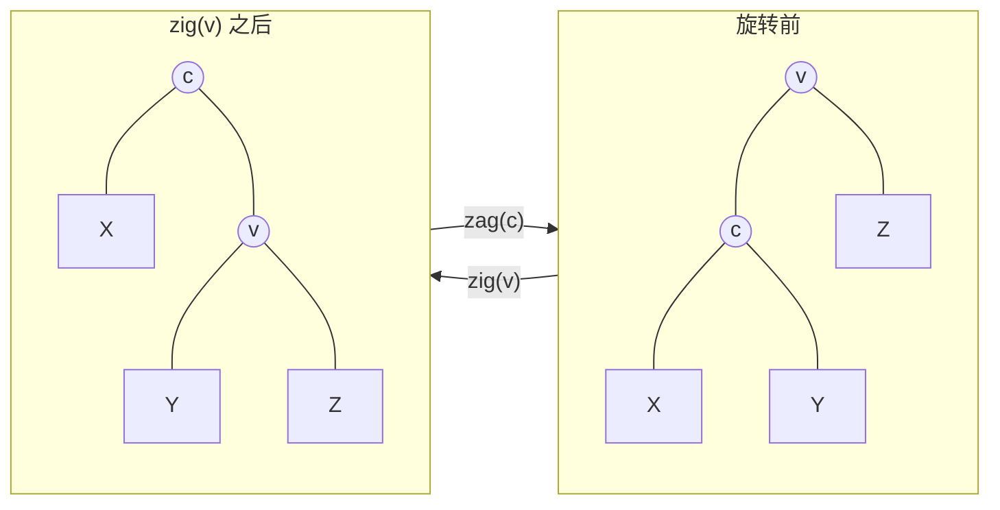
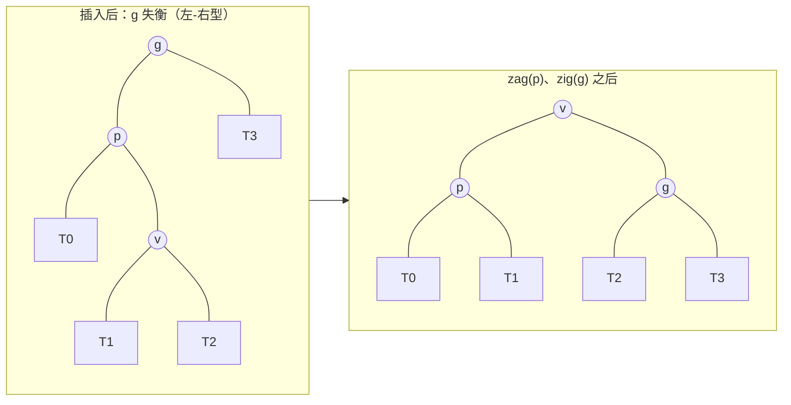
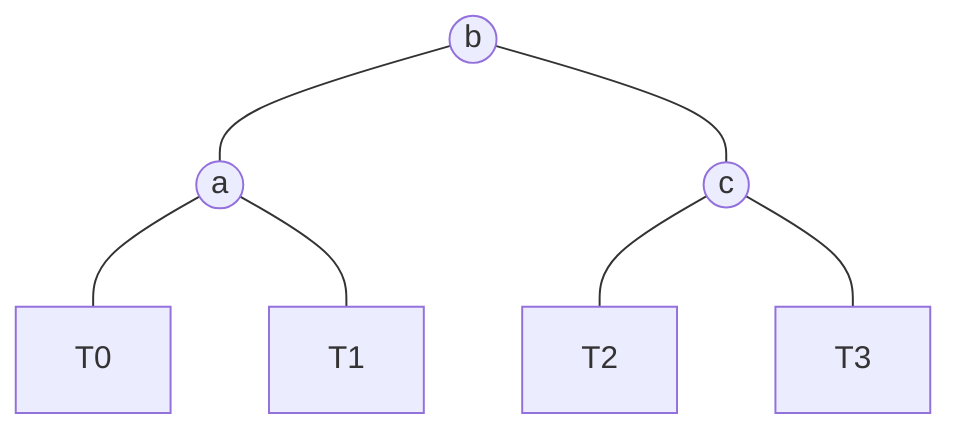

**向量**和列表都按位置（**秩**）组织数据，无法同时兼顾高效的查找与高效的修改：有序向量可以**二分查找**，插入和删除却要 $O(n)$ 时间；列表插入和删除只需 $O(1)$，查找却要 $O(n)$。本章的二叉搜索树按关键码组织数据，把二分查找的思想搬到二叉树上：只要树高控制在 $O(\log n)$，查找、插入、删除就都只需 $O(\log n)$ 时间。

本章先给出二叉搜索树的定义与三种基本操作，它们的代价都取决于树高；接着分析随机情况下的树高，说明为什么必须主动控制树高；然后引入平衡的概念与旋转这一基本工具，最后讲第一种平衡二叉搜索树：AVL 树。下一章讨论搜索树在几何查询中的应用，[4.3.8](/4.3.8) 讨论伸展树、B 树与红黑树。C++ 的 `std::map`、`std::set` 就是用红黑树实现的平衡二叉搜索树（[4.2.10](/4.2.10)）。

## 6.1. 循关键码访问

### 6.1.1. 词条与关键码

| 结构 | 查找 | 插入、删除 |
|---|---|---|
| 无序向量 | $O(n)$ | $O(n)$ |
| 有序向量 | $O(\log n)$ | $O(n)$ |
| 无序列表 | $O(n)$ | $O(1)$（已知位置时） |
| 有序列表 | $O(n)$ | $O(n)$ |

上表中没有一种结构能兼顾静态查找与动态修改。换一个角度：不再按位置（call-by-rank）访问，而是让每个数据项按它所持有的关键码互相区分、按关键码访问（call-by-key）。为此关键码之间必须同时支持比较大小与判断相等。数据项统一表示为词条（entry），即关键码（key）与数值（value）组成的对，比较词条就是比较它们的关键码。C++ 标准库中 `std::map` 的元素类型 `std::pair<const Key, T>`、Python 中 `dict.items()` 给出的二元组，都是词条。下面为简洁起见，只写关键码。

### 6.1.2. 顺序性

**定义 6.1.1（二叉搜索树）** 若二叉树中任一节点的关键码都不小于其左子树中的所有关键码、不大于其右子树中的所有关键码，则称之为**二叉搜索树**（BST）。这一条件称为顺序性。

注意顺序性约束的是节点与它的全部后代，而不仅是它的两个孩子："每个节点不小于左孩子、不大于右孩子"是更弱的条件，不能保证整体有序。为简化叙述，本章暂且假定关键码互不相等。允许重复关键码在应用中很自然，算法上也不难处理（例如约定相等者放入右子树，或在节点中计数），`std::multiset` 就是这样的容器。

顺序性只刻画局部，却导出了整体的特征：

**定理 6.1.1** 二叉树是二叉搜索树，当且仅当它的中序遍历序列单调非降。

**证明** 必要性对树高归纳：设根为 $x$，左右子树都是二叉搜索树，由归纳假设，它们的中序序列各自单调。中序序列为 $\mathrm{in}(L) \mid x \mid \mathrm{in}(R)$，由顺序性，$\mathrm{in}(L)$ 中的元素都不大于 $x$，$\mathrm{in}(R)$ 中的元素都不小于 $x$，所以整个序列单调。充分性：若中序序列单调，对任一节点 $x$，它的左子树的所有节点在中序序列中都位于 $x$ 之前，右子树的都在 $x$ 之后，因而分别不大于、不小于 $x$。$\square$

于是，二叉搜索树可以看作有序向量的另一种表示：中序序列就是有序序列，节点、词条与关键码三者一一对应。

## 6.2. 查找、插入与删除

### 6.2.1. 查找

查找关键码 $e$ 时，从根出发与当前节点比较：相等则成功；$e$ 较小则深入左子树，较大则深入右子树；到达空树则失败。这是**减治**：每次比较都排除一棵子树。对照中序序列，整个过程就是在模仿有序向量的**二分查找**，只不过"中点"由树的形状而不是秩决定。

实现时让查找返回一个"位置"：成功时它指向目标节点，失败时指向查找最后试图转向的那个空位置。不妨把这个空位置想象成一个关键码为 $e$ 的**哨兵节点**，它正是 $e$ 应该被插入的地方。同时记录这个位置的父节点 $\mathit{hot}$，插入和删除都要用到它。C++ 中用指向 `std::unique_ptr` 的引用表示位置（拥有子树的那个链接），对它赋值就直接修改了树；Python 没有这种引用，就返回父节点 $\mathit{hot}$，由它修改孩子。

查找的时间正比于返回位置的深度，最坏情况下为 $O(h)$，$h$ 是树高。

### 6.2.2. 插入

插入 $e$ 时，先查找 $e$：若已存在则不插入；否则查找返回的空位置就是插入的位置，在那里建立新节点，它的父亲就是 $\mathit{hot}$。新节点总是叶节点。若树中保存了节点高度等附加信息，还要更新新节点各祖先的高度。时间同样是 $O(h)$。

### 6.2.3. 删除

删除 $e$ 时，先查找到目标节点 $x$，然后分两种情况：

1. 单分支：$x$ 的某棵子树为空，则直接用另一棵子树（可能也是空树）替代 $x$。被删节点的父亲 $\mathit{hot}$ 改为指向这棵子树，顺序性显然保持。
2. 双分支：$x$ 的两棵子树都非空，则找到 $x$ 在中序意义下的直接后继 $w$，即右子树中最靠左的节点（[4.3.5](/4.3.5)）。$w$ 必然没有左孩子。交换 $x$ 与 $w$ 的数据，问题就转化为删除 $w$，属于情况 1。交换之后顺序性曾一度不满足，但删除 $w$ 后又恢复了。

删除的时间消耗于查找与求后继，两者合计也只是沿一条路径下行，总共 $O(h)$。

### 6.2.4. 实现

下面的实现中，查找、插入、删除都是迭代的。测试程序做二十万次随机操作，每次都与标准库的有序集合（C++ 的 `std::set`、Python 的 `set` 配合排序）比较结果。

```cpp tab
#include <algorithm>
#include <format>
#include <iostream>
#include <memory>
#include <random>
#include <set>
#include <vector>

template <typename K>
class BST {
    struct Node {
        K key;
        std::unique_ptr<Node> lc, rc;
        explicit Node(K k) : key(std::move(k)) {}
    };
    using Link = std::unique_ptr<Node>;             // a "position": the link that owns a subtree
    Link root;
    std::size_t n = 0;

    // Return the link where key is, or where it would be inserted (an empty link)
    Link& search_in(const K& key) {
        Link* v = &root;
        while (*v && (*v)->key != key)
            v = (key < (*v)->key) ? &(*v)->lc : &(*v)->rc;
        return *v;
    }
    static int height(const Link& x) {
        return x ? 1 + std::max(height(x->lc), height(x->rc)) : -1;
    }
    static void inorder(const Link& x, std::vector<K>& out) {
        if (!x) return;
        inorder(x->lc, out); out.push_back(x->key); inorder(x->rc, out);
    }

public:
    bool contains(const K& key) { return search_in(key) != nullptr; }

    bool insert(const K& key) {
        Link& v = search_in(key);
        if (v) return false;                        // already present
        v = std::make_unique<Node>(key);            // the new node is always a leaf
        ++n;
        return true;
    }

    bool remove(const K& key) {
        Link& v = search_in(key);
        if (!v) return false;
        if (v->lc && v->rc) {                       // two children: take the successor's key
            Link* w = &v->rc;
            while ((*w)->lc) w = &(*w)->lc;         // leftmost node of the right subtree
            v->key = std::move((*w)->key);
            *w = std::move((*w)->rc);               // the successor has no left child
        } else {                                    // at most one child: splice it in
            v = std::move(v->lc ? v->lc : v->rc);
        }
        --n;
        return true;
    }

    std::size_t size() const { return n; }
    int height() const { return height(root); }
    std::vector<K> keys() const { std::vector<K> out; inorder(root, out); return out; }
};

int main() {
    std::mt19937 rng(1);
    BST<int> t;
    std::set<int> ref;                              // reference implementation
    for (int step = 0; step < 200000; ++step) {
        int key = static_cast<int>(rng() % 2000);
        switch (rng() % 3) {
            case 0: if (t.insert(key) != ref.insert(key).second) return 1; break;
            case 1: if (t.remove(key) != (ref.erase(key) == 1)) return 2; break;
            default: if (t.contains(key) != ref.contains(key)) return 3;
        }
    }
    if (t.keys() != std::vector<int>(ref.begin(), ref.end())) return 4;
    std::cout << std::format("ok: {} keys, height {}\n", t.size(), t.height());
}
```

```python tab
from __future__ import annotations

import random


class Node[K]:
    __slots__ = ("key", "lc", "rc")

    def __init__(self, key: K) -> None:
        self.key = key
        self.lc: Node[K] | None = None
        self.rc: Node[K] | None = None


class BST[K]:
    def __init__(self) -> None:
        self.root: Node[K] | None = None
        self.size = 0

    def _search(self, key: K) -> tuple[Node[K] | None, Node[K] | None]:
        """Return (hot, v): v holds key (or is None), hot is the parent of v."""
        hot, v = None, self.root
        while v and v.key != key:
            hot, v = v, (v.lc if key < v.key else v.rc)
        return hot, v

    def _relink(self, parent: Node[K] | None, old: Node[K], new: Node[K] | None) -> None:
        if parent is None:
            self.root = new
        elif parent.lc is old:
            parent.lc = new
        else:
            parent.rc = new

    def __contains__(self, key: K) -> bool:
        return self._search(key)[1] is not None

    def insert(self, key: K) -> bool:
        hot, v = self._search(key)
        if v:
            return False                           # already present
        x = Node(key)                              # the new node is always a leaf
        if hot is None:
            self.root = x
        elif key < hot.key:
            hot.lc = x
        else:
            hot.rc = x
        self.size += 1
        return True

    def remove(self, key: K) -> bool:
        hot, v = self._search(key)
        if v is None:
            return False
        if v.lc and v.rc:                          # two children: take the successor's key
            hot, w = v, v.rc
            while w.lc:                            # leftmost node of the right subtree
                hot, w = w, w.lc
            v.key = w.key
            self._relink(hot, w, w.rc)             # the successor has no left child
        else:                                      # at most one child: splice it in
            self._relink(hot, v, v.lc or v.rc)
        self.size -= 1
        return True

    def keys(self) -> list[K]:
        out: list[K] = []
        stack: list[Node[K]] = []
        x = self.root
        while stack or x:                          # iterative inorder traversal
            while x:
                stack.append(x)
                x = x.lc
            x = stack.pop()
            out.append(x.key)
            x = x.rc
        return out


rng = random.Random(1)
t, ref = BST[int](), set()
for _ in range(200_000):
    key, op = rng.randrange(2000), rng.randrange(3)
    if op == 0:
        assert t.insert(key) == (key not in ref); ref.add(key)
    elif op == 1:
        assert t.remove(key) == (key in ref); ref.discard(key)
    else:
        assert (key in t) == (key in ref)
assert t.keys() == sorted(ref)
print(f"ok: {t.size} keys")
```

## 6.3. 树高

### 6.3.1. 最坏情况与两种随机口径

查找、插入、删除的时间都正比于树高，所以若不能控制树高，二叉搜索树就没有优势：最坏情况下（如按递增次序插入），它彻底退化为一个**列表**，树高 $n - 1$，而且因为结构更复杂，常数还比列表大。那么在"平均"情况下树高如何？这取决于怎样理解"随机"。

随机生成的口径：$n$ 个互异关键码按随机的次序依次插入，$n!$ 种次序等可能。

**定理 6.3.1** 随机生成的二叉搜索树中，节点的平均深度的期望为

$$
2\left(1 + \frac{1}{n}\right) H_n - 4 = 2 \ln n + O(1) \approx 1.386 \log_2 n,
$$

其中 $H_n = \sum_{k=1}^{n} 1/k$ 是调和数。

**证明** 记 $D(n)$ 为全部节点深度之和（内部路径长度）的期望。第一个插入的关键码是根，它是第 $k$ 小的概率为 $1/n$；此时左右子树分别是 $k - 1$ 个和 $n - k$ 个关键码的随机生成树，而其余 $n - 1$ 个节点的深度都比在子树中多 $1$。于是

$$
D(n) = n - 1 + \frac{1}{n}\sum_{k=1}^{n} \bigl(D(k-1) + D(n-k)\bigr) = n - 1 + \frac{2}{n}\sum_{k=0}^{n-1} D(k).
$$

两边乘以 $n$，与 $n - 1$ 时的同一等式相减，得 $nD(n) - (n+1)D(n-1) = 2(n - 1)$。两边除以 $n(n+1)$ 并逐项累加，解得 $D(n) = 2(n+1)H_n - 4n$，除以 $n$ 即得。$\square$

这个**递推式**与随机快速排序的期望比较次数完全相同（[4.1.11](/4.1.11)、[4.3.14](/4.3.14)）：插入时与根的比较，恰好对应快速排序中与枢轴的比较。树高（最深节点的深度）的分析要困难得多：

**定理 6.3.2** 随机生成的二叉搜索树，高度的期望为 $O(\log n)$。更精确地，Devroye（1986）证明了高度的期望渐近于 $\alpha \ln n \approx 4.311 \ln n$，其中 $\alpha$ 是方程 $\alpha \ln(2\mathrm{e}/\alpha) = 1$ 大于 $2$ 的根。

**证明**（$O(\log n)$ 部分）记 $Y_n = 2^{h_n}$，$h_n$ 是树高，并约定 $Y_0 = 0$、$Y_1 = 1$。根是第 $k$ 小时 $Y_n = 2\max(Y_{k-1}, Y_{n-k}) \le 2(Y_{k-1} + Y_{n-k})$，取期望得 $\mathbb{E}[Y_n] \le \frac{4}{n}\sum_{k=0}^{n-1}\mathbb{E}[Y_k]$。对 $n$ 归纳可以验证 $\mathbb{E}[Y_n] \le \frac{1}{4}\binom{n+3}{3}$（用到 $\sum_{k=0}^{n-1}\binom{k+3}{3} = \binom{n+3}{4}$）。函数 $2^x$ 是凸的，由 Jensen 不等式，$2^{\mathbb{E}[h_n]} \le \mathbb{E}[Y_n] = O(n^3)$，故 $\mathbb{E}[h_n] \le 3\log_2 n + O(1)$。$\square$

随机组成的口径：把 $n$ 个互异关键码所能组成的每一棵二叉搜索树看作等可能的。由于中序序列固定，这样的树与 $n$ 个节点的二叉树形状一一对应，共有 **Catalan 数**

$$
S(n) = \sum_{k=1}^{n} S(k-1)\,S(n-k) = \frac{1}{n+1}\binom{2n}{n}
$$

棵（根取第 $k$ 小的关键码，左右子树独立地组成）。Flajolet 与 Odlyzko（1982）证明了这一口径下高度的期望渐近于 $2\sqrt{\pi n}$。


### 6.3.2. 为什么需要平衡

两种口径给出的平均树高相差悬殊：$\Theta(\log n)$ 与 $\Theta(\sqrt{n})$。随机生成的口径更贴近树的实际生成方式，但它把较矮的树计算了多次（同一形状可以由多种插入次序得到，越矮的树对应的次序越多），因而偏于乐观；随机组成的口径则偏于悲观。更根本的问题是，理想的随机在实际中很难出现：实际的数据往往有局部性、关联性、分段单调性或周期性，例如按时间戳、自增编号插入的数据几乎是有序的。删除操作也会破坏随机性：总是用后继代替被删节点，会使树逐渐向左倾斜，长期随机地插入和删除之后平均深度可以增长到 $\Theta(\sqrt{n})$ 的量级（Culberson 与 Munro 的模型分析），随机交替地使用前驱与后继可以缓解这一现象。

所以，较高甚至极高的二叉搜索树频繁出现并不奇怪。要保证最坏情况下的性能，必须在修改操作中主动地控制树高。

## 6.4. 平衡与等价变换

### 6.4.1. 理想平衡与渐近平衡

节点数固定时，兄弟子树的高度越接近，全树越矮。由性质 5.2.2，$n$ 个节点的二叉树高度不低于 $\lfloor \log_2 n \rfloor$（[4.3.5](/4.3.5)）；达到这一下界时称为理想平衡，大致相当于**完全二叉树**。理想平衡的条件过于苛刻：每次插入或删除后要维持它，可能需要大幅改变树的结构，代价太高。退一步，只要高度渐近地不超过 $O(\log n)$ 就足够了。

**定义 6.4.1（平衡二叉搜索树）** 若一类二叉搜索树中，$n$ 个节点的树的高度总是 $O(\log n)$，则称这类树是渐近平衡的，称为**平衡二叉搜索树**（BBST）。

各种平衡二叉搜索树都是二叉搜索树的某个子集，满足精心设计的限制条件，例如 AVL 树限制兄弟子树的高度差，红黑树限制路径上红黑节点的分布（[4.3.8](/4.3.8)）。设计的关键在于：

1. 单次插入或删除之后，至多 $O(\log n)$ 处局部不再满足限制条件（可能相继违反，未必同时）；
2. 能在 $O(\log n)$ 时间内使这些局部以至全树重新满足条件。

完成第 2 点的工具，是下面的等价变换。

### 6.4.2. 等价变换与旋转

**定义 6.4.2（等价变换）** 若两棵二叉搜索树的中序序列相同，则称它们**等价**。把一棵二叉搜索树变为与之等价的另一棵，称为**等价变换**。

等价的二叉搜索树"上下可变、左右不乱"：节点间的父子关系可以不同，甚至祖先与后代的关系可以颠倒，但中序次序完全一致（"序齿不序爵"）。最基本的等价变换是旋转。

**定义 6.4.3（旋转）** 设节点 $v$ 有左孩子 $c$。令 $c$ 取代 $v$ 的位置，$v$ 成为 $c$ 的右孩子，$c$ 原来的右子树改作 $v$ 的左子树，这一操作称为绕 $v$ 的顺时针**旋转**，记作 $\mathrm{zig}(v)$（右旋）。对称地，$v$ 有右孩子时，绕 $v$ 的逆时针旋转记作 $\mathrm{zag}(v)$（左旋）。



两边的中序序列都是 $X \mid c \mid Y \mid v \mid Z$，所以旋转是等价变换。它只涉及常数个节点，只需修改常数个指针，是 $O(1)$ 时间的局部操作。旋转之后，$c$ 的深度减 $1$、$v$ 的深度加 $1$，子树 $X$ 整体上升一层，$Z$ 整体下降一层，子树（以及全树）的高度变化不超过 $1$。

**命题 6.4.1** 同一组关键码的任意两棵二叉搜索树，都可以通过不超过 $2n - 2$ 次旋转互相转化。

**证明** 先证任一棵树都能经至多 $n - 1$ 次右旋变为一条"右链"（每个节点都没有左孩子）。考察从根出发一直向右的路径：若其上某个节点有左孩子，就绕它右旋，左孩子升到这条路径上，路径长度加 $1$。每次右旋使右路径多一个节点，右路径至多 $n$ 个节点，故至多 $n - 1$ 次。右链由中序序列唯一确定，所以两棵等价的树都能变为同一条右链；把其中一棵的旋转过程倒过来（右旋的逆是左旋），就得到从一棵到另一棵的变换。$\square$

于是，刚刚失衡的二叉搜索树总能通过等价变换恢复平衡。平衡二叉搜索树的要点在于：只需 $O(\log n)$ 次、甚至 $O(1)$ 次旋转就够了。

## 6.5. AVL 树

### 6.5.1. 平衡因子与高度

**定义 6.5.1（AVL 树）** 节点 $v$ 的**平衡因子**定义为其左右子树的高度差

$$
\operatorname{balFac}(v) = \operatorname{height}(\operatorname{lc}(v)) - \operatorname{height}(\operatorname{rc}(v)),
$$
空树的高度取作 $-1$。若二叉搜索树中所有节点都满足 $\lvert\operatorname{balFac}(v)\rvert \le 1$，则称之为 **AVL 树**（G. Adelson-Velsky 与 E. Landis，1962）。

AVL 树未必理想平衡，但一定渐近平衡：

**定理 6.5.1** 高度为 $h$ 的 AVL 树至少有 $\operatorname{fib}(h+3) - 1$ 个节点，其中 $\operatorname{fib}(0) = 0$、$\operatorname{fib}(1) = 1$ 是 Fibonacci 数。因此，$n$ 个节点的 AVL 树的高度

$$
h \le \log_\varphi(n+1) - 1 < 1.4405 \log_2 (n+1), \qquad \varphi = \frac{1+\sqrt5}{2}.
$$

**证明** 记 $S(h)$ 为高度为 $h$ 的 AVL 树的最少节点数。$S(-1) = 0$，$S(0) = 1$。对高度为 $h$ 的节点最少的 AVL 树，根的一棵子树高度为 $h - 1$，另一棵高度至少为 $h - 2$（平衡条件），而且两者都应是同高度下节点最少的 AVL 树，所以

$$
S(h) = 1 + S(h-1) + S(h-2).
$$

令 $T(h) = S(h) + 1$，则 $T(h) = T(h-1) + T(h-2)$，且 $T(-1) = 1 = \operatorname{fib}(2)$，$T(0) = 2 = \operatorname{fib}(3)$，故 $T(h) = \operatorname{fib}(h+3)$。由归纳易证 $\operatorname{fib}(k) \ge \varphi^{k-2}$，于是 $n + 1 \ge \operatorname{fib}(h+3) \ge \varphi^{h+1}$，取对数即得高度界。$\square$

达到下界的"最瘦"的 AVL 树称为 Fibonacci 树：根的两棵子树分别是高度为 $h-1$ 和 $h-2$ 的 Fibonacci 树。更精细的计算（Knuth）给出 $h < 1.4405 \log_2(n+2) - 1.3277$。所以 AVL 树最多比理想平衡高约 44%。

### 6.5.2. 失衡与重平衡

按二叉搜索树的规则插入或删除之后，AVL 条件可能被破坏，但只有被修改位置的祖先的平衡因子可能变化。两种操作的失衡情况有本质区别：

- 插入：新节点 $x$ 的祖父及更高的祖先都可能失衡，而且可能同时失衡；
- 删除：被删节点的父亲及更高的祖先都可能失衡，但同一时刻至多一个。这是因为祖先 $g$ 失衡只能是因为它较矮的那棵子树变得更矮，而 $g$ 的高度由较高的那棵子树决定，并未改变，更高的祖先因而不受影响。

恢复平衡要借助等价变换。设 $g$ 是最低的失衡节点，令 $p$ 是 $g$ 较高的孩子，$v$ 是 $p$ 较高的孩子（两孩子等高时取与 $p$ 同侧者）。

插入后的重平衡分两种情形：

- 若 $p$ 与 $v$ 同侧（都是左孩子或都是右孩子），绕 $g$ 做一次单旋：$v$、$p$ 都是左孩子时做 $\mathrm{zig}(g)$，都是右孩子时做 $\mathrm{zag}(g)$。
- 若 $p$ 与 $v$ 异侧，做一次双旋：先绕 $p$ 旋转，使 $v$ 升到 $p$ 的位置，再绕 $g$ 旋转。例如 $p$ 是左孩子、$v$ 是右孩子时，先 $\mathrm{zag}(p)$ 再 $\mathrm{zig}(g)$。



无论哪种情形，调整后这棵子树的高度都恢复到插入之前的高度，所以更高的祖先也随之恢复平衡，全树复衡。插入操作至多需要一次单旋或一次双旋，即 $O(1)$ 次旋转；时间主要消耗于查找与沿路径更新高度，共 $O(\log n)$。

删除后的重平衡，调整方法完全相同，但调整之后子树的高度未必能恢复，可能比删除之前矮 $1$，于是更高的祖先可能随之失衡：失衡会沿路径向上传播。因此删除需要逐层上溯，每当发现失衡的祖先就调整，最坏情况下要做 $\Theta(\log n)$ 次旋转，总时间仍是 $O(\log n)$。

### 6.5.3. 3+4 重构

单旋与双旋的四种情形（zig-zig、zig-zag、zag-zig、zag-zag）可以统一处理。在最低失衡节点 $g$ 处，沿最长分支考察祖孙三代 $g$、$p$、$v$，把它们按中序次序重新命名为 $a < b < c$；它们总共拥有四棵子树（可能为空），也按中序次序命名为 $T_0 < T_1 < T_2 < T_3$。那么调整的结果总是：



即以 $b$ 为根，$a$、$c$ 分别为左右孩子，四棵子树依次挂在 $a$、$c$ 下面。这样得到的树与原来的中序序列相同（等价变换），而且 $a$、$c$ 的高度差都不超过 $1$，$b$ 也平衡。这种"3 个节点 + 4 棵子树"的拼接称为 3+4 重构（trinode restructuring），它不必分情况讨论旋转的方向，实现最为简洁，也是红黑树（[4.3.8](/4.3.8)）中多次用到的基本操作。

### 6.5.4. 实现

下面的实现采用递归：插入和删除在返回途中对每个祖先调用 `rebalance`，它更新高度，必要时做单旋或双旋。由于 AVL 树高度为 $O(\log n)$，递归深度不成问题。删除时若被删节点有两个孩子，就用 `pop_min` 删去右子树的最小节点（即后继），把它的关键码移来。测试程序在随机操作中定期验证所有节点的高度与平衡条件，最后按递增次序插入 $2^{20}$ 个关键码：普通二叉搜索树会退化成高度为 $2^{20} - 1$ 的链，AVL 树的高度却恰好是 $20$。

```cpp tab
#include <algorithm>
#include <cmath>
#include <format>
#include <iostream>
#include <memory>
#include <random>
#include <set>
#include <vector>

template <typename K>
class AVL {
    struct Node {
        K key;
        int height = 0;
        std::unique_ptr<Node> lc, rc;
        explicit Node(K k) : key(std::move(k)) {}
    };
    using Link = std::unique_ptr<Node>;
    Link root;
    std::size_t n = 0;

    static int h(const Link& x) { return x ? x->height : -1; }
    static void update(Link& x) { x->height = 1 + std::max(h(x->lc), h(x->rc)); }
    static int balance(const Link& x) { return h(x->lc) - h(x->rc); }

    static void rotate_right(Link& g) {             // zig(g): the left child rises
        Link p = std::move(g->lc);
        g->lc = std::move(p->rc);
        update(g);
        p->rc = std::move(g);
        g = std::move(p);
        update(g);
    }
    static void rotate_left(Link& g) {              // zag(g): the right child rises
        Link p = std::move(g->rc);
        g->rc = std::move(p->lc);
        update(g);
        p->lc = std::move(g);
        g = std::move(p);
        update(g);
    }
    // Restore |balance| <= 1 at g, assuming both subtrees are AVL trees
    static void rebalance(Link& g) {
        update(g);
        if (balance(g) > 1) {                       // left side too tall
            if (balance(g->lc) < 0) rotate_left(g->lc);   // zig-zag: double rotation
            rotate_right(g);
        } else if (balance(g) < -1) {               // right side too tall
            if (balance(g->rc) > 0) rotate_right(g->rc);  // zag-zig: double rotation
            rotate_left(g);
        }
    }
    bool insert(Link& x, const K& key) {
        if (!x) { x = std::make_unique<Node>(key); ++n; return true; }
        if (key == x->key) return false;
        bool ok = insert(key < x->key ? x->lc : x->rc, key);
        if (ok) rebalance(x);                       // only ancestors of the new leaf
        return ok;
    }
    static K pop_min(Link& x) {                     // remove the minimum of a nonempty subtree
        if (!x->lc) { K k = std::move(x->key); x = std::move(x->rc); return k; }
        K k = pop_min(x->lc);
        rebalance(x);
        return k;
    }
    bool remove(Link& x, const K& key) {
        if (!x) return false;
        if (key < x->key) { if (!remove(x->lc, key)) return false; }
        else if (x->key < key) { if (!remove(x->rc, key)) return false; }
        else {
            --n;
            if (!x->lc || !x->rc) { x = std::move(x->lc ? x->lc : x->rc); return true; }
            x->key = pop_min(x->rc);                // two children: take the successor's key
        }
        rebalance(x);                               // every ancestor may need it
        return true;
    }
    static bool check(const Link& x, int& height) {  // verify heights and the AVL condition
        if (!x) { height = -1; return true; }
        int hl, hr;
        if (!check(x->lc, hl) || !check(x->rc, hr)) return false;
        height = 1 + std::max(hl, hr);
        return height == x->height && std::abs(hl - hr) <= 1;
    }
    static void inorder(const Link& x, std::vector<K>& out) {
        if (x) { inorder(x->lc, out); out.push_back(x->key); inorder(x->rc, out); }
    }

public:
    bool insert(const K& key) { return insert(root, key); }
    bool remove(const K& key) { return remove(root, key); }
    bool contains(const K& key) const {
        for (Node* x = root.get(); x; x = key < x->key ? x->lc.get() : x->rc.get())
            if (x->key == key) return true;
        return false;
    }
    std::size_t size() const { return n; }
    int height() const { return h(root); }
    bool valid() const { int ht; return check(root, ht); }
    std::vector<K> keys() const { std::vector<K> out; inorder(root, out); return out; }
};

int main() {
    std::mt19937 rng(7);
    AVL<int> t;
    std::set<int> ref;
    for (int step = 0; step < 200000; ++step) {
        int key = static_cast<int>(rng() % 5000);
        if (rng() % 2) { if (t.insert(key) != ref.insert(key).second) return 1; }
        else if (t.remove(key) != (ref.erase(key) == 1)) return 2;
        if (step % 1000 == 0 && !t.valid()) return 3;
    }
    if (t.keys() != std::vector<int>(ref.begin(), ref.end()) || t.size() != ref.size()) return 4;
    AVL<int> s;                                     // sorted insertions: a plain BST would be a chain
    for (int k = 0; k < (1 << 20); ++k) s.insert(k);
    std::cout << std::format("ok; 2^20 sorted keys -> height {} (bound {:.1f})\n",
                             s.height(), 1.4405 * std::log2((1 << 20) + 2) - 1.3277);
}
```

```python tab
from __future__ import annotations

import random


class Node[K]:
    __slots__ = ("key", "height", "lc", "rc")

    def __init__(self, key: K) -> None:
        self.key, self.height = key, 0
        self.lc: Node[K] | None = None
        self.rc: Node[K] | None = None


def h(x: Node | None) -> int:
    return x.height if x else -1


def update(x: Node) -> None:
    x.height = 1 + max(h(x.lc), h(x.rc))


def balance(x: Node) -> int:
    return h(x.lc) - h(x.rc)


def rotate_right(g: Node) -> Node:                 # zig(g); returns the new subtree root
    p = g.lc
    g.lc, p.rc = p.rc, g
    update(g); update(p)
    return p


def rotate_left(g: Node) -> Node:                  # zag(g)
    p = g.rc
    g.rc, p.lc = p.lc, g
    update(g); update(p)
    return p


def rebalance(g: Node) -> Node:
    update(g)
    if balance(g) > 1:                             # left side too tall
        if balance(g.lc) < 0:
            g.lc = rotate_left(g.lc)               # zig-zag: double rotation
        return rotate_right(g)
    if balance(g) < -1:                            # right side too tall
        if balance(g.rc) > 0:
            g.rc = rotate_right(g.rc)              # zag-zig: double rotation
        return rotate_left(g)
    return g


class AVL[K]:
    def __init__(self) -> None:
        self.root: Node[K] | None = None
        self.size = 0

    def __contains__(self, key: K) -> bool:
        x = self.root
        while x and x.key != key:
            x = x.lc if key < x.key else x.rc
        return x is not None

    def insert(self, key: K) -> bool:
        def ins(x: Node[K] | None) -> Node[K]:
            if x is None:
                self.size += 1
                return Node(key)
            if key < x.key:
                x.lc = ins(x.lc)
            elif x.key < key:
                x.rc = ins(x.rc)
            else:
                return x                           # already present: nothing changes
            return rebalance(x)

        old = self.size
        self.root = ins(self.root)
        return self.size > old

    def remove(self, key: K) -> bool:
        def pop_min(x: Node[K]) -> tuple[Node[K] | None, K]:
            if x.lc is None:
                return x.rc, x.key
            x.lc, k = pop_min(x.lc)
            return rebalance(x), k

        def rem(x: Node[K] | None) -> Node[K] | None:
            if x is None:
                return None
            if key < x.key:
                x.lc = rem(x.lc)
            elif x.key < key:
                x.rc = rem(x.rc)
            else:
                self.size -= 1
                if x.lc is None or x.rc is None:
                    return x.lc or x.rc
                x.rc, x.key = pop_min(x.rc)        # two children: take the successor's key
            return rebalance(x)

        old = self.size
        self.root = rem(self.root)
        return self.size < old


def check(x: Node | None) -> int:                  # height, verifying the AVL condition
    if x is None:
        return -1
    hl, hr = check(x.lc), check(x.rc)
    assert abs(hl - hr) <= 1 and x.height == 1 + max(hl, hr)
    return x.height


def keys(x: Node | None) -> list:
    return keys(x.lc) + [x.key] + keys(x.rc) if x else []


rng = random.Random(7)
t, ref = AVL[int](), set()
for step in range(100_000):
    key = rng.randrange(5000)
    if rng.randrange(2):
        assert t.insert(key) == (key not in ref); ref.add(key)
    else:
        assert t.remove(key) == (key in ref); ref.discard(key)
    if step % 1000 == 0:
        check(t.root)
assert keys(t.root) == sorted(ref) and t.size == len(ref)
s = AVL[int]()
for k in range(1 << 16):                           # sorted insertions
    s.insert(k)
print(f"ok; 2^16 sorted keys -> height {h(s.root)}")
```

C++ 版本中，旋转直接在 `std::unique_ptr` 之间转移所有权：`Link& g` 是指向子树根的链接本身，旋转后它指向新的子树根，父节点不需要知道发生了什么。Python 版本的旋转函数则返回新的子树根，由调用者重新挂接。

### 6.5.5. 评价

AVL 树的优点是：查找、插入、删除在最坏情况下都是 $O(\log n)$，空间为 $O(n)$；它是平衡二叉搜索树中最"矮"的之一，查找最快。缺点是：

- 每个节点要额外记录高度或平衡因子；
- 插入与删除后的旋转成本不菲，删除可能需要 $\Theta(\log n)$ 次旋转（据 Knuth 的实验，平均只有约 $0.21$ 次）；
- 单次修改后，全树拓扑结构的变化量可能高达 $\Theta(\log n)$，这对于需要加锁的并发访问和需要保存历史版本的持久化结构都不利。

红黑树把每次修改的结构变化量降到 $O(1)$，伸展树则完全不记录平衡信息而依靠分摊来保证效率，B 树面向外存，它们是 [4.3.8](/4.3.8) 的内容。

就实际的语言而言，C++ 标准库的 `std::set`、`std::map` 及其 `multi` 版本由红黑树实现；Python 没有内置的平衡搜索树，`dict` 与 `set` 是散列表（[4.3.9](/4.3.9)），需要有序时可以用 `bisect` 模块在有序列表上二分查找与插入（插入是 $O(n)$ 的，但移动元素的常数很小），或使用第三方库 `sortedcontainers`（见 [4.2.10](/4.2.10)）。
