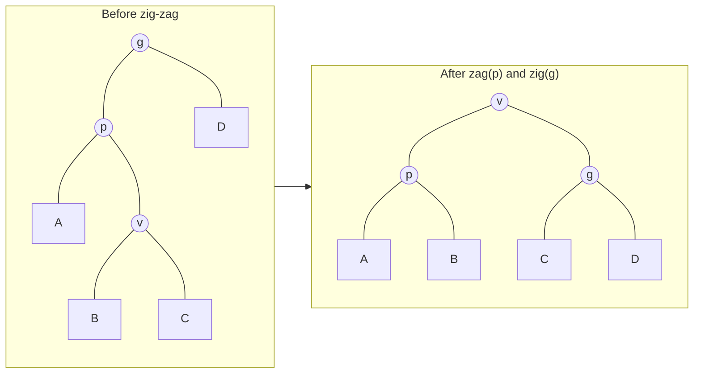
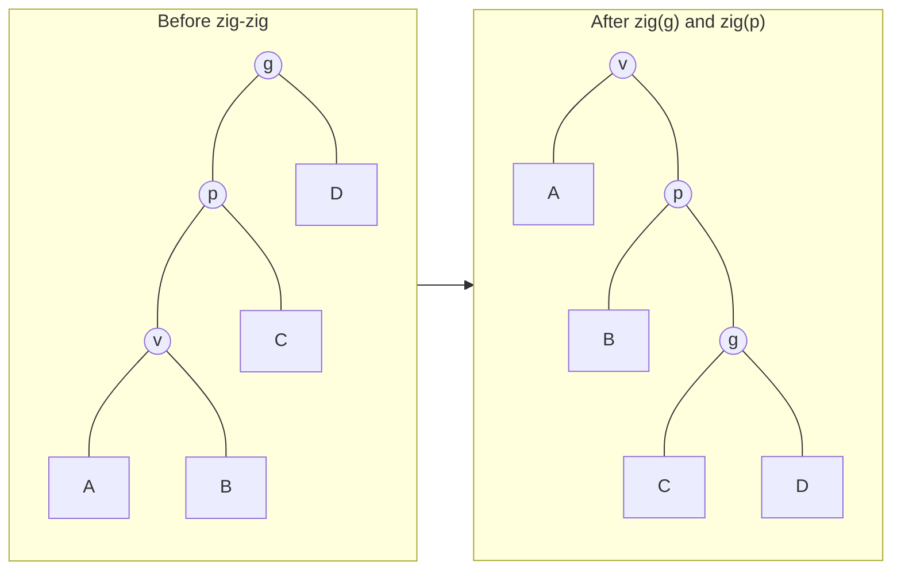
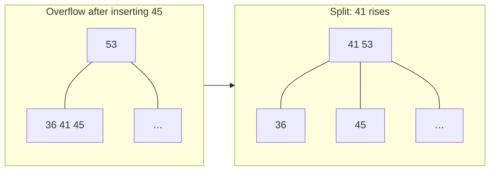
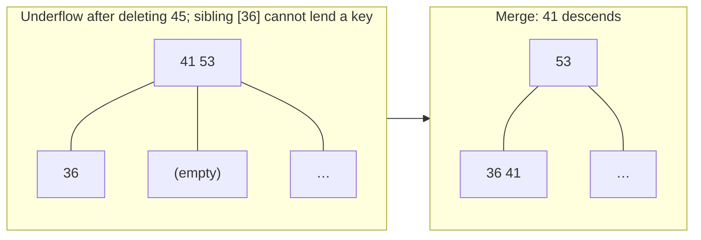
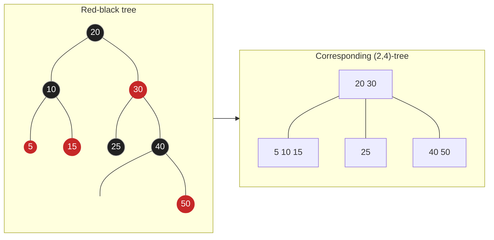
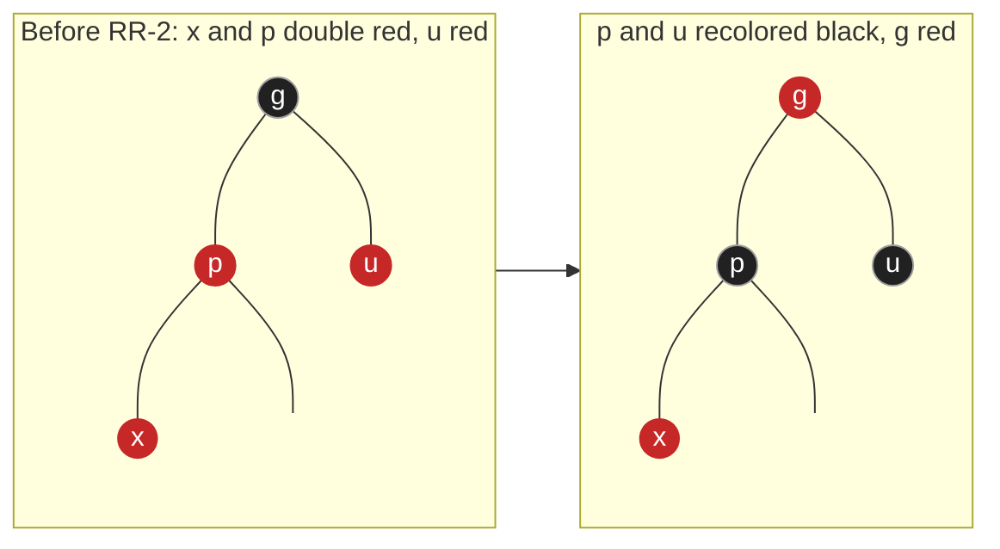

**AVL trees** ([4.3.6](/4.3.6)) guarantee $O(\log n)$ performance in the worst case, but they treat every node alike, take no account of the level of memory in which the data reside, and a deletion may cause $\Theta(\log n)$ rotations. The three kinds of search trees in this chapter improve on this from three angles:

- Splay trees exploit the locality of access: they record no balance information and move each accessed node to the root after every access, guaranteeing $O(\log n)$ efficiency in the amortized sense; the more concentrated the accesses, the faster they are.
- B-trees are designed for multilevel storage systems: they merge several levels of binary nodes into one large node, so that each search needs very few external-memory accesses; they are the foundation of database and file-system indexes.
- Red-black trees can be viewed as a binary representation of B-trees: each insertion or deletion needs only $O(1)$ rotations, and they implement the ordered containers of standard libraries such as C++ `std::map` and Java `TreeMap`.

The methods of analysis also go a step further: splay trees use the potential method for amortized analysis, B-trees count cost by the number of I/Os rather than the number of instructions, and red-black trees are understood and proved correct through their correspondence with B-trees.

## 8.1. Splay Trees

### 8.1.1. Locality

**Definition 8.1.1 (Locality of Reference)** Data that have just been accessed are very likely to be accessed again soon; this is called temporal **locality**. The next datum to be accessed is very likely to be near the one just accessed; this is called spatial locality.

This phenomenon is common in information processing: a loop executes the same piece of code repeatedly, popular goods and popular web pages are queried repeatedly, and programs scan arrays sequentially. For $m$ consecutive searches in an AVL tree ($m \gg n$), $O(m \log n)$ time is needed whether or not the accesses are concentrated. Can locality be used to speed this up?

For a **list** there is a simple approach, called a self-adjusting list: as soon as a node is accessed, it is moved to the front, so that frequently accessed nodes are always near the front. Splay trees imitate this idea: as soon as a node of a **binary search tree** is accessed, it is moved to the root. The difficulty lies in how to perform this adjustment and how to control the cost of the adjustment itself.

### 8.1.2. Single-Level Splaying

The most direct method is to rotate level by level from the bottom up: as long as the accessed node $v$ has a parent $p$, we rotate about $p$ ($\mathrm{zig}(p)$ if $v$ is a left child, $\mathrm{zag}(p)$ if it is a right child); each rotation raises $v$ by one level, until it reaches the root. Rather than "pushing" $v$ to the root, it is better to say that it "climbs" there step by step.

The efficiency of this approach depends on the initial shape of the tree and the order of access, and the worst case is bad. Consider a left-leaning chain consisting of $1, 2, \dots, n$ ($n$ is the root) and access $1, 2, \dots, n$ in turn: the numbers of rotations for the successive accesses are $n - 1, n - 1, n - 2, \dots, 2, 1$, an arithmetic progression, and after one round of accesses the tree is exactly restored to its original shape, and the cycle repeats. Each round accumulates $\Theta(n^2)$ rotations, which is $\Theta(n)$ per access when amortized, worse than not adjusting at all.

### 8.1.3. Double-Level Splaying

The *splay tree* proposed by Sleator and Tarjan (1985) improves on this. Its essence is to trace upward two levels at a time rather than one. We repeatedly examine the three generations $v$, $p = \operatorname{parent}(v)$ and $g = \operatorname{parent}(p)$, and, depending on their relative positions, perform two rotations that raise $v$ by two levels, making it the root of this subtree.

zig-zag (or zag-zig): $v$ and $p$ are on opposite sides, so $v$ is in the middle in inorder; we rotate first about $p$ and then about $g$, and the effect is exactly the same as in single-level splaying and the same as a double rotation of an **AVL tree**.



zig-zig (or zag-zag): $v$ and $p$ are on the same side, and we must rotate first about $g$ and then about $p$. Single-level splaying uses the opposite order (first about $p$, then about $g$), and the two give different results; this is exactly the difference.



zig (or zag): if $v$ has a parent but no grandparent, that is, $p$ is the root, a single rotation suffices. This case occurs at most once, at the very end.

The effect of double-level splaying is most pronounced on long chains: after accessing the node at the bottom of a chain, the length of the whole path is roughly halved, like the leaves of a mimosa folding up when touched. So the worst case cannot persist: one expensive access makes the tree more balanced and thereby lowers the cost of later accesses. The analysis below makes this intuition precise.

### 8.1.4. Search, Insertion and Deletion

Search: we search by the rules of binary search trees and then splay the last visited node to the root: on success it is the target node, and on failure it is the parent $\mathit{hot}$ of the place where the search stopped. A search in a splay tree therefore also changes the structure of the tree and is no longer a read-only operation.

Insertion: we first search for $e$. After an unsuccessful search, splaying has already brought the predecessor or successor $t$ of $e$ in the tree to the root. This being so, we attach the new node near the root: if $t < e$, the new node becomes the new root, with $t$ as its left child and the former right subtree of $t$ as its right child (and the link between $t$ and that right subtree is cut); the case $t > e$ is symmetric.

Deletion: we first search for $e$. After a successful search, the target node is already at the root; we remove it, leaving a left subtree $L$ and a right subtree $R$. If $R$ is empty, $L$ is the new tree; otherwise we search for $e$ in $R$, which necessarily fails, but the minimum node $m$ of $R$ is splayed to the root of $R$, and $m$ has no left child, so we can simply let $L$ be the left subtree of $m$.

In the implementation below, nodes carry parent pointers and splaying proceeds iteratively from the bottom up, so even when the tree degenerates into a long chain, there is no overflow from excessively deep recursion. At the end, the test program inserts $2^{16}$ keys in increasing order (obtaining a long chain), then accesses all keys repeatedly in order and counts the average number of rotations per search: the result is a small constant, rather than $\Theta(\log n)$ or $\Theta(n)$. This is exactly what the analysis below predicts.

```cpp tab
#include <format>
#include <iostream>
#include <random>
#include <set>
#include <vector>

template <typename K>
class SplayTree {
    struct Node { K key; Node *parent = nullptr, *lc = nullptr, *rc = nullptr; };
    Node* root = nullptr;
    std::size_t n = 0;
    long long rotations = 0;                        // for measuring the cost

    static void attach_lc(Node* p, Node* c) { p->lc = c; if (c) c->parent = p; }
    static void attach_rc(Node* p, Node* c) { p->rc = c; if (c) c->parent = p; }

    void rotate_up(Node* v) {                       // v rises above its parent p (zig or zag)
        Node *p = v->parent, *g = p->parent;
        if (v == p->lc) { attach_lc(p, v->rc); attach_rc(v, p); }
        else            { attach_rc(p, v->lc); attach_lc(v, p); }
        v->parent = g;
        if (!g) root = v;
        else if (g->lc == p) g->lc = v;
        else g->rc = v;
        ++rotations;
    }
    void splay(Node* v) {                           // move v to the root, two levels at a time
        while (Node* p = v->parent) {
            Node* g = p->parent;
            if (!g) rotate_up(v);                   // zig / zag: only at the very end
            else if ((v == p->lc) == (p == g->lc)) { rotate_up(p); rotate_up(v); }  // zig-zig
            else { rotate_up(v); rotate_up(v); }    // zig-zag
        }
    }
    // Standard BST descent; splay the last node reached (the target or where the search failed)
    Node* access(const K& key) {
        Node *x = root, *last = nullptr;
        while (x && x->key != key) { last = x; x = key < x->key ? x->lc : x->rc; }
        if (x || last) splay(x ? x : last);
        return x;
    }

public:
    SplayTree() = default;
    SplayTree(const SplayTree&) = delete;
    SplayTree& operator=(const SplayTree&) = delete;
    ~SplayTree() {                                  // iterative: the tree may be a long path
        std::vector<Node*> stack;
        if (root) stack.push_back(root);
        while (!stack.empty()) {
            Node* x = stack.back(); stack.pop_back();
            if (x->lc) stack.push_back(x->lc);
            if (x->rc) stack.push_back(x->rc);
            delete x;
        }
    }
    bool contains(const K& key) { return access(key) != nullptr; }

    bool insert(const K& key) {
        if (access(key)) return false;              // now the root is key's would-be neighbor
        Node* x = new Node{key};
        if (Node* t = root) {                       // split the tree around the new root
            if (t->key < key) { attach_rc(x, t->rc); t->rc = nullptr; attach_lc(x, t); }
            else              { attach_lc(x, t->lc); t->lc = nullptr; attach_rc(x, t); }
        }
        root = x;
        ++n;
        return true;
    }
    bool remove(const K& key) {
        Node* x = access(key);                      // after a hit, x is the root
        if (!x) return false;
        Node *l = x->lc, *r = x->rc;
        delete x; --n;
        if (l) l->parent = nullptr;
        if (!r) { root = l; return true; }
        r->parent = nullptr;
        root = r;
        Node* m = r;                                // splay the minimum of R to its root ...
        while (m->lc) m = m->lc;
        splay(m);
        attach_lc(m, l);                            // ... which then has no left child
        return true;
    }
    std::size_t size() const { return n; }
    long long rotation_count() const { return rotations; }
    std::vector<K> keys() const {
        std::vector<K> out;
        std::vector<Node*> stack;
        for (Node* x = root; x || !stack.empty(); ) {
            for (; x; x = x->lc) stack.push_back(x);
            x = stack.back(); stack.pop_back();
            out.push_back(x->key);
            x = x->rc;
        }
        return out;
    }
};

int main() {
    std::mt19937 rng(17);
    SplayTree<int> t;
    std::set<int> ref;
    for (int step = 0; step < 300000; ++step) {
        int key = static_cast<int>(rng() % 3000);
        switch (rng() % 3) {
            case 0: if (t.insert(key) != ref.insert(key).second) return 1; break;
            case 1: if (t.remove(key) != (ref.erase(key) == 1)) return 2; break;
            default: if (t.contains(key) != ref.contains(key)) return 3;
        }
    }
    if (t.keys() != std::vector<int>(ref.begin(), ref.end()) || t.size() != ref.size()) return 4;

    const int n = 1 << 16;                          // sorted insertions make a path ...
    SplayTree<int> s;
    for (int k = 0; k < n; ++k) s.insert(k);
    long long before = s.rotation_count();
    for (int round = 0; round < 4; ++round)         // ... yet sequential access is cheap
        for (int k = 0; k < n; ++k) s.contains(k);
    std::cout << std::format("ok; sequential access: {:.2f} rotations per search\n",
                             double(s.rotation_count() - before) / (4.0 * n));
}
```

```python tab
from __future__ import annotations

import random


class Node[K]:
    __slots__ = ("key", "parent", "lc", "rc")

    def __init__(self, key: K) -> None:
        self.key = key
        self.parent: Node[K] | None = None
        self.lc: Node[K] | None = None
        self.rc: Node[K] | None = None


def attach_lc(p: Node, c: Node | None) -> None:
    p.lc = c
    if c:
        c.parent = p


def attach_rc(p: Node, c: Node | None) -> None:
    p.rc = c
    if c:
        c.parent = p


class SplayTree[K]:
    def __init__(self) -> None:
        self.root: Node[K] | None = None
        self.size = 0

    def _rotate_up(self, v: Node[K]) -> None:      # v rises above its parent (zig or zag)
        p = v.parent
        g = p.parent
        if v is p.lc:
            attach_lc(p, v.rc); attach_rc(v, p)
        else:
            attach_rc(p, v.lc); attach_lc(v, p)
        v.parent = g
        if g is None:
            self.root = v
        elif g.lc is p:
            g.lc = v
        else:
            g.rc = v

    def _splay(self, v: Node[K]) -> None:          # two levels at a time
        while (p := v.parent) is not None:
            g = p.parent
            if g is None:
                self._rotate_up(v)                 # zig / zag: only at the very end
            elif (v is p.lc) == (p is g.lc):
                self._rotate_up(p); self._rotate_up(v)   # zig-zig: grandparent first
            else:
                self._rotate_up(v); self._rotate_up(v)   # zig-zag

    def _access(self, key: K) -> Node[K] | None:
        x, last = self.root, None
        while x and x.key != key:
            last, x = x, (x.lc if key < x.key else x.rc)
        if x or last:
            self._splay(x or last)                 # splay the last node reached
        return x

    def __contains__(self, key: K) -> bool:
        return self._access(key) is not None

    def insert(self, key: K) -> bool:
        if self._access(key):
            return False                           # the root is now key's neighbor
        x, t = Node(key), self.root
        if t:                                      # split around the new root
            if t.key < key:
                attach_rc(x, t.rc); t.rc = None; attach_lc(x, t)
            else:
                attach_lc(x, t.lc); t.lc = None; attach_rc(x, t)
        self.root = x
        x.parent = None
        self.size += 1
        return True

    def remove(self, key: K) -> bool:
        x = self._access(key)                      # after a hit, x is the root
        if x is None:
            return False
        l, r = x.lc, x.rc
        self.size -= 1
        if l:
            l.parent = None
        if r is None:
            self.root = l
            return True
        r.parent = None
        self.root = m = r
        while m.lc:                                # splay the minimum of R to its root
            m = m.lc
        self._splay(m)
        attach_lc(m, l)                            # it has no left child
        return True

    def keys(self) -> list[K]:
        out, stack, x = [], [], self.root
        while x or stack:
            while x:
                stack.append(x); x = x.lc
            x = stack.pop()
            out.append(x.key)
            x = x.rc
        return out


rng = random.Random(17)
t, ref = SplayTree[int](), set()
for _ in range(100_000):
    key, op = rng.randrange(3000), rng.randrange(3)
    if op == 0:
        assert t.insert(key) == (key not in ref); ref.add(key)
    elif op == 1:
        assert t.remove(key) == (key in ref); ref.discard(key)
    else:
        assert (key in t) == (key in ref)
assert t.keys() == sorted(ref) and t.size == len(ref)
print("ok")
```

### 8.1.5. Amortized Analysis

A single operation on a splay tree may cost as much as $\Theta(n)$, but we care about the total cost of a sequence of operations. Aggregate analysis is not easy to apply directly to splay trees, so here we use the **potential method**.

**Definition 8.1.2 (Potential Method)** Assign to each state $S$ of a data structure a real number $\Phi(S)$, called its **potential**. Let the actual cost of the $i$-th operation be $c_i$, which changes the state from $S_{i-1}$ to $S_i$, and define its amortized cost as

$$
a_i = c_i + \Phi(S_i) - \Phi(S_{i-1}).
$$
This method of analysis is called the **potential method**.

Summing over $m$ consecutive operations, the potential differences cancel term by term:

$$
\sum_{i=1}^{m} c_i = \sum_{i=1}^{m} a_i - \Phi(S_m) + \Phi(S_0).
$$

So as long as the potential never falls below some lower bound, the total actual cost does not exceed the total amortized cost plus the difference between the initial potential and the lower bound. Potential can be understood as prepaid "energy": cheap operations pay a little extra, which is stored as potential; expensive operations consume potential, so that their amortized cost remains low. A general discussion of **amortized analysis** is in [4.3.2](/4.3.2).

For splay trees, let the subtree size of a node $v$ be $s(v)$, define its rank as $r(v) = \log_2 s(v)$, and let the potential of the whole tree be the sum of the ranks of all nodes:

$$
\Phi(S) = \sum_{v \in S} r(v) = \sum_{v \in S} \log_2 s(v).
$$

Intuitively, the more balanced a tree, the smaller its potential, and the more skewed, the larger: the potential of a single chain is $\sum_{k=1}^{n} \log_2 k = \log_2 n! = \Theta(n \log n)$, while that of a **perfect binary tree** is only $\Theta(n)$. The potential is always nonnegative.

We take the number of rotations as the actual cost of splaying. Let $r$ and $r'$ denote the ranks before and after one adjustment step, respectively.

**Lemma 8.1.1** In one zig step, the amortized cost is at most $1 + 3(r'(v) - r(v))$; in one zig-zig or zig-zag step, the amortized cost is at most $3(r'(v) - r(v))$.

**Proof** Only the ranks of $v$, $p$ and $g$ change.

zig: the actual cost is $1$, and $a = 1 + r'(v) + r'(p) - r(v) - r(p)$. After the rotation, $p$ is a child of $v$, so $r'(p) \le r(p)$; also $r'(v) \ge r(v)$. Hence $a \le 1 + r'(v) - r(v) \le 1 + 3(r'(v) - r(v))$.

zig-zag: the actual cost is $2$. The node $v$ takes the place of $g$, so $r'(v) = r(g)$, and then $a = 2 + r'(p) + r'(g) - r(v) - r(p) \le 2 + r'(p) + r'(g) - 2r(v)$ (since $r(p) \ge r(v)$). After the adjustment, $p$ and $g$ are the two children of $v$, so $s'(p) + s'(g) \le s'(v)$. The logarithm is concave, $\log_2 x + \log_2 y \le 2\log_2 \frac{x+y}{2}$, so $r'(p) + r'(g) \le 2r'(v) - 2$. Substituting gives $a \le 2(r'(v) - r(v)) \le 3(r'(v) - r(v))$.

zig-zig: the actual cost is $2$, and again $r'(v) = r(g)$, so $a = 2 + r'(p) + r'(g) - r(v) - r(p)$. Since $r'(p) \le r'(v)$ and $r(p) \ge r(v)$, we get $a \le 2 + r'(v) + r'(g) - 2r(v)$. It suffices to prove $r(v) + r'(g) - 2r'(v) \le -2$. The subtree of $v$ before the adjustment ($v$, $A$, $B$) and the subtree of $g$ after the adjustment ($g$, $C$, $D$) are disjoint, and together with $p$ they make up exactly the subtree of $v$ after the adjustment, so $s(v) + s'(g) \le s'(v)$, and the same concavity inequality gives the claim. $\square$

The analysis of zig-zig is exactly the reason for rotating about $g$ first: if we rotated about $p$ first, as in single-level splaying, we would not obtain a relation such as $s(v) + s'(g) \le s'(v)$.

**Theorem 8.1.2** The amortized cost of splaying a node $v$ to the root is at most $3(r(\mathit{root}) - r(v)) + 1 = O(\log n)$. The amortized time of search, insertion and deletion in a splay tree is $O(\log n)$ each; starting from any initial state with $n$ nodes, the total time of $m$ operations is $O((m + n) \log n)$.

**Proof** A splay consists of several double-level adjustment steps and at most one zig step. By the lemma, in the sum of the amortized costs of the steps the terms $r'(v) - r(v)$ cancel one by one, leaving only $3(r_{\text{final}}(v) - r_{\text{initial}}(v)) + 1$, and in the end $v$ is the root, so $r_{\text{final}}(v) = \log_2 n$. The remaining work of a search is of the same order as the splay. For insertion, the rank of the new root attached after splaying is $\log_2(n+1)$, and the ranks of the other nodes do not increase, so the potential increases by at most $\log_2(n+1)$; for deletion, removing the root decreases the potential, the amortized cost of splaying in $R$ is $O(\log n)$, and attaching $L$ increases the rank of $m$ to at most $\log_2 n$. So the amortized cost of each kind of operation is $O(\log n)$. The initial potential is at most $n \log_2 n$ and the potential is always nonnegative, so the summation formula of the potential method gives the total time. $\square$

Splay trees have still stronger properties, which characterize what "self-adjusting" means:

- Static optimality: for any fixed distribution of access frequencies, the total cost of a splay tree is at most a constant multiple of that of the best static binary search tree (the optimal tree built from the frequencies, knowing the entire access sequence in advance).
- Working-set property: if only a subset of $k$ nodes is accessed repeatedly, the amortized cost per access is $O(\log k)$, independent of $n$.
- Sequential access theorem (Tarjan, 1985): accessing all nodes in inorder takes $O(n)$ in total; the test program above verifies this.
- Dynamic optimality conjecture (Sleator and Tarjan, 1985): for any access sequence, the cost of a splay tree is at most a constant multiple of that of any binary search tree algorithm (which may perform rotations between accesses). This conjecture has been neither proved nor disproved to this day.

### 8.1.6. Evaluation

Splay trees need no auxiliary information such as heights or balance factors, are simple to implement, and have amortized complexity comparable to AVL trees; when locality is strong (a high cache hit rate), they are even faster. Their disadvantage is that they cannot rule out the worst case of a single operation ($\Theta(n)$), so they are unsuitable where the response time of individual operations matters; a search also modifies the structure of the tree, so locking is needed when several threads read at the same time, which is very costly in concurrent settings. Splay trees are often used where splitting and merging are needed (sequence operations such as link-cut trees and interval reversal) and in some internal caching structures of software such as GCC.

## 8.2. B-Trees

### 8.2.1. The Memory Hierarchy and I/O

In computational models, memory is often assumed to have unlimited capacity and a uniform cost per access. In practice, however:

1. The size of application problems grows faster than memory capacity. Comparing typical database sizes with memory capacity, the ratio was about $10\,\mathrm{MB} / 2\,\mathrm{MB} = 5$ in 1990 and has reached $10\,\mathrm{TB} / 10\,\mathrm{GB} = 1000$ in 2020. Relatively speaking, memory is actually getting smaller.
2. For a given technology and cost, memory is always a trade-off between capacity and speed: the larger the capacity, the slower the access.
3. Practical storage systems are therefore cascades of different types of memory, whose capacities and speeds differ enormously:

   | Memory | Typical access latency | Typical capacity |
   |---|---|---|
   | Registers | below $1\,\mathrm{ns}$ | hundreds of bytes |
   | L1 / L2 / L3 caches (SRAM) | about $1$ / $4$ / $10$–$40\,\mathrm{ns}$ | KB to tens of MB |
   | Main memory (DRAM) | about $100\,\mathrm{ns}$ | several GB to several TB |
   | Solid-state drive (NVMe SSD) | about $10$–$100\,\mu\mathrm{s}$ | TB scale |
   | Hard disk drive | about $5$–$10\,\mathrm{ms}$ | TB scale |

   If one memory access took one second, one hard-disk access would take more than a day. To avoid a single disk access, it is worth making thousands of memory accesses.
4. External memory is read and written in units of pages (blocks): reading or writing $1$ byte is almost as fast as reading or writing a whole page (usually $4\,\mathrm{KB}$). The C standard library's `setvbuf` and `fflush` and the operating system's page cache all lower the average cost per byte by accessing data in batches through buffers.

The strategy of a memory hierarchy is: frequently used data are copied into higher, smaller and faster memory, and a lower level is asked only when the data are not found; this relies precisely on the locality of data access. The actual running time of an algorithm therefore depends mainly on the number of data transfers (I/Os) between adjacent levels of storage, rather than on the number of CPU instructions. The standard analysis model for external-memory algorithms (Aggarwal and Vitter, 1988) counts cost in exactly this way: memory can hold $M$ elements, each I/O transfers one block of $B$ elements between memory and external memory, and the cost is the number of I/Os.

The same reasoning applies between the cache and memory. There are two methods of rotating an array $A[0, n)$ left by $k$ positions in place using only $O(1)$ extra space: one is to cycle once along each of the $\gcd(n, k)$ residue classes, so that each element is moved only once but successive accesses are $k$ elements apart (an access pattern with stride $k$); the other is to reverse $A[0, k)$ and $A[k, n)$ separately and then reverse the whole array, so that elements are moved about $3n$ times in total, but each access is adjacent to the previous one (stride $1$). The program below compares the two: in one measurement ($n = 2^{25}$, $k = 2^{12}$, `g++ -O2`), the latter, although it performs twice as many moves, is an order of magnitude faster than the former. In Python, the overhead of the interpreter itself masks most of the difference, but the trend is the same.

```cpp tab
#include <chrono>
#include <cstddef>
#include <format>
#include <iostream>
#include <numeric>
#include <utility>
#include <vector>

// Rotate a[0, n) left by k in place, two ways with O(1) extra space.
template <typename T>
void shift_cycles(std::vector<T>& a, std::size_t k) {   // stride-k: follow gcd(n, k) cycles
    std::size_t n = a.size();
    if (n == 0 || (k %= n) == 0) return;
    for (std::size_t s = 0, g = std::gcd(n, k); s < g; ++s) {
        T b = std::move(a[s]);
        std::size_t i = s, j = (s + k) % n;
        while (j != s) { a[i] = std::move(a[j]); i = j; j = (j + k) % n; }
        a[i] = std::move(b);
    }
}

template <typename T>
void reverse(std::vector<T>& a, std::size_t lo, std::size_t hi) {  // a[lo, hi)
    while (lo + 1 < hi) std::swap(a[lo++], a[--hi]);
}

template <typename T>
void shift_reversal(std::vector<T>& a, std::size_t k) {  // stride-1: three reversals
    std::size_t n = a.size();
    if (n == 0 || (k %= n) == 0) return;
    reverse(a, 0, k); reverse(a, k, n); reverse(a, 0, n);
}

int main() {
    const std::size_t n = 1 << 25, k = 1 << 12;      // gcd = k: k cycles of length n / k
    std::vector<int> a(n), b;
    std::iota(a.begin(), a.end(), 0);
    b = a;
    auto time = [](auto&& f) {
        auto t0 = std::chrono::steady_clock::now();
        f();
        return std::chrono::duration<double, std::milli>(std::chrono::steady_clock::now() - t0).count();
    };
    double t1 = time([&] { shift_cycles(a, k); });
    double t2 = time([&] { shift_reversal(b, k); });
    std::cout << std::format("same result: {}; stride-k {:.0f} ms, stride-1 {:.0f} ms\n", a == b, t1, t2);
}
```

```python tab
from math import gcd
from time import perf_counter


def shift_cycles(a: list, k: int) -> None:
    """Rotate a left by k in place: stride-k access along gcd(n, k) cycles."""
    n = len(a)
    if n == 0 or (k := k % n) == 0:
        return
    for s in range(gcd(n, k)):
        b, i, j = a[s], s, (s + k) % n
        while j != s:
            a[i] = a[j]
            i, j = j, (j + k) % n
        a[i] = b


def reverse(a: list, lo: int, hi: int) -> None:   # a[lo:hi]
    hi -= 1
    while lo < hi:
        a[lo], a[hi] = a[hi], a[lo]
        lo, hi = lo + 1, hi - 1


def shift_reversal(a: list, k: int) -> None:
    """Rotate a left by k in place: three stride-1 reversals."""
    n = len(a)
    if n == 0 or (k := k % n) == 0:
        return
    reverse(a, 0, k); reverse(a, k, n); reverse(a, 0, n)


n, k = 1 << 22, 1 << 12
a, b = list(range(n)), list(range(n))
t0 = perf_counter(); shift_cycles(a, k)
t1 = perf_counter(); shift_reversal(b, k)
t2 = perf_counter()
print(f"same result: {a == b}; stride-k {1000 * (t1 - t0):.0f} ms, stride-1 {1000 * (t2 - t1):.0f} ms")
```

The C++ standard library's `std::rotate` takes similar considerations into account and chooses different algorithms according to the iterator category.

### 8.2.2. Structure

A **binary search tree** reads in only one key per level descended. With $n = 10^9$ records, even an **AVL tree** needs about $\log_2 10^9 \approx 30$ I/Os per search, and each I/O reads in a whole block yet uses only one key from it, which does not pay. The B-tree (R. Bayer and E. McCreight, 1970) makes full use of batch access to external memory: it merges every $d$ generations of nodes of a **balanced binary search tree** into one supernode, obtaining a multiway search tree with $m = 2^d$ branches and $m - 1$ keys per supernode. It is logically completely equivalent to the balanced binary search tree, but each level descended is in units of supernodes, and one I/O reads in a group of keys. How large a group is depends on the block size of the external memory, and $m$ is often chosen in the hundreds. Returning to the example above, with $m = 256$ each search needs no more than $4$ I/Os.

**Definition 8.2.1 (B-Tree)** A **B-tree** of order $m$ ($m \ge 3$) is an $m$-way search tree satisfying the following conditions:

1. Each internal node contains $k \le m - 1$ keys $K_1 < \dots < K_k$ in increasing order and $k + 1$ branches $A_0, A_1, \dots, A_k$, where all keys in $A_i$ lie between $K_i$ and $K_{i+1}$;
2. Except for the root, every internal node has at least $\lceil m/2 \rceil$ branches; when the tree is nonempty, the root has at least $2$ branches (unless the root is the only node);
3. Regarding empty branches as external nodes, all external nodes have the same depth, and this depth is taken as the height $h$ of the tree.

Note that leaves (internal nodes at the bottom level) differ here from external nodes: all leaves have depth $h - 1$. Since the number of branches lies between $\lceil m/2 \rceil$ and $m$, a B-tree of order $m$ is also called a $(\lceil m/2 \rceil, m)$-tree, for example a $(3, 5)$-tree or a $(9, 18)$-tree. The simplest B-tree is the $(2, 3)$-tree with $m = 3$ (2-3 tree, Hopcroft, 1970), in which each internal node has $1$ or $2$ keys. The $(2, 4)$-tree with $m = 4$ (2-3-4 tree) has $1$ to $3$ keys per node and is equivalent to the red-black tree discussed later.

The node of a B-tree is represented in memory by two vectors: the key vector and the branch (child) **vector**, the latter always having one more element than the former.

**Theorem 8.2.1** The height $h$ of a B-tree of order $m$ with $N$ keys satisfies

$$
\log_m (N + 1) \le h \le \log_{\lceil m/2 \rceil} \frac{N + 1}{2} + 1.
$$

**Proof** The number of external nodes in a B-tree is exactly $N + 1$: external nodes correspond to the $N + 1$ intervals of unsuccessful searches (alternatively, by induction on the internal nodes: each node with $k$ keys has $k + 1$ branches).

Upper bound: to make the tree as tall as possible, internal nodes should be as "thin" as possible. There is at least $1$ root at depth $0$, at least $2$ nodes at depth $1$, and thereafter each level has at least $\lceil m/2 \rceil$ times as many nodes as the previous one, so there are at least $2\lceil m/2 \rceil^{h-1}$ external nodes at depth $h$: $N + 1 \ge 2\lceil m/2 \rceil^{h-1}$, which gives the upper bound.

Lower bound: to make the tree as short as possible, internal nodes should be as "fat" as possible. Each node has at most $m$ branches, and there are at most $m^h$ external nodes at depth $h$: $N + 1 \le m^h$. $\square$

Compared with a balanced binary search tree, for $m = 256$ the upper bound is about $\log_{128} N = \frac{1}{7}\log_2 N$ and the lower bound about $\frac{1}{8}\log_2 N$: the height of a B-tree is reduced to about $1/7$ to $1/8$ of that of a binary tree. If the number of I/Os is proportional to the height, this is like the difference between finishing college in 4 years and in 28 years.

### 8.2.3. Search

**Algorithm 8.2.1 (B-Tree Search)** Starting at the root, as long as the current node is not an external node: search for $e$ among the keys of the current node (in memory); if it is found, the search succeeds; otherwise follow the corresponding branch to the child node, read it into memory (one I/O), and continue. Reaching an external node means failure.

We assume that the root resides in memory. A search performs at most one I/O at each depth, so the number of I/Os is $O(h) = O(\log_m N)$. For searching inside a node, for the usual values of $m$ (tens to hundreds), sequential search is often faster than binary search: scanning a contiguous stretch of memory sequentially makes use of the spatial locality of the cache. If binary search is used, the CPU time is $O(\log m)$ per level and $O(\log m \cdot \log_m N) = O(\log N)$ in total.

### 8.2.4. Insertion and Splitting

**Algorithm 8.2.2 (B-Tree Insertion)** We first search for $e$ and confirm that it is absent; the failed search stops at some leaf $\mathit{hot}$, and we insert $e$ at the appropriate position of its key vector and add one empty branch. If the number of keys of $\mathit{hot}$ reaches $m$ (overflow), we split: let the keys of the overflowing node be $k_0, \dots, k_{m-1}$ in order, take the median $s = \lfloor m/2 \rfloor$, and split the node at $k_s$ into a left and a right node; $k_s$ rises one level and is inserted into the parent, and the left and right nodes become the branches on its two sides.

After splitting, the left node contains $\lfloor m/2 \rfloor$ keys and the right node contains $m - \lfloor m/2 \rfloor - 1 = \lceil m/2 \rceil - 1$ keys, both meeting the conditions of a B-tree of order $m$. For example, inserting $45$ into the leaf $[36\ 41]$ of a $(2, 3)$-tree:



If the parent was already saturated, it also overflows after accepting the rising key, and the same method continues to split: overflow may propagate upward level by level, but at most up to the root. If the root also overflows, the rising key forms a new root by itself, which has only two branches. This is the only way a B-tree grows taller, and therefore all external nodes are always at the same depth. The total time of insertion is proportional to the number of splits, $O(h)$.

In fact, splits rarely occur: when $N$ keys are inserted consecutively into an empty tree, each split creates a new node and each node contains at least $\lceil m/2 \rceil - 1$ keys, so the total number of splits does not exceed $N / (\lceil m/2 \rceil - 1) + O(h)$, which averages fewer than $2/(m-2)$ per insertion.

### 8.2.5. Deletion and Merging

**Algorithm 8.2.3 (B-Tree Deletion)** We first find the node $v$ containing $e$. If $v$ is not a leaf, then, as in binary search trees, we find the immediate successor of $e$ (going right once and then always left, so it is necessarily in a leaf) and swap with it, so that the key to be deleted is always in a leaf. After deleting it together with an empty branch, if the number of branches of the node is fewer than $\lceil m/2 \rceil$ (underflow), that is, it has exactly $\lceil m/2 \rceil - 2$ keys, then, depending on the sizes of its left and right siblings $L$ and $R$, there are three cases:

1. Rotation: if $L$ exists and contains at least $\lceil m/2 \rceil$ keys, we move the separating key $y$ between the two in the parent $P$ into $V$ (as its smallest key), move the largest key $x$ of $L$ into $P$ to replace $y$, and hand the rightmost branch of $L$ over to $V$. The local part, and hence the whole tree, again satisfies the conditions of a B-tree, and the repair is complete.
2. If $R$ exists and is sufficiently "fat", we rotate symmetrically.
3. Merging: $L$ and $R$ either do not exist or both contain only $\lceil m/2 \rceil - 1$ keys. But one of them must exist, say $L$. We take the separating key $y$ from $P$ and, using $y$ as glue, merge $L$ and $V$ into one node containing $(\lceil m/2 \rceil - 1) + 1 + (\lceil m/2 \rceil - 2) \le m - 1$ keys.

After merging, $P$ has lost a key and may underflow in turn; the same method of rotation or merging continues to apply, and the underflow may propagate upward over at most $O(h)$ levels. If the last key of the root is merged down, we delete the root and take its only child as the new root. This is the only way a B-tree becomes lower.



(This is exactly the inverse of the split in the previous section.)

### 8.2.6. Implementation

In the implementation below, insertion and deletion are both recursive: when the recursion returns, the parent checks whether the child just processed has overflowed or underflowed and then splits, rotates or merges, which agrees exactly with the description of "repairing bottom-up level by level". Since B-trees are very short, the recursion depth is no problem. The test program performs random insertions and deletions for $m = 3, 4, 5, 8, 64$, compares against an ordered set, and periodically checks the node-size conditions and that all external nodes have equal depth.

```cpp tab
#include <algorithm>
#include <format>
#include <iostream>
#include <memory>
#include <random>
#include <set>
#include <vector>

template <typename K>
class BTree {                                       // order m: at most m - 1 keys and m children
    struct Node {
        std::vector<K> key;                         // sorted
        std::vector<std::unique_ptr<Node>> child;   // empty for a leaf, else key.size() + 1
        bool leaf() const { return child.empty(); }
    };
    std::unique_ptr<Node> root = std::make_unique<Node>();
    int m;
    std::size_t n = 0;

    int min_keys() const { return (m + 1) / 2 - 1; }  // ceil(m/2) - 1 for non-root nodes
    static int rank(const Node* x, const K& k) {    // first position with key >= k
        return static_cast<int>(std::ranges::lower_bound(x->key, k) - x->key.begin());
    }

    void split(Node* p, int i) {                    // child i holds m keys: overflow
        Node* v = p->child[i].get();
        int s = m / 2;                              // the median key moves up
        auto u = std::make_unique<Node>();
        u->key.assign(v->key.begin() + s + 1, v->key.end());
        if (!v->leaf()) {
            for (auto it = v->child.begin() + s + 1; it != v->child.end(); ++it)
                u->child.push_back(std::move(*it));
            v->child.resize(s + 1);
        }
        p->key.insert(p->key.begin() + i, v->key[s]);
        v->key.resize(s);
        p->child.insert(p->child.begin() + i + 1, std::move(u));
    }
    bool insert(Node* x, const K& k) {
        int i = rank(x, k);
        if (i < static_cast<int>(x->key.size()) && x->key[i] == k) return false;
        if (x->leaf()) { x->key.insert(x->key.begin() + i, k); return true; }
        if (!insert(x->child[i].get(), k)) return false;
        if (static_cast<int>(x->child[i]->key.size()) == m) split(x, i);  // may propagate up
        return true;
    }

    void fix_underflow(Node* p, int i) {            // child i may hold too few keys
        Node* v = p->child[i].get();
        if (static_cast<int>(v->key.size()) >= min_keys()) return;
        if (i > 0 && static_cast<int>(p->child[i - 1]->key.size()) > min_keys()) {
            Node* ls = p->child[i - 1].get();       // rotation: borrow through the parent
            v->key.insert(v->key.begin(), p->key[i - 1]);
            p->key[i - 1] = ls->key.back(); ls->key.pop_back();
            if (!ls->leaf()) {
                v->child.insert(v->child.begin(), std::move(ls->child.back()));
                ls->child.pop_back();
            }
        } else if (i + 1 < static_cast<int>(p->child.size()) &&
                   static_cast<int>(p->child[i + 1]->key.size()) > min_keys()) {
            Node* rs = p->child[i + 1].get();       // symmetric rotation
            v->key.push_back(p->key[i]);
            p->key[i] = rs->key.front(); rs->key.erase(rs->key.begin());
            if (!rs->leaf()) {
                v->child.push_back(std::move(rs->child.front()));
                rs->child.erase(rs->child.begin());
            }
        } else {                                    // merge with a sibling via the separator
            int j = (i > 0) ? i - 1 : i;            // merge child j + 1 into child j
            Node *a = p->child[j].get(), *b = p->child[j + 1].get();
            a->key.push_back(p->key[j]);
            a->key.insert(a->key.end(), b->key.begin(), b->key.end());
            for (auto& c : b->child) a->child.push_back(std::move(c));
            p->key.erase(p->key.begin() + j);
            p->child.erase(p->child.begin() + j + 1);  // the parent may underflow in turn
        }
    }
    bool remove(Node* x, const K& k) {
        int i = rank(x, k);
        bool here = i < static_cast<int>(x->key.size()) && x->key[i] == k;
        if (x->leaf()) {
            if (!here) return false;
            x->key.erase(x->key.begin() + i);
            return true;
        }
        if (here) {                                 // swap with the successor, which is in a leaf
            Node* u = x->child[i + 1].get();
            while (!u->leaf()) u = u->child[0].get();
            K succ = u->key[0];
            x->key[i] = succ;
            remove(x->child[++i].get(), succ);      // now delete it from the right subtree
        } else if (!remove(x->child[i].get(), k)) {
            return false;
        }
        fix_underflow(x, i);
        return true;
    }
    int check(const Node* x, bool is_root) const {  // returns the height, -1 if invalid
        int s = static_cast<int>(x->key.size());
        if (s > m - 1 || (!is_root && s < min_keys())) return -1;
        if (!std::ranges::is_sorted(x->key)) return -1;
        if (x->leaf()) return 0;
        if (static_cast<int>(x->child.size()) != s + 1) return -1;
        int h = check(x->child[0].get(), false);
        for (auto& c : x->child) if (check(c.get(), false) != h) return -1;
        return h < 0 ? -1 : h + 1;
    }
    void inorder(const Node* x, std::vector<K>& out) const {
        for (std::size_t i = 0; i <= x->key.size(); ++i) {
            if (!x->leaf()) inorder(x->child[i].get(), out);
            if (i < x->key.size()) out.push_back(x->key[i]);
        }
    }

public:
    explicit BTree(int order) : m(order) {}

    bool contains(const K& k) const {               // one node (one I/O) per level
        for (const Node* x = root.get(); ; ) {
            int i = rank(x, k);
            if (i < static_cast<int>(x->key.size()) && x->key[i] == k) return true;
            if (x->leaf()) return false;
            x = x->child[i].get();
        }
    }
    bool insert(const K& k) {
        if (!insert(root.get(), k)) return false;
        ++n;
        if (static_cast<int>(root->key.size()) == m) {   // the root splits: the tree grows
            auto r = std::make_unique<Node>();
            r->child.push_back(std::move(root));
            root = std::move(r);
            split(root.get(), 0);
        }
        return true;
    }
    bool remove(const K& k) {
        if (!remove(root.get(), k)) return false;
        --n;
        if (root->key.empty() && !root->leaf())     // the root vanishes: the tree shrinks
            root = std::move(root->child[0]);
        return true;
    }
    int levels() const {                            // = depth of the external nodes; 0 if invalid
        return check(root.get(), true) + 1;
    }
    std::size_t size() const { return n; }
    std::vector<K> keys() const { std::vector<K> out; inorder(root.get(), out); return out; }
};

int main() {
    std::mt19937 rng(19);
    for (int m : {3, 4, 5, 8, 64}) {
        BTree<int> t(m);
        std::set<int> ref;
        for (int step = 0; step < 100000; ++step) {
            int key = static_cast<int>(rng() % 4000);
            if (rng() % 2) { if (t.insert(key) != ref.insert(key).second) return 1; }
            else if (t.remove(key) != (ref.erase(key) == 1)) return 2;
            if (t.contains(key) != ref.contains(key)) return 3;
            if (step % 1000 == 0 && t.levels() == 0) return 4;
        }
        if (t.keys() != std::vector<int>(ref.begin(), ref.end())) return 5;
        std::cout << std::format("m = {:2}: {} keys in {} levels\n", m, t.size(), t.levels());
    }
}
```

```python tab
from __future__ import annotations

import random
from bisect import bisect_left


class Node[K]:
    __slots__ = ("key", "child")

    def __init__(self) -> None:
        self.key: list[K] = []                     # sorted
        self.child: list[Node[K]] = []             # empty for a leaf, else len(key) + 1


class BTree[K]:
    """B-tree of order m: every node has at most m - 1 keys and m children."""

    def __init__(self, m: int) -> None:
        self.m, self.root, self.size = m, Node[K](), 0
        self.min_keys = (m + 1) // 2 - 1           # ceil(m/2) - 1 for non-root nodes

    def __contains__(self, k: K) -> bool:          # one node (one I/O) per level
        x = self.root
        while True:
            i = bisect_left(x.key, k)
            if i < len(x.key) and x.key[i] == k:
                return True
            if not x.child:
                return False
            x = x.child[i]

    def _split(self, p: Node[K], i: int) -> None:  # child i holds m keys: overflow
        v, u, s = p.child[i], Node[K](), self.m // 2
        u.key, u.child = v.key[s + 1:], v.child[s + 1:]
        p.key.insert(i, v.key[s])                  # the median key moves up
        p.child.insert(i + 1, u)
        v.key, v.child = v.key[:s], v.child[:s + 1]

    def insert(self, k: K) -> bool:
        def ins(x: Node[K]) -> bool:
            i = bisect_left(x.key, k)
            if i < len(x.key) and x.key[i] == k:
                return False
            if not x.child:
                x.key.insert(i, k)
                return True
            if not ins(x.child[i]):
                return False
            if len(x.child[i].key) == self.m:
                self._split(x, i)                  # may propagate upward
            return True

        if not ins(self.root):
            return False
        self.size += 1
        if len(self.root.key) == self.m:           # the root splits: the tree grows
            r = Node[K]()
            r.child = [self.root]
            self.root = r
            self._split(r, 0)
        return True

    def _fix_underflow(self, p: Node[K], i: int) -> None:
        v = p.child[i]
        if len(v.key) >= self.min_keys:
            return
        if i > 0 and len(p.child[i - 1].key) > self.min_keys:
            ls = p.child[i - 1]                    # rotation: borrow through the parent
            v.key.insert(0, p.key[i - 1])
            p.key[i - 1] = ls.key.pop()
            if ls.child:
                v.child.insert(0, ls.child.pop())
        elif i + 1 < len(p.child) and len(p.child[i + 1].key) > self.min_keys:
            rs = p.child[i + 1]                    # symmetric rotation
            v.key.append(p.key[i])
            p.key[i] = rs.key.pop(0)
            if rs.child:
                v.child.append(rs.child.pop(0))
        else:                                      # merge child j + 1 into child j
            j = i - 1 if i > 0 else i
            a, b = p.child[j], p.child[j + 1]
            a.key += [p.key.pop(j)] + b.key
            a.child += b.child
            del p.child[j + 1]                     # the parent may underflow in turn

    def remove(self, k: K) -> bool:
        def rem(x: Node[K], k: K) -> bool:
            i = bisect_left(x.key, k)
            here = i < len(x.key) and x.key[i] == k
            if not x.child:
                if here:
                    del x.key[i]
                return here
            if here:                               # swap with the successor (in a leaf)
                u = x.child[i + 1]
                while u.child:
                    u = u.child[0]
                x.key[i] = u.key[0]
                i += 1
                rem(x.child[i], x.key[i - 1])
            elif not rem(x.child[i], k):
                return False
            self._fix_underflow(x, i)
            return True

        if not rem(self.root, k):
            return False
        self.size -= 1
        if not self.root.key and self.root.child:  # the root vanishes: the tree shrinks
            self.root = self.root.child[0]
        return True

    def check(self) -> int:                        # number of levels; raises if invalid
        def rec(x: Node[K], is_root: bool) -> int:
            assert len(x.key) <= self.m - 1 and (is_root or len(x.key) >= self.min_keys)
            assert x.key == sorted(x.key)
            if not x.child:
                return 1
            assert len(x.child) == len(x.key) + 1
            hs = {rec(c, False) for c in x.child}
            assert len(hs) == 1                    # all leaves at the same depth
            return hs.pop() + 1
        return rec(self.root, True)

    def keys(self) -> list[K]:
        def rec(x: Node[K]) -> list[K]:
            if not x.child:
                return list(x.key)
            out: list[K] = []
            for i, c in enumerate(x.child):
                out += rec(c)
                if i < len(x.key):
                    out.append(x.key[i])
            return out
        return rec(self.root)


rng = random.Random(19)
for m in (3, 4, 5, 8, 64):
    t, ref = BTree[int](m), set()
    for step in range(30_000):
        key = rng.randrange(4000)
        if rng.randrange(2):
            assert t.insert(key) == (key not in ref); ref.add(key)
        else:
            assert t.remove(key) == (key in ref); ref.discard(key)
        assert (key in t) == (key in ref)
        if step % 1000 == 0:
            t.check()
    assert t.keys() == sorted(ref)
    print(f"m = {m:2}: {t.size} keys in {t.check()} levels")
```

### 8.2.7. Variants and Applications

The most commonly used variant in real systems is the *B+ tree*: all keys (and their records) are stored in the leaves, internal nodes hold only separating keys used for navigation, and the leaves are linked in order. Internal nodes are thus "fatter" and the tree is shorter, and a range query only needs to find the starting point and then scan the leaf chain sequentially. The indexes of relational databases (such as the B-tree indexes of MySQL InnoDB and PostgreSQL) and many file systems (such as XFS, Btrfs and NTFS) are based on B+ trees or their variants ([4.13](/4.13)). Write-intensive storage engines (LevelDB, RocksDB) instead use log-structured merge trees (LSM trees), trading sequential writes for higher write throughput.

B-trees are also suitable for memory: transfers between cache and memory are likewise "by block", and a B-tree node occupies contiguous memory, which is better for the cache than binary-tree nodes. The ordered map `BTreeMap` of the Rust standard library and `absl::btree_map` of Google's Abseil library are in-memory B-trees; since version 6.1, the Linux kernel has used a kind of B-tree (the maple tree) in place of the red-black tree that managed the virtual memory areas of processes.

## 8.3. Red-Black Trees

### 8.3.1. Motivation

The **balanced binary search trees** above perform poorly in two situations.

Concurrent access: when several threads modify a search tree at the same time, the affected part must be locked before modification and unlocked afterward, and the access latency depends mainly on the number of places whose structure changes during the locking. Every operation on a splay tree may change the structure drastically, up to $\Theta(n)$ in the worst case; an AVL tree needs only $O(1)$ rotations for an insertion but may need $\Theta(\log n)$ for a deletion.

Persistence: a persistent data structure supports access to historical versions, for example `search(ver, key)`, `insert(ver, key)` and `remove(ver, key)`, with applications in version control, transaction snapshots and the immutable data of functional languages. The brute-force approach saves each version independently, so a single operation needs $O(n)$ time and space. If we exploit the correlation between adjacent versions, with heavy sharing and few updates, each new version needs to copy only one path, adding $O(\log n)$ space; for partial persistence, where only historical versions are read, this can be further reduced to $O(1)$ new space per update. The latter requires that each modification change the topology of the tree in only $O(1)$ places.

Both situations call for a balanced binary search tree in which each modification causes only $O(1)$ structural adjustments, and this is the red-black tree.

### 8.3.2. Definition and the (2,4)-Tree

The red-black tree was proposed by R. Bayer (1972) under the name "symmetric binary B-tree", and L. Guibas and R. Sedgewick (1978) gave the present red-black formulation.

**Definition 8.3.1 (Red-Black Tree)** A binary search tree consisting of red and black nodes, with external nodes (null pointers) uniformly introduced to make it a proper binary tree, is called a **red-black tree** if it satisfies the following conditions:

1. The root is black;
2. All external nodes are black;
3. The children of a red node are black (and hence the parent of a red node is black): no path contains adjacent red nodes;
4. On all paths from any node to its descendant external nodes, the number of black nodes is the same.

The number of black nodes on a path from the root in condition 4 is called the black height of the whole tree; the black height of a subtree is the black depth of its external nodes relative to the subtree root.

This definition is rather obscure, but it has an intuitive interpretation: raise each red node to the same height as its (black) parent, fold up the red edges, and merge each black node with its red children into a supernode, and the red-black tree becomes a $(2, 4)$-tree. There are only four combinations of supernodes: black, black-red, red-black and red-black-red, corresponding to internal nodes of a $(2, 4)$-tree with $1$, $2$, $2$ and $3$ keys, respectively; condition 4 guarantees that all external nodes lie at the same depth in the $(2, 4)$-tree. Conversely, every $(2, 4)$-tree also corresponds to a red-black tree (a node with two keys has two representations, black-red and red-black).



**Theorem 8.3.1** A red-black tree with $n$ internal nodes has height $h \le 2\log_2(n+1)$.

**Proof** Let the black height of the whole tree be $H$. By conditions 1 and 3, there are no more red nodes than black nodes on any path, so $h \le 2H$. On the other hand, $H$ is exactly the height of the corresponding $(2, 4)$-tree, which has $n$ keys, and by Theorem 8.2.1 ($m = 4$, $\lceil m/2 \rceil = 2$), $H \le \log_2 \frac{n+1}{2} + 1 = \log_2(n+1)$. $\square$

Red-black trees are therefore balanced binary search trees. They are slightly taller than **AVL trees** ($1.44 \log_2 n$) but still $O(\log n)$. In an implementation, each node needs only one extra bit for the color; the implementation below does not store heights and computes the black height recursively for validation.

### 8.3.3. Insertion: Double-Red Repair

We insert a key $e$ by the rules of **binary search trees**; the new node $x$ is necessarily a leaf, and we color it red (black if it is the root). Conditions 1, 2 and 4 still hold, but condition 3 need not: the parent $p$ of $x$ may also be red, which is called a double red. If a double red occurs, the grandparent $g$ of $x$ necessarily exists and is black ($p$ is red, hence not the root). We examine the uncle $u = \operatorname{sibling}(p)$ of $x$ and distinguish two cases:

RR-1: $u$ is black (including an external node). Then the four children (possibly external nodes) of $x$, $p$ and $g$ are all black, with the same black height. We perform a **trinode restructuring** ([4.3.6](/4.3.6)) on $x$, $p$ and $g$, color the middle node $b$ after the restructuring black and color the two side nodes $a$ and $c$ red, and the repair is completed in one step. From the point of view of the $(2, 4)$-tree, the "violation" is merely that after a red key is inserted into a node with two keys, the original black key is no longer in the middle (the node becomes red-red-black or black-red-red); the effect of the adjustment is only to change the colors of the three keys to red-black-red, and the B-tree itself does not change.

RR-2: $u$ is red. From the point of view of the $(2, 4)$-tree, the supernode containing $p$, $g$, $u$ and $x$ has $4$ keys and has overflowed. The repair is to color $p$ and $u$ black and $g$ red: this is equivalent to a B-tree split, with $g$ rising one level as the median and being handed over to the parent. No rotation is needed.



Being a split, it may continue to propagate upward: $g$ and its parent may again form a double red. We then treat $g$ as a newly inserted node and proceed in the same way, until there is no double red any more or the root is reached; if $g$ reaches the root, we forcibly color it black, and the black height of the whole tree increases by one (corresponding to the B-tree growing one level taller).

| Case | Rotations | Recolorings | Afterward |
|---|---|---|---|
| RR-1: $u$ black | $1$–$2$ | $2$ | adjustment ends immediately |
| RR-2: $u$ red | $0$ | $3$ | may form a double red again, but two levels higher |

Insertion therefore takes only $O(\log n)$ time, with at most $O(\log n)$ recolorings and at most $2$ rotations: RR-1 occurs at most once and ends the process immediately. A recoloring changes only one bit within a node and does not change the structure of the tree; moreover, it can be shown that over a sequence of insertions and deletions starting from the empty tree, the number of recolorings per operation is only $O(1)$ amortized.

### 8.3.4. Deletion: Double-Black Repair

We first delete by the usual algorithm for binary search trees: if the target node has two children, we swap data with its immediate successor and delete the successor instead. The node $x$ actually removed thus has at most one child, and it is replaced by its child $r$ (possibly an external node).

- If $x$ is red, deleting it does not affect the number of black nodes on any path, conditions 3 and 4 hold automatically, and the deletion is complete;
- If $r$ is red, we color it black, which exactly makes up for the black node taken away by $x$, and the deletion is complete.

If both $x$ and $r$ are black (a double black), then after $x$ is removed, the paths through $r$ have one black node fewer and the black depths are no longer uniform. From the point of view of the $(2, 4)$-tree, this corresponds to an underflow in the supernode containing $x$. We consider the parent $p$ of $r$ (also the former parent of $x$) and the sibling $s$. The black height on the side of $s$ is one more than on the side of $r$, so $s$ necessarily exists (it is not an external node). There are four cases:

BB-1: $s$ is black and has at least one red child $t$. We perform a trinode restructuring on $t$, $s$ and $p$; the middle node $b$ after restructuring inherits the original color of $p$, the side nodes $a$ and $c$ are colored black, and $r$ stays black. The properties of the red-black tree are restored globally, and the deletion is complete. In the $(2, 4)$-tree, this is equivalent to eliminating the underflow by a rotation of keys (borrowing a key from the sibling).

BB-2R: $s$ is black, both of its children are black, and $p$ is red. We color $s$ red and $p$ black, and $r$ stays black; the properties of the red-black tree are restored globally. In the $(2, 4)$-tree, this is equivalent to merging the underflowing node with its sibling, with the key $p$ of the parent descending. The parent does not underflow as a result: $p$ is red, so its supernode still contains a black key.

BB-2B: $s$ is black, both of its children are black, and $p$ is black. We color $s$ red, and $r$ and $p$ stay black. Balance is now restored inside the subtree rooted at $p$, but its black height is one less than before, which amounts to a new double black appearing at $p$. In the $(2, 4)$-tree, this is equivalent to merging the underflowing node with its sibling; since before merging both $p$ and $s$ belong to nodes with only one key, the parent necessarily underflows as a result. Fortunately, we can continue with the case analysis, going up one level each time, over at most $O(\log n)$ levels.

BB-3: $s$ is red (its children are necessarily black). We rotate once about $p$ so that $s$ becomes the parent of $p$, and color $s$ black and $p$ red. The black height is still abnormal, but $r$ now has a new black sibling (a former child of $s$), and the situation reduces to the earlier cases; moreover, $p$ is already red, so the next case can only be BB-1 or BB-2R, not BB-2B, and one more round of adjustment necessarily restores everything. In the $(2, 4)$-tree, this step merely changes the representation of some node with two keys (which key is black), and the B-tree itself does not change.

| Case | Rotations | Recolorings | Afterward |
|---|---|---|---|
| BB-1: black $s$ with a red child | $1$–$2$ | $3$ | adjustment ends immediately |
| BB-2R: black $s$ without red children, $p$ red | $0$ | $2$ | adjustment ends immediately |
| BB-2B: black $s$ without red children, $p$ black | $0$ | $1$ | double black again, but one level higher |
| BB-3: red $s$ | $1$ | $2$ | reduces to BB-1 or BB-2R |

Deletion therefore takes only $O(\log n)$ time, with at most $O(\log n)$ recolorings and at most $3$ rotations (one for BB-3 plus at most two for the subsequent BB-1). Compared with AVL trees, red-black trees reduce the possibly as many as $\Theta(\log n)$ structural adjustments of a deletion to a constant number.

### 8.3.5. Implementation

The implementation below uses null pointers to represent the black external nodes. `restructure(v)` performs a trinode restructuring on $v$, its parent and its grandparent (implemented with one or two rotations) and returns the middle node; `solve_double_red` and `solve_double_black` handle the cases according to the case tables above. The node $x$ removed in a deletion may have no children, in which case $r$ is a null pointer, so we must record separately whether $r$ is the left or the right child of its parent. The test program compares against `std::set` (itself a red-black tree) during random operations and periodically verifies conditions 1, 3 and 4.

```cpp tab
#include <format>
#include <iostream>
#include <random>
#include <set>
#include <vector>

template <typename K>
class RedBlackTree {                                // nullptr links are the black external nodes
    enum Color : bool { RED, BLACK };
    struct Node { K key; Color color = RED; Node *parent = nullptr, *lc = nullptr, *rc = nullptr; };
    Node* root = nullptr;
    std::size_t n = 0;

    static bool is_red(const Node* x) { return x && x->color == RED; }
    static void attach(Node* p, bool left, Node* c) { (left ? p->lc : p->rc) = c; if (c) c->parent = p; }

    void rotate_up(Node* v) {                       // v rises above its parent (zig or zag)
        Node *p = v->parent, *g = p->parent;
        bool left = (v == p->lc);
        attach(p, left, left ? v->rc : v->lc);
        attach(v, !left, p);
        v->parent = g;
        if (!g) root = v; else (g->lc == p ? g->lc : g->rc) = v;
    }
    Node* restructure(Node* v) {                    // "3 + 4": v, its parent and grandparent;
        Node* p = v->parent;                        // returns the middle one, now on top
        if ((v == p->lc) == (p == p->parent->lc)) { rotate_up(p); return p; }  // zig-zig
        rotate_up(v); rotate_up(v); return v;       // zig-zag
    }

    void solve_double_red(Node* x) {                // x is red
        while (true) {
            Node* p = x->parent;
            if (!p) { x->color = BLACK; return; }   // x reached the root: black height + 1
            if (p->color == BLACK) return;
            Node* g = p->parent;                    // exists and is black
            Node* u = (p == g->lc) ? g->rc : g->lc; // uncle
            if (!is_red(u)) {                       // RR-1: restructure and recolor, done
                Node* b = restructure(x);
                b->color = BLACK; b->lc->color = RED; b->rc->color = RED;
                return;
            }
            p->color = BLACK; u->color = BLACK;     // RR-2: like a B-tree node split,
            g->color = RED; x = g;                  // g moves up and may cause double red again
        }
    }
    // r (possibly nullptr) is one black level short; left tells which child of p it is
    void solve_double_black(Node* r, Node* p, bool left) {
        while (p) {
            Node* s = left ? p->rc : p->lc;         // sibling, never nullptr here
            if (s->color == BLACK) {
                Node* t = is_red(s->lc) ? s->lc : is_red(s->rc) ? s->rc : nullptr;
                if (t) {                            // BB-1: borrow (a B-tree rotation), done
                    Color old = p->color;
                    Node* b = restructure(t);
                    b->color = old; b->lc->color = BLACK; b->rc->color = BLACK;
                    return;
                }
                s->color = RED;                     // BB-2: a B-tree merge
                if (p->color == RED) { p->color = BLACK; return; }  // BB-2R: done
                r = p; p = r->parent;               // BB-2B: the parent underflows; go up
                left = p && r == p->lc;
            } else {                                // BB-3: s is red; rotate so that r gets a
                s->color = BLACK; p->color = RED;   // black sibling, then BB-1 or BB-2R follows
                rotate_up(s);
            }
        }
    }
    int check(const Node* x) const {                // black height; -1 if a rule is broken
        if (!x) return 0;
        if (is_red(x) && (is_red(x->lc) || is_red(x->rc))) return -1;
        int a = check(x->lc), b = check(x->rc);
        if (a < 0 || a != b) return -1;
        return a + (x->color == BLACK);
    }

public:
    RedBlackTree() = default;
    RedBlackTree(const RedBlackTree&) = delete;
    RedBlackTree& operator=(const RedBlackTree&) = delete;
    ~RedBlackTree() {
        std::vector<Node*> stack;
        if (root) stack.push_back(root);
        while (!stack.empty()) {
            Node* x = stack.back(); stack.pop_back();
            if (x->lc) stack.push_back(x->lc);
            if (x->rc) stack.push_back(x->rc);
            delete x;
        }
    }
    bool contains(const K& key) const {
        for (Node* x = root; x; x = key < x->key ? x->lc : x->rc)
            if (x->key == key) return true;
        return false;
    }
    bool insert(const K& key) {
        Node *x = root, *hot = nullptr;
        while (x) {
            if (x->key == key) return false;
            hot = x; x = key < x->key ? x->lc : x->rc;
        }
        x = new Node{key};                          // a new red leaf
        if (!hot) root = x; else attach(hot, key < hot->key, x);
        ++n;
        solve_double_red(x);
        return true;
    }
    bool remove(const K& key) {
        Node* x = root;
        while (x && x->key != key) x = key < x->key ? x->lc : x->rc;
        if (!x) return false;
        if (x->lc && x->rc) {                       // move the successor's key here
            Node* w = x->rc;
            while (w->lc) w = w->lc;
            x->key = w->key;
            x = w;                                  // and remove the successor instead
        }
        Node* r = x->lc ? x->lc : x->rc;            // x has at most one child r
        Node* p = x->parent;
        bool left = p && x == p->lc;
        if (!p) { root = r; if (r) r->parent = nullptr; }
        else attach(p, left, r);
        Color removed = x->color;
        delete x; --n;
        if (removed == RED) return true;            // black heights unchanged
        if (is_red(r)) { r->color = BLACK; return true; }
        solve_double_black(r, p, left);             // x and r both black: double black
        return true;
    }
    std::size_t size() const { return n; }
    bool valid() const { return !is_red(root) && check(root) >= 0; }
    int black_height() const { return check(root); }
    std::vector<K> keys() const {
        std::vector<K> out;
        std::vector<Node*> stack;
        for (Node* x = root; x || !stack.empty(); ) {
            for (; x; x = x->lc) stack.push_back(x);
            x = stack.back(); stack.pop_back();
            out.push_back(x->key);
            x = x->rc;
        }
        return out;
    }
};

int main() {
    std::mt19937 rng(23);
    RedBlackTree<int> t;
    std::set<int> ref;                              // std::set is itself a red-black tree
    for (int step = 0; step < 300000; ++step) {
        int key = static_cast<int>(rng() % 5000);
        if (rng() % 2) { if (t.insert(key) != ref.insert(key).second) return 1; }
        else if (t.remove(key) != (ref.erase(key) == 1)) return 2;
        if (t.contains(key) != ref.contains(key)) return 3;
        if (step % 1000 == 0 && !t.valid()) return 4;
    }
    if (!t.valid() || t.keys() != std::vector<int>(ref.begin(), ref.end())) return 5;
    std::cout << std::format("ok: {} keys, black height {}\n", t.size(), t.black_height());
}
```

```python tab
from __future__ import annotations

import random

RED, BLACK = False, True


class Node[K]:
    __slots__ = ("key", "color", "parent", "lc", "rc")

    def __init__(self, key: K) -> None:
        self.key, self.color = key, RED
        self.parent: Node[K] | None = None
        self.lc: Node[K] | None = None
        self.rc: Node[K] | None = None


def is_red(x: Node | None) -> bool:
    return x is not None and x.color == RED


def attach(p: Node, left: bool, c: Node | None) -> None:
    if left:
        p.lc = c
    else:
        p.rc = c
    if c:
        c.parent = p


class RedBlackTree[K]:
    """None links are the black external nodes."""

    def __init__(self) -> None:
        self.root: Node[K] | None = None
        self.size = 0

    def _rotate_up(self, v: Node[K]) -> None:      # v rises above its parent
        p = v.parent
        g = p.parent
        left = v is p.lc
        attach(p, left, v.rc if left else v.lc)
        attach(v, not left, p)
        v.parent = g
        if g is None:
            self.root = v
        elif g.lc is p:
            g.lc = v
        else:
            g.rc = v

    def _restructure(self, v: Node[K]) -> Node[K]:  # "3 + 4"; returns the middle node
        p = v.parent
        if (v is p.lc) == (p is p.parent.lc):      # zig-zig
            self._rotate_up(p)
            return p
        self._rotate_up(v)                         # zig-zag
        self._rotate_up(v)
        return v

    def _solve_double_red(self, x: Node[K]) -> None:
        while True:
            p = x.parent
            if p is None:                          # x reached the root
                x.color = BLACK
                return
            if p.color == BLACK:
                return
            g = p.parent                           # exists and is black
            u = g.rc if p is g.lc else g.lc        # uncle
            if not is_red(u):                      # RR-1: restructure and recolor, done
                b = self._restructure(x)
                b.color, b.lc.color, b.rc.color = BLACK, RED, RED
                return
            p.color = u.color = BLACK              # RR-2: a B-tree split; g moves up
            g.color = RED
            x = g

    def _solve_double_black(self, r: Node[K] | None, p: Node[K] | None, left: bool) -> None:
        while p is not None:
            s = p.rc if left else p.lc             # sibling, never None here
            if s.color == BLACK:
                t = s.lc if is_red(s.lc) else s.rc if is_red(s.rc) else None
                if t:                              # BB-1: a B-tree rotation, done
                    old = p.color
                    b = self._restructure(t)
                    b.color, b.lc.color, b.rc.color = old, BLACK, BLACK
                    return
                s.color = RED                      # BB-2: a B-tree merge
                if p.color == RED:                 # BB-2R: done
                    p.color = BLACK
                    return
                r, p = p, p.parent                 # BB-2B: the parent underflows
                left = p is not None and r is p.lc
            else:                                  # BB-3: give r a black sibling first
                s.color, p.color = BLACK, RED
                self._rotate_up(s)

    def __contains__(self, key: K) -> bool:
        x = self.root
        while x and x.key != key:
            x = x.lc if key < x.key else x.rc
        return x is not None

    def insert(self, key: K) -> bool:
        x, hot = self.root, None
        while x:
            if x.key == key:
                return False
            hot, x = x, (x.lc if key < x.key else x.rc)
        x = Node(key)                              # a new red leaf
        if hot is None:
            self.root = x
        else:
            attach(hot, key < hot.key, x)
        self.size += 1
        self._solve_double_red(x)
        return True

    def remove(self, key: K) -> bool:
        x = self.root
        while x and x.key != key:
            x = x.lc if key < x.key else x.rc
        if x is None:
            return False
        if x.lc and x.rc:                          # remove the successor instead
            w = x.rc
            while w.lc:
                w = w.lc
            x.key, x = w.key, w
        r = x.lc or x.rc                           # x has at most one child r
        p = x.parent
        left = p is not None and x is p.lc
        if p is None:
            self.root = r
            if r:
                r.parent = None
        else:
            attach(p, left, r)
        self.size -= 1
        if x.color == RED:
            return True
        if is_red(r):
            r.color = BLACK
            return True
        self._solve_double_black(r, p, left)       # both black: double black
        return True


def black_height(x: Node | None) -> int:           # verifies rule 3 and rule 4
    if x is None:
        return 0
    assert not (is_red(x) and (is_red(x.lc) or is_red(x.rc)))
    a, b = black_height(x.lc), black_height(x.rc)
    assert a == b
    return a + (x.color == BLACK)


def keys(x: Node | None) -> list:
    return keys(x.lc) + [x.key] + keys(x.rc) if x else []


rng = random.Random(23)
for span in (60, 5000):
    t, ref = RedBlackTree[int](), set()
    for step in range(60_000):
        key = rng.randrange(span)
        if rng.randrange(2):
            assert t.insert(key) == (key not in ref); ref.add(key)
        else:
            assert t.remove(key) == (key in ref); ref.discard(key)
        assert (key in t) == (key in ref)
        if span < 100 or step % 1000 == 0:
            assert not is_red(t.root); black_height(t.root)
    assert keys(t.root) == sorted(ref) and t.size == len(ref)
print(f"ok: {t.size} keys, black height {black_height(t.root)}")
```

### 8.3.6. Ordered Containers in Standard Libraries

The C++ standard specifies only the interface and complexity of `std::set`, `std::map`, `std::multiset` and `std::multimap` (search, insertion and deletion in $O(\log n)$, and iterators remaining valid after insertions and deletions, [4.2.10](/4.2.10)), but the three major standard library implementations (libstdc++ of GCC, libc++ of LLVM, and Microsoft's MSVC STL) all implement them with red-black trees: a red-black tree performs only a constant number of rotations per modification, and node addresses stay fixed, so iterators naturally do not become invalid. Java's `TreeMap` and `TreeSet` are also red-black trees. The Linux kernel provides a generic red-black tree used in process scheduling, timers and many other places.

Python has no built-in balanced search tree: `dict` and `set` are hash tables ([4.3.9](/4.3.9)) that preserve only insertion order and do not sort by key. When an ordered map is needed, the common practice is to use the `bisect` module for binary search and insertion in a sorted `list` (insertion is $O(n)$, but fast for data of moderate size), or to use the third-party library `sortedcontainers`, whose `SortedList` stores the data as several small sorted lists, an idea similar to that of B-trees.

| Structure | Height | Single operation | Structural adjustments per modification | Extra information | Typical use |
|---|---|---|---|---|---|
| AVL tree | $\le 1.44\log_2 n$ | worst case $O(\log n)$ | insertion $O(1)$, deletion $O(\log n)$ | height or balance factor | many searches, few modifications |
| Splay tree | no guarantee | amortized $O(\log n)$ | amortized $O(\log n)$, worst case $\Theta(n)$ | none | strong locality, splitting and merging needed |
| Red-black tree | $\le 2\log_2(n+1)$ | worst case $O(\log n)$ | $O(1)$ rotations | one color bit | general-purpose ordered container |
| B-tree | $\approx \log_{m/2} n$ | worst case $O(\log_m n)$ I/Os | amortized $O(1)$ splits or merges | node size | external-memory indexes, cache-friendly in-memory containers |

Red-black trees have many variants. The left-leaning red-black tree of Sedgewick (2008) requires that red edges lean only to the left, corresponding to 2-3 trees, and simplifies the code considerably; the AA tree follows a similar idea. The WAVL tree (weak AVL tree) of Haeupler, Sen and Tarjan (2015) unifies AVL trees and red-black trees: with insertions only, it is an AVL tree; with deletions, its height does not exceed that of a red-black tree, and each modification performs at most two rotations. There are also the treap and the skip list ([4.3.9](/4.3.9)), which stay balanced by relying on randomness; their expected performance is comparable to that of balanced trees, and they are simpler to implement.

## Summary

| | Splay tree | B-tree | Red-black tree |
|---|---|---|---|
| Motivation | Locality of access (Definition 8.1.1) | Memory hierarchy, cost counted in I/Os | Only $O(1)$ structural changes per update |
| Structure | An ordinary binary search tree with no balance information | An $m$-way search tree, non-root nodes with at least $\lceil m/2 \rceil$ branches, all external nodes at the same depth (Definition 8.2.1) | A binary search tree with colors, corresponding to a $(2, 4)$-tree (Definition 8.3.1) |
| Height | No guarantee; a single operation may cost $\Theta(n)$ | $\log_m (N+1) \le h \le \log_{\lceil m/2 \rceil} \frac{N+1}{2} + 1$ (Theorem 8.2.1) | $h \le 2\log_2(n+1)$ (Theorem 8.3.1) |
| Adjustment | Double-level splaying (zig-zig rotates about $g$ first) moves the accessed node to the root | Overflow on insertion: split; underflow on deletion: rotation (borrow a key) or merge | Insertion: double-red repair (RR-1 restructuring, RR-2 recoloring = split); deletion: double-black repair (BB-1, BB-2R, BB-2B, BB-3) |
| Cost | Amortized $O(\log n)$ (Theorem 8.1.2, potential method) | $O(\log_m N)$ I/Os | $O(\log n)$; at most $2$ rotations per insertion and $3$ per deletion |
| Applications | Concentrated access patterns, caches | Database and file-system indexes (B+ trees), in-memory `BTreeMap` | C++ `std::map` / `std::set`, Java `TreeMap`; concurrency and persistence |

Methods of analysis: the **potential method** (Definition 8.1.2) charges expensive operations to stored potential, with $\Phi = \sum_v \log_2 s(v)$ for splay trees (Lemma 8.1.1); the cost of B-trees is counted in I/Os rather than instructions; every case of the red-black tree can be understood by translating it into a split, rotation or merge in the $(2, 4)$-tree.
