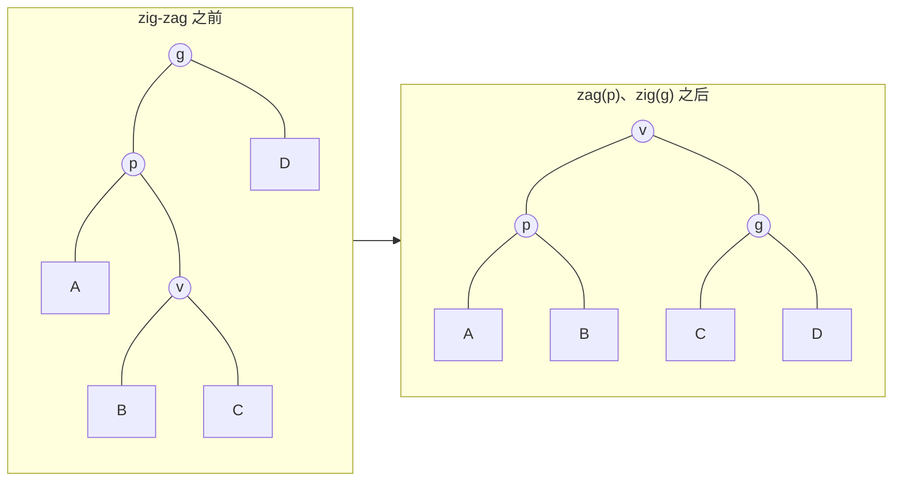
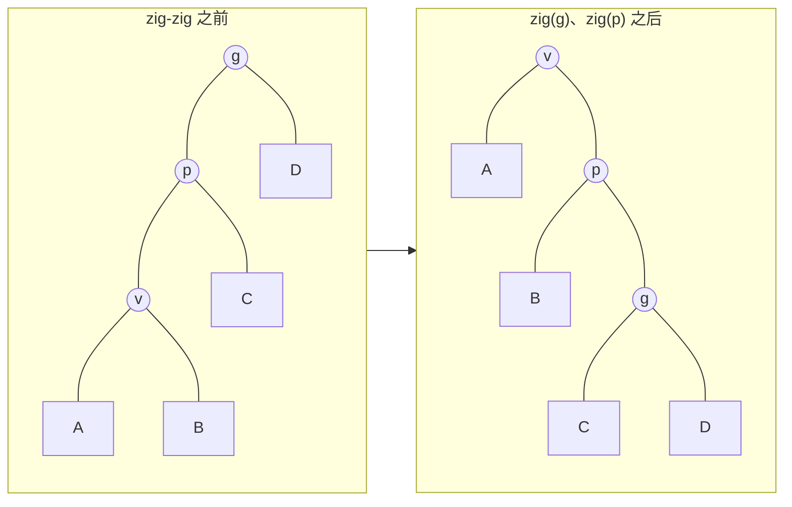
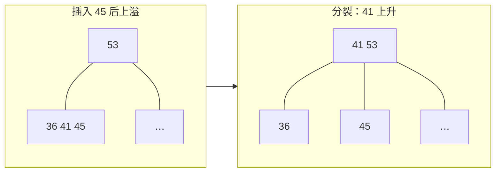
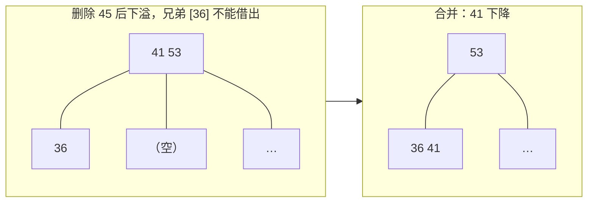
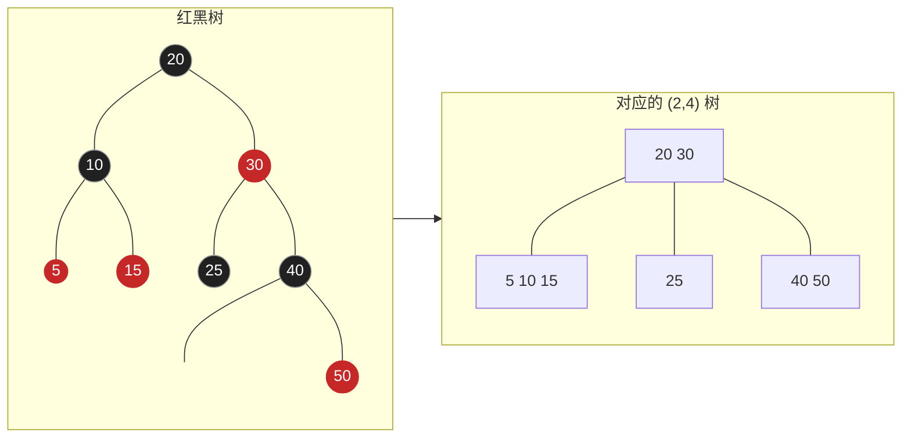
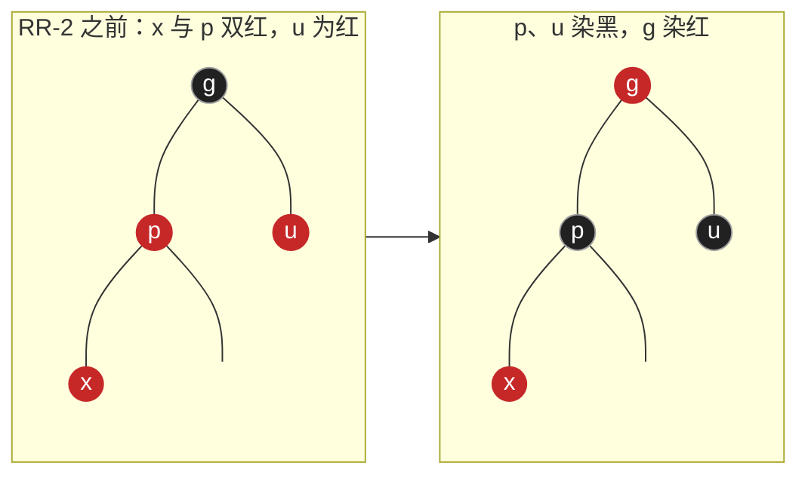

**AVL 树**（[4.3.6](/4.3.6)）保证了最坏情况下 $O(\log n)$ 的性能，但它对每个节点都"一视同仁"，也不考虑数据存放在哪一级存储器中，删除时还可能引起 $\Theta(\log n)$ 次旋转。本章的三种搜索树分别从三个角度改进：

- 伸展树利用访问的局部性，不记录任何平衡信息，每次访问后把被访问的节点调整到树根，以分摊的方式保证 $O(\log n)$ 的效率，访问越集中越快；
- B 树面向多级存储系统，把若干层二叉节点合并为一个大节点，使每次查找只需很少的外存访问，是数据库与文件系统索引的基础；
- 红黑树可以看作 B 树的二叉表示，每次插入或删除只需 $O(1)$ 次旋转，是 C++ `std::map`、Java `TreeMap` 等标准库有序容器的实现。

本章的分析方法也更进一步：伸展树用势能法做分摊分析，B 树按 I/O 次数而不是指令数计算代价，红黑树借助与 B 树的对应来理解与证明。

## 8.1. 伸展树

### 8.1.1. 局部性

**定义 8.1.1（局部性）** 刚被访问过的数据，极有可能很快再次被访问，这称为时间**局部性**；下一个将要访问的数据，极有可能就在刚被访问过的数据附近，这称为空间局部性。

这一现象在信息处理中屡见不鲜：循环反复执行同一段指令，热门商品、热门网页被反复查询，程序按顺序扫描数组。对 AVL 树做 $m$ 次连续查找（$m \gg n$），无论访问是否集中，都需要 $O(m \log n)$ 时间。能否利用局部性来加速？

**列表**中有一个简单的做法，称为自适应列表：节点一旦被访问，就把它移到最前端，于是常被访问的节点总在前面。伸展树模仿这一思路：**二叉搜索树**的节点一旦被访问，随即把它调整到树根。难点在于如何实现这种调整，以及如何控制调整过程本身的代价。

### 8.1.2. 逐层伸展

最直接的方法是自下而上逐层旋转：被访问的节点 $v$ 只要有父亲 $p$，就绕 $p$ 旋转（$v$ 是左孩子时 $\mathrm{zig}(p)$，是右孩子时 $\mathrm{zag}(p)$），每次旋转使 $v$ 上升一层，直至到达树根。与其说是把 $v$"推"到根，不如说是让它一步一步"爬"上去。

这样做的效率取决于树的初始形态与访问次序，最坏情况很糟糕。考察一条由 $1, 2, \dots, n$ 组成、向左倾斜的链（$n$ 为根），依次访问 $1, 2, \dots, n$：各次访问的旋转次数依次为 $n - 1, n - 1, n - 2, \dots, 2, 1$，构成算术级数，而访问完一轮后树恰好恢复原状，周而复始。每一轮累计 $\Theta(n^2)$ 次旋转，分摊到每次访问是 $\Theta(n)$，比不调整还差。

### 8.1.3. 双层伸展

Sleator 与 Tarjan（1985）提出的伸展树（splay tree）对此做了改进，其精髓是：每次向上追溯两层，而非一层。反复考察祖孙三代 $v$、$p = \operatorname{parent}(v)$、$g = \operatorname{parent}(p)$，根据它们的相对位置做两次旋转，使 $v$ 上升两层，成为这棵子树的根。

zig-zag（或 zag-zig）：$v$ 与 $p$ 异侧，此时 $v$ 按中序次序居中，先绕 $p$、再绕 $g$ 旋转，效果与逐层伸展完全相同，与 **AVL 树**的双旋也相同。



zig-zig（或 zag-zag）：$v$ 与 $p$ 同侧，此时要先绕 $g$、再绕 $p$ 旋转。逐层伸展的顺序恰好相反（先绕 $p$、再绕 $g$），两者结果不同，区别就在这里。



zig（或 zag）：若 $v$ 只有父亲、没有祖父，即 $p$ 就是树根，只需做一次单旋。这种情况至多在最后出现一次。

双层伸展的效果在长链上最明显：访问链底的节点之后，整条路径的长度大致折半，就像含羞草被触碰后叶子折叠起来一样。所以最坏情况不会持续发生：一次代价高的访问会使树变得更平衡，从而降低以后访问的代价。下面的分析把这一直觉精确化。

### 8.1.4. 查找、插入与删除

查找：按二叉搜索树的规则查找，然后把最后访问的节点伸展到树根：查找成功时是目标节点，失败时是查找停止处的父节点 $\mathit{hot}$。因此伸展树的查找也会改变树的结构，不再是只读的操作。

插入：先查找 $e$。查找失败后，伸展已经把 $e$ 在树中的前驱或后继 $t$ 带到了树根。既然如此，就在根附近接入新节点：若 $t < e$，则新节点作为新根，以 $t$ 为左孩子、以 $t$ 原来的右子树为右孩子（并断开 $t$ 与右子树的联系）；$t > e$ 时对称。

删除：先查找 $e$。成功之后，目标节点已在树根，摘除它，剩下左子树 $L$ 与右子树 $R$。若 $R$ 为空，$L$ 就是新树；否则在 $R$ 中查找 $e$，查找必然失败，但 $R$ 中的最小节点 $m$ 会被伸展到 $R$ 的根，而且 $m$ 没有左孩子，于是令 $L$ 作为 $m$ 的左子树即可。

下面的实现中，节点带有父指针，伸展是自下而上迭代进行的，所以退化成长链时也不会因递归太深而溢出。测试程序最后按递增次序插入 $2^{16}$ 个关键码（得到一条长链），再按顺序反复访问全部关键码，统计每次查找的平均旋转次数：结果是一个很小的常数，而不是 $\Theta(\log n)$ 或 $\Theta(n)$。这正是下面的分析所预言的。

```cpp tab
#include <format>
#include <iostream>
#include <random>
#include <set>
#include <vector>

template <typename K>
class SplayTree {
    struct Node { K key; Node *parent = nullptr, *lc = nullptr, *rc = nullptr; };
    Node* root = nullptr;
    std::size_t n = 0;
    long long rotations = 0;                        // for measuring the cost

    static void attach_lc(Node* p, Node* c) { p->lc = c; if (c) c->parent = p; }
    static void attach_rc(Node* p, Node* c) { p->rc = c; if (c) c->parent = p; }

    void rotate_up(Node* v) {                       // v rises above its parent p (zig or zag)
        Node *p = v->parent, *g = p->parent;
        if (v == p->lc) { attach_lc(p, v->rc); attach_rc(v, p); }
        else            { attach_rc(p, v->lc); attach_lc(v, p); }
        v->parent = g;
        if (!g) root = v;
        else if (g->lc == p) g->lc = v;
        else g->rc = v;
        ++rotations;
    }
    void splay(Node* v) {                           // move v to the root, two levels at a time
        while (Node* p = v->parent) {
            Node* g = p->parent;
            if (!g) rotate_up(v);                   // zig / zag: only at the very end
            else if ((v == p->lc) == (p == g->lc)) { rotate_up(p); rotate_up(v); }  // zig-zig
            else { rotate_up(v); rotate_up(v); }    // zig-zag
        }
    }
    // Standard BST descent; splay the last node reached (the target or where the search failed)
    Node* access(const K& key) {
        Node *x = root, *last = nullptr;
        while (x && x->key != key) { last = x; x = key < x->key ? x->lc : x->rc; }
        if (x || last) splay(x ? x : last);
        return x;
    }

public:
    SplayTree() = default;
    SplayTree(const SplayTree&) = delete;
    SplayTree& operator=(const SplayTree&) = delete;
    ~SplayTree() {                                  // iterative: the tree may be a long path
        std::vector<Node*> stack;
        if (root) stack.push_back(root);
        while (!stack.empty()) {
            Node* x = stack.back(); stack.pop_back();
            if (x->lc) stack.push_back(x->lc);
            if (x->rc) stack.push_back(x->rc);
            delete x;
        }
    }
    bool contains(const K& key) { return access(key) != nullptr; }

    bool insert(const K& key) {
        if (access(key)) return false;              // now the root is key's would-be neighbor
        Node* x = new Node{key};
        if (Node* t = root) {                       // split the tree around the new root
            if (t->key < key) { attach_rc(x, t->rc); t->rc = nullptr; attach_lc(x, t); }
            else              { attach_lc(x, t->lc); t->lc = nullptr; attach_rc(x, t); }
        }
        root = x;
        ++n;
        return true;
    }
    bool remove(const K& key) {
        Node* x = access(key);                      // after a hit, x is the root
        if (!x) return false;
        Node *l = x->lc, *r = x->rc;
        delete x; --n;
        if (l) l->parent = nullptr;
        if (!r) { root = l; return true; }
        r->parent = nullptr;
        root = r;
        Node* m = r;                                // splay the minimum of R to its root ...
        while (m->lc) m = m->lc;
        splay(m);
        attach_lc(m, l);                            // ... which then has no left child
        return true;
    }
    std::size_t size() const { return n; }
    long long rotation_count() const { return rotations; }
    std::vector<K> keys() const {
        std::vector<K> out;
        std::vector<Node*> stack;
        for (Node* x = root; x || !stack.empty(); ) {
            for (; x; x = x->lc) stack.push_back(x);
            x = stack.back(); stack.pop_back();
            out.push_back(x->key);
            x = x->rc;
        }
        return out;
    }
};

int main() {
    std::mt19937 rng(17);
    SplayTree<int> t;
    std::set<int> ref;
    for (int step = 0; step < 300000; ++step) {
        int key = static_cast<int>(rng() % 3000);
        switch (rng() % 3) {
            case 0: if (t.insert(key) != ref.insert(key).second) return 1; break;
            case 1: if (t.remove(key) != (ref.erase(key) == 1)) return 2; break;
            default: if (t.contains(key) != ref.contains(key)) return 3;
        }
    }
    if (t.keys() != std::vector<int>(ref.begin(), ref.end()) || t.size() != ref.size()) return 4;

    const int n = 1 << 16;                          // sorted insertions make a path ...
    SplayTree<int> s;
    for (int k = 0; k < n; ++k) s.insert(k);
    long long before = s.rotation_count();
    for (int round = 0; round < 4; ++round)         // ... yet sequential access is cheap
        for (int k = 0; k < n; ++k) s.contains(k);
    std::cout << std::format("ok; sequential access: {:.2f} rotations per search\n",
                             double(s.rotation_count() - before) / (4.0 * n));
}
```

```python tab
from __future__ import annotations

import random


class Node[K]:
    __slots__ = ("key", "parent", "lc", "rc")

    def __init__(self, key: K) -> None:
        self.key = key
        self.parent: Node[K] | None = None
        self.lc: Node[K] | None = None
        self.rc: Node[K] | None = None


def attach_lc(p: Node, c: Node | None) -> None:
    p.lc = c
    if c:
        c.parent = p


def attach_rc(p: Node, c: Node | None) -> None:
    p.rc = c
    if c:
        c.parent = p


class SplayTree[K]:
    def __init__(self) -> None:
        self.root: Node[K] | None = None
        self.size = 0

    def _rotate_up(self, v: Node[K]) -> None:      # v rises above its parent (zig or zag)
        p = v.parent
        g = p.parent
        if v is p.lc:
            attach_lc(p, v.rc); attach_rc(v, p)
        else:
            attach_rc(p, v.lc); attach_lc(v, p)
        v.parent = g
        if g is None:
            self.root = v
        elif g.lc is p:
            g.lc = v
        else:
            g.rc = v

    def _splay(self, v: Node[K]) -> None:          # two levels at a time
        while (p := v.parent) is not None:
            g = p.parent
            if g is None:
                self._rotate_up(v)                 # zig / zag: only at the very end
            elif (v is p.lc) == (p is g.lc):
                self._rotate_up(p); self._rotate_up(v)   # zig-zig: grandparent first
            else:
                self._rotate_up(v); self._rotate_up(v)   # zig-zag

    def _access(self, key: K) -> Node[K] | None:
        x, last = self.root, None
        while x and x.key != key:
            last, x = x, (x.lc if key < x.key else x.rc)
        if x or last:
            self._splay(x or last)                 # splay the last node reached
        return x

    def __contains__(self, key: K) -> bool:
        return self._access(key) is not None

    def insert(self, key: K) -> bool:
        if self._access(key):
            return False                           # the root is now key's neighbor
        x, t = Node(key), self.root
        if t:                                      # split around the new root
            if t.key < key:
                attach_rc(x, t.rc); t.rc = None; attach_lc(x, t)
            else:
                attach_lc(x, t.lc); t.lc = None; attach_rc(x, t)
        self.root = x
        x.parent = None
        self.size += 1
        return True

    def remove(self, key: K) -> bool:
        x = self._access(key)                      # after a hit, x is the root
        if x is None:
            return False
        l, r = x.lc, x.rc
        self.size -= 1
        if l:
            l.parent = None
        if r is None:
            self.root = l
            return True
        r.parent = None
        self.root = m = r
        while m.lc:                                # splay the minimum of R to its root
            m = m.lc
        self._splay(m)
        attach_lc(m, l)                            # it has no left child
        return True

    def keys(self) -> list[K]:
        out, stack, x = [], [], self.root
        while x or stack:
            while x:
                stack.append(x); x = x.lc
            x = stack.pop()
            out.append(x.key)
            x = x.rc
        return out


rng = random.Random(17)
t, ref = SplayTree[int](), set()
for _ in range(100_000):
    key, op = rng.randrange(3000), rng.randrange(3)
    if op == 0:
        assert t.insert(key) == (key not in ref); ref.add(key)
    elif op == 1:
        assert t.remove(key) == (key in ref); ref.discard(key)
    else:
        assert (key in t) == (key in ref)
assert t.keys() == sorted(ref) and t.size == len(ref)
print("ok")
```

### 8.1.5. 分摊分析

伸展树单次操作的代价可能高达 $\Theta(n)$，但我们关心的是一系列操作的总代价。聚合分析不容易直接应用于伸展树，这里用**势能法**。

**定义 8.1.2（势能法）** 为数据结构的每个状态 $S$ 定义一个实数 $\Phi(S)$，称为它的**势能**。设第 $i$ 次操作的实际代价为 $c_i$，使状态由 $S_{i-1}$ 变为 $S_i$，定义它的分摊代价为

$$
a_i = c_i + \Phi(S_i) - \Phi(S_{i-1}).
$$
这种分析方法称为**势能法**。

对 $m$ 次连续操作求和，势能差逐项抵消：

$$
\sum_{i=1}^{m} c_i = \sum_{i=1}^{m} a_i - \Phi(S_m) + \Phi(S_0).
$$

所以只要势能始终不低于某个下限，总的实际代价就不超过总的分摊代价加上势能的初值与下限之差。势能可以理解为预存的"能量"：代价低的操作多付一些，储存为势能；代价高的操作消耗势能，使其分摊代价仍然很低。**分摊分析**的一般讨论见 [4.3.2](/4.3.2)。

对伸展树，设节点 $v$ 的子树规模为 $s(v)$，定义它的秩为 $r(v) = \log_2 s(v)$，全树的势能为所有节点的秩之和：

$$
\Phi(S) = \sum_{v \in S} r(v) = \sum_{v \in S} \log_2 s(v).
$$

直观上，越平衡的树势能越小，越倾斜的树势能越大：单链的势能为 $\sum_{k=1}^{n} \log_2 k = \log_2 n! = \Theta(n \log n)$，**满二叉树**的势能只有 $\Theta(n)$。势能总是非负的。

以旋转次数作为伸展的实际代价。用 $r$、$r'$ 分别表示一步调整之前和之后的秩。

**引理 8.1.1** 在一步 zig 中，分摊代价不超过 $1 + 3(r'(v) - r(v))$；在一步 zig-zig 或 zig-zag 中，分摊代价不超过 $3(r'(v) - r(v))$。

**证明** 只有 $v$、$p$、$g$ 的秩会变化。

zig：实际代价为 $1$，$a = 1 + r'(v) + r'(p) - r(v) - r(p)$。旋转后 $p$ 是 $v$ 的孩子，$r'(p) \le r(p)$；又 $r'(v) \ge r(v)$。故 $a \le 1 + r'(v) - r(v) \le 1 + 3(r'(v) - r(v))$。

zig-zag：实际代价为 $2$。$v$ 取代了 $g$ 的位置，$r'(v) = r(g)$，于是 $a = 2 + r'(p) + r'(g) - r(v) - r(p) \le 2 + r'(p) + r'(g) - 2r(v)$（因为 $r(p) \ge r(v)$）。调整后 $p$、$g$ 是 $v$ 的两个孩子，$s'(p) + s'(g) \le s'(v)$。对数函数是凹的，$\log_2 x + \log_2 y \le 2\log_2 \frac{x+y}{2}$，所以 $r'(p) + r'(g) \le 2r'(v) - 2$。代入得 $a \le 2(r'(v) - r(v)) \le 3(r'(v) - r(v))$。

zig-zig：实际代价为 $2$，同样 $r'(v) = r(g)$，$a = 2 + r'(p) + r'(g) - r(v) - r(p)$。由于 $r'(p) \le r'(v)$、$r(p) \ge r(v)$，$a \le 2 + r'(v) + r'(g) - 2r(v)$。只需证明 $r(v) + r'(g) - 2r'(v) \le -2$。调整前 $v$ 的子树（$v$、$A$、$B$）与调整后 $g$ 的子树（$g$、$C$、$D$）互不相交，合起来再加上 $p$ 恰好是调整后 $v$ 的子树，所以 $s(v) + s'(g) \le s'(v)$，由同一个凹性不等式即得。$\square$

zig-zig 的分析正是先绕 $g$ 旋转的原因：若像逐层伸展那样先绕 $p$ 旋转，就得不到 $s(v) + s'(g) \le s'(v)$ 这样的关系。

**定理 8.1.2** 把节点 $v$ 伸展到根的分摊代价不超过 $3(r(\mathit{root}) - r(v)) + 1 = O(\log n)$。伸展树的查找、插入、删除的分摊时间都是 $O(\log n)$；从 $n$ 个节点的任意初始状态出发，$m$ 次操作的总时间为 $O((m + n) \log n)$。

**证明** 伸展由若干步双层调整与至多一步 zig 组成。由引理，各步的分摊代价之和中 $r'(v) - r(v)$ 逐项抵消，只剩下 $3(r_{\text{final}}(v) - r_{\text{initial}}(v)) + 1$，而最终 $v$ 是树根，$r_{\text{final}}(v) = \log_2 n$。查找的其余工作与伸展同阶。插入时，伸展之后接入的新根的秩为 $\log_2(n+1)$，其余节点的秩不增，势能至多增加 $\log_2(n+1)$；删除时摘除根使势能减少，在 $R$ 中伸展的分摊代价为 $O(\log n)$，接入 $L$ 使 $m$ 的秩至多增加到 $\log_2 n$。所以每种操作的分摊代价都是 $O(\log n)$。初始势能不超过 $n \log_2 n$，势能始终非负，由势能法的求和公式即得总时间。$\square$

伸展树还有更强的性质，它们刻画了"自适应"的含义：

- 静态最优性：对任意固定的访问频率分布，伸展树的总代价不超过最优的静态二叉搜索树（按频率构造的最优树，事先知道全部访问序列）的常数倍。
- 工作集性质：若只反复访问 $k$ 个节点组成的子集，每次访问的分摊代价为 $O(\log k)$，与 $n$ 无关。
- 顺序访问定理（Tarjan，1985）：按中序次序依次访问全部节点，总代价为 $O(n)$，上面的测试程序就验证了这一点。
- 动态最优性猜想（Sleator 与 Tarjan，1985）：对任何访问序列，伸展树的代价都不超过任何（可以在访问之间做旋转调整的）二叉搜索树算法的常数倍。这一猜想至今仍未被证明或否定。

### 8.1.6. 评价

伸展树无需记录高度、平衡因子等任何附加信息，实现简单，分摊复杂度与 AVL 树相当；局部性强（缓存命中率高）时，效率甚至更高。它的缺点是不能杜绝单次操作的最坏情况（$\Theta(n)$），因而不适用于对单次响应时间敏感的场合；查找也会修改树的结构，多个线程同时读取时必须加锁，这在并发环境中代价很大。伸展树常用于需要分裂与合并的场合（如 link-cut 树、区间翻转等序列操作），以及 GCC 等软件内部的一些缓存结构。

## 8.2. B 树

### 8.2.1. 存储层次与 I/O

在计算模型中，常常假定存储器容量无限、每次访问的代价相同。实际情况却是：

1. 应用问题的规模比存储器容量增长得更快。以典型的数据库规模与内存容量之比来看，1990 年约为 $10\,\mathrm{MB} / 2\,\mathrm{MB} = 5$，2020 年已达 $10\,\mathrm{TB} / 10\,\mathrm{GB} = 1000$。相对而言，内存实际上在不断变小。
2. 在给定的工艺与成本下，存储器都是容量与速度的折中：容量越大，访问越慢。
3. 因此实用的存储系统由不同类型的存储器级联而成，各级的容量、速度差异悬殊：

   | 存储器 | 典型访问延迟 | 典型容量 |
   |---|---|---|
   | 寄存器 | 小于 $1\,\mathrm{ns}$ | 数百字节 |
   | L1 / L2 / L3 缓存（SRAM） | 约 $1$ / $4$ / $10$–$40\,\mathrm{ns}$ | KB 到数十 MB |
   | 主存（DRAM） | 约 $100\,\mathrm{ns}$ | 数 GB 到数 TB |
   | 固态硬盘（NVMe SSD） | 约 $10$–$100\,\mu\mathrm{s}$ | TB 级 |
   | 机械硬盘 | 约 $5$–$10\,\mathrm{ms}$ | TB 级 |

   若一次内存访问需要一秒，则一次机械硬盘访问就需要一天多。为避免一次磁盘访问，宁可多访问上千次内存。
4. 外存以页（块）为单位读写：读写 $1$ 个字节与读写一整页（通常 $4\,\mathrm{KB}$）几乎一样快。C 标准库的 `setvbuf`、`fflush` 以及操作系统的页缓存，都是借助缓冲区批量访问来降低每字节的平均代价。

分级存储的策略是：常用的数据复制到更高层、更小、更快的存储器中，找不到才向更低层索取，这依靠的正是数据访问的局部性。于是，算法的实际运行时间主要取决于相邻存储级别之间数据传输（I/O）的次数，而非 CPU 指令的条数。外存算法的标准分析模型（Aggarwal 与 Vitter，1988）正是这样计算代价的：内存可容纳 $M$ 个元素，每次 I/O 在内存与外存之间传输一个含 $B$ 个元素的块，代价是 I/O 的次数。

同样的道理也适用于缓存与内存之间。把数组 $A[0, n)$ 就地循环左移 $k$ 位有两种只用 $O(1)$ 附加空间的方法：一是沿 $\gcd(n, k)$ 个同余类各转一圈，每个元素只移动一次，但每次访问相隔 $k$ 个元素（步长为 $k$ 的访问模式）；二是先分别倒置 $A[0, k)$ 与 $A[k, n)$，再倒置整个数组，元素共移动约 $3n$ 次，但每次访问都与上次相邻（步长为 $1$）。下面的程序比较两者：在一次实测中（$n = 2^{25}$，$k = 2^{12}$，`g++ -O2`），后者虽然多做了两倍的移动，却比前者快一个数量级。Python 中解释器本身的开销掩盖了大部分差异，但趋势相同。

```cpp tab
#include <chrono>
#include <cstddef>
#include <format>
#include <iostream>
#include <numeric>
#include <utility>
#include <vector>

// Rotate a[0, n) left by k in place, two ways with O(1) extra space.
template <typename T>
void shift_cycles(std::vector<T>& a, std::size_t k) {   // stride-k: follow gcd(n, k) cycles
    std::size_t n = a.size();
    if (n == 0 || (k %= n) == 0) return;
    for (std::size_t s = 0, g = std::gcd(n, k); s < g; ++s) {
        T b = std::move(a[s]);
        std::size_t i = s, j = (s + k) % n;
        while (j != s) { a[i] = std::move(a[j]); i = j; j = (j + k) % n; }
        a[i] = std::move(b);
    }
}

template <typename T>
void reverse(std::vector<T>& a, std::size_t lo, std::size_t hi) {  // a[lo, hi)
    while (lo + 1 < hi) std::swap(a[lo++], a[--hi]);
}

template <typename T>
void shift_reversal(std::vector<T>& a, std::size_t k) {  // stride-1: three reversals
    std::size_t n = a.size();
    if (n == 0 || (k %= n) == 0) return;
    reverse(a, 0, k); reverse(a, k, n); reverse(a, 0, n);
}

int main() {
    const std::size_t n = 1 << 25, k = 1 << 12;      // gcd = k: k cycles of length n / k
    std::vector<int> a(n), b;
    std::iota(a.begin(), a.end(), 0);
    b = a;
    auto time = [](auto&& f) {
        auto t0 = std::chrono::steady_clock::now();
        f();
        return std::chrono::duration<double, std::milli>(std::chrono::steady_clock::now() - t0).count();
    };
    double t1 = time([&] { shift_cycles(a, k); });
    double t2 = time([&] { shift_reversal(b, k); });
    std::cout << std::format("same result: {}; stride-k {:.0f} ms, stride-1 {:.0f} ms\n", a == b, t1, t2);
}
```

```python tab
from math import gcd
from time import perf_counter


def shift_cycles(a: list, k: int) -> None:
    """Rotate a left by k in place: stride-k access along gcd(n, k) cycles."""
    n = len(a)
    if n == 0 or (k := k % n) == 0:
        return
    for s in range(gcd(n, k)):
        b, i, j = a[s], s, (s + k) % n
        while j != s:
            a[i] = a[j]
            i, j = j, (j + k) % n
        a[i] = b


def reverse(a: list, lo: int, hi: int) -> None:   # a[lo:hi]
    hi -= 1
    while lo < hi:
        a[lo], a[hi] = a[hi], a[lo]
        lo, hi = lo + 1, hi - 1


def shift_reversal(a: list, k: int) -> None:
    """Rotate a left by k in place: three stride-1 reversals."""
    n = len(a)
    if n == 0 or (k := k % n) == 0:
        return
    reverse(a, 0, k); reverse(a, k, n); reverse(a, 0, n)


n, k = 1 << 22, 1 << 12
a, b = list(range(n)), list(range(n))
t0 = perf_counter(); shift_cycles(a, k)
t1 = perf_counter(); shift_reversal(b, k)
t2 = perf_counter()
print(f"same result: {a == b}; stride-k {1000 * (t1 - t0):.0f} ms, stride-1 {1000 * (t2 - t1):.0f} ms")
```

C++ 标准库的 `std::rotate` 就采用类似的考虑，按迭代器的类别选择不同的算法。

### 8.2.2. 结构

**二叉搜索树**每下降一层只读入一个关键码。设有 $n = 10^9$ 个记录，即使是 **AVL 树**，每次查找也需要约 $\log_2 10^9 \approx 30$ 次 I/O，每次 I/O 读入一整块却只用其中一个关键码，得不偿失。B 树（R. Bayer 与 E. McCreight，1970）充分利用外存的批量访问：把**平衡二叉搜索树**中每 $d$ 代节点合并成一个超级节点，得到 $m = 2^d$ 路、每个超级节点含 $m - 1$ 个关键码的多路搜索树。它在逻辑上与平衡二叉搜索树完全等价，但每下降一层都以超级节点为单位，一次 I/O 读入一组关键码。一组多大，视外存的块大小而定，常取 $m$ 为数百。回到上例，若取 $m = 256$，每次查找只需不超过 $4$ 次 I/O。

**定义 8.2.1（B 树）** $m$ 阶 **B 树**（$m \ge 3$）是满足以下条件的 $m$ 路搜索树：

1. 每个内部节点含有 $k \le m - 1$ 个按递增次序排列的关键码 $K_1 < \dots < K_k$，以及 $k + 1$ 个分支 $A_0, A_1, \dots, A_k$，$A_i$ 中的关键码都介于 $K_i$ 与 $K_{i+1}$ 之间；
2. 除根以外，每个内部节点的分支数不少于 $\lceil m/2 \rceil$；根节点在树非空时至少有 $2$ 个分支（只有根一个节点时除外）；
3. 把空分支看作外部节点，则所有外部节点的深度相等，以此深度作为树高 $h$。

注意这里叶节点（最底层的内部节点）与外部节点不同：叶节点的深度统一为 $h - 1$。由于分支数在 $\lceil m/2 \rceil$ 与 $m$ 之间，$m$ 阶 B 树也称为 $(\lceil m/2 \rceil, m)$ 树，例如 $(3, 5)$ 树、$(9, 18)$ 树。最简单的 B 树是 $m = 3$ 的 $(2, 3)$ 树（2-3 树，Hopcroft，1970），各内部节点有 $1$ 或 $2$ 个关键码。$m = 4$ 的 $(2, 4)$ 树（2-3-4 树）各节点有 $1$ 到 $3$ 个关键码，它与后面的红黑树等价。

B 树的节点在内存中用两个向量表示：关键码向量与分支（孩子）**向量**，后者总比前者多一个元素。

**定理 8.2.1** 含 $N$ 个关键码的 $m$ 阶 B 树的高度 $h$ 满足

$$
\log_m (N + 1) \le h \le \log_{\lceil m/2 \rceil} \frac{N + 1}{2} + 1.
$$

**证明** B 树中外部节点数恰为 $N + 1$：外部节点对应查找失败的 $N + 1$ 个区间（也可对内部节点归纳：每个含 $k$ 个关键码的节点有 $k + 1$ 个分支）。

上界：要使树尽可能高，内部节点应尽可能"瘦"。深度为 $0$ 的根至少 $1$ 个，深度为 $1$ 的节点至少 $2$ 个，此后每层至少是上一层的 $\lceil m/2 \rceil$ 倍，所以深度为 $h$ 的外部节点至少 $2\lceil m/2 \rceil^{h-1}$ 个：$N + 1 \ge 2\lceil m/2 \rceil^{h-1}$，即得上界。

下界：要使树尽可能矮，内部节点应尽可能"胖"。每个节点至多 $m$ 个分支，深度为 $h$ 的外部节点至多 $m^h$ 个：$N + 1 \le m^h$。$\square$

与平衡二叉搜索树相比，取 $m = 256$ 时，上界约为 $\log_{128} N = \frac{1}{7}\log_2 N$，下界约为 $\frac{1}{8}\log_2 N$：B 树的高度约降为二叉树的 $1/7$ 到 $1/8$。若 I/O 次数正比于树高，这就像"用 4 年还是 28 年上完大学"的差别。

### 8.2.3. 查找

**算法 8.2.1（B 树的查找）** 从根节点出发，只要当前节点不是外部节点：在当前节点的关键码中查找 $e$（在内存中进行），找到则成功；否则沿相应的分支找到孩子节点，把它读入内存（一次 I/O），继续。到达外部节点则失败。

约定根节点常驻内存。查找在每一深度至多做一次 I/O，所以 I/O 次数为 $O(h) = O(\log_m N)$。在节点内部查找时，对通常的 $m$（数十到数百），顺序查找往往比二分查找更快：顺序扫描一段连续内存，正好利用了缓存的空间局部性。若按二分查找计，CPU 时间为每层 $O(\log m)$，总共 $O(\log m \cdot \log_m N) = O(\log N)$。

### 8.2.4. 插入与分裂

**算法 8.2.2（B 树的插入）** 先查找 $e$，确认不存在；查找失败时停在某个叶节点 $\mathit{hot}$，把 $e$ 插入其关键码向量的适当位置，并增加一个空分支。若 $\mathit{hot}$ 的关键码数达到 $m$（上溢），则分裂：设上溢节点的关键码依次为 $k_0, \dots, k_{m-1}$，取中位数 $s = \lfloor m/2 \rfloor$，以 $k_s$ 为界把节点分为左右两个节点，$k_s$ 上升一层插入父节点，左右两个节点作为它两侧的分支。

分裂后左节点含 $\lfloor m/2 \rfloor$ 个关键码、右节点含 $m - \lfloor m/2 \rfloor - 1 = \lceil m/2 \rceil - 1$ 个，都符合 $m$ 阶 B 树的条件。例如在 $(2, 3)$ 树中向叶节点 $[36\ 41]$ 插入 $45$：



若父节点原本已经饱和，接纳上升的关键码后也会上溢，可以套用同样的方法继续分裂：上溢可能逐层向上传播，但至多传播到根。若根也上溢，就让上升的关键码自成一个新的根节点，它只有两个分支。这是 B 树增高的唯一途径，因此所有外部节点总在同一深度。插入的总时间正比于分裂次数，为 $O(h)$。

实际上分裂很少发生：从空树开始连续插入 $N$ 个关键码，每次分裂都会产生一个新节点，而每个节点至少含 $\lceil m/2 \rceil - 1$ 个关键码，所以分裂总次数不超过 $N / (\lceil m/2 \rceil - 1) + O(h)$，平均到每次插入不足 $2/(m-2)$ 次。

### 8.2.5. 删除与合并

**算法 8.2.3（B 树的删除）** 先查找到 $e$ 所在的节点 $v$。若 $v$ 不是叶节点，就像二叉搜索树一样，找到 $e$ 的直接后继（右侧分支中一直向左，必在叶节点中），与之交换，于是待删除的关键码总在叶节点中。删除它与一个空分支后，若该节点的分支数少于 $\lceil m/2 \rceil$（下溢），即恰有 $\lceil m/2 \rceil - 2$ 个关键码，则视其左、右兄弟 $L$、$R$ 的规模分三种情况处理：

1. 旋转：若 $L$ 存在且至少含 $\lceil m/2 \rceil$ 个关键码，则把父节点 $P$ 中介于两者之间的分界关键码 $y$ 移入 $V$（作为最小关键码），把 $L$ 中的最大关键码 $x$ 移入 $P$ 取代 $y$，$L$ 的最右侧分支随之过继给 $V$。局部乃至全树都重新满足 B 树的条件，修复完毕。
2. 若 $R$ 存在且足够"胖"，对称地旋转。
3. 合并：$L$ 和 $R$ 或不存在，或都只含 $\lceil m/2 \rceil - 1$ 个关键码。但它们必有其一存在，不妨设为 $L$。从 $P$ 中取出分界关键码 $y$，以 $y$ 为粘合剂，把 $L$ 与 $V$ 合并成一个节点，含 $(\lceil m/2 \rceil - 1) + 1 + (\lceil m/2 \rceil - 2) \le m - 1$ 个关键码。

合并之后 $P$ 失去一个关键码，可能随之下溢，同样套用上面的方法继续旋转或合并：下溢可能持续向上传播，至多 $O(h)$ 层。若根节点的最后一个关键码被合并下去，就删除根，以它唯一的孩子作为新根。这是 B 树降低的唯一途径。



（这正是上一节分裂的逆过程。）

### 8.2.6. 实现

下面的实现中，插入与删除都是递归的：递归返回时，父节点检查刚处理过的孩子是否上溢或下溢，再做分裂、旋转或合并，这与"自底而上逐层修复"的描述完全一致。由于 B 树很矮，递归深度不成问题。测试程序对 $m = 3, 4, 5, 8, 64$ 分别做随机插入与删除，与有序集合对拍，并定期检查节点规模与外部节点等深的条件。

```cpp tab
#include <algorithm>
#include <format>
#include <iostream>
#include <memory>
#include <random>
#include <set>
#include <vector>

template <typename K>
class BTree {                                       // order m: at most m - 1 keys and m children
    struct Node {
        std::vector<K> key;                         // sorted
        std::vector<std::unique_ptr<Node>> child;   // empty for a leaf, else key.size() + 1
        bool leaf() const { return child.empty(); }
    };
    std::unique_ptr<Node> root = std::make_unique<Node>();
    int m;
    std::size_t n = 0;

    int min_keys() const { return (m + 1) / 2 - 1; }  // ceil(m/2) - 1 for non-root nodes
    static int rank(const Node* x, const K& k) {    // first position with key >= k
        return static_cast<int>(std::ranges::lower_bound(x->key, k) - x->key.begin());
    }

    void split(Node* p, int i) {                    // child i holds m keys: overflow
        Node* v = p->child[i].get();
        int s = m / 2;                              // the median key moves up
        auto u = std::make_unique<Node>();
        u->key.assign(v->key.begin() + s + 1, v->key.end());
        if (!v->leaf()) {
            for (auto it = v->child.begin() + s + 1; it != v->child.end(); ++it)
                u->child.push_back(std::move(*it));
            v->child.resize(s + 1);
        }
        p->key.insert(p->key.begin() + i, v->key[s]);
        v->key.resize(s);
        p->child.insert(p->child.begin() + i + 1, std::move(u));
    }
    bool insert(Node* x, const K& k) {
        int i = rank(x, k);
        if (i < static_cast<int>(x->key.size()) && x->key[i] == k) return false;
        if (x->leaf()) { x->key.insert(x->key.begin() + i, k); return true; }
        if (!insert(x->child[i].get(), k)) return false;
        if (static_cast<int>(x->child[i]->key.size()) == m) split(x, i);  // may propagate up
        return true;
    }

    void fix_underflow(Node* p, int i) {            // child i may hold too few keys
        Node* v = p->child[i].get();
        if (static_cast<int>(v->key.size()) >= min_keys()) return;
        if (i > 0 && static_cast<int>(p->child[i - 1]->key.size()) > min_keys()) {
            Node* ls = p->child[i - 1].get();       // rotation: borrow through the parent
            v->key.insert(v->key.begin(), p->key[i - 1]);
            p->key[i - 1] = ls->key.back(); ls->key.pop_back();
            if (!ls->leaf()) {
                v->child.insert(v->child.begin(), std::move(ls->child.back()));
                ls->child.pop_back();
            }
        } else if (i + 1 < static_cast<int>(p->child.size()) &&
                   static_cast<int>(p->child[i + 1]->key.size()) > min_keys()) {
            Node* rs = p->child[i + 1].get();       // symmetric rotation
            v->key.push_back(p->key[i]);
            p->key[i] = rs->key.front(); rs->key.erase(rs->key.begin());
            if (!rs->leaf()) {
                v->child.push_back(std::move(rs->child.front()));
                rs->child.erase(rs->child.begin());
            }
        } else {                                    // merge with a sibling via the separator
            int j = (i > 0) ? i - 1 : i;            // merge child j + 1 into child j
            Node *a = p->child[j].get(), *b = p->child[j + 1].get();
            a->key.push_back(p->key[j]);
            a->key.insert(a->key.end(), b->key.begin(), b->key.end());
            for (auto& c : b->child) a->child.push_back(std::move(c));
            p->key.erase(p->key.begin() + j);
            p->child.erase(p->child.begin() + j + 1);  // the parent may underflow in turn
        }
    }
    bool remove(Node* x, const K& k) {
        int i = rank(x, k);
        bool here = i < static_cast<int>(x->key.size()) && x->key[i] == k;
        if (x->leaf()) {
            if (!here) return false;
            x->key.erase(x->key.begin() + i);
            return true;
        }
        if (here) {                                 // swap with the successor, which is in a leaf
            Node* u = x->child[i + 1].get();
            while (!u->leaf()) u = u->child[0].get();
            K succ = u->key[0];
            x->key[i] = succ;
            remove(x->child[++i].get(), succ);      // now delete it from the right subtree
        } else if (!remove(x->child[i].get(), k)) {
            return false;
        }
        fix_underflow(x, i);
        return true;
    }
    int check(const Node* x, bool is_root) const {  // returns the height, -1 if invalid
        int s = static_cast<int>(x->key.size());
        if (s > m - 1 || (!is_root && s < min_keys())) return -1;
        if (!std::ranges::is_sorted(x->key)) return -1;
        if (x->leaf()) return 0;
        if (static_cast<int>(x->child.size()) != s + 1) return -1;
        int h = check(x->child[0].get(), false);
        for (auto& c : x->child) if (check(c.get(), false) != h) return -1;
        return h < 0 ? -1 : h + 1;
    }
    void inorder(const Node* x, std::vector<K>& out) const {
        for (std::size_t i = 0; i <= x->key.size(); ++i) {
            if (!x->leaf()) inorder(x->child[i].get(), out);
            if (i < x->key.size()) out.push_back(x->key[i]);
        }
    }

public:
    explicit BTree(int order) : m(order) {}

    bool contains(const K& k) const {               // one node (one I/O) per level
        for (const Node* x = root.get(); ; ) {
            int i = rank(x, k);
            if (i < static_cast<int>(x->key.size()) && x->key[i] == k) return true;
            if (x->leaf()) return false;
            x = x->child[i].get();
        }
    }
    bool insert(const K& k) {
        if (!insert(root.get(), k)) return false;
        ++n;
        if (static_cast<int>(root->key.size()) == m) {   // the root splits: the tree grows
            auto r = std::make_unique<Node>();
            r->child.push_back(std::move(root));
            root = std::move(r);
            split(root.get(), 0);
        }
        return true;
    }
    bool remove(const K& k) {
        if (!remove(root.get(), k)) return false;
        --n;
        if (root->key.empty() && !root->leaf())     // the root vanishes: the tree shrinks
            root = std::move(root->child[0]);
        return true;
    }
    int levels() const {                            // = depth of the external nodes; 0 if invalid
        return check(root.get(), true) + 1;
    }
    std::size_t size() const { return n; }
    std::vector<K> keys() const { std::vector<K> out; inorder(root.get(), out); return out; }
};

int main() {
    std::mt19937 rng(19);
    for (int m : {3, 4, 5, 8, 64}) {
        BTree<int> t(m);
        std::set<int> ref;
        for (int step = 0; step < 100000; ++step) {
            int key = static_cast<int>(rng() % 4000);
            if (rng() % 2) { if (t.insert(key) != ref.insert(key).second) return 1; }
            else if (t.remove(key) != (ref.erase(key) == 1)) return 2;
            if (t.contains(key) != ref.contains(key)) return 3;
            if (step % 1000 == 0 && t.levels() == 0) return 4;
        }
        if (t.keys() != std::vector<int>(ref.begin(), ref.end())) return 5;
        std::cout << std::format("m = {:2}: {} keys in {} levels\n", m, t.size(), t.levels());
    }
}
```

```python tab
from __future__ import annotations

import random
from bisect import bisect_left


class Node[K]:
    __slots__ = ("key", "child")

    def __init__(self) -> None:
        self.key: list[K] = []                     # sorted
        self.child: list[Node[K]] = []             # empty for a leaf, else len(key) + 1


class BTree[K]:
    """B-tree of order m: every node has at most m - 1 keys and m children."""

    def __init__(self, m: int) -> None:
        self.m, self.root, self.size = m, Node[K](), 0
        self.min_keys = (m + 1) // 2 - 1           # ceil(m/2) - 1 for non-root nodes

    def __contains__(self, k: K) -> bool:          # one node (one I/O) per level
        x = self.root
        while True:
            i = bisect_left(x.key, k)
            if i < len(x.key) and x.key[i] == k:
                return True
            if not x.child:
                return False
            x = x.child[i]

    def _split(self, p: Node[K], i: int) -> None:  # child i holds m keys: overflow
        v, u, s = p.child[i], Node[K](), self.m // 2
        u.key, u.child = v.key[s + 1:], v.child[s + 1:]
        p.key.insert(i, v.key[s])                  # the median key moves up
        p.child.insert(i + 1, u)
        v.key, v.child = v.key[:s], v.child[:s + 1]

    def insert(self, k: K) -> bool:
        def ins(x: Node[K]) -> bool:
            i = bisect_left(x.key, k)
            if i < len(x.key) and x.key[i] == k:
                return False
            if not x.child:
                x.key.insert(i, k)
                return True
            if not ins(x.child[i]):
                return False
            if len(x.child[i].key) == self.m:
                self._split(x, i)                  # may propagate upward
            return True

        if not ins(self.root):
            return False
        self.size += 1
        if len(self.root.key) == self.m:           # the root splits: the tree grows
            r = Node[K]()
            r.child = [self.root]
            self.root = r
            self._split(r, 0)
        return True

    def _fix_underflow(self, p: Node[K], i: int) -> None:
        v = p.child[i]
        if len(v.key) >= self.min_keys:
            return
        if i > 0 and len(p.child[i - 1].key) > self.min_keys:
            ls = p.child[i - 1]                    # rotation: borrow through the parent
            v.key.insert(0, p.key[i - 1])
            p.key[i - 1] = ls.key.pop()
            if ls.child:
                v.child.insert(0, ls.child.pop())
        elif i + 1 < len(p.child) and len(p.child[i + 1].key) > self.min_keys:
            rs = p.child[i + 1]                    # symmetric rotation
            v.key.append(p.key[i])
            p.key[i] = rs.key.pop(0)
            if rs.child:
                v.child.append(rs.child.pop(0))
        else:                                      # merge child j + 1 into child j
            j = i - 1 if i > 0 else i
            a, b = p.child[j], p.child[j + 1]
            a.key += [p.key.pop(j)] + b.key
            a.child += b.child
            del p.child[j + 1]                     # the parent may underflow in turn

    def remove(self, k: K) -> bool:
        def rem(x: Node[K], k: K) -> bool:
            i = bisect_left(x.key, k)
            here = i < len(x.key) and x.key[i] == k
            if not x.child:
                if here:
                    del x.key[i]
                return here
            if here:                               # swap with the successor (in a leaf)
                u = x.child[i + 1]
                while u.child:
                    u = u.child[0]
                x.key[i] = u.key[0]
                i += 1
                rem(x.child[i], x.key[i - 1])
            elif not rem(x.child[i], k):
                return False
            self._fix_underflow(x, i)
            return True

        if not rem(self.root, k):
            return False
        self.size -= 1
        if not self.root.key and self.root.child:  # the root vanishes: the tree shrinks
            self.root = self.root.child[0]
        return True

    def check(self) -> int:                        # number of levels; raises if invalid
        def rec(x: Node[K], is_root: bool) -> int:
            assert len(x.key) <= self.m - 1 and (is_root or len(x.key) >= self.min_keys)
            assert x.key == sorted(x.key)
            if not x.child:
                return 1
            assert len(x.child) == len(x.key) + 1
            hs = {rec(c, False) for c in x.child}
            assert len(hs) == 1                    # all leaves at the same depth
            return hs.pop() + 1
        return rec(self.root, True)

    def keys(self) -> list[K]:
        def rec(x: Node[K]) -> list[K]:
            if not x.child:
                return list(x.key)
            out: list[K] = []
            for i, c in enumerate(x.child):
                out += rec(c)
                if i < len(x.key):
                    out.append(x.key[i])
            return out
        return rec(self.root)


rng = random.Random(19)
for m in (3, 4, 5, 8, 64):
    t, ref = BTree[int](m), set()
    for step in range(30_000):
        key = rng.randrange(4000)
        if rng.randrange(2):
            assert t.insert(key) == (key not in ref); ref.add(key)
        else:
            assert t.remove(key) == (key in ref); ref.discard(key)
        assert (key in t) == (key in ref)
        if step % 1000 == 0:
            t.check()
    assert t.keys() == sorted(ref)
    print(f"m = {m:2}: {t.size} keys in {t.check()} levels")
```

### 8.2.7. 变种与应用

实际系统中最常用的是 B+ 树（B+ tree）：所有关键码（及其记录）都存放在叶节点中，内部节点只保存用于导航的分界关键码，叶节点之间按次序链接。这样内部节点更"胖"、树更矮，范围查询只需找到起点后沿叶节点链表顺序扫描。关系数据库的索引（如 MySQL InnoDB、PostgreSQL 的 B-tree 索引）和许多文件系统（如 XFS、Btrfs、NTFS）都基于 B+ 树或其变种（[4.13](/4.13)）。写入密集的存储引擎（LevelDB、RocksDB）则改用日志结构合并树（LSM 树），以顺序写换取更高的写吞吐量。

B 树也适用于内存：缓存与内存之间同样是"按块传输"的，一个 B 树节点占据连续的内存，比二叉树节点更利于缓存。Rust 标准库的有序映射 `BTreeMap`、Google Abseil 库的 `absl::btree_map` 都是内存中的 B 树；Linux 内核自 6.1 版起用一种 B 树（maple tree）取代了管理进程虚拟内存区域的红黑树。

## 8.3. 红黑树

### 8.3.1. 动机

前面的**平衡二叉搜索树**在两个场合表现不佳。

并发访问：多个线程同时修改一棵搜索树时，修改之前要对受影响的部分加锁，完成后解锁，访问延迟主要取决于加锁期间结构发生变化的局部的数量。伸展树每次操作都可能使结构发生剧烈变化，最坏达到 $\Theta(n)$；AVL 树插入时只需 $O(1)$ 次旋转，删除时却可能需要 $\Theta(\log n)$ 次。

持久化：持久化的数据结构支持访问历史版本，例如 `search(ver, key)`、`insert(ver, key)`、`remove(ver, key)`，应用于版本管理、事务的快照、函数式语言的不可变数据。蛮力的做法是每个版本独立保存一份，单次操作需要 $O(n)$ 时间与空间。若利用相邻版本之间的相关性，大量共享、少量更新，每个新版本只需复制一条路径，新增 $O(\log n)$ 空间；对于只读取历史版本的部分持久化，还可以进一步降到每次更新新增 $O(1)$ 空间。后者要求每次修改时，树的拓扑结构只有 $O(1)$ 处变化。

这两个场合都需要一种每次修改只引起 $O(1)$ 次结构调整的平衡二叉搜索树，这就是红黑树。

### 8.3.2. 定义与 (2,4) 树

红黑树由 R. Bayer（1972）以"对称二叉 B 树"的名义提出，L. Guibas 与 R. Sedgewick（1978）给出了现在的红黑表述。

**定义 8.3.1（红黑树）** 由红、黑两类节点组成的二叉搜索树，统一引入外部节点（空指针）使之成为真二叉树，若满足以下条件，则称为**红黑树**：

1. 树根是黑色的；
2. 外部节点都是黑色的；
3. 红节点的孩子都是黑色的（因而红节点的父亲也是黑色的）：任何路径上都没有相邻的红节点；
4. 从任一节点到其后代外部节点的所有路径上，黑节点的数目都相同。

条件 4 中从根出发的路径上的黑节点数称为全树的黑高度；子树的黑高度，就是它的外部节点相对于子树根的黑深度。

这个定义颇为费解，但它有一个直观的解释：把每个红节点提升到与它的（黑）父亲同一高度，把红边折叠起来，再把黑节点与它的红孩子合并成一个超级节点，红黑树就变成了一棵 $(2, 4)$ 树。超级节点只有四种组合：黑、黑红、红黑、红黑红，分别对应 $(2, 4)$ 树中含 $1$、$2$、$2$、$3$ 个关键码的内部节点；条件 4 保证了所有外部节点在 $(2, 4)$ 树中位于同一深度。反过来，每棵 $(2, 4)$ 树也对应于红黑树（含两个关键码的节点有黑红、红黑两种表示）。



**定理 8.3.1** 含 $n$ 个内部节点的红黑树，高度 $h \le 2\log_2(n+1)$。

**证明** 设全树的黑高度为 $H$。由条件 1 与条件 3，任一路径上红节点不比黑节点多，所以 $h \le 2H$。另一方面，$H$ 恰是对应的 $(2, 4)$ 树的高度，而 $(2, 4)$ 树含 $n$ 个关键码，由定理 8.2.1（$m = 4$，$\lceil m/2 \rceil = 2$），$H \le \log_2 \frac{n+1}{2} + 1 = \log_2(n+1)$。$\square$

所以红黑树是平衡二叉搜索树。它比 **AVL 树**（$1.44 \log_2 n$）稍高，但仍是 $O(\log n)$。实现时每个节点只需额外记录一位颜色；下面的实现不保存高度，校验时递归计算黑高度。

### 8.3.3. 插入：双红修正

按**二叉搜索树**的规则插入关键码 $e$，新节点 $x$ 必为叶节点，把它染成红色（若它是根则染黑）。此时条件 1、2、4 仍然满足，条件 3 却不见得：$x$ 的父亲 $p$ 也可能是红色，这称为双红。若出现双红，$x$ 的祖父 $g$ 必然存在且为黑色（$p$ 是红的，不是根）。考察 $x$ 的叔父 $u = \operatorname{sibling}(p)$，分两种情况：

RR-1：$u$ 为黑色（包括外部节点）。此时 $x$、$p$、$g$ 的四个孩子（可能是外部节点）都是黑色的，且黑高度相同。对 $x$、$p$、$g$ 做 **3+4 重构**（[4.3.6](/4.3.6)），把重构后居中的 $b$ 染黑，两侧的 $a$、$c$ 染红，就一次性完成了修复。从 $(2, 4)$ 树的角度看，所谓"非法"无非是：在某个含两个关键码的节点中插入一个红关键码后，原来的黑关键码不再居中（成了红红黑或黑红红）；调整的效果，只是把三个关键码的颜色改为红黑红，B 树本身并无变化。

RR-2：$u$ 为红色。从 $(2, 4)$ 树的角度看，$p$、$g$、$u$ 与 $x$ 所在的超级节点含有 $4$ 个关键码，发生了上溢。修复办法是把 $p$ 与 $u$ 染黑、$g$ 染红：这正等效于 B 树的分裂，$g$ 作为中位数上升一层，交给父节点。不需要旋转。



既然是分裂，就可能继续向上传播：$g$ 与它的父亲可能再次构成双红。这时把 $g$ 视作新插入的节点，如法处理，直到不再双红，或者到达树根；若 $g$ 到达树根，就强行把它染黑，全树的黑高度加一（对应 B 树增高一层）。

| 情况 | 旋转 | 染色 | 此后 |
|---|---|---|---|
| RR-1：$u$ 为黑 | $1$–$2$ | $2$ | 调整随即完成 |
| RR-2：$u$ 为红 | $0$ | $3$ | 可能再次双红，但上升两层 |

所以插入只需 $O(\log n)$ 时间，其间至多 $O(\log n)$ 次染色，而旋转至多 $2$ 次：RR-1 至多发生一次，并且之后立即结束。染色只改变节点内的一位，不改变树的结构；而且可以证明，从空树开始的一系列插入删除中，每次操作的染色次数分摊只是 $O(1)$。

### 8.3.4. 删除：双黑修正

首先按二叉搜索树的常规算法删除：若目标节点有两个孩子，就与其直接后继交换数据，转而删除后继。于是实际被摘除的节点 $x$ 至多有一个孩子，它由孩子 $r$（可能是外部节点）接替。

- 若 $x$ 为红色，删除它不影响任何路径上的黑节点数，条件 3、4 自然满足，删除完成；
- 若 $r$ 为红色，把它染黑，恰好补上 $x$ 带走的那个黑节点，删除完成。

若 $x$ 与 $r$ 都是黑色（双黑），摘除 $x$ 后经过 $r$ 的路径少了一个黑节点，黑深度不再统一。从 $(2, 4)$ 树的角度看，这相当于 $x$ 所在的超级节点发生了下溢。考察 $r$ 的父亲 $p$（也是原来 $x$ 的父亲）与兄弟 $s$。$s$ 一侧的黑高度比 $r$ 一侧多一，所以 $s$ 必然存在（不是外部节点）。分四种情况：

BB-1：$s$ 为黑，且至少有一个红孩子 $t$。对 $t$、$s$、$p$ 做 3+4 重构，重构后居中的 $b$ 继承 $p$ 原来的颜色，两侧的 $a$、$c$ 染黑，$r$ 保持黑色。红黑树的性质在全局恢复，删除完成。在 $(2, 4)$ 树中，这等效于通过关键码的旋转（向兄弟借一个关键码）消除下溢。

BB-2R：$s$ 为黑，两个孩子都是黑的，且 $p$ 为红。把 $s$ 染红、$p$ 染黑，$r$ 保持黑色，红黑树的性质在全局恢复。在 $(2, 4)$ 树中，这等效于下溢节点与兄弟合并，父节点的关键码 $p$ 下降。父节点不会因此下溢：$p$ 是红的，它所在的超级节点中还有一个黑关键码。

BB-2B：$s$ 为黑，两个孩子都是黑的，且 $p$ 为黑。把 $s$ 染红，$r$ 与 $p$ 保持黑色。现在以 $p$ 为根的子树内部恢复了平衡，但它的黑高度比原来少一，相当于 $p$ 处出现了新的双黑。在 $(2, 4)$ 树中，这等效于下溢节点与兄弟合并；由于合并前 $p$ 和 $s$ 都属于只含一个关键码的节点，父节点必然随之下溢。好在可以继续分情况处理，每次上升一层，至多 $O(\log n)$ 层。

BB-3：$s$ 为红（其孩子必然都是黑的）。绕 $p$ 单旋，使 $s$ 成为 $p$ 的父亲，并把 $s$ 染黑、$p$ 染红。此时黑高度依然异常，但 $r$ 有了一个新的黑兄弟（$s$ 原来的孩子），转化为前面的情况；而且 $p$ 已经是红色的，接下来只能是 BB-1 或 BB-2R，不会是 BB-2B，再经一轮调整就必然恢复。在 $(2, 4)$ 树中，这一步只是改变了某个含两个关键码的节点的表示（哪个关键码是黑的），B 树本身并无变化。

| 情况 | 旋转 | 染色 | 此后 |
|---|---|---|---|
| BB-1：黑 $s$ 有红孩子 | $1$–$2$ | $3$ | 调整随即完成 |
| BB-2R：黑 $s$ 无红孩子，$p$ 红 | $0$ | $2$ | 调整随即完成 |
| BB-2B：黑 $s$ 无红孩子，$p$ 黑 | $0$ | $1$ | 必再次双黑，但上升一层 |
| BB-3：红 $s$ | $1$ | $2$ | 转为 BB-1 或 BB-2R |

所以删除只需 $O(\log n)$ 时间，其间至多 $O(\log n)$ 次染色，而旋转至多 $3$ 次（BB-3 一次，加上随后 BB-1 的至多两次）。与 AVL 树相比，红黑树的删除把可能多达 $\Theta(\log n)$ 次的结构调整降到了常数次。

### 8.3.5. 实现

下面的实现用空指针表示黑色的外部节点。`restructure(v)` 对 $v$、它的父亲与祖父做 3+4 重构（用一次或两次旋转实现），返回居中的节点；`solve_double_red` 与 `solve_double_black` 分别按上面的情况表处理。删除时被摘除的 $x$ 可能没有孩子，此时 $r$ 是空指针，所以要另外记下 $r$ 是父亲的左孩子还是右孩子。测试程序在随机操作中与 `std::set`（它本身就是一棵红黑树）对拍，并定期验证条件 1、3、4。

```cpp tab
#include <format>
#include <iostream>
#include <random>
#include <set>
#include <vector>

template <typename K>
class RedBlackTree {                                // nullptr links are the black external nodes
    enum Color : bool { RED, BLACK };
    struct Node { K key; Color color = RED; Node *parent = nullptr, *lc = nullptr, *rc = nullptr; };
    Node* root = nullptr;
    std::size_t n = 0;

    static bool is_red(const Node* x) { return x && x->color == RED; }
    static void attach(Node* p, bool left, Node* c) { (left ? p->lc : p->rc) = c; if (c) c->parent = p; }

    void rotate_up(Node* v) {                       // v rises above its parent (zig or zag)
        Node *p = v->parent, *g = p->parent;
        bool left = (v == p->lc);
        attach(p, left, left ? v->rc : v->lc);
        attach(v, !left, p);
        v->parent = g;
        if (!g) root = v; else (g->lc == p ? g->lc : g->rc) = v;
    }
    Node* restructure(Node* v) {                    // "3 + 4": v, its parent and grandparent;
        Node* p = v->parent;                        // returns the middle one, now on top
        if ((v == p->lc) == (p == p->parent->lc)) { rotate_up(p); return p; }  // zig-zig
        rotate_up(v); rotate_up(v); return v;       // zig-zag
    }

    void solve_double_red(Node* x) {                // x is red
        while (true) {
            Node* p = x->parent;
            if (!p) { x->color = BLACK; return; }   // x reached the root: black height + 1
            if (p->color == BLACK) return;
            Node* g = p->parent;                    // exists and is black
            Node* u = (p == g->lc) ? g->rc : g->lc; // uncle
            if (!is_red(u)) {                       // RR-1: restructure and recolor, done
                Node* b = restructure(x);
                b->color = BLACK; b->lc->color = RED; b->rc->color = RED;
                return;
            }
            p->color = BLACK; u->color = BLACK;     // RR-2: like a B-tree node split,
            g->color = RED; x = g;                  // g moves up and may cause double red again
        }
    }
    // r (possibly nullptr) is one black level short; left tells which child of p it is
    void solve_double_black(Node* r, Node* p, bool left) {
        while (p) {
            Node* s = left ? p->rc : p->lc;         // sibling, never nullptr here
            if (s->color == BLACK) {
                Node* t = is_red(s->lc) ? s->lc : is_red(s->rc) ? s->rc : nullptr;
                if (t) {                            // BB-1: borrow (a B-tree rotation), done
                    Color old = p->color;
                    Node* b = restructure(t);
                    b->color = old; b->lc->color = BLACK; b->rc->color = BLACK;
                    return;
                }
                s->color = RED;                     // BB-2: a B-tree merge
                if (p->color == RED) { p->color = BLACK; return; }  // BB-2R: done
                r = p; p = r->parent;               // BB-2B: the parent underflows; go up
                left = p && r == p->lc;
            } else {                                // BB-3: s is red; rotate so that r gets a
                s->color = BLACK; p->color = RED;   // black sibling, then BB-1 or BB-2R follows
                rotate_up(s);
            }
        }
    }
    int check(const Node* x) const {                // black height; -1 if a rule is broken
        if (!x) return 0;
        if (is_red(x) && (is_red(x->lc) || is_red(x->rc))) return -1;
        int a = check(x->lc), b = check(x->rc);
        if (a < 0 || a != b) return -1;
        return a + (x->color == BLACK);
    }

public:
    RedBlackTree() = default;
    RedBlackTree(const RedBlackTree&) = delete;
    RedBlackTree& operator=(const RedBlackTree&) = delete;
    ~RedBlackTree() {
        std::vector<Node*> stack;
        if (root) stack.push_back(root);
        while (!stack.empty()) {
            Node* x = stack.back(); stack.pop_back();
            if (x->lc) stack.push_back(x->lc);
            if (x->rc) stack.push_back(x->rc);
            delete x;
        }
    }
    bool contains(const K& key) const {
        for (Node* x = root; x; x = key < x->key ? x->lc : x->rc)
            if (x->key == key) return true;
        return false;
    }
    bool insert(const K& key) {
        Node *x = root, *hot = nullptr;
        while (x) {
            if (x->key == key) return false;
            hot = x; x = key < x->key ? x->lc : x->rc;
        }
        x = new Node{key};                          // a new red leaf
        if (!hot) root = x; else attach(hot, key < hot->key, x);
        ++n;
        solve_double_red(x);
        return true;
    }
    bool remove(const K& key) {
        Node* x = root;
        while (x && x->key != key) x = key < x->key ? x->lc : x->rc;
        if (!x) return false;
        if (x->lc && x->rc) {                       // move the successor's key here
            Node* w = x->rc;
            while (w->lc) w = w->lc;
            x->key = w->key;
            x = w;                                  // and remove the successor instead
        }
        Node* r = x->lc ? x->lc : x->rc;            // x has at most one child r
        Node* p = x->parent;
        bool left = p && x == p->lc;
        if (!p) { root = r; if (r) r->parent = nullptr; }
        else attach(p, left, r);
        Color removed = x->color;
        delete x; --n;
        if (removed == RED) return true;            // black heights unchanged
        if (is_red(r)) { r->color = BLACK; return true; }
        solve_double_black(r, p, left);             // x and r both black: double black
        return true;
    }
    std::size_t size() const { return n; }
    bool valid() const { return !is_red(root) && check(root) >= 0; }
    int black_height() const { return check(root); }
    std::vector<K> keys() const {
        std::vector<K> out;
        std::vector<Node*> stack;
        for (Node* x = root; x || !stack.empty(); ) {
            for (; x; x = x->lc) stack.push_back(x);
            x = stack.back(); stack.pop_back();
            out.push_back(x->key);
            x = x->rc;
        }
        return out;
    }
};

int main() {
    std::mt19937 rng(23);
    RedBlackTree<int> t;
    std::set<int> ref;                              // std::set is itself a red-black tree
    for (int step = 0; step < 300000; ++step) {
        int key = static_cast<int>(rng() % 5000);
        if (rng() % 2) { if (t.insert(key) != ref.insert(key).second) return 1; }
        else if (t.remove(key) != (ref.erase(key) == 1)) return 2;
        if (t.contains(key) != ref.contains(key)) return 3;
        if (step % 1000 == 0 && !t.valid()) return 4;
    }
    if (!t.valid() || t.keys() != std::vector<int>(ref.begin(), ref.end())) return 5;
    std::cout << std::format("ok: {} keys, black height {}\n", t.size(), t.black_height());
}
```

```python tab
from __future__ import annotations

import random

RED, BLACK = False, True


class Node[K]:
    __slots__ = ("key", "color", "parent", "lc", "rc")

    def __init__(self, key: K) -> None:
        self.key, self.color = key, RED
        self.parent: Node[K] | None = None
        self.lc: Node[K] | None = None
        self.rc: Node[K] | None = None


def is_red(x: Node | None) -> bool:
    return x is not None and x.color == RED


def attach(p: Node, left: bool, c: Node | None) -> None:
    if left:
        p.lc = c
    else:
        p.rc = c
    if c:
        c.parent = p


class RedBlackTree[K]:
    """None links are the black external nodes."""

    def __init__(self) -> None:
        self.root: Node[K] | None = None
        self.size = 0

    def _rotate_up(self, v: Node[K]) -> None:      # v rises above its parent
        p = v.parent
        g = p.parent
        left = v is p.lc
        attach(p, left, v.rc if left else v.lc)
        attach(v, not left, p)
        v.parent = g
        if g is None:
            self.root = v
        elif g.lc is p:
            g.lc = v
        else:
            g.rc = v

    def _restructure(self, v: Node[K]) -> Node[K]:  # "3 + 4"; returns the middle node
        p = v.parent
        if (v is p.lc) == (p is p.parent.lc):      # zig-zig
            self._rotate_up(p)
            return p
        self._rotate_up(v)                         # zig-zag
        self._rotate_up(v)
        return v

    def _solve_double_red(self, x: Node[K]) -> None:
        while True:
            p = x.parent
            if p is None:                          # x reached the root
                x.color = BLACK
                return
            if p.color == BLACK:
                return
            g = p.parent                           # exists and is black
            u = g.rc if p is g.lc else g.lc        # uncle
            if not is_red(u):                      # RR-1: restructure and recolor, done
                b = self._restructure(x)
                b.color, b.lc.color, b.rc.color = BLACK, RED, RED
                return
            p.color = u.color = BLACK              # RR-2: a B-tree split; g moves up
            g.color = RED
            x = g

    def _solve_double_black(self, r: Node[K] | None, p: Node[K] | None, left: bool) -> None:
        while p is not None:
            s = p.rc if left else p.lc             # sibling, never None here
            if s.color == BLACK:
                t = s.lc if is_red(s.lc) else s.rc if is_red(s.rc) else None
                if t:                              # BB-1: a B-tree rotation, done
                    old = p.color
                    b = self._restructure(t)
                    b.color, b.lc.color, b.rc.color = old, BLACK, BLACK
                    return
                s.color = RED                      # BB-2: a B-tree merge
                if p.color == RED:                 # BB-2R: done
                    p.color = BLACK
                    return
                r, p = p, p.parent                 # BB-2B: the parent underflows
                left = p is not None and r is p.lc
            else:                                  # BB-3: give r a black sibling first
                s.color, p.color = BLACK, RED
                self._rotate_up(s)

    def __contains__(self, key: K) -> bool:
        x = self.root
        while x and x.key != key:
            x = x.lc if key < x.key else x.rc
        return x is not None

    def insert(self, key: K) -> bool:
        x, hot = self.root, None
        while x:
            if x.key == key:
                return False
            hot, x = x, (x.lc if key < x.key else x.rc)
        x = Node(key)                              # a new red leaf
        if hot is None:
            self.root = x
        else:
            attach(hot, key < hot.key, x)
        self.size += 1
        self._solve_double_red(x)
        return True

    def remove(self, key: K) -> bool:
        x = self.root
        while x and x.key != key:
            x = x.lc if key < x.key else x.rc
        if x is None:
            return False
        if x.lc and x.rc:                          # remove the successor instead
            w = x.rc
            while w.lc:
                w = w.lc
            x.key, x = w.key, w
        r = x.lc or x.rc                           # x has at most one child r
        p = x.parent
        left = p is not None and x is p.lc
        if p is None:
            self.root = r
            if r:
                r.parent = None
        else:
            attach(p, left, r)
        self.size -= 1
        if x.color == RED:
            return True
        if is_red(r):
            r.color = BLACK
            return True
        self._solve_double_black(r, p, left)       # both black: double black
        return True


def black_height(x: Node | None) -> int:           # verifies rule 3 and rule 4
    if x is None:
        return 0
    assert not (is_red(x) and (is_red(x.lc) or is_red(x.rc)))
    a, b = black_height(x.lc), black_height(x.rc)
    assert a == b
    return a + (x.color == BLACK)


def keys(x: Node | None) -> list:
    return keys(x.lc) + [x.key] + keys(x.rc) if x else []


rng = random.Random(23)
for span in (60, 5000):
    t, ref = RedBlackTree[int](), set()
    for step in range(60_000):
        key = rng.randrange(span)
        if rng.randrange(2):
            assert t.insert(key) == (key not in ref); ref.add(key)
        else:
            assert t.remove(key) == (key in ref); ref.discard(key)
        assert (key in t) == (key in ref)
        if span < 100 or step % 1000 == 0:
            assert not is_red(t.root); black_height(t.root)
    assert keys(t.root) == sorted(ref) and t.size == len(ref)
print(f"ok: {t.size} keys, black height {black_height(t.root)}")
```

### 8.3.6. 标准库中的有序容器

C++ 标准对 `std::set`、`std::map`、`std::multiset`、`std::multimap` 只规定了接口与复杂度（查找、插入、删除 $O(\log n)$，迭代器在插入删除后保持有效，[4.2.10](/4.2.10)），但三大标准库实现（GCC 的 libstdc++、LLVM 的 libc++、微软的 MSVC STL）都用红黑树实现它们：红黑树每次修改只做常数次旋转，节点地址固定不变，迭代器自然不会失效。Java 的 `TreeMap`、`TreeSet` 也是红黑树。Linux 内核提供了通用的红黑树，用于进程调度、定时器等许多地方。

Python 没有内置的平衡搜索树：`dict` 与 `set` 是散列表（[4.3.9](/4.3.9)），只保证插入顺序而不按键排序。需要有序的映射时，常见的做法是用 `bisect` 模块在有序 `list` 上二分查找与插入（插入是 $O(n)$ 的，但对中等规模的数据很快），或者使用第三方库 `sortedcontainers`，它的 `SortedList` 把数据存成若干段有序的小列表，思路与 B 树类似。

| 结构 | 高度 | 单次操作 | 每次修改的结构调整 | 附加信息 | 典型用途 |
|---|---|---|---|---|---|
| AVL 树 | $\le 1.44\log_2 n$ | 最坏 $O(\log n)$ | 插入 $O(1)$，删除 $O(\log n)$ | 高度或平衡因子 | 查找多、修改少 |
| 伸展树 | 无保证 | 分摊 $O(\log n)$ | 分摊 $O(\log n)$，最坏 $\Theta(n)$ | 无 | 局部性强、需要分裂合并 |
| 红黑树 | $\le 2\log_2(n+1)$ | 最坏 $O(\log n)$ | $O(1)$ 次旋转 | 一位颜色 | 通用的有序容器 |
| B 树 | $\approx \log_{m/2} n$ | 最坏 $O(\log_m n)$ 次 I/O | 分摊 $O(1)$ 次分裂或合并 | 节点规模 | 外存索引、缓存友好的内存容器 |

红黑树还有许多变种。Sedgewick（2008）的左倾红黑树规定红边只能向左，对应 2-3 树，代码大为简化；AA 树也是类似的思路。Haeupler、Sen 与 Tarjan（2015）的 WAVL 树（弱 AVL 树）统一了 AVL 树与红黑树：只插入时它就是 AVL 树，有删除时高度不超过红黑树，每次修改至多两次旋转。此外还有依靠随机性保持平衡的 Treap 与跳表（[4.3.9](/4.3.9)），它们的期望性能与平衡树相当，实现更简单。

## 小结

| | 伸展树 | B 树 | 红黑树 |
|---|---|---|---|
| 出发点 | 访问的局部性（定义 8.1.1） | 多级存储，按 I/O 计价 | 每次修改只做 $O(1)$ 次结构调整 |
| 结构 | 普通二叉搜索树，不记录平衡信息 | $m$ 路搜索树，非根节点至少 $\lceil m/2 \rceil$ 个分支，外部节点等深（定义 8.2.1） | 二叉搜索树 + 颜色，对应 $(2, 4)$ 树（定义 8.3.1） |
| 高度 | 无保证，单次操作可达 $\Theta(n)$ | $\log_m (N+1) \le h \le \log_{\lceil m/2 \rceil} \frac{N+1}{2} + 1$（定理 8.2.1） | $h \le 2\log_2(n+1)$（定理 8.3.1） |
| 调整方式 | 双层伸展（zig-zig 先绕 $g$ 旋转）把被访问节点移到树根 | 插入上溢则分裂；删除下溢则旋转（借关键码）或合并 | 插入：双红修正（RR-1 重构，RR-2 染色 = 分裂）；删除：双黑修正（BB-1、BB-2R、BB-2B、BB-3） |
| 代价 | 分摊 $O(\log n)$（定理 8.1.2，势能法） | $O(\log_m N)$ 次 I/O | $O(\log n)$；插入至多 $2$ 次、删除至多 $3$ 次旋转 |
| 应用 | 访问集中的场合、缓存 | 数据库与文件系统索引（B+ 树），内存中的 `BTreeMap` | C++ `std::map` / `std::set`、Java `TreeMap`；并发与持久化 |

分析方法：**势能法**（定义 8.1.2）把高代价操作摊到预存的势能上，伸展树取 $\Phi = \sum_v \log_2 s(v)$（引理 8.1.1）；B 树的代价按 I/O 次数而不是指令数计算；红黑树的各种情形都可以翻译成 $(2, 4)$ 树中的分裂、旋转与合并来理解。
