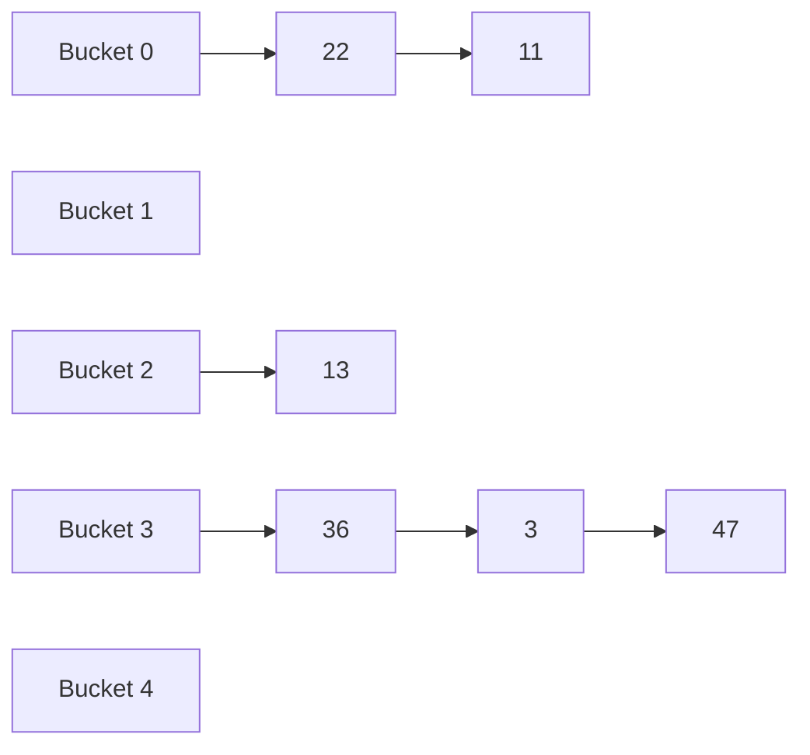

The data structures of the preceding chapters access elements by position (**rank**) or by order of size: a **vector** gives random access by rank, and a search tree compares keys level by level according to their size. This chapter discusses another way of access: finding the corresponding data item directly from the key itself, which is "call-by-key". The core technique that realizes this kind of access is hashing: a function maps a key to an array index, so that search, insertion and deletion take only constant time in the expected sense, and keys need not even be comparable. Hash tables are among the most used data structures in real programs, and Python's `dict` and `set` and C++'s `unordered_map` are all built on them (for their usage see [4.2.10](/4.2.10)). This chapter first covers the design of hash functions and the two main families of methods for resolving collisions, and analyzes their expected performance. We then apply the idea of "distributing by value into buckets" to sorting, which yields bucket sort, counting sort and radix sort, which break the lower bound for comparison sorting. Finally we introduce skip lists, which implement an ordered dictionary with randomized multilevel **linked lists** and are a simple alternative to **balanced binary search trees** ([4.3.6](/4.3.6), [4.3.8](/4.3.8)).

## 9.1. Dictionaries and Hashing

### 9.1.1. The Dictionary ADT

Many languages have built-in arrays whose "index need not be an integer": in Python one writes `style["Guan Yu"] = "Yunchang"`, and in C++ `m["east"] = "Tai"`. Such structures are called associative arrays, maps or dictionaries.

**Definition 9.1.1 (Dictionary)** A set of **entries** $(\mathit{key}, \mathit{value})$, where $\mathit{key}$ is the key, is called a **dictionary**. A dictionary supports the following operations:

| Operation | Function |
|---|---|
| `get(key)` | Return the value of the entry with key `key`; report failure if it does not exist |
| `put(key, value)` | Insert an entry; if the key already exists, by convention overwrite the old value (or refuse the insertion, or allow duplicates) |
| `remove(key)` | Delete the entry with key `key` |
| `size()` | Total number of entries |

Compared with binary search trees, a dictionary requires only that keys can be tested for equality, not compared by size, so the types of keys are more varied; compared with a priority queue ([4.3.12](/4.3.12)), a dictionary can look up any entry, not only the maximum or the minimum. Conversely, if traversal in order or range queries are needed, an ordered dictionary must be used (`std::map` in C++, or the skip list of §9.6 in this chapter).

### 9.1.2. Hash Tables and Hash Functions

Let us start with a direct scheme. Suppose we build a telephone directory for a school and look up users by 8-digit phone number: there are $10^8$ possible numbers, of which only about $2.5 \times 10^4$ are actually in use. Opening an **array** of length $10^8$ indexed by the number makes search take only $O(1)$ time, but the space utilization is only $0.025\%$. We would like to keep the search speed while making the space proportional to the actual number of entries.

**Definition 9.1.2 (Hash Table)** Let the keys be drawn from a universe $U$. A **hash table** is an array $T[0, M)$ of length $M$, each cell of which is called a **bucket** and stores an entry directly or points to it indirectly; together with a **hash function**

$$
h\colon U \to \{0, 1, \dots, M-1\},
$$
the entry with key $k$ is stored in the bucket $T[h(k)]$. If $k_1 \ne k_2$ but $h(k_1) = h(k_2)$, a **collision** is said to occur, and $k_1$ and $k_2$ are synonyms of each other. If the table contains $N$ entries, the quantity

$$
\lambda = \frac{N}{M}
$$
is called the **load factor**.

In the telephone directory example, taking $M = 90\,001$ and $h(k) = k \bmod M$ reduces the space to $O(N + M)$, while computing $h(k)$ is still constant time. The price is collisions: as long as $|U| > M$, collisions are unavoidable by the pigeonhole principle. The larger the load factor, the higher the space utilization and the more severe the collisions; lowering the load factor alleviates collisions, but as long as the data set changes, they cannot be eliminated completely. Hashing therefore has two basic tasks: to design a good hash function that lowers the probability of collisions as much as possible (§9.2), and to establish a scheme for resolving collisions when they occur (§9.3, §9.4).

### 9.1.3. How Common Are Collisions? The Birthday Problem

**Example 9.1.1 (The Birthday Problem)** Hash $n$ people by birthday into $M = 365$ buckets, assuming that each person's birthday is independently and uniformly distributed. The probability that all birthdays are distinct is

$$
\prod_{i=0}^{n-1} \left(1 - \frac{i}{M}\right) \approx \exp\!\left(-\frac{n(n-1)}{2M}\right).
$$
For $n = 23$ the probability that at least two people share a birthday already reaches $50.7\%$, although the load factor is only $\lambda = 23/365 \approx 6\%$; for $n = 100$ the probability that all birthdays are distinct is only about $3 \times 10^{-7}$. In general, when about $\sqrt{\pi M / 2}$ keys are thrown at random into $M$ buckets, we can expect the first collision to occur.

Collisions thus appear already at a very low load factor, and the design of a hash table cannot count on "no collisions" but must keep the cost of collisions under control.

Collisions can be avoided completely in only one situation: when the data set is known in advance and fixed (for example, the keyword table of a compiler). In this case we can construct *perfect hashing*, that is, a hash function that is injective on this data set. Fredman, Komlós and Szemerédi (1984) gave the classical two-level scheme:

**Theorem 9.1.1 (FKS Perfect Hashing)** For any static set of $n$ keys, a two-level hash table can be constructed in expected $O(n)$ time: the first level hashes the keys into $n$ buckets, and the $n_i$ keys of the $i$-th bucket are stored without collisions in a second-level table of length $n_i^2$. The total space is $O(n)$, and the worst-case search time is $O(1)$.

The key points are: when the hash function is chosen at random from the universal family of §9.2.3, the first level satisfies $\mathbb{E}\bigl[\sum_i n_i^2\bigr] < 2n$, so the expected total space is linear; and a second-level table of length $n_i^2$ is collision-free with probability at least $1/2$, so in case of failure we simply choose again.

## 9.2. Hash Functions

### 9.2.1. Design Principles

A good hash function should satisfy:

| Principle | Meaning |
|---|---|
| Deterministic | The same key is always mapped to the same address |
| Fast | The computation time is $O(1)$ (for variable-length keys such as strings, proportional to their length) |
| Surjective | Covers the whole address space $[0, M)$ as much as possible |
| Uniform | The probabilities of keys being mapped to the various addresses are as close as possible, avoiding *clustering*, that is, a large number of keys concentrated in a few adjacent buckets |

"Uniform" is relative to actual data. For ideally random keys, almost any hash function performs well; the real difficulty is that actual data often have regularities: arithmetic progressions (serial numbers), periodic sequences, high-frequency words and common word roots in natural language. The task of a hash function is to break these regularities.

### 9.2.2. The Division Method and the MAD Method

The most commonly used hash function is the *division method*: $h(k) = k \bmod M$. The table length $M$ is usually chosen to be prime, for the following reason.

**Theorem 9.2.1** Let the keys form an arithmetic progression $k_i = a + i d$ ($i = 0, 1, 2, \dots$) and let $g = \gcd(d, M)$. Then $k_i \bmod M$ has period $M/g$ and takes exactly $M/g$ distinct values.

**Proof** $k_i \equiv k_j \pmod M$ if and only if $M \mid (i - j)d$, if and only if $\frac{M}{g} \mid (i - j)\frac{d}{g}$. Since $\frac{M}{g}$ and $\frac{d}{g}$ are coprime, this is again equivalent to $\frac{M}{g} \mid (i - j)$. $\square$

Hence, if the keys appear regularly with step $d$, only a fraction $1/g$ of the buckets is used. When $M$ is prime, unless the step is exactly a multiple of $M$, we have $g = 1$ and all buckets are covered uniformly. (Conversely, if the keys themselves are ideally random, whether the table length is prime does not matter.)

The division method has two further defects: $h(0) = 0$ is a fixed point regardless of $M$, and adjacent keys are mapped to adjacent buckets, so the original local regularity is preserved as it is. The MAD method (multiply–add–divide) takes

$$
h(k) = (a k + b) \bmod M,
$$
where $M$ is prime and $a \bmod M \ne 0$. It eliminates the fixed point and pulls adjacent keys apart by a distance of $a$ buckets.

There are also some traditional methods: digit analysis (extracting some digits of the key), the mid-square method (taking the middle digits of $k^2$ so that every digit influences the result), the folding method (splitting the key into segments of equal width and summing them) and the bitwise XOR method (splitting into binary segments and XORing them). Another method commonly used in practice is multiplicative hashing: for a $w$-bit key, take $h(k) = \bigl\lfloor (A k \bmod 2^w) / 2^{w-r} \bigr\rfloor$ with table length $M = 2^r$ and a constant $A$ that is an odd number close to $2^w / \varphi$ ($\varphi$ the golden ratio); it needs only one multiplication and one shift.

### 9.2.3. Universal Hashing

The methods above are all fixed functions, and there is always a set of "bad" keys that makes all of them collide; if the keys are chosen by an adversary (for example, the request parameters received by a network service), the adversary can make the hash table degenerate into linear search. The modern solution is to choose the hash function at random: instead of making probabilistic assumptions about the input, the algorithm itself flips coins.

**Definition 9.2.1 (Universal Hashing)** Let $\mathcal{H}$ be a family of functions from $U$ to $[0, M)$. If for any $x \ne y \in U$, choosing $h$ uniformly at random from $\mathcal{H}$ gives

$$
\mathbb{P}\bigl(h(x) = h(y)\bigr) \le \frac{1}{M},
$$
then $\mathcal{H}$ is called a family for **universal hashing** (a universal family).

**Theorem 9.2.2 (Carter–Wegman)** Let $p > \max U$ be a prime. Then

$$
\mathcal{H}_{p,M} = \bigl\{\, h_{a,b}(k) = \bigl((a k + b) \bmod p\bigr) \bmod M \;:\; 1 \le a < p,\ 0 \le b < p \,\bigr\}
$$
is a universal family.

**Proof** (sketch) For $x \ne y$, let $r = (a x + b) \bmod p$ and $s = (a y + b) \bmod p$. Since $p$ is prime, $(a, b) \mapsto (r, s)$ is a bijection from $\{1, \dots, p-1\} \times \{0, \dots, p-1\}$ onto $\{(r, s) : r \ne s\}$, so $(r, s)$ is uniformly distributed over all pairs with $r \ne s$. For a fixed $r$, there are at most $\lceil p/M \rceil - 1 \le (p-1)/M$ values of $s$ with $s \ne r$ and $s \equiv r \pmod M$, so the collision probability is at most $\frac{1}{p-1} \cdot \frac{p-1}{M} = \frac{1}{M}$. $\square$

This is the randomized MAD method: first do MAD over a prime field, then reduce modulo the table length. The implementation in §9.3 uses the Mersenne prime $p = 2^{61} - 1$ and applies $h_{a,b}$ once more to the hash code of the key, with $a, b$ chosen at random when each hash table is constructed.

### 9.2.4. Hash Codes: From Objects to Integers

A hash function usually works in two steps: first convert an arbitrary object into an integer, called a *hash code*; then compress the hash code into $[0, M)$. The hash code of a string must make every character and its position count. If the character codes are simply added, anagrams such as `"stop"`, `"tops"`, `"pots"` and `"spot"` all collide. The standard approach is polynomial hashing:

$$
\operatorname{hc}(s_0 s_1 \cdots s_{n-1}) = s_0 x^{n-1} + s_1 x^{n-2} + \cdots + s_{n-1} \pmod{2^w},
$$
computed character by character with Horner's rule $h \leftarrow h \cdot x + s_i$, which takes only $O(n)$ time. Java's `String.hashCode` takes $x = 31$; a cyclic shift can also replace the multiplication, as in `h = (h << 5) | (h >> 27); h += s[i];`.

Actual language runtimes add a further consideration: resisting *hash flooding* attacks. In 2011 it was demonstrated that submitting to a web server a large number of parameter names with identical hash codes makes the hash tables of many languages degenerate into linked lists and exhausts the server's CPU. Since then, mainstream implementations have switched to hash functions with random keys:

- Python: the hashes of `str` and `bytes` use SipHash (SipHash-1-3 since 3.11), and the key is generated at random when each interpreter process starts, so the `hash` value of the same string differs between two runs and the iteration order of a `set` of strings also changes. The environment variable `PYTHONHASHSEED` can fix or disable the randomization, which helps reproducibility. Integers are not randomized: on a 64-bit platform `hash(x)` is $x$ modulo the Mersenne prime $2^{61} - 1$ (preserving the sign; `hash(-1)` is specially equal to $-2$ because $-1$ signals an error in the C interface).
- C++: the algorithm of `std::hash<std::string>` is implementation-defined (libstdc++ uses the MurmurHash family) and has no random key; `std::hash<int>` is the identity function in libstdc++ and libc++. When handling untrusted input, one should supply a hash function with a random seed oneself.

## 9.3. Separate Chaining

### 9.3.1. Method and Analysis

The first family of methods for resolving collisions lets each bucket hold several entries. If a fixed number of slots is reserved for each bucket, it is hard to predict how many are enough: too many waste space, and too few may still overflow in extreme cases. A more flexible approach is:

**Definition 9.3.1 (Separate Chaining)** Each bucket maintains a list holding all synonyms hashed to that bucket. For search, insertion and deletion, we first compute $h(k)$ and then search sequentially in the list of the bucket $T[h(k)]$. This method of resolving collisions is called **separate chaining** (also called chaining), and it is the typical form of "open hashing": entries are stored outside the bucket array.



Separate chaining can resolve any number of collisions, and deletion is simple and uniform; its disadvantages are that each node must store an extra pointer, that dynamic allocation and deallocation of nodes takes time, and, more importantly, that nodes are not contiguous in memory, so the cache cannot do its job.

**Theorem 9.3.1** Let the hash function be chosen at random from a universal family, let the table contain $N$ entries, and let the **load factor** be $\lambda = N/M$. Then in separate chaining: when searching for a key $x$ not in the table, the expected length of the list searched is at most $\lambda$; when searching for a key $x$ in the table, the expected length of the list searched is at most $1 + \lambda$.

**Proof** For each key $y \ne x$ in the table, let the indicator variable be $I_y = \boldsymbol{1}_{\{h(y) = h(x)\}}$; then the number of entries other than $x$ in the bucket of $x$ is $\sum_{y \ne x} I_y$. By linearity of expectation and universality,

$$
\mathbb{E}\Bigl[\sum_{y \ne x} I_y\Bigr] = \sum_{y \ne x} \mathbb{P}\bigl(h(y) = h(x)\bigr) \le \frac{\#\{y \ne x\}}{M}.
$$
When $x$ is not in the table, $\#\{y \ne x\} = N$ and the upper bound is $\lambda$; when $x$ is in the table, it is $N - 1$, and adding $x$ itself gives the upper bound $1 + (N-1)/M < 1 + \lambda$. $\square$

So as long as $\lambda = O(1)$ is maintained (for example, doubling the table length and rehashing whenever it exceeds 1, §9.4.3), the expected time of each operation is $O(1)$. Note that the expectation here is only over the random choice of the hash function, and it holds for any input. Expanding the table reinserts the $N$ entries one by one at cost $O(N)$, but since the table length grows geometrically, this cost is only $O(1)$ per insertion when amortized (for the same reason as the expansion of a **vector** in [4.3.2](/4.3.2)).

### 9.3.2. Implementation

The implementation below uses a dynamic array as the **list** of each bucket (more cache-friendly than a linked list; the order within a bucket does not matter, and on deletion the last element is moved in to fill the gap), applies universal hashing $h_{a,b}$ once more to the hash code of the key, and doubles the table length when the load factor exceeds 1. At the end, the program checks the correctness of the implementation against the standard library's hash table with 200,000 random operations.

```cpp tab
#include <cstdint>
#include <format>
#include <functional>
#include <iostream>
#include <random>
#include <string>
#include <unordered_map>
#include <utility>
#include <vector>

// Hash table with separate chaining; bucket index from a universal hash
// h(x) = ((a * x + b) mod p) mod M applied to the key's hash code.
template <typename K, typename V>
class ChainedHashMap {
    static constexpr std::uint64_t P = (1ULL << 61) - 1;   // Mersenne prime
    std::vector<std::vector<std::pair<K, V>>> buckets_;
    std::size_t size_ = 0;
    std::uint64_t a_, b_;

    static std::uint64_t mulmod(std::uint64_t x, std::uint64_t y) {
        return static_cast<std::uint64_t>(static_cast<unsigned __int128>(x) * y % P);
    }
    std::size_t index(const K& key, std::size_t m) const {
        std::uint64_t x = std::hash<K>{}(key) % P;
        return (mulmod(a_, x) + b_) % P % m;
    }
    void rehash(std::size_t m) {                 // move every entry to a new table
        std::vector<std::vector<std::pair<K, V>>> old(m);
        old.swap(buckets_);
        for (auto& chain : old)
            for (auto& kv : chain)
                buckets_[index(kv.first, m)].push_back(std::move(kv));
    }

public:
    explicit ChainedHashMap(std::uint64_t seed = 2024) : buckets_(8) {
        std::mt19937_64 gen(seed);
        a_ = gen() % (P - 1) + 1;                // a in [1, p)
        b_ = gen() % P;                          // b in [0, p)
    }
    std::size_t size() const { return size_; }
    double load_factor() const { return double(size_) / buckets_.size(); }

    V* get(const K& key) {
        for (auto& kv : buckets_[index(key, buckets_.size())])
            if (kv.first == key) return &kv.second;
        return nullptr;
    }
    bool put(const K& key, V value) {            // false if the key was present
        if (V* v = get(key)) { *v = std::move(value); return false; }
        if (size_ + 1 > buckets_.size()) rehash(2 * buckets_.size());   // keep load <= 1
        buckets_[index(key, buckets_.size())].emplace_back(key, std::move(value));
        ++size_;
        return true;
    }
    bool remove(const K& key) {
        auto& chain = buckets_[index(key, buckets_.size())];
        for (std::size_t i = 0; i < chain.size(); ++i)
            if (chain[i].first == key) {
                chain[i] = std::move(chain.back());   // order inside a chain is irrelevant
                chain.pop_back();
                --size_;
                return true;
            }
        return false;
    }
};

int main() {
    ChainedHashMap<std::string, std::string> peaks;
    peaks.put("east", "Tai");
    peaks.put("west", "Hua");
    peaks.put("south", "Heng");
    peaks.remove("south");
    std::cout << std::format("{} {} {}\n", *peaks.get("west"), peaks.get("south") == nullptr,
                             peaks.size());     // Hua true 2

    // Random self-test against std::unordered_map.
    ChainedHashMap<int, int> h;
    std::unordered_map<int, int> ref;
    std::mt19937 gen(1);
    for (int step = 0; step < 200000; ++step) {
        int k = gen() % 5000, op = gen() % 3;
        if (op == 0) {
            bool fresh = !ref.contains(k);
            ref[k] = step;
            if (h.put(k, step) != fresh) { std::cout << "put mismatch\n"; return 1; }
        } else if (op == 1) {
            if (h.remove(k) != (ref.erase(k) == 1)) { std::cout << "remove mismatch\n"; return 1; }
        } else {
            int* v = h.get(k);
            auto it = ref.find(k);
            if ((v == nullptr) != (it == ref.end()) || (v && *v != it->second)) {
                std::cout << "get mismatch\n"; return 1;
            }
        }
    }
    std::cout << std::format("ok: size {}, load factor {:.2f}\n", h.size(), h.load_factor());
}
```

```python tab
import random
from typing import Any, Hashable


class ChainedHashMap:
    """Hash table with separate chaining and a universal bucket hash."""

    P = (1 << 61) - 1                              # Mersenne prime

    def __init__(self, seed: int = 2024) -> None:
        rng = random.Random(seed)
        self._a = rng.randrange(1, self.P)
        self._b = rng.randrange(self.P)
        self._buckets: list[list[list[Any]]] = [[] for _ in range(8)]
        self._size = 0

    def _index(self, key: Hashable, m: int) -> int:
        return (self._a * (hash(key) % self.P) + self._b) % self.P % m

    def _rehash(self, m: int) -> None:
        old, self._buckets = self._buckets, [[] for _ in range(m)]
        for chain in old:
            for entry in chain:
                self._buckets[self._index(entry[0], m)].append(entry)

    def __len__(self) -> int:
        return self._size

    def load_factor(self) -> float:
        return self._size / len(self._buckets)

    def get(self, key: Hashable, default: Any = None) -> Any:
        for k, v in self._buckets[self._index(key, len(self._buckets))]:
            if k == key:
                return v
        return default

    def put(self, key: Hashable, value: Any) -> bool:
        """Insert or update; return True if the key is new."""
        chain = self._buckets[self._index(key, len(self._buckets))]
        for entry in chain:
            if entry[0] == key:
                entry[1] = value
                return False
        if self._size + 1 > len(self._buckets):   # keep load factor <= 1
            self._rehash(2 * len(self._buckets))
            chain = self._buckets[self._index(key, len(self._buckets))]
        chain.append([key, value])
        self._size += 1
        return True

    def remove(self, key: Hashable) -> bool:
        chain = self._buckets[self._index(key, len(self._buckets))]
        for i, entry in enumerate(chain):
            if entry[0] == key:
                chain[i] = chain[-1]               # order inside a chain is irrelevant
                chain.pop()
                self._size -= 1
                return True
        return False


peaks = ChainedHashMap()
peaks.put("east", "Tai")
peaks.put("west", "Hua")
peaks.put("south", "Heng")
peaks.remove("south")
print(peaks.get("west"), peaks.get("south") is None, len(peaks))   # Hua True 2

# Random self-test against dict.
h, ref = ChainedHashMap(), {}
rng = random.Random(1)
for step in range(200_000):
    k, op = rng.randrange(5000), rng.randrange(3)
    if op == 0:
        assert h.put(k, step) == (k not in ref)
        ref[k] = step
    elif op == 1:
        assert h.remove(k) == (ref.pop(k, None) is not None)
    else:
        assert h.get(k) == ref.get(k)
print(f"ok: size {len(h)}, load factor {h.load_factor():.2f}")
```

### 9.3.3. C++ unordered_map

The C++ standard specifies a bucket interface for `std::unordered_map`: `bucket_count()`, `bucket(key)` (the bucket in which a key resides), `begin(n)` and `end(n)` (traversing the $n$-th bucket), and requires that references and pointers to elements remain valid across rehashing. These requirements in effect prescribe separate chaining: each element is an individually allocated node hanging on the list of a bucket. In libstdc++, all nodes are strung into one singly linked list, and each bucket points to the predecessor of its first node; the number of buckets is prime.

- `load_factor()` returns the current load factor $N/M$; `max_load_factor()` defaults to 1.0, and exceeding it after an insertion triggers rehashing automatically; `reserve(n)` adjusts the number of buckets in advance to hold $n$ elements, avoiding repeated expansion.
- Rehashing invalidates all iterators, but references to elements remain valid (the iterator invalidation rules of [4.2.10](/4.2.10) originate here).
- Since each node is allocated separately, `unordered_map` has poor cache locality. Where performance matters, third-party implementations based on open addressing (§9.4) are commonly used, such as Abseil's `absl::flat_hash_map` (the Swiss table, which uses SIMD instructions to compare the metadata of a group of slots at once) and Boost's `boost::unordered_flat_map`.

## 9.4. Open Addressing

### 9.4.1. Probe Sequences and Linear Probing

The other family of methods allocates no space outside the bucket array:

**Definition 9.4.1 (Open Addressing)** All entries are stored inside the bucket array, with at most one entry per bucket. For each key $k$ we fix a **probe sequence** $h_0(k), h_1(k), h_2(k), \dots$, a sequence of bucket addresses: an insertion looks along the probe sequence for the first empty bucket; a search checks the buckets along the probe sequence one by one until it hits, or fails on meeting an empty bucket. This method is called **open addressing**, also "closed hashing", because the physical space of the hash table is fixed and collisions are all resolved inside the table.

The simplest probe sequence is *linear probing*:

$$
h_i(k) = \bigl(h(k) + i\bigr) \bmod M, \qquad i = 0, 1, 2, \dots
$$

As long as the table still has an empty bucket, a search with linear probing necessarily terminates. Its disadvantage is that the probe sequences of different keys overlap: a contiguous run of full buckets (called a "cluster") attracts more keys to fall into it and lengthens it, and the longer the cluster, the faster it grows; this is called primary clustering. Nevertheless, linear probing visits adjacent memory cells in turn, so its cache hit rate is extremely high, and as long as the load factor is kept under control, its actual performance is often better than that of other methods.

The relation between the performance of open addressing and the **load factor** is given by the following classical results ($\lambda < 1$):

**Theorem 9.4.1 (Knuth)** Let hash values be independent and uniformly distributed, and use linear probing. As $M \to \infty$ with $\lambda$ fixed, the expected numbers of probes for a successful and an unsuccessful search tend to

$$
\frac{1}{2}\left(1 + \frac{1}{1 - \lambda}\right), \qquad \frac{1}{2}\left(1 + \frac{1}{(1 - \lambda)^2}\right),
$$
respectively.

**Theorem 9.4.2** Let the probe sequence of each key be a uniformly random permutation of $[0, M)$ (the uniform hashing assumption, which double hashing approximately satisfies). Then the expected number of probes of an unsuccessful search is at most $\dfrac{1}{1 - \lambda}$, and that of a successful search is at most $\dfrac{1}{\lambda} \ln \dfrac{1}{1 - \lambda}$.

**Proof** In an unsuccessful search, the conditional probability that the $i$-th probe meets a full bucket is at most $\frac{N - i + 1}{M - i + 1} \le \lambda$, so the probability that at least $i$ probes are needed is at most $\lambda^{i-1}$, and the expected number is

$$
\sum_{i \ge 1} \mathbb{P}(\text{at least } i \text{ probes}) \le \sum_{i \ge 1} \lambda^{i-1} = \frac{1}{1 - \lambda}.
$$
The probing process of a successful search for a key is the same as when it was inserted. When the $(j+1)$-th key is inserted, the load factor is $j/M$ and the expected number of probes is at most $\frac{1}{1 - j/M}$; averaging over $j = 0, \dots, N-1$,

$$
\frac{1}{N} \sum_{j=0}^{N-1} \frac{M}{M - j} = \frac{1}{\lambda} \sum_{t = M - N + 1}^{M} \frac{1}{t} \le \frac{1}{\lambda} \int_{M-N}^{M} \frac{\mathrm{d}x}{x} = \frac{1}{\lambda} \ln \frac{1}{1 - \lambda}. \qquad \square
$$

The figure below compares the expected numbers of probes of several methods (logarithmic vertical axis); the dots are simulation results of linear probing on a table with $M = 2^{14}$. At $\lambda = 0.5$, an unsuccessful search with linear probing needs on average only 2.5 probes, but at $\lambda = 0.9$ it needs more than 50. Open addressing therefore usually keeps the load factor below $1/2$ to $3/4$.


### 9.4.2. Lazy Deletion

Deletion in open addressing cannot simply empty the bucket: probe sequences overlap one another, and emptying a bucket breaks all probe sequences passing through it at that point, so that entries behind it, though present, can no longer be found.

**Definition 9.4.2 (Lazy Deletion)** To delete an entry, we only put a "deleted" mark (also called a tombstone) on its bucket and do not adjust the probe sequences. Afterward, a marked bucket is treated in a search as "a nonempty bucket that never matches", so that the probe sequence continues through it; in an insertion it is treated as "a free bucket" that can hold a new entry. This method is called **lazy deletion**.

Two kinds of probing are thus needed: probing for search (continue past marked buckets) and probing for insertion (a marked bucket can be used immediately). Before an insertion, a search is performed first to confirm that the key does not exist. If the table contains $N$ entries and $L$ marked buckets, then as long as $N + L < M$, a search sooner or later meets a truly empty bucket and terminates; the load factor should also be computed as $(N + L)/M$, because marked buckets lengthen probe sequences just as well.

**Remark 9.4.1** Marked buckets are cleared only on rehashing. If deletions are frequent and insertions rare, the marks accumulate. An extreme example: in Python the hash code of an integer is the integer itself, so if the keys are $0, 1, \dots, 2999$ and are repeatedly deleted and inserted, these keys occupy exactly a contiguous run of buckets; the marks left after deletion join this run into a long cluster of "full or deleted" buckets, and every unsuccessful search has to scan the entire run. If the implementation below used such keys for its random self-test, the running time would increase by about a factor of 30. For linear probing, another approach is to move later entries of the cluster forward to fill the gap on deletion (Knuth's Algorithm R), which needs no marks at all.

### 9.4.3. Rehashing

When the load factor exceeds a threshold, collisions increase sharply, and the table must be expanded:

**Definition 9.4.3 (Rehashing)** Create a new, larger bucket array (the table length is usually a prime not less than $4N$ or $2M$), reinsert all entries of the old table one by one, and then free the old table. This process is called **rehashing**.

Since the hash function depends on the table length, the position of an entry in the new table has nothing to do with that in the old one and must be recomputed one by one; rehashing also clears all lazy-deletion marks. If, when $(N + L)/M > 1/2$, the table length is expanded to a prime not less than $4N$, the load factor of the new table does not exceed $1/4$, and at least about $M'/4$ more entries must be inserted (or as many marks accumulated) before the next rehashing, so the $O(N)$ cost of rehashing is $O(1)$ per operation when amortized.

### 9.4.4. Implementation

Below we implement an open-addressing hash table according to the above design: linear probing, lazy deletion, and rehashing to a prime table length not less than $4N$ when $(N + L)/M > 1/2$. `probe_for_hit` returns the bucket holding the key or the empty bucket where the search ends, and `probe_for_free` returns the first usable bucket (an empty bucket or a marked bucket).

```cpp tab
#include <cstdint>
#include <format>
#include <functional>
#include <iostream>
#include <optional>
#include <random>
#include <unordered_map>
#include <vector>

// Open addressing with linear probing, lazy removal and rehashing.
template <typename K, typename V>
class ProbingHashMap {
    enum class State : std::uint8_t { Empty, Full, Removed };
    struct Slot { State state = State::Empty; K key{}; V value{}; };
    std::vector<Slot> ht_;
    std::size_t n_ = 0;          // entries
    std::size_t removed_ = 0;    // slots carrying a lazy-removal mark

    static bool is_prime(std::size_t m) {
        if (m < 2) return false;
        for (std::size_t d = 2; d * d <= m; ++d)
            if (m % d == 0) return false;
        return true;
    }
    static std::size_t prime_not_less(std::size_t m) {
        while (!is_prime(m)) ++m;
        return m;
    }
    std::size_t home(const K& k) const { return std::hash<K>{}(k) % ht_.size(); }

    // Slot holding k, or the empty (unmarked) slot where the search fails.
    std::size_t probe_for_hit(const K& k) const {
        std::size_t r = home(k);
        while (!(ht_[r].state == State::Full && ht_[r].key == k) && ht_[r].state != State::Empty)
            r = (r + 1) % ht_.size();          // removed slots keep the chain alive
        return r;
    }
    // First slot that can receive a new entry: empty or marked as removed.
    std::size_t probe_for_free(const K& k) const {
        std::size_t r = home(k);
        while (ht_[r].state == State::Full) r = (r + 1) % ht_.size();
        return r;
    }
    void rehash() {
        std::vector<Slot> old(prime_not_less(4 * n_ + 1));
        old.swap(ht_);
        n_ = removed_ = 0;
        for (Slot& s : old)
            if (s.state == State::Full) put(s.key, s.value);
    }

public:
    ProbingHashMap() : ht_(prime_not_less(7)) {}
    std::size_t size() const { return n_; }
    std::size_t capacity() const { return ht_.size(); }

    std::optional<V> get(const K& k) const {
        const Slot& s = ht_[probe_for_hit(k)];
        if (s.state == State::Full) return s.value;
        return std::nullopt;
    }
    bool put(const K& k, const V& v) {
        if (Slot& s = ht_[probe_for_hit(k)]; s.state == State::Full) { s.value = v; return false; }
        Slot& s = ht_[probe_for_free(k)];
        if (s.state == State::Removed) --removed_;   // reuse a marked slot
        s = {State::Full, k, v};
        ++n_;
        if (2 * (n_ + removed_) > ht_.size()) rehash();   // keep (N + L) / M <= 1/2
        return true;
    }
    bool remove(const K& k) {
        Slot& s = ht_[probe_for_hit(k)];
        if (s.state != State::Full) return false;
        s.state = State::Removed;                    // lazy removal: only mark the slot
        --n_;
        ++removed_;
        return true;
    }
};

int main() {
    ProbingHashMap<int, char> h;
    for (int k : {7, 14, 21, 3}) h.put(k, char('a' + k % 26));   // grows from 7 to 17 slots
    h.remove(14);
    std::cout << std::format("{} {} capacity {}\n", h.get(21).value(), h.get(14).has_value(),
                             h.capacity());

    // Random self-test against std::unordered_map.
    ProbingHashMap<int, int> t;
    std::unordered_map<int, int> ref;
    std::mt19937 gen(7);
    std::vector<int> pool(3000);
    for (int& k : pool) k = static_cast<int>(gen() >> 1);
    for (int step = 0; step < 200000; ++step) {
        int k = pool[gen() % pool.size()], op = gen() % 3;
        if (op == 0) {
            bool fresh = !ref.contains(k);
            ref[k] = step;
            if (t.put(k, step) != fresh) { std::cout << "put mismatch\n"; return 1; }
        } else if (op == 1) {
            if (t.remove(k) != (ref.erase(k) == 1)) { std::cout << "remove mismatch\n"; return 1; }
        } else {
            auto v = t.get(k);
            auto it = ref.find(k);
            if (v.has_value() != (it != ref.end()) || (v && *v != it->second)) {
                std::cout << "get mismatch\n"; return 1;
            }
        }
    }
    std::cout << std::format("ok: size {}, capacity {}\n", t.size(), t.capacity());
}
```

```python tab
import random
from typing import Any, Hashable

_EMPTY, _REMOVED = object(), object()          # sentinels for the two kinds of free slot


def _prime_not_less(m: int) -> int:
    def is_prime(x: int) -> bool:
        return x >= 2 and all(x % d for d in range(2, int(x**0.5) + 1))
    while not is_prime(m):
        m += 1
    return m


class ProbingHashMap:
    """Open addressing with linear probing, lazy removal and rehashing."""

    def __init__(self) -> None:
        self._keys: list[Any] = [_EMPTY] * 7
        self._vals: list[Any] = [None] * 7
        self._n = 0                            # entries
        self._removed = 0                      # slots carrying a lazy-removal mark

    def _probe_for_hit(self, key: Hashable) -> int:
        m = len(self._keys)
        r = hash(key) % m
        while self._keys[r] is not _EMPTY and (self._keys[r] is _REMOVED or self._keys[r] != key):
            r = (r + 1) % m                    # removed slots keep the chain alive
        return r

    def _probe_for_free(self, key: Hashable) -> int:
        m = len(self._keys)
        r = hash(key) % m
        while self._keys[r] is not _EMPTY and self._keys[r] is not _REMOVED:
            r = (r + 1) % m
        return r

    def _rehash(self) -> None:
        old = [(k, v) for k, v in zip(self._keys, self._vals) if k is not _EMPTY and k is not _REMOVED]
        m = _prime_not_less(4 * self._n + 1)
        self._keys, self._vals = [_EMPTY] * m, [None] * m
        self._n = self._removed = 0
        for k, v in old:
            self.put(k, v)

    def __len__(self) -> int:
        return self._n

    def capacity(self) -> int:
        return len(self._keys)

    def get(self, key: Hashable, default: Any = None) -> Any:
        r = self._probe_for_hit(key)
        return default if self._keys[r] is _EMPTY else self._vals[r]

    def put(self, key: Hashable, value: Any) -> bool:
        r = self._probe_for_hit(key)
        if self._keys[r] is not _EMPTY:        # found: update
            self._vals[r] = value
            return False
        r = self._probe_for_free(key)
        if self._keys[r] is _REMOVED:          # reuse a marked slot
            self._removed -= 1
        self._keys[r], self._vals[r] = key, value
        self._n += 1
        if 2 * (self._n + self._removed) > len(self._keys):   # keep (N + L) / M <= 1/2
            self._rehash()
        return True

    def remove(self, key: Hashable) -> bool:
        r = self._probe_for_hit(key)
        if self._keys[r] is _EMPTY:
            return False
        self._keys[r], self._vals[r] = _REMOVED, None   # lazy removal: only mark the slot
        self._n -= 1
        self._removed += 1
        return True


h = ProbingHashMap()
for k in (7, 14, 21, 3):                       # the table grows from 7 to 17 slots
    h.put(k, chr(ord("a") + k % 26))
h.remove(14)
print(h.get(21), h.get(14) is not None, "capacity", h.capacity())

# Random self-test against dict.
t, ref = ProbingHashMap(), {}
rng = random.Random(7)
pool = [rng.getrandbits(40) for _ in range(3000)]
for step in range(200_000):
    k, op = rng.choice(pool), rng.randrange(3)
    if op == 0:
        assert t.put(k, step) == (k not in ref)
        ref[k] = step
    elif op == 1:
        assert t.remove(k) == (ref.pop(k, None) is not None)
    else:
        assert t.get(k) == ref.get(k)
print(f"ok: size {len(t)}, capacity {t.capacity()}")
```

### 9.4.5. Quadratic Probing

To alleviate primary clustering, we can let the probing step grow larger and larger, so that after a collision we quickly jump away from "the place of trouble".

**Definition 9.4.4 (Quadratic Probing)** The probe sequence is

$$
h_i(k) = \bigl(h(k) + i^2\bigr) \bmod M, \qquad i = 0, 1, 2, \dots
$$
The distances between successive probes, $1, 3, 5, 7, \dots$, increase linearly. This method is called **quadratic probing**.

Quadratic probing eliminates primary clustering, but synonyms still share the same probe sequence (secondary clustering); probing is no longer contiguous and cache utilization drops somewhat, though fortunately the distances of the first few probes are still small. A new problem arises: since probing no longer proceeds one bucket at a time, is an empty bucket always found as long as one exists?

If $M$ is composite, the answer is no. For example, for $M = 12$, $i^2 \bmod 12$ takes only the four values $\{0, 1, 4, 9\}$, and as long as these four buckets are nonempty, an insertion fails, even if the other 8 buckets are all empty. When the table length is prime, we have:

**Theorem 9.4.3** Let $M$ be an odd prime. Then the first $\lceil M/2 \rceil$ terms of any probe sequence are pairwise distinct. Hence, as long as $N + L \le \lfloor M/2 \rfloor$ (that is, the load factor does not exceed $1/2$), an insertion always finds an empty bucket.

**Proof** Let $0 \le a < b \le \lceil M/2 \rceil - 1 = \frac{M-1}{2}$ with $a^2 \equiv b^2 \pmod M$. Then $M \mid (b - a)(b + a)$. Since $M$ is prime, $M$ divides $b - a$ or $b + a$; but $0 < b - a < M$ and $0 < b + a \le M - 2$, so neither is possible. $\square$

$i^2 \bmod M$ ($0 \le i \le \frac{M-1}{2}$) takes exactly all $\frac{M+1}{2}$ quadratic residues modulo $M$ (including 0), so the probe sequence can reach only about half of the buckets. Can the other half be used as well?

### 9.4.6. Bidirectional Quadratic Probing

We probe alternately in two directions, with the distances still growing quadratically:

$$
h(k),\ h(k) + 1^2,\ h(k) - 1^2,\ h(k) + 2^2,\ h(k) - 2^2,\ \dots,\ h(k) \pm \left(\tfrac{M-1}{2}\right)^2 \pmod M.
$$
This probe sequence has $M$ terms in total. By Theorem 9.4.3, the $\frac{M+1}{2}$ forward terms are pairwise distinct, and likewise the backward ones; the question is whether the two directions can collide.

**Theorem 9.4.4** Let $M$ be an odd prime. The first $M$ terms of the bidirectional quadratic probe sequence cover all $M$ buckets exactly if and only if $M \equiv 3 \pmod 4$.

**Proof** A collision between the forward and backward directions means that there exist $1 \le a, b \le \frac{M-1}{2}$ with $a^2 \equiv -b^2 \pmod M$, which is equivalent to $(a b^{-1})^2 \equiv -1$, that is, $-1$ is a quadratic residue modulo $M$. By Euler's criterion, $-1$ is a quadratic residue if and only if $(-1)^{(M-1)/2} = 1$, that is, $M \equiv 1 \pmod 4$. Conversely, if $M \equiv 1 \pmod 4$, take a solution $x$ of $x^2 \equiv -1$ (replacing it by $M - x$ if necessary so that $1 \le x \le \frac{M-1}{2}$); then $a = x$, $b = 1$ gives a collision. $\square$

This can also be understood through Fermat's theorem on sums of two squares: an odd prime $M$ can be written as a sum of two squares of integers, $M = a^2 + b^2$, if and only if $M \equiv 1 \pmod 4$; then $a^2 \equiv -b^2$, and the $a$-th forward term and the $b$-th backward term fall in the same bucket. For example, for $M = 13 = 2^2 + 3^2$, $h + 4$ and $h - 9$ are the same bucket. The table length for bidirectional quadratic probing should therefore be a prime of the form $4j + 3$, such as 7, 11, 19, 23, 31.

### 9.4.7. Double Hashing

More generally, we can let the probing increment also depend on the key:

**Definition 9.4.5 (Double Hashing)** Take a second hash function $h_2$ and let the probe sequence be

$$
h_i(k) = \bigl(h(k) + i \cdot h_2(k)\bigr) \bmod M, \qquad i = 0, 1, 2, \dots
$$
This method is called **double hashing**. For the probe sequence to cover all buckets, $h_2(k)$ must be coprime to $M$: for example, take $M$ prime and $h_2(k) = 1 + (k \bmod (M - 1))$, or take $M = 2^r$ and $h_2(k)$ always odd.

Linear probing corresponds to $h_2 \equiv 1$. In double hashing, even if two keys have the same $h(k)$, their steps generally differ and their probe sequences quickly separate, so there is neither primary nor secondary clustering, and the performance is close to that of uniform hashing in Theorem 9.4.2.

### 9.4.8. Python dict and set

CPython's `dict` and `set` are both implemented with open addressing, with a table length that is a power of 2, but their probing differs from the above:

- Probe sequence: it starts at `i = hash & mask` (`mask` is the table length minus 1) and then repeatedly executes `perturb >>= 5; i = (5*i + perturb + 1) & mask`, where `perturb` is initially the hash code. The recurrence $i \leftarrow 5i + 1 \pmod{2^r}$ by itself traverses all buckets; `perturb` gradually mixes in the high bits of the hash code, preventing keys whose hash codes agree in the low bits (for example, integers with step $2^r$) from following the same probe sequence. The hash code of an integer is the integer itself, and consecutive integers fall into consecutive buckets and, on the contrary, hardly collide at all.
- Compact dictionaries (since 3.6; insertion order became a language guarantee in 3.7): a `dict` consists of two arrays. One is a sparse index table, the actual hash table, each slot of which stores only a small integer (only 1 byte when the table is small); the other is an entries array appended in insertion order, each item storing (hash code, key, value). A lookup finds an index in the index table along the probe sequence and then compares in the entries array. This both saves space (most empty slots take only a few bytes) and naturally preserves insertion order, and iteration only scans the entries array.
- Load factor and deletion: the table expands when the number of entries reaches $2/3$ of the index table length. A deletion leaves a DUMMY mark in the index table, which is exactly lazy deletion; the vacancies in the entries array are compacted at the next rebuild.
- `set`: a `set` does not preserve insertion order and has no compact layout; buckets store (hash code, key) directly. It first makes up to 9 linear probes (exploiting the cache) and then jumps by a perturbation scheme similar to that of `dict`; it expands when the fill exceeds about $3/5$.

So `d[k]` and `k in s` take $O(1)$ on average and $O(n)$ in the worst case; objects used as keys must be hashable, and equal objects must have the same hash code (`a == b` implies `hash(a) == hash(b)`), so a mutable `list` cannot be a key.

## 9.5. Bucket Sort and Radix Sort

Hashing maps keys directly to addresses; if the mapping preserves the order of the keys, collecting the buckets in the order of their addresses completes the sorting. Such sorting is not based on comparisons and is therefore not subject to the $\Omega(n \log n)$ lower bound for comparison sorting.

### 9.5.1. Bucket Sort

**Definition 9.5.1 (Bucket Sort)** Let $n$ keys be drawn from $[0, m)$. Open $m$ buckets, put each element into the bucket corresponding to its key (elements in the same bucket are strung into a list in order of arrival), and then collect them in order of bucket number. This sorting method is called **bucket sort**.

Distribution and collection take $O(n)$ and $O(m)$ time respectively, and the total time and space are both $O(n + m)$. When $m = O(n)$ it is a linear-time sort. Since each bucket is collected in order of arrival, elements with equal keys keep their relative order in the input, that is, bucket sort is stable.

**Example 9.5.1 (Maximum Gap)** Given any $n \ge 2$ points on the real line, find the largest distance between adjacent points after sorting (MaxGap). Sorting first and then scanning needs $O(n \log n)$ time; with the help of buckets, $O(n)$ can be achieved:

1. One scan finds the leftmost point $lo$ and the rightmost point $hi$;
2. Divide $[lo, hi]$ into $n - 1$ equal segments, each of width $\delta = \frac{hi - lo}{n - 1}$; a point $x$ is put into bucket number $\bigl\lfloor (x - lo)/\delta \bigr\rfloor$ ($hi$ alone occupies bucket number $n-1$, for $n$ buckets in total);
3. Each bucket records only the smallest and the largest point that fall into it;
4. Scan the nonempty buckets in order and compute, for each nonempty bucket, the difference between its smallest point and the largest point of the previous nonempty bucket; the largest such difference is the answer.

The key to correctness is this: $n$ points have $n - 1$ gaps between them with total length $hi - lo$, so the maximum gap is at least the average $\delta$; while two points in the same bucket differ by less than $\delta$. The maximum gap therefore cannot lie inside a bucket, and must span two nonempty buckets, going from "the largest point of the previous nonempty bucket" to "the smallest point of the next nonempty bucket".

```cpp tab
#include <algorithm>
#include <format>
#include <iostream>
#include <random>
#include <vector>

// Largest gap between neighbours in sorted order, in O(n) time with n buckets.
double max_gap(const std::vector<double>& p) {
    std::size_t n = p.size();
    if (n < 2) return 0;
    auto [lo_it, hi_it] = std::minmax_element(p.begin(), p.end());
    double lo = *lo_it, hi = *hi_it;
    if (lo == hi) return 0;
    std::vector<double> bmin(n, hi), bmax(n, lo);
    std::vector<bool> used(n, false);
    for (double x : p) {                                   // bucket i: width (hi - lo) / (n - 1)
        auto i = static_cast<std::size_t>((x - lo) / (hi - lo) * (n - 1));
        bmin[i] = std::min(bmin[i], x);
        bmax[i] = std::max(bmax[i], x);
        used[i] = true;
    }
    double best = 0, prev = bmax[0];                       // bucket 0 holds lo
    for (std::size_t i = 1; i < n; ++i)
        if (used[i]) { best = std::max(best, bmin[i] - prev); prev = bmax[i]; }
    return best;
}

int main() {
    std::cout << std::format("{}\n", max_gap({3.0, 9.5, 1.0, 6.0, 15.0, 11.5}));   // 3.5

    std::mt19937 gen(3);                                   // self-test against sorting
    for (int t = 0; t < 500; ++t) {
        std::vector<double> d(gen() % 500 + 2);
        for (auto& x : d) x = static_cast<double>(gen() % 100000);
        auto e = d;
        std::sort(e.begin(), e.end());
        double gap = 0;
        for (std::size_t i = 1; i < e.size(); ++i) gap = std::max(gap, e[i] - e[i - 1]);
        if (gap != max_gap(d)) { std::cout << "mismatch\n"; return 1; }
    }
    std::cout << "ok\n";
}
```

```python tab
import random


def max_gap(p: list[float]) -> float:
    """Largest gap between neighbours in sorted order, in O(n) time with n buckets."""
    n = len(p)
    if n < 2:
        return 0.0
    lo, hi = min(p), max(p)
    if lo == hi:
        return 0.0
    bmin: list[float | None] = [None] * n
    bmax: list[float | None] = [None] * n
    for x in p:                                # bucket i: width (hi - lo) / (n - 1)
        i = int((x - lo) / (hi - lo) * (n - 1))
        bmin[i] = x if bmin[i] is None else min(bmin[i], x)
        bmax[i] = x if bmax[i] is None else max(bmax[i], x)
    best, prev = 0.0, bmax[0]                  # bucket 0 holds lo
    for i in range(1, n):
        if bmin[i] is not None:
            best = max(best, bmin[i] - prev)
            prev = bmax[i]
    return best


print(max_gap([3.0, 9.5, 1.0, 6.0, 15.0, 11.5]))   # 3.5

rng = random.Random(3)                         # self-test against sorting
for _ in range(500):
    d = [float(rng.randrange(100_000)) for _ in range(rng.randrange(2, 502))]
    e = sorted(d)
    assert max_gap(d) == max(y - x for x, y in zip(e, e[1:]))
print("ok")
```

The symmetric minimum-gap problem (MinGap) cannot be solved this way: the minimum gap may lie inside a bucket. In fact, in the algebraic decision tree model, deciding whether $n$ numbers are pairwise distinct (whether MinGap is 0) already requires $\Omega(n \log n)$ time.

### 9.5.2. Counting Sort

Radix sort (§9.5.3) has to perform bucket sort repeatedly in a situation where "the keys take few values and the elements are many". Then there is no need to build lists at all; counting suffices:

**Definition 9.5.2 (Counting Sort)** Let the keys of $n$ elements be drawn from $[0, m)$. The sorting completed by the following three steps is called **counting sort**:

1. Scan once and count the number of occurrences $c_j$ of each key;
2. Compute the prefix sums $s_j = c_0 + \cdots + c_{j-1}$, which are the starting ranks in the output of the elements with key $j$: the elements with key $j$ occupy the rank interval $[s_j, s_j + c_j)$;
3. Scan again in input order, put each element at the current $s_j$ of its key, and increment $s_j$ by one.

For example, to sort 11 cards by suit, we count 3 clubs, 2 diamonds, 4 hearts and 2 spades, and the prefix sums give the rank intervals of the suits $[0, 3)$, $[3, 5)$, $[5, 9)$, $[9, 11)$. The time and space of counting sort are both $O(n + m)$, but it cannot be done in place and needs an output array of length $n$. Placing in input order in step 3 guarantees stability; another common formulation takes the prefix sums to be the right endpoints of the intervals, scans from back to front, and decrements before each placement, with the same effect; if one scans from front to back in that formulation, elements with equal keys are placed in reverse order and the sort is no longer stable.

### 9.5.3. Radix Sort

Sometimes a key consists of several fields, such as (suit, rank) of a playing card or (year, month, day) of a date. If the fields are regarded as letters, the key is a word, sorted in **lexicographic order**.

**Definition 9.5.3 (Radix Sort)** Let a key consist of $d$ fields $k_d, k_{d-1}, \dots, k_1$ ($k_d$ the most significant). From the least significant field $k_1$ to the most significant field $k_d$, perform in turn one pass of a stable sort (usually counting sort) with each field as the key. This sorting method is called **radix sort**, here in the least-significant-digit-first (LSD) version.

**Theorem 9.5.1** After the $i$-th pass of radix sort, all elements are sorted by the key $(k_i, \dots, k_1)$ formed by the lowest $i$ fields.

**Proof** By induction on $i$. The case $i = 1$ is obvious. Suppose that after the first $i - 1$ passes the elements are sorted by the lowest $i-1$ fields, and consider any two elements after the $i$-th pass: if their $i$-th fields differ, the $i$-th pass sorts by that field and their order is correct; if their $i$-th fields are equal, since the $i$-th pass is stable, they keep the order they had before the $i$-th pass, which by the induction hypothesis is exactly the order by the lowest $i-1$ fields. $\square$

The proof shows that stability is indispensable, and this is the beauty of the least-significant-first order: each pass need not care about the higher fields and processes everything as a whole. Let the range of the $j$-th field be $m_j$; each pass of counting sort needs $O(n + m_j)$ time, and the total time is

$$
\sum_{j=1}^{d} O(n + m_j) = O\bigl(d\,(n + m)\bigr), \qquad m = \max_j m_j.
$$
When $d$ is constant and $m = O(n)$, this is $O(n)$.

**Theorem 9.5.2** Let $n$ integers be drawn from $[0, n^d)$ with $d$ constant. Then they can be sorted in $O(n)$ time.

**Proof** Write each integer in base $n$, obtaining $d$ fields with values in $[0, n)$ (the $j$-th digit is $\lfloor x / n^{j-1} \rfloor \bmod n$, computed in $O(1)$ time per digit), and then perform radix sort, taking time $O\bigl(d\,(n + n)\bigr) = O(n)$. $\square$

For example, for 64-bit integers, $d = 4$ suffices as long as $n \ge 2^{16}$. This does not contradict the lower bound for comparison sorting: the range of the integers is restricted here, and the computational model is no longer based only on comparisons but can use keys as array indices.

The implementation below performs 4 passes of counting sort on 32-bit unsigned integers, byte by byte (radix 256):

```cpp tab
#include <algorithm>
#include <cstdint>
#include <format>
#include <iostream>
#include <random>
#include <vector>

// Stable counting sort of a by key(x) in [0, m).
template <typename T, typename Key>
void counting_sort(std::vector<T>& a, std::size_t m, Key key) {
    std::vector<std::size_t> count(m + 1, 0);
    for (const T& x : a) ++count[key(x) + 1];                      // 1) count each key
    for (std::size_t i = 0; i < m; ++i) count[i + 1] += count[i];  // 2) prefix sums: first ranks
    std::vector<T> out(a.size());
    for (const T& x : a) out[count[key(x)]++] = x;                 // 3) place, keeping input order
    a.swap(out);
}

// LSD radix sort of 32-bit unsigned integers, one byte (base 256) per pass.
void radix_sort(std::vector<std::uint32_t>& a) {
    for (int shift = 0; shift < 32; shift += 8)
        counting_sort(a, 256, [shift](std::uint32_t x) { return (x >> shift) & 0xFF; });
}

int main() {
    std::vector<std::uint32_t> a = {170, 45, 75, 90, 802, 24, 2, 66, 4000000000u};
    radix_sort(a);
    for (auto x : a) std::cout << std::format("{} ", x);
    std::cout << '\n';

    std::mt19937 gen(3);                                           // random self-test
    for (int t = 0; t < 200; ++t) {
        std::vector<std::uint32_t> v(gen() % 2000);
        for (auto& x : v) x = gen();
        auto w = v;
        radix_sort(v);
        std::sort(w.begin(), w.end());
        if (v != w) { std::cout << "mismatch\n"; return 1; }
    }
    std::cout << "ok\n";
}
```

```python tab
import random
from collections.abc import Callable
from typing import TypeVar

T = TypeVar("T")


def counting_sort(a: list[T], m: int, key: Callable[[T], int]) -> list[T]:
    """Stable counting sort by key(x) in range(m)."""
    count = [0] * (m + 1)
    for x in a:                                # 1) count each key
        count[key(x) + 1] += 1
    for i in range(m):                         # 2) prefix sums: first ranks
        count[i + 1] += count[i]
    out: list[T | None] = [None] * len(a)
    for x in a:                                # 3) place, keeping input order
        k = key(x)
        out[count[k]] = x
        count[k] += 1
    return out                                 # type: ignore[return-value]


def radix_sort(a: list[int]) -> list[int]:
    """LSD radix sort of 32-bit unsigned integers, one byte (base 256) per pass."""
    for shift in range(0, 32, 8):
        a = counting_sort(a, 256, lambda x: (x >> shift) & 0xFF)
    return a


print(*radix_sort([170, 45, 75, 90, 802, 24, 2, 66, 4_000_000_000]))

rng = random.Random(3)                         # random self-test
for _ in range(200):
    v = [rng.getrandbits(32) for _ in range(rng.randrange(2000))]
    assert radix_sort(v) == sorted(v)
print("ok")
```

The sorting routines of actual standard libraries (C++'s `std::sort`, Python's `sorted`) are all comparison sorts, because they must apply to arbitrary comparable types; for large numbers of fixed-length integers or strings, radix sort is often faster in practice.

## 9.6. Skip Lists

### 9.6.1. Structure

A **balanced binary search tree** guarantees height $O(\log n)$ by strict structural constraints, at the price of complicated rotations and recolorings. The skip list proposed by Pugh (1989) takes a different approach: on top of an ordinary sorted linked list, it builds several levels of "shortcuts" by randomization and controls the search length only in terms of the **expectation**.

Imagine a sorted linked list $S_0$. Taking every other node from it forms the list $S_1$ of the level above; taking every other node from $S_1$ forms $S_2$; and so on, halving level by level, with $O(\log n)$ levels in all. A search starts from the top level, at each level moves right to the last node not exceeding the target and then drops one level, moving at most one step per level, so the search time is $O(\log n)$. But insertions and deletions destroy the strict "every other node" structure. The approach of the skip list is not to insist on strictness but to let each node decide at random in how many levels it appears.

**Definition 9.6.1 (Skip List)** A **skip list** consists of several levels of sorted linked lists $S_0, S_1, \dots, S_{h-1}$, where $S_0$ contains all entries and the entries of $S_{l+1}$ all appear in $S_l$. The nodes of an entry in the various levels form a **tower**; when an entry is inserted, the height of its tower is determined by coin tosses: starting from height 1, with probability $1/2$ each time it grows one level taller. Each level has a sentinel (head and tail) at both ends.


The tower height $H$ follows the **geometric distribution** with parameter $1/2$: $\mathbb{P}(H \ge j) = 2^{1-j}$, and the expected tower height is $\mathbb{E}[H] = 2$. This is the "level-by-level random halving": each entry of $S_l$ appears in $S_{l+1}$ with probability $1/2$.

### 9.6.2. Performance Analysis

**Theorem 9.6.1** A skip list with $n$ entries has an expected total of $2n$ nodes, so the space is $O(n)$ in expectation.

**Proof** The expected number of nodes at level $l$ ($l = 0, 1, \dots$) is $n \cdot 2^{-l}$, and summing gives $\sum_{l \ge 0} n\, 2^{-l} = 2n$. $\square$

**Theorem 9.6.2** For any constant $c > 1$, the probability that the number of levels of a skip list exceeds $c \log_2 n$ is at most $n^{1-c}$, that is, the number of levels is $O(\log n)$ with high probability.

**Proof** The probability that a tower has height at least $k + 1$ is $2^{-k}$, so by the union bound the probability that at least one of the $n$ towers has height exceeding $k$ is at most $n \cdot 2^{-k}$. Taking $k = c \log_2 n$ gives the claim. $\square$

**Theorem 9.6.3** In a skip list with $n$ entries, the expected search time is $O(\log n)$; more precisely, the expected length of the search path is at most $2 \log_2 n + O(1)$.

**Proof** Look at the search path backward: it starts from the endpoint at the bottom level, and each step either goes up (the tower of the current node has a higher level) or goes left. Every node passed when going left is the top of its tower, since otherwise the search would have skipped over it from a higher level. The probability that each tower "has a higher level" is independently $1/2$, so on the same level, the number of steps that the backward path goes left before going up follows a geometric distribution with expectation at most 1; the expected cost per level is at most $2$ (one step left, one step up). Over the lowest $\log_2 n$ levels, the expected cost is at most $2 \log_2 n$; the expected total number of nodes in the higher levels is at most $\sum_{l > \log_2 n} n\, 2^{-l} \le 1$, and together with the upward steps for the $O(1)$ expected number of levels, the contribution is $O(1)$. $\square$

Both insertion and deletion first perform a search, recording on each level the last node smaller than the target key; an insertion tosses coins to determine the tower height and links the new tower after these nodes from the bottom up; a deletion removes the entire tower level by level and deletes top levels that become empty. The expected time of both is $O(\log n)$, and only local pointers need to be modified, without any rotation.

### 9.6.3. Implementation

In the implementation below, each node stores its entire tower as an array of pointers `next[0..height)`, with `next[l]` pointing to the successor at level $l$, and the head sentinel is a tower of full height. This is more compact than the "quad-linked" style in which each level has one node linked by four pointers (predecessor, successor, above, below), and it is the usual style in actual implementations. `predecessors(k)` implements the search "go right if possible, otherwise descend" and returns the last node on each level whose key is less than $k$; search, insertion and deletion are all built on it.

```cpp tab
#include <algorithm>
#include <format>
#include <iostream>
#include <map>
#include <optional>
#include <random>
#include <vector>

// Skip list: node i of level l links to the next node whose tower reaches level l.
template <typename K, typename V>
class SkipList {
    struct Node {
        K key{};
        V value{};
        std::vector<Node*> next;                   // next[l]: successor on level l
        explicit Node(int height) : next(height, nullptr) {}
    };
    static constexpr int kMaxHeight = 32;
    Node head_{kMaxHeight};                        // sentinel tower of full height
    int height_ = 1;                               // number of non-empty levels (at least 1)
    std::size_t size_ = 0;
    std::mt19937 gen_{2024};

    int random_height() {                          // flip coins: P(height >= h) = 2^(1-h)
        int h = 1;
        while (h < kMaxHeight && (gen_() & 1)) ++h;
        return h;
    }
    // Rightmost node with key < k on each level, top-down: "right while you can, then down".
    std::vector<Node*> predecessors(const K& k) {
        std::vector<Node*> pred(kMaxHeight, &head_);
        Node* p = &head_;
        for (int l = height_ - 1; l >= 0; --l) {
            while (p->next[l] && p->next[l]->key < k) p = p->next[l];
            pred[l] = p;
        }
        return pred;
    }

public:
    SkipList() = default;
    SkipList(const SkipList&) = delete;
    SkipList& operator=(const SkipList&) = delete;
    ~SkipList() {
        for (Node* p = head_.next[0]; p;) { Node* q = p->next[0]; delete p; p = q; }
    }
    std::size_t size() const { return size_; }
    int height() const { return height_; }

    std::optional<V> get(const K& k) const {
        const Node* p = &head_;
        for (int l = height_ - 1; l >= 0; --l)
            while (p->next[l] && p->next[l]->key < k) p = p->next[l];
        p = p->next[0];
        if (p && p->key == k) return p->value;
        return std::nullopt;
    }
    bool put(const K& k, const V& v) {            // false: key existed, value updated
        auto pred = predecessors(k);
        if (Node* q = pred[0]->next[0]; q && q->key == k) { q->value = v; return false; }
        int h = random_height();
        height_ = std::max(height_, h);            // new levels start from head_ (pred default)
        Node* x = new Node(h);
        x->key = k;
        x->value = v;
        for (int l = 0; l < h; ++l) {              // splice the tower in, bottom-up
            x->next[l] = pred[l]->next[l];
            pred[l]->next[l] = x;
        }
        ++size_;
        return true;
    }
    bool remove(const K& k) {
        auto pred = predecessors(k);
        Node* x = pred[0]->next[0];
        if (!x || x->key != k) return false;
        for (int l = 0; l < static_cast<int>(x->next.size()); ++l)
            pred[l]->next[l] = x->next[l];         // unlink the tower level by level
        delete x;
        while (height_ > 1 && !head_.next[height_ - 1]) --height_;   // drop empty top levels
        --size_;
        return true;
    }
    template <typename F>
    void for_each(F f) const {                     // in increasing key order
        for (const Node* p = head_.next[0]; p; p = p->next[0]) f(p->key, p->value);
    }
};

int main() {
    SkipList<int, char> s;
    for (int k : {30, 10, 50, 20, 40}) s.put(k, char('A' + k / 10));
    s.remove(20);
    s.for_each([](int k, char v) { std::cout << std::format("{}:{} ", k, v); });
    std::cout << std::format("| get(40)={}\n", s.get(40).value());   // 10:B 30:D 40:E 50:F

    // Random self-test against std::map.
    SkipList<int, int> t;
    std::map<int, int> ref;
    std::mt19937 gen(5);
    for (int step = 0; step < 200000; ++step) {
        int k = gen() % 4000, op = gen() % 3;
        if (op == 0) {
            bool fresh = !ref.contains(k);
            ref[k] = step;
            if (t.put(k, step) != fresh) { std::cout << "put mismatch\n"; return 1; }
        } else if (op == 1) {
            if (t.remove(k) != (ref.erase(k) == 1)) { std::cout << "remove mismatch\n"; return 1; }
        } else if (auto v = t.get(k); v.has_value() != ref.contains(k) || (v && *v != ref[k])) {
            std::cout << "get mismatch\n"; return 1;
        }
    }
    std::vector<std::pair<int, int>> items;
    t.for_each([&](int k, int v) { items.emplace_back(k, v); });
    bool same = items == std::vector<std::pair<int, int>>(ref.begin(), ref.end());
    std::cout << std::format("ok: {}, size {}\n", same, t.size());
}
```

```python tab
import random
from collections.abc import Iterator
from typing import Any


class _Node:
    __slots__ = ("key", "value", "next")

    def __init__(self, key: Any, value: Any, height: int) -> None:
        self.key, self.value = key, value
        self.next: list[_Node | None] = [None] * height   # next[l]: successor on level l


class SkipList:
    MAX_HEIGHT = 32

    def __init__(self, seed: int = 2024) -> None:
        self._head = _Node(None, None, self.MAX_HEIGHT)   # sentinel tower
        self._height = 1                                  # non-empty levels (at least 1)
        self._size = 0
        self._rng = random.Random(seed)

    def _random_height(self) -> int:                      # P(height >= h) = 2^(1-h)
        h = 1
        while h < self.MAX_HEIGHT and self._rng.getrandbits(1):
            h += 1
        return h

    def _predecessors(self, key: Any) -> list[_Node]:
        """Rightmost node with key < `key` on each level: right while you can, then down."""
        pred = [self._head] * self.MAX_HEIGHT
        p = self._head
        for l in range(self._height - 1, -1, -1):
            while (q := p.next[l]) is not None and q.key < key:
                p = q
            pred[l] = p
        return pred

    def __len__(self) -> int:
        return self._size

    def height(self) -> int:
        return self._height

    def get(self, key: Any, default: Any = None) -> Any:
        q = self._predecessors(key)[0].next[0]
        return q.value if q is not None and q.key == key else default

    def put(self, key: Any, value: Any) -> bool:
        pred = self._predecessors(key)
        q = pred[0].next[0]
        if q is not None and q.key == key:
            q.value = value
            return False
        h = self._random_height()
        self._height = max(self._height, h)               # new levels start from the head
        x = _Node(key, value, h)
        for l in range(h):                                # splice the tower in, bottom-up
            x.next[l], pred[l].next[l] = pred[l].next[l], x
        self._size += 1
        return True

    def remove(self, key: Any) -> bool:
        pred = self._predecessors(key)
        x = pred[0].next[0]
        if x is None or x.key != key:
            return False
        for l in range(len(x.next)):                      # unlink the tower level by level
            pred[l].next[l] = x.next[l]
        while self._height > 1 and self._head.next[self._height - 1] is None:
            self._height -= 1                             # drop empty top levels
        self._size -= 1
        return True

    def items(self) -> Iterator[tuple[Any, Any]]:         # in increasing key order
        p = self._head.next[0]
        while p is not None:
            yield p.key, p.value
            p = p.next[0]


s = SkipList()
for k in (30, 10, 50, 20, 40):
    s.put(k, chr(ord("A") + k // 10))
s.remove(20)
print(*(f"{k}:{v}" for k, v in s.items()), "| get(40) =", s.get(40))   # 10:B 30:D 40:E 50:F

# Random self-test against dict + sorted().
t, ref = SkipList(), {}
rng = random.Random(5)
for step in range(200_000):
    k, op = rng.randrange(4000), rng.randrange(3)
    if op == 0:
        assert t.put(k, step) == (k not in ref)
        ref[k] = step
    elif op == 1:
        assert t.remove(k) == (ref.pop(k, None) is not None)
    else:
        assert t.get(k) == ref.get(k)
assert list(t.items()) == sorted(ref.items())
print(f"ok: size {len(t)}")
```

Skip lists are simpler than balanced trees in both implementation and analysis, and their local modifications make them easy to turn into lock-free concurrent structures. They are widely used in engineering: Redis's sorted sets, the memtables of LevelDB and RocksDB, and Java's `ConcurrentSkipListMap` are all based on skip lists.

## Summary

- A dictionary accesses entries by key and requires only that keys can be tested for equality. A hash table maps keys to buckets with a hash function, and the **load factor** $\lambda = N/M$ is the central parameter measuring the degree of collision; by the birthday problem, collisions appear already at very small $\lambda$.
- A hash function should be deterministic, fast, surjective and uniform. Choosing a prime table length for the division method breaks arithmetic-progression regularities; the randomly chosen universal family $((ak+b) \bmod p) \bmod M$ gives expected $O(1)$ performance on any input. Language runtimes use hashes with random keys (Python's SipHash and `PYTHONHASHSEED`) to resist hash flooding.
- Separate chaining: expected chain length $O(1 + \lambda)$, simple to implement and convenient for deletion, but poor cache locality (C++ `unordered_map`). Open addressing: all entries inside the table, cache-friendly (Python `dict`/`set`, Swiss table), needing lazy deletion for deletions and a load factor kept below $1/2$ to $3/4$.

  | Method | Probe sequence | Clustering | Requirement |
  |---|---|---|---|
  | Linear probing | $h + i$ | severe primary clustering | any empty bucket suffices |
  | Quadratic probing | $h + i^2$ | secondary clustering | $M$ prime and $\lambda \le 1/2$ |
  | Bidirectional quadratic probing | $h \pm i^2$ | secondary clustering | $M$ a prime of the form $4j+3$ |
  | Double hashing | $h + i\,h_2$ | close to uniform hashing | $h_2(k)$ coprime to $M$ |

- When the load factor exceeds a threshold, rehash; expanding geometrically makes the amortized cost $O(1)$.
- Bucket sort and counting sort take $O(n + m)$ and are stable; radix sort performs $d$ passes of stable sorting in $O(d(n + m))$, and integers in $[0, n^d)$ can be sorted in linear time. The maximum gap problem can be solved in $O(n)$ time with buckets.
- A skip list implements an ordered dictionary with random tower heights: expected space $O(n)$, height $O(\log n)$ with high probability, and expected $O(\log n)$ for search, insertion and deletion.
