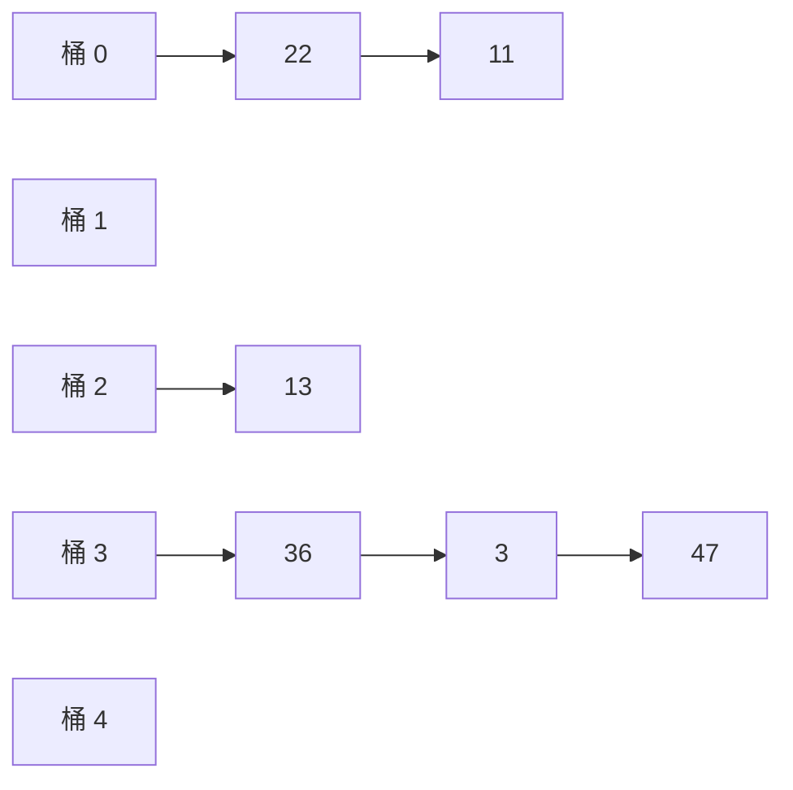

前面几章的数据结构都按位置（秩）或按大小次序访问元素：向量按秩随机访问，搜索树按关键码的大小逐层比较。本章讨论另一种访问方式：根据关键码本身直接找到对应的数据项，即"循对象访问"。实现这种访问的核心技术是散列：用一个函数把关键码映射为数组下标，于是查找、插入与删除在期望意义下只需常数时间，而且关键码不必能比较大小。散列表是实际程序中使用最多的数据结构之一，Python 的 `dict`、`set` 与 C++ 的 `unordered_map` 都建立在它之上（用法见 [4.2.10](/4.2.10)）。本章先讲散列函数的设计和两大类排解冲突的方法，分析它们的期望性能；再把"按值分桶"的思想用于排序，得到突破比较排序下界的桶排序、计数排序与基数排序；最后介绍跳表，它用随机化的多层**链表**实现有序词典，是平衡二叉搜索树（[4.3.6](/4.3.6)、[4.3.8](/4.3.8)）的一种简洁替代。

## 9.1. 词典与散列

### 9.1.1. 词典 ADT

很多语言内置了"下标不必是整数"的数组：Python 写 `style["关羽"] = "云长"`，C++ 写 `m["east"] = "Tai"`。这类结构称为关联数组、映射或词典。

**定义 9.1.1（词典）** 由**词条**（entry）$(\mathit{key}, \mathit{value})$ 组成的集合称为**词典**，其中 $\mathit{key}$ 是关键码。词典支持以下操作：

| 操作 | 功能 |
|---|---|
| `get(key)` | 返回关键码为 `key` 的词条的值；不存在时报告失败 |
| `put(key, value)` | 插入词条；关键码已存在时，按约定覆盖原值（或拒绝插入、或允许重复） |
| `remove(key)` | 删除关键码为 `key` 的词条 |
| `size()` | 词条总数 |

与二叉搜索树相比，词典只要求关键码能判等，不要求能比较大小，因此关键码的类型更多样；与优先级队列（[4.3.12](/4.3.12)）相比，词典可以查找任意词条，而不只是最大或最小者。反过来，若需要按次序遍历或做范围查询，就要用有序词典（C++ 的 `std::map`，或本章 §9.6 的跳表）。

### 9.1.2. 散列表与散列函数

先看一个直接的方案。为一所学校制作电话簿，按 8 位电话号码查用户：可能的号码有 $10^8$ 个，实际使用的只有约 $2.5 \times 10^4$ 个。以号码为下标开一个长 $10^8$ 的**数组**，查找只需 $O(1)$ 时间，但空间利用率只有 $0.025\%$。我们希望在保持查找速度的同时，让空间与实际词条数成正比。

**定义 9.1.2（散列表）** 设关键码取自全集 $U$。**散列表**（也称哈希表）是一个长为 $M$ 的数组 $T[0, M)$，其中每个单元称为一个**桶**（bucket），直接存放或间接指向词条；配合一个**散列函数**

$$
h\colon U \to \{0, 1, \dots, M-1\},
$$
关键码为 $k$ 的词条存放在桶 $T[h(k)]$ 中。若 $k_1 \ne k_2$ 而 $h(k_1) = h(k_2)$，则称发生了**冲突**，$k_1$ 与 $k_2$ 互为同义词。设表中有 $N$ 个词条，称

$$
\lambda = \frac{N}{M}
$$
为**装填因子**。

电话簿的例子中取 $M = 90\,001$、$h(k) = k \bmod M$，空间就降到了 $O(N + M)$，而计算 $h(k)$ 仍是常数时间。代价是冲突：只要 $|U| > M$，由抽屉原理，冲突就不可避免。装填因子越大，空间利用率越高，冲突也越严重；降低装填因子可以减轻冲突，但只要数据集在变化，就无法彻底杜绝。因此散列有两项基本任务：设计好的散列函数，尽可能降低冲突的概率（§9.2）；制定冲突发生时的排解方案（§9.3、§9.4）。

### 9.1.3. 冲突有多常见：生日问题

**例 9.1.1（生日问题）** 把 $n$ 个人按生日散列到 $M = 365$ 个桶中，假设每个人的生日独立、均匀地分布。所有人生日互不相同的概率为

$$
\prod_{i=0}^{n-1} \left(1 - \frac{i}{M}\right) \approx \exp\!\left(-\frac{n(n-1)}{2M}\right).
$$
$n = 23$ 时至少两人同一天生日的概率已达 $50.7\%$，此时装填因子只有 $\lambda = 23/365 \approx 6\%$；$n = 100$ 时，所有人生日互不相同的概率只有约 $3 \times 10^{-7}$。一般地，在 $M$ 个桶中随机投入约 $\sqrt{\pi M / 2}$ 个关键码，就可以期望出现第一次冲突。

可见冲突在装填因子很低时就会出现，散列表的设计不能指望"没有冲突"，而要让冲突的代价可控。

只有在一种情形下可以完全避免冲突：数据集事先已知且固定不变（例如编译器的关键字表）。此时可以构造完美散列（perfect hashing），即在该数据集上为单射的散列函数。Fredman、Komlós 与 Szemerédi（1984）给出了经典的两级方案：

**定理 9.1.1（FKS 完美散列）** 对任意 $n$ 个关键码的静态集合，可以在期望 $O(n)$ 时间内构造一个两级散列表：第一级把关键码散列到 $n$ 个桶，第 $i$ 个桶的 $n_i$ 个关键码再用一个长为 $n_i^2$ 的二级表无冲突地存放。总空间为 $O(n)$，最坏情况下的查找时间为 $O(1)$。

其要点是：用 §9.2.3 的通用散列族随机选取散列函数时，第一级满足 $\mathbb{E}\bigl[\sum_i n_i^2\bigr] < 2n$，所以总空间期望为线性；而长为 $n_i^2$ 的二级表无冲突的概率至少 $1/2$，失败了重选即可。

## 9.2. 散列函数

### 9.2.1. 设计原则

好的散列函数应当满足：

| 原则 | 含义 |
|---|---|
| 确定 | 同一关键码总是映射到同一地址 |
| 快速 | 计算时间为 $O(1)$（对字符串等变长关键码，与其长度成正比） |
| 满射 | 尽可能覆盖整个地址空间 $[0, M)$ |
| 均匀 | 关键码映射到各地址的概率尽量接近，避免聚集（clustering），即大量关键码集中在少数相邻的桶中 |

"均匀"是相对于实际数据而言的。对于理想随机的关键码，几乎任何散列函数都表现良好；真正的困难在于实际数据往往有规律：等差数列（编号）、周期序列、自然语言中的高频词与公共词根。散列函数的任务就是打破这些规律。

### 9.2.2. 除余法与 MAD 法

最常用的散列函数是除余法（division method）：$h(k) = k \bmod M$。表长 $M$ 通常取素数，理由如下。

**定理 9.2.1** 设关键码构成等差数列 $k_i = a + i d$（$i = 0, 1, 2, \dots$），$g = \gcd(d, M)$，则 $k_i \bmod M$ 以 $M/g$ 为周期，恰好取 $M/g$ 个不同的值。

**证明** $k_i \equiv k_j \pmod M$ 当且仅当 $M \mid (i - j)d$，当且仅当 $\frac{M}{g} \mid (i - j)\frac{d}{g}$。由于 $\frac{M}{g}$ 与 $\frac{d}{g}$ 互素，这又等价于 $\frac{M}{g} \mid (i - j)$。$\square$

因此，若关键码以步长 $d$ 规律地出现，只有 $1/g$ 的桶会被用到。$M$ 取素数时，除非步长恰为 $M$ 的倍数，否则 $g = 1$，所有桶都被均匀地覆盖。（反之，若关键码本身是理想随机的，表长是否为素数无关紧要。）

除余法还有两个缺陷：$h(0) = 0$ 是不动点，与 $M$ 无关；相邻的关键码被映射到相邻的桶，原有的局部规律原样保留。MAD 法（multiply–add–divide）取

$$
h(k) = (a k + b) \bmod M,
$$
其中 $M$ 为素数，$a \bmod M \ne 0$。它消除了不动点，并把相邻的关键码拉开 $a$ 个桶的距离。

此外还有一些传统方法：数字分析法（抽取关键码的若干位）、平方取中法（取 $k^2$ 的中间若干位，使每一位都对结果有影响）、折叠法（把关键码分成等宽的若干段再求和）与位异或法（按二进制分段后异或）。实践中常用的另一种是乘法散列：对 $w$ 位的关键码取 $h(k) = \bigl\lfloor (A k \bmod 2^w) / 2^{w-r} \bigr\rfloor$，表长 $M = 2^r$，常数 $A$ 取接近 $2^w / \varphi$ 的奇数（$\varphi$ 为黄金比），只需一次乘法和一次移位。

### 9.2.3. 通用散列

上述方法都是固定的函数，总存在一组"坏"的关键码让它们全部冲突；若关键码由对手选择（例如网络服务收到的请求参数），对手就能让散列表退化为线性查找。现代的解决办法是随机选取散列函数：不是对输入做概率假设，而是让算法自己掷硬币。

**定义 9.2.1（通用散列）** 设 $\mathcal{H}$ 是一族从 $U$ 到 $[0, M)$ 的函数。若对任意 $x \ne y \in U$，从 $\mathcal{H}$ 中均匀随机地选取 $h$ 时都有

$$
\mathbb{P}\bigl(h(x) = h(y)\bigr) \le \frac{1}{M},
$$
则称 $\mathcal{H}$ 是一个**通用散列**族（universal family）。

**定理 9.2.2（Carter–Wegman）** 设素数 $p > \max U$，则

$$
\mathcal{H}_{p,M} = \bigl\{\, h_{a,b}(k) = \bigl((a k + b) \bmod p\bigr) \bmod M \;:\; 1 \le a < p,\ 0 \le b < p \,\bigr\}
$$
是通用散列族。

**证明**（概要） 对 $x \ne y$，令 $r = (a x + b) \bmod p$，$s = (a y + b) \bmod p$。由于 $p$ 是素数，$(a, b) \mapsto (r, s)$ 是从 $\{1, \dots, p-1\} \times \{0, \dots, p-1\}$ 到 $\{(r, s) : r \ne s\}$ 的双射，所以 $(r, s)$ 在所有 $r \ne s$ 的数对上均匀分布。对固定的 $r$，满足 $s \ne r$ 且 $s \equiv r \pmod M$ 的 $s$ 至多 $\lceil p/M \rceil - 1 \le (p-1)/M$ 个，故冲突概率至多 $\frac{1}{p-1} \cdot \frac{p-1}{M} = \frac{1}{M}$。$\square$

它就是随机化的 MAD 法：先在素数域上做 MAD，再对表长取模。§9.3 的实现用 $p = 2^{61} - 1$ 这个 Mersenne 素数，对关键码的散列码再做一次 $h_{a,b}$，每个散列表在构造时随机选取 $a, b$。

### 9.2.4. 散列码：从对象到整数

散列函数通常分两步：先把任意对象转换为一个整数，称为散列码（hash code）；再把散列码压缩到 $[0, M)$。字符串的散列码要让每个字符及其所在的位置都起作用。如果简单地把各字符的编码相加，`"stop"`、`"tops"`、`"pots"`、`"spot"` 这样的异序词就全部冲突。标准做法是多项式散列：

$$
\operatorname{hc}(s_0 s_1 \cdots s_{n-1}) = s_0 x^{n-1} + s_1 x^{n-2} + \cdots + s_{n-1} \pmod{2^w},
$$
用 Horner 法则逐个字符计算 $h \leftarrow h \cdot x + s_i$，只需 $O(n)$ 时间。Java 的 `String.hashCode` 取 $x = 31$；也可以用循环移位代替乘法，如 `h = (h << 5) | (h >> 27); h += s[i];`。

实际的语言运行时又多了一层考虑：抵御散列洪泛（hash flooding）攻击。2011 年，人们演示了向 Web 服务器提交大量散列码相同的参数名，使多种语言的散列表退化为链表、服务器 CPU 被耗尽。此后主流实现都改用带随机密钥的散列函数：

- Python：`str` 与 `bytes` 的散列使用 SipHash（3.11 起为 SipHash-1-3），密钥在每个解释器进程启动时随机生成，所以同一字符串在两次运行中的 `hash` 值不同，字符串 `set` 的遍历顺序也会变化。环境变量 `PYTHONHASHSEED` 可以固定或关闭随机化，便于复现。整数不做随机化：在 64 位平台上 `hash(x)` 是 $x$ 模 Mersenne 素数 $2^{61} - 1$（保留符号；`hash(-1)` 特别地等于 $-2$，因为 $-1$ 在 C 接口中表示出错）。
- C++：`std::hash<std::string>` 的算法由实现决定（libstdc++ 用 MurmurHash 系列），不带随机密钥；`std::hash<int>` 在 libstdc++ 与 libc++ 中就是恒等函数。处理不可信输入时，应自己提供带随机种子的散列函数。

## 9.3. 链地址法

### 9.3.1. 方法与分析

排解冲突的第一类方法是让每个桶能容纳多个词条。若每个桶预留固定数目的槽位，多少才够难以预测：太多浪费空间，太少则极端情况下仍会溢出。更灵活的做法是：

**定义 9.3.1（链地址法）** 每个桶维护一个列表，存放散列到该桶的全部同义词。查找、插入、删除时先计算 $h(k)$，再在桶 $T[h(k)]$ 的列表中顺序查找。这种排解冲突的方法称为**链地址法**（也称独立链法、拉链法），它是"开放散列"（open hashing）的典型：词条存放在桶数组之外。



链地址法可以排解任意多次冲突，删除也简单统一；缺点是每个节点要额外存放指针，节点的动态分配与回收耗时，更重要的是节点在内存中不连续，缓存难以发挥作用。

**定理 9.3.1** 设散列函数从通用散列族中随机选取，表中有 $N$ 个词条，装填因子 $\lambda = N/M$。则在链地址法中：查找不在表中的关键码 $x$，所查列表的期望长度至多 $\lambda$；查找表中的关键码 $x$，所查列表的期望长度至多 $1 + \lambda$。

**证明** 对表中每个关键码 $y \ne x$，令示性变量 $I_y = \boldsymbol{1}_{\{h(y) = h(x)\}}$，则 $x$ 所在桶中除 $x$ 外的词条数为 $\sum_{y \ne x} I_y$。由期望的线性性与通用性，

$$
\mathbb{E}\Bigl[\sum_{y \ne x} I_y\Bigr] = \sum_{y \ne x} \mathbb{P}\bigl(h(y) = h(x)\bigr) \le \frac{\#\{y \ne x\}}{M}.
$$
$x$ 不在表中时，$\#\{y \ne x\} = N$，上界为 $\lambda$；$x$ 在表中时为 $N - 1$，再加上 $x$ 本身，上界为 $1 + (N-1)/M < 1 + \lambda$。$\square$

所以只要保持 $\lambda = O(1)$（例如超过 1 就把表长加倍并重散列，§9.4.3），每次操作的期望时间就是 $O(1)$。注意这里的期望只对散列函数的随机选取而言，对任意输入都成立。扩容时把 $N$ 个词条逐一重新插入，代价 $O(N)$，但由于表长按倍数增长，这一代价分摊到每次插入只是 $O(1)$（与 [4.3.2](/4.3.2) 中向量的扩容同理）。

### 9.3.2. 实现

下面的实现用动态数组作为每个桶的列表（比链表对缓存更友好；桶内次序无关紧要，删除时把末尾元素移来填补），对关键码的散列码再施加通用散列 $h_{a,b}$，装填因子超过 1 时把表长加倍。程序最后用 20 万次随机操作与标准库的散列表对照，检验实现的正确性。

```cpp tab
#include <cstdint>
#include <format>
#include <functional>
#include <iostream>
#include <random>
#include <string>
#include <unordered_map>
#include <utility>
#include <vector>

// Hash table with separate chaining; bucket index from a universal hash
// h(x) = ((a * x + b) mod p) mod M applied to the key's hash code.
template <typename K, typename V>
class ChainedHashMap {
    static constexpr std::uint64_t P = (1ULL << 61) - 1;   // Mersenne prime
    std::vector<std::vector<std::pair<K, V>>> buckets_;
    std::size_t size_ = 0;
    std::uint64_t a_, b_;

    static std::uint64_t mulmod(std::uint64_t x, std::uint64_t y) {
        return static_cast<std::uint64_t>(static_cast<unsigned __int128>(x) * y % P);
    }
    std::size_t index(const K& key, std::size_t m) const {
        std::uint64_t x = std::hash<K>{}(key) % P;
        return (mulmod(a_, x) + b_) % P % m;
    }
    void rehash(std::size_t m) {                 // move every entry to a new table
        std::vector<std::vector<std::pair<K, V>>> old(m);
        old.swap(buckets_);
        for (auto& chain : old)
            for (auto& kv : chain)
                buckets_[index(kv.first, m)].push_back(std::move(kv));
    }

public:
    explicit ChainedHashMap(std::uint64_t seed = 2024) : buckets_(8) {
        std::mt19937_64 gen(seed);
        a_ = gen() % (P - 1) + 1;                // a in [1, p)
        b_ = gen() % P;                          // b in [0, p)
    }
    std::size_t size() const { return size_; }
    double load_factor() const { return double(size_) / buckets_.size(); }

    V* get(const K& key) {
        for (auto& kv : buckets_[index(key, buckets_.size())])
            if (kv.first == key) return &kv.second;
        return nullptr;
    }
    bool put(const K& key, V value) {            // false if the key was present
        if (V* v = get(key)) { *v = std::move(value); return false; }
        if (size_ + 1 > buckets_.size()) rehash(2 * buckets_.size());   // keep load <= 1
        buckets_[index(key, buckets_.size())].emplace_back(key, std::move(value));
        ++size_;
        return true;
    }
    bool remove(const K& key) {
        auto& chain = buckets_[index(key, buckets_.size())];
        for (std::size_t i = 0; i < chain.size(); ++i)
            if (chain[i].first == key) {
                chain[i] = std::move(chain.back());   // order inside a chain is irrelevant
                chain.pop_back();
                --size_;
                return true;
            }
        return false;
    }
};

int main() {
    ChainedHashMap<std::string, std::string> peaks;
    peaks.put("east", "Tai");
    peaks.put("west", "Hua");
    peaks.put("south", "Heng");
    peaks.remove("south");
    std::cout << std::format("{} {} {}\n", *peaks.get("west"), peaks.get("south") == nullptr,
                             peaks.size());     // Hua true 2

    // Random self-test against std::unordered_map.
    ChainedHashMap<int, int> h;
    std::unordered_map<int, int> ref;
    std::mt19937 gen(1);
    for (int step = 0; step < 200000; ++step) {
        int k = gen() % 5000, op = gen() % 3;
        if (op == 0) {
            bool fresh = !ref.contains(k);
            ref[k] = step;
            if (h.put(k, step) != fresh) { std::cout << "put mismatch\n"; return 1; }
        } else if (op == 1) {
            if (h.remove(k) != (ref.erase(k) == 1)) { std::cout << "remove mismatch\n"; return 1; }
        } else {
            int* v = h.get(k);
            auto it = ref.find(k);
            if ((v == nullptr) != (it == ref.end()) || (v && *v != it->second)) {
                std::cout << "get mismatch\n"; return 1;
            }
        }
    }
    std::cout << std::format("ok: size {}, load factor {:.2f}\n", h.size(), h.load_factor());
}
```

```python tab
import random
from typing import Any, Hashable


class ChainedHashMap:
    """Hash table with separate chaining and a universal bucket hash."""

    P = (1 << 61) - 1                              # Mersenne prime

    def __init__(self, seed: int = 2024) -> None:
        rng = random.Random(seed)
        self._a = rng.randrange(1, self.P)
        self._b = rng.randrange(self.P)
        self._buckets: list[list[list[Any]]] = [[] for _ in range(8)]
        self._size = 0

    def _index(self, key: Hashable, m: int) -> int:
        return (self._a * (hash(key) % self.P) + self._b) % self.P % m

    def _rehash(self, m: int) -> None:
        old, self._buckets = self._buckets, [[] for _ in range(m)]
        for chain in old:
            for entry in chain:
                self._buckets[self._index(entry[0], m)].append(entry)

    def __len__(self) -> int:
        return self._size

    def load_factor(self) -> float:
        return self._size / len(self._buckets)

    def get(self, key: Hashable, default: Any = None) -> Any:
        for k, v in self._buckets[self._index(key, len(self._buckets))]:
            if k == key:
                return v
        return default

    def put(self, key: Hashable, value: Any) -> bool:
        """Insert or update; return True if the key is new."""
        chain = self._buckets[self._index(key, len(self._buckets))]
        for entry in chain:
            if entry[0] == key:
                entry[1] = value
                return False
        if self._size + 1 > len(self._buckets):   # keep load factor <= 1
            self._rehash(2 * len(self._buckets))
            chain = self._buckets[self._index(key, len(self._buckets))]
        chain.append([key, value])
        self._size += 1
        return True

    def remove(self, key: Hashable) -> bool:
        chain = self._buckets[self._index(key, len(self._buckets))]
        for i, entry in enumerate(chain):
            if entry[0] == key:
                chain[i] = chain[-1]               # order inside a chain is irrelevant
                chain.pop()
                self._size -= 1
                return True
        return False


peaks = ChainedHashMap()
peaks.put("east", "Tai")
peaks.put("west", "Hua")
peaks.put("south", "Heng")
peaks.remove("south")
print(peaks.get("west"), peaks.get("south") is None, len(peaks))   # Hua True 2

# Random self-test against dict.
h, ref = ChainedHashMap(), {}
rng = random.Random(1)
for step in range(200_000):
    k, op = rng.randrange(5000), rng.randrange(3)
    if op == 0:
        assert h.put(k, step) == (k not in ref)
        ref[k] = step
    elif op == 1:
        assert h.remove(k) == (ref.pop(k, None) is not None)
    else:
        assert h.get(k) == ref.get(k)
print(f"ok: size {len(h)}, load factor {h.load_factor():.2f}")
```

### 9.3.3. C++ 的 unordered_map

C++ 标准对 `std::unordered_map` 规定了一组桶接口：`bucket_count()`、`bucket(key)`（关键码所在的桶）、`begin(n)` 与 `end(n)`（遍历第 $n$ 个桶），并要求重散列时元素的引用与指针保持有效。这些要求实际上规定了链地址法：每个元素是一个独立分配的节点，挂在桶的链表上。在 libstdc++ 中，全部节点串成一条单链表，每个桶指向其第一个节点的前驱；桶数取素数。

- `load_factor()` 返回当前装填因子 $N/M$；`max_load_factor()` 默认为 1.0，插入后超过它就自动重散列；`reserve(n)` 预先把桶数调整到能容纳 $n$ 个元素，避免反复扩容。
- 重散列使所有迭代器失效，但元素的引用仍然有效（[4.2.10](/4.2.10) 的迭代器失效规则即源于此）。
- 由于每个节点单独分配，`unordered_map` 的缓存局部性较差。对性能要求高的场合，常用基于开放定址法（§9.4）的第三方实现，如 Abseil 的 `absl::flat_hash_map`（Swiss table，用 SIMD 指令一次比较一组槽位的元数据）和 Boost 的 `boost::unordered_flat_map`。

## 9.4. 开放定址法

### 9.4.1. 试探链与线性试探

另一类方法不在桶数组之外分配任何空间：

**定义 9.4.1（开放定址法）** 所有词条都存放在桶数组内部，每个桶至多一个词条。对每个关键码 $k$ 约定一个**试探链**（probe sequence）$h_0(k), h_1(k), h_2(k), \dots$，它是桶地址的序列：插入时沿试探链找第一个空桶；查找时沿试探链逐个检查，直到命中，或遇到空桶而失败。这种方法称为**开放定址法**（open addressing），也称"封闭散列"（closed hashing），因为散列表的物理空间固定，冲突都在表内解决。

最简单的试探链是线性试探（linear probing）：

$$
h_i(k) = \bigl(h(k) + i\bigr) \bmod M, \qquad i = 0, 1, 2, \dots
$$

只要表中还有空桶，线性试探的查找必然终止。它的缺点是不同关键码的试探链相互重叠：一段连续的满桶（称为一个"簇"）会吸引更多关键码落入并延长它，簇越长增长越快，这称为一次聚集（primary clustering）。不过线性试探依次访问相邻的内存单元，缓存命中率极高，只要装填因子控制得当，实际性能往往优于其他方法。

开放定址法的性能与装填因子的关系，经典结果如下（$\lambda < 1$）：

**定理 9.4.1（Knuth）** 设散列值独立、均匀地分布，采用线性试探。当 $M \to \infty$ 而 $\lambda$ 固定时，成功查找与失败查找的期望试探次数分别趋于

$$
\frac{1}{2}\left(1 + \frac{1}{1 - \lambda}\right), \qquad \frac{1}{2}\left(1 + \frac{1}{(1 - \lambda)^2}\right).
$$

**定理 9.4.2** 设每个关键码的试探链是 $[0, M)$ 的一个均匀随机排列（均匀散列假设，双散列近似满足它）。则失败查找的期望试探次数至多 $\dfrac{1}{1 - \lambda}$，成功查找的期望试探次数至多 $\dfrac{1}{\lambda} \ln \dfrac{1}{1 - \lambda}$。

**证明** 失败查找时，第 $i$ 次试探遇到满桶的条件概率不超过 $\frac{N - i + 1}{M - i + 1} \le \lambda$，所以至少需要 $i$ 次试探的概率不超过 $\lambda^{i-1}$，期望次数

$$
\sum_{i \ge 1} \mathbb{P}(\text{至少 } i \text{ 次}) \le \sum_{i \ge 1} \lambda^{i-1} = \frac{1}{1 - \lambda}.
$$
成功查找某关键码的试探过程与当初插入它时相同。第 $j + 1$ 个插入的关键码插入时装填因子为 $j/M$，期望试探至多 $\frac{1}{1 - j/M}$ 次，对 $j = 0, \dots, N-1$ 取平均：

$$
\frac{1}{N} \sum_{j=0}^{N-1} \frac{M}{M - j} = \frac{1}{\lambda} \sum_{t = M - N + 1}^{M} \frac{1}{t} \le \frac{1}{\lambda} \int_{M-N}^{M} \frac{\mathrm{d}x}{x} = \frac{1}{\lambda} \ln \frac{1}{1 - \lambda}. \qquad \square
$$

下图比较了几种方法的期望试探次数（纵轴为对数刻度），圆点是线性试探在 $M = 2^{14}$ 的表上的模拟结果。$\lambda = 0.5$ 时线性试探的失败查找平均只需 2.5 次试探，$\lambda = 0.9$ 时却要 50 次以上。因此开放定址法通常把装填因子控制在 $1/2$ 到 $3/4$ 以下。


### 9.4.2. 懒惰删除

开放定址法的删除不能简单地清空桶：试探链彼此重叠，清空一个桶会让经过它的所有试探链在此断裂，后面的词条明明存在却再也找不到。

**定义 9.4.2（懒惰删除）** 删除词条时只在其桶上做一个"已删除"标记（也称墓碑），而不调整试探链。此后，带标记的桶在查找时被视为"必不匹配的非空桶"，试探链在此延续；在插入时被视为"空闲桶"，可以存放新词条。这种方法称为**懒惰删除**。

于是需要两种试探：为查找而试探（遇到标记桶继续），为插入而试探（遇到标记桶即可使用）。插入前先做一次查找，确认关键码不存在。设表中有 $N$ 个词条、$L$ 个标记桶，则只要 $N + L < M$，查找迟早会遇到真正的空桶而终止；计算装填因子时也应按 $(N + L)/M$ 计，因为标记桶同样会拉长试探链。

**注 9.4.1** 标记桶只在重散列时才被清除。如果删除频繁而插入很少，标记会越积越多。一个极端的例子：在 Python 中整数的散列码就是它本身，若关键码是 $0, 1, \dots, 2999$ 且反复删除、插入，这些关键码恰好占据一段连续的桶；删除后留下的标记使这段桶连成一个"满或已删除"的长簇，每次失败查找都要扫过整段。下面的实现若改用这样的关键码做随机自检，运行时间会增加约 30 倍。对线性试探，另一种办法是删除时把簇中后面的词条前移填补空位（Knuth 的算法 R），从而完全不需要标记。

### 9.4.3. 重散列

装填因子超过阈值后，冲突急剧增加，这时要扩容：

**定义 9.4.3（重散列）** 新建一个更大的桶数组（表长通常取不小于 $4N$ 或 $2M$ 的素数），把原表中的全部词条逐个重新插入，然后释放旧表。这一过程称为**重散列**（rehashing）。

由于散列函数依赖于表长，词条在新表中的位置与原表无关，必须逐个重新计算；重散列的同时也清除了所有懒惰删除的标记。若在 $(N + L)/M > 1/2$ 时把表长扩到不小于 $4N$ 的素数，新表的装填因子不超过 $1/4$，至少还要插入约 $M'/4$ 个词条（或积累同样多的标记）才会再次重散列，所以重散列的 $O(N)$ 代价分摊到每次操作为 $O(1)$。

### 9.4.4. 实现

下面按上述设计实现开放定址的散列表：线性试探，懒惰删除，$(N + L)/M > 1/2$ 时重散列到不小于 $4N$ 的素数表长。`probe_for_hit` 返回关键码所在的桶或查找终止处的空桶，`probe_for_free` 返回第一个可用的桶（空桶或带标记的桶）。

```cpp tab
#include <cstdint>
#include <format>
#include <functional>
#include <iostream>
#include <optional>
#include <random>
#include <unordered_map>
#include <vector>

// Open addressing with linear probing, lazy removal and rehashing.
template <typename K, typename V>
class ProbingHashMap {
    enum class State : std::uint8_t { Empty, Full, Removed };
    struct Slot { State state = State::Empty; K key{}; V value{}; };
    std::vector<Slot> ht_;
    std::size_t n_ = 0;          // entries
    std::size_t removed_ = 0;    // slots carrying a lazy-removal mark

    static bool is_prime(std::size_t m) {
        if (m < 2) return false;
        for (std::size_t d = 2; d * d <= m; ++d)
            if (m % d == 0) return false;
        return true;
    }
    static std::size_t prime_not_less(std::size_t m) {
        while (!is_prime(m)) ++m;
        return m;
    }
    std::size_t home(const K& k) const { return std::hash<K>{}(k) % ht_.size(); }

    // Slot holding k, or the empty (unmarked) slot where the search fails.
    std::size_t probe_for_hit(const K& k) const {
        std::size_t r = home(k);
        while (!(ht_[r].state == State::Full && ht_[r].key == k) && ht_[r].state != State::Empty)
            r = (r + 1) % ht_.size();          // removed slots keep the chain alive
        return r;
    }
    // First slot that can receive a new entry: empty or marked as removed.
    std::size_t probe_for_free(const K& k) const {
        std::size_t r = home(k);
        while (ht_[r].state == State::Full) r = (r + 1) % ht_.size();
        return r;
    }
    void rehash() {
        std::vector<Slot> old(prime_not_less(4 * n_ + 1));
        old.swap(ht_);
        n_ = removed_ = 0;
        for (Slot& s : old)
            if (s.state == State::Full) put(s.key, s.value);
    }

public:
    ProbingHashMap() : ht_(prime_not_less(7)) {}
    std::size_t size() const { return n_; }
    std::size_t capacity() const { return ht_.size(); }

    std::optional<V> get(const K& k) const {
        const Slot& s = ht_[probe_for_hit(k)];
        if (s.state == State::Full) return s.value;
        return std::nullopt;
    }
    bool put(const K& k, const V& v) {
        if (Slot& s = ht_[probe_for_hit(k)]; s.state == State::Full) { s.value = v; return false; }
        Slot& s = ht_[probe_for_free(k)];
        if (s.state == State::Removed) --removed_;   // reuse a marked slot
        s = {State::Full, k, v};
        ++n_;
        if (2 * (n_ + removed_) > ht_.size()) rehash();   // keep (N + L) / M <= 1/2
        return true;
    }
    bool remove(const K& k) {
        Slot& s = ht_[probe_for_hit(k)];
        if (s.state != State::Full) return false;
        s.state = State::Removed;                    // lazy removal: only mark the slot
        --n_;
        ++removed_;
        return true;
    }
};

int main() {
    ProbingHashMap<int, char> h;
    for (int k : {7, 14, 21, 3}) h.put(k, char('a' + k % 26));   // grows from 7 to 17 slots
    h.remove(14);
    std::cout << std::format("{} {} capacity {}\n", h.get(21).value(), h.get(14).has_value(),
                             h.capacity());

    // Random self-test against std::unordered_map.
    ProbingHashMap<int, int> t;
    std::unordered_map<int, int> ref;
    std::mt19937 gen(7);
    std::vector<int> pool(3000);
    for (int& k : pool) k = static_cast<int>(gen() >> 1);
    for (int step = 0; step < 200000; ++step) {
        int k = pool[gen() % pool.size()], op = gen() % 3;
        if (op == 0) {
            bool fresh = !ref.contains(k);
            ref[k] = step;
            if (t.put(k, step) != fresh) { std::cout << "put mismatch\n"; return 1; }
        } else if (op == 1) {
            if (t.remove(k) != (ref.erase(k) == 1)) { std::cout << "remove mismatch\n"; return 1; }
        } else {
            auto v = t.get(k);
            auto it = ref.find(k);
            if (v.has_value() != (it != ref.end()) || (v && *v != it->second)) {
                std::cout << "get mismatch\n"; return 1;
            }
        }
    }
    std::cout << std::format("ok: size {}, capacity {}\n", t.size(), t.capacity());
}
```

```python tab
import random
from typing import Any, Hashable

_EMPTY, _REMOVED = object(), object()          # sentinels for the two kinds of free slot


def _prime_not_less(m: int) -> int:
    def is_prime(x: int) -> bool:
        return x >= 2 and all(x % d for d in range(2, int(x**0.5) + 1))
    while not is_prime(m):
        m += 1
    return m


class ProbingHashMap:
    """Open addressing with linear probing, lazy removal and rehashing."""

    def __init__(self) -> None:
        self._keys: list[Any] = [_EMPTY] * 7
        self._vals: list[Any] = [None] * 7
        self._n = 0                            # entries
        self._removed = 0                      # slots carrying a lazy-removal mark

    def _probe_for_hit(self, key: Hashable) -> int:
        m = len(self._keys)
        r = hash(key) % m
        while self._keys[r] is not _EMPTY and (self._keys[r] is _REMOVED or self._keys[r] != key):
            r = (r + 1) % m                    # removed slots keep the chain alive
        return r

    def _probe_for_free(self, key: Hashable) -> int:
        m = len(self._keys)
        r = hash(key) % m
        while self._keys[r] is not _EMPTY and self._keys[r] is not _REMOVED:
            r = (r + 1) % m
        return r

    def _rehash(self) -> None:
        old = [(k, v) for k, v in zip(self._keys, self._vals) if k is not _EMPTY and k is not _REMOVED]
        m = _prime_not_less(4 * self._n + 1)
        self._keys, self._vals = [_EMPTY] * m, [None] * m
        self._n = self._removed = 0
        for k, v in old:
            self.put(k, v)

    def __len__(self) -> int:
        return self._n

    def capacity(self) -> int:
        return len(self._keys)

    def get(self, key: Hashable, default: Any = None) -> Any:
        r = self._probe_for_hit(key)
        return default if self._keys[r] is _EMPTY else self._vals[r]

    def put(self, key: Hashable, value: Any) -> bool:
        r = self._probe_for_hit(key)
        if self._keys[r] is not _EMPTY:        # found: update
            self._vals[r] = value
            return False
        r = self._probe_for_free(key)
        if self._keys[r] is _REMOVED:          # reuse a marked slot
            self._removed -= 1
        self._keys[r], self._vals[r] = key, value
        self._n += 1
        if 2 * (self._n + self._removed) > len(self._keys):   # keep (N + L) / M <= 1/2
            self._rehash()
        return True

    def remove(self, key: Hashable) -> bool:
        r = self._probe_for_hit(key)
        if self._keys[r] is _EMPTY:
            return False
        self._keys[r], self._vals[r] = _REMOVED, None   # lazy removal: only mark the slot
        self._n -= 1
        self._removed += 1
        return True


h = ProbingHashMap()
for k in (7, 14, 21, 3):                       # the table grows from 7 to 17 slots
    h.put(k, chr(ord("a") + k % 26))
h.remove(14)
print(h.get(21), h.get(14) is not None, "capacity", h.capacity())

# Random self-test against dict.
t, ref = ProbingHashMap(), {}
rng = random.Random(7)
pool = [rng.getrandbits(40) for _ in range(3000)]
for step in range(200_000):
    k, op = rng.choice(pool), rng.randrange(3)
    if op == 0:
        assert t.put(k, step) == (k not in ref)
        ref[k] = step
    elif op == 1:
        assert t.remove(k) == (ref.pop(k, None) is not None)
    else:
        assert t.get(k) == ref.get(k)
print(f"ok: size {len(t)}, capacity {t.capacity()}")
```

### 9.4.5. 平方试探

为了缓解一次聚集，可以让试探的步长越来越大，一旦冲突就迅速跳离"是非之地"。

**定义 9.4.4（平方试探）** 试探链为

$$
h_i(k) = \bigl(h(k) + i^2\bigr) \bmod M, \qquad i = 0, 1, 2, \dots
$$
相邻两次试探的间距 $1, 3, 5, 7, \dots$ 线性递增。这种方法称为**平方试探**（quadratic probing）。

平方试探消除了一次聚集，但同义词仍共用同一条试探链（二次聚集，secondary clustering）；试探不再连续，缓存利用率有所下降，好在前几次试探的距离仍然不大。新的问题是：试探不再逐个进行，只要有空桶就一定能找到吗？

若 $M$ 是合数，答案是否定的。例如 $M = 12$ 时 $i^2 \bmod 12$ 只取 $\{0, 1, 4, 9\}$ 四个值，只要这四个桶非空，插入就会失败，哪怕另外 8 个桶都空着。表长取素数时则有：

**定理 9.4.3** 设 $M$ 为奇素数，则任一试探链的前 $\lceil M/2 \rceil$ 项互不相同。因此只要 $N + L \le \lfloor M/2 \rfloor$（即装填因子不超过 $1/2$），插入必能找到空桶。

**证明** 设 $0 \le a < b \le \lceil M/2 \rceil - 1 = \frac{M-1}{2}$，而 $a^2 \equiv b^2 \pmod M$，则 $M \mid (b - a)(b + a)$。由于 $M$ 是素数，$M$ 整除 $b - a$ 或 $b + a$；但 $0 < b - a < M$，$0 < b + a \le M - 2$，均不可能。$\square$

$i^2 \bmod M$（$0 \le i \le \frac{M-1}{2}$）恰好取遍模 $M$ 的 $\frac{M+1}{2}$ 个二次剩余（含 0），所以试探链只能到达大约一半的桶。另一半能否也利用起来？

### 9.4.6. 双向平方试探

交替地沿两个方向试探，距离仍按平方增长：

$$
h(k),\ h(k) + 1^2,\ h(k) - 1^2,\ h(k) + 2^2,\ h(k) - 2^2,\ \dots,\ h(k) \pm \left(\tfrac{M-1}{2}\right)^2 \pmod M.
$$
这条试探链共 $M$ 项。由定理 9.4.3，正向的 $\frac{M+1}{2}$ 项互不相同，反向的同理；问题在于两个方向会不会撞上。

**定理 9.4.4** 设 $M$ 为奇素数。双向平方试探链的前 $M$ 项恰好取遍全部 $M$ 个桶，当且仅当 $M \equiv 3 \pmod 4$。

**证明** 正反两个方向冲突，即存在 $1 \le a, b \le \frac{M-1}{2}$ 使 $a^2 \equiv -b^2 \pmod M$，等价于 $(a b^{-1})^2 \equiv -1$，即 $-1$ 是模 $M$ 的二次剩余。由 Euler 判别法，$-1$ 是二次剩余当且仅当 $(-1)^{(M-1)/2} = 1$，即 $M \equiv 1 \pmod 4$。反过来，若 $M \equiv 1 \pmod 4$，取 $x^2 \equiv -1$ 的解 $x$（必要时换成 $M - x$，使 $1 \le x \le \frac{M-1}{2}$），则 $a = x$、$b = 1$ 给出冲突。$\square$

这也可以用 Fermat 的平方和定理理解：奇素数 $M$ 可以写成两个整数的平方和 $M = a^2 + b^2$，当且仅当 $M \equiv 1 \pmod 4$；此时 $a^2 \equiv -b^2$，正向第 $a$ 项与反向第 $b$ 项落在同一个桶。例如 $M = 13 = 2^2 + 3^2$，$h + 4$ 与 $h - 9$ 是同一个桶。所以双向平方试探的表长应取形如 $4j + 3$ 的素数，如 7、11、19、23、31。

### 9.4.7. 双散列

更一般地，让试探的增量也依赖于关键码：

**定义 9.4.5（双散列）** 另取第二散列函数 $h_2$，试探链为

$$
h_i(k) = \bigl(h(k) + i \cdot h_2(k)\bigr) \bmod M, \qquad i = 0, 1, 2, \dots
$$
这种方法称为**双散列**（double hashing）。为使试探链能取遍所有桶，要求 $h_2(k)$ 与 $M$ 互素，例如取 $M$ 为素数、$h_2(k) = 1 + (k \bmod (M - 1))$，或取 $M = 2^r$、$h_2(k)$ 恒为奇数。

线性试探相当于 $h_2 \equiv 1$。双散列中，即使两个关键码的 $h(k)$ 相同，它们的步长一般也不同，试探链很快分开，因此既没有一次聚集，也没有二次聚集，性能接近定理 9.4.2 的均匀散列。

### 9.4.8. Python 的 dict 与 set

CPython 的 `dict` 与 `set` 都用开放定址法实现，表长是 2 的幂，但试探方式与上面不同：

- 试探序列：起点是 `i = hash & mask`（`mask` 为表长减 1），之后反复执行 `perturb >>= 5; i = (5*i + perturb + 1) & mask`，其中 `perturb` 初值为散列码。递推 $i \leftarrow 5i + 1 \pmod{2^r}$ 本身就能遍历所有桶；`perturb` 则把散列码的高位逐步混入，避免了散列码低位相同的关键码（例如步长为 $2^r$ 的整数）走同一条试探链。整数的散列码就是其本身，连续的整数落在连续的桶中，反而几乎不冲突。
- 紧凑字典（3.6 起；3.7 起保持插入顺序成为语言规范）：`dict` 由两个数组组成。一个是稀疏的索引表，即真正的散列表，每个槽位只存一个小整数（表小时只占 1 字节）；另一个是按插入顺序追加的词条数组，每项存 (散列码, 键, 值)。查找时沿试探序列在索引表中找到下标，再到词条数组中比较。这样既节省空间（大部分空槽只占几个字节），又自然保持了插入顺序，遍历只需扫描词条数组。
- 装填因子与删除：词条数达到索引表长的 $2/3$ 时扩容。删除时在索引表中留下 DUMMY 标记，正是懒惰删除；词条数组中的空位在下次重建时被压缩。
- `set`：`set` 不保持插入顺序，也没有紧凑布局，桶中直接存放 (散列码, 键)。它先做最多 9 次线性试探（利用缓存），再按与 `dict` 类似的扰动方式跳转；装填超过约 $3/5$ 时扩容。

所以 `d[k]`、`k in s` 平均 $O(1)$，最坏 $O(n)$；用作键的对象必须可散列，且相等的对象散列码必须相同（`a == b` 蕴含 `hash(a) == hash(b)`），可变的 `list` 因此不能作键。

## 9.5. 桶排序与基数排序

散列把关键码直接映射为地址；若映射保持关键码的大小次序，按地址依次收集各桶，就完成了排序。这类排序不基于比较，因而不受比较排序 $\Omega(n \log n)$ 下界的限制。

### 9.5.1. 桶排序

**定义 9.5.1（桶排序）** 设 $n$ 个关键码取自 $[0, m)$。开 $m$ 个桶，把每个元素放入与其关键码对应的桶（同一桶中的元素按到达的先后串成列表），再按桶的编号依次收集。这种排序方法称为**桶排序**（bucket sort）。

分配与收集各需 $O(n)$ 与 $O(m)$ 时间，总时间与空间都是 $O(n + m)$。当 $m = O(n)$ 时它是线性时间的排序。由于每个桶按到达顺序收集，关键码相同的元素保持了输入中的相对次序，即桶排序是稳定的。

**例 9.5.1（最大间隙）** 实轴上任给 $n \ge 2$ 个点，求排序后相邻两点间距的最大值（MaxGap）。先排序再扫描需要 $O(n \log n)$ 时间；借助分桶可以做到 $O(n)$：

1. 一趟扫描求出最左点 $lo$ 与最右点 $hi$；
2. 把 $[lo, hi]$ 等分为 $n - 1$ 段，每段宽 $\delta = \frac{hi - lo}{n - 1}$；点 $x$ 放入第 $\bigl\lfloor (x - lo)/\delta \bigr\rfloor$ 个桶（$hi$ 单独占第 $n-1$ 个桶，共 $n$ 个桶）；
3. 每个桶只记录落入其中的最小点和最大点；
4. 依次扫描非空桶，计算每个非空桶的最小点与前一个非空桶的最大点之差，最大者即为所求。

正确性的关键是：$n$ 个点之间有 $n - 1$ 段间隙，总长 $hi - lo$，所以最大间隙至少是平均值 $\delta$；而同一个桶内两点之差小于 $\delta$。因此最大间隙不可能落在某个桶内部，必然跨越两个非空桶，且是"前一非空桶的最大点"到"后一非空桶的最小点"。

```cpp tab
#include <algorithm>
#include <format>
#include <iostream>
#include <random>
#include <vector>

// Largest gap between neighbours in sorted order, in O(n) time with n buckets.
double max_gap(const std::vector<double>& p) {
    std::size_t n = p.size();
    if (n < 2) return 0;
    auto [lo_it, hi_it] = std::minmax_element(p.begin(), p.end());
    double lo = *lo_it, hi = *hi_it;
    if (lo == hi) return 0;
    std::vector<double> bmin(n, hi), bmax(n, lo);
    std::vector<bool> used(n, false);
    for (double x : p) {                                   // bucket i: width (hi - lo) / (n - 1)
        auto i = static_cast<std::size_t>((x - lo) / (hi - lo) * (n - 1));
        bmin[i] = std::min(bmin[i], x);
        bmax[i] = std::max(bmax[i], x);
        used[i] = true;
    }
    double best = 0, prev = bmax[0];                       // bucket 0 holds lo
    for (std::size_t i = 1; i < n; ++i)
        if (used[i]) { best = std::max(best, bmin[i] - prev); prev = bmax[i]; }
    return best;
}

int main() {
    std::cout << std::format("{}\n", max_gap({3.0, 9.5, 1.0, 6.0, 15.0, 11.5}));   // 3.5

    std::mt19937 gen(3);                                   // self-test against sorting
    for (int t = 0; t < 500; ++t) {
        std::vector<double> d(gen() % 500 + 2);
        for (auto& x : d) x = static_cast<double>(gen() % 100000);
        auto e = d;
        std::sort(e.begin(), e.end());
        double gap = 0;
        for (std::size_t i = 1; i < e.size(); ++i) gap = std::max(gap, e[i] - e[i - 1]);
        if (gap != max_gap(d)) { std::cout << "mismatch\n"; return 1; }
    }
    std::cout << "ok\n";
}
```

```python tab
import random


def max_gap(p: list[float]) -> float:
    """Largest gap between neighbours in sorted order, in O(n) time with n buckets."""
    n = len(p)
    if n < 2:
        return 0.0
    lo, hi = min(p), max(p)
    if lo == hi:
        return 0.0
    bmin: list[float | None] = [None] * n
    bmax: list[float | None] = [None] * n
    for x in p:                                # bucket i: width (hi - lo) / (n - 1)
        i = int((x - lo) / (hi - lo) * (n - 1))
        bmin[i] = x if bmin[i] is None else min(bmin[i], x)
        bmax[i] = x if bmax[i] is None else max(bmax[i], x)
    best, prev = 0.0, bmax[0]                  # bucket 0 holds lo
    for i in range(1, n):
        if bmin[i] is not None:
            best = max(best, bmin[i] - prev)
            prev = bmax[i]
    return best


print(max_gap([3.0, 9.5, 1.0, 6.0, 15.0, 11.5]))   # 3.5

rng = random.Random(3)                         # self-test against sorting
for _ in range(500):
    d = [float(rng.randrange(100_000)) for _ in range(rng.randrange(2, 502))]
    e = sorted(d)
    assert max_gap(d) == max(y - x for x, y in zip(e, e[1:]))
print("ok")
```

对称的最小间隙问题（MinGap）不能这样解决：最小间隙可能落在一个桶的内部。事实上，在代数判定树模型中判定 $n$ 个数是否互不相同（MinGap 是否为 0）就需要 $\Omega(n \log n)$ 时间。

### 9.5.2. 计数排序

基数排序（§9.5.3）要反复做"关键码取值很少而元素很多"的桶排序。这时不必真的建立列表，只需计数：

**定义 9.5.2（计数排序）** 设 $n$ 个元素的关键码取自 $[0, m)$。按以下三步完成的排序称为**计数排序**（counting sort）：

1. 扫描一遍，统计每个关键码出现的次数 $c_j$；
2. 计算前缀和 $s_j = c_0 + \cdots + c_{j-1}$，它就是关键码为 $j$ 的元素在输出中的起始秩，关键码为 $j$ 的元素占据秩区间 $[s_j, s_j + c_j)$；
3. 按输入次序再扫描一遍，把每个元素放到其关键码当前的 $s_j$ 处，并令 $s_j$ 加一。

例如按花色给 11 张牌排序，统计出梅花 3 张、方块 2 张、红心 4 张、黑桃 2 张，前缀和给出各花色的秩区间 $[0, 3)$、$[3, 5)$、$[5, 9)$、$[9, 11)$。计数排序的时间与空间都是 $O(n + m)$，但不能就地完成，需要一个长为 $n$ 的输出数组。第 3 步按输入次序放置，保证了稳定性；另一种常见写法是把前缀和取为各区间的右端点，再自后向前扫描、每次先减一再放置，效果相同；若在那种写法中改为自前向后扫描，关键码相同的元素就会被反序放置，排序不再稳定。

### 9.5.3. 基数排序

有时关键码由多个域组成，如扑克牌的 (花色, 点数)、日期的 (年, 月, 日)。若把各域看作字母，关键码就是一个单词，按**字典序**排序。

**定义 9.5.3（基数排序）** 设关键码由 $d$ 个域 $k_d, k_{d-1}, \dots, k_1$ 组成（$k_d$ 最高位）。自最低位 $k_1$ 到最高位 $k_d$，依次以各域为关键码做一趟稳定的排序（通常为计数排序）。这种排序方法称为**基数排序**（radix sort），这里是低位优先（least significant digit first，LSD）的版本。

**定理 9.5.1** 基数排序的第 $i$ 趟之后，所有元素按低 $i$ 位构成的关键码 $(k_i, \dots, k_1)$ 有序。

**证明** 对 $i$ 归纳。$i = 1$ 显然。设前 $i - 1$ 趟后元素按低 $i-1$ 位有序，考察第 $i$ 趟后的任意两个元素：若它们的第 $i$ 位不同，第 $i$ 趟按该位排序，它们的次序正确；若第 $i$ 位相同，由于第 $i$ 趟排序稳定，它们保持第 $i$ 趟之前的次序，而由归纳假设，该次序正是按低 $i-1$ 位的次序。$\square$

证明表明稳定性必不可少，这也是低位优先的妙处：每一趟都不必关心更高位，只需整体处理。设第 $j$ 个域的取值范围为 $m_j$，每趟计数排序需要 $O(n + m_j)$ 时间，总时间为

$$
\sum_{j=1}^{d} O(n + m_j) = O\bigl(d\,(n + m)\bigr), \qquad m = \max_j m_j.
$$
当 $d$ 为常数且 $m = O(n)$ 时，这是 $O(n)$。

**定理 9.5.2** 设 $n$ 个整数取自 $[0, n^d)$，$d$ 为常数，则它们可以在 $O(n)$ 时间内排序。

**证明** 把每个整数写成 $n$ 进制，得到 $d$ 个取值于 $[0, n)$ 的域（第 $j$ 位为 $\lfloor x / n^{j-1} \rfloor \bmod n$，每位 $O(1)$ 时间算出），再做基数排序，时间 $O\bigl(d\,(n + n)\bigr) = O(n)$。$\square$

例如 64 位整数只要 $n \ge 2^{16}$，取 $d = 4$ 即可。这并不与比较排序的下界矛盾：这里限制了整数的取值范围，计算模型也不再只基于比较，而可以把关键码用作数组下标。

下面的实现对 32 位无符号整数按字节（基数 256）做 4 趟计数排序：

```cpp tab
#include <algorithm>
#include <cstdint>
#include <format>
#include <iostream>
#include <random>
#include <vector>

// Stable counting sort of a by key(x) in [0, m).
template <typename T, typename Key>
void counting_sort(std::vector<T>& a, std::size_t m, Key key) {
    std::vector<std::size_t> count(m + 1, 0);
    for (const T& x : a) ++count[key(x) + 1];                      // 1) count each key
    for (std::size_t i = 0; i < m; ++i) count[i + 1] += count[i];  // 2) prefix sums: first ranks
    std::vector<T> out(a.size());
    for (const T& x : a) out[count[key(x)]++] = x;                 // 3) place, keeping input order
    a.swap(out);
}

// LSD radix sort of 32-bit unsigned integers, one byte (base 256) per pass.
void radix_sort(std::vector<std::uint32_t>& a) {
    for (int shift = 0; shift < 32; shift += 8)
        counting_sort(a, 256, [shift](std::uint32_t x) { return (x >> shift) & 0xFF; });
}

int main() {
    std::vector<std::uint32_t> a = {170, 45, 75, 90, 802, 24, 2, 66, 4000000000u};
    radix_sort(a);
    for (auto x : a) std::cout << std::format("{} ", x);
    std::cout << '\n';

    std::mt19937 gen(3);                                           // random self-test
    for (int t = 0; t < 200; ++t) {
        std::vector<std::uint32_t> v(gen() % 2000);
        for (auto& x : v) x = gen();
        auto w = v;
        radix_sort(v);
        std::sort(w.begin(), w.end());
        if (v != w) { std::cout << "mismatch\n"; return 1; }
    }
    std::cout << "ok\n";
}
```

```python tab
import random
from collections.abc import Callable
from typing import TypeVar

T = TypeVar("T")


def counting_sort(a: list[T], m: int, key: Callable[[T], int]) -> list[T]:
    """Stable counting sort by key(x) in range(m)."""
    count = [0] * (m + 1)
    for x in a:                                # 1) count each key
        count[key(x) + 1] += 1
    for i in range(m):                         # 2) prefix sums: first ranks
        count[i + 1] += count[i]
    out: list[T | None] = [None] * len(a)
    for x in a:                                # 3) place, keeping input order
        k = key(x)
        out[count[k]] = x
        count[k] += 1
    return out                                 # type: ignore[return-value]


def radix_sort(a: list[int]) -> list[int]:
    """LSD radix sort of 32-bit unsigned integers, one byte (base 256) per pass."""
    for shift in range(0, 32, 8):
        a = counting_sort(a, 256, lambda x: (x >> shift) & 0xFF)
    return a


print(*radix_sort([170, 45, 75, 90, 802, 24, 2, 66, 4_000_000_000]))

rng = random.Random(3)                         # random self-test
for _ in range(200):
    v = [rng.getrandbits(32) for _ in range(rng.randrange(2000))]
    assert radix_sort(v) == sorted(v)
print("ok")
```

实际的标准库排序（C++ 的 `std::sort`、Python 的 `sorted`）都是比较排序，因为它们要适用于任意可比较的类型；对大量定长整数或字符串，基数排序在实践中常常更快。

## 9.6. 跳表

### 9.6.1. 结构

平衡二叉搜索树以严格的结构约束保证 $O(\log n)$ 的高度，代价是复杂的旋转与重染色。Pugh（1989）提出的跳表换一种思路：在普通的有序链表之上，用随机化的方法建立若干层"捷径"，只从**数学期望**的角度控制查找长度。

设想一个有序链表 $S_0$。从中每隔一个节点抽出一个，构成上一层列表 $S_1$；再从 $S_1$ 中每隔一个抽出一个，构成 $S_2$……这样逐层折半，共 $O(\log n)$ 层。查找时从顶层出发，在每层向右走到不超过目标的最后一个节点再下降一层，每层至多走一步，查找时间为 $O(\log n)$。但插入、删除会破坏严格的"每隔一个"结构。跳表的做法是不追求严格，而让每个节点随机地决定自己出现在多少层中。

**定义 9.6.1（跳表）** 一个**跳表**（skip list）由若干层有序链表 $S_0, S_1, \dots, S_{h-1}$ 组成，$S_0$ 包含全部词条，$S_{l+1}$ 中的词条都出现在 $S_l$ 中。每个词条在各层中的节点构成一座**塔**；插入词条时，塔高按投掷硬币确定：从高度 1 开始，每次以 $1/2$ 的概率再长高一层。每层两端各有一个哨兵（头、尾）。


塔高 $H$ 服从参数为 $1/2$ 的**几何分布**：$\mathbb{P}(H \ge j) = 2^{1-j}$，期望塔高 $\mathbb{E}[H] = 2$。这就是"逐层随机减半"：$S_l$ 中的每个词条以 $1/2$ 的概率出现在 $S_{l+1}$ 中。

### 9.6.2. 性能分析

**定理 9.6.1** $n$ 个词条的跳表期望共有 $2n$ 个节点，所以空间为期望 $O(n)$。

**证明** 第 $l$ 层（$l = 0, 1, \dots$）的期望节点数为 $n \cdot 2^{-l}$，求和得 $\sum_{l \ge 0} n\, 2^{-l} = 2n$。$\square$

**定理 9.6.2** 对任意常数 $c > 1$，跳表的层数超过 $c \log_2 n$ 的概率不超过 $n^{1-c}$，即层数以高概率为 $O(\log n)$。

**证明** 一座塔高度至少为 $k + 1$ 的概率为 $2^{-k}$，由并集上界，$n$ 座塔中至少有一座高度超过 $k$ 的概率不超过 $n \cdot 2^{-k}$。取 $k = c \log_2 n$ 即得。$\square$

**定理 9.6.3** 在 $n$ 个词条的跳表中，查找的期望时间为 $O(\log n)$；更精确地，查找路径的期望长度不超过 $2 \log_2 n + O(1)$。

**证明** 把查找路径倒过来看：它从底层的终点出发，每一步要么向上（当前节点所在的塔还有更高一层），要么向左。向左时经过的每个节点都是其所在塔的塔顶，否则查找就会从更高层直接越过它。每座塔"还有更高一层"的概率独立地为 $1/2$，因此在同一层上，倒着走的路径在向上之前向左走的步数服从几何分布，期望不超过 1；每层的期望代价不超过 $2$（一次向左，一次向上）。在最低的 $\log_2 n$ 层中，期望代价不超过 $2 \log_2 n$；更高各层的节点总数期望不超过 $\sum_{l > \log_2 n} n\, 2^{-l} \le 1$，再加上 $O(1)$ 期望层数的向上步，贡献为 $O(1)$。$\square$

插入与删除都先做一次查找，记下每层上最后一个小于目标关键码的节点；插入时投掷硬币决定塔高，自底向上把新塔接到这些节点之后；删除时逐层摘除整座塔，并删去变空的顶层。二者的期望时间都是 $O(\log n)$，而且只需修改局部的指针，不需要任何旋转。

### 9.6.3. 实现

下面的实现中，每个节点把它的整座塔存为一个指针数组 `next[0..height)`，`next[l]` 指向第 $l$ 层的后继，头哨兵是一座满高度的塔。这比每层一个节点、用前驱、后继、上邻、下邻四个指针相连的"四联表"写法更紧凑，也是实际实现的通行写法。`predecessors(k)` 实现"能右则右，否则下降"的查找，返回每层上最后一个关键码小于 $k$ 的节点，查找、插入、删除都建立在它之上。

```cpp tab
#include <algorithm>
#include <format>
#include <iostream>
#include <map>
#include <optional>
#include <random>
#include <vector>

// Skip list: node i of level l links to the next node whose tower reaches level l.
template <typename K, typename V>
class SkipList {
    struct Node {
        K key{};
        V value{};
        std::vector<Node*> next;                   // next[l]: successor on level l
        explicit Node(int height) : next(height, nullptr) {}
    };
    static constexpr int kMaxHeight = 32;
    Node head_{kMaxHeight};                        // sentinel tower of full height
    int height_ = 1;                               // number of non-empty levels (at least 1)
    std::size_t size_ = 0;
    std::mt19937 gen_{2024};

    int random_height() {                          // flip coins: P(height >= h) = 2^(1-h)
        int h = 1;
        while (h < kMaxHeight && (gen_() & 1)) ++h;
        return h;
    }
    // Rightmost node with key < k on each level, top-down: "right while you can, then down".
    std::vector<Node*> predecessors(const K& k) {
        std::vector<Node*> pred(kMaxHeight, &head_);
        Node* p = &head_;
        for (int l = height_ - 1; l >= 0; --l) {
            while (p->next[l] && p->next[l]->key < k) p = p->next[l];
            pred[l] = p;
        }
        return pred;
    }

public:
    SkipList() = default;
    SkipList(const SkipList&) = delete;
    SkipList& operator=(const SkipList&) = delete;
    ~SkipList() {
        for (Node* p = head_.next[0]; p;) { Node* q = p->next[0]; delete p; p = q; }
    }
    std::size_t size() const { return size_; }
    int height() const { return height_; }

    std::optional<V> get(const K& k) const {
        const Node* p = &head_;
        for (int l = height_ - 1; l >= 0; --l)
            while (p->next[l] && p->next[l]->key < k) p = p->next[l];
        p = p->next[0];
        if (p && p->key == k) return p->value;
        return std::nullopt;
    }
    bool put(const K& k, const V& v) {            // false: key existed, value updated
        auto pred = predecessors(k);
        if (Node* q = pred[0]->next[0]; q && q->key == k) { q->value = v; return false; }
        int h = random_height();
        height_ = std::max(height_, h);            // new levels start from head_ (pred default)
        Node* x = new Node(h);
        x->key = k;
        x->value = v;
        for (int l = 0; l < h; ++l) {              // splice the tower in, bottom-up
            x->next[l] = pred[l]->next[l];
            pred[l]->next[l] = x;
        }
        ++size_;
        return true;
    }
    bool remove(const K& k) {
        auto pred = predecessors(k);
        Node* x = pred[0]->next[0];
        if (!x || x->key != k) return false;
        for (int l = 0; l < static_cast<int>(x->next.size()); ++l)
            pred[l]->next[l] = x->next[l];         // unlink the tower level by level
        delete x;
        while (height_ > 1 && !head_.next[height_ - 1]) --height_;   // drop empty top levels
        --size_;
        return true;
    }
    template <typename F>
    void for_each(F f) const {                     // in increasing key order
        for (const Node* p = head_.next[0]; p; p = p->next[0]) f(p->key, p->value);
    }
};

int main() {
    SkipList<int, char> s;
    for (int k : {30, 10, 50, 20, 40}) s.put(k, char('A' + k / 10));
    s.remove(20);
    s.for_each([](int k, char v) { std::cout << std::format("{}:{} ", k, v); });
    std::cout << std::format("| get(40)={}\n", s.get(40).value());   // 10:B 30:D 40:E 50:F

    // Random self-test against std::map.
    SkipList<int, int> t;
    std::map<int, int> ref;
    std::mt19937 gen(5);
    for (int step = 0; step < 200000; ++step) {
        int k = gen() % 4000, op = gen() % 3;
        if (op == 0) {
            bool fresh = !ref.contains(k);
            ref[k] = step;
            if (t.put(k, step) != fresh) { std::cout << "put mismatch\n"; return 1; }
        } else if (op == 1) {
            if (t.remove(k) != (ref.erase(k) == 1)) { std::cout << "remove mismatch\n"; return 1; }
        } else if (auto v = t.get(k); v.has_value() != ref.contains(k) || (v && *v != ref[k])) {
            std::cout << "get mismatch\n"; return 1;
        }
    }
    std::vector<std::pair<int, int>> items;
    t.for_each([&](int k, int v) { items.emplace_back(k, v); });
    bool same = items == std::vector<std::pair<int, int>>(ref.begin(), ref.end());
    std::cout << std::format("ok: {}, size {}\n", same, t.size());
}
```

```python tab
import random
from collections.abc import Iterator
from typing import Any


class _Node:
    __slots__ = ("key", "value", "next")

    def __init__(self, key: Any, value: Any, height: int) -> None:
        self.key, self.value = key, value
        self.next: list[_Node | None] = [None] * height   # next[l]: successor on level l


class SkipList:
    MAX_HEIGHT = 32

    def __init__(self, seed: int = 2024) -> None:
        self._head = _Node(None, None, self.MAX_HEIGHT)   # sentinel tower
        self._height = 1                                  # non-empty levels (at least 1)
        self._size = 0
        self._rng = random.Random(seed)

    def _random_height(self) -> int:                      # P(height >= h) = 2^(1-h)
        h = 1
        while h < self.MAX_HEIGHT and self._rng.getrandbits(1):
            h += 1
        return h

    def _predecessors(self, key: Any) -> list[_Node]:
        """Rightmost node with key < `key` on each level: right while you can, then down."""
        pred = [self._head] * self.MAX_HEIGHT
        p = self._head
        for l in range(self._height - 1, -1, -1):
            while (q := p.next[l]) is not None and q.key < key:
                p = q
            pred[l] = p
        return pred

    def __len__(self) -> int:
        return self._size

    def height(self) -> int:
        return self._height

    def get(self, key: Any, default: Any = None) -> Any:
        q = self._predecessors(key)[0].next[0]
        return q.value if q is not None and q.key == key else default

    def put(self, key: Any, value: Any) -> bool:
        pred = self._predecessors(key)
        q = pred[0].next[0]
        if q is not None and q.key == key:
            q.value = value
            return False
        h = self._random_height()
        self._height = max(self._height, h)               # new levels start from the head
        x = _Node(key, value, h)
        for l in range(h):                                # splice the tower in, bottom-up
            x.next[l], pred[l].next[l] = pred[l].next[l], x
        self._size += 1
        return True

    def remove(self, key: Any) -> bool:
        pred = self._predecessors(key)
        x = pred[0].next[0]
        if x is None or x.key != key:
            return False
        for l in range(len(x.next)):                      # unlink the tower level by level
            pred[l].next[l] = x.next[l]
        while self._height > 1 and self._head.next[self._height - 1] is None:
            self._height -= 1                             # drop empty top levels
        self._size -= 1
        return True

    def items(self) -> Iterator[tuple[Any, Any]]:         # in increasing key order
        p = self._head.next[0]
        while p is not None:
            yield p.key, p.value
            p = p.next[0]


s = SkipList()
for k in (30, 10, 50, 20, 40):
    s.put(k, chr(ord("A") + k // 10))
s.remove(20)
print(*(f"{k}:{v}" for k, v in s.items()), "| get(40) =", s.get(40))   # 10:B 30:D 40:E 50:F

# Random self-test against dict + sorted().
t, ref = SkipList(), {}
rng = random.Random(5)
for step in range(200_000):
    k, op = rng.randrange(4000), rng.randrange(3)
    if op == 0:
        assert t.put(k, step) == (k not in ref)
        ref[k] = step
    elif op == 1:
        assert t.remove(k) == (ref.pop(k, None) is not None)
    else:
        assert t.get(k) == ref.get(k)
assert list(t.items()) == sorted(ref.items())
print(f"ok: size {len(t)}")
```

跳表的实现与分析都比平衡树简单，而且局部修改的特点使它易于做成无锁的并发结构。它在工程中被广泛使用：Redis 的有序集合、LevelDB 与 RocksDB 的内存表、Java 的 `ConcurrentSkipListMap` 都基于跳表。

## 小结

- 词典按关键码访问词条，只要求关键码能判等。散列表用散列函数把关键码映射到桶，装填因子 $\lambda = N/M$ 是衡量冲突程度的核心参数；由生日问题，冲突在 $\lambda$ 很小时就会出现。
- 散列函数应确定、快速、满射、均匀。除余法的表长取素数可以打破等差规律；随机选取的通用散列族 $((ak+b) \bmod p) \bmod M$ 对任意输入都给出期望 $O(1)$ 的性能。语言运行时用带随机密钥的散列（Python 的 SipHash 与 `PYTHONHASHSEED`）抵御散列洪泛。
- 链地址法：期望链长 $O(1 + \lambda)$，实现简单、删除方便，但缓存局部性差（C++ `unordered_map`）。开放定址法：所有词条在表内，缓存友好（Python `dict`/`set`、Swiss table），删除需懒惰删除，装填因子需保持在 $1/2$ 到 $3/4$ 以下。

  | 方法 | 试探链 | 聚集 | 要求 |
  |---|---|---|---|
  | 线性试探 | $h + i$ | 一次聚集严重 | 有空桶即可 |
  | 平方试探 | $h + i^2$ | 二次聚集 | $M$ 为素数且 $\lambda \le 1/2$ |
  | 双向平方试探 | $h \pm i^2$ | 二次聚集 | $M$ 为 $4j+3$ 型素数 |
  | 双散列 | $h + i\,h_2$ | 接近均匀散列 | $h_2(k)$ 与 $M$ 互素 |

- 装填因子超过阈值时重散列，按倍数扩容使其分摊代价为 $O(1)$。
- 桶排序、计数排序 $O(n + m)$ 且稳定；基数排序做 $d$ 趟稳定排序，$O(d(n + m))$，取值于 $[0, n^d)$ 的整数可在线性时间内排序。最大间隙问题可用分桶在 $O(n)$ 时间内解决。
- 跳表以随机塔高实现有序词典：期望空间 $O(n)$，高度以高概率 $O(\log n)$，查找、插入、删除期望 $O(\log n)$。
