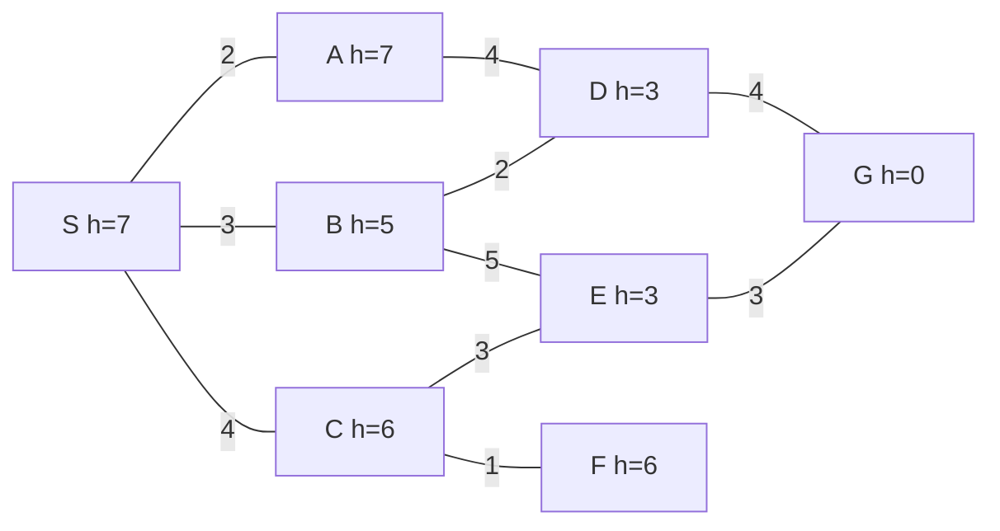
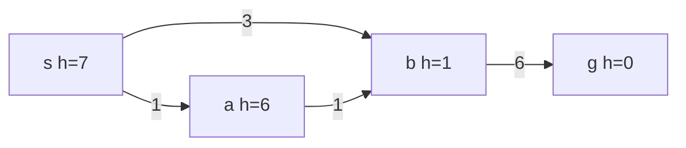

Many intelligent tasks can be reduced to "finding a path to a goal in a huge space of possibilities": a navigation system looks for the shortest route in a road network, a sliding puzzle needs a sequence of moves that turns a scrambled arrangement into an ordered one, and an input method must find the most fluent sentence among the combinations of thousands of homophones. [4.1.14](/4.1.14) has already shown how to model such problems as a **state space** and solve them with **depth-first search** and **breadth-first search**; [4.3.10](/4.3.10) and [4.3.11](/4.3.11) covered graph traversal and the implementation and correctness of **Dijkstra's algorithm**. The question of this chapter is: when the state space is too large to check state by state, how can we use knowledge about the problem to search as little as possible and still guarantee an optimal solution? The core is the A* algorithm and its two properties: if the heuristic function never overestimates, an optimal solution is always found (admissibility); if the heuristic function satisfies the triangle inequality, each node needs to be expanded only once (consistency). The chapter ends with local search and dynamic programming; the latter, in sequence-decoding problems such as pinyin input, takes the form of the Viterbi algorithm, which reappears in the hidden Markov models of [4.6.8](/4.6.8). The next chapter, [4.5.3](/4.5.3), discusses search with an adversary.

## 2.1. Search Problems

### 2.1.1. Formulating a Problem

**Definition 2.1.1 (Search Problem)** A **search problem** consists of the following parts:

- a set of states $S$ and an initial state $s_0 \in S$;
- for each state $n$, the available actions and their results, that is, the set $\operatorname{succ}(n)$ of successor states of $n$;
- the cost $c(n, m) > 0$ of each transition ($m \in \operatorname{succ}(n)$), also called the step cost;
- a goal test: decide whether a state belongs to the set of goal states $T \subseteq S$.

A sequence of transitions from $s_0$ to some goal state is called a solution, and its cost is the sum of the step costs; a solution of minimum cost is called an optimal solution.

This is exactly the state space of [4.1.14](/4.1.14) with a cost added to each step. The state space is generally not given explicitly: the eight-puzzle has $9!/2 = 181440$ reachable states and the fifteen-puzzle about $10^{13}$, so a search can only start from the initial state and generate successors on demand. The part of the state graph generated step by step in this way is called the implicit graph, and the part actually visited by a search algorithm is called the search space; a good algorithm keeps the search space a small fraction of the whole state space.

Some typical problems:

| Problem | State | Actions | Cost |
|---|---|---|---|
| Route finding on a map | The intersection where we currently are | Follow a road segment to an adjacent intersection | Segment length |
| Eight-puzzle | An arrangement of 8 tiles and the blank on a $3 \times 3$ board | Swap the blank with the tile above, below, left, or right | 1 per move |
| Missionaries and cannibals ([4.1.14](/4.1.14)) | Numbers of missionaries and cannibals on the east bank and the position of the boat | 5 ways of loading the boat | 1 per crossing |
| Eight queens ([4.1.12](/4.1.12)) | Positions of the queens in the first $k$ rows | Place a queen in row $k+1$ | Only a feasible solution is needed |

A search algorithm is usually evaluated on four criteria:

- completeness: whether it is guaranteed to find a solution when one exists;
- optimality: whether the solution it finds is guaranteed to be optimal;
- time complexity: the number of nodes expanded (or generated);
- space complexity: the number of nodes stored at the same time.

Time and space are commonly expressed in terms of the branching factor $b$ (an upper bound on the number of successors of a state), the depth $d$ of the shallowest goal, and the maximum depth $m$ of the search tree.

### 2.1.2. General Graph Search

All search algorithms fit into one framework: maintain an OPEN list (nodes that have been generated and await expansion, also called the frontier) and a CLOSED list (nodes that have been expanded). In each round, take a node out of the OPEN list; if it is a goal, stop; otherwise expand it, that is, generate all its successors and put them into the OPEN list. For every node we record a pointer to its parent, so that after a goal is found we can follow the pointers backward to obtain the solution path.

**Algorithm 2.1.1 (Graph Search)**

1. $\mathrm{OPEN} = \{s_0\}$, $\mathrm{CLOSED} = \varnothing$, $g(s_0) = 0$.
2. If OPEN is empty, return failure.
3. Remove a node $n$ from OPEN according to some rule and put it into CLOSED.
4. If $n$ is a goal state, return the solution path by following the parent pointers.
5. For each successor $m$ of $n$, let $g' = g(n) + c(n, m)$. If $m$ is a new node, or $g'$ is smaller than the existing $g(m)$, set $g(m) = g'$, point the parent pointer of $m$ to $n$, and put $m$ into OPEN (if $m$ is in CLOSED, move it back to OPEN, which is called reopening). Go to step 2.

Here $g(n)$ is the smallest cost found so far from $s_0$ to $n$. The various search algorithms differ only in step 3, "which node to remove":

| Algorithm | Removes each time |
|---|---|
| Depth-first search | The node that entered OPEN last (a stack) |
| Breadth-first search | The node that entered OPEN first (a queue) |
| Uniform-cost search (Dijkstra's algorithm) | The node with the smallest $g(n)$ |
| Greedy best-first search | The node with the smallest $h(n)$ |
| Algorithm A, A* algorithm | The node with the smallest $f(n) = g(n) + h(n)$ |

This is the same idea as the **priority-first search** of [4.3.11](/4.3.11): traversals differ only in their priorities. The first three use only the definition of the problem and are called uninformed search (Definition 2.2.1); the last two also use an estimate $h(n)$ of "how far we still are from the goal" and are called *heuristic search*.

## 2.2. Uninformed Search

### 2.2.1. Depth-First, Breadth-First, and Iterative Deepening

**Definition 2.2.1 (Uninformed Search)** A search that uses only the information given in the problem definition (successors, costs, and the goal test), and uses no estimate of the location of the goal to decide the order of expansion, is called **uninformed search**.

The modeling and implementation of **depth-first search** and **breadth-first search** are in [4.1.14](/4.1.14), and their properties as graph traversals are in [4.3.10](/4.3.10). Viewed as search algorithms for search problems, their properties are as follows:

| | Depth-first | Breadth-first |
|---|---|---|
| Completeness | Complete if the state space is finite and visited states are recorded; with infinite depth it may get stuck on an infinite branch | Complete if the branching factor is finite |
| Optimality | Not guaranteed | Optimal if all step costs are equal |
| Time | $O(b^m)$ | $O(b^d)$ |
| Space | $O(bm)$ (stores only the current path and its siblings) | $O(b^d)$ (stores an entire level) |

The bottleneck of breadth-first search is memory: with $b = 10$ and $d = 10$, a single level has $10^{10}$ nodes. Depth-first search saves memory but may wander for a long time in a very deep, useless branch. The two can be combined:

**Definition 2.2.2 (Iterative Deepening Search)** Running depth-limited depth-first search with depth limit $\ell = 0, 1, 2, \dots$ in turn (nodes deeper than $\ell$ are not expanded) until a solution is found is called **iterative deepening search**.

Like breadth-first search, iterative deepening search finds the shallowest solution when all step costs are equal, yet it needs only $O(bd)$ space. The cost of repeatedly searching the shallow levels is small: a node at depth $k$ is generated $d - k + 1$ times, for a total of $\sum_{k=1}^{d}(d-k+1)b^k = O(b^d)$; with $b = 10$ this is only about 11% more than breadth-first search.

### 2.2.2. Uniform-Cost Search

When step costs differ, breadth-first search expands level by level by "number of steps" rather than by "cost," so the solution it finds need not be optimal. Changing "expand the node with fewer steps first" into "expand the node with smaller cost $g(n)$ first" gives

**Definition 2.2.3 (Uniform-Cost Search)** A graph search that always removes from OPEN the node with the smallest $g(n)$ for expansion is called **uniform-cost search**.

It is exactly **Dijkstra's algorithm** run on an implicit graph: the whole graph is not given in advance, and the search stops as soon as a goal is removed. By Theorem 11.4.2 of [4.3.11](/4.3.11), when costs are nonnegative, the $g$ value of each node is already its shortest distance when it is removed, so uniform-cost search is optimal; if each step costs at least $\varepsilon > 0$ and the branching factor is finite, it is also complete.

The weakness of uniform-cost search is that it looks only at "how far we have come" and not at "how far we still have to go": it expands uniformly in all directions around the start, even when the goal is clearly in one particular direction. The small road network below illustrates this (the numbers on the edges are segment lengths; the number beside each node is an estimate of the straight-line distance to $G$, used in the next section):



The shortest path from $S$ to $G$ is $S \to B \to D \to G$, of length 9. Uniform-cost search expands $S(0), A(2), B(3), C(4), D(5), F(5), E(7)$ in turn and finally removes $G(9)$, where the number in parentheses is the $g$ value at removal: apart from the goal, all 7 nodes are expanded, including $F$, which lies in exactly the opposite direction.

## 2.3. Heuristic Search

### 2.3.1. Heuristic Functions and Algorithm A

To reduce the search, we use knowledge about the problem to estimate how far each node is from the goal. Write

- $g^*(n)$: the cost of an optimal path from $s_0$ to $n$;
- $h^*(n)$: the cost of an optimal path from $n$ to the (nearest) goal, which is $+\infty$ if there is no path;
- $f^*(n) = g^*(n) + h^*(n)$: the cost of an optimal path from $s_0$ through $n$ to a goal. In particular, $f^*(s_0) = h^*(s_0) = C^*$ is the cost of an optimal solution.

During a search only estimates of these are available: $g(n)$ is the smallest cost found so far from $s_0$ to $n$, and always satisfies $g(n) \ge g^*(n)$; $h(n)$ is supplied by knowledge about the problem.

**Definition 2.3.1 (Heuristic Function)** A nonnegative function $h(n)$ that estimates the cost $h^*(n)$ of an optimal path from node $n$ to a goal is called a **heuristic function**; it is required that $h(t) = 0$ for every goal state $t$.

**Definition 2.3.2 (Algorithm A)** A graph search (Algorithm 2.1.1) that uses

$$
f(n) = g(n) + h(n)
$$
as its evaluation function and each time removes from OPEN the node with the smallest $f(n)$ for expansion is called **algorithm A**, where $h$ is a heuristic function.

$f(n)$ estimates "the cost of an optimal solution through $n$." When $h \equiv 0$, algorithm A is uniform-cost search; using only $h$ ($f = h$) gives greedy best-first search, which is often fast but not guaranteed to be optimal.

In step 5 of Algorithm 2.1.1, a successor $m$ falls into one of three cases, often denoted $m_j$, $m_k$, $m_l$:

- $m_j$: a new node; compute $f$ and put it into OPEN;
- $m_k$: already in OPEN; if the path through $n$ is shorter, update its $g$, $f$, and parent pointer;
- $m_l$: already in CLOSED; if the path through $n$ is shorter, update it and put it back into OPEN.

The third case means that the same node may be expanded several times; §2.3.4 discusses how to avoid this. The implementation below uses a binary heap ([4.3.12](/4.3.12)) as the OPEN list. When an $f$ value is updated, it does not look up the old entry in the heap but simply pushes a new entry and discards stale entries when they are popped (lazy deletion, as in the implementation in [4.3.11](/4.3.11)); when $f$ values are equal, the node with larger $g$, that is, the one closer to the goal, is taken first.

```python
import heapq

def best_first(graph, h, start, goal):
    """A (or A*) graph search that reopens closed nodes; h = 0 gives Dijkstra."""
    g = {start: 0}
    parent = {start: None}
    frontier = [(h[start], 0, start)]
    closed = set()
    order = []
    while frontier:
        f, _, n = heapq.heappop(frontier)
        if f > g[n] + h[n]:              # stale entry: n was improved later
            continue
        order.append(f"{n}({f})")
        if n == goal:
            path = []
            while n is not None:
                path.append(n)
                n = parent[n]
            return path[::-1], g[goal], order
        closed.add(n)
        for m, c in graph[n].items():
            if g[n] + c < g.get(m, float("inf")):
                g[m] = g[n] + c          # new node, or a shorter path to an old one
                parent[m] = n
                closed.discard(m)        # a closed node is reopened
                heapq.heappush(frontier, (g[m] + h[m], -g[m], m))  # ties: deeper first
    return None, float("inf"), order

def undirected(edges):
    graph = {}
    for u, v, c in edges:
        graph.setdefault(u, {})[v] = c
        graph.setdefault(v, {})[u] = c
    return graph

roads = undirected([("S", "A", 2), ("S", "B", 3), ("S", "C", 4), ("A", "D", 4),
                    ("B", "D", 2), ("B", "E", 5), ("C", "E", 3), ("C", "F", 1),
                    ("D", "G", 4), ("E", "G", 3)])
h = {"S": 7, "A": 7, "B": 5, "C": 6, "D": 3, "E": 3, "F": 6, "G": 0}
zero = dict.fromkeys(h, 0)
for name, heur in [("Dijkstra", zero), ("A*", h)]:
    print(name, *best_first(roads, heur, "S", "G"))
```

```text
Dijkstra ['S', 'B', 'D', 'G'] 9 ['S(0)', 'A(2)', 'B(3)', 'C(4)', 'D(5)', 'F(5)', 'E(7)', 'G(9)']
A* ['S', 'B', 'D', 'G'] 9 ['S(7)', 'B(8)', 'D(8)', 'G(9)']
```

With the heuristic function, only the 3 nodes on the optimal path are expanded; the number in parentheses is the $f$ value at removal.

### 2.3.2. The A* Algorithm and Admissibility

Algorithm A does not always find an optimal solution: if $h$ badly overestimates the cost of some node on an optimal path, that node is pushed to the bottom of the OPEN list, and the algorithm may reach the goal along a worse path first. Never overestimating is the condition that guarantees optimality.

**Definition 2.3.3 (Admissibility)** If $h(n) \le h^*(n)$ for all nodes $n$, the heuristic function $h$ is called **admissible**. Algorithm A with an admissible heuristic function is called the **A\* algorithm**.

$h \equiv 0$ is admissible, so uniform-cost search is a special case of A\*. The straight-line distance on a map and the two eight-puzzle heuristics of §2.3.5 are all admissible. A search algorithm is called admissible if, whenever the problem has a solution, it terminates and finds an optimal solution; the theorem below shows that the A\* algorithm is admissible. The key to the proof is a lemma: before A\* terminates, the OPEN list always contains a node that lies on an optimal path and whose $g$ value is already correct.

**Lemma 2.3.1** Let $n$ be any node not yet closed (not in CLOSED), and let $P = (s_0 = n_0, n_1, \dots, n_k = n)$ be an optimal path from $s_0$ to $n$. Then at any moment of the run of algorithm A, OPEN contains a node $n'$ on $P$ with $g(n') = g^*(n')$.

**Proof** If $s_0$ is in OPEN, take $n' = s_0$, since $g(s_0) = 0 = g^*(s_0)$. Otherwise $s_0$ has been closed. Let $n_i$ be the node on $P$ with the largest index among those that are "closed and have $g(n_i) = g^*(n_i)$"; it exists ($s_0$ qualifies), and $n_i \ne n$ (since $n$ is not closed). When $n_i$ was expanded with $g(n_i) = g^*(n_i)$, its successor $n_{i+1}$ received

$$
g(n_{i+1}) \le g^*(n_i) + c(n_i, n_{i+1}) = g^*(n_{i+1}),
$$
where the last equality holds because a prefix of an optimal path is also an optimal path. Since always $g \ge g^*$, we get $g(n_{i+1}) = g^*(n_{i+1})$, and it will never change afterward. By the choice of $n_i$, $n_{i+1}$ cannot be a closed node, so it is in OPEN. Take $n' = n_{i+1}$. $\square$

**Corollary 2.3.1** If $h$ is admissible and the problem has a solution, then at any moment before A\* terminates, OPEN contains a node $n'$ with $f(n') \le C^*$.

**Proof** Apply Lemma 2.3.1 to an optimal solution path (the goal $t$ is not closed before the algorithm terminates) to obtain $n'$ in OPEN with $g(n') = g^*(n')$. By admissibility, $f(n') = g^*(n') + h(n') \le g^*(n') + h^*(n') = f^*(n') = C^*$, where the last equality holds because $n'$ lies on an optimal solution path. $\square$

**Theorem 2.3.1 (Admissibility Theorem)** Suppose every node has finitely many successors, every step costs at least some constant $\varepsilon > 0$, and $h$ is admissible. If there is a path from $s_0$ to a goal, then the A\* algorithm terminates, and the solution it finds upon termination is optimal.

**Proof** First, A\* does not terminate with failure: by Corollary 2.3.1, OPEN is never empty before termination.

Next, A\* terminates. By Corollary 2.3.1, every node $n$ removed for expansion satisfies $f(n) \le C^*$, hence $g(n) \le C^*$. Each step costs at least $\varepsilon$, so the path from $s_0$ to an expanded node along its current parent pointers has at most $C^* / \varepsilon$ steps. With a finite branching factor, there are only finitely many paths from $s_0$ of length at most $C^*/\varepsilon$, so only finitely many nodes can be expanded; each reopening of a node corresponds to a shorter path, so a node can also be reopened only finitely many times. Hence A\* terminates in finitely many steps.

Finally, optimality. Suppose A\* terminates upon removing the goal $t$ and $g(t) > C^*$. Before $t$ is removed, by Corollary 2.3.1, OPEN contains $n'$ with $f(n') \le C^* < g(t) = f(t)$, so A\* should have removed $n'$ rather than $t$, a contradiction. Hence $g(t) = C^*$. $\square$

**Example 2.3.1** If $h$ is not admissible, algorithm A may lose optimality. In the road network of §2.2.2, change $h(B)$ to $9$ ($h^*(B) = 6$) and keep everything else. After expanding $S$ we have $f(A) = 9$, $f(B) = 12$, $f(C) = 10$. Algorithm A first expands $A$ to get $D$ ($g = 6$, $f = 9$), then expands $D$ to get $G$ ($g = 10$, $f = 10$); among $C$ and $G$, both with $f = 10$, it removes $G$, which has the larger $g$, and terminates, returning the path $S \to A \to D \to G$ of length 10, whereas the optimal solution has length 9.

There are many admissible heuristic functions; the larger the estimate (the closer to $h^*$), the more focused the search.

**Theorem 2.3.2** Let $A_1$ and $A_2$ be two A\* algorithms for the same problem with heuristic functions $h_1$ and $h_2$. If $h_2(n) > h_1(n)$ for all non-goal nodes, then whenever the problem has a solution, every node expanded by $A_2$ is also expanded by $A_1$, so $A_1$ expands at least as many nodes as $A_2$.

Here "the number of nodes expanded" counts multiple expansions of the same node once. The general proof of this theorem is by induction on the depth of the search tree and is rather tedious; under the consistency condition of the next section there is a short proof (Theorem 2.3.5). The strict inequality in the hypothesis is necessary: whether a node with $f(n) = C^*$ is expanded depends on the order among nodes with the same $f$ value in OPEN, and if we assume only $h_2 \ge h_1$, the two algorithms may choose differently on these nodes, so the conclusion no longer holds; after excluding nodes with $f(n) = C^*$, the equality can be allowed.

### 2.3.3. Consistency

A\* is allowed to reopen closed nodes, so the same node may be expanded several times. In the example below, the number beside each node is its $h$ value, and $h$ is admissible ($h^*(s) = 8$, $h^*(a) = 7$, $h^*(b) = 6$):



A\* first expands $s$; the $f$ value of $b$ is $3 + 1 = 4$, smaller than the $f$ value $1 + 6 = 7$ of $a$, so $b$ is expanded with $g(b) = 3$, producing $g$ ($f = 9$). Then $a$ is expanded, and the path to $b$ through $a$ is found to be shorter ($g(b) = 2$), so the closed node $b$ is reopened and expanded a second time, and finally $g$ is removed with cost 8. The nodes are removed in the order $s(7), b(4), a(7), b(3), g(8)$, and $b$ is expanded twice. In the worst case, such repeated expansion can make the number of A\* expansions exponential in the number of nodes (Martelli, 1977).

The problem is that $h(a) = 6$ while $h(b) = 1$: moving one step from $a$ to $b$ at cost 1 makes the estimate drop by 5, which is inconsistent with the meaning of "$h$ estimates the remaining cost." A reasonable estimate should satisfy the triangle inequality.

**Definition 2.3.4 (Consistency)** If for every node $n$ and each of its successors $m$,

$$
h(n) \le c(n, m) + h(m),
$$
and $h(t) = 0$ for every goal $t$, the heuristic function $h$ is called **consistent**, also called **monotone**.

Consistency is a local condition that need only be checked for each edge, so it is easier to verify than admissibility; and it is stronger.

**Theorem 2.3.3** A consistent heuristic function is admissible.

**Proof** If $n$ cannot reach a goal, $h^*(n) = +\infty$ and the claim is obvious. Otherwise take an optimal path $n = n_0, n_1, \dots, n_k = t$ from $n$ to a goal $t$ and apply the consistency condition repeatedly:

$$
h(n_0) \le c(n_0, n_1) + h(n_1) \le \cdots \le \sum_{i=0}^{k-1} c(n_i, n_{i+1}) + h(t) = h^*(n). \qquad \square
$$

The converse does not hold: the example above is admissible but not consistent. The benefit of consistency lies in the following theorem.

**Theorem 2.3.4** If $h$ is consistent, then whenever A\* chooses a node $n$ for expansion, $g(n) = g^*(n)$; moreover, the $f$ values of expanded nodes are nondecreasing in the order of expansion.

**Proof** Suppose A\* chooses $n$ for expansion while $g(n) > g^*(n)$. At this moment $n$ is not closed, so by Lemma 2.3.1 OPEN contains a node $n'$ on an optimal path from $s_0$ to $n$ with $g(n') = g^*(n')$. The cost along this optimal path from $n'$ to $n$ is $g^*(n) - g^*(n')$; applying the consistency condition repeatedly along this segment (as in the proof of Theorem 2.3.3) gives $h(n') \le g^*(n) - g^*(n') + h(n)$. Hence

$$
f(n') = g^*(n') + h(n') \le g^*(n) + h(n) < g(n) + h(n) = f(n),
$$
and A\* should have chosen $n'$ rather than $n$, a contradiction.

Now monotonicity. Suppose that after $n$ is expanded, the next node expanded is $m$. If $m$ is a successor just generated or updated by expanding $n$, then $f(m) = g(n) + c(n, m) + h(m) \ge g(n) + h(n) = f(n)$; otherwise $m$ was already in OPEN before $n$ was expanded, and $n$ was chosen over it, so $f(m) \ge f(n)$. $\square$

By Theorem 2.3.4, when a node is expanded for the first time, the shortest path to it has already been found, and it will never be reopened; each node is expanded at most once, and nodes in CLOSED can simply be skipped. From another angle, define the reduced cost

$$
c_h(n, m) = c(n, m) - h(n) + h(m);
$$
consistency says exactly that $c_h \ge 0$; the reduced cost of a path from $s_0$ to $n$ equals $g - h(s_0) + h(n)$, which differs from $f$ only by the constant $h(s_0)$. So A\* with a consistent heuristic function is exactly **Dijkstra's algorithm** run with the reduced costs, and its correctness follows directly from Theorem 11.4.2 of [4.3.11](/4.3.11).

With consistency we can characterize exactly which nodes A\* expands.

**Theorem 2.3.5** Let $h$ be consistent, let the problem have a solution, and let the optimal cost be $C^*$. Then A\* expands every node with $g^*(n) + h(n) < C^*$ and expands no node with $g^*(n) + h(n) > C^*$.

**Proof** By Theorem 2.3.4, when a node $n$ is expanded, $f(n) = g^*(n) + h(n)$; by Corollary 2.3.1 and the proof of Theorem 2.3.1, every expanded node has $f(n) \le C^*$, so nodes with $g^*(n) + h(n) > C^*$ are not expanded.

Suppose $g^*(n) + h(n) < C^*$ and $n$ is still unexpanded when A\* terminates (removing the goal $t$, $f(t) = C^*$). By Lemma 2.3.1, OPEN then contains a node $n'$ on an optimal path from $s_0$ to $n$ with $g(n') = g^*(n')$; as in the proof of Theorem 2.3.4, $f(n') \le g^*(n) + h(n) < C^* = f(t)$, so A\* should have removed $n'$ first, a contradiction. $\square$

**Corollary 2.3.2** Let $h_1$ and $h_2$ both be consistent, with $h_1(n) \le h_2(n)$ for all $n$. Then every node with $g^*(n) + h_2(n) < C^*$ (a node $A_2$ must expand) also satisfies $g^*(n) + h_1(n) < C^*$ and is expanded by $A_1$ as well.

This is Theorem 2.3.2 under the consistency condition: the larger the estimate, the smaller the set of nodes that A\* must expand. Nodes with $f(n) = C^*$ differ only in how ties among equal $f$ values are broken, which is exactly why Theorem 2.3.2 requires the strict inequality.

**Remark 2.3.1** Dechter and Pearl (1985) proved a stronger result: among all algorithms that use the same consistent heuristic function and are guaranteed to find an optimal solution, A\* is optimally efficient; that is, any such algorithm must expand all nodes with $g^*(n) + h(n) < C^*$ (otherwise it cannot rule out a better solution through that node). So the only way to make A\* faster is to design better heuristic functions.

### 2.3.4. Improvements for Inconsistent Heuristics

When the heuristic function is inconsistent, the algorithm itself can also be improved to reduce repeated expansion. Martelli's (1977) modified algorithm (often called modified A\*, or algorithm B) records $f_m$, the maximum $f$ value among the nodes expanded so far. By Corollary 2.3.1 every expanded node has $f \le C^*$, so $f_m \le C^*$, and nodes in OPEN with $f < f_m$ will certainly be expanded; their relative order does not affect admissibility. Thus in each round:

1. if OPEN contains nodes with $f(n) < f_m$, expand the one with the smallest $g$ among them (a node with small $g$ is more likely to have its shortest path already found, so expanding it first reduces later reopening);
2. otherwise expand the node with the smallest $f$ and set $f_m = f(n)$.

It remains admissible, and the worst-case number of expansions drops from exponential to quadratic in the number of nodes. In practice the more common remedy is to construct consistent heuristic functions directly: the heuristic functions of the next section are all consistent.

### 2.3.5. Designing Heuristic Functions

A good heuristic function should be admissible (preferably consistent), as large as possible, and cheap to compute. The most common construction is relaxation: remove some constraints of the original problem to obtain an easier problem, and use the optimal cost of the relaxed problem as the heuristic function of the original problem. The solutions of the relaxed problem include those of the original problem, so its optimal cost does not exceed that of the original problem and the heuristic function is naturally admissible; and since it is the exact cost of some problem, it satisfies the triangle inequality and is therefore also consistent.

**Example 2.3.2 (Eight-Puzzle)** The goal state has 1 2 3 in the first row, 8 □ 4 in the second row, and 7 6 5 in the third row (□ is the blank).

- $h_1(n)$ = the number of tiles not in their goal positions. It corresponds to the relaxed problem "a tile can move to any position in one step."
- $h_2(n)$ = the sum of the horizontal and vertical distances of each tile from its goal position (the sum of Manhattan distances). It corresponds to the relaxed problem "a tile can move to an adjacent square whether or not it is occupied."

Each move changes the position of just one tile, so $h_1$ and $h_2$ change by at most 1, and both are consistent. For every state, $h_1(n) \le h_2(n)$ (a misplaced tile needs at least 1 move), so by Corollary 2.3.2, $h_2$ is better.

**Example 2.3.3 (Missionaries and Cannibals)** In the notation of [4.1.14](/4.1.14), let $n$ be the total number of people on the east bank (missionaries plus cannibals), with $b = 0$ when the boat is on the east bank. Keep only the constraint that the boat carries at most 2 and needs at least 1 rower: a trip from east to west takes away at most 2, and a trip back brings at least 1, so each round trip reduces the east bank by at most 1 net, and only the last trip reduces it by 2. Hence with the boat on the east bank and $n \ge 2$, at least $2n - 3$ more crossings are needed; with the boat on the west bank and $n \ge 1$, the boat must first come back, so at least $2n$ more crossings are needed. The initial state has $h = 9$, while the true minimum is 11. Checking all 16 reachable states by program shows that this $h$ is admissible and consistent. The cruder $h(n) = n - 2(1 - b)$ is also admissible but far less informative.

The effect of a heuristic function can be measured by the effective branching factor.

**Definition 2.3.5 (Effective Branching Factor)** Suppose A\* finds a solution at depth $d$ after expanding $N$ nodes. The $b^*$ that satisfies

$$
N + 1 = 1 + b^* + (b^*)^2 + \cdots + (b^*)^d
$$
is called the **effective branching factor**, that is, the branching factor a uniform tree of depth $d$ would need in order to contain $N$ expanded nodes.

The closer $b^*$ is to 1, the better the heuristic function. Experiments show that $b^*$ is quite stable for the same problem and the same heuristic function and hardly varies with problem size. Below we solve the eight-puzzle with A\* using $h_1$ and $h_2$; the implementation is the same as in §2.3.1, and the eight-puzzle only needs to supply the successors of a state.

```cpp tab
#include <array>
#include <cstdlib>
#include <functional>
#include <iostream>
#include <map>
#include <queue>
#include <tuple>
#include <vector>

using Board = std::array<int, 9>;            // row-major, 0 is the blank
const Board kGoal{1, 2, 3, 8, 0, 4, 7, 6, 5};

int misplaced(const Board& s) {              // h1: tiles not in place
    int n = 0;
    for (int i = 0; i < 9; ++i) n += (s[i] != 0 && s[i] != kGoal[i]);
    return n;
}

int manhattan(const Board& s) {              // h2: sum of tile distances
    static std::array<int, 9> where = [] {
        std::array<int, 9> w{};
        for (int i = 0; i < 9; ++i) w[kGoal[i]] = i;
        return w;
    }();
    int n = 0;
    for (int i = 0; i < 9; ++i)
        if (s[i] != 0) n += std::abs(i / 3 - where[s[i]] / 3) + std::abs(i % 3 - where[s[i]] % 3);
    return n;
}

std::vector<Board> neighbors(const Board& s) {
    std::vector<Board> out;
    int z = 0;
    while (s[z] != 0) ++z;
    int r = z / 3, c = z % 3;
    constexpr int dr[] = {-1, 1, 0, 0}, dc[] = {0, 0, -1, 1};
    for (int k = 0; k < 4; ++k) {
        int nr = r + dr[k], nc = c + dc[k];
        if (nr < 0 || nr > 2 || nc < 0 || nc > 2) continue;
        Board t = s;
        std::swap(t[z], t[3 * nr + nc]);
        out.push_back(t);
    }
    return out;
}

// Returns {number of moves, number of nodes expanded}.
std::pair<int, int> astar(const Board& start, const std::function<int(const Board&)>& h) {
    using Entry = std::tuple<int, int, Board>;   // f, -g (deeper first on ties), state
    std::priority_queue<Entry, std::vector<Entry>, std::greater<>> frontier;
    std::map<Board, int> g{{start, 0}};
    frontier.emplace(h(start), 0, start);
    int expanded = 0;
    while (!frontier.empty()) {
        auto [f, neg_g, s] = frontier.top();
        frontier.pop();
        if (f > g[s] + h(s)) continue;           // stale entry
        if (s == kGoal) return {g[s], expanded};
        ++expanded;
        for (const Board& t : neighbors(s)) {
            int gt = g[s] + 1;
            auto it = g.find(t);
            if (it != g.end() && it->second <= gt) continue;
            g[t] = gt;
            frontier.emplace(gt + h(t), -gt, t);
        }
    }
    return {-1, expanded};
}

int main() {
    const Board start{2, 1, 0, 5, 6, 3, 8, 4, 7};
    using Heuristic = int (*)(const Board&);
    const std::pair<const char*, Heuristic> heuristics[] = {{"misplaced", misplaced}, {"manhattan", manhattan}};
    for (auto [name, h] : heuristics) {
        auto [moves, expanded] = astar(start, h);
        std::cout << name << ": " << moves << " moves, " << expanded << " nodes expanded\n";
    }
}
```

```python tab
import heapq

GOAL = (1, 2, 3, 8, 0, 4, 7, 6, 5)           # 0 is the blank
POS = {t: divmod(i, 3) for i, t in enumerate(GOAL)}

def misplaced(s):                             # h1: tiles not in place
    return sum(1 for i, t in enumerate(s) if t and t != GOAL[i])

def manhattan(s):                             # h2: sum of tile distances
    total = 0
    for i, t in enumerate(s):
        if t:
            r, c = divmod(i, 3)
            gr, gc = POS[t]
            total += abs(r - gr) + abs(c - gc)
    return total

def neighbors(s):
    z = s.index(0)
    r, c = divmod(z, 3)
    for dr, dc in ((-1, 0), (1, 0), (0, -1), (0, 1)):
        nr, nc = r + dr, c + dc
        if 0 <= nr < 3 and 0 <= nc < 3:
            t = list(s)
            t[z], t[3 * nr + nc] = t[3 * nr + nc], 0
            yield tuple(t)

def astar(start, h):
    g = {start: 0}
    parent = {start: None}
    frontier = [(h(start), 0, start)]
    expanded = 0
    while frontier:
        f, _, s = heapq.heappop(frontier)
        if f > g[s] + h(s):                   # stale entry
            continue
        if s == GOAL:
            path = []
            while s is not None:
                path.append(s)
                s = parent[s]
            return path[::-1], expanded
        expanded += 1
        for t in neighbors(s):
            if g[s] + 1 < g.get(t, float("inf")):
                g[t] = g[s] + 1
                parent[t] = s
                heapq.heappush(frontier, (g[t] + h(t), -g[t], t))
    return None, expanded

start = (2, 1, 0, 5, 6, 3, 8, 4, 7)
for name, h in [("misplaced", misplaced), ("manhattan", manhattan)]:
    path, expanded = astar(start, h)
    print(f"{name:9s}: {len(path) - 1} moves, {expanded} nodes expanded")
```

```text
misplaced: 20 moves, 2170 nodes expanded
manhattan: 20 moves, 275 nodes expanded
```

For each depth $d$, we sample 100 states at random from those whose optimal solution length is exactly $d$ (found by breadth-first search from the goal); the average numbers of expanded nodes and the corresponding effective branching factors are:

| $d$ | $N$ ($h_1$) | $b^*$ ($h_1$) | $N$ ($h_2$) | $b^*$ ($h_2$) |
|---|---|---|---|---|
| 8 | 13.2 | 1.11 | 8.7 | 1.02 |
| 12 | 68.8 | 1.25 | 24.2 | 1.10 |
| 16 | 392.8 | 1.33 | 68.6 | 1.16 |
| 20 | 2252.9 | 1.38 | 229.5 | 1.20 |
| 24 | 12475.6 | 1.41 | 763.6 | 1.23 |

For comparison, the average branching factor of the eight-puzzle is about 2.67 (the blank has 2 successors in a corner, 3 on an edge, and 4 at the center). Breadth-first search without heuristic information expands over a hundred thousand nodes at $d = 24$, nearly all of the 181440 reachable states. At $d = 24$, $h_2$ expands about 94% fewer nodes than $h_1$.

Several further methods:

- If there are several admissible heuristic functions $h_1, \dots, h_k$ none of which dominates the others, take $h = \max_i h_i$: it is still admissible (and consistency is preserved), and is better than each of them.
- Pattern databases: for a subproblem (for example, considering only the positions of tiles 1–4), precompute the exact costs by backward search from the goal and store them in a table; look them up as the heuristic function. This is the main method for finding optimal solutions of the fifteen-puzzle and Rubik's cube.
- Learning heuristic functions from data: train a regression model on solved instances to predict $h^*$. The learned function is generally not guaranteed to be admissible, so the guarantee of optimality is given up in exchange for speed; the value network of AlphaGo ([4.5.3](/4.5.3)) is an application of the same idea to games.
- Relaxing optimality: weighted A\* uses $f = g + w h$ ($w > 1$); the cost of the solution it finds is at most $w C^*$, and it usually expands far fewer nodes.

## 2.4. Other Search Methods

### 2.4.1. Local Search

In problems such as eight queens, course scheduling, and circuit layout, what matters is the final state rather than the path to it. Then we can keep only one current state and repeatedly move to a better neighbor, without recording the search tree.

**Definition 2.4.1 (Hill Climbing)** Given an objective function (larger is better), each time choose the neighbor of the current state with the largest objective value; if it is better than the current state, move to it, otherwise stop. This method is called **hill climbing**.

Hill climbing needs only $O(1)$ memory, but it gets stuck at local optima, plateaus, and ridges. Common remedies are random restarts (climb several times from different random initial states); stochastic hill climbing (choose at random among the improving neighbors); and simulated annealing: accept a worsening move with some probability, namely $\mathrm{e}^{-\Delta/T}$ for a worsening of $\Delta$, where the "temperature" $T$ is gradually lowered over time. If $T$ decreases slowly enough, simulated annealing finds a global optimum with probability tending to 1, but the time required is generally unacceptable, and in practice the cooling is much faster. Genetic algorithms maintain a population of states and produce the next generation through selection, crossover, and mutation.

### 2.4.2. Dynamic Programming and the Viterbi Algorithm

If $h \equiv 0$ at every node, A\* degenerates into uniform-cost search, which fixes the optimal value of each node in increasing order of cost; this is exactly the idea of **dynamic programming** ([4.1.13](/4.1.13)). When the state graph is divided into layers and edges go only from one layer to the next, no priority queue is needed, and computing layer by layer suffices.

Suppose layer $i$ has nodes $W_{i,1}, W_{i,2}, \dots$, $D(W_{i-1,k}, W_{i,j})$ is the cost of an edge, and $Q(W_{i,j})$ is the cost of an optimal path from the start to $W_{i,j}$. Then

$$
Q(W_{i,j}) = \begin{cases} 0, & i = 0, \\ \min_k \bigl(Q(W_{i-1,k}) + D(W_{i-1,k}, W_{i,j})\bigr), & i > 0. \end{cases}
$$
Each node also records the predecessor $k$ attaining the minimum, and the optimal path is recovered by tracing back from the end. If each layer has at most $m$ nodes and there are $L$ layers, the computation is $O(Lm^2)$, whereas there are $m^L$ paths in all. This dynamic programming for finding an optimal path in a layered graph is called the Viterbi algorithm in sequence decoding.

**Example 2.4.1 (Pinyin Input Method)** The user types a string of pinyin $O = o_1 o_2 \cdots o_n$, and we want to find the most probable string of Chinese characters $S = w_1 w_2 \cdots w_n$. Mandarin has about 400 syllables (ignoring tones) and about 4000 commonly used characters, so on average each syllable corresponds to 10 characters, and a pinyin string of 11 syllables has about $10^{11}$ candidate sentences, which cannot be compared one by one. By Bayes' formula,

$$
\mathbb{P}(S \mid O) = \frac{\mathbb{P}(S)\,\mathbb{P}(O \mid S)}{\mathbb{P}(O)},
$$
$\mathbb{P}(O)$ does not depend on $S$; for pinyin input, once the character string is given the pinyin is almost determined, so we may take $\mathbb{P}(O \mid S) \approx 1$. Then we only need to maximize the sentence probability $\mathbb{P}(S)$, which is given by a language model. Using the bigram approximation

$$
\mathbb{P}(S) = \prod_{i=1}^{n} \mathbb{P}(w_i \mid w_1 \cdots w_{i-1}) \approx \prod_{i=1}^{n} \mathbb{P}(w_i \mid w_{i-1}),
$$
and taking negative logarithms, maximizing $\mathbb{P}(S)$ is the same as minimizing $\sum_i -\log \mathbb{P}(w_i \mid w_{i-1})$. Take the candidate characters of the $i$-th syllable as the nodes of layer $i$ and $-\log \mathbb{P}(w_i \mid w_{i-1})$ as the edge costs, and the problem is a shortest path in a layered graph. The **conditional probability** is estimated from counts in a corpus, $\mathbb{P}(w_i \mid w_{i-1}) = \operatorname{count}(w_{i-1} w_i) / \operatorname{count}(w_{i-1})$; character pairs that never co-occur in the corpus receive probability 0, so smoothing is needed, the simplest being interpolation with the unigram probability:

$$
\mathbb{P}_\lambda(w_i \mid w_{i-1}) = \lambda\,\mathbb{P}(w_i \mid w_{i-1}) + (1 - \lambda)\,\mathbb{P}(w_i), \qquad 0 < \lambda < 1.
$$

The program below demonstrates the same computation with English homophones in place of Chinese characters: each "sound" has several candidate words, and a smoothed bigram model is built from the counts of a toy corpus.

```python
import math

# Candidate words for each sound (a toy stand-in for the characters of a pinyin syllable).
lattice = [["I", "eye"], ["write", "right", "rite"], ["to", "two", "too"], ["you", "ewe"]]

# Toy corpus statistics: unigram and bigram counts.
unigram = {"<s>": 100, "I": 30, "eye": 5, "write": 6, "right": 10, "rite": 1,
           "to": 40, "two": 8, "too": 6, "you": 30, "ewe": 1}
bigram = {("<s>", "I"): 20, ("<s>", "eye"): 1, ("I", "write"): 3, ("I", "right"): 1,
          ("eye", "right"): 1, ("write", "to"): 4, ("right", "to"): 3, ("right", "two"): 1,
          ("to", "you"): 12, ("two", "you"): 1, ("too", "you"): 1}
total = sum(unigram.values())

def cost(prev: str, w: str, lam: float = 0.9) -> float:
    """-log of the smoothed bigram probability P(w | prev)."""
    p_bi = bigram.get((prev, w), 0) / unigram[prev]
    p_uni = unigram[w] / total
    return -math.log(lam * p_bi + (1 - lam) * p_uni)

def viterbi(lattice):
    best = {"<s>": (0.0, ["<s>"])}             # word -> (cost of best path, path)
    for column in lattice:
        best = {w: min((c + cost(prev, w), path + [w]) for prev, (c, path) in best.items())
                for w in column}
    c, path = min(best.values())
    return path[1:], c

words, c = viterbi(lattice)
print(" ".join(words), f"(cost {c:.3f})")
print("paths in the lattice:", math.prod(len(col) for col in lattice))
```

```text
I write to you (cost 5.774)
paths in the lattice: 36
```

The same framework is used for post-processing in character recognition: the recognizer gives each character position several candidate characters together with recognition confidences $\operatorname{CF}(w_i)$, which replace $\mathbb{P}(O \mid S)$, and we look for the sentence that maximizes $\prod_i \mathbb{P}(w_i \mid w_{i-1})\operatorname{CF}(w_i)$. Modeling "pinyin is generated from characters" as a probability distribution leads to the hidden Markov model, discussed in [4.6.8](/4.6.8); today's input methods and recognition systems use neural language models ([4.7](/4.7)) in place of bigrams, but decoding is still a search over the candidate lattice.

## Summary

| Algorithm | Expansion order | Complete | Optimal | Notes |
|---|---|---|---|---|
| Depth-first | The deepest node | With a finite space and duplicate checking | No | Space $O(bm)$ |
| Breadth-first | The shallowest node | Yes | With unit costs | Space $O(b^d)$ |
| Iterative deepening | Depth-first with increasing depth | Yes | With unit costs | Space $O(bd)$ |
| Uniform-cost (Dijkstra) | Smallest $g$ | Yes | Yes | A\* with $h \equiv 0$ |
| Algorithm A | Smallest $f = g + h$ | Yes | Not necessarily | |
| A\* algorithm | Smallest $f = g + h$, $h \le h^*$ | Yes | Yes | With consistent $h$, each node is expanded once |

- A search problem consists of states, successors, costs, and a goal test; all graph-search algorithms differ only in "which node to take from OPEN."
- Admissibility theorem: when $h \le h^*$, A\* always finds an optimal solution (Theorem 2.3.1). The key to the proof is that OPEN always contains a node on an optimal path with a correct $g$ value.
- Consistency $h(n) \le c(n, m) + h(m)$ implies admissibility; under consistency, $g = g^*$ when a node is first expanded, A\* is Dijkstra's algorithm under reduced costs, and it expands exactly all nodes with $g^* + h < C^*$, so the larger $h$ is, the better (Corollary 2.3.2).
- Heuristic functions come from relaxed problems; the effective branching factor measures their effect.
- Local search cares only about the final state; dynamic programming on a layered graph is the Viterbi algorithm, used in sequence decoding such as pinyin input.
