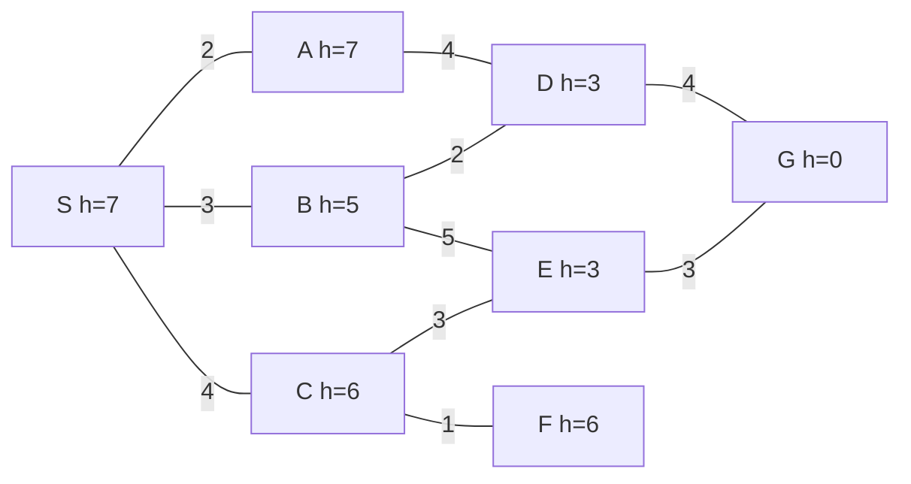
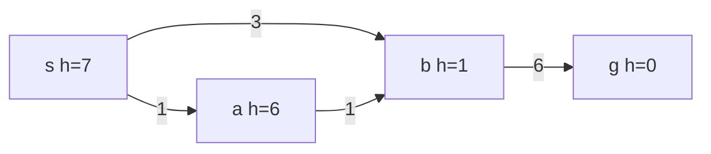

很多智能问题都可以归结为"在一个巨大的可能性空间中找一条通向目标的路"：导航系统在路网中找最短路线，拼图要找一串把乱序变为有序的移动，输入法要在成千上万个同音字的组合中找出最通顺的一句话。[4.1.14](/4.1.14) 已经讲过怎样把这类问题建模成**状态空间**，并用**深度优先搜索**与**广度优先搜索**求解；[4.3.10](/4.3.10)、[4.3.11](/4.3.11) 讲了图遍历和 **Dijkstra 算法**的实现与正确性。本章的问题是：当状态空间大到不能逐个检查时，怎样利用关于问题的知识，尽可能少地搜索而仍然保证找到最优解。核心是 A* 算法及其两个性质：启发函数不高估时一定找到最优解（可采纳性），启发函数满足三角不等式时每个结点只需扩展一次（一致性）。本章最后介绍局部搜索与动态规划，后者在拼音输入法等序列解码问题中的形式就是 Viterbi 算法；它将在 [4.6.8](/4.6.8) 的隐 Markov 模型中再次出现。下一章 [4.5.3](/4.5.3) 讨论有对手参与的搜索。

## 2.1. 搜索问题

### 2.1.1. 问题的形式化

**定义 2.1.1（搜索问题）** 一个**搜索问题**由以下几部分组成：

- 状态集合 $S$，以及初始状态 $s_0 \in S$；
- 对每个状态 $n$，可用的操作及其结果，即 $n$ 的后继状态集合 $\operatorname{succ}(n)$；
- 每一步转移的代价 $c(n, m) > 0$（$m \in \operatorname{succ}(n)$），也称耗散值；
- 目标测试：判断一个状态是否属于目标状态集合 $T \subseteq S$。

一条从 $s_0$ 到某个目标状态的转移序列称为一个解，其代价为各步代价之和；代价最小的解称为最优解。

这正是 [4.1.14](/4.1.14) 的状态空间加上每一步的代价。状态空间一般不会显式给出：八数码有 $9!/2 = 181440$ 个可达状态，十五数码约有 $10^{13}$ 个，搜索时只能从初始状态出发，按需生成后继。这样逐步生成的那部分状态图称为隐含图，搜索算法实际访问到的部分称为搜索空间；好的算法让搜索空间只占全状态空间的一小部分。

几个典型问题：

| 问题 | 状态 | 操作 | 代价 |
|---|---|---|---|
| 地图路径 | 当前所在的路口 | 沿一条路段走到相邻路口 | 路段长度 |
| 八数码 | $3 \times 3$ 棋盘上 8 个将牌与空格的排列 | 空格与上下左右的将牌交换 | 每步 1 |
| 传教士与野人（[4.1.14](/4.1.14)） | 东岸的人数、野人数与船的位置 | 5 种载法 | 每次摆渡 1 |
| 八皇后（[4.1.12](/4.1.12)） | 前 $k$ 行皇后的位置 | 在第 $k+1$ 行放一个皇后 | 只求可行解 |

评价一个搜索算法通常看四点：

- 完备性：问题有解时是否一定能找到解；
- 最优性：找到的是否一定是最优解；
- 时间复杂度：扩展（或生成）的结点数；
- 空间复杂度：同时保存的结点数。

时间与空间常用分支因子 $b$（每个状态的后继数的上界）、最浅目标的深度 $d$ 和搜索树的最大深度 $m$ 来表示。

### 2.1.2. 通用图搜索

所有搜索算法都可以放进同一个框架：维护一张 OPEN 表（已生成、待扩展的结点，又称前沿 frontier）和一张 CLOSED 表（已扩展的结点）。每一轮从 OPEN 表中取出一个结点，若它是目标就结束，否则扩展它，即生成它的全部后继并放入 OPEN 表；为每个结点记下指向父结点的指针，找到目标后沿指针倒推就得到解路径。

**算法 2.1.1（图搜索）**

1. $\mathrm{OPEN} = \{s_0\}$，$\mathrm{CLOSED} = \varnothing$，$g(s_0) = 0$。
2. 若 OPEN 为空，失败返回。
3. 按某种规则从 OPEN 中取出一个结点 $n$，放入 CLOSED。
4. 若 $n$ 是目标状态，沿父指针返回解路径。
5. 对 $n$ 的每个后继 $m$，令 $g' = g(n) + c(n, m)$：若 $m$ 是新结点，或 $g'$ 小于 $m$ 已有的 $g(m)$，则令 $g(m) = g'$、父指针指向 $n$，并把 $m$ 放入 OPEN（若 $m$ 在 CLOSED 中，就把它移回 OPEN，称为重新打开）。转第 2 步。

其中 $g(n)$ 是目前找到的从 $s_0$ 到 $n$ 的最小代价。各种搜索算法的区别只在第 3 步"取哪一个结点"：

| 算法 | 每次取出 |
|---|---|
| 深度优先搜索 | 最后进入 OPEN 的结点（栈） |
| 广度优先搜索 | 最先进入 OPEN 的结点（队列） |
| 一致代价搜索（Dijkstra 算法） | $g(n)$ 最小的结点 |
| 贪婪最佳优先搜索 | $h(n)$ 最小的结点 |
| A 算法、A* 算法 | $f(n) = g(n) + h(n)$ 最小的结点 |

这与 [4.3.11](/4.3.11) 的**优先级搜索**是同一个思想：遍历的区别只在优先级。前三种只用到问题本身的定义，称为盲目搜索（定义 2.2.1）；后两种还用到对"离目标还有多远"的估计 $h(n)$，称为启发式搜索（heuristic search）。

## 2.2. 盲目搜索

### 2.2.1. 深度优先、广度优先与迭代加深

**定义 2.2.1（盲目搜索）** 只利用问题定义中给出的信息（后继、代价与目标测试）、不利用任何关于目标位置的估计来决定扩展次序的搜索称为**盲目搜索**。

**深度优先搜索**与**广度优先搜索**的建模与实现见 [4.1.14](/4.1.14)，作为图遍历的性质见 [4.3.10](/4.3.10)。从搜索问题的角度，它们的性质如下：

| | 深度优先 | 广度优先 |
|---|---|---|
| 完备性 | 状态空间有限且记录已访问状态时完备；无限深时可能陷入一条无穷分支 | 分支因子有限时完备 |
| 最优性 | 不保证 | 每步代价相同时最优 |
| 时间 | $O(b^m)$ | $O(b^d)$ |
| 空间 | $O(bm)$（只存当前路径及其兄弟） | $O(b^d)$（要存一整层） |

广度优先搜索的瓶颈是内存：$b = 10$、$d = 10$ 时一层就有 $10^{10}$ 个结点。深度优先搜索省内存，但可能在很深的无用分支里走很久。二者可以结合：

**定义 2.2.2（迭代加深搜索）** 依次以深度上限 $\ell = 0, 1, 2, \dots$ 做深度受限的深度优先搜索（深度超过 $\ell$ 的结点不再扩展），直到找到解为止，称为**迭代加深搜索**。

迭代加深搜索像广度优先搜索一样在每步代价相同时找到最浅的解，空间却只有 $O(bd)$。重复搜索浅层的代价不大：深度为 $k$ 的结点被生成 $d - k + 1$ 次，总数 $\sum_{k=1}^{d}(d-k+1)b^k = O(b^d)$，$b = 10$ 时只比广度优先多约 11%。

### 2.2.2. 一致代价搜索

当每一步的代价不同时，广度优先搜索按"步数"而不是"代价"逐层扩展，找到的解不一定最优。把"先扩展步数少的"改为"先扩展代价 $g(n)$ 小的"，就得到

**定义 2.2.3（一致代价搜索）** 每次从 OPEN 中取出 $g(n)$ 最小的结点扩展的图搜索称为**一致代价搜索**。

它就是在隐含图上运行的 **Dijkstra 算法**：只是不预先给出整张图，并且取出目标时立即停止。由 [4.3.11](/4.3.11) 的定理 11.4.2，代价非负时，每个结点被取出时其 $g$ 值已是最短距离，所以一致代价搜索是最优的；若每步代价至少为 $\varepsilon > 0$ 且分支因子有限，它也是完备的。

一致代价搜索的不足是只看"已经走了多远"，不看"还要走多远"：它以起点为中心向四面八方均匀扩展，即使目标明显在某一个方向上。下面的小路网说明这一点（边上的数是路段长度，结点旁是到 $G$ 的直线距离估计，下一节用到）：



从 $S$ 到 $G$ 的最短路为 $S \to B \to D \to G$，长度 9。一致代价搜索依次扩展 $S(0), A(2), B(3), C(4), D(5), F(5), E(7)$，最后取出 $G(9)$，括号内是取出时的 $g$ 值：除目标外，全部 7 个结点都被扩展了，包括方向完全相反的 $F$。

## 2.3. 启发式搜索

### 2.3.1. 启发函数与 A 算法

为了减少搜索，要利用关于问题的知识，估计每个结点离目标有多远。记

- $g^*(n)$：从 $s_0$ 到 $n$ 的最优路径的代价；
- $h^*(n)$：从 $n$ 到（最近的）目标的最优路径的代价，无路径时为 $+\infty$；
- $f^*(n) = g^*(n) + h^*(n)$：从 $s_0$ 经过 $n$ 到达目标的最优路径的代价。特别地，$f^*(s_0) = h^*(s_0) = C^*$ 是最优解的代价。

搜索中只能得到它们的估计：$g(n)$ 是目前找到的从 $s_0$ 到 $n$ 的最小代价，总有 $g(n) \ge g^*(n)$；$h(n)$ 由问题的知识给出。

**定义 2.3.1（启发函数）** 估计结点 $n$ 到目标的最优路径代价 $h^*(n)$ 的非负函数 $h(n)$ 称为**启发函数**，要求对目标状态 $t$ 有 $h(t) = 0$。

**定义 2.3.2（A 算法）** 以

$$
f(n) = g(n) + h(n)
$$
为评价函数、每次从 OPEN 中取出 $f(n)$ 最小的结点扩展的图搜索（算法 2.1.1）称为 **A 算法**，其中 $h$ 是启发函数。

$f(n)$ 估计的是"经过 $n$ 的最优解的代价"。$h \equiv 0$ 时 A 算法就是一致代价搜索；只用 $h$（$f = h$）则是贪婪最佳优先搜索，它往往很快，但不保证最优。

算法 2.1.1 第 5 步中，后继 $m$ 有三种情况，课件中常记为 $m_j$、$m_k$、$m_l$：

- $m_j$：新结点，计算 $f$ 后放入 OPEN；
- $m_k$：已在 OPEN 中，若经 $n$ 的路径更短，就修改它的 $g$、$f$ 和父指针；
- $m_l$：已在 CLOSED 中，若经 $n$ 的路径更短，修改后重新放回 OPEN。

第三种情况意味着同一个结点可能被扩展多次，§2.3.4 会讨论怎样避免。下面的实现用二叉堆（[4.3.12](/4.3.12)）作 OPEN 表；修改 $f$ 值时不在堆中查找旧的条目，而是直接压入新条目，弹出时丢弃已过时的条目（懒惰删除，与 [4.3.11](/4.3.11) 的实现相同）；$f$ 相同时优先取 $g$ 大的结点，即离目标更近的。

```python
import heapq

def best_first(graph, h, start, goal):
    """A (or A*) graph search that reopens closed nodes; h = 0 gives Dijkstra."""
    g = {start: 0}
    parent = {start: None}
    frontier = [(h[start], 0, start)]
    closed = set()
    order = []
    while frontier:
        f, _, n = heapq.heappop(frontier)
        if f > g[n] + h[n]:              # stale entry: n was improved later
            continue
        order.append(f"{n}({f})")
        if n == goal:
            path = []
            while n is not None:
                path.append(n)
                n = parent[n]
            return path[::-1], g[goal], order
        closed.add(n)
        for m, c in graph[n].items():
            if g[n] + c < g.get(m, float("inf")):
                g[m] = g[n] + c          # new node, or a shorter path to an old one
                parent[m] = n
                closed.discard(m)        # a closed node is reopened
                heapq.heappush(frontier, (g[m] + h[m], -g[m], m))  # ties: deeper first
    return None, float("inf"), order

def undirected(edges):
    graph = {}
    for u, v, c in edges:
        graph.setdefault(u, {})[v] = c
        graph.setdefault(v, {})[u] = c
    return graph

roads = undirected([("S", "A", 2), ("S", "B", 3), ("S", "C", 4), ("A", "D", 4),
                    ("B", "D", 2), ("B", "E", 5), ("C", "E", 3), ("C", "F", 1),
                    ("D", "G", 4), ("E", "G", 3)])
h = {"S": 7, "A": 7, "B": 5, "C": 6, "D": 3, "E": 3, "F": 6, "G": 0}
zero = dict.fromkeys(h, 0)
for name, heur in [("Dijkstra", zero), ("A*", h)]:
    print(name, *best_first(roads, heur, "S", "G"))
```

```text
Dijkstra ['S', 'B', 'D', 'G'] 9 ['S(0)', 'A(2)', 'B(3)', 'C(4)', 'D(5)', 'F(5)', 'E(7)', 'G(9)']
A* ['S', 'B', 'D', 'G'] 9 ['S(7)', 'B(8)', 'D(8)', 'G(9)']
```

用了启发函数之后，只扩展了最优路径上的 3 个结点，括号内是取出时的 $f$ 值。

### 2.3.2. A* 算法与可采纳性

A 算法不一定找到最优解：若 $h$ 严重高估了最优路径上某个结点的代价，这个结点就会被压在 OPEN 表底部，算法可能先沿一条较差的路径到达目标。不高估就是保证最优的条件。

**定义 2.3.3（可采纳性）** 若对所有结点 $n$ 都有 $h(n) \le h^*(n)$，则称启发函数 $h$ 是**可采纳**的。使用可采纳启发函数的 A 算法称为 **A\* 算法**。

$h \equiv 0$ 是可采纳的，所以一致代价搜索是 A\* 的特例。地图上的直线距离、§2.3.5 中八数码的两个启发函数都是可采纳的。一个搜索算法称为可采纳的，是指只要问题有解，它就能结束并找到最优解；下面的定理说明 A\* 算法是可采纳的。证明的关键是一个引理：在 A\* 结束之前，OPEN 表中总有一个"走在最优路径上、而且 $g$ 值已经正确"的结点。

**引理 2.3.1** 设 $n$ 是任一尚未关闭的结点（不在 CLOSED 中），$P = (s_0 = n_0, n_1, \dots, n_k = n)$ 是从 $s_0$ 到 $n$ 的一条最优路径。则在 A 算法运行的任一时刻，OPEN 中存在 $P$ 上的结点 $n'$，满足 $g(n') = g^*(n')$。

**证明** 若 $s_0$ 在 OPEN 中，取 $n' = s_0$ 即可，因为 $g(s_0) = 0 = g^*(s_0)$。否则 $s_0$ 已关闭。设 $n_i$ 是 $P$ 上满足"已关闭且 $g(n_i) = g^*(n_i)$"的结点中下标最大的一个；它存在（$s_0$ 就满足），且 $n_i \ne n$（$n$ 未关闭）。$n_i$ 以 $g(n_i) = g^*(n_i)$ 被扩展时，它的后继 $n_{i+1}$ 得到

$$
g(n_{i+1}) \le g^*(n_i) + c(n_i, n_{i+1}) = g^*(n_{i+1}),
$$
后一个等号是因为最优路径的前缀也是最优路径。由于总有 $g \ge g^*$，所以 $g(n_{i+1}) = g^*(n_{i+1})$，且以后不会再变。由 $n_i$ 的选取，$n_{i+1}$ 不能是已关闭的结点，因此它在 OPEN 中。取 $n' = n_{i+1}$。$\square$

**推论 2.3.1** 若 $h$ 可采纳，问题有解，则在 A\* 结束之前的任一时刻，OPEN 中都存在结点 $n'$ 满足 $f(n') \le C^*$。

**证明** 对一条最优解路径用引理 2.3.1（目标 $t$ 在算法结束前未关闭），得到 OPEN 中的 $n'$，$g(n') = g^*(n')$。由可采纳性，$f(n') = g^*(n') + h(n') \le g^*(n') + h^*(n') = f^*(n') = C^*$，最后一个等号是因为 $n'$ 在最优解路径上。$\square$

**定理 2.3.1（可采纳性定理）** 设每个结点的后继有限，每步代价不小于某个常数 $\varepsilon > 0$，$h$ 可采纳。若从 $s_0$ 到目标有路径，则 A\* 算法一定结束，并且结束时找到的是最优解。

**证明** 先证 A\* 不会以失败结束：由推论 2.3.1，结束之前 OPEN 总不为空。

再证 A\* 会结束。由推论 2.3.1，每次被取出扩展的结点 $n$ 都满足 $f(n) \le C^*$，从而 $g(n) \le C^*$。每步代价至少为 $\varepsilon$，所以被扩展的结点沿当前父指针的路径至多有 $C^* / \varepsilon$ 步。分支因子有限时，从 $s_0$ 出发长度不超过 $C^*/\varepsilon$ 的路径只有有限多条，所以可能被扩展的结点只有有限多个；每个结点每次被重新打开，都对应一条更短的路径，所以也只能重新打开有限次。因此 A\* 在有限步内结束。

最后证明最优性。设 A\* 在取出目标 $t$ 时结束，而 $g(t) > C^*$。取出 $t$ 之前，由推论 2.3.1，OPEN 中有 $n'$ 满足 $f(n') \le C^* < g(t) = f(t)$，A\* 应当先取出 $n'$ 而不是 $t$，矛盾。所以 $g(t) = C^*$。$\square$

**例 2.3.1** 若 $h$ 不可采纳，A 算法可能失去最优性。在 §2.2.2 的路网中把 $h(B)$ 改为 $9$（$h^*(B) = 6$），其余不变：扩展 $S$ 后 $f(A) = 9$、$f(B) = 12$、$f(C) = 10$，A 算法先扩展 $A$ 得到 $D$（$g = 6$，$f = 9$），再扩展 $D$ 得到 $G$（$g = 10$，$f = 10$），接着在 $f = 10$ 的 $C$ 与 $G$ 中取出 $g$ 较大的 $G$ 而结束，返回长度 10 的路径 $S \to A \to D \to G$，而最优解是 9。

可采纳的启发函数很多，估计值越大（越接近 $h^*$），搜索就越有针对性。

**定理 2.3.2** 设 $A_1$、$A_2$ 是同一问题的两个 A\* 算法，启发函数分别为 $h_1$、$h_2$。若对所有非目标结点有 $h_2(n) > h_1(n)$，则在问题有解时，$A_2$ 扩展的每个结点也必定被 $A_1$ 扩展，因而 $A_1$ 扩展的结点数至少与 $A_2$ 一样多。

这里"扩展的结点数"把同一个结点的多次扩展只算一次。这个定理的一般证明对搜索树的深度归纳，较为繁琐；在下一节的一致性条件下有一个简洁的证明（定理 2.3.5）。条件中的严格不等号是必要的：$f(n) = C^*$ 的结点是否被扩展取决于 OPEN 中同 $f$ 值结点的先后次序，若只假定 $h_2 \ge h_1$，两个算法在这些结点上的选择可能不同，结论就不再成立；排除 $f(n) = C^*$ 的结点后，等号可以加上。

### 2.3.3. 一致性

A\* 允许重新打开已关闭的结点，同一个结点就可能被扩展多次。下面的例子中，每个结点旁是 $h$ 值，$h$ 是可采纳的（$h^*(s) = 8$、$h^*(a) = 7$、$h^*(b) = 6$）：



A\* 先扩展 $s$；$b$ 的 $f = 3 + 1 = 4$ 小于 $a$ 的 $f = 1 + 6 = 7$，于是以 $g(b) = 3$ 扩展 $b$，得到 $g$（$f = 9$）；再扩展 $a$，发现经 $a$ 到 $b$ 的路径更短（$g(b) = 2$），把已关闭的 $b$ 重新打开并再扩展一次，最后以代价 8 取出 $g$。依次取出 $s(7), b(4), a(7), b(3), g(8)$，$b$ 被扩展了两次。在最坏情况下，这种重复扩展会使 A\* 扩展的次数达到结点数的指数级（Martelli，1977）。

问题出在：$h(a) = 6$ 而 $h(b) = 1$，从 $a$ 走一步代价 1 到 $b$，估计值却下降了 5，与"$h$ 估计剩余代价"的含义不协调。合理的估计应满足三角不等式。

**定义 2.3.4（一致性）** 若对任意结点 $n$ 及其任一后继 $m$ 有

$$
h(n) \le c(n, m) + h(m),
$$
且对目标 $t$ 有 $h(t) = 0$，则称启发函数 $h$ 是**一致**的，也称**单调**的。

一致性是局部条件，只需对每条边检查，比可采纳性容易验证；而且它更强。

**定理 2.3.3** 一致的启发函数是可采纳的。

**证明** 若 $n$ 到不了目标，$h^*(n) = +\infty$，结论显然。否则取从 $n$ 到目标 $t$ 的一条最优路径 $n = n_0, n_1, \dots, n_k = t$，反复使用一致性条件：

$$
h(n_0) \le c(n_0, n_1) + h(n_1) \le \cdots \le \sum_{i=0}^{k-1} c(n_i, n_{i+1}) + h(t) = h^*(n). \qquad \square
$$

反之不成立，上面的例子就是可采纳而不一致的。一致性的好处在于下面的定理。

**定理 2.3.4** 若 $h$ 是一致的，则 A\* 选择结点 $n$ 扩展时，必有 $g(n) = g^*(n)$；并且被扩展结点的 $f$ 值按扩展的先后单调不减。

**证明** 设 A\* 选择 $n$ 扩展时 $g(n) > g^*(n)$。$n$ 此时尚未关闭，由引理 2.3.1，OPEN 中有一个 $s_0$ 到 $n$ 的最优路径上的结点 $n'$，$g(n') = g^*(n')$。沿这条最优路径从 $n'$ 到 $n$ 的代价为 $g^*(n) - g^*(n')$，对这一段反复使用一致性条件（同定理 2.3.3 的证明），得 $h(n') \le g^*(n) - g^*(n') + h(n)$。于是

$$
f(n') = g^*(n') + h(n') \le g^*(n) + h(n) < g(n) + h(n) = f(n),
$$
A\* 应先选 $n'$ 而不是 $n$，矛盾。

再证单调性。设 $n$ 被扩展后，下一个被扩展的是 $m$。若 $m$ 是 $n$ 刚生成或刚更新的后继，则 $f(m) = g(n) + c(n, m) + h(m) \ge g(n) + h(n) = f(n)$；否则 $m$ 在扩展 $n$ 之前就在 OPEN 中，当时 $n$ 被优先选出，$f(m) \ge f(n)$。$\square$

由定理 2.3.4，结点第一次被扩展时就已找到了到它的最短路径，以后不会再被重新打开，每个结点至多扩展一次，CLOSED 中的结点可以直接跳过。换一个角度看，令约化代价

$$
c_h(n, m) = c(n, m) - h(n) + h(m),
$$
一致性就是 $c_h \ge 0$；一条从 $s_0$ 到 $n$ 的路径的约化代价等于 $g - h(s_0) + h(n)$，与 $f$ 只差常数 $h(s_0)$。所以使用一致启发函数的 A\* 恰好是在约化代价下运行的 **Dijkstra 算法**，它的正确性由 [4.3.11](/4.3.11) 的定理 11.4.2 直接给出。

有了一致性，可以精确地刻画 A\* 扩展哪些结点。

**定理 2.3.5** 设 $h$ 一致，问题有解，最优代价为 $C^*$。则 A\* 扩展所有满足 $g^*(n) + h(n) < C^*$ 的结点，不扩展任何满足 $g^*(n) + h(n) > C^*$ 的结点。

**证明** 由定理 2.3.4，结点 $n$ 被扩展时 $f(n) = g^*(n) + h(n)$；由推论 2.3.1 与定理 2.3.1 的证明，被扩展的结点都有 $f(n) \le C^*$，所以 $g^*(n) + h(n) > C^*$ 的结点不会被扩展。

设 $g^*(n) + h(n) < C^*$ 而 $n$ 在 A\* 结束（取出目标 $t$，$f(t) = C^*$）时仍未被扩展。由引理 2.3.1，此时 OPEN 中有 $s_0$ 到 $n$ 的最优路径上的结点 $n'$，$g(n') = g^*(n')$，同定理 2.3.4 的证明可得 $f(n') \le g^*(n) + h(n) < C^* = f(t)$，A\* 应先取出 $n'$，矛盾。$\square$

**推论 2.3.2** 设 $h_1$、$h_2$ 都一致，且 $h_1(n) \le h_2(n)$ 对所有 $n$ 成立。则凡是 $g^*(n) + h_2(n) < C^*$ 的结点（$A_2$ 必定扩展的结点）都满足 $g^*(n) + h_1(n) < C^*$，也被 $A_1$ 扩展。

这就是在一致性条件下的定理 2.3.2：估计越大，A\* 必定扩展的结点集合越小。$f(n) = C^*$ 的结点只差在同 $f$ 值时的取舍次序，这正是定理 2.3.2 要求严格不等号的原因。

**注 2.3.1** Dechter 与 Pearl（1985）证明了更强的结论：在使用同一个一致启发函数、并保证找到最优解的所有算法中，A\* 是最优高效的，即任何这样的算法都必须扩展所有 $g^*(n) + h(n) < C^*$ 的结点（否则它无法排除经过该结点存在更好的解）。所以要让 A\* 更快，只能设计更好的启发函数。

### 2.3.4. 不一致时的改进

启发函数不一致时，也可以改进算法本身来减少重复扩展。Martelli（1977）的修正算法（常称为修正的 A\* 算法，或算法 B）记录 $f_m$：到目前为止已扩展结点的 $f$ 值的最大值。由推论 2.3.1，被扩展的结点都有 $f \le C^*$，所以 $f_m \le C^*$，OPEN 中 $f < f_m$ 的结点必定会被扩展，它们之间的先后不影响可采纳性。于是每一轮：

1. 若 OPEN 中有 $f(n) < f_m$ 的结点，在其中选 $g$ 最小的扩展（$g$ 小的结点更可能已经找到了最短路径，先扩展它可以减少日后的重新打开）；
2. 否则选 $f$ 最小的结点扩展，并令 $f_m = f(n)$。

它仍是可采纳的，最坏情况下的扩展次数从指数级降为结点数的平方级。实践中更常用的办法是直接构造一致的启发函数：下一节的启发函数都是一致的。

### 2.3.5. 启发函数的设计

好的启发函数应当可采纳（最好一致）、尽可能大，并且计算便宜。最常用的构造方法是松弛：去掉原问题的一些约束，得到一个更容易的问题，以松弛问题的最优代价作为原问题的启发函数。松弛问题的解集包含原问题的解，所以它的最优代价不超过原问题的最优代价，启发函数自然可采纳；而且它是某个问题的精确代价，满足三角不等式，因而也是一致的。

**例 2.3.2（八数码）** 目标状态为第一行 1 2 3、第二行 8 □ 4、第三行 7 6 5（□ 为空格）。

- $h_1(n)$ = 不在目标位置上的将牌数。它对应的松弛问题是"将牌可以一步移到任何位置"。
- $h_2(n)$ = 各将牌离目标位置的水平距离与垂直距离之和（Manhattan 距离之和）。它对应的松弛问题是"将牌可以移到相邻格，不论那里是否有将牌"。

每移动一步，只有一个将牌改变位置，$h_1$、$h_2$ 至多改变 1，所以二者都一致。对每个状态 $h_1(n) \le h_2(n)$（不在位的将牌至少要走 1 步），所以由推论 2.3.2，$h_2$ 更好。

**例 2.3.3（传教士与野人）** 用 [4.1.14](/4.1.14) 的记号，$n$ 为东岸的总人数（人与鬼之和），船在东岸时 $b = 0$。只保留"船最多载 2 个、至少 1 个划船"这一约束：船从东岸开往西岸最多运走 2 个，开回来至少带回 1 个，所以每一个来回最多使东岸净减 1 个，只有最后一趟净减 2 个。于是船在东岸、$n \ge 2$ 时至少还要 $2n - 3$ 次摆渡；船在西岸、$n \ge 1$ 时要先开回来一趟，至少还要 $2n$ 次。初始状态 $h = 9$，而真实的最少次数是 11。用程序对全部 16 个可达状态检查，这个 $h$ 可采纳且一致。更粗糙的 $h(n) = n - 2(1 - b)$ 同样可采纳，但信息少得多。

启发函数的效果可以用有效分支因子来衡量。

**定义 2.3.5（有效分支因子）** 设 A\* 找到深度为 $d$ 的解，共扩展了 $N$ 个结点。满足

$$
N + 1 = 1 + b^* + (b^*)^2 + \cdots + (b^*)^d
$$
的 $b^*$ 称为**有效分支因子**，即深度为 $d$、扩展 $N$ 个结点的均匀树应有的分支因子。

$b^*$ 越接近 1，启发函数越好。实验表明 $b^*$ 对同一问题、同一启发函数相当稳定，基本不随问题规模变化。下面用 A\* 分别配合 $h_1$、$h_2$ 求解八数码；实现与 §2.3.1 相同，八数码只需提供状态的后继。

```cpp tab
#include <array>
#include <cstdlib>
#include <functional>
#include <iostream>
#include <map>
#include <queue>
#include <tuple>
#include <vector>

using Board = std::array<int, 9>;            // row-major, 0 is the blank
const Board kGoal{1, 2, 3, 8, 0, 4, 7, 6, 5};

int misplaced(const Board& s) {              // h1: tiles not in place
    int n = 0;
    for (int i = 0; i < 9; ++i) n += (s[i] != 0 && s[i] != kGoal[i]);
    return n;
}

int manhattan(const Board& s) {              // h2: sum of tile distances
    static std::array<int, 9> where = [] {
        std::array<int, 9> w{};
        for (int i = 0; i < 9; ++i) w[kGoal[i]] = i;
        return w;
    }();
    int n = 0;
    for (int i = 0; i < 9; ++i)
        if (s[i] != 0) n += std::abs(i / 3 - where[s[i]] / 3) + std::abs(i % 3 - where[s[i]] % 3);
    return n;
}

std::vector<Board> neighbors(const Board& s) {
    std::vector<Board> out;
    int z = 0;
    while (s[z] != 0) ++z;
    int r = z / 3, c = z % 3;
    constexpr int dr[] = {-1, 1, 0, 0}, dc[] = {0, 0, -1, 1};
    for (int k = 0; k < 4; ++k) {
        int nr = r + dr[k], nc = c + dc[k];
        if (nr < 0 || nr > 2 || nc < 0 || nc > 2) continue;
        Board t = s;
        std::swap(t[z], t[3 * nr + nc]);
        out.push_back(t);
    }
    return out;
}

// Returns {number of moves, number of nodes expanded}.
std::pair<int, int> astar(const Board& start, const std::function<int(const Board&)>& h) {
    using Entry = std::tuple<int, int, Board>;   // f, -g (deeper first on ties), state
    std::priority_queue<Entry, std::vector<Entry>, std::greater<>> frontier;
    std::map<Board, int> g{{start, 0}};
    frontier.emplace(h(start), 0, start);
    int expanded = 0;
    while (!frontier.empty()) {
        auto [f, neg_g, s] = frontier.top();
        frontier.pop();
        if (f > g[s] + h(s)) continue;           // stale entry
        if (s == kGoal) return {g[s], expanded};
        ++expanded;
        for (const Board& t : neighbors(s)) {
            int gt = g[s] + 1;
            auto it = g.find(t);
            if (it != g.end() && it->second <= gt) continue;
            g[t] = gt;
            frontier.emplace(gt + h(t), -gt, t);
        }
    }
    return {-1, expanded};
}

int main() {
    const Board start{2, 1, 0, 5, 6, 3, 8, 4, 7};
    using Heuristic = int (*)(const Board&);
    const std::pair<const char*, Heuristic> heuristics[] = {{"misplaced", misplaced}, {"manhattan", manhattan}};
    for (auto [name, h] : heuristics) {
        auto [moves, expanded] = astar(start, h);
        std::cout << name << ": " << moves << " moves, " << expanded << " nodes expanded\n";
    }
}
```

```python tab
import heapq

GOAL = (1, 2, 3, 8, 0, 4, 7, 6, 5)           # 0 is the blank
POS = {t: divmod(i, 3) for i, t in enumerate(GOAL)}

def misplaced(s):                             # h1: tiles not in place
    return sum(1 for i, t in enumerate(s) if t and t != GOAL[i])

def manhattan(s):                             # h2: sum of tile distances
    total = 0
    for i, t in enumerate(s):
        if t:
            r, c = divmod(i, 3)
            gr, gc = POS[t]
            total += abs(r - gr) + abs(c - gc)
    return total

def neighbors(s):
    z = s.index(0)
    r, c = divmod(z, 3)
    for dr, dc in ((-1, 0), (1, 0), (0, -1), (0, 1)):
        nr, nc = r + dr, c + dc
        if 0 <= nr < 3 and 0 <= nc < 3:
            t = list(s)
            t[z], t[3 * nr + nc] = t[3 * nr + nc], 0
            yield tuple(t)

def astar(start, h):
    g = {start: 0}
    parent = {start: None}
    frontier = [(h(start), 0, start)]
    expanded = 0
    while frontier:
        f, _, s = heapq.heappop(frontier)
        if f > g[s] + h(s):                   # stale entry
            continue
        if s == GOAL:
            path = []
            while s is not None:
                path.append(s)
                s = parent[s]
            return path[::-1], expanded
        expanded += 1
        for t in neighbors(s):
            if g[s] + 1 < g.get(t, float("inf")):
                g[t] = g[s] + 1
                parent[t] = s
                heapq.heappush(frontier, (g[t] + h(t), -g[t], t))
    return None, expanded

start = (2, 1, 0, 5, 6, 3, 8, 4, 7)
for name, h in [("misplaced", misplaced), ("manhattan", manhattan)]:
    path, expanded = astar(start, h)
    print(f"{name:9s}: {len(path) - 1} moves, {expanded} nodes expanded")
```

```text
misplaced: 20 moves, 2170 nodes expanded
manhattan: 20 moves, 275 nodes expanded
```

对每个深度 $d$，从全部最优解长度恰为 $d$ 的状态（用从目标出发的广度优先搜索求出）中随机取 100 个，平均扩展结点数与相应的有效分支因子如下：

| $d$ | $N$（$h_1$） | $b^*$（$h_1$） | $N$（$h_2$） | $b^*$（$h_2$） |
|---|---|---|---|---|
| 8 | 13.2 | 1.11 | 8.7 | 1.02 |
| 12 | 68.8 | 1.25 | 24.2 | 1.10 |
| 16 | 392.8 | 1.33 | 68.6 | 1.16 |
| 20 | 2252.9 | 1.38 | 229.5 | 1.20 |
| 24 | 12475.6 | 1.41 | 763.6 | 1.23 |

作为对照，八数码的平均分支因子约为 2.67（空格在角上有 2 个后继、在边上 3 个、在中心 4 个），不用启发信息的广度优先搜索在 $d = 24$ 时要扩展十几万个结点，几乎是全部 181440 个可达状态。$h_2$ 在 $d = 24$ 时比 $h_1$ 少扩展约 94% 的结点。

几种进一步的方法：

- 若有几个可采纳的启发函数 $h_1, \dots, h_k$ 而互不占优，取 $h = \max_i h_i$：它仍可采纳（一致性也保持），且优于每一个。
- 模式数据库：对子问题（如只考虑将牌 1–4 的位置）用从目标出发的反向搜索预先算出精确代价并存表，查表作启发函数。它是求解十五数码、魔方最优解的主要方法。
- 从数据中学习启发函数：用已解决的实例训练一个回归模型预测 $h^*$。学到的函数一般不保证可采纳，因而放弃了最优性的保证，换取速度；AlphaGo 的估值网络（[4.5.3](/4.5.3)）是同一思想在博弈中的应用。
- 放宽最优性：加权 A\* 用 $f = g + w h$（$w > 1$），找到的解的代价不超过 $w C^*$，扩展的结点通常少得多。

## 2.4. 其他搜索方法

### 2.4.1. 局部搜索

在八皇后、排课、电路布局等问题中，关心的是最终状态而不是到达它的路径。这时可以只保留一个当前状态，反复移到更好的邻居，不必记录搜索树。

**定义 2.4.1（爬山法）** 给定目标函数（越大越好），每次从当前状态的邻居中选出目标函数值最大的一个，若它比当前状态好就移过去，否则停止。这一方法称为**爬山法**。

爬山法内存只需 $O(1)$，但会停在局部最优、平台和山脊上。常用的补救办法有：随机重启（从不同的随机初始状态多次爬山）；随机爬山（在变好的邻居中随机选一个）；以及模拟退火：以一定概率接受变差的移动，变差 $\Delta$ 时接受的概率为 $\mathrm{e}^{-\Delta/T}$，"温度" $T$ 随时间逐渐降低。若 $T$ 下降得足够慢，模拟退火以趋于 1 的概率找到全局最优，但所需的时间一般不可接受，实践中的降温速度要快得多。遗传算法则维护一组状态，通过选择、交叉与变异产生下一代。

### 2.4.2. 动态规划与 Viterbi 算法

若每个结点的 $h \equiv 0$，A\* 退化为一致代价搜索，它按代价从小到大确定每个结点的最优值，这正是**动态规划**的思想（[4.1.13](/4.1.13)）。当状态图分成若干层、边只从一层指向下一层时，不需要优先级队列，按层的顺序计算就可以了。

设第 $i$ 层有结点 $W_{i,1}, W_{i,2}, \dots$，$D(W_{i-1,k}, W_{i,j})$ 是边的代价，$Q(W_{i,j})$ 是从起点到 $W_{i,j}$ 的最优路径代价，则

$$
Q(W_{i,j}) = \begin{cases} 0, & i = 0, \\ \min_k \bigl(Q(W_{i-1,k}) + D(W_{i-1,k}, W_{i,j})\bigr), & i > 0. \end{cases}
$$
每个结点同时记下取得最小值的前驱 $k$，最后从终点倒推即得最优路径。若每层至多 $m$ 个结点、共 $L$ 层，计算量为 $O(Lm^2)$，而所有路径共有 $m^L$ 条。这种在分层图上求最优路径的动态规划，在序列解码中称为 Viterbi 算法。

**例 2.4.1（拼音输入法）** 用户输入一串拼音 $O = o_1 o_2 \cdots o_n$，要找出最可能的汉字串 $S = w_1 w_2 \cdots w_n$。汉语约有 400 个音节（不计声调）、常用汉字约 4000 个，平均每个音节对应 10 个汉字，一个 11 个音节的拼音串就有约 $10^{11}$ 个候选句子，不能逐个比较。由 Bayes 公式，

$$
\mathbb{P}(S \mid O) = \frac{\mathbb{P}(S)\,\mathbb{P}(O \mid S)}{\mathbb{P}(O)},
$$
$\mathbb{P}(O)$ 与 $S$ 无关；对拼音输入，汉字串一旦给定，拼音几乎是确定的，可取 $\mathbb{P}(O \mid S) \approx 1$。于是只需最大化句子的概率 $\mathbb{P}(S)$，它由语言模型给出。采用二元语法（bigram）近似

$$
\mathbb{P}(S) = \prod_{i=1}^{n} \mathbb{P}(w_i \mid w_1 \cdots w_{i-1}) \approx \prod_{i=1}^{n} \mathbb{P}(w_i \mid w_{i-1}),
$$
取负对数，最大化 $\mathbb{P}(S)$ 就是最小化 $\sum_i -\log \mathbb{P}(w_i \mid w_{i-1})$。把第 $i$ 个音节的候选汉字作为第 $i$ 层的结点，$-\log \mathbb{P}(w_i \mid w_{i-1})$ 作为边的代价，问题就是分层图上的最短路。条件概率由语料库中的频数估计，$\mathbb{P}(w_i \mid w_{i-1}) = \operatorname{count}(w_{i-1} w_i) / \operatorname{count}(w_{i-1})$；没有在语料中同现过的字对会得到概率 0，所以要平滑，最简单的是与一元概率插值：

$$
\mathbb{P}_\lambda(w_i \mid w_{i-1}) = \lambda\,\mathbb{P}(w_i \mid w_{i-1}) + (1 - \lambda)\,\mathbb{P}(w_i), \qquad 0 < \lambda < 1.
$$

下面的程序用英文同音词代替汉字演示同样的计算：每个"读音"有几个候选词，用一个玩具语料的计数构造平滑的二元语法。

```python
import math

# Candidate words for each sound (a toy stand-in for the characters of a pinyin syllable).
lattice = [["I", "eye"], ["write", "right", "rite"], ["to", "two", "too"], ["you", "ewe"]]

# Toy corpus statistics: unigram and bigram counts.
unigram = {"<s>": 100, "I": 30, "eye": 5, "write": 6, "right": 10, "rite": 1,
           "to": 40, "two": 8, "too": 6, "you": 30, "ewe": 1}
bigram = {("<s>", "I"): 20, ("<s>", "eye"): 1, ("I", "write"): 3, ("I", "right"): 1,
          ("eye", "right"): 1, ("write", "to"): 4, ("right", "to"): 3, ("right", "two"): 1,
          ("to", "you"): 12, ("two", "you"): 1, ("too", "you"): 1}
total = sum(unigram.values())

def cost(prev: str, w: str, lam: float = 0.9) -> float:
    """-log of the smoothed bigram probability P(w | prev)."""
    p_bi = bigram.get((prev, w), 0) / unigram[prev]
    p_uni = unigram[w] / total
    return -math.log(lam * p_bi + (1 - lam) * p_uni)

def viterbi(lattice):
    best = {"<s>": (0.0, ["<s>"])}             # word -> (cost of best path, path)
    for column in lattice:
        best = {w: min((c + cost(prev, w), path + [w]) for prev, (c, path) in best.items())
                for w in column}
    c, path = min(best.values())
    return path[1:], c

words, c = viterbi(lattice)
print(" ".join(words), f"(cost {c:.3f})")
print("paths in the lattice:", math.prod(len(col) for col in lattice))
```

```text
I write to you (cost 5.774)
paths in the lattice: 36
```

同样的框架也用于汉字识别的后处理：识别器对每个字位给出若干候选字及其识别信度 $\operatorname{CF}(w_i)$，用它代替 $\mathbb{P}(O \mid S)$，求 $\prod_i \mathbb{P}(w_i \mid w_{i-1})\operatorname{CF}(w_i)$ 最大的句子。把"拼音由汉字生成"建模为概率分布，就得到隐 Markov 模型，见 [4.6.8](/4.6.8)；今天的输入法和识别系统用神经语言模型（[4.7](/4.7)）代替二元语法，但解码仍是在候选格上的搜索。

## 小结

| 算法 | 扩展次序 | 完备 | 最优 | 说明 |
|---|---|---|---|---|
| 深度优先 | 最深的结点 | 有限空间且查重时 | 否 | 空间 $O(bm)$ |
| 广度优先 | 最浅的结点 | 是 | 单位代价时 | 空间 $O(b^d)$ |
| 迭代加深 | 逐次加深的深度优先 | 是 | 单位代价时 | 空间 $O(bd)$ |
| 一致代价（Dijkstra） | $g$ 最小 | 是 | 是 | $h \equiv 0$ 的 A\* |
| A 算法 | $f = g + h$ 最小 | 是 | 不一定 | |
| A\* 算法 | $f = g + h$ 最小，$h \le h^*$ | 是 | 是 | $h$ 一致时每个结点只扩展一次 |

- 搜索问题由状态、后继、代价和目标测试组成；所有图搜索算法只在"从 OPEN 中取哪个结点"上不同。
- 可采纳性定理：$h \le h^*$ 时 A\* 一定找到最优解（定理 2.3.1）。证明的关键是 OPEN 中总有一个在最优路径上、$g$ 值正确的结点。
- 一致性 $h(n) \le c(n, m) + h(m)$ 蕴含可采纳性；在一致性下，结点第一次被扩展时 $g = g^*$，A\* 就是约化代价下的 Dijkstra 算法，并恰好扩展 $g^* + h < C^*$ 的全部结点，所以 $h$ 越大越好（推论 2.3.2）。
- 启发函数来自松弛问题；有效分支因子衡量其效果。
- 局部搜索只关心最终状态；分层图上的动态规划即 Viterbi 算法，用于拼音输入等序列解码。
