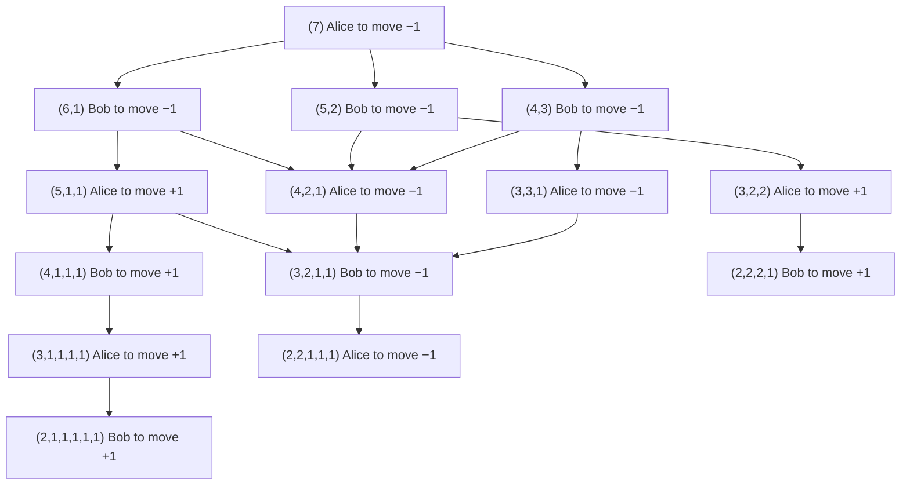
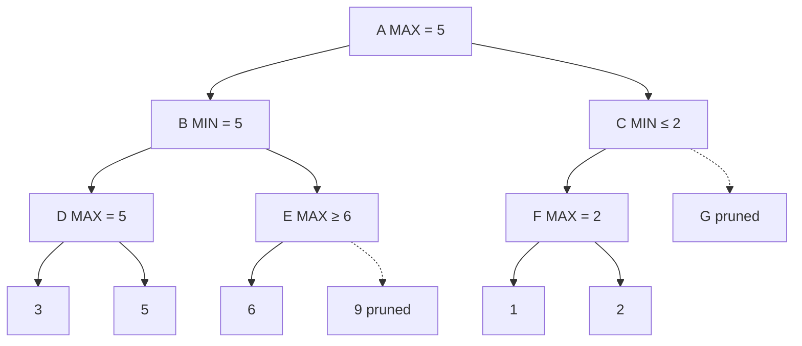

The search of the previous chapter had a single decision maker, and how the state changed was determined entirely by its own choices. Playing a board game is different: after each move, the opponent chooses the reply that is worst for us. This chapter discusses such adversarial search. We first use the minimax algorithm to characterize the value of a position when both sides play their best moves, and then use alpha–beta pruning to skip a large number of branches without changing the result; these two methods, together with an evaluation function designed by experts, make up Deep Blue, which defeated the world chess champion in 1997. Go has a larger state space and, more importantly, it is hard to write a good evaluation function for it, so another route appeared: estimate the win rate of a position by random simulation (the Monte Carlo method) and balance "exploration" against "exploitation" within the simulations (multi-armed bandits and UCB1). This is Monte Carlo tree search. AlphaGo combined it with deep neural networks and reinforcement learning and defeated Lee Sedol in 2016; the later AlphaGo Zero, AlphaZero, and MuZero gradually removed the dependence on human game records, hand-designed features, and even the rules of the game. For the search framework used in this chapter see [4.5.2](/4.5.2); for the basics of neural networks see [4.5.4](/4.5.4); for convolutional networks and residual networks see [4.7.3](/4.7.3).

## 3.1. Game Problems

### 3.1.1. Two-Player Zero-Sum Games

The games discussed in this chapter have the following features:

- two players: the two participants move in turn, one move each;
- perfect information: both sides see the whole position, with no hidden information (poker does not qualify);
- deterministic: there are no random elements such as dice;
- zero-sum: one side's gain is the other side's loss, so the outcome can be expressed from one side's viewpoint by a single number.

Chess, Chinese chess (xiangqi), Go, and gomoku all belong to this class. By convention the side that moves first is called MAX and the other MIN: the outcome is expressed as MAX's payoff, which MAX wants to be large and MIN wants to be small.

**Definition 3.1.1 (Game Tree)** Take the initial position as the root, with each node representing a position; the children of a node are all the positions that can result from one move by the side to move, and the leaves are terminal positions labeled with MAX's payoff (for example win $+1$, draw $0$, loss $-1$). Such a tree is called a **game tree**. A node at which MAX is to move is called a MAX node, and one at which MIN is to move is called a MIN node; the two alternate level by level.

### 3.1.2. Example: Splitting Coins

**Example 3.1.1 (Splitting Coins)** There is a pile of 7 coins, and two players, Alice and Bob, move in turn, Alice first. On each turn the player chooses a pile and splits it into two piles of unequal size; the player to move when no pile can be split any more (every pile has only 1 or 2 coins) loses.

This game has few states, so the complete game graph can be drawn (each position drawn once). In the figure below MAX = Alice, the numbers in parentheses are the pile sizes, and each node's value is Alice's outcome when both sides play their best: $+1$ means Alice wins and $-1$ means Bob wins.



The values of the leaves are determined by the rules: if it is Bob's turn and no pile can be split, Bob loses and the value is $+1$; if it is Alice's turn and no pile can be split, the value is $-1$. Going up from the leaves, a node where Alice moves takes the maximum of its children and a node where Bob moves takes the minimum. The value of the root is $-1$: whatever Alice's first split is, Bob can answer to reach $(4,2,1)$ or $(3,3,1)$; after that Alice can only move to $(3,2,1,1)$, Bob then moves to $(2,2,1,1,1)$, and Alice cannot split and loses. So in this game the second player wins.

### 3.1.3. Can We Enumerate Everything?

Splitting coins can be enumerated, but real board games cannot. Roughly speaking, chess has about $10^{44}$ legal positions and a game tree of about $10^{120}$ (the number of distinct games from the opening to the end); the game tree of Chinese chess is about $10^{150}$; Go has about $2 \times 10^{170}$ legal positions (Tromp and Farnebäck, 2016) and a game tree of about $10^{360}$. Even checking one position per nanosecond, checking $10^{120}$ positions would take about $3 \times 10^{103}$ years, whereas the age of the universe is about $1.38 \times 10^{10}$ years. So we can only "look ahead a few moves" as humans do, and try to look as deep and as accurately as possible within a limited amount of computation.

## 3.2. The Minimax Algorithm

### 3.2.1. Minimax Values

When people play, they look ahead a few moves, assume that the opponent always plays the move worst for them, and choose the best move from among these "worst cases." Formalizing this idea:

**Definition 3.2.1 (Minimax Value)** The **minimax value** of a node $n$ in a game tree is defined recursively by

$$
\operatorname{minimax}(n) = \begin{cases} \operatorname{utility}(n), & n \text{ is terminal}, \\ \max_{m \in \operatorname{succ}(n)} \operatorname{minimax}(m), & n \text{ is a MAX node}, \\ \min_{m \in \operatorname{succ}(n)} \operatorname{minimax}(m), & n \text{ is a MIN node}. \end{cases}
$$
where $\operatorname{utility}(n)$ is MAX's payoff at a terminal position. The algorithm that computes node values bottom-up by this recursion and at the root chooses the child with the largest value as the move is called the **minimax algorithm**.

The minimax value is the outcome when both sides use optimal strategies: if MAX moves to the child of largest value at every MAX node, then whatever MIN does, MAX's payoff is at least $\operatorname{minimax}(\text{root})$; when MIN uses the symmetric strategy, MAX's payoff cannot be higher. The minimax algorithm is just one depth-first search of the game tree, with time $O(b^m)$ and space $O(bm)$, where $b$ is the branching factor and $m$ the search depth.

Using the zero-sum property, the two kinds of nodes can be unified: if we always score from the viewpoint of the side to move, the value of a node is the maximum of the negated values of its children, $\operatorname{negamax}(n) = \max_{m} \bigl(-\operatorname{negamax}(m)\bigr)$. This formulation is called negamax, and the program needs to handle only one case; the Monte Carlo tree search of §3.5 also changes the sign during backpropagation, for the same reason.

### 3.2.2. Evaluation Functions

When a game tree is too large to be searched to terminal positions, we can search only to a certain depth and use a function at the depth limit to estimate how good a position is.

**Definition 3.2.2 (Evaluation Function)** A function $\operatorname{eval}(n)$ that gives an estimate of MAX's expected payoff for a non-terminal position $n$ is called an **evaluation function**. The minimax algorithm that uses $\operatorname{eval}(n)$ in place of $\operatorname{utility}(n)$ of Definition 3.2.1 at the depth limit is called depth-limited minimax.

A traditional evaluation function is a weighted sum of expert knowledge; in chess, for example,

$$
\operatorname{eval}(n) = \sum_{i} w_i f_i(n),
$$
where the $f_i$ are features such as material (queen 9, rook 5, bishop and knight 3, pawn 1), king safety, pawn structure, and mobility, and the weights $w_i$ are tuned by experts or learned from games. Its role is the same as that of the **heuristic function** of [4.5.2](/4.5.2): to use knowledge to estimate the part that the search does not reach.

Depth limiting brings a problem: if the search stops exactly in the middle of an exchange (a piece has just been captured, and the next move will recapture it), the evaluation is badly distorted; this is called the horizon effect. The usual remedy is quiescence search: at the depth limit, continue searching only "noisy" moves such as captures and checks until the position is quiet, and only then evaluate.

Even with a depth limit, exhaustive search quickly becomes infeasible. Deep Blue typically searched about 12 plies per move; the average branching factor of chess is about 35, and $35^{12} \approx 3.4 \times 10^{18}$, which at Deep Blue's speed of about 200 million positions per second would still take several hundred years. The alpha–beta pruning of the next section brings this number into a feasible range.

## 3.3. Alpha–Beta Pruning

### 3.3.1. The Principle

When computing minimax values, many nodes can be determined not to affect the result without looking at them. Consider an example:



Search from left to right. The value of $D$ is 5, so the value of the MIN node $B$ is at most 5. Next we search $E$: the first leaf is 6, so the value of the MAX node $E$ is at least 6, larger than 5; MIN at $B$ will never choose $E$, so the remaining children of $E$ need not be examined. Hence $B = 5$, and the value of the root $A$ is at least 5. Then we search $C$: the value of $F$ is 2, so the value of the MIN node $C$ is at most 2, smaller than 5; MAX at $A$ will not choose $C$, so the whole subtree of $G$ need not be searched. The value of the root is 5, the same as with the complete minimax algorithm.

Generalizing this reasoning: during the search, the value of a MAX node has a lower bound that keeps rising, denoted $\alpha$; the value of a MIN node has an upper bound that keeps falling, denoted $\beta$.

**Definition 3.3.1 (Alpha–Beta Pruning)** In depth-first minimax search, maintain for each node the current $\alpha$ (the best value MAX can already guarantee along the path) and $\beta$ (the best value MIN can already guarantee along the path). When the $\beta$ value of a MIN node is no greater than the $\alpha$ value of one of its MAX ancestors, stop searching the remaining children of that MIN node, which is called α pruning; when the $\alpha$ value of a MAX node is no less than the $\beta$ value of one of its MIN ancestors, stop searching the remaining children of that MAX node, which is called β pruning. This search method is called **alpha–beta pruning**.

In short: "min $\le$ max, prune; max $\ge$ min, prune." In the example above, pruning $e_2$ is β pruning and pruning $G$ is α pruning. Note that the comparison is with all ancestors, not only the parent: passing the largest $\alpha$ and the smallest $\beta$ among the ancestors as parameters down the recursion accomplishes this automatically.

```python
import math
import random

def make_tree(b, d, rng):
    """A uniform game tree: internal nodes are lists of children, leaves are numbers."""
    if d == 0:
        return rng.randint(-100, 100)
    return [make_tree(b, d - 1, rng) for _ in range(b)]

def minimax(node, maximizing):
    if not isinstance(node, list):
        return node
    values = [minimax(child, not maximizing) for child in node]
    return max(values) if maximizing else min(values)

def alphabeta(node, alpha, beta, maximizing, counter):
    if not isinstance(node, list):
        counter[0] += 1                       # count evaluated leaves
        return node
    if maximizing:
        value = -math.inf
        for child in node:
            value = max(value, alphabeta(child, alpha, beta, False, counter))
            alpha = max(alpha, value)
            if alpha >= beta:                 # beta cutoff: MIN above will avoid this node
                break
    else:
        value = math.inf
        for child in node:
            value = min(value, alphabeta(child, alpha, beta, True, counter))
            beta = min(beta, value)
            if alpha >= beta:                 # alpha cutoff: MAX above will avoid this node
                break
    return value

def best_first_order(node, maximizing):
    """Reorder children so that the best move for the side to move comes first."""
    if not isinstance(node, list):
        return node
    children = [best_first_order(child, not maximizing) for child in node]
    children.sort(key=lambda c: minimax(c, not maximizing), reverse=maximizing)
    return children

rng = random.Random(0)
b, d = 4, 8
for trial in range(3):
    tree = make_tree(b, d, rng)
    for name, t in [("random order", tree), ("best first", best_first_order(tree, True))]:
        counter = [0]
        v = alphabeta(t, -math.inf, math.inf, True, counter)
        assert v == minimax(t, True)
        print(f"{name:12s}: value {v:4d}, leaves evaluated {counter[0]:6d}")
print("all leaves:", b**d, " formula b^ceil(d/2) + b^floor(d/2) - 1:",
      b**math.ceil(d / 2) + b**(d // 2) - 1)
```

```text
random order: value  -42, leaves evaluated   7070
best first  : value  -42, leaves evaluated    511
random order: value  -43, leaves evaluated   5551
best first  : value  -43, leaves evaluated    511
random order: value  -43, leaves evaluated   3649
best first  : value  -43, leaves evaluated    511
all leaves: 65536  formula b^ceil(d/2) + b^floor(d/2) - 1: 511
```

On random trees with branching factor 4 and depth 8, alpha–beta pruning examines only about 6% to 11% of the 65536 leaves; if the children are ordered with the best move first, it examines only 511, in agreement with the formula of Theorem 3.3.2 below.

### 3.3.2. Correctness

**Theorem 3.3.1** Let $\alpha < \beta$, let $v = \operatorname{minimax}(n)$, and let $r = \operatorname{alphabeta}(n, \alpha, \beta)$ be the value returned by the program above. Then

1. if $v \le \alpha$, then $r \le \alpha$;
2. if $v \ge \beta$, then $r \ge \beta$;
3. if $\alpha < v < \beta$, then $r = v$.

In particular, $\operatorname{alphabeta}(\text{root}, -\infty, +\infty) = \operatorname{minimax}(\text{root})$.

In other words, $r$ is the exact value when it lies inside the window $(\alpha, \beta)$, and when it falls outside the window it is guaranteed only to be "on the same side." Values outside the window need not be exact: the ancestors already have a better option, so the exact value of this node does not affect the result.

**Proof** By induction on the height of the node. A leaf returns $v$ directly, so the claim holds. Let $n$ be a MAX node (MIN nodes are symmetric), with children $m_1, \dots, m_k$ in order, $v_i = \operatorname{minimax}(m_i)$, and $v = \max_i v_i$. The program calls the children in turn with windows $(\alpha_i, \beta)$, where $\alpha_1 = \alpha$, $\alpha_{i+1} = \max(\alpha_i, r_i)$, and $r_i$ is the value returned by the $i$-th call; it stops when $\alpha_{i+1} \ge \beta$ and returns $r = \max_{j \le i} r_j$ (if it never stops, $i = k$). By the induction hypothesis, for each child $m_i$ that is called: if $v_i \le \alpha_i$ then $r_i \le \alpha_i$; if $v_i \ge \beta$ then $r_i \ge \beta$; otherwise $r_i = v_i$. This yields an invariant: for each $i$,

$$
\max(\alpha, r_1, \dots, r_i) = \max(\alpha, v_1, \dots, v_i) \quad \text{as long as the latter is} < \beta,
$$
and as soon as $\max(\alpha, v_1, \dots, v_i) \ge \beta$, we have $\max(\alpha, r_1, \dots, r_i) \ge \beta$. (By induction on $i$: if $v_i \le \alpha_i$, then $r_i \le \alpha_i$ and neither maximum changes; if $\alpha_i < v_i < \beta$, then $r_i = v_i$; if $v_i \ge \beta$, then $r_i \ge \beta$.)

Case 2: $v \ge \beta$; let $v_j \ge \beta$. If the program stops before $j$, then at the stop we already have $r \ge \alpha_{i+1} \ge \beta$; otherwise $r_j \ge \beta$ at the $j$-th call. In either case $r \ge \beta$.

Cases 1 and 3: $v < \beta$. Then every $\max(\alpha, v_1, \dots, v_i) < \beta$, so by the invariant the program does not stop early, and $\max(\alpha, r_1, \dots, r_k) = \max(\alpha, v)$. If $v > \alpha$, the right side is $v$, and since each $r_i \le \max(\alpha_i, v_i) \le v$, at least one has $r_i = v_i = v$ (take the first $i$ with $v_i = v$, for which $\alpha_i < v$), so $r = \max_i r_i = v$. If $v \le \alpha$, then $\max(\alpha, r_1, \dots, r_k) = \alpha$, so $r = \max_i r_i \le \alpha$.

Taking $\alpha = -\infty$ and $\beta = +\infty$, only case 3 is possible. $\square$

### 3.3.3. Efficiency

The effect of alpha–beta pruning depends on the order in which children are searched: when the best move is placed first, the later branches are pruned quickly; when the best move is placed last, nothing can be pruned and the search is the same as minimax.

**Theorem 3.3.2 (Knuth–Moore, 1975)** On a uniform game tree with branching factor $b$ and depth $d$, if the children of every node are ordered from best to worst for the side to move, then alpha–beta pruning (with initial window $(-\infty, +\infty)$) examines exactly

$$
b^{\lceil d/2 \rceil} + b^{\lfloor d/2 \rfloor} - 1
$$
leaf nodes; moreover, for any ordering, any algorithm that is guaranteed to compute the minimax value must examine at least this many leaf nodes.

**Proof** We give the idea. Under the optimal ordering, nodes fall into three types: the root is of type 1; the first child of a type-1 node is of type 1 and its other children are of type 2; only the first child of a type-2 node is searched, and it is of type 3 (its value is already enough to cause a cutoff); all children of a type-3 node are searched, and they are all of type 2. Denote the child indices at successive levels along the path from the root to a leaf by $a_1, \dots, a_d$ (the first child is numbered 1). The path proceeds through type-1 nodes until the first index $a_k$ different from 1 enters a type-2 node; after that, types 3 and 2 alternate, and at a type-2 node only the first child can be taken, so $a_{k+1}, a_{k+3}, \dots$ must all be 1. Hence a leaf is examined if and only if all the indices at even levels are 1 (when $k$ is odd) or all the indices at odd levels are 1 (when $k$ is even). There are $b^{\lceil d/2\rceil}$ sequences of the former kind and $b^{\lfloor d/2\rfloor}$ of the latter, and the only common one is the sequence of all 1's, so the total is $b^{\lceil d/2 \rceil} + b^{\lfloor d/2 \rfloor} - 1$. The lower bound comes from the same structure: to prove that the value of the root equals $v$, one must prove both that MAX can guarantee $\ge v$ (which requires a "strategy tree" that takes one child at each MAX node and all children at each MIN node) and that MIN can guarantee $\le v$ (symmetrically); the two strategy trees have $b^{\lfloor d/2\rfloor}$ and $b^{\lceil d/2\rceil}$ leaves respectively and share only one leaf. $\square$

So in the best case the same amount of computation can double the search depth: the **effective branching factor** drops from $b$ to $\sqrt b$, from 35 to about 6 in chess. With a random ordering of children, the expected number of leaves examined is about $O(b^{3d/4})$ (an approximation for moderate $b$, from the analysis of Knuth and Moore; Pearl gave the exact asymptotic order in 1982 and proved that alpha–beta pruning is asymptotically optimal on random trees).

### 3.3.4. Practical Techniques and Deep Blue

Real game-playing programs add many techniques on top of alpha–beta pruning, all aimed at getting good moves searched early:

- Move ordering: search captures, checks, and the best moves of the previous search first (the killer heuristic and the history heuristic).
- Iterative deepening: search to depths $1, 2, 3, \dots$ in turn, using the best move of a shallower search as the first move of the deeper one; it also lets the program give its current best result at any time when the time runs out (the **iterative deepening search** of [4.5.2](/4.5.2)).
- Transposition tables: different move orders may reach the same position, so a hash table records the values of positions already searched to avoid repeated searching.
- Narrow-window search: search with a window narrower than $(-\infty, +\infty)$; by Theorem 3.3.1, if the result falls inside the window it is exact, and otherwise the search is repeated; algorithms such as principal variation search (PVS) are based on this.

Deep Blue (IBM; in May 1997 it defeated the world chess champion Kasparov 3.5 to 2.5, having lost 2 to 4 in the first challenge in 1996) is the representative of this route: parallel alpha–beta search implemented on special-purpose chips, about 200 million positions per second, typically searching about 12 plies and extending critical lines further; its evaluation function has about 8000 features, tuned with the participation of chess grandmasters, and it is equipped with an opening book and endgame databases. It can be summarized as "expert knowledge + alpha–beta pruning." In 2006, to mark the 50th anniversary of the birth of AI, a Chinese chess program also defeated 5 grandmasters, including Liu Dahua, by an overall score of 11 to 9.

Checkers developed even further: Schaeffer's Chinook became the man–machine world champion in 1994; in 2007 his group used alpha–beta search and endgame databases to prove that checkers is a draw when neither side makes a mistake, that is, checkers has been "solved."

## 3.4. Monte Carlo Methods

Alpha–beta pruning long performed poorly on Go. The large number of states is not the fundamental reason; the key is evaluation: the outcome of Go depends on global "influence" and on life and death, the stones have no clear material values as in chess, and expert knowledge is hard to organize into a unified, reliable evaluation function. This prompted a different way of evaluating: instead of "understanding" a position, let the program play randomly from this position to the end, many times, and use the win rate as the evaluation of the position. This is the application of the **Monte Carlo method** ([3.1.12](/3.1.12)) to games.

A classic example of the Monte Carlo method is Buffon's needle: parallel lines with spacing $d$ are drawn on a plane, and a needle of length $l \le d$ is dropped at random. Describe the position of the needle by the distance $x \in [0, d/2]$ from its midpoint to the nearest line and the angle $\alpha \in [0, \pi]$ between the needle and the lines, which are independent and uniformly distributed; the needle crosses a line if and only if $x \le \frac{l}{2}\sin\alpha$. The probability of crossing is therefore

$$
p = \frac{\int_0^\pi \frac{l}{2}\sin\alpha\,\mathrm{d}\alpha}{\pi \cdot \frac{d}{2}} = \frac{2l}{\pi d}.
$$
If the needle is dropped $n$ times and crosses a line $m$ times, then by the **law of large numbers**, $m/n \to p$, so $\pi \approx \frac{2nl}{md}$. Estimating a quantity that is hard to compute directly by the frequency of a random experiment is the basic idea of the Monte Carlo method.

**Example 3.4.1 (Monte Carlo Evaluation of a Position)** For each legal move in the current position, after playing it, both sides play random legal moves from the resulting position until the winner can be determined, and the result is recorded. Repeat many times for each move and choose the move with the highest win rate.

This "flat" Monte Carlo evaluation has two shortcomings: every move gets the same number of simulations, so obviously bad moves receive just as much computation; and the games played with random moves are of very poor quality, so the evaluation deviates greatly from actual strength. Monte Carlo tree search solves the first problem, and AlphaGo's neural networks solve the second.

## 3.5. Monte Carlo Tree Search

### 3.5.1. Multi-Armed Bandits and UCB1

With a limited number of simulations, more simulations should be given to the more promising moves, but the moves that currently look bad cannot be ignored altogether, since their estimated win rates may simply have been unlucky. This is a tradeoff between "exploitation" and "exploration," and the simplest model of it is the multi-armed bandit (Robbins, 1952).

**Definition 3.5.1 (Multi-Armed Bandit)** There are $K$ levers. The payoff from pulling lever $j$ is an independent and identically distributed random variable taking values in $[0, 1]$ with unknown mean $\mu_j$, and different levers are independent of each other. In each round we choose a lever and observe its payoff, and the goal is to maximize the total payoff. This problem is called the **multi-armed bandit** problem.

Write $\mu^* = \max_j \mu_j$, $\Delta_j = \mu^* - \mu_j$, and let $T_j(n)$ be the number of times lever $j$ is pulled in the first $n$ rounds. The quality of a strategy is measured by regret:

**Definition 3.5.2 (Regret)** The **regret** over the first $n$ rounds is the difference between the expected payoff of "always pulling the best lever" and the expected payoff of the strategy:

$$
R_n = n\mu^* - \mathbb{E}\Bigl[\sum_{t=1}^{n} X_t\Bigr] = \sum_{j} \Delta_j\, \mathbb{E}[T_j(n)],
$$
where $X_t$ is the payoff in round $t$.

Always pulling the lever with the "highest average payoff so far" (greedy) may be unlucky at the start and miss the best lever forever, so the regret grows linearly in $n$; exploring at random with a fixed probability $\varepsilon$ ($\varepsilon$-greedy) also pays a linear regret for exploration. Lai and Robbins (1985) proved that any strategy that is "not too bad" on all problems has regret growing at least at the rate $\log n$: for each suboptimal lever $j$, $\liminf_{n\to\infty} \mathbb{E}[T_j(n)]/\ln n \ge 1/\operatorname{KL}(\mu_j \Vert \mu^*)$, where KL is the Kullback–Leibler divergence between the two payoff distributions. The algorithm below attains the logarithmic order.

**Algorithm 3.5.1 (UCB1)** First pull each lever once. Thereafter, in round $n$, compute for each lever the upper confidence bound

$$
I_j = \bar X_j + \sqrt{\frac{2 \ln n}{T_j(n)}},
$$
and pull the lever with the largest $I_j$. Here $\bar X_j$ is the average payoff of lever $j$ so far and $n$ is the total number of pulls so far.

$\bar X_j$ is "exploitation," and the second term is "exploration": a lever that has been pulled little has large uncertainty, and the second term is large as well. By Hoeffding's inequality, the probability that $\mu_j$ exceeds $I_j$ is at most $n^{-4}$, so $I_j$ is an optimistic estimate of $\mu_j$. This class of algorithms is called upper confidence bound (UCB) algorithms, and the basic principle is "optimism in the face of uncertainty": a lever is either really good, or has a large $I_j$ because it has been pulled little, and after it is pulled the uncertainty shrinks.

**Theorem 3.5.1 (Auer, Cesa-Bianchi, and Fischer, 2002)** When payoffs take values in $[0, 1]$, for any $n$ the regret of UCB1 satisfies

$$
R_n \le 8 \sum_{j:\, \mu_j < \mu^*} \frac{\ln n}{\Delta_j} + \Bigl(1 + \frac{\pi^2}{3}\Bigr) \sum_{j} \Delta_j.
$$


### 3.5.2. The UCT Algorithm

**Definition 3.5.3 (Monte Carlo Tree Search)** **Monte Carlo tree search** (MCTS) starts from the current position and gradually builds a search tree in which each node records the number of visits and the accumulated payoff, and repeats the following four steps until the computing time is used up:

1. Selection: starting from the root, choose a child at each level according to some strategy until reaching a node that still has unexpanded children (or a terminal position);
2. Expansion: generate a new child for it;
3. Simulation: from the position of the new node, play to the end according to a default policy (for example random moves) and obtain the payoff;
4. Backpropagation: propagate the payoff back along the path to all ancestors, updating their visit counts and accumulated payoffs.

Finally, the child of the root with the most visits is chosen as the move.

Compared with flat Monte Carlo evaluation, a parent node can use the simulation results of its children, good branches are visited repeatedly and searched deeper and deeper, and the search can be stopped at any time to give the current best move. The selection strategy in step 1 determines the balance between exploration and exploitation: Kocsis and Szepesvári (2006) viewed the choice of a child at each node of the tree as a multi-armed bandit and selected with UCB1, obtaining

**Algorithm 3.5.2 (UCT)** In the selection step, choose the child $j$ that maximizes

$$
I_j = \bar X_j + c\sqrt{\frac{2 \ln n}{n_j}},
$$
where $\bar X_j$ is the average payoff of child $j$ (computed from the viewpoint of the side that moves to that child), $n_j$ is its visit count, $n$ is the visit count of the parent, and $c > 0$ adjusts the degree of exploration. Unvisited children take priority.

Two points need attention:

- Viewpoint of the payoff: the average payoff of a child must be recorded from the viewpoint of "the side that moves to this child," so during backpropagation the result of the same simulation has opposite signs at two adjacent levels (the idea of negamax, §3.2.1). If we record counts of wins and losses, this means that "the number of wins is counted for the side that moved to this node."
- Visit counts: each simulation adds 1 to the visit count of every node on the path, so the visit count of a parent equals the sum of the visit counts of its children (plus the one visit when it was expanded itself).

UCT is theoretically sound: Kocsis and Szepesvári proved that as the number of simulations tends to infinity, the probability that UCT chooses a wrong move at the root tends to 0, and the root's value estimate converges to the minimax value. In practice, Monte Carlo tree search was first used for computer Go around 2006 (Coulom's Crazy Stone, MoGo by Gelly and others), raising the level of programs from amateur beginner to amateur high dan, which was the turning point that put computer Go on the right track.

### 3.5.3. Implementation

The following demonstrates UCT on tic-tac-toe. Each node records the accumulated score of "the side that moved to this node" (win 1, draw 0.5, loss 0), and simulation uses random moves.

```python
import math
import random

LINES = [(0, 1, 2), (3, 4, 5), (6, 7, 8), (0, 3, 6), (1, 4, 7), (2, 5, 8), (0, 4, 8), (2, 4, 6)]

def winner(board):
    for a, b, c in LINES:
        if board[a] != "." and board[a] == board[b] == board[c]:
            return board[a]
    return "draw" if "." not in board else None

def moves(board):
    return [i for i, x in enumerate(board) if x == "."]

def play(board, i, player):
    return board[:i] + player + board[i + 1:]

class Node:
    def __init__(self, board, player, parent=None, move=None):
        self.board, self.player = board, player     # player = side to move here
        self.parent, self.move = parent, move
        self.children, self.untried = [], moves(board) if winner(board) is None else []
        self.wins, self.visits = 0.0, 0             # wins for the player who moved INTO this node

    def ucb_child(self, c):
        return max(self.children, key=lambda ch: ch.wins / ch.visits
                   + c * math.sqrt(math.log(self.visits) / ch.visits))

def other(p):
    return "O" if p == "X" else "X"

def mcts(board, player, iterations, c=math.sqrt(2), rng=random.Random(0)):
    root = Node(board, player)
    for _ in range(iterations):
        node = root
        while not node.untried and node.children:   # 1. selection
            node = node.ucb_child(c)
        if node.untried:                            # 2. expansion
            i = node.untried.pop(rng.randrange(len(node.untried)))
            child = Node(play(node.board, i, node.player), other(node.player), node, i)
            node.children.append(child)
            node = child
        b, p = node.board, node.player              # 3. simulation (random playout)
        while winner(b) is None:
            b = play(b, rng.choice(moves(b)), p)
            p = other(p)
        result = winner(b)
        while node is not None:                     # 4. backpropagation
            node.visits += 1
            mover = other(node.player)              # the player who made the move into node
            node.wins += 1.0 if result == mover else 0.5 if result == "draw" else 0.0
            node = node.parent
    best = max(root.children, key=lambda ch: ch.visits)
    return best.move, {ch.move: ch.visits for ch in root.children}

# X to move; O threatens to complete the left column (cells 0, 3, 6).
board = "O.X" + "OX." + "..."
move, visits = mcts(board, "X", 3000)
print("chosen move:", move)
print("visits per move:", dict(sorted(visits.items())))
```

```text
chosen move: 6
visits per move: {1: 29, 5: 30, 6: 2881, 7: 30, 8: 30}
```

The cells of the board are numbered 0–8 by rows. O already has two stones in the left column; X playing at 6 both blocks this column and completes the diagonal 2–4–6 for an immediate win; 2881 of the 3000 simulations went to this move. In the code, $c = \sqrt 2$ together with $\sqrt{\ln n / n_j}$ makes up the $\sqrt{2\ln n/n_j}$ of UCB1.

## 3.6. Reinforcement Learning

### 3.6.1. Basic Concepts

Besides learning from human game records, AlphaGo's neural networks also keep improving through self-play, which is reinforcement learning.

**Definition 3.6.1 (Reinforcement Learning)** An agent acts repeatedly in an environment: at each time it observes a state $s_t$ and chooses an action $a_t$ according to a policy $\pi(a \mid s)$, and the environment gives a reward $r_{t+1}$ and moves to a new state $s_{t+1}$. The goal of learning is to find the policy that maximizes the expected cumulative reward (the return). This method of learning "what to do" from reward signals through interaction with the environment is called **reinforcement learning**.

Compared with **supervised learning**, reinforcement learning has two characteristics:

- Trial and error: the learner is not told what the correct action is and must try things itself, discovering from the rewards which actions are good;
- Delayed reward: the consequences of an action may appear only many steps later. In a board game, there is a win or loss only at the end, and it is unclear how much each intermediate move contributed; this is called the credit assignment problem.

Several basic quantities: the state value $V^\pi(s)$ is the expected return when starting from state $s$ and acting according to policy $\pi$; the action value $Q^\pi(s, a)$ is the expected return when first taking action $a$ in $s$ and then acting according to $\pi$. Reinforcement learning that represents the policy or value function by a neural network is called deep reinforcement learning. After 2025, reinforcement learning also became the main means of training the reasoning ability of large language models (**reinforcement learning with verifiable rewards**, [4.2.14](/4.2.14); [4.7.9](/4.7.9)), and Sutton and Barto received the 2024 Turing Award for laying the foundations of reinforcement learning.

### 3.6.2. Three Learning Signals in Go

The key to deep reinforcement learning is to turn rewards into the "labels" needed for training neural networks, and different conversions correspond to different loss functions. Take self-play Go as an example, and write the result of a game as $z = +1$ (win) or $-1$ (loss), always from the viewpoint of the side to move at the time.

1. Policy gradient: the policy network $p_\theta(a \mid s)$ gives the probability of playing at $a$ in position $s$. For each move $(s, a)$ by our side in a game, minimize

   $$
   L(\theta) = -z \log p_\theta(a \mid s).
   $$
   The probabilities of moves in won games are raised and those in lost games are lowered, by the same amount in opposite directions. The expectation of its gradient is proportional to the gradient of the expected return with respect to $\theta$ (the REINFORCE algorithm, Williams, 1992), so what is learned is the policy that maximizes the win rate. The samples of each game are used for only one update, because once the policy changes, the distribution of the old data no longer corresponds to the current policy.

2. Value estimation: the value network $v_\theta(s)$ predicts the expected outcome of position $s$, with values in $[-1, 1]$, using the regression loss

   $$
   L(\theta) = \bigl(z - v_\theta(s)\bigr)^2.
   $$

3. Actor–critic: train the policy (the actor) and the value (the critic) at the same time. How good a move is is measured by the reward increment (the advantage),

   $$
   A = Q(s, a) - V(s) \approx z - v_\theta(s),
   $$
   where a large $A$ means that the move did much better than the average in that position (a brilliant move), and a very small $A$ means a blunder. The actor's loss $-A \log p_\theta(a \mid s)$ produces large gradients only where there is a "surprise," which highlights the key move better than using $z$ itself; the critic's loss is still $(z - v_\theta(s))^2$. The total loss is a weighted sum of the two.

## 3.7. AlphaGo

Monte Carlo tree search has two problems: every node must generate all its children, and the branching factor of Go is about 250, so the tree is very wide; and the quality of random simulations is poor. AlphaGo (DeepMind, Silver et al., 2016) introduces empirical knowledge of Go into the search with two deep convolutional networks.

### 3.7.1. The Policy Network

The policy network takes the current position as input and outputs the probabilities of playing at the 361 points, which can be viewed as a 361-class classification problem. The input is 48 feature planes of size $19 \times 19$ (own stones, opponent stones, empty points, and hand-designed Go features such as liberties, liberties after playing, number of stones that can be captured, and ladders), and the network is a 13-layer convolutional network. Training has two stages:

- Supervised learning: 30 million positions are taken from 160,000 games of strong amateur players on the KGS Go server, with the human move as the label, and the network is trained with the cross-entropy loss $-\sum_a t_a \log p_a$; the accuracy of predicting the human move is 57%;
- Reinforcement learning: starting from the supervised network, it plays against earlier versions of itself and is improved by policy gradient; the improved network wins about 80% of games against the supervised network.

A fast rollout network using only simple features was also trained; its accuracy is only about 24%, but it takes about 2 microseconds per move, about 1000 times faster than the policy network, and it is used for simulation.

### 3.7.2. The Value Network

The value network takes a position as input (with one more plane than the policy network, indicating "the side to move") and outputs the expected result in $[-1, 1]$, trained with the regression loss $(z - v(s))^2$. The training data come from 30 million self-play games of the reinforcement-learning policy network, taking only one position from each game: adjacent positions in the same game are highly correlated and have the same outcome, and if all were used for training, the network would memorize games instead of learning to evaluate, which is **overfitting**.

### 3.7.3. Combining with Monte Carlo Tree Search

Each edge $(s, a)$ of the search tree records a visit count $N(s, a)$, a mean payoff $Q(s, a)$, and a prior probability $P(s, a)$ (the output of the policy network).

1. Selection: choose the action that maximizes $Q(s, a) + u(s, a)$, where the exploration term

   $$
   u(s, a) = c\, P(s, a)\, \frac{\sqrt{\sum_b N(s, b)}}{1 + N(s, a)}
   $$
   is proportional to the prior probability and decays with the visit count. Compared with UCT, besides "exploitation" (large $Q$) and "exploration" (few visits), the selection principle has an extra element, "experience": the moves that the policy network considers likely take priority.
2. Expansion: after reaching a leaf node $s_L$, generate its children and compute their prior probabilities with the policy network.
3. Evaluation: the payoff of the leaf node is a weighted average of the value network and one fast rollout simulation,

   $$
   V(s_L) = (1 - \lambda)\, v(s_L) + \lambda\, z_L, \qquad \lambda = 0.5,
   $$
   where $z_L$ is the result of playing from $s_L$ to the end with the fast rollout network.
4. Backpropagation: update $N$ and $Q$ along the path, noting that adjacent levels have opposite signs.

Finally the move with the most visits at the root is chosen. In October 2015, the distributed version of AlphaGo (1202 CPUs and 176 GPUs) defeated the European champion Fan Hui 5 to 0; in March 2016 it defeated Lee Sedol 4 to 1; in May 2017, the upgraded AlphaGo Master defeated Ke Jie 3 to 0. In short, AlphaGo is "human data + Monte Carlo tree search + deep learning," and it does not need Go masters to take part directly in designing the evaluation.

## 3.8. AlphaGo Zero, AlphaZero, and MuZero

### 3.8.1. AlphaGo Zero

AlphaGo Zero (Silver et al., 2017) achieved learning from scratch:

- it uses no human game records and starts self-play from a randomly initialized network;
- it uses no hand-designed features, and its input has only 17 planes: the positions of black and white stones in the last 8 positions (16 planes), plus the side to move (1 plane);
- the policy and the value are combined into one two-headed network $(\boldsymbol{p}, v) = f_\theta(s)$: the trunk is a convolutional network of 19 or 39 residual blocks ([4.7.3](/4.7.3)), the policy outputs $19 \times 19 + 1 = 362$ probabilities (the extra one is "pass"), and the value outputs $v \in [-1, 1]$;
- the MCTS no longer performs fast rollout simulations, and the payoff of a leaf node is taken directly as $v(s_L)$.

The more essential change is to put MCTS into the training loop: MCTS is itself a "policy improvement operator" stronger than the raw network. For each move, a search is performed first (1600 simulations per move), and the visit counts of the children of the root are converted into probabilities

$$
\pi(a) = \frac{N(s, a)^{1/\tau}}{\sum_b N(s, b)^{1/\tau}},
$$
which at temperature $\tau = 1$ are just the proportions of the visit counts (for example, if three children are visited 7, 20, and 13 times, then $\pi = (0.175, 0.5, 0.325)$), and the move is played according to $\pi$. After a game ends, the network is trained with $(\pi, z)$ as the targets for each position, with loss

$$
L(\theta) = (z - v)^2 - \boldsymbol{\pi}^{\mathsf T}\log\boldsymbol{p} + c\,\|\theta\|^2,
$$
that is, the squared error of the value, the cross-entropy of the policy with respect to the search probabilities, and $L_2$ regularization. As the network gets stronger, the search gets stronger and the training targets it produces get better, and so the cycle continues. For exploration, Dirichlet noise is added to the prior probabilities at the root: $P(s, a) = (1 - \varepsilon) p_a + \varepsilon \eta_a$, $\boldsymbol{\eta} \sim \operatorname{Dir}(0.03)$, $\varepsilon = 0.25$; when the concentration parameter is small, most components of the sampled probability vector are close to 0 and a few are larger, which amounts to randomly encouraging a few moves. The noise does not push the search too far off course: if a move overestimated because of the noise has a poor $Q$ after the search, its visit count naturally falls.

After 3 days of training (about 4.9 million self-play games), AlphaGo Zero defeated the version that beat Lee Sedol 100 to 0; after 40 days of training it defeated AlphaGo Master 89 to 11. At play time it uses a single machine with 4 TPUs, whereas the version that beat Lee Sedol used 48 TPUs distributed over several machines.

### 3.8.2. AlphaZero and MuZero

AlphaZero (Silver et al., released in 2017 and published in 2018) applied the same algorithm unchanged to chess, shogi, and Go, given only the rules as input, and within a few hours to a few days surpassed the strongest programs of the time, Stockfish, Elmo, and AlphaGo Zero, respectively. It further simplified training: instead of the evaluation gate "replace the old network only if the new one beats it," it continually updates a single network.

MuZero (Schrittwieser et al., 2020) does not even need the rules: it learns three functions, a representation function that encodes observations into a hidden state, a dynamics function that predicts the next hidden state and the reward after an action, and a prediction function that gives a policy and a value from a hidden state; MCTS is carried out in the learned hidden-state model. In this way the same algorithm can play board games and also Atari games whose states cannot be simulated simply.

| | AlphaGo | AlphaGo Zero | AlphaZero | MuZero |
|---|---|---|---|---|
| Human game records | Used | Not used | Not used | Not used |
| Input features | 48 hand-designed feature planes | Raw stone positions | Raw position | Raw observations |
| Network | Three networks: policy, value, fast rollout | One two-headed residual network | Same as AlphaGo Zero | Three functions: representation, dynamics, prediction |
| Leaf evaluation | Average of value network and simulation | Value only | Value only | Value in the learned model |
| Rules | Needed | Needed | Needed | Not needed |
| Games | Go | Go | Go, chess, shogi | The above plus Atari |

The significance of this route is that in a closed environment where the outcome can be judged automatically, search and learning can reinforce each other without human knowledge. Its limitation lies here too: board games have clear rules and automatically decidable outcomes, and many real problems do not. Even in Go, "superhuman" programs are not invulnerable: a 2023 study found adversarial strategies that reliably defeat top Go programs such as KataGo, and human players, after learning them, can also beat these programs, which shows that the Go concepts learned by the networks differ from those of humans. The idea of "using search to produce better targets and then training the model" later also appeared in the reasoning training of large language models ([4.7.9](/4.7.9)).

## Summary

| Method | Where the evaluation comes from | Search method | Representative |
|---|---|---|---|
| Minimax | Terminal positions or an evaluation function | Depth-first, complete | |
| Alpha–beta pruning | An expert-designed evaluation function | Depth-first, pruning branches that do not affect the result | Deep Blue (1997) |
| Monte Carlo tree search | Win rates of random simulations | Selection, expansion, simulation, backpropagation, with UCB balancing exploration and exploitation | Crazy Stone, MoGo (2006) |
| AlphaGo | Value network + fast rollout simulation | MCTS + policy-network priors | Defeated Lee Sedol in 2016 |
| AlphaGo Zero / AlphaZero | Values learned by self-play | MCTS embedded in the training loop | 2017 |

- The value of a two-player zero-sum game with perfect information is defined recursively by minimax; with a depth limit, an evaluation function is used.
- Alpha–beta pruning does not change the result (Theorem 3.3.1); in the best case it needs to examine only $b^{\lceil d/2\rceil} + b^{\lfloor d/2\rfloor} - 1$ leaves (Theorem 3.3.2), which doubles the searchable depth; the effect depends on move ordering.
- Multi-armed bandits capture the tradeoff between exploration and exploitation; the regret of UCB1 is $O(\log n)$, attaining the order of the Lai–Robbins lower bound. UCT uses UCB1 for the selection at every node of the tree.
- Reinforcement learning learns from rewards; policy gradient, value regression, and actor–critic correspond to different loss functions.
- AlphaGo uses neural networks to provide priors and evaluations for MCTS; AlphaGo Zero embeds MCTS as a policy improvement operator in self-play training and dispenses with human data.
