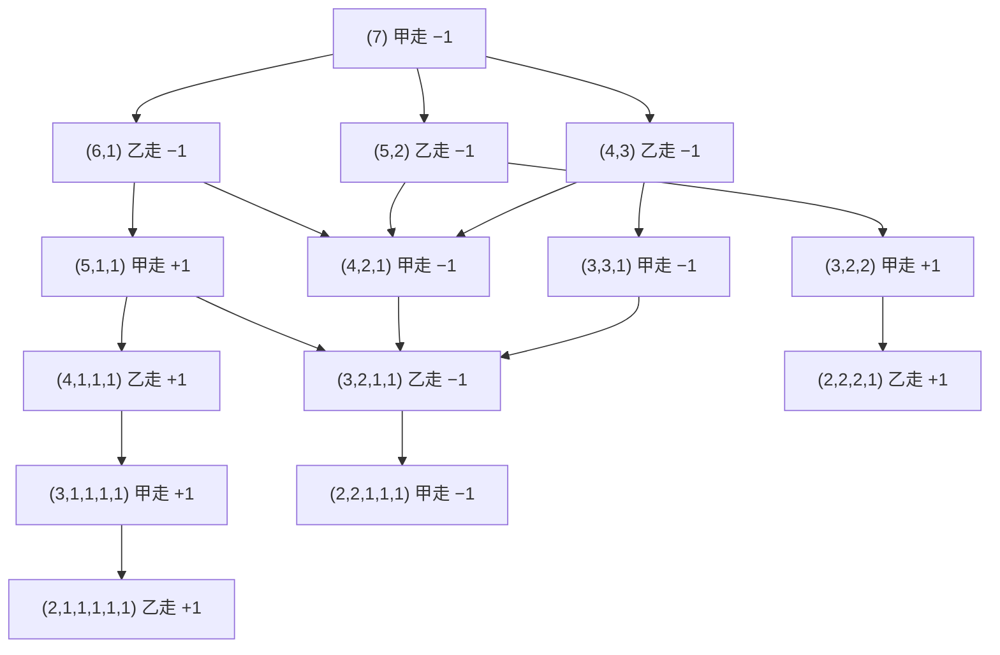
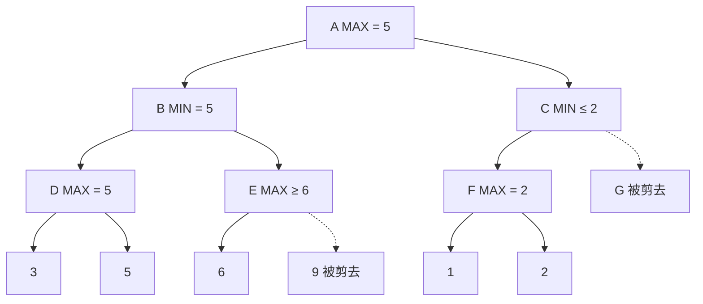

上一章的搜索只有一个决策者：状态怎样变化完全由自己的选择决定。下棋不是这样，每走一步之后，对手会选择对我们最不利的应对。本章讨论这类对抗搜索。先用极小极大算法刻画"双方都走最好的一步"时局面的价值，再用 α-β 剪枝在不改变结果的前提下跳过大量分支；这两种方法加上专家设计的估值函数，构成了 1997 年战胜国际象棋世界冠军的深蓝。围棋的状态空间更大，更重要的是难以写出好的估值函数，于是出现了另一条路线：用随机模拟估计局面的胜率（蒙特卡洛方法），并在模拟中平衡"探索"与"利用"（多臂老虎机与 UCB1），这就是蒙特卡洛树搜索。AlphaGo 把它与深度神经网络和强化学习结合，2016 年战胜了李世石；之后的 AlphaGo Zero、AlphaZero 与 MuZero 逐步去掉了对人类棋谱、人工特征乃至游戏规则的依赖。本章用到的搜索框架见 [4.5.2](/4.5.2)，神经网络的基础见 [4.5.4](/4.5.4)，卷积网络与残差网络见 [4.7.3](/4.7.3)。

## 3.1. 博弈问题

### 3.1.1. 二人零和博弈

本章讨论的博弈具有以下特点：

- 双人：两个参与者轮流行动，一人一步；
- 完全信息：双方都能看到全部局面，没有隐藏的信息（扑克不是）；
- 确定性：没有掷骰子之类的随机因素；
- 零和：一方之所得即另一方之所失，结果可以只用一个数从一方的角度表示。

国际象棋、中国象棋、围棋、五子棋都属于这一类。按惯例把先走的一方称为 MAX，另一方称为 MIN：结果用 MAX 的收益表示，MAX 希望它大，MIN 希望它小。

**定义 3.1.1（博弈树）** 以初始局面为根，每个结点表示一个局面，结点的子结点是轮到行动的一方走一步后可能得到的所有局面，叶结点是终局并标有 MAX 的收益（如胜 $+1$、和 $0$、负 $-1$）。这样的树称为**博弈树**。轮到 MAX 行动的结点称为 MAX 结点，轮到 MIN 行动的称为 MIN 结点，二者逐层交替。

### 3.1.2. 例：分钱币

**例 3.1.1（分钱币）** 有一堆 7 枚钱币，甲、乙两人轮流行动，甲先。每次选择一堆，把它分成数目不等的两堆；轮到谁时已经不能再分（每堆都只有 1 枚或 2 枚），谁就输。

这个游戏的状态少，可以画出完整的博弈图（同一局面只画一次）。下图中 MAX = 甲，括号内是各堆的枚数，结点值是双方都走最好的一步时甲的结果：$+1$ 表示甲胜，$-1$ 表示乙胜。



叶结点的值由规则决定：轮到乙而不能再分，乙输，值为 $+1$；轮到甲而不能再分，值为 $-1$。从叶结点向上，甲走的结点取子结点的最大值，乙走的结点取最小值。根的值为 $-1$：无论甲第一步怎样分，乙都可以应对到 $(4,2,1)$ 或 $(3,3,1)$，此后甲只能走到 $(3,2,1,1)$，乙再走到 $(2,2,1,1,1)$，甲无法再分而输。所以这个游戏后手必胜。

### 3.1.3. 能否穷举

分钱币可以穷举，真正的棋类不行。粗略地说，国际象棋合法局面约有 $10^{44}$ 个，博弈树的规模（从开局到终局的不同对局数）约为 $10^{120}$；中国象棋的博弈树约为 $10^{150}$；围棋的合法局面约有 $2 \times 10^{170}$ 个（Tromp 与 Farnebäck，2016），博弈树约为 $10^{360}$。即使每纳秒检查一个局面，检查 $10^{120}$ 个也需要约 $3 \times 10^{103}$ 年，而宇宙的年龄约为 $1.38 \times 10^{10}$ 年。所以只能像人一样"向前看若干步"，并在有限的计算中尽量看得深、看得准。

## 3.2. 极小极大算法

### 3.2.1. 极小极大值

人下棋时向前看若干步，并假定对手总是走对自己最不利的一步，从"最坏的情形"中选择最好的走法。把这一想法形式化：

**定义 3.2.1（极小极大值）** 博弈树中结点 $n$ 的**极小极大值**递归地定义为

$$
\operatorname{minimax}(n) = \begin{cases} \operatorname{utility}(n), & n \text{ 是终局}, \\ \max_{m \in \operatorname{succ}(n)} \operatorname{minimax}(m), & n \text{ 是 MAX 结点}, \\ \min_{m \in \operatorname{succ}(n)} \operatorname{minimax}(m), & n \text{ 是 MIN 结点}. \end{cases}
$$
其中 $\operatorname{utility}(n)$ 是终局时 MAX 的收益。按这一递归自底向上计算结点的值、在根结点选择值最大的子结点作为走步的算法称为**极小极大算法**。

极小极大值就是双方都采用最优策略时的结果：若 MAX 在每个 MAX 结点都走向值最大的子结点，无论 MIN 怎样走，MAX 的收益都不低于 $\operatorname{minimax}(\text{根})$；MIN 采用对称的策略时，MAX 的收益也不会更高。极小极大算法就是在博弈树上做一次深度优先搜索，时间 $O(b^m)$，空间 $O(bm)$，$b$ 为分支因子，$m$ 为搜索深度。

利用零和性质，可以把两种结点统一起来：若总是从轮到行动的一方的角度记分，结点的值就是子结点的值取负后的最大值，$\operatorname{negamax}(n) = \max_{m} \bigl(-\operatorname{negamax}(m)\bigr)$。这种写法称为负极大值（negamax），程序只需写一种情形；§3.5 的蒙特卡洛树搜索在回传时改变符号，也是这个道理。

### 3.2.2. 估值函数

博弈树大到不能搜索到终局时，只能搜索到一定深度，在深度上限处用一个函数估计局面的好坏。

**定义 3.2.2（估值函数）** 对非终局的局面 $n$ 给出 MAX 的预期收益的估计的函数 $\operatorname{eval}(n)$ 称为**估值函数**（又称局面评估函数）。在深度上限处用 $\operatorname{eval}(n)$ 代替定义 3.2.1 中的 $\operatorname{utility}(n)$ 的极小极大算法称为深度受限的极小极大算法。

传统的估值函数是专家知识的加权和，例如国际象棋中

$$
\operatorname{eval}(n) = \sum_{i} w_i f_i(n),
$$
$f_i$ 是子力（后 9、车 5、象与马 3、兵 1）、王的安全、兵型、机动性等特征，权重 $w_i$ 由专家调整或从对局中学习。它的作用和 [4.5.2](/4.5.2) 的**启发函数**相同：用知识估计"搜索不到"的部分。

深度受限带来一个问题：若搜索恰好停在一次交换的中途（刚吃掉对方的子，下一步就会被吃回），估值会严重失真，这称为水平线效应。常用的对策是静态搜索（quiescence search）：在深度上限处只继续搜索吃子、将军等"不平静"的走法，直到局面平静再估值。

即使深度受限，穷举也很快变得不可行。深蓝每步棋通常搜索 12 层左右；国际象棋的平均分支因子约为 35，$35^{12} \approx 3.4 \times 10^{18}$，按深蓝每秒约 2 亿个局面的速度，也要几百年。下一节的 α-β 剪枝使这个数降到可行的范围。

## 3.3. α-β 剪枝

### 3.3.1. 原理

计算极小极大值时，很多结点不需要看就能确定它们不影响结果。看一个例子：



自左向右搜索。$D$ 的值为 5，所以 MIN 结点 $B$ 的值至多为 5。接着搜索 $E$：第一个叶子是 6，MAX 结点 $E$ 的值至少为 6，比 5 大，MIN 在 $B$ 处无论如何不会选择 $E$，$E$ 的其余子结点不必再看。于是 $B = 5$，根 $A$ 的值至少为 5。再搜索 $C$：$F$ 的值为 2，MIN 结点 $C$ 的值至多为 2，比 5 小，MAX 在 $A$ 处不会选择 $C$，于是 $G$ 整棵子树都不必搜索。根的值为 5，与完整的极小极大算法相同。

把这种推理一般化：在搜索过程中，MAX 结点的值有一个不断提高的下界，记为 $\alpha$；MIN 结点的值有一个不断降低的上界，记为 $\beta$。

**定义 3.3.1（α-β 剪枝）** 在深度优先的极小极大搜索中，对每个结点维护到目前为止的 $\alpha$（路径上 MAX 一方已经能够保证的最好值）与 $\beta$（路径上 MIN 一方已经能够保证的最好值）。当某个 MIN 结点的 $\beta$ 值不大于它的某个 MAX 祖先的 $\alpha$ 值时，停止搜索该 MIN 结点的其余子结点，称为 α 剪枝；当某个 MAX 结点的 $\alpha$ 值不小于它的某个 MIN 祖先的 $\beta$ 值时，停止搜索该 MAX 结点的其余子结点，称为 β 剪枝。这种搜索方法称为**α-β 剪枝**。

简记为"极小 $\le$ 极大，剪枝；极大 $\ge$ 极小，剪枝"。上例中剪去 $e_2$ 是 β 剪枝，剪去 $G$ 是 α 剪枝。注意比较的对象是所有祖先，而不只是父结点：把祖先中最大的 $\alpha$ 与最小的 $\beta$ 作为参数沿递归向下传递，就自动做到了这一点。

```python
import math
import random

def make_tree(b, d, rng):
    """A uniform game tree: internal nodes are lists of children, leaves are numbers."""
    if d == 0:
        return rng.randint(-100, 100)
    return [make_tree(b, d - 1, rng) for _ in range(b)]

def minimax(node, maximizing):
    if not isinstance(node, list):
        return node
    values = [minimax(child, not maximizing) for child in node]
    return max(values) if maximizing else min(values)

def alphabeta(node, alpha, beta, maximizing, counter):
    if not isinstance(node, list):
        counter[0] += 1                       # count evaluated leaves
        return node
    if maximizing:
        value = -math.inf
        for child in node:
            value = max(value, alphabeta(child, alpha, beta, False, counter))
            alpha = max(alpha, value)
            if alpha >= beta:                 # beta cutoff: MIN above will avoid this node
                break
    else:
        value = math.inf
        for child in node:
            value = min(value, alphabeta(child, alpha, beta, True, counter))
            beta = min(beta, value)
            if alpha >= beta:                 # alpha cutoff: MAX above will avoid this node
                break
    return value

def best_first_order(node, maximizing):
    """Reorder children so that the best move for the side to move comes first."""
    if not isinstance(node, list):
        return node
    children = [best_first_order(child, not maximizing) for child in node]
    children.sort(key=lambda c: minimax(c, not maximizing), reverse=maximizing)
    return children

rng = random.Random(0)
b, d = 4, 8
for trial in range(3):
    tree = make_tree(b, d, rng)
    for name, t in [("random order", tree), ("best first", best_first_order(tree, True))]:
        counter = [0]
        v = alphabeta(t, -math.inf, math.inf, True, counter)
        assert v == minimax(t, True)
        print(f"{name:12s}: value {v:4d}, leaves evaluated {counter[0]:6d}")
print("all leaves:", b**d, " formula b^ceil(d/2) + b^floor(d/2) - 1:",
      b**math.ceil(d / 2) + b**(d // 2) - 1)
```

```text
random order: value  -42, leaves evaluated   7070
best first  : value  -42, leaves evaluated    511
random order: value  -43, leaves evaluated   5551
best first  : value  -43, leaves evaluated    511
random order: value  -43, leaves evaluated   3649
best first  : value  -43, leaves evaluated    511
all leaves: 65536  formula b^ceil(d/2) + b^floor(d/2) - 1: 511
```

在分支因子 4、深度 8 的随机树上，α-β 剪枝只看了 65536 个叶子中的约 6%–11%；若子结点按最好的走法在前排序，只需看 511 个，与下面定理 3.3.2 的公式一致。

### 3.3.2. 正确性

**定理 3.3.1** 设 $\alpha < \beta$，记 $v = \operatorname{minimax}(n)$，$r = \operatorname{alphabeta}(n, \alpha, \beta)$ 为上面程序的返回值。则

1. 若 $v \le \alpha$，则 $r \le \alpha$；
2. 若 $v \ge \beta$，则 $r \ge \beta$；
3. 若 $\alpha < v < \beta$，则 $r = v$。

特别地，$\operatorname{alphabeta}(\text{根}, -\infty, +\infty) = \operatorname{minimax}(\text{根})$。

也就是说，$r$ 在窗口 $(\alpha, \beta)$ 内时是精确值，落在窗口外时只保证"同侧"。窗口外的值不需要精确：祖先已经有更好的选择，这个结点的具体值不会影响结果。

**证明** 对结点的高度归纳。叶结点直接返回 $v$，结论成立。设 $n$ 是 MAX 结点（MIN 结点对称），子结点依次为 $m_1, \dots, m_k$，$v_i = \operatorname{minimax}(m_i)$，$v = \max_i v_i$。程序依次以窗口 $(\alpha_i, \beta)$ 调用子结点，其中 $\alpha_1 = \alpha$，$\alpha_{i+1} = \max(\alpha_i, r_i)$，$r_i$ 是第 $i$ 次调用的返回值；当 $\alpha_{i+1} \ge \beta$ 时停止，返回值 $r = \max_{j \le i} r_j$（若一直未停止则 $i = k$）。由归纳假设，对每个被调用的 $m_i$：若 $v_i \le \alpha_i$ 则 $r_i \le \alpha_i$，若 $v_i \ge \beta$ 则 $r_i \ge \beta$，否则 $r_i = v_i$。由此可得一个不变式：对每个 $i$，

$$
\max(\alpha, r_1, \dots, r_i) = \max(\alpha, v_1, \dots, v_i) \quad \text{只要后者} < \beta,
$$
而一旦 $\max(\alpha, v_1, \dots, v_i) \ge \beta$，就有 $\max(\alpha, r_1, \dots, r_i) \ge \beta$。（对 $i$ 归纳：若 $v_i \le \alpha_i$，则 $r_i \le \alpha_i$，两边的最大值都不变；若 $\alpha_i < v_i < \beta$，则 $r_i = v_i$；若 $v_i \ge \beta$，则 $r_i \ge \beta$。）

情形 2：$v \ge \beta$，设 $v_j \ge \beta$。若程序在 $j$ 之前停止，停止时已有 $r \ge \alpha_{i+1} \ge \beta$；否则到第 $j$ 次调用时 $r_j \ge \beta$。总之 $r \ge \beta$。

情形 1、3：$v < \beta$，则每个 $\max(\alpha, v_1, \dots, v_i) < \beta$，由不变式程序不会提前停止，且 $\max(\alpha, r_1, \dots, r_k) = \max(\alpha, v)$。若 $v > \alpha$，右边为 $v$，而各 $r_i \le \max(\alpha_i, v_i) \le v$ 中至少有一个 $r_i = v_i = v$（取 $v_i = v$ 的第一个 $i$，此时 $\alpha_i < v$），故 $r = \max_i r_i = v$。若 $v \le \alpha$，则 $\max(\alpha, r_1, \dots, r_k) = \alpha$，故 $r = \max_i r_i \le \alpha$。

取 $\alpha = -\infty$、$\beta = +\infty$，只可能是情形 3。$\square$

### 3.3.3. 效率

α-β 剪枝的效果取决于子结点的搜索次序：最好的走法排在前面时，后面的分支很快就能剪掉；最好的走法排在最后时，什么也剪不掉，与极小极大算法相同。

**定理 3.3.2（Knuth–Moore，1975）** 在分支因子为 $b$、深度为 $d$ 的均匀博弈树上，若每个结点的子结点按对行动方最好的次序排列，则 α-β 剪枝（初始窗口 $(-\infty, +\infty)$）恰好检查

$$
b^{\lceil d/2 \rceil} + b^{\lfloor d/2 \rfloor} - 1
$$
个叶结点；而且对任何次序，任何保证求出极小极大值的算法至少要检查这么多个叶结点。

**证明** 这里给出思路。在最优次序下，结点可以分为三类：根是 1 类；1 类结点的第一个子结点是 1 类，其余子结点是 2 类；2 类结点只有第一个子结点被搜索，它是 3 类（它的值已经足以引起剪枝）；3 类结点的所有子结点都被搜索，都是 2 类。把从根到一个叶子的路径上各层的子结点序号记为 $a_1, \dots, a_d$（第一个子结点记为 1）。路径沿 1 类结点前进，直到第一个不等于 1 的序号 $a_k$ 进入 2 类结点；此后 3 类与 2 类交替，在 2 类结点处只能取第一个子结点，所以 $a_{k+1}, a_{k+3}, \dots$ 都必须为 1。因此一个叶子被检查，当且仅当所有偶数层的序号都为 1（$k$ 为奇数时），或所有奇数层的序号都为 1（$k$ 为偶数时）。前一种序列有 $b^{\lceil d/2\rceil}$ 个，后一种有 $b^{\lfloor d/2\rfloor}$ 个，二者的公共部分只有全为 1 的那一条，故总数为 $b^{\lceil d/2 \rceil} + b^{\lfloor d/2 \rfloor} - 1$。下界来自同一个结构：要证明根的值等于 $v$，必须同时证明 MAX 能保证 $\ge v$（需要一棵在 MAX 结点只取一个子结点、在 MIN 结点取全部子结点的"策略树"）和 MIN 能保证 $\le v$（对称），两棵策略树的叶子数分别为 $b^{\lfloor d/2\rfloor}$ 和 $b^{\lceil d/2\rceil}$，只共享一个叶子。$\square$

所以在最好情况下，相同的计算量可以把搜索深度加倍：**有效分支因子**从 $b$ 降为 $\sqrt b$，国际象棋从 35 降到约 6。子结点次序随机时，期望检查的叶子数约为 $O(b^{3d/4})$（$b$ 不太大时的近似，Knuth 与 Moore 的分析；Pearl 在 1982 年给出了精确的渐近阶，并证明 α-β 剪枝在随机树上是渐近最优的）。

### 3.3.4. 实用技术与深蓝

实际的棋类程序在 α-β 剪枝之上加了许多技术，目的都是让好的走法尽早被搜索：

- 走法排序：先搜吃子、将军和上一次搜索中最好的走法（杀手启发、历史启发）。
- 迭代加深：依次搜索深度 $1, 2, 3, \dots$，把浅层搜索的最好走法作为深层搜索的第一个走法；还能在时间用完时随时给出当前最好的结果（[4.5.2](/4.5.2) 的**迭代加深搜索**）。
- 置换表：不同的走法次序可能到达同一局面，用哈希表记录已搜索过的局面的值，避免重复搜索。
- 窄窗口搜索：用比 $(-\infty, +\infty)$ 窄的窗口搜索，由定理 3.3.1，若结果落在窗口内就是精确值，否则重新搜索；主变例搜索（PVS）等算法都基于这一点。

深蓝（IBM，1997 年 5 月以 3.5∶2.5 战胜国际象棋世界冠军卡斯帕罗夫；1996 年首次挑战时以 2∶4 失利）是这条路线的代表：专用芯片实现的并行 α-β 搜索，每秒约 2 亿个局面，通常搜索 12 层左右，对关键变化再延伸；估值函数有约 8000 个特征，由国际象棋大师参与调整，并配有开局库和残局库。可以概括为"专家知识 + α-β 剪枝"。2006 年，为纪念人工智能诞生 50 周年，中国象棋程序也以 11∶9 的总比分战胜了柳大华等 5 位象棋大师。

西洋跳棋的发展更彻底：Schaeffer 的 Chinook 在 1994 年成为人机世界冠军；2007 年，他们用 α-β 搜索与残局库证明了西洋跳棋在双方都不犯错时是和棋，即西洋跳棋已被"解决"。

## 3.4. 蒙特卡洛方法

α-β 剪枝在围棋上长期效果不佳。状态多不是根本原因，关键在于估值：围棋的胜负取决于全局的"势"与死活，棋子之间没有国际象棋那样明确的子力价值，专家知识难以整理成一个统一、可靠的估值函数。这促使人们换一种估值方式：不去"理解"局面，而是让程序从这个局面开始随机下到终局，下很多次，用胜率作为局面的估值。这就是**蒙特卡洛方法**（[3.1.12](/3.1.12)）在博弈中的应用。

蒙特卡洛方法的经典例子是 Buffon 投针：平面上画着间距为 $d$ 的平行线，随机投一根长 $l \le d$ 的针。用针的中点到最近直线的距离 $x \in [0, d/2]$ 与针和直线的夹角 $\alpha \in [0, \pi]$ 描述针的位置，二者独立且均匀分布；针与直线相交当且仅当 $x \le \frac{l}{2}\sin\alpha$。于是相交的概率为

$$
p = \frac{\int_0^\pi \frac{l}{2}\sin\alpha\,\mathrm{d}\alpha}{\pi \cdot \frac{d}{2}} = \frac{2l}{\pi d}.
$$
投 $n$ 次、相交 $m$ 次，由**大数定律**，$m/n \to p$，于是 $\pi \approx \frac{2nl}{md}$。用随机试验的频率估计一个难以直接计算的量，就是蒙特卡洛方法的基本思想。

**例 3.4.1（局面的蒙特卡洛评估）** 对当前局面的每个可落子点，落子后从得到的局面开始，双方都随机地在合法点中落子，直到胜负可以判断为止，记录胜负。对每个落子点重复多次，选择胜率最高的落子点。

这种"平坦"的蒙特卡洛评估有两个缺点：每个落子点平均分配模拟次数，明显的坏棋也得到同样多的计算；随机落子的对局质量很差，估值与实际的强弱之间偏差很大。蒙特卡洛树搜索解决了前一个问题，AlphaGo 的神经网络解决了后一个。

## 3.5. 蒙特卡洛树搜索

### 3.5.1. 多臂老虎机与 UCB1

在有限的模拟次数下，应当把更多的模拟分给更有希望的落子点，但也不能完全不管目前看起来不好的点，因为它们的胜率估计可能只是运气不好。这是"利用"与"探索"之间的权衡，最简单的模型是多臂老虎机（Robbins，1952）。

**定义 3.5.1（多臂老虎机）** 有 $K$ 个拉杆，拉动第 $j$ 个拉杆得到的收益是独立同分布的随机变量，取值于 $[0, 1]$，均值 $\mu_j$ 未知，不同拉杆互不相关。每一轮选择一个拉杆并观察其收益，目标是使总收益最大。这一问题称为**多臂老虎机**问题。

记 $\mu^* = \max_j \mu_j$，$\Delta_j = \mu^* - \mu_j$，$T_j(n)$ 是前 $n$ 轮中拉第 $j$ 个拉杆的次数。一个策略的好坏用遗憾来衡量：

**定义 3.5.2（遗憾）** 前 $n$ 轮的**遗憾**是"一直拉最好的拉杆"所得期望收益与该策略的期望收益之差：

$$
R_n = n\mu^* - \mathbb{E}\Bigl[\sum_{t=1}^{n} X_t\Bigr] = \sum_{j} \Delta_j\, \mathbb{E}[T_j(n)],
$$
其中 $X_t$ 是第 $t$ 轮的收益。

总是拉"目前平均收益最高的"拉杆（贪心）可能一开始运气不好而永远错过最好的拉杆，遗憾随 $n$ 线性增长；以固定概率 $\varepsilon$ 随机探索（$\varepsilon$-贪心）也要为探索付出线性的遗憾。Lai 与 Robbins（1985）证明了，任何在所有问题上都"不太差"的策略，遗憾至少按 $\log n$ 的速度增长：对每个次优拉杆 $j$，$\liminf_{n\to\infty} \mathbb{E}[T_j(n)]/\ln n \ge 1/\operatorname{KL}(\mu_j \Vert \mu^*)$，KL 是两个收益分布的 Kullback–Leibler 散度。下面的算法达到了对数阶。

**算法 3.5.1（UCB1）** 先把每个拉杆各拉一次。此后在第 $n$ 轮，对每个拉杆计算置信上界

$$
I_j = \bar X_j + \sqrt{\frac{2 \ln n}{T_j(n)}},
$$
拉 $I_j$ 最大的拉杆。其中 $\bar X_j$ 是拉杆 $j$ 到目前为止的平均收益，$n$ 是到目前为止的总次数。

$\bar X_j$ 是"利用"，第二项是"探索"：拉得少的拉杆不确定性大，第二项也大。由 Hoeffding 不等式，$\mu_j$ 超过 $I_j$ 的概率不超过 $n^{-4}$，所以 $I_j$ 是 $\mu_j$ 的一个乐观估计。这一类算法称为置信上界算法（UCB），基本原则是"面对不确定性保持乐观"：一个拉杆要么真的好，要么因为被拉得少而 $I_j$ 很大，被拉之后不确定性随即减小。

**定理 3.5.1（Auer、Cesa-Bianchi 与 Fischer，2002）** 收益取值于 $[0, 1]$ 时，对任意 $n$，UCB1 的遗憾满足

$$
R_n \le 8 \sum_{j:\, \mu_j < \mu^*} \frac{\ln n}{\Delta_j} + \Bigl(1 + \frac{\pi^2}{3}\Bigr) \sum_{j} \Delta_j.
$$


### 3.5.2. UCT 算法

**定义 3.5.3（蒙特卡洛树搜索）** **蒙特卡洛树搜索**（MCTS）从当前局面出发，逐步建立一棵搜索树，每个结点记录被访问的次数与累计收益，反复执行以下四步，直到用完计算时间：

1. 选择：从根出发，按某种策略逐层选择子结点，直到到达一个还有未扩展子结点的结点（或终局）；
2. 扩展：为它生成一个新的子结点；
3. 模拟：从新结点的局面开始，按默认策略（如随机落子）下到终局，得到收益；
4. 回传：把收益沿路径回传给所有祖先，更新它们的访问次数与累计收益。

最后选择根的子结点中访问次数最多的一个作为走步。

与平坦的蒙特卡洛评估相比，父结点可以利用子结点的模拟结果，好的分支被反复访问、越搜越深，并且在任何时刻都可以停止并给出当前的最好走法。第 1 步的选择策略决定了探索与利用的平衡：Kocsis 与 Szepesvári（2006）把树中每个结点的子结点选择看作一个多臂老虎机，用 UCB1 来选，得到

**算法 3.5.2（UCT）** 在选择步骤中，选择使

$$
I_j = \bar X_j + c\sqrt{\frac{2 \ln n}{n_j}}
$$
最大的子结点 $j$，其中 $\bar X_j$ 是子结点 $j$ 的平均收益（从走向该子结点的一方的角度计算），$n_j$ 是它的访问次数，$n$ 是父结点的访问次数，$c > 0$ 调节探索的程度。未访问过的子结点优先。

需要注意两点：

- 收益的角度：子结点的平均收益要从"走到这个子结点的一方"的角度记，所以回传时，同一次模拟的结果对相邻两层的结点符号相反（负极大值的思想，§3.2.1）。若记录的是胜负次数，就是"获胜次数是从走到本结点的一方来计"。
- 访问次数：每次模拟都会使路径上每个结点的访问次数加 1，所以父结点的访问次数等于各子结点的访问次数之和（加上它自己被扩展时的那一次）。

UCT 在理论上是可靠的：Kocsis 与 Szepesvári 证明了，随着模拟次数趋于无穷，UCT 在根选错走法的概率趋于 0，根的估值收敛到极小极大值。实际中，蒙特卡洛树搜索在 2006 年前后首次用于计算机围棋（Coulom 的 Crazy Stone、Gelly 等人的 MoGo），把程序的水平从业余初级提高到业余高段，是计算机围棋走上正确方向的转折点。

### 3.5.3. 实现

下面用井字棋演示 UCT。每个结点记录"走到这个结点的一方"的累计得分（胜 1、和 0.5、负 0），模拟采用随机落子。

```python
import math
import random

LINES = [(0, 1, 2), (3, 4, 5), (6, 7, 8), (0, 3, 6), (1, 4, 7), (2, 5, 8), (0, 4, 8), (2, 4, 6)]

def winner(board):
    for a, b, c in LINES:
        if board[a] != "." and board[a] == board[b] == board[c]:
            return board[a]
    return "draw" if "." not in board else None

def moves(board):
    return [i for i, x in enumerate(board) if x == "."]

def play(board, i, player):
    return board[:i] + player + board[i + 1:]

class Node:
    def __init__(self, board, player, parent=None, move=None):
        self.board, self.player = board, player     # player = side to move here
        self.parent, self.move = parent, move
        self.children, self.untried = [], moves(board) if winner(board) is None else []
        self.wins, self.visits = 0.0, 0             # wins for the player who moved INTO this node

    def ucb_child(self, c):
        return max(self.children, key=lambda ch: ch.wins / ch.visits
                   + c * math.sqrt(math.log(self.visits) / ch.visits))

def other(p):
    return "O" if p == "X" else "X"

def mcts(board, player, iterations, c=math.sqrt(2), rng=random.Random(0)):
    root = Node(board, player)
    for _ in range(iterations):
        node = root
        while not node.untried and node.children:   # 1. selection
            node = node.ucb_child(c)
        if node.untried:                            # 2. expansion
            i = node.untried.pop(rng.randrange(len(node.untried)))
            child = Node(play(node.board, i, node.player), other(node.player), node, i)
            node.children.append(child)
            node = child
        b, p = node.board, node.player              # 3. simulation (random playout)
        while winner(b) is None:
            b = play(b, rng.choice(moves(b)), p)
            p = other(p)
        result = winner(b)
        while node is not None:                     # 4. backpropagation
            node.visits += 1
            mover = other(node.player)              # the player who made the move into node
            node.wins += 1.0 if result == mover else 0.5 if result == "draw" else 0.0
            node = node.parent
    best = max(root.children, key=lambda ch: ch.visits)
    return best.move, {ch.move: ch.visits for ch in root.children}

# X to move; O threatens to complete the left column (cells 0, 3, 6).
board = "O.X" + "OX." + "..."
move, visits = mcts(board, "X", 3000)
print("chosen move:", move)
print("visits per move:", dict(sorted(visits.items())))
```

```text
chosen move: 6
visits per move: {1: 29, 5: 30, 6: 2881, 7: 30, 8: 30}
```

棋盘的格子按行编号 0–8。O 在左列已有两子，X 走 6 既堵住了这一列，又连成了对角线 2–4–6 直接获胜；3000 次模拟中有 2881 次给了这个走法。代码中 $c = \sqrt 2$ 与 $\sqrt{\ln n / n_j}$ 合起来就是 UCB1 的 $\sqrt{2\ln n/n_j}$。

## 3.6. 强化学习

### 3.6.1. 基本概念

AlphaGo 的神经网络除了从人类棋谱中学习，还要通过自我对弈不断提高，这属于强化学习。

**定义 3.6.1（强化学习）** 智能体在环境中反复行动：在每个时刻观察状态 $s_t$，按策略 $\pi(a \mid s)$ 选择动作 $a_t$，环境给出收益 $r_{t+1}$ 并转移到新状态 $s_{t+1}$。学习的目标是找到使期望累计收益（回报）最大的策略。这种通过与环境交互、从收益信号中学习"做什么"的方法称为**强化学习**。

与**有监督学习**相比，强化学习有两个特点：

- 试错：学习者不会被告知正确的动作是什么，必须自己尝试，从收益中发现哪些动作好；
- 延迟收益：一个动作的后果可能在很多步之后才显现。下棋时只有终局才有胜负，中途的每一步各起了多大作用并不清楚，这称为信用分配问题。

几个基本的量：状态价值 $V^\pi(s)$ 是从状态 $s$ 出发按策略 $\pi$ 行动的期望回报；动作价值 $Q^\pi(s, a)$ 是在 $s$ 先做动作 $a$、此后按 $\pi$ 行动的期望回报。用神经网络表示策略或价值函数的强化学习称为深度强化学习。强化学习在 2025 年以后也成为训练大语言模型推理能力的主要手段（**基于可验证奖励的强化学习**，[4.2.14](/4.2.14)；[4.7.9](/4.7.9)），Sutton 与 Barto 因奠定强化学习的基础获得了 2024 年度图灵奖。

### 3.6.2. 围棋中的三种学习信号

深度强化学习的关键是把收益转化为神经网络训练所需的"标注"，不同的转化方式对应不同的损失函数。以自我对弈的围棋为例，记一局棋的结果 $z = +1$（胜）或 $-1$（负），都从当时行棋一方的角度计。

1. 策略梯度：策略网络 $p_\theta(a \mid s)$ 给出在局面 $s$ 下落子于 $a$ 的概率。对一局中己方的每一步 $(s, a)$，最小化

   $$
   L(\theta) = -z \log p_\theta(a \mid s).
   $$
   胜局中的走法概率被提高，负局中的被降低，幅度相同、方向相反。它的梯度的期望正比于期望回报对 $\theta$ 的梯度（REINFORCE 算法，Williams，1992），所以学到的是使胜率最大的策略。每一局的样本只用于一次更新，因为策略一变，旧数据的分布就不再对应当前策略。

2. 价值评估：价值网络 $v_\theta(s)$ 预测局面 $s$ 的期望结果，取值于 $[-1, 1]$，用回归损失

   $$
   L(\theta) = \bigl(z - v_\theta(s)\bigr)^2.
   $$

3. 演员–评价（actor-critic）：同时训练策略（演员）与价值（评价者）。一步棋的好坏用收益增量（优势）衡量，

   $$
   A = Q(s, a) - V(s) \approx z - v_\theta(s),
   $$
   $A$ 大说明这步棋比该局面下的平均表现好得多（妙手），$A$ 很小说明是败着。演员的损失 $-A \log p_\theta(a \mid s)$ 只在"意外"的地方产生大的梯度，比用 $z$ 本身更能突出关键的一步；评价者的损失仍是 $(z - v_\theta(s))^2$。总损失为二者的加权和。

## 3.7. AlphaGo

蒙特卡洛树搜索有两个问题：每个结点要生成所有子结点，围棋的分支因子约为 250，树很宽；随机模拟的质量差。AlphaGo（DeepMind，Silver 等，2016）用两个深度卷积网络把围棋的经验知识引入搜索。

### 3.7.1. 策略网络

策略网络输入当前局面，输出 361 个点上的落子概率，可以看作一个 361 类的分类问题。输入是 48 个 $19 \times 19$ 的特征平面（己方、对方、空点，气数、落子后的气数、能吃的子数、征子等人工设计的围棋特征），网络为 13 层卷积网络。训练分两个阶段：

- 有监督学习：从 KGS 围棋服务器上 16 万局业余高段棋手的对局中取出 3000 万个局面，以人类的落子为标注，用交叉熵损失 $-\sum_a t_a \log p_a$ 训练，预测人类落子的准确率为 57%；
- 强化学习：从有监督网络出发，与自己的较早版本对弈，用策略梯度改进，改进后的网络与有监督网络对弈的胜率约 80%。

另训练了一个只用简单特征的快速走子网络，准确率只有 24% 左右，但每步约 2 微秒，比策略网络快约 1000 倍，用于模拟。

### 3.7.2. 估值网络

估值网络输入局面（比策略网络多一个"当前行棋方"的平面），输出 $[-1, 1]$ 中的期望结果，用回归损失 $(z - v(s))^2$ 训练。训练数据来自强化学习策略网络的 3000 万局自我对弈，每局只取一个局面：同一局中相邻的局面高度相关而结果相同，若都用来训练，网络会记住对局而不是学会估值，即**过拟合**。

### 3.7.3. 与蒙特卡洛树搜索的结合

搜索树的每条边 $(s, a)$ 记录访问次数 $N(s, a)$、平均收益 $Q(s, a)$ 和先验概率 $P(s, a)$（策略网络的输出）。

1. 选择：选使 $Q(s, a) + u(s, a)$ 最大的动作，其中探索项

   $$
   u(s, a) = c\, P(s, a)\, \frac{\sqrt{\sum_b N(s, b)}}{1 + N(s, a)}
   $$
   与先验概率成正比、随访问次数衰减。与 UCT 相比，选择原则除了"利用"（$Q$ 大）与"探索"（访问少）之外，多了"经验"：策略网络认为可能的走法优先。
2. 扩展：到达叶结点 $s_L$ 后生成其子结点，用策略网络计算它们的先验概率。
3. 评估：叶结点的收益是估值网络与一次快速走子模拟的加权平均，

   $$
   V(s_L) = (1 - \lambda)\, v(s_L) + \lambda\, z_L, \qquad \lambda = 0.5,
   $$
   $z_L$ 是从 $s_L$ 用快速走子网络下到终局的结果。
4. 回传：沿路径更新 $N$ 与 $Q$，注意相邻两层符号相反。

最终选择根结点访问次数最多的走法。2015 年 10 月，分布式版本的 AlphaGo（1202 个 CPU、176 个 GPU）以 5∶0 战胜欧洲冠军樊麾；2016 年 3 月以 4∶1 战胜李世石；2017 年 5 月，升级版 AlphaGo Master 以 3∶0 战胜柯洁。概括地说，AlphaGo 是"人类数据 + 蒙特卡洛树搜索 + 深度学习"，不需要围棋大师直接参与设计估值。

## 3.8. AlphaGo Zero、AlphaZero 与 MuZero

### 3.8.1. AlphaGo Zero

AlphaGo Zero（Silver 等，2017）实现了从零学习：

- 不用人类棋谱，只从随机初始化的网络开始自我对弈；
- 不用人工特征，输入只有 17 个平面：最近 8 个局面中黑子与白子的位置（16 个），加上当前行棋方（1 个）；
- 策略与估值合为一个双输出网络 $(\boldsymbol{p}, v) = f_\theta(s)$：主干是 19 或 39 个残差模块的卷积网络（[4.7.3](/4.7.3)），策略输出 $19 \times 19 + 1 = 362$ 个概率（多出的一个是"停一手"），估值输出 $v \in [-1, 1]$；
- MCTS 中不再做快速走子模拟，叶结点的收益直接取 $v(s_L)$。

更本质的变化是把 MCTS 放进了训练循环：MCTS 本身是一个比原始网络更强的"策略改进算子"。每一步棋先做一次搜索（每步 1600 次模拟），把根结点各子结点的访问次数转化为概率

$$
\pi(a) = \frac{N(s, a)^{1/\tau}}{\sum_b N(s, b)^{1/\tau}},
$$
温度 $\tau = 1$ 时就是访问次数的比例（例如三个子结点访问 7、20、13 次，则 $\pi = (0.175, 0.5, 0.325)$），按 $\pi$ 落子。一局结束后，对每个局面以 $(\pi, z)$ 为目标训练网络，损失为

$$
L(\theta) = (z - v)^2 - \boldsymbol{\pi}^{\mathsf T}\log\boldsymbol{p} + c\,\|\theta\|^2,
$$
即估值的平方误差、策略对搜索概率的交叉熵与 $L_2$ 正则。网络变强后，搜索更强，产生的训练目标也更好，如此循环。为了探索，在根结点的先验概率中加入 Dirichlet 噪声：$P(s, a) = (1 - \varepsilon) p_a + \varepsilon \eta_a$，$\boldsymbol{\eta} \sim \operatorname{Dir}(0.03)$，$\varepsilon = 0.25$；浓度参数小时采样出的概率向量大多数分量接近 0、少数较大，相当于随机地鼓励少数几个走法。噪声不会让搜索走偏太远：被噪声高估的走法经搜索后若 $Q$ 不好，访问次数自然下降。

训练 3 天（约 490 万局自我对弈）后，AlphaGo Zero 以 100∶0 战胜战胜李世石的版本；训练 40 天后以 89∶11 战胜 AlphaGo Master。下棋时只用一台带 4 个 TPU 的机器，而战胜李世石的版本用了分布在多台机器上的 48 个 TPU。

### 3.8.2. AlphaZero 与 MuZero

AlphaZero（Silver 等，2017 年发布，2018 年发表）把同一算法不加修改地用于国际象棋、将棋和围棋，只输入规则，分别在几小时到几天内超过了当时最强的程序 Stockfish、Elmo 和 AlphaGo Zero。它进一步简化了训练：不再用"新网络战胜旧网络才替换"的评估门槛，而是持续更新同一个网络。

MuZero（Schrittwieser 等，2020）连规则也不再给出：它学习三个函数，表示函数把观测编码为隐状态，动力学函数预测执行动作后的下一个隐状态与收益，预测函数从隐状态给出策略与价值；MCTS 在学到的隐状态模型中进行。这样同一个算法既能下棋，也能玩状态无法简单模拟的 Atari 游戏。

| | AlphaGo | AlphaGo Zero | AlphaZero | MuZero |
|---|---|---|---|---|
| 人类棋谱 | 用 | 不用 | 不用 | 不用 |
| 输入特征 | 48 个人工特征平面 | 原始棋子位置 | 原始局面 | 原始观测 |
| 网络 | 策略、估值、快速走子三个网络 | 一个双输出残差网络 | 同左 | 表示、动力学、预测三个函数 |
| 叶结点评估 | 估值网络与模拟的平均 | 只用估值 | 只用估值 | 在学到的模型中估值 |
| 规则 | 需要 | 需要 | 需要 | 不需要 |
| 游戏 | 围棋 | 围棋 | 围棋、国际象棋、将棋 | 以上加 Atari |

这条路线的意义在于：在可以自己判断胜负的封闭环境中，搜索与学习可以互相促进，不需要人类知识。它的局限也在这里：棋类有清楚的规则和可以自动判定的结果，许多现实问题没有。即使在围棋中，"超人"的程序也并非无懈可击：2023 年的研究找到了能稳定击败 KataGo 等顶级围棋程序的对抗策略，人类棋手学会之后也能战胜它们，说明网络学到的围棋概念与人类并不相同。"用搜索产生更好的目标、再训练模型"的思想后来也出现在大语言模型的推理训练中（[4.7.9](/4.7.9)）。

## 小结

| 方法 | 估值从哪里来 | 搜索方式 | 代表 |
|---|---|---|---|
| 极小极大 | 终局或估值函数 | 深度优先，完整 | |
| α-β 剪枝 | 专家设计的估值函数 | 深度优先，剪去不影响结果的分支 | 深蓝（1997） |
| 蒙特卡洛树搜索 | 随机模拟的胜率 | 选择、扩展、模拟、回传，UCB 平衡探索与利用 | Crazy Stone、MoGo（2006） |
| AlphaGo | 估值网络 + 快速走子模拟 | MCTS + 策略网络先验 | 2016 年战胜李世石 |
| AlphaGo Zero / AlphaZero | 自我对弈学到的估值 | MCTS 嵌入训练循环 | 2017 年 |

- 二人零和完全信息博弈的值由极小极大递归定义；深度受限时用估值函数。
- α-β 剪枝不改变结果（定理 3.3.1），最好情况下只需检查 $b^{\lceil d/2\rceil} + b^{\lfloor d/2\rfloor} - 1$ 个叶子（定理 3.3.2），等于把可搜索的深度加倍；效果取决于走法排序。
- 多臂老虎机刻画探索与利用的权衡；UCB1 的遗憾为 $O(\log n)$，达到 Lai–Robbins 下界的阶。UCT 把 UCB1 用于树中每个结点的选择。
- 强化学习从收益中学习；策略梯度、价值回归与演员–评价对应不同的损失函数。
- AlphaGo 用神经网络为 MCTS 提供先验和估值；AlphaGo Zero 把 MCTS 作为策略改进算子嵌入自我对弈训练，摆脱了人类数据。
