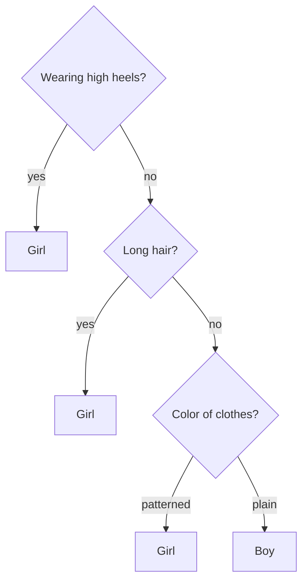
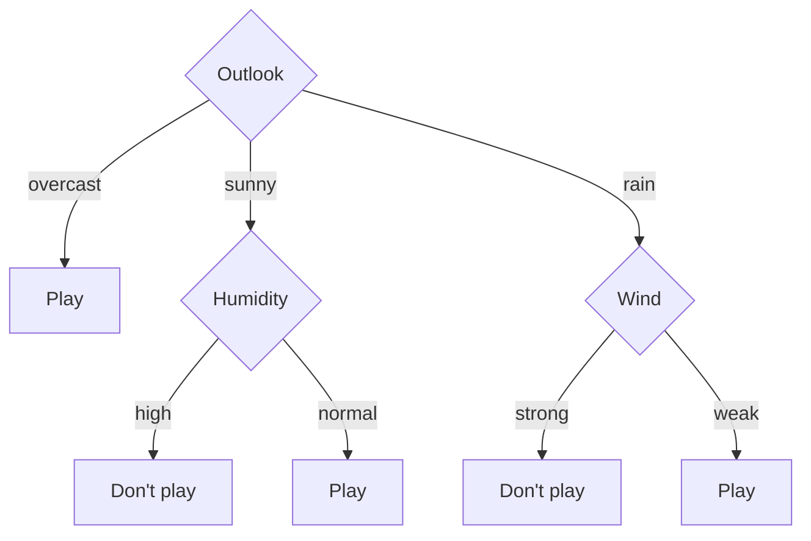

A decision tree classifies samples with a series of yes-or-no questions: first ask the question that best separates the classes, split the samples into groups according to the answer, and continue to ask questions of each group until each group belongs essentially to one class. Its structure matches the way people make judgments, and the learned model can be read directly as if-then rules, which makes it one of the most interpretable machine learning models. This chapter discusses three questions: which question is best to ask at each step (feature selection: information gain, gain ratio, the Gini index), how to generate the whole tree recursively (ID3, C4.5, CART), and how to avoid **overfitting** by keeping the tree from growing too complex (pruning). [3.4.10](/3.4.10) briefly described decision trees from the viewpoint of discriminant analysis, and [3.3.12](/3.3.12) introduced **regression trees**; this chapter gives the complete algorithms. A single decision tree is unstable and of limited accuracy; random forests and gradient boosting, which combine many trees, are among the strongest methods on tabular data, as discussed in [4.6.6](/4.6.6).

## 6.1. The Decision Tree Model

**Definition 6.1.1 (Decision Tree)** A **decision tree** is a tree structure for classifying instances, consisting of nodes and directed edges. There are two kinds of nodes: an internal node represents a test on a feature (attribute), and each of its branches corresponds to an outcome of the test; a leaf node represents a class. To classify an instance, start at the root node and follow the tests at the internal nodes to the corresponding child nodes until a leaf node is reached, and take the class of the leaf node as the prediction.

Take the problem of deciding whether a person is a boy or a girl as an example; the available features include height, weight, style of shoes, hair length, color of clothes, and so on. One possible decision tree is:



We could also ask about height first and then weight, obtaining a different tree. Which tree is better? A good tree should have little conflict with the training data (small training error) and at the same time a simple structure, so that it generalizes well to new data.

There are two equivalent ways to understand a decision tree:

- A set of rules: the path from the root to each leaf node corresponds to a rule, the tests along the path are the conditions of the rule, and the class of the leaf node is the conclusion. These rules are mutually exclusive and exhaustive: every instance is covered by exactly one rule.
- A partition of space: each internal node cuts the current region with one feature, and the leaf nodes correspond to disjoint regions of the feature space, so that the whole tree partitions the feature space into a number of "boxes," each labeled with a class. For continuous features, with tests of the form $x^{(j)} \le a$, the boxes are rectangular solids whose edges are parallel to the coordinate axes.

Given a training set $D = \{(\boldsymbol{x}_1, y_1), \dots, (\boldsymbol{x}_N, y_N)\}$, where $\boldsymbol{x}_i = (x_i^{(1)}, \dots, x_i^{(n)})$ has $n$ features and $y_i \in \{1, \dots, K\}$, there are generally many decision trees that fit the training set perfectly, and there may be none at all (samples with the same features but different classes). Choosing the best tree from among all decision trees is NP-complete (Hyafil and Rivest, 1976), so practical algorithms are all greedy heuristics: top-down, at each step choose the currently best feature to split the data, generate the subtrees recursively, and prune afterward. Decision tree learning therefore consists of three steps: feature selection, tree generation, and tree pruning.

## 6.2. Feature Selection

### 6.2.1. Entropy and Conditional Entropy

Different features have different classification power. The criterion for feature selection is that, after splitting on the feature, the "uncertainty" of the classes within the subsets should decrease as much as possible. Uncertainty is measured by entropy.

**Definition 6.2.1 (Entropy)** Let a discrete random variable $Y$ have distribution $\mathbb{P}(Y = k) = p_k$, $k = 1, \dots, K$. The **entropy** (information entropy) of $Y$ is

$$
H(Y) = -\sum_{k=1}^{K} p_k \log p_k,
$$
with the convention $0 \log 0 = 0$. When the logarithm is to base 2, the unit is the bit.

Entropy satisfies $0 \le H(Y) \le \log K$: when $Y$ takes some value with probability 1, the entropy is 0 and there is no uncertainty at all; the entropy is largest when $Y$ is uniformly distributed. For binary classification, $H(p) = -p\log_2 p - (1 - p)\log_2(1 - p)$, which equals 1 bit at $p = 1/2$. Entropy can be understood as the average number of bits needed to transmit the value of $Y$ with an optimal code.

For a dataset $D$, estimating probabilities by the frequencies of the classes gives the empirical entropy

$$
H(D) = -\sum_{k=1}^{K} \frac{\lvert C_k\rvert}{\lvert D\rvert} \log_2 \frac{\lvert C_k\rvert}{\lvert D\rvert},
$$
where $C_k$ is the set of samples in $D$ belonging to class $k$ and $\lvert\cdot\rvert$ denotes the number of samples.

**Definition 6.2.2 (Conditional Entropy)** Suppose a feature $A$ has $m$ possible values $a_1, \dots, a_m$ and divides $D$ into subsets $D_1, \dots, D_m$ ($D_i$ is the set of samples with $A = a_i$), and let $D_{ik} = D_i \cap C_k$. The empirical **conditional entropy** of $D$ given the feature $A$ is

$$
H(D \mid A) = \sum_{i=1}^{m} \frac{\lvert D_i\rvert}{\lvert D\rvert} H(D_i) = -\sum_{i=1}^{m} \frac{\lvert D_i\rvert}{\lvert D\rvert} \sum_{k=1}^{K} \frac{\lvert D_{ik}\rvert}{\lvert D_i\rvert} \log_2 \frac{\lvert D_{ik}\rvert}{\lvert D_i\rvert}.
$$

It is the average of the entropies of the subsets after splitting on $A$, weighted by the proportions of samples.

### 6.2.2. Information Gain

**Definition 6.2.3 (Information Gain)** The **information gain** of a feature $A$ with respect to a dataset $D$ is

$$
g(D, A) = H(D) - H(D \mid A).
$$

Information gain expresses how much the uncertainty about the class decreases once the value of feature $A$ is known. In probability theory, $H(Y) - H(Y \mid X)$ is the mutual information of $X$ and $Y$, so the information gain is the empirical mutual information between the class and the feature, and it is always nonnegative (by Jensen's inequality). A feature with large information gain has strong classification power, and the ID3 algorithm chooses the feature with the largest information gain at each step.

**Example 6.2.1** The table below is the classic data that Quinlan (1986) used to illustrate ID3: deciding from the weather whether to go out and play tennis, over 14 days.

| No. | Outlook | Temperature | Humidity | Wind | Play |
|---|---|---|---|---|---|
| 1 | Sunny | Hot | High | Weak | No |
| 2 | Sunny | Hot | High | Strong | No |
| 3 | Overcast | Hot | High | Weak | Yes |
| 4 | Rain | Mild | High | Weak | Yes |
| 5 | Rain | Cool | Normal | Weak | Yes |
| 6 | Rain | Cool | Normal | Strong | No |
| 7 | Overcast | Cool | Normal | Strong | Yes |
| 8 | Sunny | Mild | High | Weak | No |
| 9 | Sunny | Cool | Normal | Weak | Yes |
| 10 | Rain | Mild | Normal | Weak | Yes |
| 11 | Sunny | Mild | Normal | Strong | Yes |
| 12 | Overcast | Mild | High | Strong | Yes |
| 13 | Overcast | Hot | Normal | Weak | Yes |
| 14 | Rain | Mild | High | Strong | No |

On 9 days they played and on 5 they did not, so $H(D) = -\frac{9}{14}\log_2\frac{9}{14} - \frac{5}{14}\log_2\frac{5}{14} \approx 0.940$. Splitting on "outlook": sunny 5 days (2 yes, 3 no), overcast 4 days (all yes), rain 5 days (3 yes, 2 no), so

$$
H(D \mid \text{outlook}) = \frac{5}{14}H\Bigl(\frac25\Bigr) + \frac{4}{14} \cdot 0 + \frac{5}{14}H\Bigl(\frac35\Bigr) = \frac{10}{14} \times 0.971 \approx 0.694,
$$
and the information gain is $g(D, \text{outlook}) \approx 0.940 - 0.694 = 0.247$. Similarly, humidity gives $0.152$, wind $0.048$, and temperature $0.029$. So the root node chooses "outlook"; the "overcast" subset is already all "yes" and becomes a leaf node.

### 6.2.3. Gain Ratio

Information gain is biased toward features with many values. An extreme example is to treat the "number" column as a feature: it splits the 14 samples into 14 singleton subsets, each with entropy 0, so the information gain is $H(D) = 0.940$, larger than that of any real feature, yet such a split is of no use for new samples. To correct this bias, C4.5 normalizes by the entropy of the values of the feature itself.

**Definition 6.2.4 (Gain Ratio)** The **gain ratio** (also called the information gain ratio) of a feature $A$ with respect to a dataset $D$ is

$$
g_R(D, A) = \frac{g(D, A)}{H_A(D)}, \qquad H_A(D) = -\sum_{i=1}^{m} \frac{\lvert D_i\rvert}{\lvert D\rvert} \log_2 \frac{\lvert D_i\rvert}{\lvert D\rvert},
$$
where $H_A(D)$ is the entropy of the partition of $D$ by the values of feature $A$ (called the split information) and $m$ is the number of values of $A$.

The more values there are and the more even the split, the larger $H_A(D)$. In Example 6.2.1, the gain ratio of outlook is $0.247 / 1.577 \approx 0.156$ and that of humidity is $0.152 / 1 = 0.152$.

The gain ratio in turn is biased toward features with very uneven splits: if one value contains almost all the samples, $H_A(D)$ is close to 0 and the gain ratio can be very large. Moreover, it does not completely eliminate the bias toward features with many values: in the example above, the gain ratio of the "number" column is $0.940 / \log_2 14 \approx 0.247$, still larger than that of outlook. So C4.5 adopts a compromise heuristic: first find the features whose information gain is above average, and then choose from among them the one with the largest gain ratio.

### 6.2.4. The Gini Index

CART uses a different function to measure impurity.

**Definition 6.2.5 (Gini Index)** Let the proportion of samples of class $k$ in a dataset $D$ be $p_k$. The **Gini index** of $D$ is

$$
\operatorname{Gini}(D) = \sum_{k=1}^{K} p_k(1 - p_k) = 1 - \sum_{k=1}^{K} p_k^2.
$$
If a feature $A$ splits $D$ into two parts $D_1$ and $D_2$, the Gini index after the split is $\operatorname{Gini}(D, A) = \frac{\lvert D_1\rvert}{\lvert D\rvert}\operatorname{Gini}(D_1) + \frac{\lvert D_2\rvert}{\lvert D\rvert}\operatorname{Gini}(D_2)$.

The Gini index is the probability that two samples drawn at random from $D$ (with replacement) have different classes; it is also the expected misclassification rate when samples are labeled at random according to the class proportions. Like entropy, it is 0 when $D$ is pure and largest when the classes are uniform, and CART chooses the feature and split point that minimize the Gini index after the split. In Example 6.2.1, $\operatorname{Gini}(D) = 1 - (9/14)^2 - (5/14)^2 \approx 0.459$.


In practice, entropy and the Gini index rarely choose different splits, and the Gini index needs no logarithm and is slightly faster. The misclassification rate $1 - \max_k p_k$ looks the most direct but is unsuitable for growing trees: it is piecewise linear, and many clearly useful splits (splitting a node into a purer child and a slightly impure one) do not change the misclassification rate, whereas the strictly concave entropy and Gini index can recognize them.

## 6.3. Generating Decision Trees

### 6.3.1. The ID3 Algorithm

**Algorithm 6.3.1 (ID3)** Input: a training set $D$, a feature set $\mathcal{A}$, and a threshold $\varepsilon > 0$. Output: a decision tree $T$.

1. If all samples in $D$ belong to the same class $C_k$, let $T$ be a single-node tree with class $C_k$ and return $T$.
2. If $\mathcal{A} = \varnothing$, let $T$ be a single-node tree whose class is the class with the most samples in $D$, and return $T$.
3. Otherwise compute the information gain of each feature in $\mathcal{A}$ with respect to $D$ and choose the feature $A_g$ with the largest information gain.
4. If $g(D, A_g) < \varepsilon$, let $T$ be a single-node tree whose class is the class with the most samples in $D$, and return $T$.
5. Otherwise, for each value $a_i$ of $A_g$, split $D$ into the subset $D_i$ with $A_g = a_i$, as a child node; if some $D_i$ is empty, take the class with the most samples in $D$ as the class of that child node.
6. For each nonempty $D_i$, call steps 1–5 recursively with $D_i$ as the training set and $\mathcal{A} \setminus \{A_g\}$ as the feature set to obtain the subtree $T_i$, and return the tree consisting of $A_g$ and the $T_i$.

A few remarks: a discrete feature is used at most once on a path (step 6 removes it from the feature set), but different branches may use the same feature; the tree does not necessarily use all features; the samples in a leaf node may not all belong to the same class (steps 2 and 4); and because the algorithm is greedy, the tree obtained is not guaranteed to be optimal.

```python
import math
from collections import Counter

FEATURES = ["outlook", "temperature", "humidity", "wind"]
ROWS = """sunny hot high weak no
sunny hot high strong no
overcast hot high weak yes
rain mild high weak yes
rain cool normal weak yes
rain cool normal strong no
overcast cool normal strong yes
sunny mild high weak no
sunny cool normal weak yes
rain mild normal weak yes
sunny mild normal strong yes
overcast mild high strong yes
overcast hot normal weak yes
rain mild high strong no"""
DATA = [dict(zip(FEATURES + ["play"], line.split())) for line in ROWS.splitlines()]

def entropy(rows):
    counts = Counter(r["play"] for r in rows)
    n = len(rows)
    return -sum(c / n * math.log2(c / n) for c in counts.values())

def gini(rows):
    counts = Counter(r["play"] for r in rows)
    n = len(rows)
    return 1 - sum((c / n) ** 2 for c in counts.values())

def split(rows, a):
    parts = {}
    for r in rows:
        parts.setdefault(r[a], []).append(r)
    return parts

def gain(rows, a):
    """Information gain g(D, A) = H(D) - H(D | A)."""
    n = len(rows)
    return entropy(rows) - sum(len(p) / n * entropy(p) for p in split(rows, a).values())

def gain_ratio(rows, a):
    n = len(rows)
    split_info = -sum(len(p) / n * math.log2(len(p) / n) for p in split(rows, a).values())
    return gain(rows, a) / split_info

def id3(rows, features, eps=1e-9):
    labels = Counter(r["play"] for r in rows)
    majority = labels.most_common(1)[0][0]
    if len(labels) == 1 or not features:
        return majority                                   # leaf
    best = max(features, key=lambda a: gain(rows, a))
    if gain(rows, best) < eps:
        return majority
    rest = [a for a in features if a != best]
    return (best, {v: id3(p, rest, eps) for v, p in sorted(split(rows, best).items())})

def show(tree, indent=""):
    if isinstance(tree, str):
        print(indent + "-> " + tree)
        return
    a, branches = tree
    for v, sub in branches.items():
        print(f"{indent}{a} = {v}")
        show(sub, indent + "    ")

print(f"H(D) = {entropy(DATA):.3f}, Gini(D) = {gini(DATA):.3f}")
for a in FEATURES:
    print(f"{a:12s} gain {gain(DATA, a):.3f}  gain ratio {gain_ratio(DATA, a):.3f}")
show(id3(DATA, FEATURES))

for i, r in enumerate(DATA):                              # add a useless identifier feature
    r["day"] = f"d{i + 1}"
print(f"day          gain {gain(DATA, 'day'):.3f}  gain ratio {gain_ratio(DATA, 'day'):.3f}")
```

```text
H(D) = 0.940, Gini(D) = 0.459
outlook      gain 0.247  gain ratio 0.156
temperature  gain 0.029  gain ratio 0.019
humidity     gain 0.152  gain ratio 0.152
wind         gain 0.048  gain ratio 0.049
outlook = overcast
    -> yes
outlook = rain
    wind = strong
        -> no
    wind = weak
        -> yes
outlook = sunny
    humidity = high
        -> no
    humidity = normal
        -> yes
day          gain 0.940  gain ratio 0.247
```

The resulting decision tree is:



It uses only three features, and temperature does not appear; all 5 leaf nodes are pure, and the training error is 0.

### 6.3.2. The C4.5 Algorithm

C4.5 (Quinlan, 1993) makes several improvements on ID3:

- It uses the gain ratio (together with the heuristic of §6.2.3) instead of information gain to select features;
- It handles continuous features: sort the samples by the value of feature $A$, try split points $a_0$ at the midpoints between adjacent distinct values, put the samples with $A \le a_0$ into the left subtree and those with $A > a_0$ into the right subtree, and choose the best split point. A continuous feature can be used several times on the same path (with different split points each time);
- It handles missing values: a sample whose feature value is missing enters all the branches at once with fractional weights, in proportion to the known samples in each branch;
- After generation it prunes (§6.4), and can convert the tree into a set of rules that are then simplified one by one.

## 6.4. Pruning

### 6.4.1. Overfitting and Pruning

If the tree keeps growing by the algorithm above, it tries to classify the training set perfectly: the leaf nodes become more and more numerous, each holds fewer and fewer samples, and in the end even the noise in the training data is "memorized" one item at a time. Such a tree is very accurate on the training set but poor on new data, which is **overfitting**.

**Definition 6.4.1 (Decision Tree Pruning)** The process of simplifying a generated decision tree, that is, cutting off some subtrees or leaf nodes, making their parent node a new leaf node with the class that has the most samples in it, in order to reduce model complexity and improve generalization, is called **decision tree pruning**. Stopping the splitting early during generation is called **pre-pruning**, and first generating the complete tree and then pruning bottom-up is called **post-pruning**.

Stopping conditions for pre-pruning can be: the number of samples at a node falls below a threshold, the depth of the tree reaches a limit, or the impurity decrease from the best split is below a threshold (the $\varepsilon$ of ID3). Pre-pruning is simple and saves time, but it is "shortsighted": a split may have little effect by itself and yet make the splits below it very useful (exclusive or is such a case), and stopping early misses them. So post-pruning is more commonly used.

When there is plenty of data, a portion can be held out as a validation set: generate the tree with the training set, then examine each internal node bottom-up, and prune it if turning its subtree into a leaf does not increase the error on the validation set, until no more pruning is possible (reduced-error pruning); finally the pruned tree is evaluated on an independent test set. When data are scarce, holding out a validation set is too wasteful, and one can prune directly on the training set using a loss function that penalizes complexity.

### 6.4.2. Loss-Based Pruning

Let the number of leaf nodes of a tree $T$ be $\lvert T\rvert$, let leaf node $t$ have $N_t$ samples, of which $N_{tk}$ belong to class $k$, let $H_t(T) = -\sum_k \frac{N_{tk}}{N_t}\log\frac{N_{tk}}{N_t}$ be the empirical entropy at leaf node $t$, and let $\alpha \ge 0$ be a parameter. Define the loss function

$$
C_\alpha(T) = \sum_{t=1}^{\lvert T\rvert} N_t H_t(T) + \alpha\lvert T\rvert = C(T) + \alpha\lvert T\rvert.
$$
$C(T) = -\sum_t\sum_k N_{tk}\log\frac{N_{tk}}{N_t}$ measures how well the model fits the training data (it is the negative log-likelihood of the training data when the class frequencies at the leaves are used as probabilities), $\lvert T\rvert$ measures the model complexity, and $\alpha$ balances the two. A large $\alpha$ favors simple trees, and $\alpha = 0$ considers only the fit, with no pruning. This is again the **structural risk minimization** of [4.5.5](/4.5.5) §5.1.1.

**Algorithm 6.4.1 (Loss-Based Pruning)** Given a generated tree $T$ and a parameter $\alpha$: compute the empirical entropy of each node; recursively retract upward from the leaf nodes, and if after a group of leaf nodes is retracted into their parent node the loss $C_\alpha$ of the whole tree is not greater than before the retraction, prune and turn the parent node into a leaf node; repeat until no more can be done, obtaining the subtree $T_\alpha$ with the smallest loss.

Since both $C(T)$ and $\lvert T\rvert$ in the loss function decompose over leaf nodes, deciding whether to make a retraction only requires comparing local losses, and the pruning can be implemented by **dynamic programming**.

### 6.4.3. Cost-Complexity Pruning

Algorithm 6.4.1 requires $\alpha$ to be given in advance. The cost-complexity pruning of CART (Breiman et al., 1984) considers all $\alpha$ together. Let $R(T)$ be the error of tree $T$ on the training set (the number of misclassifications, or the sum of squared errors for regression), and let $R_\alpha(T) = R(T) + \alpha\lvert T\rvert$. For an internal node $t$, let $T_t$ be the subtree rooted at $t$. When $T_t$ is pruned into a single leaf node $t$, the error increases by $R(t) - R(T_t)$ and the number of leaf nodes decreases by $\lvert T_t\rvert - 1$; the critical value at which the two losses are equal is

$$
g(t) = \frac{R(t) - R(T_t)}{\lvert T_t\rvert - 1}.
$$
When $\alpha < g(t)$ it is better to keep the subtree, and when $\alpha \ge g(t)$ it is better to prune it.

**Algorithm 6.4.2 (Cost-Complexity Pruning)** Starting from the complete tree $T_0$, let $k = 0$. Compute $g(t)$ for every internal node of $T_k$, prune the subtree of the node $t$ with the smallest $g(t)$ (the "weakest link") to obtain $T_{k+1}$, and let $\alpha_{k+1} = \min_t g(t)$; repeat until only the root remains. After obtaining the sequence of subtrees $T_0 \supset T_1 \supset \cdots \supset T_m$, choose the subtree with the smallest error from it using a validation set or **cross-validation**.

Breiman et al. proved that for each $\alpha \ge 0$ there is a unique smallest subtree $T(\alpha)$ that minimizes $R_\alpha$; it becomes smaller in a nested way as $\alpha$ increases; and for $\alpha \in [\alpha_k, \alpha_{k+1})$, $T(\alpha) = T_k$. So the sequence above contains the optimal subtrees for all $\alpha$, and choosing $\alpha$ requires comparing only among finitely many candidates.

![Cost-complexity pruning of a CART classification tree on two-dimensional data: the left panel is the fully grown tree (32 leaf nodes), whose splits follow the noise in the training data; the middle panel is the pruned tree chosen by validation error (6 leaf nodes), closer to the true boundary (dashed line); the right panel shows the training and validation errors along the pruning sequence, with the training error decreasing monotonically as leaf nodes increase and the validation error first falling and then rising](./plots/cart-pruning.py)

## 6.5. CART

CART (classification and regression tree) was proposed by Breiman, Friedman, Olshen, and Stone (1984), and its main differences from ID3 and C4.5 are:

- The tree is binary: the test at each internal node is yes or no, namely $x^{(j)} \le a$ for continuous features and $x^{(j)} = a$ (or $x^{(j)} \in S$) for discrete features;
- Classification trees use the Gini index to choose features and split points, and regression trees use the squared error;
- It uses cost-complexity pruning (§6.4.3).

A **regression tree** gives a real number at a leaf node, taken to be the mean of the responses in that region. At a node, for each feature $j$ and split point $s$, split the data into $R_1(j, s) = \{\boldsymbol{x} : x^{(j)} \le s\}$ and $R_2(j, s) = \{\boldsymbol{x} : x^{(j)} > s\}$ and solve

$$
\min_{j, s}\Bigl[\sum_{\boldsymbol{x}_i \in R_1(j, s)} (y_i - \bar y_1)^2 + \sum_{\boldsymbol{x}_i \in R_2(j, s)} (y_i - \bar y_2)^2\Bigr],
$$
where $\bar y_1$ and $\bar y_2$ are the means of $y$ in the two regions. For a fixed feature, after sorting the samples by that feature, the squared errors of the left and right parts can be updated in $O(1)$ time using prefix sums ($\sum (y - \bar y)^2 = \sum y^2 - (\sum y)^2/n$), so scanning all split points takes only $O(N \log N)$, mostly the time for sorting. A regression tree generated step by step in this way is called a least-squares regression tree.

```python
import numpy as np

def best_split(x, y):
    """Best threshold on one feature for squared error, in O(n log n) via prefix sums."""
    order = np.argsort(x)
    xs, ys = x[order], y[order]
    n = len(ys)
    s1, s2 = np.cumsum(ys), np.cumsum(ys**2)
    best = (np.inf, None)
    for k in range(1, n):                         # left = first k points
        if xs[k - 1] == xs[k]:
            continue
        sse_left = s2[k - 1] - s1[k - 1] ** 2 / k
        sse_right = (s2[-1] - s2[k - 1]) - (s1[-1] - s1[k - 1]) ** 2 / (n - k)
        if sse_left + sse_right < best[0]:
            best = (sse_left + sse_right, (xs[k - 1] + xs[k]) / 2)
    return best

def grow(x, y, depth, indent=""):
    sse, thr = best_split(x, y) if depth > 0 and len(y) > 1 else (np.inf, None)
    if thr is None:
        print(f"{indent}leaf: predict {y.mean():.2f} ({len(y)} points)")
        return
    print(f"{indent}x <= {thr:.2f}  (SSE {np.sum((y - y.mean())**2):.2f} -> {sse:.2f})")
    m = x <= thr
    grow(x[m], y[m], depth - 1, indent + "    ")
    print(f"{indent}x > {thr:.2f}")
    grow(x[~m], y[~m], depth - 1, indent + "    ")

rng = np.random.default_rng(1)
x = np.arange(1, 21, dtype=float)
y = np.where(x <= 6, 2.0, np.where(x <= 14, 5.0, 3.0)) + rng.normal(0, 0.4, 20)
grow(x, y, depth=2)
```

```text
x <= 6.50  (SSE 33.13 -> 16.05)
    x <= 4.50  (SSE 0.52 -> 0.43)
        leaf: predict 2.02 (4 points)
    x > 4.50
        leaf: predict 2.27 (2 points)
x > 6.50
    x <= 14.50  (SSE 15.53 -> 0.45)
        leaf: predict 5.02 (8 points)
    x > 14.50
        leaf: predict 2.92 (6 points)
```

The data are generated from three constant segments (2, 5, 3) plus noise. The depth-2 tree correctly finds the two split points $x = 6.5$ and $x = 14.5$; the split in the left subtree reduces the squared error only from 0.52 to 0.43, which is almost entirely fitting noise, and cost-complexity pruning would cut it first.

## 6.6. Characteristics and Developments of Decision Trees

| Advantages | Disadvantages |
|---|---|
| The model is readable and can be converted into rules | The accuracy of a single tree is generally not high |
| No need to standardize features; handles discrete and continuous features and missing values | Unstable: a small change in the data may completely change the structure of the tree |
| Fast in both training and prediction | Axis-parallel splits have difficulty representing oblique boundaries |
| Performs feature selection automatically and is insensitive to irrelevant features | Greedy growth does not guarantee a global optimum |

The two shortcomings of instability and limited accuracy can be remedied by ensemble learning ([4.6.6](/4.6.6)): a random forest (Breiman, 2001) draws samples with replacement (the **bootstrap**), chooses the split at each node only from a randomly selected subset of the features, trains many unpruned trees, and takes a vote, and the out-of-bag samples that were not drawn can be used to estimate the generalization error; gradient boosted trees fit the residuals of the preceding trees one tree at a time. Gradient boosted trees, represented by XGBoost (2016), LightGBM (2017), and CatBoost, have long outperformed deep neural networks on tabular data (Grinsztajn et al., 2022) and remain the first choice in data competitions and in industry for structured data; recently, tabular foundation models (such as TabPFN, published in Nature in 2025) have begun to compete with them on small tabular datasets.

## Summary

| Algorithm | Shape of tree | Feature selection | Continuous features | Pruning |
|---|---|---|---|---|
| ID3 | Multiway | Information gain | Not supported | None (only the threshold $\varepsilon$) |
| C4.5 | Multiway | Gain ratio (with the information gain heuristic) | Binary split points | Post-pruning |
| CART | Binary | Gini index (classification), squared error (regression) | Binary split points | Cost-complexity pruning |

- A decision tree partitions the feature space into regions and can be read as mutually exclusive and exhaustive rules; finding the optimal tree is NP-complete, and practical algorithms grow the tree greedily from the top down.
- Information gain $H(D) - H(D \mid A)$ is the empirical mutual information between the class and the feature and is biased toward features with many values; the gain ratio normalizes by the split information; the Gini index is the probability that two random samples have different classes.
- A fully grown tree overfits and needs pruning: pre-pruning stops early, and post-pruning uses a validation set or the loss function $C_\alpha(T) = C(T) + \alpha\lvert T\rvert$; the weakest-link pruning of CART gives a nested sequence that contains the optimal subtrees for all $\alpha$.
- A single tree is unstable; random forests and gradient boosted trees combine many trees and are among the strongest methods on tabular data.
