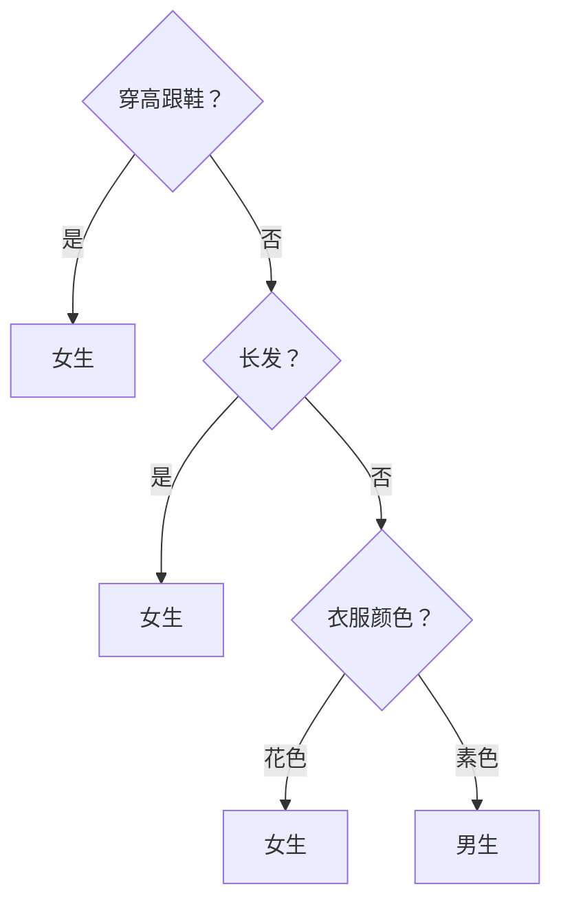
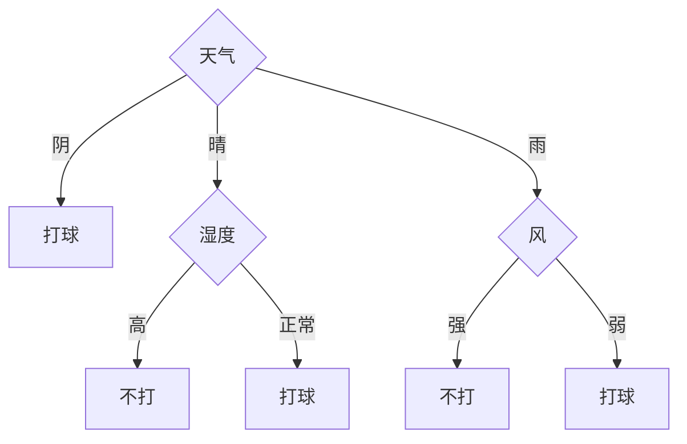

决策树用一连串"是或否"的问题对样本分类：先问一个最能区分类别的问题，按回答把样本分成几组，再对每组继续提问，直到每组基本属于同一类。它的结构和人做判断的过程一致，学到的模型可以直接读成 if-then 规则，因而是最容易解释的机器学习模型之一。本章讨论三个问题：每一步问哪个问题最好（特征选择：信息增益、增益率、Gini 指数），怎样递归地生成整棵树（ID3、C4.5、CART），以及怎样避免树长得过于复杂而**过拟合**（剪枝）。[3.4.10](/3.4.10) 曾从判别分析的角度简述过决策树，[3.3.12](/3.3.12) 介绍过**回归树**；本章给出完整的算法。单棵决策树不稳定、精度有限，把许多棵树组合起来的随机森林与梯度提升是表格数据上最强的方法之一，见 [4.6.6](/4.6.6)。

## 6.1. 决策树模型

**定义 6.1.1（决策树）** **决策树**是对实例进行分类的树形结构，由结点和有向边组成。结点分为两种：内部结点表示对一个特征（属性）的测试，它的每个分支对应测试的一种结果；叶结点表示一个类别。对一个实例分类时，从根结点开始，依次按内部结点的测试走到相应的子结点，直到到达叶结点，以叶结点的类别作为预测。

以判断一个人是男生还是女生为例，可用的特征有身高、体重、鞋的式样、头发长度、衣服颜色等。一棵可能的决策树是：



也可以先问身高、再问体重，得到另一棵树。哪一棵更好？好的树应当与训练数据的矛盾小（训练误差小），同时结构简单，对新数据有好的泛化能力。

决策树有两种等价的理解方式：

- 规则集：从根到每个叶结点的路径对应一条规则，路径上的测试是规则的条件，叶结点的类别是结论。这些规则互斥而且完备：每个实例恰好被一条规则覆盖。
- 空间划分：每个内部结点用一个特征把当前区域切开，叶结点对应特征空间中互不相交的区域，整棵树把特征空间划分为若干个"盒子"，每个盒子标一个类别。对连续特征，用 $x^{(j)} \le a$ 形式的测试，盒子就是各边与坐标轴平行的长方体。

给定训练集 $D = \{(\boldsymbol{x}_1, y_1), \dots, (\boldsymbol{x}_N, y_N)\}$，$\boldsymbol{x}_i = (x_i^{(1)}, \dots, x_i^{(n)})$ 有 $n$ 个特征，$y_i \in \{1, \dots, K\}$。能完全拟合训练集的决策树一般有很多棵，也可能一棵都没有（相同特征的样本类别不同）。从所有决策树中选出最优的一棵是 NP 完全问题（Hyafil 与 Rivest，1976），所以实际的算法都是贪心的启发式方法：自顶向下，每一步选择当前最好的特征划分数据，递归地生成子树，然后再剪枝。决策树学习因此包括三步：特征选择、决策树的生成、决策树的剪枝。

## 6.2. 特征选择

### 6.2.1. 信息熵与条件熵

不同的特征有不同的分类能力。特征选择的准则是：按这个特征划分之后，各子集中类别的"不确定性"减少得越多越好。不确定性用熵来度量。

**定义 6.2.1（信息熵）** 设离散随机变量 $Y$ 的分布为 $\mathbb{P}(Y = k) = p_k$，$k = 1, \dots, K$。$Y$ 的**信息熵**（简称熵）为

$$
H(Y) = -\sum_{k=1}^{K} p_k \log p_k,
$$
约定 $0 \log 0 = 0$。对数以 2 为底时单位是比特。

熵满足 $0 \le H(Y) \le \log K$：$Y$ 取某个值的概率为 1 时熵为 0，没有任何不确定性；$Y$ 均匀分布时熵最大。二分类时，$H(p) = -p\log_2 p - (1 - p)\log_2(1 - p)$，$p = 1/2$ 时为 1 比特。熵可以理解为用最优编码传送 $Y$ 的取值所需的平均比特数。

对数据集 $D$，用各类的频率估计概率，得到经验熵

$$
H(D) = -\sum_{k=1}^{K} \frac{\lvert C_k\rvert}{\lvert D\rvert} \log_2 \frac{\lvert C_k\rvert}{\lvert D\rvert},
$$
其中 $C_k$ 是 $D$ 中属于第 $k$ 类的样本的集合，$\lvert\cdot\rvert$ 表示样本个数。

**定义 6.2.2（条件熵）** 设特征 $A$ 有 $m$ 个可能取值 $a_1, \dots, a_m$，它把 $D$ 划分为子集 $D_1, \dots, D_m$（$D_i$ 是 $A = a_i$ 的样本），$D_{ik} = D_i \cap C_k$。特征 $A$ 给定条件下 $D$ 的经验**条件熵**为

$$
H(D \mid A) = \sum_{i=1}^{m} \frac{\lvert D_i\rvert}{\lvert D\rvert} H(D_i) = -\sum_{i=1}^{m} \frac{\lvert D_i\rvert}{\lvert D\rvert} \sum_{k=1}^{K} \frac{\lvert D_{ik}\rvert}{\lvert D_i\rvert} \log_2 \frac{\lvert D_{ik}\rvert}{\lvert D_i\rvert}.
$$

它是按 $A$ 划分之后，各子集的熵按样本比例的加权平均。

### 6.2.2. 信息增益

**定义 6.2.3（信息增益）** 特征 $A$ 对数据集 $D$ 的**信息增益**为

$$
g(D, A) = H(D) - H(D \mid A).
$$

信息增益表示得知特征 $A$ 的取值之后，类别的不确定性减少的程度。在概率论中，$H(Y) - H(Y \mid X)$ 就是 $X$ 与 $Y$ 的互信息，所以信息增益是类别与特征之间的经验互信息，总是非负的（由 Jensen 不等式）。信息增益大的特征分类能力强，ID3 算法每一步选择信息增益最大的特征。

**例 6.2.1** 下表是 Quinlan（1986）用来说明 ID3 的经典数据：根据天气情况决定是否外出打网球，共 14 天。

| 编号 | 天气 | 温度 | 湿度 | 风 | 打球 |
|---|---|---|---|---|---|
| 1 | 晴 | 热 | 高 | 弱 | 否 |
| 2 | 晴 | 热 | 高 | 强 | 否 |
| 3 | 阴 | 热 | 高 | 弱 | 是 |
| 4 | 雨 | 适中 | 高 | 弱 | 是 |
| 5 | 雨 | 凉 | 正常 | 弱 | 是 |
| 6 | 雨 | 凉 | 正常 | 强 | 否 |
| 7 | 阴 | 凉 | 正常 | 强 | 是 |
| 8 | 晴 | 适中 | 高 | 弱 | 否 |
| 9 | 晴 | 凉 | 正常 | 弱 | 是 |
| 10 | 雨 | 适中 | 正常 | 弱 | 是 |
| 11 | 晴 | 适中 | 正常 | 强 | 是 |
| 12 | 阴 | 适中 | 高 | 强 | 是 |
| 13 | 阴 | 热 | 正常 | 弱 | 是 |
| 14 | 雨 | 适中 | 高 | 强 | 否 |

9 天打球、5 天不打，$H(D) = -\frac{9}{14}\log_2\frac{9}{14} - \frac{5}{14}\log_2\frac{5}{14} \approx 0.940$。按"天气"划分：晴 5 天（2 是 3 否），阴 4 天（全是），雨 5 天（3 是 2 否），

$$
H(D \mid \text{天气}) = \frac{5}{14}H\Bigl(\frac25\Bigr) + \frac{4}{14} \cdot 0 + \frac{5}{14}H\Bigl(\frac35\Bigr) = \frac{10}{14} \times 0.971 \approx 0.694,
$$
信息增益 $g(D, \text{天气}) \approx 0.940 - 0.694 = 0.247$。同样算得湿度 $0.152$、风 $0.048$、温度 $0.029$。所以根结点选"天气"；"阴"的子集已全部为"是"，成为叶结点。

### 6.2.3. 增益率

信息增益偏向取值多的特征。极端的例子是把"编号"也当作特征：它把 14 个样本分成 14 个单元素子集，每个子集的熵都是 0，信息增益为 $H(D) = 0.940$，比任何真正的特征都大，但这样的划分对新样本毫无用处。为了校正这种偏向，C4.5 用特征本身取值的熵做归一化。

**定义 6.2.4（增益率）** 特征 $A$ 对数据集 $D$ 的**增益率**（又称信息增益比）为

$$
g_R(D, A) = \frac{g(D, A)}{H_A(D)}, \qquad H_A(D) = -\sum_{i=1}^{m} \frac{\lvert D_i\rvert}{\lvert D\rvert} \log_2 \frac{\lvert D_i\rvert}{\lvert D\rvert},
$$
其中 $H_A(D)$ 是 $D$ 按特征 $A$ 的取值划分的熵（称为分裂信息），$m$ 是 $A$ 的取值个数。

取值越多、划分越均匀，$H_A(D)$ 越大。例 6.2.1 中，天气的增益率为 $0.247 / 1.577 \approx 0.156$，湿度为 $0.152 / 1 = 0.152$。

增益率又反过来偏向划分很不均匀的特征：若某个取值几乎包含全部样本，$H_A(D)$ 接近 0，增益率可以很大。而且它并没有完全消除对取值多的特征的偏向：上例中"编号"的增益率为 $0.940 / \log_2 14 \approx 0.247$，仍然比天气大。所以 C4.5 采用一个折中的启发式：先找出信息增益高于平均水平的特征，再从中选增益率最大的。

### 6.2.4. Gini 指数

CART 用另一种度量不纯度的函数。

**定义 6.2.5（Gini 指数）** 设数据集 $D$ 中第 $k$ 类样本的比例为 $p_k$，$D$ 的 **Gini 指数**为

$$
\operatorname{Gini}(D) = \sum_{k=1}^{K} p_k(1 - p_k) = 1 - \sum_{k=1}^{K} p_k^2.
$$
若特征 $A$ 把 $D$ 分为 $D_1$、$D_2$ 两部分，划分后的 Gini 指数为 $\operatorname{Gini}(D, A) = \frac{\lvert D_1\rvert}{\lvert D\rvert}\operatorname{Gini}(D_1) + \frac{\lvert D_2\rvert}{\lvert D\rvert}\operatorname{Gini}(D_2)$。

Gini 指数是从 $D$ 中随机抽取两个样本（有放回）、它们类别不同的概率；也是按各类的比例随机给样本贴标签时的期望误判率。它与熵一样在 $D$ 纯净时为 0、各类均匀时最大，CART 选择使划分后的 Gini 指数最小的特征与切分点。例 6.2.1 中 $\operatorname{Gini}(D) = 1 - (9/14)^2 - (5/14)^2 \approx 0.459$。


实践中熵与 Gini 指数选出的划分很少有差别，Gini 指数不需要计算对数，略快一些。误分类率 $1 - \max_k p_k$ 看似最直接，却不适合用来生长树：它是分段线性的，许多明显有用的划分（把一个结点分成一个更纯的子结点和一个稍不纯的子结点）不改变误分类率，而严格凹的熵和 Gini 指数能识别出它们。

## 6.3. 决策树的生成

### 6.3.1. ID3 算法

**算法 6.3.1（ID3）** 输入：训练集 $D$，特征集 $\mathcal{A}$，阈值 $\varepsilon > 0$。输出：决策树 $T$。

1. 若 $D$ 中所有样本属于同一类 $C_k$，则 $T$ 为单结点树，以 $C_k$ 为类别，返回 $T$。
2. 若 $\mathcal{A} = \varnothing$，则 $T$ 为单结点树，以 $D$ 中样本数最多的类为类别，返回 $T$。
3. 否则计算 $\mathcal{A}$ 中各特征对 $D$ 的信息增益，选择信息增益最大的特征 $A_g$。
4. 若 $g(D, A_g) < \varepsilon$，则 $T$ 为单结点树，以 $D$ 中样本数最多的类为类别，返回 $T$。
5. 否则对 $A_g$ 的每个取值 $a_i$，按 $A_g = a_i$ 把 $D$ 划分为子集 $D_i$，作为子结点；若某个 $D_i$ 为空，以 $D$ 中样本数最多的类作为该子结点的类别。
6. 对每个非空的 $D_i$，以 $D_i$ 为训练集、$\mathcal{A} \setminus \{A_g\}$ 为特征集，递归调用第 1–5 步，得到子树 $T_i$，返回由 $A_g$ 及各 $T_i$ 组成的树。

几点说明：同一条路径上一个离散特征至多使用一次（第 6 步把它从特征集中删去），但不同的分支可以使用同一个特征；树不一定用到所有特征；叶结点中的样本可能不全属于同一类（第 2、4 步）；由于是贪心算法，得到的树不保证最优。

```python
import math
from collections import Counter

FEATURES = ["outlook", "temperature", "humidity", "wind"]
ROWS = """sunny hot high weak no
sunny hot high strong no
overcast hot high weak yes
rain mild high weak yes
rain cool normal weak yes
rain cool normal strong no
overcast cool normal strong yes
sunny mild high weak no
sunny cool normal weak yes
rain mild normal weak yes
sunny mild normal strong yes
overcast mild high strong yes
overcast hot normal weak yes
rain mild high strong no"""
DATA = [dict(zip(FEATURES + ["play"], line.split())) for line in ROWS.splitlines()]

def entropy(rows):
    counts = Counter(r["play"] for r in rows)
    n = len(rows)
    return -sum(c / n * math.log2(c / n) for c in counts.values())

def gini(rows):
    counts = Counter(r["play"] for r in rows)
    n = len(rows)
    return 1 - sum((c / n) ** 2 for c in counts.values())

def split(rows, a):
    parts = {}
    for r in rows:
        parts.setdefault(r[a], []).append(r)
    return parts

def gain(rows, a):
    """Information gain g(D, A) = H(D) - H(D | A)."""
    n = len(rows)
    return entropy(rows) - sum(len(p) / n * entropy(p) for p in split(rows, a).values())

def gain_ratio(rows, a):
    n = len(rows)
    split_info = -sum(len(p) / n * math.log2(len(p) / n) for p in split(rows, a).values())
    return gain(rows, a) / split_info

def id3(rows, features, eps=1e-9):
    labels = Counter(r["play"] for r in rows)
    majority = labels.most_common(1)[0][0]
    if len(labels) == 1 or not features:
        return majority                                   # leaf
    best = max(features, key=lambda a: gain(rows, a))
    if gain(rows, best) < eps:
        return majority
    rest = [a for a in features if a != best]
    return (best, {v: id3(p, rest, eps) for v, p in sorted(split(rows, best).items())})

def show(tree, indent=""):
    if isinstance(tree, str):
        print(indent + "-> " + tree)
        return
    a, branches = tree
    for v, sub in branches.items():
        print(f"{indent}{a} = {v}")
        show(sub, indent + "    ")

print(f"H(D) = {entropy(DATA):.3f}, Gini(D) = {gini(DATA):.3f}")
for a in FEATURES:
    print(f"{a:12s} gain {gain(DATA, a):.3f}  gain ratio {gain_ratio(DATA, a):.3f}")
show(id3(DATA, FEATURES))

for i, r in enumerate(DATA):                              # add a useless identifier feature
    r["day"] = f"d{i + 1}"
print(f"day          gain {gain(DATA, 'day'):.3f}  gain ratio {gain_ratio(DATA, 'day'):.3f}")
```

```text
H(D) = 0.940, Gini(D) = 0.459
outlook      gain 0.247  gain ratio 0.156
temperature  gain 0.029  gain ratio 0.019
humidity     gain 0.152  gain ratio 0.152
wind         gain 0.048  gain ratio 0.049
outlook = overcast
    -> yes
outlook = rain
    wind = strong
        -> no
    wind = weak
        -> yes
outlook = sunny
    humidity = high
        -> no
    humidity = normal
        -> yes
day          gain 0.940  gain ratio 0.247
```

得到的决策树是：



它只用了三个特征，温度没有出现；5 个叶结点都是纯的，训练误差为 0。

### 6.3.2. C4.5 算法

C4.5（Quinlan，1993）在 ID3 的基础上做了几项改进：

- 用增益率（结合 §6.2.3 的启发式）代替信息增益选择特征；
- 处理连续特征：把样本按特征 $A$ 的值排序，在相邻两个不同取值的中点处尝试切分点 $a_0$，把 $A \le a_0$ 的样本分到左子树、$A > a_0$ 的分到右子树，选出最好的切分点。连续特征在同一路径上可以多次使用（每次切分点不同）；
- 处理缺失值：特征值缺失的样本按已知样本在各分支中的比例，以分数权重同时进入各个分支；
- 生成之后进行剪枝（§6.4），并可以把树转换为规则集再逐条化简。

## 6.4. 剪枝

### 6.4.1. 过拟合与剪枝

按上面的算法一直生长，树会尽量把训练集完全分对：叶结点越来越多、每个叶结点的样本越来越少，最后连训练数据中的噪声也被一一"记住"。这样的树在训练集上很准，在新数据上却很差，这就是过拟合。

**定义 6.4.1（决策树剪枝）** 对生成的决策树进行简化，即裁掉一些子树或叶结点，把它们的父结点作为新的叶结点，并以其中样本数最多的类为类别，以降低模型复杂度、提高泛化能力的过程称为**决策树剪枝**。在生成过程中提前停止分裂的做法称为**预剪枝**，先生成完整的树再自底向上剪枝的做法称为**后剪枝**。

预剪枝的停止条件可以是：结点的样本数少于阈值、树的深度达到上限、最好的划分带来的不纯度下降小于阈值（ID3 的 $\varepsilon$）。预剪枝简单省时，但有"视野短浅"的问题：一次划分本身作用不大，却可能使它下面的划分很有用（异或就是这样），提前停止就错过了。所以更常用的是后剪枝。

数据量大时，可以留出一部分作为验证集：用训练集生成树，然后自底向上考察每个内部结点，若把它的子树剪成叶结点后验证集上的误差不增加，就剪掉，直到不能再剪为止（错误率降低剪枝）；最后在独立的测试集上评价剪枝后的树。数据量小时，留出验证集太浪费，可以直接在训练集上用一个惩罚复杂度的损失函数剪枝。

### 6.4.2. 基于损失函数的剪枝

设树 $T$ 的叶结点个数为 $\lvert T\rvert$，叶结点 $t$ 有 $N_t$ 个样本，其中第 $k$ 类有 $N_{tk}$ 个，$H_t(T) = -\sum_k \frac{N_{tk}}{N_t}\log\frac{N_{tk}}{N_t}$ 是叶结点 $t$ 上的经验熵，$\alpha \ge 0$ 为参数。定义损失函数

$$
C_\alpha(T) = \sum_{t=1}^{\lvert T\rvert} N_t H_t(T) + \alpha\lvert T\rvert = C(T) + \alpha\lvert T\rvert.
$$
$C(T) = -\sum_t\sum_k N_{tk}\log\frac{N_{tk}}{N_t}$ 衡量模型对训练数据的拟合程度（它就是以叶结点的类别频率为概率时训练数据的负对数似然），$\lvert T\rvert$ 衡量模型复杂度，$\alpha$ 调节二者。$\alpha$ 大时倾向于简单的树，$\alpha = 0$ 时只考虑拟合，不剪枝。这又是 [4.5.5](/4.5.5) §5.1.1 中的结构风险最小化。

**算法 6.4.1（基于损失函数的剪枝）** 给定生成的树 $T$ 和参数 $\alpha$：计算每个结点的经验熵；递归地从叶结点向上回缩，若一组叶结点回缩到其父结点之后，整棵树的损失函数 $C_\alpha$ 不大于回缩之前，就剪枝，把父结点变为叶结点；重复直到不能继续为止，得到损失函数最小的子树 $T_\alpha$。

由于损失函数中 $C(T)$ 与 $\lvert T\rvert$ 都可以按叶结点分解，判断一次回缩只需比较局部的损失，剪枝可以用动态规划实现。

### 6.4.3. 代价复杂度剪枝

算法 6.4.1 需要事先给定 $\alpha$。CART（Breiman 等，1984）的代价复杂度剪枝把所有 $\alpha$ 一并考虑。记 $R(T)$ 为树 $T$ 在训练集上的误差（误分类数，或回归的平方误差和），$R_\alpha(T) = R(T) + \alpha\lvert T\rvert$。对内部结点 $t$，记 $T_t$ 为以 $t$ 为根的子树。把 $T_t$ 剪成单个叶结点 $t$ 时，误差增加 $R(t) - R(T_t)$，叶结点减少 $\lvert T_t\rvert - 1$ 个；二者的损失相等的临界值为

$$
g(t) = \frac{R(t) - R(T_t)}{\lvert T_t\rvert - 1}.
$$
$\alpha < g(t)$ 时保留子树更好，$\alpha \ge g(t)$ 时剪掉更好。

**算法 6.4.2（代价复杂度剪枝）** 从完整的树 $T_0$ 出发，令 $k = 0$。对 $T_k$ 的每个内部结点计算 $g(t)$，剪去 $g(t)$ 最小的结点 $t$ 的子树（"最弱的连接"），得到 $T_{k+1}$，记 $\alpha_{k+1} = \min_t g(t)$；重复直到只剩根结点。得到子树序列 $T_0 \supset T_1 \supset \cdots \supset T_m$ 后，用验证集或**交叉验证**从中选出误差最小的子树。

Breiman 等人证明了：对每个 $\alpha \ge 0$，存在唯一的使 $R_\alpha$ 最小的最小子树 $T(\alpha)$；它随 $\alpha$ 增大而嵌套地变小；当 $\alpha \in [\alpha_k, \alpha_{k+1})$ 时 $T(\alpha) = T_k$。所以上面的序列包含了所有 $\alpha$ 下的最优子树，选择 $\alpha$ 只需在有限个候选中比较。


## 6.5. CART

CART（classification and regression tree）由 Breiman、Friedman、Olshen 与 Stone（1984）提出，与 ID3、C4.5 的主要区别是：

- 树是二叉树：每个内部结点的测试都是"是或否"，对连续特征是 $x^{(j)} \le a$，对离散特征是 $x^{(j)} = a$（或 $x^{(j)} \in S$）；
- 分类树用 Gini 指数选择特征和切分点，回归树用平方误差；
- 用代价复杂度剪枝（§6.4.3）。

**回归树**的叶结点给出一个实数，取为该区域内响应的均值。在结点上，对每个特征 $j$ 和切分点 $s$，把数据分为 $R_1(j, s) = \{\boldsymbol{x} : x^{(j)} \le s\}$ 与 $R_2(j, s) = \{\boldsymbol{x} : x^{(j)} > s\}$，求

$$
\min_{j, s}\Bigl[\sum_{\boldsymbol{x}_i \in R_1(j, s)} (y_i - \bar y_1)^2 + \sum_{\boldsymbol{x}_i \in R_2(j, s)} (y_i - \bar y_2)^2\Bigr],
$$
其中 $\bar y_1$、$\bar y_2$ 是两个区域内 $y$ 的均值。对固定的特征，把样本按该特征排序后，左右两部分的平方误差可以用前缀和在 $O(1)$ 时间内更新（$\sum (y - \bar y)^2 = \sum y^2 - (\sum y)^2/n$），所以扫描全部切分点只需 $O(N \log N)$，主要是排序的时间。这样逐步生成的回归树称为最小二乘回归树。

```python
import numpy as np

def best_split(x, y):
    """Best threshold on one feature for squared error, in O(n log n) via prefix sums."""
    order = np.argsort(x)
    xs, ys = x[order], y[order]
    n = len(ys)
    s1, s2 = np.cumsum(ys), np.cumsum(ys**2)
    best = (np.inf, None)
    for k in range(1, n):                         # left = first k points
        if xs[k - 1] == xs[k]:
            continue
        sse_left = s2[k - 1] - s1[k - 1] ** 2 / k
        sse_right = (s2[-1] - s2[k - 1]) - (s1[-1] - s1[k - 1]) ** 2 / (n - k)
        if sse_left + sse_right < best[0]:
            best = (sse_left + sse_right, (xs[k - 1] + xs[k]) / 2)
    return best

def grow(x, y, depth, indent=""):
    sse, thr = best_split(x, y) if depth > 0 and len(y) > 1 else (np.inf, None)
    if thr is None:
        print(f"{indent}leaf: predict {y.mean():.2f} ({len(y)} points)")
        return
    print(f"{indent}x <= {thr:.2f}  (SSE {np.sum((y - y.mean())**2):.2f} -> {sse:.2f})")
    m = x <= thr
    grow(x[m], y[m], depth - 1, indent + "    ")
    print(f"{indent}x > {thr:.2f}")
    grow(x[~m], y[~m], depth - 1, indent + "    ")

rng = np.random.default_rng(1)
x = np.arange(1, 21, dtype=float)
y = np.where(x <= 6, 2.0, np.where(x <= 14, 5.0, 3.0)) + rng.normal(0, 0.4, 20)
grow(x, y, depth=2)
```

```text
x <= 6.50  (SSE 33.13 -> 16.05)
    x <= 4.50  (SSE 0.52 -> 0.43)
        leaf: predict 2.02 (4 points)
    x > 4.50
        leaf: predict 2.27 (2 points)
x > 6.50
    x <= 14.50  (SSE 15.53 -> 0.45)
        leaf: predict 5.02 (8 points)
    x > 14.50
        leaf: predict 2.92 (6 points)
```

数据由三段常数（2、5、3）加噪声生成。深度 2 的树正确找到了 $x = 6.5$ 与 $x = 14.5$ 两个切分点；左子树上的划分只把平方误差从 0.52 降到 0.43，几乎全是在拟合噪声，代价复杂度剪枝会首先剪去它。

## 6.6. 决策树的特点与发展

| 优点 | 缺点 |
|---|---|
| 模型可读，能转换为规则 | 单棵树精度一般不高 |
| 不需要对特征做标准化，能同时处理离散与连续特征、缺失值 | 不稳定：数据的微小变化可能完全改变树的结构 |
| 训练与预测都快 | 与坐标轴平行的划分难以表示斜的边界 |
| 自动进行特征选择，对无关特征不敏感 | 贪心生长，不保证全局最优 |

不稳定和精度有限这两个缺点，正好可以用集成学习弥补（[4.6.6](/4.6.6)）：随机森林（Breiman，2001）对样本做有放回抽样（**自助法**）、在每个结点只从随机选出的一部分特征中选择划分，训练许多棵不剪枝的树再投票，没有被抽到的袋外样本可以用来估计泛化误差；梯度提升树则逐棵地拟合前面各棵树的残差。以 XGBoost（2016）、LightGBM（2017）、CatBoost 为代表的梯度提升树在表格数据上长期优于深度神经网络（Grinsztajn 等，2022），至今仍是数据竞赛与工业界处理结构化数据的首选；近年出现的表格基础模型（如 TabPFN，2025 年发表于 Nature）在小规模表格数据上开始与之竞争。

## 小结

| 算法 | 树的形状 | 特征选择 | 连续特征 | 剪枝 |
|---|---|---|---|---|
| ID3 | 多叉 | 信息增益 | 不支持 | 无（只有阈值 $\varepsilon$） |
| C4.5 | 多叉 | 增益率（结合信息增益的启发式） | 二分切分点 | 后剪枝 |
| CART | 二叉 | Gini 指数（分类）、平方误差（回归） | 二分切分点 | 代价复杂度剪枝 |

- 决策树把特征空间划分为若干区域，可读成互斥而完备的规则；求最优树是 NP 完全的，实际算法自顶向下贪心生长。
- 信息增益 $H(D) - H(D \mid A)$ 是类别与特征的经验互信息，偏向取值多的特征；增益率用分裂信息归一化；Gini 指数是两个随机样本类别不同的概率。
- 完整生成的树会过拟合，需要剪枝：预剪枝提前停止，后剪枝用验证集或损失函数 $C_\alpha(T) = C(T) + \alpha\lvert T\rvert$；CART 的最弱连接剪枝给出包含所有 $\alpha$ 下最优子树的嵌套序列。
- 单棵树不稳定，随机森林与梯度提升树把许多棵树组合起来，是表格数据上最强的方法之一。
