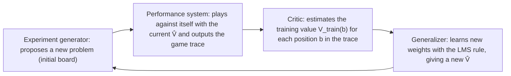

This chapter opens the machine learning course. We first look at where machine learning is used and when it is worth using, and then state Mitchell's formal definition: a program improves its performance on a task $T$, as measured by $P$, with experience $E$. By the form of the experience, learning falls into supervised, unsupervised, self-supervised and **reinforcement learning**; the first two already appeared in the statistics courses (discriminant analysis is supervised and clustering is unsupervised; see [3.4.10](/3.4.10) and [3.4.11](/3.4.11)). The main part of the chapter is one complete design case: teaching a program to play checkers. Designing a learning system means answering four questions in turn: what experience to learn from, what function to learn, how to represent it, and which algorithm to learn it with. These four questions run through the rest of the course. The [next chapter](/4.6.2) discusses how to evaluate what has been learned, and the chapters from [4.6.3](/4.6.3) on present different representations and algorithms. The search and game-playing methods of the introduction to AI ([4.5.2](/4.5.2), [4.5.3](/4.5.3)) form the background of this case, and the corresponding practice in deep learning is covered in [Artificial Neural Networks](/4.7).

## 1.1. Applications of Machine Learning

### 1.1.1. Application Areas

Applications of machine learning fall roughly into three groups.

- Improving decisions with historical data (data mining). In business intelligence, supermarkets use shopping-basket data to decide product placement and coupon distribution; telecommunication and internet companies predict which users are about to leave and intervene in advance; credit card companies judge from records such as years of credit history, outstanding balance, income and number of defaults whether a customer is valuable or likely to default.
- Personalized services. Mail and message filtering (spam detection; see [4.6.3](/4.6.3)); learning interests from user behavior for news feeds, social networks and recommender systems.
- Replacing human labor. Pattern recognition (recognition of faces, speech, gestures, and printed and handwritten text); autonomous driving (from ALVINN, a neural network that drove on highways at CMU in 1989, to the robotaxis operating in several cities today); search engines (the ranking function of a modern search engine combines thousands of features, which gave rise to learning to rank, at the intersection of machine learning and information retrieval; see [4.6.2](/4.6.2#sec-2.4.2)); content generation (large language models generate text and code, and diffusion models generate images, video and music; see [4.7](/4.7)); scientific discovery (AlphaFold predicts protein structures from amino acid sequences and received the 2024 Nobel Prize in Chemistry).

Data mining, pattern recognition and machine learning are related as follows: the first two are named after application problems (discovering useful patterns in large amounts of data; recognizing objects in signals), whereas machine learning is named after a method and supplies the main tools for both. Neural networks and deep learning are one family among machine learning methods; see [4.5.4](/4.5.4) and [4.7](/4.7).

### 1.1.2. When to Use Machine Learning

Machine learning is not the default way of writing programs. It is worth using when the following conditions roughly hold:

1. There is enough data, and the data is representative of the cases to be handled in the future.
2. A certain proportion of errors is acceptable (machine learning gives statistical guarantees, not a proof of correctness for each case).
3. Writing rules by hand is impractical: there are too many or too complicated rules, compiling them by hand is too time-consuming and expensive, the scale of computation is too large, empirical parameters are unreliable, or the system must respond online, in real time or in a harsh environment.
4. One wants to discover regularities in the data that are not known in advance.

Conversely, if the problem has a clear algorithmic solution (sorting, shortest paths), or if the cost of an error is extremely high and cannot be tolerated, conventional programming should be preferred.

## 1.2. What Is Machine Learning

### 1.2.1. Definition

Learning has been characterized in many ways. Herbert Simon said that learning is a change in a system that makes it more effective the next time it performs the same task; Ryszard Michalski said that learning is the construction or modification of representations of what is experienced. The two emphasize "change" and "representation", respectively. The definition in common use today is Tom Mitchell's, which emphasizes "improvement" and can be tested:

**Definition 1.2.1 (Machine Learning)** A computer program is said to learn from experience $E$ with respect to some class of tasks $T$ and performance measure $P$ if its performance at tasks in $T$, as measured by $P$, improves with experience $E$. The field that studies such programs is called **machine learning**.

To define a learning problem is to specify these three items. The first two rows of the following table are classical examples, and the remaining rows are modern ones.

| Problem | Task $T$ | Performance $P$ | Experience $E$ |
|---|---|---|---|
| Playing checkers | Playing games | Win rate against arbitrary opponents | Games played against itself |
| Handwritten character recognition | Recognizing characters in images | Recognition accuracy | Character images labeled with their classes |
| Spam filtering | Deciding whether an email is spam | Miss rate and false-alarm rate (misclassifying a legitimate email is costlier) | Emails labeled by the user |
| Recommender system | Ranking candidate items for a user | Click-through rate, retention, ranking metrics | The user's interaction history |
| Large language model | Generating text from a prompt | In pre-training, the prediction loss on held-out text; in alignment, human preferences and the pass rate on automatically checkable tasks | A large text corpus; human preferences and reward feedback |

The last row answers a common question: what are $T$, $P$ and $E$ for content generation? The difficulty lies in $P$. There is no single correct answer by which to judge generated content, so in practice one uses several surrogate metrics supplemented by human evaluation.

### 1.2.2. Types of Learning

By the form of the experience $E$, learning problems fall mainly into the following types.

- **Supervised learning**: the experience consists of input–output pairs $(x, y)$, where the output $y$ is usually labeled by humans. The goal is to learn a mapping from $x$ to $y$, with a loss function measuring the quality of predictions. When $y$ takes discrete classes the problem is called classification, and when $y$ is real-valued it is called regression.
- **Unsupervised learning**: the experience consists of inputs $x$ only. The goal is to discover the structure of $x$, for example by clustering ([4.6.5](/4.6.5)), dimensionality reduction and density estimation. There are no labels, and hence no uniform loss function to measure performance.

The other two types are self-supervised learning and reinforcement learning.

**Definition 1.2.2 (Self-Supervised Learning)** If the target $y$ in a training example $(x, y)$ is constructed automatically from the data itself (for example, masking a word in a sentence and using it as the prediction target, or predicting the next token from the preceding text), with no human labeling, this way of learning is called **self-supervised learning**.

Self-supervised learning has the same form as supervised learning, but its labels come in almost unlimited quantity from raw data, which makes it the basis of large-scale pre-training ([4.7](/4.7)).

**Definition 1.2.3 (Reinforcement Learning)** A learner (an agent) chooses actions in an environment one after another, and the environment returns a new state and a numerical reward. The goal is to find a policy from states to actions that maximizes the expected long-term cumulative reward. This way of learning is called **reinforcement learning**.

The experience in reinforcement learning is not the "correct answer" but delayed, evaluative feedback: a game of checkers reveals only the outcome at the end, and the learner must infer for itself which moves are responsible for the result (the credit assignment problem). The checkers example below is of this kind.

| | Supervised | Unsupervised | Self-supervised | Reinforcement |
|---|---|---|---|---|
| Training experience | Pairs $(x, y)$, with $y$ mostly labeled by humans | Only $x$ | Pairs $(x, y)$, with $y$ derived from the data itself | Sequences of states, actions and rewards |
| Learning goal | The relation between $x$ and $y$ | The structure of $x$ | The relation between $x$ and $y$ | A policy that maximizes cumulative reward |
| Measure of success | Loss function | No uniform criterion | Loss function | Cumulative reward |
| Typical applications | Prediction, classification | Clustering, dimensionality reduction, data analysis | Pre-training | Games, control, alignment |

## 1.3. Designing a Learning System

We take the classical problem from Mitchell's textbook as our example: teaching a program to play checkers (on an $8\times 8$ board). The task $T$ is playing games, the performance $P$ is the win rate in matches, and the experience $E$ is yet to be chosen. The design answers four questions in turn.

### 1.3.1. Training Experience

The first question is what experience to use. There are three possible kinds: the correct move in each position from expert game records (direct feedback); games played against an expert; and games played against itself. The latter two give only the outcome at the end of the game (indirect feedback), and the learner must itself judge which moves led to the win or loss.

The experience must also be representative of future use: the distribution of the examples seen in training should be close to the distribution at test time and in actual use. A program that plays only against itself may never see the positions that human masters commonly reach; a program that only watches games between masters rarely sees the mistakes that masters would never make. When the training experience does not match the situation of use, what is learned can be surprising, and the discrepancy can come from three sources:

- Data: an image classifier that distinguishes huskies from wolves achieved high accuracy, but a post-hoc analysis showed that it relied mainly on whether there was snow in the background, because most wolf photographs in the training set were taken on snow (Ribeiro et al., 2016).
- Training process: the order in which examples are presented, inconsistent preprocessing between training and use, and information that is available during training but not in use (data leakage, see [4.6.2](/4.6.2#sec-2.5)) can all lead the model to learn shortcuts.
- Features: in 2011, on the quiz show *Jeopardy!*, IBM Watson answered "Toronto" to a clue in the category "U.S. Cities" ("Its largest airport is named for a World War II hero; its second largest, for a World War II battle"); the correct answer is Chicago. The system did not treat the category name as a strong constraint on the answer, and its features did not adequately capture the structure of the clue.

### 1.3.2. The Target Function

The second question is what exactly to learn. The most direct goal is a function that chooses moves, $\operatorname{ChooseMove}\colon B \to M$, which maps legal board positions to moves. It is easy to learn when direct feedback is available, and hard to learn when only indirect feedback is. Another choice is an evaluation function for positions, $V\colon B \to \mathbb{R}$: once $V$ is learned, the program only has to choose the move that leads to the successor position with the highest score.

**Definition 1.3.1 (Target Function and Hypothesis)** The unknown function that a learning system is to learn is called the **target function**; the approximation of the target function actually output by the learning algorithm is called a **hypothesis**, and the set of all hypotheses that can possibly be output forms the **hypothesis space**.

The target function $V$ for checkers can be defined as follows. If $b$ is a final position, then $V(b) = 100$ for a win, $V(b) = -100$ for a loss and $V(b) = 0$ for a draw. If $b$ is not a final position, then $V(b) = V(b')$, where $b'$ is the final position reached from $b$ when both sides play optimally. This definition is correct but not operational: to compute the value of one position, one must search all variations to the end of the game, which is exactly the computation of [minimax search](/4.5.3) on the complete game tree, at exponential cost. We therefore learn only an approximation of $V$, the hypothesis $\hat V$. This trade-off between "correct" and "feasible" is a recurring theme in machine learning.

### 1.3.3. Representing the Target Function

The third question is how to represent $\hat V$. Possible representations include a lookup table of position–score pairs, a set of rules, a polynomial in board features, and a neural network. The more expressive the representation, the better it can approximate $V$, but the more data it needs. Choosing a representation is a trade-off between approximation ability and data requirements.

A simple choice is a linear function of board features. Let the program play red, and take six features of a position $b$: $x_1, x_2$ are the numbers of white and red pieces, $x_3, x_4$ are the numbers of white and red kings, $x_5$ is the number of white pieces threatened by red (to be captured on the next turn), and $x_6$ is the number of red pieces threatened by white. Let

$$
\hat V(b) = w_0 + w_1 x_1 + w_2 x_2 + w_3 x_3 + w_4 x_4 + w_5 x_5 + w_6 x_6,
$$
where $w_0, \dots, w_6$ are the weights to be learned. A training example is a pair $\langle b, V_{\mathrm{train}}(b)\rangle$, for instance $\langle (x_1, \dots, x_6) = (0, 3, 0, 1, 0, 0),\ +100\rangle$: white has no pieces left and red has won.

The learning problem has thus been reduced to estimating seven weights from training examples.

### 1.3.4. The Learning Algorithm

The fourth question is which algorithm to learn with, and it has two parts: how to obtain training values, and how to adjust the weights according to them.

Consider first the estimation of training values. The training value of a final position is simply the outcome. The true value of an intermediate position is unknown, but we can use the current hypothesis's score of its successor position as an estimate:

$$
V_{\mathrm{train}}(b) \leftarrow \hat V(\operatorname{Successor}(b)),
$$
where $\operatorname{Successor}(b)$ is the next position at which it is the program's turn to move, after the program has moved and the opponent has replied. Estimating training values with the still imperfect $\hat V$ seems circular, but estimates closer to the end of the game are more accurate, and accurate values gradually propagate backward. This idea later developed into the temporal-difference methods of **reinforcement learning**.

Consider next the adjustment of the weights. Taking the squared error on the training examples, $E = \sum_{b} \bigl(V_{\mathrm{train}}(b) - \hat V(b)\bigr)^2$, as the criterion, the least mean squares (LMS) rule updates the weights one example at a time:

**Algorithm 1.3.1 (LMS Weight Update Rule)** Initialize the weights $w_0, \dots, w_6$ (for example, with small random numbers). Repeat:

1. choose a training example $b$ at random;
2. compute the error $\operatorname{error}(b) = V_{\mathrm{train}}(b) - \hat V(b)$;
3. for each feature $x_i$ (with the convention $x_0 = 1$), update $w_i \leftarrow w_i + c\, x_i\, \operatorname{error}(b)$.

The constant $c > 0$ is called the learning rate; it controls the size of each update.

The direction of the update is intuitively reasonable: when the error is positive (the position was underestimated), the weights of features with positive values are increased; the larger the error and the larger the feature value, the larger the change in the weight; and when the error is zero the weights do not change. From the viewpoint of optimization, $-2x_i\operatorname{error}(b)$ is exactly the partial derivative of the squared error of a single example with respect to $w_i$, so the LMS rule is **stochastic gradient descent** ([3.5.5](/3.5.5)). The learning rate must match the scale of the features: when feature values range from $0$ to $12$, $c = 0.1$ makes the iteration diverge, and one must take a smaller value or normalize the features first ([4.6.4](/4.6.4#sec-4.2.4)).

The following program uses the LMS rule to recover a set of weights from noisy training values. So that the result can be checked, the training values are generated from a known set of "true" weights.

```python
import numpy as np

rng = np.random.default_rng(0)
# Six board features per state, and a hidden "true" evaluation used to label them
w_true = np.array([0.0, 10.0, -10.0, 30.0, -30.0, -5.0, 5.0])   # w0 (bias), w1..w6
X = rng.integers(0, 13, size=(500, 6)).astype(float)            # wp, rp, wk, rk, wt, rt
X[:, 2:4] = rng.integers(0, 4, size=(500, 2))                   # few kings
X[:, 4:6] = rng.integers(0, 4, size=(500, 2))                   # few threatened pieces
Xb = np.hstack([np.ones((500, 1)), X])                          # prepend x0 = 1
v_train = Xb @ w_true + rng.normal(0, 2.0, size=500)            # noisy training values

w = np.zeros(7)
c = 0.002                                                       # learning rate
for epoch in range(200):
    for i in rng.permutation(500):                              # one random example at a time
        error = v_train[i] - Xb[i] @ w                          # V_train(b) - V_hat(b)
        w += c * error * Xb[i]                                  # LMS rule: w_i <- w_i + c x_i error
print(np.round(w, 1))
```

```text
[ -0.   10.  -10.   30.  -30.1  -5.    5.1]
```

(Python 3.12, NumPy 2.5.) Here the features are given directly and the training values are not estimated circularly, so the problem reduces to linear regression; in a real checkers program, the training values keep changing as $\hat V$ improves.

## 1.4. The Complete Design

### 1.4.1. The Four Modules

Combining the four choices, the checkers learning system consists of four modules operating in a loop:



That is: initialize the weights of $\hat V$; play against itself with $\hat V$, recording the sequence of positions $b_1, \dots, b_m$ of each game; the training value of the final position $b_m$ is the outcome ($\pm 100$ or $0$), and that of every other position is $\hat V(\operatorname{Successor}(b_i))$; update the weights with these examples and start a new game.

### 1.4.2. Design Choices

Every step has alternatives, and the whole design is the result of a series of choices:

| Design question | Choice in this example | Alternatives | Corresponding general issue |
|---|---|---|---|
| What experience | Self-play | Play against experts, table of expert moves | Data: watch for biases from the data, the training process and the features |
| What to learn | Position evaluation $V\colon B \to \mathbb{R}$ | Move selection $B \to M$ | Target: trade off correctness against feasibility |
| How to represent it | Linear function of six features | Polynomials, neural networks | Features and representation: trade off expressiveness against data requirements |
| Which algorithm | LMS (gradient descent) | Linear programming | Algorithm: choose it to fit the representation and the learning objective |
| How well it learned | Win rate against humans | Games against a fixed program | Evaluation ([4.6.2](/4.6.2)) |

The last row is the part of the design that is easily overlooked: only reliable evaluation makes it possible to compare different choices.

### 1.4.3. From Checkers to Modern Systems

This case has a real history. Arthur Samuel's checkers program, published in 1959, learned with exactly a linear evaluation function of board features and self-play, and was the first to use the term "machine learning". In 1992, TD-Gammon represented the evaluation function of backgammon with a neural network and, through self-play and temporal-difference learning, reached a level close to that of the best human players. In 2007, Schaeffer et al. proved by exhaustive search that checkers is a draw under optimal play by both sides. AlphaZero in 2017 pushed the same framework to the extreme: the experience is still self-play, the representation is replaced by a deep neural network taking the raw board as input, so that hand-designed features are no longer needed, and the training values come from Monte Carlo tree search ([4.5.3](/4.5.3)).

Modern deep learning changes the answer to the third question, in that features are learned by the network from raw data instead of being designed by hand, but the four questions themselves have not disappeared. Take large language models as an example: the experience is the pre-training corpus and human feedback, whose quality and biases determine the upper limit of the model; the objective is the next-token prediction loss and, in the alignment stage, the reward; the representation is the Transformer; and the algorithm is gradient-based optimization ([4.7](/4.7)).

## Summary

- The definition of machine learning consists of three items, the task $T$, the performance $P$ and the experience $E$; to define a learning problem is to specify these three.
- By the form of the experience, learning is divided into supervised, unsupervised, self-supervised and reinforcement learning.
- Designing a learning system means answering four questions: the training experience (representativeness and bias), the target function (correctness versus feasibility), the representation (expressiveness versus data requirements) and the learning algorithm; and then evaluating the result.
- The LMS rule $w_i \leftarrow w_i + c\,x_i\,\operatorname{error}(b)$ is stochastic gradient descent under squared error.
