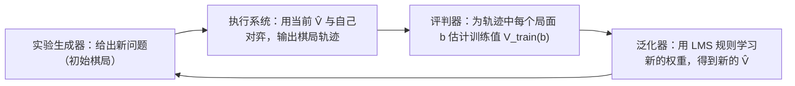

本章是机器学习课程的起点。先看机器学习在哪些地方被使用、什么时候值得使用，再给出 Mitchell 的形式化定义：程序在任务 $T$ 上以性能 $P$ 衡量的表现随经验 $E$ 提高。按经验的形式，学习分为有监督、无监督、自监督与强化学习几类；它们在统计学课程中已经出现过（判别分析是有监督的，聚类是无监督的，见 [3.4.10](/3.4.10)、[3.4.11](/3.4.11)）。本章的主体是一个完整的设计案例：让程序学会下西洋跳棋。设计一个学习系统要依次回答四个问题——用什么经验、学什么函数、怎样表示它、用什么算法学——这四个问题贯穿以后各章：[下一章](/4.6.2)讲怎样评价学到的结果，[4.6.3](/4.6.3) 以后各章给出不同的表示与算法。人工智能导论中的搜索与博弈（[4.5.2](/4.5.2)、[4.5.3](/4.5.3)）是这个案例的背景，深度学习中的对应做法见[人工神经网络](/4.7)。

## 1.1. 机器学习的应用

### 1.1.1. 应用背景

机器学习的应用大致分为三类。

- 用历史数据改善决策（数据挖掘）。商业智能中，超市根据购物篮数据决定商品摆放和优惠券的发放；电信与互联网公司预测哪些用户将要流失并提前干预；信用卡公司根据客户的信用年限、贷款余额、收入、违约次数等记录判断客户是否有价值、是否可能违约。
- 个性化服务。邮件与信息过滤（垃圾邮件识别，见 [4.6.3](/4.6.3)）；从用户行为中学习兴趣，用于信息流、社交网络和推荐系统。
- 代替人力的应用。模式识别（人脸、语音、手势、印刷与手写文字的识别）；自动驾驶（从 1989 年 CMU 用神经网络在高速公路上驾驶的 ALVINN，到今天在多个城市运营的无人驾驶出租车）；搜索引擎（现代搜索引擎的排序函数综合上千个特征，由此产生了机器学习与信息检索交叉的排序学习，见 [4.6.2](/4.6.2#sec-2.4.2)）；内容生成（大语言模型生成文本与代码，扩散模型生成图像、视频与音乐，见 [4.7](/4.7)）；科学发现（AlphaFold 由氨基酸序列预测蛋白质结构，获 2024 年诺贝尔化学奖）。

数据挖掘、模式识别与机器学习的关系是：前两者以应用问题命名（从大量数据中发现有用的模式；识别信号中的对象），机器学习以方法命名，为它们提供主要的工具。神经网络与深度学习则是机器学习方法中的一个家族，见 [4.5.4](/4.5.4) 与 [4.7](/4.7)。

### 1.1.2. 何时使用机器学习

机器学习不是写程序的默认方式。当下列条件大致成立时，它才值得使用：

1. 有足够多的数据，并且数据能代表将来要处理的情形；
2. 可以接受一定比例的错误（机器学习给出的是统计意义上的保证，没有逐例的正确性证明）；
3. 人工编写规则力不从心：规则太多、太复杂，人工整理太耗时费钱，计算规模太大，经验参数不可靠，或者需要在线、实时、在恶劣环境中响应；
4. 想从数据中发现事先不知道的规律。

反过来，若问题有明确的算法解（排序、最短路），或错误代价极高且无法容忍，就应当优先使用传统的程序设计。

## 1.2. 什么是机器学习

### 1.2.1. 定义

"学习"有过多种刻画。Herbert Simon 说，学习是系统中的变化，这种变化使系统在下次完成同样的任务时更有效；Ryszard Michalski 说，学习是构造或修改对所经历事物的表示。两者分别强调"变化"与"表示"。今天通用的是 Tom Mitchell 的定义，它强调"进步"，并且可以检验：

**定义 1.2.1（机器学习）** 对于某类任务 $T$ 和性能度量 $P$，如果一个计算机程序在 $T$ 上以 $P$ 衡量的性能随着经验 $E$ 而提高，就称这个程序从经验 $E$ 中学习。研究这类程序的领域称为**机器学习**。

给一个学习问题下定义，就是指明这三项。下表的前两行是经典的例子，后几行是现代的例子。

| 问题 | 任务 $T$ | 性能 $P$ | 经验 $E$ |
|---|---|---|---|
| 下西洋跳棋 | 下棋 | 对任意对手的胜率 | 与自己对弈的棋局 |
| 手写字符识别 | 识别图像中的字符 | 识别正确率 | 已标注类别的字符图像 |
| 垃圾邮件过滤 | 判断邮件是否为垃圾邮件 | 漏判率与误判率（误判正常邮件代价更高） | 用户标记过的邮件 |
| 推荐系统 | 为用户排序候选物品 | 点击率、留存、排序指标 | 用户的历史交互 |
| 大语言模型 | 根据提示生成文本 | 预训练阶段是留出文本上的预测损失；对齐阶段是人类偏好、可自动判定的任务通过率 | 大规模文本语料；人类偏好与奖励反馈 |

最后一行回答了一个常见的问题：内容生成的 $T$、$P$、$E$ 是什么。它的难点在 $P$：生成内容的好坏没有唯一的标准答案，所以实践中用多种替代指标，并辅以人工评价。

### 1.2.2. 学习的类型

按经验 $E$ 的形式，学习问题主要分为以下几类。

- **有监督学习**：经验是输入–输出对 $(x, y)$，输出 $y$ 通常由人工标注；目标是学习从 $x$ 到 $y$ 的映射，用损失函数衡量预测的好坏。$y$ 取离散类别时称为分类，取实数值时称为回归。
- **无监督学习**：经验只有输入 $x$；目标是发现 $x$ 的结构，例如聚类（[4.6.5](/4.6.5)）、降维与密度估计。没有标签，因此也没有统一的损失函数来衡量效果。

另外两类是自监督学习与强化学习。

**定义 1.2.2（自监督学习）** 若训练样例 $(x, y)$ 中的目标 $y$ 由数据本身自动构造（例如遮住句子中的一个词，以它为预测目标；或者用前文预测下一个词元），不需要人工标注，则称这种学习方式为**自监督学习**。

自监督学习在形式上与有监督学习相同，但标签几乎无限量地来自原始数据，因此成为大规模预训练的基础（[4.7](/4.7)）。

**定义 1.2.3（强化学习）** 学习者（智能体）在环境中依次选择行动，环境返回新的状态与一个数值奖励；学习的目标是找到一个由状态到行动的策略，使长期累积奖励的期望最大。这种学习方式称为**强化学习**。

强化学习的经验不是"正确答案"，而是延迟的、评价性的反馈：一盘棋只在终局给出胜负，哪一步该为结果负责（信用分配问题）需要学习者自己推断。下面的西洋跳棋就是这种情形。

| | 有监督 | 无监督 | 自监督 | 强化 |
|---|---|---|---|---|
| 训练经验 | $(x, y)$ 对，$y$ 多为人工标注 | 只有 $x$ | $(x, y)$ 对，$y$ 来自数据本身 | 状态、行动与奖励的序列 |
| 学习目标 | $x$ 与 $y$ 的关系 | $x$ 的结构 | $x$ 与 $y$ 的关系 | 使累积奖励最大的策略 |
| 效果衡量 | 损失函数 | 无统一标准 | 损失函数 | 累积奖励 |
| 典型应用 | 预测、分类 | 聚类、降维、数据分析 | 预训练 | 博弈、控制、对齐 |

## 1.3. 学习系统的设计

以 Mitchell 教材中的经典问题为例：让程序学会下西洋跳棋（checkers，$8\times 8$ 棋盘）。任务 $T$ 是下棋，性能 $P$ 是在比赛中的胜率，经验 $E$ 待定。设计依次回答四个问题。

### 1.3.1. 训练经验

第一个问题是用什么经验。可选的经验有三种：专家棋谱中每个局面下的正确走法（直接反馈）；与专家对弈的棋局；与自己对弈的棋局。后两种只在终局给出胜负（间接反馈），学习者必须自己判断哪些走法导致了胜负。

经验还必须代表将来的使用情形：训练时见到的样例的分布，应当与测试和实际使用时的分布相近。只与自己对弈的程序可能从未见过人类大师常用的局面；只看大师对局的程序则很少见到大师不会犯的错误。训练经验与使用情形不一致时，学到的东西会出乎意料，偏差可能来自三个方面：

- 数据：一个区分哈士奇与狼的图像分类器准确率很高，事后分析却发现它依据的主要是背景中有没有雪——训练集里狼的照片大多拍于雪地（Ribeiro 等，2016）。
- 训练过程：样例呈现的顺序、训练与使用时预处理的不一致、训练时可以获得而使用时无法获得的信息（[4.6.2](/4.6.2#sec-2.5) 的数据泄漏），都会让模型学到捷径。
- 特征：2011 年 IBM Watson 在问答节目 *Jeopardy!* 中以"美国城市"为类别的一道题（"它最大的机场以一位二战英雄命名，第二大机场以一场二战战役命名"）上答了 Toronto，正确答案是 Chicago。系统没有把类别名当作对答案的强约束，所用的特征没有充分刻画题目的结构。

### 1.3.2. 目标函数

第二个问题是到底学什么。最直接的目标是一个选择走法的函数 $\operatorname{ChooseMove}\colon B \to M$，把合法的棋盘局面映射为走法。有直接反馈时它容易学，只有间接反馈时则很难。另一个选择是局面的评分函数 $V\colon B \to \mathbb{R}$：学会了 $V$，下棋时只要选择使后继局面评分最高的走法。

**定义 1.3.1（目标函数与假设）** 学习系统要学习的未知函数称为**目标函数**；学习算法实际输出的、对目标函数的近似称为**假设**，所有可能输出的假设构成**假设空间**。

西洋跳棋的目标函数 $V$ 可以这样定义：若 $b$ 是终局，则胜局 $V(b) = 100$，负局 $V(b) = -100$，和局 $V(b) = 0$；若 $b$ 不是终局，则 $V(b) = V(b')$，其中 $b'$ 是从 $b$ 出发、双方都走最优着法时到达的终局。这个定义是正确的，却不可操作：为了算出一个局面的值，要搜索到终局的所有变化，这正是[极小极大搜索](/4.5.3)在完整博弈树上的计算，代价是指数级的。因此我们只学 $V$ 的一个近似，即假设 $\hat V$。"正确"与"可行"之间的取舍，是机器学习中反复出现的主题。

### 1.3.3. 目标函数的表示

第三个问题是 $\hat V$ 怎样表示。可选的表示有局面–评分对照表、规则集合、棋盘特征的多项式、神经网络等。表示的表达能力越强，就越能逼近 $V$，但需要的数据也越多。选择表示，就是在近似能力与数据需求之间取舍。

一种简单的选择是棋盘特征的线性函数。设程序执红方，对局面 $b$ 取六个特征：$x_1, x_2$ 为白方、红方的棋子数，$x_3, x_4$ 为白方、红方的王棋数，$x_5$ 为受红方威胁（下一回合将被吃）的白子数，$x_6$ 为受白方威胁的红子数。令

$$
\hat V(b) = w_0 + w_1 x_1 + w_2 x_2 + w_3 x_3 + w_4 x_4 + w_5 x_5 + w_6 x_6,
$$
其中 $w_0, \dots, w_6$ 是待学习的权重。一个训练样例是一对 $\langle b, V_{\mathrm{train}}(b)\rangle$，例如 $\langle (x_1, \dots, x_6) = (0, 3, 0, 1, 0, 0),\ +100\rangle$：白方已无棋子，红方获胜。

至此，学习问题被归结为：从训练样例中估计七个权重。

### 1.3.4. 学习算法

第四个问题是用什么算法学习，它又分两步：怎样得到训练值，怎样根据训练值调整权重。

先看训练值的估计。终局的训练值就是胜负。中间局面的真实值未知，可以用当前假设对它的后继局面的评分作为估计：

$$
V_{\mathrm{train}}(b) \leftarrow \hat V(\operatorname{Successor}(b)),
$$
其中 $\operatorname{Successor}(b)$ 是程序走棋、对手应着之后轮到程序走棋的局面。用尚不完美的 $\hat V$ 去估计训练值似乎是循环论证，但越接近终局的估计越准确，准确的值会逐步向前传播。这一思想后来发展为强化学习中的时间差分方法。

再看权重的调整。以训练样例上的平方误差 $E = \sum_{b} \bigl(V_{\mathrm{train}}(b) - \hat V(b)\bigr)^2$ 为准则，用最小均方（least mean squares，LMS）规则逐个样例地更新权重：

**算法 1.3.1（LMS 权重更新规则）** 初始化权重 $w_0, \dots, w_6$（例如取小的随机数）。重复：

1. 随机选取一个训练样例 $b$；
2. 计算误差 $\operatorname{error}(b) = V_{\mathrm{train}}(b) - \hat V(b)$；
3. 对每个特征 $x_i$（约定 $x_0 = 1$），更新 $w_i \leftarrow w_i + c\, x_i\, \operatorname{error}(b)$。

常数 $c > 0$ 称为学习率，控制每步更新的大小。

更新的方向直观合理：误差为正（低估了局面）时，增大取值为正的特征的权重；误差越大、特征取值越大，权重的变化就越大；误差为零时权重不变。从优化的角度看，$-2x_i\operatorname{error}(b)$ 正是单个样例的平方误差对 $w_i$ 的偏导数，所以 LMS 规则就是**随机梯度下降**（[3.5.5](/3.5.5)）。学习率要与特征的尺度相称：特征取值在 $0$ 到 $12$ 之间时，$c = 0.1$ 会使迭代发散，需要取得更小，或者先把特征归一化（[4.6.4](/4.6.4#sec-4.2.4)）。

下面的程序用 LMS 规则从带噪声的训练值中恢复一组权重。为了能检验结果，训练值由一组已知的"真实"权重生成。

```python
import numpy as np

rng = np.random.default_rng(0)
# Six board features per state, and a hidden "true" evaluation used to label them
w_true = np.array([0.0, 10.0, -10.0, 30.0, -30.0, -5.0, 5.0])   # w0 (bias), w1..w6
X = rng.integers(0, 13, size=(500, 6)).astype(float)            # wp, rp, wk, rk, wt, rt
X[:, 2:4] = rng.integers(0, 4, size=(500, 2))                   # few kings
X[:, 4:6] = rng.integers(0, 4, size=(500, 2))                   # few threatened pieces
Xb = np.hstack([np.ones((500, 1)), X])                          # prepend x0 = 1
v_train = Xb @ w_true + rng.normal(0, 2.0, size=500)            # noisy training values

w = np.zeros(7)
c = 0.002                                                       # learning rate
for epoch in range(200):
    for i in rng.permutation(500):                              # one random example at a time
        error = v_train[i] - Xb[i] @ w                          # V_train(b) - V_hat(b)
        w += c * error * Xb[i]                                  # LMS rule: w_i <- w_i + c x_i error
print(np.round(w, 1))
```

```text
[ -0.   10.  -10.   30.  -30.1  -5.    5.1]
```

（Python 3.12，NumPy 2.5。）这里的特征直接给出、训练值没有循环估计，所以问题退化为线性回归；真实的跳棋程序中，训练值随 $\hat V$ 的改进而不断变化。

## 1.4. 完整的设计

### 1.4.1. 四个模块

把四个选择组合起来，西洋跳棋学习系统由四个模块循环构成：



即：初始化 $\hat V$ 的权重；用 $\hat V$ 与自己下棋，记录每局的局面序列 $b_1, \dots, b_m$；终局 $b_m$ 的训练值是胜负（$\pm 100$ 或 $0$），其余局面的训练值是 $\hat V(\operatorname{Successor}(b_i))$；用这些样例更新权重，开始新的对局。

### 1.4.2. 设计的选择

每一步都有其他选择，整个设计是一系列选择的结果：

| 设计问题 | 本例的选择 | 其他可能 | 对应的一般问题 |
|---|---|---|---|
| 用什么经验 | 自我对弈 | 与专家对弈、专家走法表 | 数据：注意数据、训练过程、特征带来的偏差 |
| 学习什么 | 局面评分 $V\colon B \to \mathbb{R}$ | 走法选择 $B \to M$ | 目标：在正确性与可行性之间取舍 |
| 怎样表示 | 六个特征的线性函数 | 多项式、神经网络 | 特征与表示：表达能力与数据需求的取舍 |
| 用什么算法 | LMS（梯度下降） | 线性规划 | 算法：结合表示与学习目标选择 |
| 学得怎么样 | 与人对弈的胜率 | 与固定程序对弈 | 评价（[4.6.2](/4.6.2)） |

最后一行是设计中容易被忽略的一环：只有可靠地评价，才能比较不同的选择。

### 1.4.3. 从跳棋到现代系统

这个案例有真实的历史。Arthur Samuel 在 1959 年发表的跳棋程序正是用局面特征的线性评估函数和自我对弈来学习，并首次使用了"机器学习"一词；1992 年的 TD-Gammon 用神经网络表示双陆棋的评估函数，通过自我对弈和时间差分学习达到了接近顶尖人类棋手的水平；2007 年，Schaeffer 等人用穷举搜索证明了西洋跳棋在双方最优时是和棋。2017 年的 AlphaZero 把同样的框架推到极致：经验仍是自我对弈，表示换成了以原始棋盘为输入的深度神经网络，不再需要人工设计特征，训练值来自蒙特卡洛树搜索（[4.5.3](/4.5.3)）。

现代深度学习改变了第三个问题的答法——特征由网络从原始数据中学出，而不是人工设计——但四个问题本身没有消失。以大语言模型为例：经验是预训练语料与人类反馈，其质量与偏差决定了模型的上限；目标是下一个词元的预测损失，以及对齐阶段的奖励；表示是 Transformer；算法是基于梯度的优化（[4.7](/4.7)）。

## 小结

- 机器学习的定义由任务 $T$、性能 $P$、经验 $E$ 三项构成；给学习问题下定义就是指明这三项。
- 按经验的形式分为有监督、无监督、自监督与强化学习。
- 设计学习系统要回答四个问题：训练经验（代表性与偏差）、目标函数（正确性与可行性）、表示（表达能力与数据需求）、学习算法；然后评价结果。
- LMS 规则 $w_i \leftarrow w_i + c\,x_i\,\operatorname{error}(b)$ 是平方误差下的随机梯度下降。
