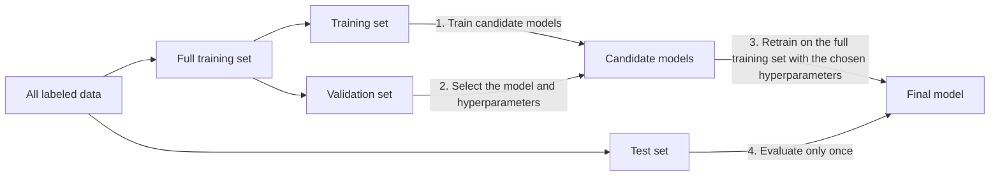

The design in the [previous chapter](/4.6.1) ended with the question "how well did it learn?". This chapter answers it: how to arrange experiments so that the performance of a model on unseen data can be estimated reliably, and which metrics to use to measure that performance. The first half is about experimental methods: how to split the data into training, validation and test parts, and how to reduce the variability of the estimate with repeated experiments and cross-validation. The second half is about evaluation metrics: classification, regression and ranking each have their own, and the confusion matrix, ROC curve and PR curve of binary classification are the focus. Finally we discuss the most common and most insidious mistake in practice, data leakage. Cross-validation and the confusion matrix already appeared in discriminant analysis in the statistics courses ([3.4.10](/3.4.10)), and overfitting is treated in [3.3.11](/3.3.11); this chapter organizes them from the viewpoint of machine learning experiments. Confidence intervals for error estimates and statistical comparison between learning algorithms are discussed in [4.6.7](/4.6.7).

## 2.1. Training, Validation and Test Sets

### 2.1.1. The Roles of the Three Sets

During training a model sees only a finite number of examples, whereas the unseen examples it will face in the future are often exponentially many or even infinitely many. Doing well on the training examples does not mean doing well on unseen ones: the model may memorize noise peculiar to the training examples, which is **overfitting**. We therefore need another part of the data to estimate the model's performance on unseen examples.

**Definition 2.1.1 (Training, Validation and Test Sets)** Split the labeled data into three disjoint parts. The part used to fit the model parameters is the **training set**; the part set aside from the training data to select models and tune **hyperparameters** (quantities not determined directly by training but fixed before it, such as the number of epochs, the regularization coefficient, the learning rate and the number of neighbors) is the **validation set**; and the part used only once, at the very end, to estimate the performance of the final model on unseen examples is the **test set**.

The relation among the three can be compared with examinations: the training set is the homework, the validation set is the mock exam, and the test set is the final exam.

- Why must test examples be disjoint from training examples? Taking an exam on problems already worked shows only that the answers were memorized. The result on the test set should be an estimate of the model's performance on all unseen examples.
- Why not tune hyperparameters on the training set? The training error always decreases as model complexity increases, so tuning by it only selects a model that overfits the training set.
- Why not tune hyperparameters on the test set? Parameters tuned against the test set may be good only on that particular test set; the test result is then too high, and the premise that the test set is independent of the training process is destroyed. It is like guessing exam questions from the distribution of topics in one particular exam: the score does not reflect mastery of all the material. In machine learning competitions, teams that submit repeatedly and over-tune against the part of the test data used for the public leaderboard often drop sharply in the ranking on the full hidden test data.

The complete procedure is:



### 2.1.2. Ways of Splitting

**Definition 2.1.2 (Holdout Method)** Randomly split the data into two disjoint parts, one for training and the other (the part that is "held out") for evaluation. This practice is called the **holdout method**.

The held-out proportion is commonly $8:2$ or $9:1$; with a lot of data one can also fix the size of the test set (for example, draw ten thousand examples at random for testing and use the rest for training). In classification problems one usually samples stratified by class, so that the class proportions in both parts match those of the whole; this matters especially when a class is rare.

Random splitting assumes that the examples are independent and identically distributed. Much real data does not satisfy this assumption, and the way of splitting must match the way the model will be used in the future:

| Characteristic of the data | Way of splitting | Example |
|---|---|---|
| Very few examples | Leave-one-out: test on a single example at a time and train on the rest, in turn | Evaluating $k$-nearest neighbors ([4.6.4](/4.6.4)) |
| Temporal order | Split by time: train on the past, test on the future | Train on meteorological data from January to May, test on June |
| User behavior sequences | Use each user's last interaction for testing and the rest for training | Recommender systems |
| Examples correlated in groups | Split by group: all examples of a group go to the training set or all to the test set | Several medical images of the same patient; several recordings of the same speaker |

Splitting data with temporal order or group correlation at random puts "close relatives" of the training examples into the test set, and the estimate becomes optimistic (see Sec. 2.5).

## 2.2. Repeated Experiments and Cross-Validation

### 2.2.1. Repeated Random Experiments

Is one measurement enough? Consider an extreme case: a binary classifier outputs random guesses, and the test set happens to be very small and happens to be guessed entirely correctly. The variability of an evaluation metric has two sources:

- Randomness of the data: variability caused by the split of the dataset. With enough data, enlarge the test set; with limited data, repeat the split several times.
- Randomness of the model: variability caused by the model or the learning algorithm itself, for example the random initialization of a neural network or the random generation of training batches. One can change the random seed and repeat training and testing.

Let the metrics obtained from $n$ repeated experiments be $X_1, \dots, X_n$. When reporting results, give the mean and its uncertainty:

$$
\bar X = \frac{1}{n}\sum_{i=1}^n X_i, \qquad S = \sqrt{\frac{1}{n-1}\sum_{i=1}^n (X_i - \bar X)^2}, \qquad \mathrm{SEM} = \frac{S}{\sqrt{n}}.
$$
Here $S$ is the **sample standard deviation**, which reflects the dispersion of the result of a single experiment, and $\mathrm{SEM}$ is the standard error of the mean, which reflects the precision of $\bar X$ as an estimate of the population mean. Using $n-1$ rather than $n$ in $S$ (Bessel's correction) makes $S^2$ an unbiased estimate of the variance ([3.2.3](/3.2.3)).

These formulas require the metrics of the individual runs to be independent and identically distributed. This holds approximately when the data is re-split independently with different random seeds; but in the cross-validation below, the training sets of different folds overlap heavily and the fold results are positively correlated, so the $\mathrm{SEM}$ computed by the formula underestimates the true uncertainty (Bengio and Grandvalet, 2004). For the correct way of comparing two algorithms, see [4.6.7](/4.6.7).

### 2.2.2. k-Fold Cross-Validation

The holdout method uses only part of the data for training and part for evaluation, and the result depends on that one split. **Cross-validation** ([3.4.10](/3.4.10)) lets every example be evaluated exactly once:

**Algorithm 2.2.1 (k-Fold Cross-Validation)** Randomly split the data into $k$ parts of nearly equal size (stratified by class in classification problems). For $j = 1, \dots, k$: train the model on the $k-1$ parts other than part $j$, and compute the evaluation metric $X_j$ on part $j$. Report the mean $\frac{1}{k}\sum_j X_j$ of the $k$ metrics.

- $k$ is commonly $5$ or $10$. The larger $k$ is, the closer the data used in each training run is to the whole data and the smaller the bias of the estimate, but the greater the computational cost.
- When $k$ equals the sample size, this is **leave-one-out cross-validation**. It is especially convenient for methods that need no training, such as $k$-nearest neighbors ([4.6.4](/4.6.4#sec-4.2.5)).
- Repeated $k$-fold cross-validation: repeating with different random splits several times and averaging reduces the variability due to splitting.
- Cross-validation can be used either to estimate the performance of a fixed method or, within the training set, to select hyperparameters in place of a separate validation set. If both are needed, two levels are required: in each outer fold, perform an inner cross-validation on the outer training part to select hyperparameters, and then evaluate on that outer fold. This is called nested cross-validation. Using a single level of cross-validation both to select hyperparameters and to report the result reports the best result among those selected, which is optimistic.

## 2.3. Evaluation Metrics for Classification

Let the test set have $n$ examples, with true labels $y_i$ and model predictions $\hat y_i$.

### 2.3.1. Accuracy and Error Rate

**Definition 2.3.1 (Accuracy and Error Rate)** The **accuracy** of a classifier is the proportion of examples predicted correctly, and the **error rate** is the proportion predicted incorrectly:

$$
\operatorname{Accuracy} = \frac{1}{n}\sum_{i=1}^n \boldsymbol{1}(\hat y_i = y_i), \qquad \operatorname{ErrorRate} = 1 - \operatorname{Accuracy}.
$$

Accuracy is simple and intuitive and applies to multiclass problems, but it is misleading when the classes are imbalanced: if $99\%$ of emails are legitimate, a classifier that labels every email as legitimate has an accuracy as high as $99\%$ yet finds not a single spam email. It also does not distinguish between the different costs of the two kinds of error.

### 2.3.2. Confusion Matrix, Precision and Recall

In binary classification the class of interest is called positive (label $1$, such as "diseased" or "spam") and the other class negative. Crossing the predictions with the true labels gives the **confusion matrix**:

| | Predicted positive $\hat y = 1$ | Predicted negative $\hat y = 0$ |
|---|---|---|
| Actually positive $y = 1$ | True positive $\mathrm{TP}$ | False negative $\mathrm{FN}$ |
| Actually negative $y = 0$ | False positive $\mathrm{FP}$ | True negative $\mathrm{TN}$ |

**Definition 2.3.2 (Precision, Recall and F-Score)** For a binary classifier,

$$
P = \frac{\mathrm{TP}}{\mathrm{TP} + \mathrm{FP}}, \qquad R = \frac{\mathrm{TP}}{\mathrm{TP} + \mathrm{FN}}.
$$
$P$ is called the **precision**, the proportion of truly positive examples among those predicted positive; $R$ is called the **recall** (also known as sensitivity), the proportion of all positive examples that are found. Their weighted harmonic mean

$$
F_\beta = \left[\frac{1}{1+\beta^2}\cdot\frac{1}{P} + \frac{\beta^2}{1+\beta^2}\cdot\frac{1}{R}\right]^{-1} = \frac{(1+\beta^2)\,P R}{\beta^2 P + R} \qquad (\beta > 0)
$$
is called the **$F_\beta$ score**; for $\beta = 1$ we obtain the **F1 score**

$$
F_1 = \frac{2PR}{P + R} = \frac{2\,\mathrm{TP}}{2\,\mathrm{TP} + \mathrm{FP} + \mathrm{FN}}.
$$

In $F_\beta$ the weight of $1/R$ is $\beta^2$ times that of $1/P$, so recall matters more when $\beta > 1$ (for example in cancer screening, where a missed diagnosis is costly), and precision matters more when $\beta < 1$ (for example in spam filtering, where deleting a legitimate email is costly). The harmonic mean is used rather than the arithmetic mean because it leans toward the smaller of the two: a classifier with $P = 1$ and $R \approx 0$ (labeling only the single most certain example as positive) has $F_1 \approx 0$, whereas its arithmetic mean is close to $0.5$. The $F$ score is thus a "conservative" average.

Precision and recall trade off against each other: lowering the threshold for predicting positive raises recall and usually lowers precision. Precision looks only at examples predicted positive and is unstable when positives are rare; recall looks only at the truly positive examples, and pursuing it alone makes the criterion too lenient (recall is $1$ when everything is predicted positive). The two should therefore be reported together, or combined by the $F$ score.

In the multiclass case, compute the precision, recall and $F_1$ of "this class against the rest" for each class, and then average: macro-averaging weights the classes equally and suits cases where minority classes matter; micro-averaging first sums the $\mathrm{TP}$, $\mathrm{FP}$ and $\mathrm{FN}$ over classes and then computes the metric, and for single-label multiclass problems it equals accuracy.

### 2.3.3. ROC Curve and AUC

Most classifiers output a score $s(x)$ (a probability or confidence), which is then compared with a threshold $T$: $s(x) \ge T$ is predicted positive, otherwise negative. The confusion matrix, precision and recall all depend on the choice of $T$. To evaluate the ranking ability of the classifier itself, we can examine all possible thresholds.

**Definition 2.3.3 (ROC Curve and AUC)** For a threshold $T$, let the true positive rate be $\mathrm{TPR} = \mathrm{TP}/(\mathrm{TP} + \mathrm{FN})$ (that is, the recall) and the false positive rate be $\mathrm{FPR} = \mathrm{FP}/(\mathrm{FP} + \mathrm{TN})$. As $T$ decreases from $+\infty$ to $-\infty$, the point $(\mathrm{FPR}, \mathrm{TPR})$ moves from $(0,0)$ to $(1,1)$, and the curve connecting these points is called the **ROC curve** (receiver operating characteristic curve). The area under the ROC curve is called the **AUC**.

To compute it, sort the test examples by score from high to low and take the score of each example in turn as the threshold; $n$ examples give at most $n$ points. At a positive example the curve moves up by $1/n_1$; at a negative example it moves right by $1/n_0$, where $n_1, n_0$ are the numbers of positive and negative examples.

- For a random classifier the ROC curve is the diagonal from $(0,0)$ to $(1,1)$ and $\mathrm{AUC} = 0.5$.
- An ideal classifier ranks all positive examples before all negative examples; its ROC curve passes through $(0,1)$ and $\mathrm{AUC} = 1$.
- For example, let the test set have $3$ positive and $3$ negative examples. At a high threshold only $1$ positive and $1$ negative example are predicted positive, so $\mathrm{TPR} = \mathrm{FPR} = 1/3$; when the threshold is lowered until $3$ positive and $2$ negative examples are predicted positive, $\mathrm{TPR} = 1$ and $\mathrm{FPR} = 2/3$.

**Theorem 2.3.1 (Probabilistic Interpretation of AUC)** Draw a positive example $X^+$ and a negative example $X^-$ at random. Then

$$
\mathrm{AUC} = \mathbb{P}\bigl(s(X^+) > s(X^-)\bigr) + \tfrac{1}{2}\,\mathbb{P}\bigl(s(X^+) = s(X^-)\bigr),
$$
that is, the AUC is the probability that the classifier ranks a pair of positive and negative examples in the right order (a tie counts as half right). On a test set it equals the proportion of positive–negative pairs ranked in the right order:

$$
\mathrm{AUC} = \frac{1}{n_1 n_0}\sum_{i\colon y_i = 1}\ \sum_{j\colon y_j = 0}\Bigl[\boldsymbol{1}(s_i > s_j) + \tfrac{1}{2}\boldsymbol{1}(s_i = s_j)\Bigr].
$$

**Proof** Suppose there are no ties. The ROC curve is a staircase: at each negative example the curve moves one step to the right, of width $1/n_0$, and the height of this step is the proportion of positive examples ranked before this negative example. The area is therefore $\frac{1}{n_0}\sum_{j\colon y_j=0}\frac{\#\{i\colon y_i = 1,\ s_i > s_j\}}{n_1}$, which is the formula above. With ties, a tied positive–negative pair makes the curve run along a diagonal segment, and the area of the trapezoid counts exactly half for each such pair. $\square$

This proportion is the Mann–Whitney $U$ statistic divided by $n_1 n_0$, so the AUC is the same quantity as in the **Wilcoxon rank-sum test** ([3.2.6](/3.2.6)). This gives a convenient way of computing it (Hand and Till, 2001): sort the test examples by score from high to low, let the position (rank) of the $j$-th negative example be $r_j$, and let $S_0 = \sum_{j=1}^{n_0} r_j$. The number of positive examples ranked before the $j$-th negative example is then $r_j - j$, and so

$$
\mathrm{AUC} = \frac{S_0 - n_0(n_0+1)/2}{n_0 n_1}.
$$
With ties, tied examples take the average of their ranks.

**Example 2.3.1** The $8$ test examples have scores $10, 9, 7, 6, 3, 2, 1, 0$ from high to low and true labels $+, +, -, +, -, +, -, +$ in this order. Here $n_1 = 5$, $n_0 = 3$, the ranks of the negative examples are $3, 5, 7$, $S_0 = 15$, and

$$
\mathrm{AUC} = \frac{15 - 6}{15} = 0.6.
$$
Checking pair by pair: $2, 3, 4$ positive examples precede the three negative examples, so $9$ pairs are ranked correctly out of all $15$, a proportion of $0.6$. With threshold $T = 5$, the first $4$ examples are predicted positive: $\mathrm{TP} = 3$, $\mathrm{FP} = 1$, $\mathrm{FN} = 2$, $\mathrm{TN} = 2$, $P = 0.75$, $R = 0.6$ and $F_1 = 6/9 \approx 0.667$.

The following code verifies these numbers with scikit-learn.

```python
import numpy as np
from sklearn.metrics import (average_precision_score, confusion_matrix,
                             precision_recall_fscore_support, roc_auc_score)

y = np.array([1, 1, 0, 1, 0, 1, 0, 1])               # true labels, sorted by score
s = np.array([10, 9, 7, 6, 3, 2, 1, 0], dtype=float)  # classifier scores

def auc_pairs(y, s):
    """AUC as the fraction of (positive, negative) pairs ranked correctly."""
    d = s[y == 1][:, None] - s[y == 0][None, :]
    return np.mean((d > 0) + 0.5 * (d == 0))

pred = (s >= 5).astype(int)                           # threshold T = 5
print(confusion_matrix(y, pred, labels=[1, 0]))       # rows: true 1, 0; columns: predicted 1, 0
p, r, f, _ = precision_recall_fscore_support(y, pred, average="binary")
print(f"precision={p:.3f} recall={r:.3f} F1={f:.3f}")
print(f"AUC by pairs={auc_pairs(y, s):.3f}  sklearn={roc_auc_score(y, s):.3f}")
print(f"average precision={average_precision_score(y, s):.3f}")
```

```text
[[3 2]
 [1 2]]
precision=0.750 recall=0.600 F1=0.667
AUC by pairs=0.600  sklearn=0.600
average precision=0.808
```

(Python 3.12, scikit-learn 1.9.) The AUC depends only on the ranking of the scores, not on their actual values: any strictly monotone transformation of the scores leaves the AUC unchanged. This is both an advantage (no threshold has to be chosen, and classifiers with different output scales can be compared) and a drawback (it does not check whether the scores are accurate as probabilities, and it does not tell us which threshold to use).

### 2.3.4. The PR Curve

**Definition 2.3.4 (PR Curve and Average Precision)** The curve drawn with recall on the horizontal axis and precision on the vertical axis as the threshold varies from high to low is called the **precision–recall curve** (PR curve). After sorting by score from high to low, compute at each positive example the precision up to that position and average over all positive examples; the result is the **average precision** (AP):

$$
\mathrm{AP} = \frac{1}{n_1}\sum_{k\colon y_{(k)} = 1} P@k, \qquad P@k = \frac{\#\{\text{positive examples among the first } k \text{ examples}\}}{k},
$$
where $y_{(k)}$ is the label of the example ranked $k$-th.

In Example 2.3.1 the positive examples are at positions $1, 2, 4, 6, 8$, and $\mathrm{AP} = \frac{1}{5}\bigl(1 + 1 + \frac{3}{4} + \frac{4}{6} + \frac{5}{8}\bigr) \approx 0.808$, in agreement with the output above.

The two coordinates of the ROC curve are normalized by the numbers of positive and negative examples respectively, so it is not affected by the class proportions; the precision of the PR curve is directly affected by the class proportions, and the PR curve of a random classifier is a horizontal line at a height equal to the proportion of positive examples. When positive examples are rare (fraud detection, information retrieval, screening for rare diseases), what matters is often whether the few examples at the very top of the ranking are reliable; then the number of negative examples is large, many false positives raise the FPR only slightly, and the ROC curve shows almost no difference, whereas the PR curve is far more sensitive. In the figure below the AUCs of the two classifiers are almost the same, but B gives high scores to about $4\%$ of the negative examples; the top of its ranking is occupied by these false positives, and the average precisions differ greatly.


A rule of thumb for choosing a metric: use accuracy when the classes are roughly balanced and the two kinds of error cost about the same; report precision, recall and $F_1$ when one class is of interest; use the AUC to evaluate ranking ability without fixing a threshold; and prefer the PR curve and average precision when positive examples are scarce. In actual deployment a threshold must also be chosen; it should be determined by the costs of the two kinds of error and by business constraints (for example, "the false-alarm rate must not exceed $0.1\%$"), and fixed on the validation set.

## 2.4. Evaluation Metrics for Regression and Ranking

### 2.4.1. Regression

In regression the prediction $\hat y_i$ is a continuous value, and evaluation measures its error with respect to the true value $y_i$.

**Definition 2.4.1 (Evaluation Metrics for Regression)** The mean absolute error, the **mean squared error** and the root mean squared error are

$$
\mathrm{MAE} = \frac{1}{n}\sum_{i=1}^n \lvert y_i - \hat y_i\rvert, \qquad \mathrm{MSE} = \frac{1}{n}\sum_{i=1}^n (y_i - \hat y_i)^2, \qquad \mathrm{RMSE} = \sqrt{\mathrm{MSE}}.
$$

The MSE squares the errors, so examples with large errors have more influence and it is sensitive to outliers; the MAE is more robust to outliers. The RMSE has the same unit as the predictions and the labels, which makes it easy to interpret. As with the **coefficient of determination** in statistics ([3.3.4](/3.3.4)), $1 - \mathrm{MSE}/\widehat{\operatorname{Var}}(y)$ compares the MSE with the baseline of "always predict the mean"; on a test set it can be negative, which means the model is worse than this baseline.

### 2.4.2. Ranking

A search engine or recommender system outputs a ranked list, and evaluation asks whether the results ranked first are relevant. Let the relevance of the $i$-th result returned for a query $q$ be $\mathrm{rel}_i$ (binary or graded).

- $P@k$ and $R@k$: the proportion of relevant results among the first $k$ results, and the proportion of all relevant results that appear among the first $k$.
- Mean reciprocal rank: $\mathrm{MRR} = \frac{1}{\lvert Q\rvert}\sum_{q \in Q}\frac{1}{\operatorname{rank}_q}$, where $\operatorname{rank}_q$ is the position of the first relevant result for query $q$. It suits cases where only one correct answer is needed (question answering, navigational search).
- Mean average precision: compute the $\mathrm{AP}$ of Sec. 2.3.4 for each query and then average over queries.
- For graded relevance the most common is NDCG:

**Definition 2.4.2 (NDCG)** The discounted cumulative gain of the first $k$ results is $\mathrm{DCG}@k = \sum_{i=1}^{k}\frac{2^{\mathrm{rel}_i} - 1}{\log_2(i+1)}$; let $\mathrm{IDCG}@k$ denote the $\mathrm{DCG}@k$ obtained by rearranging the results into the ideal order according to their true relevance. The **normalized discounted cumulative gain** (NDCG) is $\mathrm{NDCG}@k = \mathrm{DCG}@k / \mathrm{IDCG}@k \in [0, 1]$.

The denominator $\log_2(i+1)$ makes results ranked lower contribute less (users rarely scroll down), and the numerator $2^{\mathrm{rel}_i} - 1$ makes highly relevant results contribute more. Since ranking metrics look only at the top of the list, training a ranking function directly to optimize them is learning to rank, a direction at the intersection of machine learning and information retrieval.

## 2.5. Data Leakage

**Definition 2.5.1 (Data Leakage)** If a model uses, in training or model selection, information that is not available at actual prediction time (in particular information from the test data or from the target itself), **data leakage** is said to have occurred.

Data leakage makes offline evaluation optimistic, and performance drops sharply once the model is deployed. It takes many forms:

| Form | Example | Prevention |
|---|---|---|
| Preprocessing uses all the data | Normalizing, imputing missing values or selecting features on all the data first, and only then splitting into training and test sets | Split first; treat preprocessing as part of the model, fitted on the training part only |
| Target leakage | Predicting pneumonia with the feature "whether antibiotics were prescribed", which arises only after the diagnosis | Check for each feature whether it is available at prediction time |
| Temporal leakage | Splitting a time series at random and predicting the past from the future | Split by time (Sec. 2.1.2) |
| Duplicates and close relatives | Images of the same patient in both training and test sets; duplicate documents in a web corpus; benchmark questions mixed into the pre-training corpus of a large language model | Split by group, deduplicate |
| Reusing the test set | Evaluating on the test set many times and modifying the model accordingly | Use the test set only once; tune with the validation set or cross-validation |

The first is the most insidious: even if the features are entirely unrelated to the labels, selecting the features most correlated with the labels on all the data first and then running cross-validation can give a very high "accuracy" (Ambroise and McLachlan, 2002, pointed out this problem in gene expression data). The following program generates $100$ examples, $10\,000$ pure-noise features and random labels independent of them, so the true accuracy of any method is $0.5$.

```python
import numpy as np
from sklearn.feature_selection import SelectKBest, f_classif
from sklearn.linear_model import LogisticRegression
from sklearn.model_selection import StratifiedKFold, cross_val_score
from sklearn.pipeline import make_pipeline

rng = np.random.default_rng(0)
X = rng.normal(size=(100, 10_000))      # pure noise features
y = rng.integers(0, 2, size=100)        # labels independent of X: true accuracy is 0.5
cv = StratifiedKFold(n_splits=5, shuffle=True, random_state=0)

# Wrong: select features on all data, then cross-validate the classifier
X_sel = SelectKBest(f_classif, k=20).fit_transform(X, y)
leaky = cross_val_score(LogisticRegression(), X_sel, y, cv=cv)

# Right: selection is part of the model and is refit inside every training fold
pipe = make_pipeline(SelectKBest(f_classif, k=20), LogisticRegression())
clean = cross_val_score(pipe, X, y, cv=cv)

print(f"leaky CV accuracy: {leaky.mean():.2f} +/- {leaky.std(ddof=1):.2f}")
print(f"clean CV accuracy: {clean.mean():.2f} +/- {clean.std(ddof=1):.2f}")
```

```text
leaky CV accuracy: 0.87 +/- 0.08
clean CV accuracy: 0.47 +/- 0.10
```

(Python 3.12, scikit-learn 1.9.) The wrong procedure has already seen the labels of each fold's test examples when selecting features. The scikit-learn `Pipeline` wraps preprocessing and model into a single whole and refits all the steps on the training part of each fold during cross-validation; it is the standard way to prevent this kind of leakage.

## Summary

| Problem | Approach |
|---|---|
| Estimating performance on unseen data | Fit parameters on the training set, select hyperparameters on the validation set, use the test set only once |
| Splitting the data | Holdout (stratified); by time when there is temporal order, by group when examples are grouped |
| Reducing the variability of the estimate | Repeated random experiments, $k$-fold cross-validation; nested cross-validation when tuning and evaluating at the same time |
| Reporting results | Mean with standard deviation or standard error; the folds of cross-validation are not independent |
| Classification metrics | Accuracy (when classes are balanced); precision, recall, $F_\beta$ ($\beta > 1$ favors recall); AUC (ranking ability, threshold-free); PR curve and AP (when positives are scarce) |
| Regression and ranking metrics | MAE, MSE, RMSE; $P@k$, MRR, AP, NDCG |
| Data leakage | Split before preprocessing; check when each feature becomes available; deduplicate and split by group |
