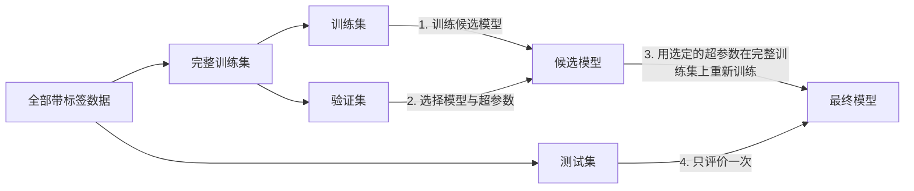

[上一章](/4.6.1)的设计以"学得怎么样"结束。本章回答这个问题：怎样安排实验，才能可靠地估计一个模型在将来未见数据上的表现，以及用什么指标衡量这种表现。前半章是实验方法：数据怎样划分为训练、验证与测试三部分，怎样用随机重复与交叉验证减小估计的波动；后半章是评价指标：分类、回归与排序任务各有不同的指标，二分类的混淆矩阵、ROC 曲线与 PR 曲线是重点。最后讨论实践中最常见、也最隐蔽的错误——数据泄漏。交叉验证与混淆矩阵在统计学的判别分析中已经出现过（[3.4.10](/3.4.10)），过拟合见 [3.3.11](/3.3.11)；本章从机器学习实验的角度把它们组织起来。错误率估计的置信区间与学习算法之间的统计比较见 [4.6.7](/4.6.7)。

## 2.1. 训练集、验证集与测试集

### 2.1.1. 三个集合的作用

模型在训练时看到的样例是有限的，而将来要处理的未见样例往往有指数级甚至无穷多个。在训练样例上表现好，不等于在未见样例上表现好：模型可能记住了训练样例特有的噪声，即**过拟合**。因此要用另一部分数据来估计模型在未见样例上的表现。

**定义 2.1.1（训练集、验证集与测试集）** 把已知标签的数据分为互不相交的三部分。用来拟合模型参数的部分称为**训练集**；从训练数据中另外分出、用来选择模型和调整**超参数**（不由训练直接确定、需要在训练之前设定的量，如训练轮数、正则化系数、学习率、近邻个数）的部分称为**验证集**；只在最后使用一次、用来估计最终模型在未见样例上的表现的部分称为**测试集**。

三者的关系可以用考试来类比：训练集是平时的作业，验证集是模拟考试，测试集是期末考试。

- 测试样例为什么要与训练样例互斥？在做过的题上考试，只能说明记住了答案。测试集上的结果应当是模型在全部未见样例上表现的估计。
- 为什么不在训练集上调超参数？训练误差总是随模型复杂度增加而下降，按它调参只会选出过拟合训练集的模型。
- 为什么不在测试集上调超参数？针对测试集调出的参数，可能只在这一份测试集上较好；测试结果因此偏高，也破坏了"测试集独立于训练过程"的前提。这就像针对某场考试的知识点分布押题，成绩不能反映对全部知识的掌握。机器学习竞赛中，对公开排行榜上的那部分测试数据反复提交、过度调参的队伍，在隐藏的全部测试数据上排名常常大幅下降。

完整的流程是：



### 2.1.2. 划分的方式

**定义 2.1.2（留出法）** 把数据随机地分成互不相交的两部分，一部分用于训练，另一部分（"留出"的部分）用于评价，这种做法称为**留出法**。

留出的比例常取 $8:2$ 或 $9:1$；数据很多时也可以固定测试集的大小（例如随机抽取一万个样例作测试，其余作训练）。分类问题中，通常按类别分层抽样，使两部分的类别比例与整体一致；某一类很少时这一点尤其重要。

随机划分假定样例独立同分布。很多实际数据不满足这一假定，划分方式必须与将来的使用方式一致：

| 数据的特点 | 划分方式 | 例子 |
|---|---|---|
| 样例很少 | 留一：每次只留一个样例测试，其余训练，轮流进行 | $k$ 近邻的评价（[4.6.4](/4.6.4)） |
| 有时间顺序 | 按时间划分：用过去训练，用将来测试 | 用 1–5 月的气象数据训练，6 月的测试 |
| 用户行为序列 | 每个用户的最后一次交互作测试，其余作训练 | 推荐系统 |
| 样例成组相关 | 按组划分：同一组的样例全部在训练集或全部在测试集 | 同一病人的多张医学影像；同一说话人的多段录音 |

随机地划分有时间顺序或成组相关的数据，会让测试集中出现与训练样例几乎相同的"近亲"，估计偏于乐观（见 §2.5）。

## 2.2. 随机重复与交叉验证

### 2.2.1. 随机重复实验

测一次就够了吗？考虑一个极端情形：二分类器随机输出，而测试集恰好很小、恰好全部猜对。评价指标的波动有两个来源：

- 数据的随机性：由数据集的划分带来的波动。数据足够多时增大测试集；数据有限时多次重复划分。
- 模型的随机性：由模型或学习算法本身带来的波动，例如神经网络的随机初始化、训练批次的随机生成。可以更换随机种子重复训练与测试。

设重复 $n$ 次实验得到的评价指标为 $X_1, \dots, X_n$。报告结果时给出均值与它的不确定性：

$$
\bar X = \frac{1}{n}\sum_{i=1}^n X_i, \qquad S = \sqrt{\frac{1}{n-1}\sum_{i=1}^n (X_i - \bar X)^2}, \qquad \mathrm{SEM} = \frac{S}{\sqrt{n}}.
$$
其中 $S$ 是**样本标准差**，反映单次实验结果的离散程度；$\mathrm{SEM}$ 是均值的标准误，反映 $\bar X$ 作为总体均值估计的精度。$S$ 中用 $n-1$ 而不是 $n$（Bessel 校正），使 $S^2$ 是方差的无偏估计（[3.2.3](/3.2.3)）。

这些公式要求各次的指标独立同分布。用不同的随机种子独立地重新划分数据时，这一点近似成立；但下面的交叉验证中，各折的训练集彼此大量重叠，各折结果正相关，按上式算出的 $\mathrm{SEM}$ 会低估真实的不确定性（Bengio 与 Grandvalet，2004）。比较两个算法时的正确做法见 [4.6.7](/4.6.7)。

### 2.2.2. k 折交叉验证

留出法只用了一部分数据来训练、一部分来评价，结果依赖于那一次划分。**交叉验证**（[3.4.10](/3.4.10)）让每个样例都恰好被评价一次：

**算法 2.2.1（k 折交叉验证）** 把数据随机地分成大小几乎相等的 $k$ 份（分类问题中按类别分层）。对 $j = 1, \dots, k$：用除第 $j$ 份以外的 $k-1$ 份训练模型，在第 $j$ 份上计算评价指标 $X_j$。报告 $k$ 个指标的均值 $\frac{1}{k}\sum_j X_j$。

- $k$ 常取 $5$ 或 $10$。$k$ 越大，每次训练用的数据越接近全部数据，估计的偏差越小，但计算量越大。
- $k$ 等于样本数时就是**留一交叉验证**。它对 $k$ 近邻这类无需训练的方法特别方便（[4.6.4](/4.6.4#sec-4.2.5)）。
- 重复 $k$ 折交叉验证：用不同的随机划分重复若干次，再取平均，可以减小划分带来的波动。
- 交叉验证既可以用来估计一个固定方法的表现，也可以在训练集内部代替单独的验证集来选超参数。若两件事都要做，就需要两层：外层的每一折中，在外层训练部分上再做一次内层交叉验证来选超参数，然后在外层的那一折上评价。这称为嵌套交叉验证。只用一层交叉验证同时选超参数又报告结果，报告的是被选中的最好结果，偏于乐观。

## 2.3. 分类任务的评价指标

设测试集有 $n$ 个样例，真实标签为 $y_i$，模型的预测为 $\hat y_i$。

### 2.3.1. 准确率与错误率

**定义 2.3.1（准确率与错误率）** 分类器的**准确率**是预测正确的样例所占的比例，**错误率**是预测错误的样例所占的比例：

$$
\operatorname{Accuracy} = \frac{1}{n}\sum_{i=1}^n \boldsymbol{1}(\hat y_i = y_i), \qquad \operatorname{ErrorRate} = 1 - \operatorname{Accuracy}.
$$

准确率简单直观，适用于多分类，但在类别不平衡时会误导：若 $99\%$ 的邮件是正常邮件，把所有邮件都判为正常的分类器准确率高达 $99\%$，却一封垃圾邮件也没有找出来。它也不区分两类错误的代价不同。

### 2.3.2. 混淆矩阵、精确率与召回率

二分类中把关心的一类称为正例（标签 $1$，如"患病""垃圾邮件"），另一类称为反例。预测结果与真实标签交叉，得到**混淆矩阵**：

| | 预测为正例 $\hat y = 1$ | 预测为反例 $\hat y = 0$ |
|---|---|---|
| 真实为正例 $y = 1$ | 真正例 $\mathrm{TP}$（真阳性） | 假反例 $\mathrm{FN}$（假阴性） |
| 真实为反例 $y = 0$ | 假正例 $\mathrm{FP}$（假阳性） | 真反例 $\mathrm{TN}$（真阴性） |

**定义 2.3.2（精确率、召回率与 F 值）** 对二分类器，

$$
P = \frac{\mathrm{TP}}{\mathrm{TP} + \mathrm{FP}}, \qquad R = \frac{\mathrm{TP}}{\mathrm{TP} + \mathrm{FN}},
$$
$P$ 称为**精确率**（又称查准率、精度），即预测为正例的样例中真为正例的比例；$R$ 称为**召回率**（又称查全率），即全部正例中被找出的比例。两者的加权调和平均

$$
F_\beta = \left[\frac{1}{1+\beta^2}\cdot\frac{1}{P} + \frac{\beta^2}{1+\beta^2}\cdot\frac{1}{R}\right]^{-1} = \frac{(1+\beta^2)\,P R}{\beta^2 P + R} \qquad (\beta > 0)
$$
称为 **$F_\beta$ 值**；$\beta = 1$ 时得到 **F1 值**

$$
F_1 = \frac{2PR}{P + R} = \frac{2\,\mathrm{TP}}{2\,\mathrm{TP} + \mathrm{FP} + \mathrm{FN}}.
$$

$F_\beta$ 中 $1/R$ 的权重是 $1/P$ 的 $\beta^2$ 倍，所以 $\beta > 1$ 时召回率更重要（如癌症筛查，漏诊代价高），$\beta < 1$ 时精确率更重要（如垃圾邮件过滤，误删正常邮件代价高）。用调和平均而不用算术平均，是因为调和平均偏向两者中较小的一个：$P = 1$、$R \approx 0$ 的分类器（只把最有把握的一个样例判为正例）$F_1 \approx 0$，算术平均却接近 $0.5$。因此 $F$ 值是一种"保守"的平均。

精确率与召回率此消彼长：降低判为正例的门槛，召回率上升而精确率通常下降。精确率只关注被判为正例的样例，正例很少时不稳定；召回率只关注真正的正例，单独追求它会使判断尺度过松（全部判为正例时召回率为 $1$）。所以两者要一起报告，或用 $F$ 值综合。

多分类时，对每一类计算"该类对其余类"的精确率、召回率与 $F_1$，再取平均：宏平均对各类等权平均，适合关心少数类的场合；微平均先把各类的 $\mathrm{TP}$、$\mathrm{FP}$、$\mathrm{FN}$ 相加再计算，单标签多分类时它等于准确率。

### 2.3.3. ROC 曲线与 AUC

多数分类器输出的是一个分数 $s(x)$（概率或置信度），再与阈值 $T$ 比较：$s(x) \ge T$ 判为正例，否则判为反例。混淆矩阵与精确率、召回率都依赖于 $T$ 的选取。为了评价分类器本身的排序能力，可以考察所有可能的阈值。

**定义 2.3.3（ROC 曲线与 AUC）** 对阈值 $T$，记真正例率 $\mathrm{TPR} = \mathrm{TP}/(\mathrm{TP} + \mathrm{FN})$（即召回率）与假正例率 $\mathrm{FPR} = \mathrm{FP}/(\mathrm{FP} + \mathrm{TN})$。$T$ 从 $+\infty$ 降到 $-\infty$ 时，点 $(\mathrm{FPR}, \mathrm{TPR})$ 从 $(0,0)$ 移到 $(1,1)$，连成的曲线称为 **ROC 曲线**（受试者工作特征曲线）。ROC 曲线下的面积称为 **AUC**。

计算时把测试样例按分数从高到低排序，依次把每个样例的分数作为阈值，$n$ 个样例给出至多 $n$ 个点：遇到正例，曲线向上走 $1/n_1$；遇到反例，向右走 $1/n_0$，其中 $n_1, n_0$ 是正例与反例的个数。

- 随机猜测的分类器，ROC 曲线是从 $(0,0)$ 到 $(1,1)$ 的对角线，$\mathrm{AUC} = 0.5$。
- 理想的分类器把所有正例排在所有反例之前，ROC 曲线经过 $(0,1)$，$\mathrm{AUC} = 1$。
- 例如测试集有 $3$ 个正例、$3$ 个反例。阈值较高时只有 $1$ 个正例和 $1$ 个反例被判为正例，$\mathrm{TPR} = \mathrm{FPR} = 1/3$；阈值降低到判出 $3$ 个正例和 $2$ 个反例时，$\mathrm{TPR} = 1$，$\mathrm{FPR} = 2/3$。

**定理 2.3.1（AUC 的概率解释）** 随机抽取一个正例 $X^+$ 和一个反例 $X^-$，则

$$
\mathrm{AUC} = \mathbb{P}\bigl(s(X^+) > s(X^-)\bigr) + \tfrac{1}{2}\,\mathbb{P}\bigl(s(X^+) = s(X^-)\bigr),
$$
即 AUC 是分类器把一对正、反例排对顺序的概率（同分算半对）。在测试集上，它等于排对顺序的正–反例对所占的比例：

$$
\mathrm{AUC} = \frac{1}{n_1 n_0}\sum_{i\colon y_i = 1}\ \sum_{j\colon y_j = 0}\Bigl[\boldsymbol{1}(s_i > s_j) + \tfrac{1}{2}\boldsymbol{1}(s_i = s_j)\Bigr].
$$

**证明** 设没有同分。ROC 曲线是阶梯形：每遇到一个反例，曲线向右走一格，宽 $1/n_0$，这一格的高度是排在这个反例之前的正例所占的比例。因此面积为 $\frac{1}{n_0}\sum_{j\colon y_j=0}\frac{\#\{i\colon y_i = 1,\ s_i > s_j\}}{n_1}$，即上式。有同分时，同分的正、反例使曲线走一段斜线，梯形面积恰好把这些对各算一半。$\square$

这个比例就是 Mann–Whitney $U$ 统计量除以 $n_1 n_0$，所以 AUC 与 **Wilcoxon 秩和检验**（[3.2.6](/3.2.6)）是同一个量。由此得到一个简便的计算方法（Hand 与 Till，2001）：把测试样例按分数从高到低排序，设第 $j$ 个反例的位置（秩）为 $r_j$，$S_0 = \sum_{j=1}^{n_0} r_j$，则排在第 $j$ 个反例之前的正例有 $r_j - j$ 个，于是

$$
\mathrm{AUC} = \frac{S_0 - n_0(n_0+1)/2}{n_0 n_1}.
$$
有同分时，同分的样例取它们秩的平均值。

**例 2.3.1** $8$ 个测试样例按分数从高到低为 $10, 9, 7, 6, 3, 2, 1, 0$，真实标签依次为 $+, +, -, +, -, +, -, +$。$n_1 = 5$，$n_0 = 3$，反例的秩为 $3, 5, 7$，$S_0 = 15$，

$$
\mathrm{AUC} = \frac{15 - 6}{15} = 0.6.
$$
逐对验证：三个反例之前分别有 $2, 3, 4$ 个正例，共 $9$ 对排对，占全部 $15$ 对的 $0.6$。取阈值 $T = 5$ 时，前 $4$ 个样例判为正例：$\mathrm{TP} = 3$，$\mathrm{FP} = 1$，$\mathrm{FN} = 2$，$\mathrm{TN} = 2$，$P = 0.75$，$R = 0.6$，$F_1 = 6/9 \approx 0.667$。

下面用 scikit-learn 验证这些数字。

```python
import numpy as np
from sklearn.metrics import (average_precision_score, confusion_matrix,
                             precision_recall_fscore_support, roc_auc_score)

y = np.array([1, 1, 0, 1, 0, 1, 0, 1])               # true labels, sorted by score
s = np.array([10, 9, 7, 6, 3, 2, 1, 0], dtype=float)  # classifier scores

def auc_pairs(y, s):
    """AUC as the fraction of (positive, negative) pairs ranked correctly."""
    d = s[y == 1][:, None] - s[y == 0][None, :]
    return np.mean((d > 0) + 0.5 * (d == 0))

pred = (s >= 5).astype(int)                           # threshold T = 5
print(confusion_matrix(y, pred, labels=[1, 0]))       # rows: true 1, 0; columns: predicted 1, 0
p, r, f, _ = precision_recall_fscore_support(y, pred, average="binary")
print(f"precision={p:.3f} recall={r:.3f} F1={f:.3f}")
print(f"AUC by pairs={auc_pairs(y, s):.3f}  sklearn={roc_auc_score(y, s):.3f}")
print(f"average precision={average_precision_score(y, s):.3f}")
```

```text
[[3 2]
 [1 2]]
precision=0.750 recall=0.600 F1=0.667
AUC by pairs=0.600  sklearn=0.600
average precision=0.808
```

（Python 3.12，scikit-learn 1.9。）AUC 只与分数的排序有关，与分数的具体取值无关：对分数做任何严格单调变换，AUC 不变。这既是优点（不必选阈值，可以比较输出尺度不同的分类器），也是缺点（它不检查分数作为概率是否准确，也不告诉我们应当用哪个阈值）。

### 2.3.4. PR 曲线

**定义 2.3.4（PR 曲线与平均精度）** 阈值从高到低变化时，以召回率为横轴、精确率为纵轴画出的曲线称为**精确率–召回率曲线**（PR 曲线）。按分数从高到低排序后，在每个正例处计算到该位置为止的精确率，再对全部正例取平均，得到**平均精度**（AP）：

$$
\mathrm{AP} = \frac{1}{n_1}\sum_{k\colon y_{(k)} = 1} P@k, \qquad P@k = \frac{\#\{\text{前 } k \text{ 个样例中的正例}\}}{k},
$$
其中 $y_{(k)}$ 是排在第 $k$ 位的样例的标签。

例 2.3.1 中正例位于第 $1, 2, 4, 6, 8$ 位，$\mathrm{AP} = \frac{1}{5}\bigl(1 + 1 + \frac{3}{4} + \frac{4}{6} + \frac{5}{8}\bigr) \approx 0.808$，与上面的输出一致。

ROC 曲线的两个坐标分别以正例数与反例数归一化，不受类别比例的影响；PR 曲线的精确率直接受类别比例影响，随机分类器的 PR 曲线是高度等于正例比例的水平线。正例很少时（欺诈检测、信息检索、罕见病筛查），关心的往往是排在最前面的少数样例是否可靠；这时反例数很大，大量假正例只让 FPR 增加一点点，ROC 曲线几乎看不出差别，PR 曲线则敏感得多。下图中两个分类器的 AUC 几乎相同，但 B 把约 $4\%$ 的反例打出了很高的分数，排序的头部被这些假正例占据，平均精度相差很大。


选择评价指标的经验是：类别大致平衡、两类错误代价相近时用准确率；关心某一类时报告精确率、召回率与 $F_1$；要评价排序能力、不想固定阈值时用 AUC；正例稀少时优先用 PR 曲线与平均精度。实际部署时还要选定一个阈值，它应当由两类错误的代价与业务约束（例如"误判率不超过 $0.1\%$"）决定，并在验证集上确定。

## 2.4. 回归与排序任务的评价指标

### 2.4.1. 回归任务

回归任务的预测值 $\hat y_i$ 是连续值，评价时衡量它与真实值 $y_i$ 的误差。

**定义 2.4.1（回归的评价指标）** 平均绝对误差、**均方误差**与均方根误差分别为

$$
\mathrm{MAE} = \frac{1}{n}\sum_{i=1}^n \lvert y_i - \hat y_i\rvert, \qquad \mathrm{MSE} = \frac{1}{n}\sum_{i=1}^n (y_i - \hat y_i)^2, \qquad \mathrm{RMSE} = \sqrt{\mathrm{MSE}}.
$$

MSE 对误差取平方，误差大的样例影响更大，因此对离群点敏感；MAE 对离群点更稳健。RMSE 与预测值、标签的单位相同，便于解释。与统计学中的**决定系数**（[3.3.4](/3.3.4)）一样，$1 - \mathrm{MSE}/\widehat{\operatorname{Var}}(y)$ 把 MSE 与"总是预测均值"的基准相比；在测试集上它可以为负，表示模型还不如这个基准。

### 2.4.2. 排序任务

搜索引擎与推荐系统输出的是一个排好序的列表，评价的是排在前面的结果是否相关。设对查询 $q$ 返回的第 $i$ 个结果的相关度为 $\mathrm{rel}_i$（二值或分级）。

- $P@k$ 与 $R@k$：前 $k$ 个结果中相关结果所占的比例，以及全部相关结果中出现在前 $k$ 个之中的比例。
- 平均倒数排名：$\mathrm{MRR} = \frac{1}{\lvert Q\rvert}\sum_{q \in Q}\frac{1}{\operatorname{rank}_q}$，其中 $\operatorname{rank}_q$ 是查询 $q$ 的第一个相关结果的位置。适用于只需要一个正确答案的场合（问答、导航式搜索）。
- 平均精度均值：对每个查询计算 §2.3.4 的 $\mathrm{AP}$，再对查询取平均。
- 分级相关度最常用的是 NDCG：

**定义 2.4.2（NDCG）** 前 $k$ 个结果的折损累计增益为 $\mathrm{DCG}@k = \sum_{i=1}^{k}\frac{2^{\mathrm{rel}_i} - 1}{\log_2(i+1)}$；把结果按真实相关度重新排成理想顺序所得的 $\mathrm{DCG}@k$ 记为 $\mathrm{IDCG}@k$。**NDCG**（归一化折损累计增益）为 $\mathrm{NDCG}@k = \mathrm{DCG}@k / \mathrm{IDCG}@k \in [0, 1]$。

分母 $\log_2(i+1)$ 让排在后面的结果贡献更小（用户很少往下翻），分子 $2^{\mathrm{rel}_i} - 1$ 让高度相关的结果贡献更大。由于排序指标只看列表的头部，以它们为目标直接训练排序函数就是排序学习，这是机器学习与信息检索交叉的方向。

## 2.5. 数据泄漏

**定义 2.5.1（数据泄漏）** 若模型在训练或模型选择中使用了实际预测时无法获得的信息——特别是来自测试数据或来自目标本身的信息——则称发生了**数据泄漏**。

数据泄漏使离线评价偏于乐观，模型上线后表现骤降。它的形式多种多样：

| 形式 | 例子 | 防范 |
|---|---|---|
| 预处理用了全部数据 | 先在全部数据上做归一化、缺失值填补或特征选择，再划分训练集与测试集 | 先划分；预处理作为模型的一部分，只在训练部分上拟合 |
| 目标泄漏 | 预测是否患肺炎时，用了"是否开具了抗生素"这个特征——它是诊断之后才产生的 | 逐个检查特征在预测时刻是否可得 |
| 时间泄漏 | 随机划分时间序列，用将来的数据预测过去 | 按时间划分（§2.1.2） |
| 重复与近亲样例 | 同一病人的影像同时出现在训练集与测试集；网页语料中的重复文档；大语言模型的预训练语料中混入了评测基准的题目 | 按组划分，去重 |
| 反复使用测试集 | 在测试集上多次评价并据此修改模型 | 测试集只用一次，调参用验证集或交叉验证 |

第一种最为隐蔽：即使特征与标签完全无关，先在全部数据上挑选与标签相关的特征，再做交叉验证，也能得到很高的"准确率"（Ambroise 与 McLachlan，2002，在基因表达数据中指出了这一问题）。下面的程序生成 $100$ 个样例、$10\,000$ 个纯噪声特征和与它们独立的随机标签，任何方法的真实准确率都是 $0.5$。

```python
import numpy as np
from sklearn.feature_selection import SelectKBest, f_classif
from sklearn.linear_model import LogisticRegression
from sklearn.model_selection import StratifiedKFold, cross_val_score
from sklearn.pipeline import make_pipeline

rng = np.random.default_rng(0)
X = rng.normal(size=(100, 10_000))      # pure noise features
y = rng.integers(0, 2, size=100)        # labels independent of X: true accuracy is 0.5
cv = StratifiedKFold(n_splits=5, shuffle=True, random_state=0)

# Wrong: select features on all data, then cross-validate the classifier
X_sel = SelectKBest(f_classif, k=20).fit_transform(X, y)
leaky = cross_val_score(LogisticRegression(), X_sel, y, cv=cv)

# Right: selection is part of the model and is refit inside every training fold
pipe = make_pipeline(SelectKBest(f_classif, k=20), LogisticRegression())
clean = cross_val_score(pipe, X, y, cv=cv)

print(f"leaky CV accuracy: {leaky.mean():.2f} +/- {leaky.std(ddof=1):.2f}")
print(f"clean CV accuracy: {clean.mean():.2f} +/- {clean.std(ddof=1):.2f}")
```

```text
leaky CV accuracy: 0.87 +/- 0.08
clean CV accuracy: 0.47 +/- 0.10
```

（Python 3.12，scikit-learn 1.9。）错误的做法在挑选特征时已经看过了每一折的测试样例的标签。scikit-learn 的 `Pipeline` 把预处理与模型封装成一个整体，交叉验证时在每一折的训练部分上重新拟合全部步骤，是防止这类泄漏的标准写法。

## 小结

| 问题 | 做法 |
|---|---|
| 估计未见数据上的表现 | 训练集拟合参数，验证集选超参数，测试集只用一次 |
| 划分数据 | 留出法（分层）；有时间顺序时按时间，样例成组时按组 |
| 减小估计的波动 | 随机重复，$k$ 折交叉验证；同时调参与评价时用嵌套交叉验证 |
| 报告结果 | 均值加标准差或标准误；交叉验证各折不独立 |
| 分类指标 | 准确率（类别平衡时）；精确率、召回率、$F_\beta$（$\beta > 1$ 偏重召回）；AUC（排序能力，阈值无关）；PR 曲线与 AP（正例稀少时） |
| 回归与排序指标 | MAE、MSE、RMSE；$P@k$、MRR、AP、NDCG |
| 数据泄漏 | 先划分再预处理；检查特征的可得时刻；去重并按组划分 |
