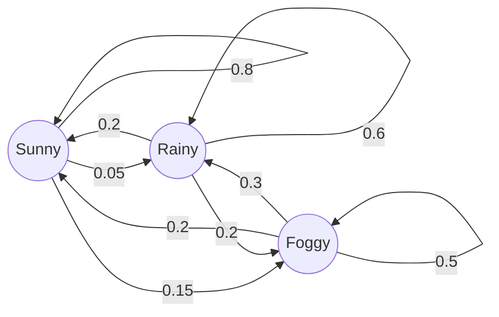
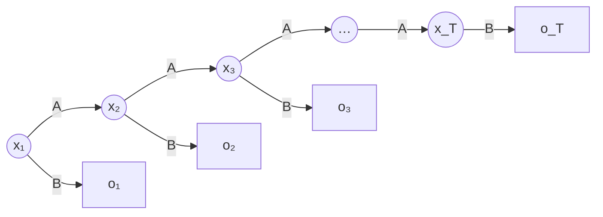

The preceding chapters all assumed that examples are independent and identically distributed, but much data comes in sequences with an order: the weather, the number of infections in an epidemic, speech, text, gene sequences, the clicks and purchases of a user, the sensor readings of a robot. Adjacent elements of a sequence depend on one another, and ignoring the order discards the most important information. This chapter introduces the most classical sequence models: the Markov model assumes that the next state depends only on the current state; the hidden Markov model (HMM) assumes further that the state itself cannot be observed and can only be inferred indirectly from the observations it generates. All three basic problems of the HMM can be solved efficiently by **dynamic programming** ([4.1.13](/4.1.13)), exploiting the special structure of the model, and the learning problem is a special case of the **EM algorithm** ([3.5.6](/3.5.6)). The probability theory of Markov chains is in [3.5.9](/3.5.9); methods that model sequences with neural networks (recurrent neural networks, the Transformer) are in [4.7.5](/4.7.5) and [4.7.6](/4.7.6).

## 8.1. Markov Models

### 8.1.1. The First-Order Markov Assumption

Take weather forecasting as an example: let the weather have three states {sunny, rainy, foggy}, and let $w_n$ be the weather on day $n$. In general, today's weather depends on the weather of all past days; for instance, if the first three days were {sunny, sunny, foggy} in turn, the probability of rain on the fourth day is $\mathbb{P}(w_4 = \text{rainy} \mid w_3 = \text{foggy}, w_2 = \text{sunny}, w_1 = \text{sunny})$. Conditioning on the whole history requires a number of parameters that grows exponentially with the length of the sequence. By the chain rule,

$$
\mathbb{P}(w_1, \dots, w_n) = \prod_{i=1}^n\mathbb{P}(w_i \mid w_{i-1}, \dots, w_1),
$$
and the simplest approximation is the first-order Markov assumption: the observation at time $n$ depends only on the observation at time $n-1$,

$$
\mathbb{P}(w_n \mid w_{n-1}, \dots, w_1) = \mathbb{P}(w_n \mid w_{n-1}),
$$
that is, "given the present, the past and the future are independent." This is the **Markov property** of a **Markov chain**. Markov (1856–1922), a student of Chebyshev and a leading figure of the St. Petersburg school, extended the range of validity of the law of large numbers and the central limit theorem, and introduced Markov chains in 1906–1907, founding a branch of the theory of stochastic processes.

**Definition 8.1.1 (Markov Model)** Let a variable $x_t$ take one of $m$ states $\{S_1, \dots, S_m\}$. A **Markov model** is given by an initial distribution $\pi_i = \mathbb{P}(x_1 = S_i)$ and transition probabilities

$$
a_{ij} = \mathbb{P}(x_{t+1} = S_j \mid x_t = S_i),
$$
and assumes the first-order Markov property and time invariance (homogeneity): $a_{ij}$ does not depend on $t$. The transition probabilities satisfy $a_{ij} \ge 0$ and $\sum_j a_{ij} = 1$, so each row of the transition matrix $A = (a_{ij})$ sums to 1. The joint probability of a sequence is

$$
\mathbb{P}(x_1, \dots, x_T) = \pi_{x_1}\prod_{t=2}^T a_{x_{t-1}x_t}.
$$

**Example 8.1.1** Transition probabilities of the weather (rows are today, columns are tomorrow):

| Today \ Tomorrow | Sunny | Rainy | Foggy |
|---|---|---|---|
| Sunny | 0.8 | 0.05 | 0.15 |
| Rainy | 0.2 | 0.6 | 0.2 |
| Foggy | 0.2 | 0.3 | 0.5 |



Given that today is sunny, the probability that tomorrow is sunny and the day after is rainy is $\mathbb{P}(w_2 = \text{sunny}, w_3 = \text{rainy} \mid w_1 = \text{sunny}) = a_{\text{sunny},\text{sunny}}\,a_{\text{sunny},\text{rainy}} = 0.8 \times 0.05 = 0.04$. Given that today is foggy, the probability of rain the day after tomorrow requires a sum over tomorrow's weather:

$$
\mathbb{P}(w_3 = \text{rainy} \mid w_1 = \text{foggy}) = \sum_k a_{\text{foggy},k}\,a_{k,\text{rainy}} = 0.2 \times 0.05 + 0.3 \times 0.6 + 0.5 \times 0.3 = 0.34,
$$
which is precisely the (foggy, rainy) entry of the matrix $A^2$. In general the $k$-step transition probabilities are the entries of $A^k$; a chain satisfying certain conditions (irreducible and aperiodic) converges from any initial distribution to a unique **stationary distribution** ([3.5.9](/3.5.9)).

The Markov model is also the simplest language model. Regard words as states; the probability of a sentence is then the product of the transition probabilities of the adjacent word pairs. For example, if the transition probabilities the → big, big → dog, dog → just and just → died are 0.4, 0.6, 0.2 and 0.4 in turn, then

$$
\mathbb{P}(\text{the big dog just died} \mid \text{the}) = 0.4 \times 0.6 \times 0.2 \times 0.4 = 0.0192 .
$$
Such a model is called a bigram model; letting the next word depend on the previous $n-1$ words gives an $n$-gram model, which is a Markov model of order $n-1$.

### 8.1.2. Parameter Estimation

In the weather example the transition matrix was given. If it is unknown, it must be learned from observed sequences (the training set). When the state sequences are observed, **maximum likelihood estimation** amounts to counting:

$$
\hat a_{ij} = \frac{n_{ij}}{\sum_k n_{ik}},\qquad \hat\pi_i = \frac{\text{number of sequences starting with } S_i}{\text{total number of sequences}},
$$
where $n_{ij}$ is the number of times $S_i$ is immediately followed by $S_j$ in the training sequences. When there are many states (such as the vocabulary of a language model), most pairs of states never occur, and a transition with count 0 makes the probability of any sequence containing it 0; we therefore smooth, for example by adding 1 to every count (Laplace smoothing) or by interpolating a higher-order model with a lower-order one.

## 8.2. Hidden Markov Models

### 8.2.1. Definition

Consider the weather example again: suppose someone stays for several days in a room from which he cannot see outside and does not know the weather; his only clue is whether the person who looks after him brings an umbrella when coming in each day. The weather still changes as a Markov chain, but he cannot observe it (the hidden state) and observes only the umbrella (the observation), and the probability of carrying an umbrella depends on the weather of the day:

| Weather | Probability of an umbrella |
|---|---|
| Sunny | 0.1 |
| Rainy | 0.8 |
| Foggy | 0.3 |

**Definition 8.2.1 (Hidden Markov Model)** A **hidden Markov model** (HMM) is described by a five-tuple $\{S, K, \pi, A, B\}$:

- $S = \{s_1, \dots, s_N\}$ is the set of values of the hidden state and $K = \{k_1, \dots, k_M\}$ is the set of values of the observation;
- $\pi_i = \mathbb{P}(x_1 = s_i)$ is the initial state distribution;
- $A = (a_{ij})$, $a_{ij} = \mathbb{P}(x_{t+1} = s_j \mid x_t = s_i)$, are the state transition probabilities;
- $B = (b_j(k))$, $b_j(k) = \mathbb{P}(o_t = k \mid x_t = s_j)$, are the output probabilities (emission probabilities).

Write the model parameters as $\lambda = (A, B, \pi)$. For a hidden state sequence $X = x_1, \dots, x_T$ and an observation sequence $O = o_1, \dots, o_T$, the HMM makes three assumptions:

1. Markov assumption: the states form a first-order Markov chain, $\mathbb{P}(x_t \mid x_{t-1}, \dots, x_1) = \mathbb{P}(x_t \mid x_{t-1})$;
2. Time invariance: $\mathbb{P}(x_{t+1} \mid x_t)$ does not depend on $t$;
3. Output independence: an observation depends only on the current hidden state, $\mathbb{P}(o_1, \dots, o_T \mid x_1, \dots, x_T) = \prod_t\mathbb{P}(o_t \mid x_t)$.

The joint probability of the state sequence and the observation sequence is therefore

$$
\mathbb{P}(O, X \mid \lambda) = \pi_{x_1}b_{x_1}(o_1)\prod_{t=2}^T a_{x_{t-1}x_t}\,b_{x_t}(o_t). \tag{8.1}
$$

An HMM is a graphical model: the hidden states form a chain, and each hidden state emits one observation. In a Markov model the states are observed directly, whereas in an HMM they can only be inferred indirectly from the observations.



**Example 8.2.1** Suppose the first day is sunny and on the second day the caretaker brings an umbrella. What is the probability that it rains on the second day? By Bayes' theorem and output independence,

$$
\mathbb{P}(x_2 = \text{rainy} \mid o_2 = \text{umbrella}, x_1 = \text{sunny}) = \frac{b_{\text{rainy}}(\text{umbrella})\,a_{\text{sunny},\text{rainy}}}{\sum_k b_k(\text{umbrella})\,a_{\text{sunny},k}} = \frac{0.8 \times 0.05}{0.1 \times 0.8 + 0.8 \times 0.05 + 0.3 \times 0.15} \approx 0.243 .
$$
Without the observation the prior probability of rain is only $0.05$, and after seeing the umbrella it rises to about $0.24$; but because the prior probability of a sunny day is high, a sunny day is still more likely (about $0.48$).

### 8.2.2. The Three Basic Problems

Given the HMM parameters $\lambda = (A, B, \pi)$ and an observation sequence $O = o_1, \dots, o_T$:

1. The evaluation problem: compute the probability $\mathbb{P}(O \mid \lambda)$ of the observation sequence. It can be used to compare how well different models explain the same sequence; for example, in speech recognition one trains an HMM for each word and takes the word whose $\mathbb{P}(O \mid \lambda)$ is largest.
2. The decoding problem: find the most probable state sequence $\arg\max_X\mathbb{P}(X \mid O, \lambda)$, that is, uncover the hidden part.
3. The learning problem: given only the observation sequence, adjust the parameters $\lambda$ to maximize $\mathbb{P}(O \mid \lambda)$.

## 8.3. The Evaluation Problem: The Forward and Backward Algorithms

### 8.3.1. Enumeration

By the law of total probability and Eq. (8.1),

$$
\mathbb{P}(O \mid \lambda) = \sum_X\mathbb{P}(O \mid X, \lambda)\,\mathbb{P}(X \mid \lambda) = \sum_{x_1, \dots, x_T}\pi_{x_1}b_{x_1}(o_1)\prod_{t=2}^T a_{x_{t-1}x_t}\,b_{x_t}(o_t).
$$
Direct computation lists all $N^{T}$ state sequences, each requiring about $2T$ multiplications, for a total of $O(2TN^{T})$, which is already infeasible for $N = 5$ and $T = 100$. But different state sequences share many prefixes, and the chain structure of the HMM suggests using dynamic programming.

### 8.3.2. The Forward Algorithm

**Definition 8.3.1 (Forward Variable)** The **forward variable** $\alpha_t(i) = \mathbb{P}(o_1, \dots, o_t, x_t = s_i \mid \lambda)$ is the joint probability of observing the first $t$ observations and being in state $s_i$ at time $t$.

Decompose $\alpha_{t+1}(j)$ according to the state at time $t$, using output independence and the Markov assumption:

$$
\begin{aligned}
\alpha_{t+1}(j) &= \mathbb{P}(o_1, \dots, o_{t+1}, x_{t+1} = s_j)
= \sum_{i=1}^N\mathbb{P}(o_1, \dots, o_t, x_t = s_i, x_{t+1} = s_j, o_{t+1}) \\
&= \sum_{i=1}^N\mathbb{P}(o_1, \dots, o_t, x_t = s_i)\,\mathbb{P}(x_{t+1} = s_j \mid x_t = s_i)\,\mathbb{P}(o_{t+1} \mid x_{t+1} = s_j)
= \Big[\sum_{i=1}^N\alpha_t(i)\,a_{ij}\Big]b_j(o_{t+1}),
\end{aligned}
$$
where the third equality uses that, given $x_t$, $x_{t+1}$ is independent of the earlier observations, and that, given $x_{t+1}$, $o_{t+1}$ is independent of everything else.

**Algorithm 8.3.1 (Forward Algorithm)**

1. Initialization: $\alpha_1(i) = \pi_i\,b_i(o_1)$, $i = 1, \dots, N$;
2. Recursion: for $t = 1, \dots, T-1$, $\alpha_{t+1}(j) = \big[\sum_{i=1}^N\alpha_t(i)\,a_{ij}\big]b_j(o_{t+1})$;
3. Termination: $\mathbb{P}(O \mid \lambda) = \sum_{i=1}^N\alpha_T(i)$.

Each step performs $N$ multiply-adds for each of the $N$ values of $j$, about $2TN^2$ multiplications in total, a complexity of $O(N^2T)$, reduced from exponential to linear in $T$.

### 8.3.3. The Backward Algorithm

**Definition 8.3.2 (Backward Variable)** The **backward variable** $\beta_t(i) = \mathbb{P}(o_{t+1}, \dots, o_T \mid x_t = s_i, \lambda)$ is the probability of observing the subsequent observations given that the state at time $t$ is $s_i$.

**Algorithm 8.3.2 (Backward Algorithm)**

1. Initialization: $\beta_T(i) = 1$;
2. Recursion: for $t = T-1, \dots, 1$, $\beta_t(i) = \sum_{j=1}^N a_{ij}\,b_j(o_{t+1})\,\beta_{t+1}(j)$;
3. Termination: $\mathbb{P}(O \mid \lambda) = \sum_{i=1}^N\pi_i\,b_i(o_1)\,\beta_1(i)$.

The derivation is symmetric to that of the forward algorithm, and the complexity is likewise $O(N^2T)$. The forward and backward variables can be joined at any time: for every $t$,

$$
\mathbb{P}(O \mid \lambda) = \sum_{i=1}^N\alpha_t(i)\,\beta_t(i),\qquad
\gamma_t(i) = \mathbb{P}(x_t = s_i \mid O, \lambda) = \frac{\alpha_t(i)\,\beta_t(i)}{\mathbb{P}(O \mid \lambda)} . \tag{8.2}
$$
Here $\gamma_t(i)$ is the posterior probability of being in $s_i$ at time $t$ given all the observations; computing both $\alpha$ and $\beta$ to obtain $\gamma$ is called the forward–backward algorithm, which is the basis of the learning problem below.

Below we implement the forward and backward algorithms on the umbrella example (with a uniform initial distribution and the observations "umbrella, umbrella, no umbrella, umbrella, no umbrella") and compare them with enumeration:

```python
import itertools

import numpy as np

# weather HMM: hidden states sunny, rainy, foggy; observations 0 = umbrella, 1 = no umbrella
A = np.array([[0.8, 0.05, 0.15],
              [0.2, 0.6, 0.2],
              [0.2, 0.3, 0.5]])
B = np.array([[0.1, 0.9],
              [0.8, 0.2],
              [0.3, 0.7]])
pi = np.array([1 / 3, 1 / 3, 1 / 3])
obs = [0, 0, 1, 0, 1]


def forward(A, B, pi, obs):
    """alpha[t, i] = P(o_1..o_t, x_t = i); returns alpha and P(O)."""
    alpha = np.zeros((len(obs), len(pi)))
    alpha[0] = pi * B[:, obs[0]]
    for t in range(1, len(obs)):
        alpha[t] = (alpha[t - 1] @ A) * B[:, obs[t]]
    return alpha, alpha[-1].sum()


def backward(A, B, obs):
    """beta[t, i] = P(o_{t+1}..o_T | x_t = i)."""
    beta = np.ones((len(obs), A.shape[0]))
    for t in range(len(obs) - 2, -1, -1):
        beta[t] = A @ (B[:, obs[t + 1]] * beta[t + 1])
    return beta


def brute_force(A, B, pi, obs):
    """Sum P(O, X) over all N^T state sequences."""
    total = 0.0
    for xs in itertools.product(range(len(pi)), repeat=len(obs)):
        p = pi[xs[0]] * B[xs[0], obs[0]]
        for t in range(1, len(obs)):
            p *= A[xs[t - 1], xs[t]] * B[xs[t], obs[t]]
        total += p
    return total


alpha, p_forward = forward(A, B, pi, obs)
beta = backward(A, B, obs)
print(f"forward     P(O) = {p_forward:.6f}")
print(f"brute force P(O) = {brute_force(A, B, pi, obs):.6f}")
print(f"backward    P(O) = {(pi * B[:, obs[0]] * beta[0]).sum():.6f}")
gamma = alpha * beta / p_forward          # posterior P(x_t = i | O)
print("posterior of each state per day:\n", gamma.round(3))
```

```text
forward     P(O) = 0.017039
brute force P(O) = 0.017039
backward    P(O) = 0.017039
posterior of each state per day:
 [[0.032 0.745 0.223]
 [0.061 0.73  0.209]
 [0.265 0.316 0.419]
 [0.213 0.506 0.282]
 [0.476 0.169 0.355]]
```

The three methods give the same probability. The posterior probabilities show that on the two days with an umbrella in a row it probably rains, and that on the third day, without an umbrella, a foggy day has the largest posterior probability.

### 8.3.4. Numerical Underflow

$\alpha_t(i)$ is a product of $2t$ numbers smaller than 1 and decreases exponentially with $t$, so for sequences of a few hundred steps it **underflows** to 0. In implementations we rescale at every time step: let $c_t = \sum_i\alpha_t(i)$, divide $\alpha_t$ by $c_t$ before recursing, and then $\log\mathbb{P}(O \mid \lambda) = \sum_t\log c_t$; scaling $\beta_t$ by the same $c_t$ leaves $\gamma_t$ in Eq. (8.2) unaffected. One can also compute everything in the log domain, replacing sums by $\log\sum_i\mathrm{e}^{u_i} = u^* + \log\sum_i\mathrm{e}^{u_i - u^*}$ ($u^* = \max_i u_i$).

## 8.4. The Decoding Problem: The Viterbi Algorithm

### 8.4.1. What Is the "Best" State Sequence

"Best" can be defined in different ways. One is to take, at each time separately, the state of largest posterior probability, $\hat x_t = \arg\max_i\gamma_t(i)$, which maximizes the expected number of correct states; but the sequence so assembled may be impossible (for example, the transition probability between two adjacent states may be 0). The more common definition is to find the state sequence that best explains the observations as a whole:

$$
\hat X = \arg\max_X\mathbb{P}(X \mid O, \lambda) = \arg\max_X\mathbb{P}(X, O \mid \lambda),
$$
where the equality holds because $\mathbb{P}(O \mid \lambda)$ does not depend on $X$. The dynamic programming algorithm that finds it is the Viterbi algorithm (Viterbi, 1967).

### 8.4.2. The Algorithm

Let

$$
\delta_t(j) = \max_{x_1, \dots, x_{t-1}}\mathbb{P}(x_1, \dots, x_{t-1}, x_t = s_j, o_1, \dots, o_t \mid \lambda)
$$
be the largest probability among all state sequences that reach state $s_j$ at time $t$ and explain the first $t$ observations. A prefix of an optimal path is itself optimal (optimal substructure), so

$$
\delta_{t+1}(j) = \Big[\max_i\delta_t(i)\,a_{ij}\Big]b_j(o_{t+1}) .
$$
This is exactly the recursion of the forward algorithm, with the sum replaced by a maximum.

**Algorithm 8.4.1 (Viterbi Algorithm)**

1. Initialization: $\delta_1(j) = \pi_j\,b_j(o_1)$;
2. Recursion: for $t = 1, \dots, T-1$, $\delta_{t+1}(j) = \big[\max_i\delta_t(i)\,a_{ij}\big]b_j(o_{t+1})$, and record the predecessor attaining the maximum, $\psi_{t+1}(j) = \arg\max_i\delta_t(i)\,a_{ij}$;
3. Termination: $\hat x_T = \arg\max_i\delta_T(i)$, with maximum probability $\max_i\delta_T(i)$;
4. Backtracking: for $t = T-1, \dots, 1$, $\hat x_t = \psi_{t+1}(\hat x_{t+1})$.

The complexity is again $O(N^2T)$. Arranging the states of all times in a grid (a trellis), the Viterbi algorithm finds the longest (most probable) path on the grid; implementations work in the log domain, turning products into sums to avoid underflow.

**Example 8.4.1** A patient's health state {Healthy, Fever} is hidden, and the doctor observes each day only how he feels, {normal, cold, dizzy}. The parameters are: initial distribution Healthy 0.6, Fever 0.4; transition probabilities Healthy→Healthy 0.7, Healthy→Fever 0.3, Fever→Healthy 0.4, Fever→Fever 0.6; output probabilities normal 0.5, cold 0.4, dizzy 0.1 when Healthy and normal 0.1, cold 0.3, dizzy 0.6 when Fever. On three consecutive days "normal, cold, dizzy" are observed. What is the most probable sequence of health states? In the first step $\delta_1(\text{Healthy}) = 0.6 \times 0.5 = 0.3$ and $\delta_1(\text{Fever}) = 0.4 \times 0.1 = 0.04$; in each later step, only the most probable path to each state is kept:

```python
import numpy as np

states = ["Healthy", "Fever"]
symbols = ["normal", "cold", "dizzy"]
pi = np.array([0.6, 0.4])
A = np.array([[0.7, 0.3],
              [0.4, 0.6]])
B = np.array([[0.5, 0.4, 0.1],
              [0.1, 0.3, 0.6]])


def viterbi(A, B, pi, obs):
    """Most probable state sequence; delta[t, j] is the best path probability ending in j at t."""
    T, N = len(obs), len(pi)
    delta = np.zeros((T, N))
    psi = np.zeros((T, N), dtype=int)
    delta[0] = pi * B[:, obs[0]]
    for t in range(1, T):
        scores = delta[t - 1][:, None] * A          # scores[i, j] = delta_{t-1}(i) a_ij
        psi[t] = scores.argmax(axis=0)
        delta[t] = scores.max(axis=0) * B[:, obs[t]]
    path = [int(delta[-1].argmax())]
    for t in range(T - 1, 0, -1):                   # backtrack
        path.append(int(psi[t, path[-1]]))
    return path[::-1], delta[-1].max(), delta


obs = [symbols.index(s) for s in ["normal", "cold", "dizzy"]]
path, prob, delta = viterbi(A, B, pi, obs)
print("delta:\n", delta.round(5))
print("best path:", [states[i] for i in path], f"probability {prob:.5f}")
```

```text
delta:
 [[0.3     0.04   ]
 [0.084   0.027  ]
 [0.00588 0.01512]]
best path: ['Healthy', 'Healthy', 'Fever'] probability 0.01512
```

The most probable sequence is "Healthy, Healthy, Fever", with joint probability $0.01512$. For example, $\delta_2(\text{Healthy}) = \max(0.3 \times 0.7,\ 0.04 \times 0.4) \times 0.4 = 0.084$, with predecessor Healthy.

The figure below is a longer example: the "occasionally dishonest casino" alternates between a fair die and a loaded die that shows a six with probability $1/2$. Seeing only the numbers rolled, the forward–backward algorithm gives the posterior probability at each time that the loaded die is in use, and the Viterbi algorithm gives the most probable sequence of dice; both roughly locate the periods of cheating.


## 8.5. The Learning Problem: The Baum–Welch Algorithm

### 8.5.1. Labeled and Unlabeled Data

If the training data give both the observation sequences and the state sequences (for example, a corpus annotated with parts of speech by hand), learning is the counting of Sec. 8.1.2: $\hat a_{ij}$ is the frequency with which $s_i$ is immediately followed by $s_j$, and $\hat b_j(k)$ is the frequency of outputting $k$ in state $s_j$.

With only observation sequences, this is the hardest of the three problems: the states are missing data, the likelihood $\mathbb{P}(O \mid \lambda)$ is a sum of $N^{T}$ terms with no analytic maximizer, and we can only seek a local optimum: given the model and the observation sequence, adjust the parameters repeatedly so that the model fits the observation sequence better. This is exactly the **maximum likelihood estimation** problem with latent variables that the **EM algorithm** handles: the E step computes the posterior distribution of the hidden states with the current parameters, and the M step re-estimates the parameters with expected counts in place of true counts. The EM algorithm for HMMs is called the Baum–Welch algorithm (Baum et al., 1970), and its E step is done by the forward–backward algorithm.

### 8.5.2. The Algorithm

In addition to $\gamma_t(i)$ in Eq. (8.2), we need the posterior probability of the states at two adjacent times,

$$
\xi_t(i, j) = \mathbb{P}(x_t = s_i, x_{t+1} = s_j \mid O, \lambda) = \frac{\alpha_t(i)\,a_{ij}\,b_j(o_{t+1})\,\beta_{t+1}(j)}{\mathbb{P}(O \mid \lambda)} .
$$
Here $\sum_{t=1}^{T-1}\gamma_t(i)$ is the expected number of transitions out of $s_i$, and $\sum_{t=1}^{T-1}\xi_t(i,j)$ is the expected number of transitions from $s_i$ to $s_j$.

**Algorithm 8.5.1 (Baum–Welch Algorithm)** Choose initial parameters $\lambda = (A, B, \pi)$ and repeat the following two steps until $\mathbb{P}(O \mid \lambda)$ no longer increases appreciably:

1. E step: compute $\alpha_t(i)$ and $\beta_t(i)$ with the forward and backward algorithms, and from them $\gamma_t(i)$ and $\xi_t(i, j)$;
2. M step: re-estimate

   $$
   \hat\pi_i = \gamma_1(i),\qquad
   \hat a_{ij} = \frac{\sum_{t=1}^{T-1}\xi_t(i, j)}{\sum_{t=1}^{T-1}\gamma_t(i)},\qquad
   \hat b_j(k) = \frac{\sum_{t : o_t = k}\gamma_t(j)}{\sum_{t=1}^T\gamma_t(j)} .
   $$

By the ascent property of the EM algorithm ([3.5.6](/3.5.6#thm-6.1.1)), each iteration does not decrease $\mathbb{P}(O \mid \lambda)$, and the algorithm converges to a local maximum (or saddle point) of the likelihood. The result depends on the initial values; in practice one starts from several random initializations and takes the result of largest likelihood, or initializes with a small amount of labeled data. With several training sequences, we simply add up the expected counts over the sequences.

Below we run the Baum–Welch algorithm from random initial values on simulated casino data (3000 rolls), with the forward–backward algorithm using the scaling of Sec. 8.3.4:

```python
import numpy as np


def forward_backward(A, B, pi, obs):
    """Scaled forward-backward; returns gamma, xi summed over t, and log P(O)."""
    T, N = len(obs), len(pi)
    alpha, beta, c = np.zeros((T, N)), np.ones((T, N)), np.zeros(T)
    alpha[0] = pi * B[:, obs[0]]
    c[0] = alpha[0].sum()
    alpha[0] /= c[0]
    for t in range(1, T):
        alpha[t] = (alpha[t - 1] @ A) * B[:, obs[t]]
        c[t] = alpha[t].sum()
        alpha[t] /= c[t]
    for t in range(T - 2, -1, -1):
        beta[t] = A @ (B[:, obs[t + 1]] * beta[t + 1]) / c[t + 1]
    gamma = alpha * beta
    xi = np.zeros((N, N))
    for t in range(T - 1):
        xi += alpha[t][:, None] * A * (B[:, obs[t + 1]] * beta[t + 1])[None, :] / c[t + 1]
    return gamma, xi, np.log(c).sum()


def baum_welch(obs, N, M, iters, rng):
    A = rng.dirichlet(np.ones(N), N)
    B = rng.dirichlet(np.ones(M), N)
    pi = np.full(N, 1 / N)
    obs = np.asarray(obs)
    for it in range(iters):
        gamma, xi, loglik = forward_backward(A, B, pi, obs)
        pi = gamma[0]
        A = xi / xi.sum(axis=1, keepdims=True)
        B = np.array([[gamma[obs == k, i].sum() for k in range(M)] for i in range(N)])
        B /= B.sum(axis=1, keepdims=True)
        if it in (0, 1, 5, 20, 100, iters - 1):
            print(f"iteration {it:3d}: log P(O) = {loglik:.2f}")
    return A, B, pi


# simulate the "occasionally dishonest casino": a fair die and a loaded die (six with prob 1/2)
rng = np.random.default_rng(0)
A_true = np.array([[0.95, 0.05], [0.10, 0.90]])
B_true = np.array([[1 / 6] * 6, [0.1] * 5 + [0.5]])
x, obs = 0, []
for _ in range(3000):
    obs.append(rng.choice(6, p=B_true[x]))
    x = rng.choice(2, p=A_true[x])
A, B, pi = baum_welch(obs, N=2, M=6, iters=200, rng=rng)
print("estimated A:\n", A.round(3))
print("estimated B:\n", B.round(3))
```

```text
iteration   0: log P(O) = -6146.75
iteration   1: log P(O) = -5253.28
iteration   5: log P(O) = -5249.27
iteration  20: log P(O) = -5242.86
iteration 100: log P(O) = -5216.87
iteration 199: log P(O) = -5203.58
estimated A:
 [[0.952 0.048]
 [0.068 0.932]]
estimated B:
 [[0.187 0.156 0.172 0.179 0.152 0.154]
 [0.111 0.116 0.086 0.094 0.131 0.461]]
```

The log-likelihood increases monotonically, and the estimated parameters are close to the true values (transition probabilities $0.95/0.05$ and $0.10/0.90$, and probability $0.5$ of a six for the loaded die). Note that EM converges rather slowly here: the likelihood rises quickly in the first few steps, and then it takes several hundred iterations to separate the two states gradually. The labeling of the hidden states has no meaning in itself; that the learned state 1 corresponds to the loaded die is judged from the output probabilities.

## 8.6. Applications

HMMs apply to any phenomenon involving a linear sequence, and before the rise of deep learning in the 2010s they were the workhorse of speech recognition and natural language processing.

| Application | Hidden state | Observation | Main problems used |
|---|---|---|---|
| Pinyin input method | Chinese character (or word) | Pinyin | Decoding |
| Part-of-speech tagging | Part of speech (noun, verb, ...) | Word | Supervised learning + decoding |
| Speech recognition | Substate of a phoneme | Acoustic feature vector | Evaluation, decoding, learning |
| Gene prediction | Exon, intron, intergenic region | DNA base | Decoding |
| Protein family modeling | Match, insert, delete states | Amino acid | Evaluation, learning |
| Disease inference | Disease | Symptom | Decoding |

- Pinyin input method: given a pinyin sequence $w_1 w_2 \cdots w_n$, find the character sequence $c_1 c_2 \cdots c_n$. Regard characters as states and pinyin as outputs; estimate from a large corpus the transition matrix $(a_{ij})$ between characters and the output matrix $(b_{ik})$ from characters to pinyin (the output probability of a polyphonic character is spread over several pinyin), and then find the most probable character sequence with the Viterbi algorithm. The transition probabilities are a bigram language model; real input methods work with words, use higher-order language models, and in recent years also incorporate neural language models.
- Part-of-speech tagging: count the transition probabilities between parts of speech and the output probabilities from parts of speech to words in a hand-annotated corpus, and tag new sentences with the Viterbi algorithm. The TnT tagger based on a second-order HMM (Brants, 2000) has an accuracy of about 96.7% on English corpora and was for a long time an important baseline.
- Speech recognition: each phoneme is a small left-to-right HMM of a few states, and the output probability is a Gaussian mixture over acoustic features; models of words and sentences are assembled from phoneme models, trained with the Baum–Welch algorithm and decoded with Viterbi (beam search). Around 2012, deep neural networks replaced Gaussian mixtures for estimating the output probabilities (DNN-HMM hybrid models); today the mainstream is end-to-end neural models.
- Biological sequences: in gene prediction, the states represent region types of DNA, and programs such as GENSCAN (Burge and Karlin, 1997) segment a genome into exons and introns with the Viterbi algorithm; a profile HMM describes the multiple alignment of a protein family, and HMMER and the Pfam database use it to search sequence databases for homologous proteins (the evaluation problem) and to train family models from a set of sequences (the learning problem).
- Disease inference: assume that at each time there is only one disease (cold, pneumonia, tonsillitis) and that it depends only on the disease at the previous time, and that the symptoms (fever, cough, sore throat, runny nose) depend only on the disease at that time; the transition probabilities are the probabilities of change between diseases, and the output probabilities are the probabilities that a disease presents a symptom. Given that a person's symptoms are, in turn, cough, sore throat, runny nose and fever, the Viterbi algorithm finds the most probable course of the disease.

## 8.7. Limitations and Neural Sequence Models

The HMM is thoroughly studied, its algorithms are mature, efficient and easy to train, and it works well on many tasks. Most importantly, it exploits the special structure of the model so that inference, decoding and learning, which would otherwise take exponential time, can all be done in linear time by simple dynamic programming. Its limitations lie in the model assumptions:

1. The first-order Markov assumption may not hold: a word in a language may depend on words far earlier; raising the order makes the number of states grow exponentially.
2. The output independence assumption ignores direct dependences among observations and makes it hard to use overlapping, arbitrary features of the observation sequence.
3. Parameter estimation can still get stuck in local optima, and the number of states $N$ must be specified in advance.

For the second point, conditional random fields (CRFs, Lafferty et al., 2001) model $\mathbb{P}(X \mid O)$ directly and can use arbitrary features of the whole observation sequence; they long replaced HMMs in sequence labeling, and their inference still uses the same dynamic programming as the forward algorithm and the Viterbi algorithm. For the first point, recurrent neural networks and LSTMs ([4.7.5](/4.7.5)) replace the distribution over the $N$ discrete states of an HMM by a continuous hidden vector; their recursion $h_t = f(h_{t-1}, o_t)$ resembles the forward algorithm yet can remember a much longer history; the Transformer ([4.7.6](/4.7.6)) connects any two positions directly by attention. Today speech recognition, input methods and part-of-speech tagging are mostly done by these neural models, but the ideas of the HMM (hidden states, decoding by dynamic programming, training by EM) remain the foundation for understanding sequence models, and HMMs are still widely used in fields such as bioinformatics, where data are limited and interpretability is needed.

## Summary

| Problem | What to compute | Algorithm | Complexity |
|---|---|---|---|
| Evaluation | $\mathbb{P}(O \mid \lambda)$ | Forward algorithm ($\alpha_{t+1}(j) = [\sum_i\alpha_t(i)a_{ij}]b_j(o_{t+1})$) or backward algorithm | $O(N^2T)$ |
| Decoding | $\arg\max_X\mathbb{P}(X \mid O, \lambda)$ | Viterbi algorithm (replace the sum by a maximum, then backtrack) | $O(N^2T)$ |
| Learning | $\arg\max_\lambda\mathbb{P}(O \mid \lambda)$ | Baum–Welch algorithm (a special case of EM, with the forward–backward algorithm as the E step) | $O(N^2T)$ per iteration |

The Markov model uses the first-order Markov assumption to factor the joint distribution of a sequence into a product of transition probabilities; the HMM further introduces unobservable states and output probabilities. All three basic problems exploit the chain structure and turn a sum or maximization over $N^{T}$ state sequences into a recursion over time.
