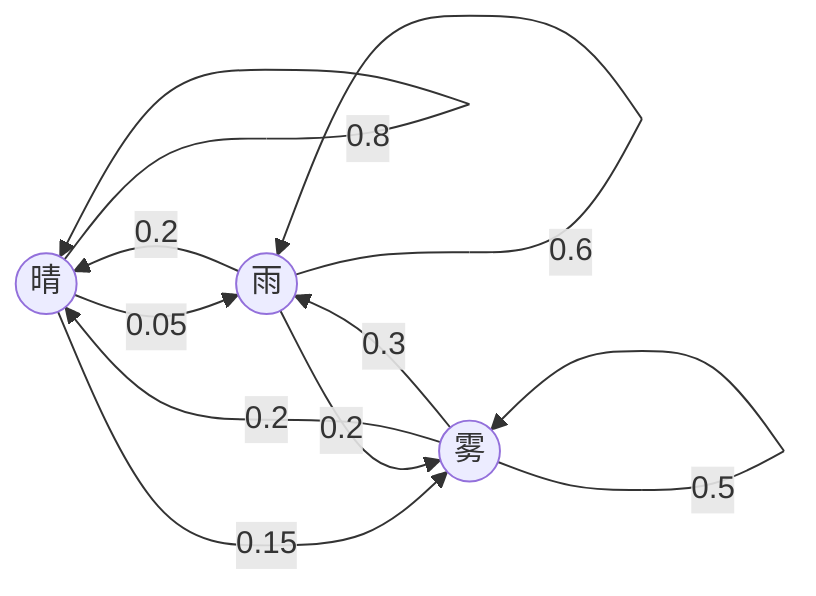
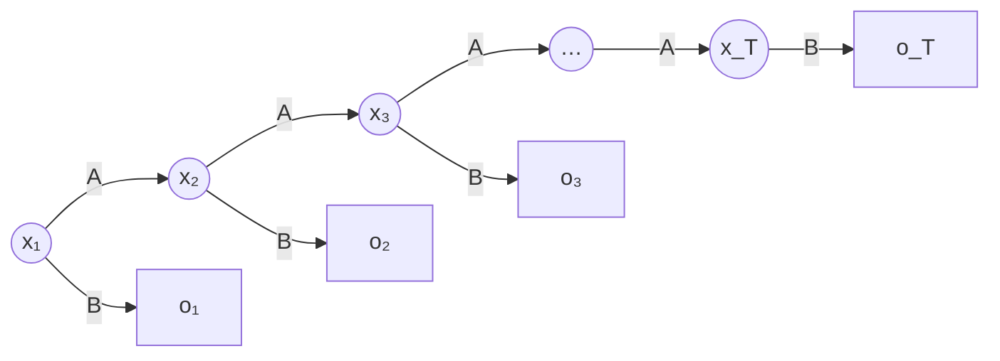

前面各章都假设样例独立同分布，但许多数据是有先后顺序的序列：天气、传染病的感染人数、语音、文字、基因序列、用户的点击与购买记录、机器人的传感器读数。序列中相邻的元素相互依赖，忽略顺序就丢掉了最重要的信息。本章介绍最经典的序列模型：Markov 模型假设下一个状态只依赖于当前状态；隐 Markov 模型（HMM）进一步假设状态本身观察不到，只能通过它产生的观察值间接推断。HMM 的三个基本问题都能利用模型的特殊结构，用**动态规划**（[4.1.13](/4.1.13)）高效地求解，其中的学习问题是 **EM 算法**（[3.5.6](/3.5.6)）的一个特例。Markov 链的概率理论见 [3.5.9](/3.5.9)；用神经网络建模序列的方法（循环神经网络、Transformer）见 [4.7.5](/4.7.5)、[4.7.6](/4.7.6)。

## 8.1. Markov 模型

### 8.1.1. 一阶 Markov 假设

以天气预报为例：设天气有三种状态 {晴，雨，雾}，记第 $n$ 天的天气为 $w_n$。一般来说，今天的天气与过去所有天的天气都有关，例如已知前三天依次为 {晴，晴，雾}，第四天下雨的概率是 $\mathbb{P}(w_4 = \text{雨} \mid w_3 = \text{雾}, w_2 = \text{晴}, w_1 = \text{晴})$。把整个历史都作为条件，需要的参数随序列长度指数增长。由链式法则，

$$
\mathbb{P}(w_1, \dots, w_n) = \prod_{i=1}^n\mathbb{P}(w_i \mid w_{i-1}, \dots, w_1),
$$
最简单的近似是一阶 Markov 假设：时刻 $n$ 的观察值只依赖于时刻 $n-1$ 的观察值，

$$
\mathbb{P}(w_n \mid w_{n-1}, \dots, w_1) = \mathbb{P}(w_n \mid w_{n-1}),
$$
即"给定现在，过去与未来独立"。这就是 **Markov 链**的 **Markov 性**。Markov（1856–1922）是 Chebyshev 的学生、圣彼得堡学派的代表人物，扩大了大数定律与中心极限定理的适用范围，并于 1906 年至 1907 年提出了 Markov 链，开创了随机过程这一分支。

**定义 8.1.1（Markov 模型）** 设变量 $x_t$ 取 $m$ 个状态 $\{S_1, \dots, S_m\}$ 之一。**Markov 模型**由初始分布 $\pi_i = \mathbb{P}(x_1 = S_i)$ 和转移概率

$$
a_{ij} = \mathbb{P}(x_{t+1} = S_j \mid x_t = S_i)
$$
给出，并假设一阶 Markov 性与时间不变性（齐次性）：$a_{ij}$ 与 $t$ 无关。转移概率满足 $a_{ij} \ge 0$，$\sum_j a_{ij} = 1$，排成的转移概率矩阵 $A = (a_{ij})$ 每一行之和为 1。序列的联合概率为

$$
\mathbb{P}(x_1, \dots, x_T) = \pi_{x_1}\prod_{t=2}^T a_{x_{t-1}x_t}.
$$

**例 8.1.1** 天气的转移概率（行为今天、列为明天）：

| 今天 \ 明天 | 晴 | 雨 | 雾 |
|---|---|---|---|
| 晴 | 0.8 | 0.05 | 0.15 |
| 雨 | 0.2 | 0.6 | 0.2 |
| 雾 | 0.2 | 0.3 | 0.5 |



已知今天晴，明天晴且后天雨的概率为 $\mathbb{P}(w_2 = \text{晴}, w_3 = \text{雨} \mid w_1 = \text{晴}) = a_{\text{晴晴}}\,a_{\text{晴雨}} = 0.8 \times 0.05 = 0.04$。已知今天有雾，后天下雨的概率要对明天的天气求和：

$$
\mathbb{P}(w_3 = \text{雨} \mid w_1 = \text{雾}) = \sum_k a_{\text{雾}k}\,a_{k\text{雨}} = 0.2 \times 0.05 + 0.3 \times 0.6 + 0.5 \times 0.3 = 0.34,
$$
这正是矩阵 $A^2$ 的（雾，雨）元。一般地，$k$ 步转移概率是 $A^k$ 的元素；满足一定条件（不可约、非周期）的链从任何初始分布出发，都收敛到唯一的**平稳分布**（[3.5.9](/3.5.9)）。

Markov 模型也是最简单的语言模型。把词看作状态，句子的概率就是各个相邻词对的转移概率之积，例如若 the → big、big → dog、dog → just、just → died 的转移概率依次为 0.4、0.6、0.2、0.4，则

$$
\mathbb{P}(\text{the big dog just died} \mid \text{the}) = 0.4 \times 0.6 \times 0.2 \times 0.4 = 0.0192 .
$$
这样的模型称为二元语法（bigram）模型；让下一个词依赖于前 $n-1$ 个词，就得到 $n$ 元语法模型，它是 $n-1$ 阶的 Markov 模型。

### 8.1.2. 参数估计

天气的例子中转移矩阵是给定的。如果不知道，就要从观察序列（训练集）中学习。观察到状态序列时，**极大似然估计**就是计数：

$$
\hat a_{ij} = \frac{n_{ij}}{\sum_k n_{ik}},\qquad \hat\pi_i = \frac{\text{以 } S_i \text{ 开头的序列数}}{\text{序列总数}},
$$
其中 $n_{ij}$ 是训练序列中 $S_i$ 之后紧接着 $S_j$ 的次数。状态很多（如语言模型中的词表）时，大多数状态对从未出现，计数为 0 的转移会使任何包含它的序列概率为 0，因此要做平滑，例如给每个计数加 1（Laplace 平滑），或把高阶模型与低阶模型插值。

## 8.2. 隐 Markov 模型

### 8.2.1. 定义

再看天气的例子：假设某人一连几天待在一个看不到外面的屋子里，不知道天气如何，唯一的线索是照顾他的人每天进来时是否带了雨伞。天气仍按 Markov 链变化，但他观察不到天气（隐藏状态），只观察到雨伞（观察值），而带伞的概率取决于当天的天气：

| 天气 | 带伞的概率 |
|---|---|
| 晴 | 0.1 |
| 雨 | 0.8 |
| 雾 | 0.3 |

**定义 8.2.1（隐 Markov 模型）** **隐 Markov 模型**（HMM）由五元组 $\{S, K, \pi, A, B\}$ 描述：

- $S = \{s_1, \dots, s_N\}$ 是隐藏状态的取值集合，$K = \{k_1, \dots, k_M\}$ 是观察值的取值集合；
- $\pi_i = \mathbb{P}(x_1 = s_i)$ 是初始状态分布；
- $A = (a_{ij})$，$a_{ij} = \mathbb{P}(x_{t+1} = s_j \mid x_t = s_i)$ 是状态转移概率；
- $B = (b_j(k))$，$b_j(k) = \mathbb{P}(o_t = k \mid x_t = s_j)$ 是输出概率（发射概率）。

记模型参数为 $\lambda = (A, B, \pi)$。对隐藏的状态序列 $X = x_1, \dots, x_T$ 与观察序列 $O = o_1, \dots, o_T$，HMM 作三个假设：

1. Markov 假设：状态构成一阶 Markov 链，$\mathbb{P}(x_t \mid x_{t-1}, \dots, x_1) = \mathbb{P}(x_t \mid x_{t-1})$；
2. 时间不变性：$\mathbb{P}(x_{t+1} \mid x_t)$ 与 $t$ 无关；
3. 输出独立性：观察值只依赖于当前的隐藏状态，$\mathbb{P}(o_1, \dots, o_T \mid x_1, \dots, x_T) = \prod_t\mathbb{P}(o_t \mid x_t)$。

于是状态序列与观察序列的联合概率为

$$
\mathbb{P}(O, X \mid \lambda) = \pi_{x_1}b_{x_1}(o_1)\prod_{t=2}^T a_{x_{t-1}x_t}\,b_{x_t}(o_t). \tag{8.1}
$$

HMM 是一个图模型：隐藏状态排成一条链，每个隐藏状态向下产生一个观察值。Markov 模型中状态是直接观察到的，HMM 中状态只能通过观察值间接推断。



**例 8.2.1** 设第一天晴，第二天照顾者带了伞。第二天下雨的概率是多少？由 Bayes 公式与输出独立性，

$$
\mathbb{P}(x_2 = \text{雨} \mid o_2 = \text{伞}, x_1 = \text{晴}) = \frac{b_{\text{雨}}(\text{伞})\,a_{\text{晴雨}}}{\sum_k b_k(\text{伞})\,a_{\text{晴}k}} = \frac{0.8 \times 0.05}{0.1 \times 0.8 + 0.8 \times 0.05 + 0.3 \times 0.15} \approx 0.243 .
$$
没有观察时下雨的先验概率只有 $0.05$，看到雨伞之后升到约 $0.24$；但因为晴天的先验概率很高，晴天仍然更有可能（约 $0.48$）。

### 8.2.2. 三个基本问题

给定 HMM 的参数 $\lambda = (A, B, \pi)$ 和观察序列 $O = o_1, \dots, o_T$：

1. 评估问题：求观察序列的概率 $\mathbb{P}(O \mid \lambda)$。它可以用来比较不同模型对同一序列的解释程度，例如在语音识别中为每个词训练一个 HMM，取使 $\mathbb{P}(O \mid \lambda)$ 最大的词。
2. 解码问题：求最可能的状态序列 $\arg\max_X\mathbb{P}(X \mid O, \lambda)$，即揭示隐藏的部分。
3. 学习问题：只给定观察序列，调整参数 $\lambda$ 使 $\mathbb{P}(O \mid \lambda)$ 最大。

## 8.3. 评估问题：前向算法与后向算法

### 8.3.1. 穷举

由全概率公式与式 (8.1)，

$$
\mathbb{P}(O \mid \lambda) = \sum_X\mathbb{P}(O \mid X, \lambda)\,\mathbb{P}(X \mid \lambda) = \sum_{x_1, \dots, x_T}\pi_{x_1}b_{x_1}(o_1)\prod_{t=2}^T a_{x_{t-1}x_t}\,b_{x_t}(o_t).
$$
直接计算要列出所有 $N^{\mathsf T}$ 个状态序列，每个需要约 $2T$ 次乘法，共 $O(2TN^{\mathsf T})$ 次，$N = 5$、$T = 100$ 时就已无法计算。但不同的状态序列共享大量的前缀，HMM 的链式结构提示我们用动态规划。

### 8.3.2. 前向算法

**定义 8.3.1（前向变量）** **前向变量** $\alpha_t(i) = \mathbb{P}(o_1, \dots, o_t, x_t = s_i \mid \lambda)$ 是观察到前 $t$ 个观察值、且时刻 $t$ 处于状态 $s_i$ 的联合概率。

对 $\alpha_{t+1}(j)$ 按时刻 $t$ 的状态分解，利用输出独立性与 Markov 假设：

$$
\begin{aligned}
\alpha_{t+1}(j) &= \mathbb{P}(o_1, \dots, o_{t+1}, x_{t+1} = s_j)
= \sum_{i=1}^N\mathbb{P}(o_1, \dots, o_t, x_t = s_i, x_{t+1} = s_j, o_{t+1}) \\
&= \sum_{i=1}^N\mathbb{P}(o_1, \dots, o_t, x_t = s_i)\,\mathbb{P}(x_{t+1} = s_j \mid x_t = s_i)\,\mathbb{P}(o_{t+1} \mid x_{t+1} = s_j)
= \Big[\sum_{i=1}^N\alpha_t(i)\,a_{ij}\Big]b_j(o_{t+1}),
\end{aligned}
$$
其中第三个等号用到：给定 $x_t$，$x_{t+1}$ 与更早的观察值独立；给定 $x_{t+1}$，$o_{t+1}$ 与其他一切独立。

**算法 8.3.1（前向算法）**

1. 初始化：$\alpha_1(i) = \pi_i\,b_i(o_1)$，$i = 1, \dots, N$；
2. 递推：对 $t = 1, \dots, T-1$，$\alpha_{t+1}(j) = \big[\sum_{i=1}^N\alpha_t(i)\,a_{ij}\big]b_j(o_{t+1})$；
3. 终止：$\mathbb{P}(O \mid \lambda) = \sum_{i=1}^N\alpha_T(i)$。

每一步对 $N$ 个 $j$ 各做 $N$ 次乘加，总共约 $2TN^2$ 次乘法，复杂度 $O(N^2T)$，从指数降到了线性。

### 8.3.3. 后向算法

**定义 8.3.2（后向变量）** **后向变量** $\beta_t(i) = \mathbb{P}(o_{t+1}, \dots, o_T \mid x_t = s_i, \lambda)$ 是已知时刻 $t$ 处于状态 $s_i$ 时，观察到其后各观察值的概率。

**算法 8.3.2（后向算法）**

1. 初始化：$\beta_T(i) = 1$；
2. 递推：对 $t = T-1, \dots, 1$，$\beta_t(i) = \sum_{j=1}^N a_{ij}\,b_j(o_{t+1})\,\beta_{t+1}(j)$；
3. 终止：$\mathbb{P}(O \mid \lambda) = \sum_{i=1}^N\pi_i\,b_i(o_1)\,\beta_1(i)$。

推导与前向算法对称，复杂度同样为 $O(N^2T)$。前向变量与后向变量可以在任一时刻拼接：对每个 $t$，

$$
\mathbb{P}(O \mid \lambda) = \sum_{i=1}^N\alpha_t(i)\,\beta_t(i),\qquad
\gamma_t(i) = \mathbb{P}(x_t = s_i \mid O, \lambda) = \frac{\alpha_t(i)\,\beta_t(i)}{\mathbb{P}(O \mid \lambda)} . \tag{8.2}
$$
$\gamma_t(i)$ 是给定全部观察值后时刻 $t$ 处于 $s_i$ 的后验概率；同时算出 $\alpha$ 与 $\beta$ 以得到 $\gamma$ 的方法称为前向–后向算法，它是下面学习问题的基础。

下面在雨伞的例子上实现前向与后向算法（取均匀的初始分布，观察到"伞、伞、无伞、伞、无伞"），并与穷举比较：

```python
import itertools

import numpy as np

# weather HMM: hidden states sunny, rainy, foggy; observations 0 = umbrella, 1 = no umbrella
A = np.array([[0.8, 0.05, 0.15],
              [0.2, 0.6, 0.2],
              [0.2, 0.3, 0.5]])
B = np.array([[0.1, 0.9],
              [0.8, 0.2],
              [0.3, 0.7]])
pi = np.array([1 / 3, 1 / 3, 1 / 3])
obs = [0, 0, 1, 0, 1]


def forward(A, B, pi, obs):
    """alpha[t, i] = P(o_1..o_t, x_t = i); returns alpha and P(O)."""
    alpha = np.zeros((len(obs), len(pi)))
    alpha[0] = pi * B[:, obs[0]]
    for t in range(1, len(obs)):
        alpha[t] = (alpha[t - 1] @ A) * B[:, obs[t]]
    return alpha, alpha[-1].sum()


def backward(A, B, obs):
    """beta[t, i] = P(o_{t+1}..o_T | x_t = i)."""
    beta = np.ones((len(obs), A.shape[0]))
    for t in range(len(obs) - 2, -1, -1):
        beta[t] = A @ (B[:, obs[t + 1]] * beta[t + 1])
    return beta


def brute_force(A, B, pi, obs):
    """Sum P(O, X) over all N^T state sequences."""
    total = 0.0
    for xs in itertools.product(range(len(pi)), repeat=len(obs)):
        p = pi[xs[0]] * B[xs[0], obs[0]]
        for t in range(1, len(obs)):
            p *= A[xs[t - 1], xs[t]] * B[xs[t], obs[t]]
        total += p
    return total


alpha, p_forward = forward(A, B, pi, obs)
beta = backward(A, B, obs)
print(f"forward     P(O) = {p_forward:.6f}")
print(f"brute force P(O) = {brute_force(A, B, pi, obs):.6f}")
print(f"backward    P(O) = {(pi * B[:, obs[0]] * beta[0]).sum():.6f}")
gamma = alpha * beta / p_forward          # posterior P(x_t = i | O)
print("posterior of each state per day:\n", gamma.round(3))
```

```text
forward     P(O) = 0.017039
brute force P(O) = 0.017039
backward    P(O) = 0.017039
posterior of each state per day:
 [[0.032 0.745 0.223]
 [0.061 0.73  0.209]
 [0.265 0.316 0.419]
 [0.213 0.506 0.282]
 [0.476 0.169 0.355]]
```

三种方法给出相同的概率。后验概率显示，连续两天带伞时这两天很可能下雨，而第三天没带伞时雾天的后验概率最大。

### 8.3.4. 数值下溢

$\alpha_t(i)$ 是 $2t$ 个小于 1 的数之积，随 $t$ 指数地变小，序列长度到几百时就会**下溢**为 0。实现时对每个时刻做缩放：令 $c_t = \sum_i\alpha_t(i)$，把 $\alpha_t$ 除以 $c_t$ 后再递推，则 $\log\mathbb{P}(O \mid \lambda) = \sum_t\log c_t$；$\beta_t$ 用同样的 $c_t$ 缩放，式 (8.2) 中的 $\gamma_t$ 不受影响。也可以全部在对数域中计算，用 $\log\sum_i\mathrm{e}^{u_i} = u^* + \log\sum_i\mathrm{e}^{u_i - u^*}$（$u^* = \max_i u_i$）代替求和。

## 8.4. 解码问题：Viterbi 算法

### 8.4.1. 什么是"最佳"状态序列

"最佳"有不同的定义。一种是对每个时刻分别取后验概率最大的状态 $\hat x_t = \arg\max_i\gamma_t(i)$，它使期望的正确状态个数最大；但拼起来的序列可能根本不可能出现（例如相邻两个状态之间的转移概率为 0）。更常用的定义是找一个整体上最能解释观察值的状态序列：

$$
\hat X = \arg\max_X\mathbb{P}(X \mid O, \lambda) = \arg\max_X\mathbb{P}(X, O \mid \lambda),
$$
等号成立是因为 $\mathbb{P}(O \mid \lambda)$ 与 $X$ 无关。求它的动态规划算法是 Viterbi 算法（Viterbi，1967）。

### 8.4.2. 算法

令

$$
\delta_t(j) = \max_{x_1, \dots, x_{t-1}}\mathbb{P}(x_1, \dots, x_{t-1}, x_t = s_j, o_1, \dots, o_t \mid \lambda)
$$
为在时刻 $t$ 到达状态 $s_j$、并解释了前 $t$ 个观察值的所有状态序列中最大的概率。最优路径的前缀也是最优的（最优子结构），所以

$$
\delta_{t+1}(j) = \Big[\max_i\delta_t(i)\,a_{ij}\Big]b_j(o_{t+1}) .
$$
这与前向算法的递推完全相同，只是把求和换成了取最大值。

**算法 8.4.1（Viterbi 算法）**

1. 初始化：$\delta_1(j) = \pi_j\,b_j(o_1)$；
2. 递推：对 $t = 1, \dots, T-1$，$\delta_{t+1}(j) = \big[\max_i\delta_t(i)\,a_{ij}\big]b_j(o_{t+1})$，并记录取得最大值的前驱状态 $\psi_{t+1}(j) = \arg\max_i\delta_t(i)\,a_{ij}$；
3. 终止：$\hat x_T = \arg\max_i\delta_T(i)$，最大概率为 $\max_i\delta_T(i)$；
4. 回溯：对 $t = T-1, \dots, 1$，$\hat x_t = \psi_{t+1}(\hat x_{t+1})$。

复杂度也是 $O(N^2T)$。把各时刻的状态排成一个网格（trellis），Viterbi 算法就是在网格上求一条最长（概率最大）的路径；实现时在对数域中把乘法变成加法，避免下溢。

**例 8.4.1** 一个病人的健康状态 {健康，发烧} 是隐藏的，医生每天只观察到他的感觉 {正常，冷，头晕}。参数为：初始分布 健康 0.6、发烧 0.4；转移概率 健康→健康 0.7、健康→发烧 0.3、发烧→健康 0.4、发烧→发烧 0.6；输出概率 健康时 正常 0.5、冷 0.4、头晕 0.1，发烧时 正常 0.1、冷 0.3、头晕 0.6。连续三天观察到"正常、冷、头晕"，最可能的健康状态序列是什么？第一步 $\delta_1(\text{健康}) = 0.6 \times 0.5 = 0.3$，$\delta_1(\text{发烧}) = 0.4 \times 0.1 = 0.04$；之后每一步对每个状态只保留概率最大的那条路径：

```python
import numpy as np

states = ["Healthy", "Fever"]
symbols = ["normal", "cold", "dizzy"]
pi = np.array([0.6, 0.4])
A = np.array([[0.7, 0.3],
              [0.4, 0.6]])
B = np.array([[0.5, 0.4, 0.1],
              [0.1, 0.3, 0.6]])


def viterbi(A, B, pi, obs):
    """Most probable state sequence; delta[t, j] is the best path probability ending in j at t."""
    T, N = len(obs), len(pi)
    delta = np.zeros((T, N))
    psi = np.zeros((T, N), dtype=int)
    delta[0] = pi * B[:, obs[0]]
    for t in range(1, T):
        scores = delta[t - 1][:, None] * A          # scores[i, j] = delta_{t-1}(i) a_ij
        psi[t] = scores.argmax(axis=0)
        delta[t] = scores.max(axis=0) * B[:, obs[t]]
    path = [int(delta[-1].argmax())]
    for t in range(T - 1, 0, -1):                   # backtrack
        path.append(int(psi[t, path[-1]]))
    return path[::-1], delta[-1].max(), delta


obs = [symbols.index(s) for s in ["normal", "cold", "dizzy"]]
path, prob, delta = viterbi(A, B, pi, obs)
print("delta:\n", delta.round(5))
print("best path:", [states[i] for i in path], f"probability {prob:.5f}")
```

```text
delta:
 [[0.3     0.04   ]
 [0.084   0.027  ]
 [0.00588 0.01512]]
best path: ['Healthy', 'Healthy', 'Fever'] probability 0.01512
```

最可能的序列是"健康、健康、发烧"，联合概率为 $0.01512$。例如 $\delta_2(\text{健康}) = \max(0.3 \times 0.7,\ 0.04 \times 0.4) \times 0.4 = 0.084$，前驱是健康。

下图是一个更长的例子："偶尔作弊的赌场"交替使用一枚公平的骰子和一枚出 6 的概率为 $1/2$ 的灌铅骰子。只看掷出的点数，前向–后向算法给出每一时刻使用灌铅骰子的后验概率，Viterbi 算法给出最可能的骰子序列，两者都大致找出了作弊的时段。


## 8.5. 学习问题：Baum–Welch 算法

### 8.5.1. 有标注与无标注

如果训练数据同时给出了观察序列和状态序列（例如人工标注了词性的语料），学习就是 8.1.2 节的计数：$\hat a_{ij}$ 是 $s_i$ 之后紧接 $s_j$ 的频率，$\hat b_j(k)$ 是处于 $s_j$ 时输出 $k$ 的频率。

只有观察序列时，这是三个问题中最难的一个：状态是缺失的数据，似然函数 $\mathbb{P}(O \mid \lambda)$ 是 $N^{\mathsf T}$ 项之和，没有解析的最大值点，只能求局部最优：给定模型和观察序列，反复调整参数，使模型更好地适应观察序列。这正是 **EM 算法**处理的带隐变量的**极大似然估计**问题：E 步用当前参数计算隐藏状态的后验分布，M 步用期望的计数代替真实的计数重新估计参数。用于 HMM 的 EM 算法称为 Baum–Welch 算法（Baum 等，1970），E 步由前向–后向算法完成。

### 8.5.2. 算法

除了式 (8.2) 中的 $\gamma_t(i)$，还需要相邻两个时刻状态的后验概率

$$
\xi_t(i, j) = \mathbb{P}(x_t = s_i, x_{t+1} = s_j \mid O, \lambda) = \frac{\alpha_t(i)\,a_{ij}\,b_j(o_{t+1})\,\beta_{t+1}(j)}{\mathbb{P}(O \mid \lambda)} .
$$
$\sum_{t=1}^{T-1}\gamma_t(i)$ 是从 $s_i$ 出发的转移次数的期望，$\sum_{t=1}^{T-1}\xi_t(i,j)$ 是从 $s_i$ 转移到 $s_j$ 的次数的期望。

**算法 8.5.1（Baum–Welch 算法）** 选择初始参数 $\lambda = (A, B, \pi)$，重复以下两步直到 $\mathbb{P}(O \mid \lambda)$ 不再明显增大：

1. E 步：用前向算法与后向算法计算 $\alpha_t(i)$、$\beta_t(i)$，进而得到 $\gamma_t(i)$ 与 $\xi_t(i, j)$；
2. M 步：重新估计

   $$
   \hat\pi_i = \gamma_1(i),\qquad
   \hat a_{ij} = \frac{\sum_{t=1}^{T-1}\xi_t(i, j)}{\sum_{t=1}^{T-1}\gamma_t(i)},\qquad
   \hat b_j(k) = \frac{\sum_{t : o_t = k}\gamma_t(j)}{\sum_{t=1}^T\gamma_t(j)} .
   $$

由 EM 算法的上升性质（[3.5.6](/3.5.6#thm-6.1.1)），每次迭代都不会减小 $\mathbb{P}(O \mid \lambda)$，算法收敛到似然函数的一个局部极大（或鞍点）。结果依赖于初值，实践中从多组随机初值出发、取似然最大的结果，或者用少量有标注的数据初始化。有多条训练序列时，把各条序列的期望计数相加即可。

下面在模拟的赌场数据（3000 次掷骰）上从随机初值运行 Baum–Welch 算法，前向–后向算法采用 8.3.4 节的缩放：

```python
import numpy as np


def forward_backward(A, B, pi, obs):
    """Scaled forward-backward; returns gamma, xi summed over t, and log P(O)."""
    T, N = len(obs), len(pi)
    alpha, beta, c = np.zeros((T, N)), np.ones((T, N)), np.zeros(T)
    alpha[0] = pi * B[:, obs[0]]
    c[0] = alpha[0].sum()
    alpha[0] /= c[0]
    for t in range(1, T):
        alpha[t] = (alpha[t - 1] @ A) * B[:, obs[t]]
        c[t] = alpha[t].sum()
        alpha[t] /= c[t]
    for t in range(T - 2, -1, -1):
        beta[t] = A @ (B[:, obs[t + 1]] * beta[t + 1]) / c[t + 1]
    gamma = alpha * beta
    xi = np.zeros((N, N))
    for t in range(T - 1):
        xi += alpha[t][:, None] * A * (B[:, obs[t + 1]] * beta[t + 1])[None, :] / c[t + 1]
    return gamma, xi, np.log(c).sum()


def baum_welch(obs, N, M, iters, rng):
    A = rng.dirichlet(np.ones(N), N)
    B = rng.dirichlet(np.ones(M), N)
    pi = np.full(N, 1 / N)
    obs = np.asarray(obs)
    for it in range(iters):
        gamma, xi, loglik = forward_backward(A, B, pi, obs)
        pi = gamma[0]
        A = xi / xi.sum(axis=1, keepdims=True)
        B = np.array([[gamma[obs == k, i].sum() for k in range(M)] for i in range(N)])
        B /= B.sum(axis=1, keepdims=True)
        if it in (0, 1, 5, 20, 100, iters - 1):
            print(f"iteration {it:3d}: log P(O) = {loglik:.2f}")
    return A, B, pi


# simulate the "occasionally dishonest casino": a fair die and a loaded die (six with prob 1/2)
rng = np.random.default_rng(0)
A_true = np.array([[0.95, 0.05], [0.10, 0.90]])
B_true = np.array([[1 / 6] * 6, [0.1] * 5 + [0.5]])
x, obs = 0, []
for _ in range(3000):
    obs.append(rng.choice(6, p=B_true[x]))
    x = rng.choice(2, p=A_true[x])
A, B, pi = baum_welch(obs, N=2, M=6, iters=200, rng=rng)
print("estimated A:\n", A.round(3))
print("estimated B:\n", B.round(3))
```

```text
iteration   0: log P(O) = -6146.75
iteration   1: log P(O) = -5253.28
iteration   5: log P(O) = -5249.27
iteration  20: log P(O) = -5242.86
iteration 100: log P(O) = -5216.87
iteration 199: log P(O) = -5203.58
estimated A:
 [[0.952 0.048]
 [0.068 0.932]]
estimated B:
 [[0.187 0.156 0.172 0.179 0.152 0.154]
 [0.111 0.116 0.086 0.094 0.131 0.461]]
```

对数似然单调上升，估计出的参数接近真实值（转移概率 $0.95/0.05$、$0.10/0.90$，灌铅骰子出 6 的概率 $0.5$）。注意 EM 在这里收敛得相当慢：最初几步似然迅速上升，之后要几百次迭代才逐渐区分出两个状态。隐藏状态的编号本身没有意义，学到的状态 1 对应灌铅骰子，是由输出概率判断出来的。

## 8.6. 应用

HMM 适用于任何与线性序列有关的现象，在 2010 年代深度学习兴起之前，它是语音识别与自然语言处理的主力模型。

| 应用 | 隐藏状态 | 观察值 | 主要用到的问题 |
|---|---|---|---|
| 拼音输入法 | 汉字（或词） | 拼音 | 解码 |
| 词性标注 | 词性（名词、动词……） | 词 | 有标注学习 + 解码 |
| 语音识别 | 音素的子状态 | 声学特征向量 | 评估、解码、学习 |
| 基因预测 | 外显子、内含子、基因间区 | DNA 碱基 | 解码 |
| 蛋白质家族建模 | 匹配、插入、删除状态 | 氨基酸 | 评估、学习 |
| 病情推断 | 疾病 | 症状 | 解码 |

- 拼音输入法：已知拼音序列 $w_1 w_2 \cdots w_n$，求汉字序列 $c_1 c_2 \cdots c_n$。把汉字看作状态、拼音看作输出值，从大规模语料中统计汉字之间的转移矩阵 $(a_{ij})$ 和汉字到拼音的输出矩阵 $(b_{ik})$（多音字的输出概率分散在几个拼音上），再用 Viterbi 算法求最可能的汉字序列。转移概率就是二元语法的语言模型；实际的输入法以词为单位，使用更高阶的语言模型，近年还结合了神经网络语言模型。
- 词性标注：在人工标注的语料上数出词性之间的转移概率和词性到词的输出概率，对新句子用 Viterbi 算法标注。基于二阶 HMM 的 TnT 标注器（Brants，2000）在英文语料上的准确率约为 96.7%，长期是重要的基线。
- 语音识别：每个音素用几个状态从左到右串成一个小 HMM，输出概率是声学特征的高斯混合；词和句子的模型由音素模型拼接而成，用 Baum–Welch 训练、用 Viterbi（束搜索）解码。2012 年前后，深度神经网络取代高斯混合来估计输出概率（DNN-HMM 混合模型）；如今主流已是端到端的神经网络模型。
- 生物序列：基因预测中，状态表示 DNA 的区域类型，GENSCAN（Burge 与 Karlin，1997）等程序用 Viterbi 算法把基因组切分成外显子与内含子；profile HMM 刻画一个蛋白质家族的多序列比对，HMMER 与 Pfam 数据库用它在序列库中搜索同源蛋白（评估问题），并从一组序列中训练出家族模型（学习问题）。
- 病情推断：假设每一时刻只有一种疾病（感冒、肺炎、扁桃体炎），且只依赖于上一时刻的疾病，症状（发烧、咳嗽、咽喉肿痛、流涕）只依赖于当时的疾病；转移概率是疾病之间转变的概率，输出概率是某种疾病呈现某种症状的概率。已知某人的症状依次为咳嗽、咽喉痛、流涕、发烧，用 Viterbi 算法求其疾病最可能的演变过程。

## 8.7. 局限与神经序列模型

HMM 研究透彻，算法成熟，效率高，容易训练，在许多任务上效果很好。最重要的一点是它充分利用了模型的特殊结构，使原本需要指数时间的推断、解码与学习都能用简洁的动态规划在线性时间内完成。它的局限在于模型假设：

1. 一阶 Markov 假设未必成立：语言中一个词可能依赖于很远之前的词；提高阶数会使状态数指数增长。
2. 输出独立性假设忽略了观察值之间的直接依赖，也难以使用观察序列中重叠的、任意的特征。
3. 参数估计仍会陷入局部最优，且状态数 $N$ 要事先指定。

针对第 2 点，条件随机场（CRF，Lafferty 等，2001）直接对 $\mathbb{P}(X \mid O)$ 建模，可以使用整个观察序列上的任意特征，在序列标注中曾长期取代 HMM；它的推断仍用与前向算法、Viterbi 算法相同的动态规划。针对第 1 点，循环神经网络与 LSTM（[4.7.5](/4.7.5)）用一个连续的隐藏向量代替 HMM 中 $N$ 个离散状态上的分布，递推形式 $h_t = f(h_{t-1}, o_t)$ 与前向算法相似，却能记住长得多的历史；Transformer（[4.7.6](/4.7.6)）则用注意力直接连接任意两个位置。今天的语音识别、输入法和词性标注大多由这些神经模型完成，但 HMM 的思想（隐藏状态、动态规划解码、EM 训练）仍是理解序列模型的基础，在生物信息学等数据有限、需要可解释性的领域仍被广泛使用。

## 小结

| 问题 | 求什么 | 算法 | 复杂度 |
|---|---|---|---|
| 评估 | $\mathbb{P}(O \mid \lambda)$ | 前向算法（$\alpha_{t+1}(j) = [\sum_i\alpha_t(i)a_{ij}]b_j(o_{t+1})$）或后向算法 | $O(N^2T)$ |
| 解码 | $\arg\max_X\mathbb{P}(X \mid O, \lambda)$ | Viterbi 算法（把求和换成取最大值，再回溯） | $O(N^2T)$ |
| 学习 | $\arg\max_\lambda\mathbb{P}(O \mid \lambda)$ | Baum–Welch 算法（EM 的特例，E 步为前向–后向算法） | 每次迭代 $O(N^2T)$ |

Markov 模型用一阶 Markov 假设把序列的联合分布分解为转移概率之积；HMM 再引入观察不到的状态和输出概率。三个基本问题都利用链式结构，把对 $N^{\mathsf T}$ 个状态序列的求和或最大化化为逐时刻的递推。
