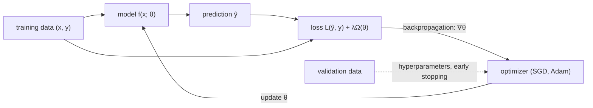

This course is about neural networks trained on data: how they are built, how their parameters are found, and why the resulting models work as well as they do. The first chapter sets the stage in two ways. Its first part describes what deep learning is, how it grew out of seventy years of research on artificial neurons, and what models trained this way can do as of October 2026, from writing machine-checked proofs to working as autonomous **coding agents**. Its second part collects the **machine learning** concepts on which every later chapter relies: a learning algorithm is described by a task, a performance measure and a kind of experience; the central difficulty is generalization, the gap between doing well on the training data and doing well on new data; and most loss functions in deep learning are negative log-likelihoods. These ideas are treated at more length elsewhere in this wiki: the classical machine learning view in 4.6 ([4.6.1](/4.6.1), [4.6.2](/4.6.2)), and the statistical theory in 3.2 (**maximum likelihood estimation**, [3.2.3](/3.2.3)) and 3.3 (model selection, [3.3.11](/3.3.11)); here we state them in the form deep learning uses. The intuitive picture of a neuron and of **gradient descent** from [4.5.4](/4.5.4) is made precise in the next chapter, [4.7.2](/4.7.2).

## 1.1. What Deep Learning Is

### 1.1.1. Artificial Intelligence, Machine Learning and Deep Learning

**Artificial intelligence** (4.5) is the broad goal of building systems that act intelligently. Early systems encoded human knowledge directly as rules and knowledge bases; **machine learning** (4.6) replaces hand-written rules by programs that improve with data, but classical methods such as **support vector machines** or **naive Bayes** still depend on features designed by people. Deep learning removes this last hand-designed stage as well.

**Definition 1.1.1 (Deep Learning)** **Deep learning** is the family of machine learning methods that learn a composition of many parameterized, differentiable transformations (layers), $f = f^{(L)} \circ \cdots \circ f^{(1)}$, end to end from data, typically by gradient-based optimization of a single objective. The intermediate outputs of the layers are learned *representations* of the input.

So deep learning is a form of *representation learning*: the network learns not only the final mapping but also the features it is built on. In a network that classifies images, the first layers come to respond to edges and color contrasts, intermediate layers to textures and object parts, and the last layers to whole objects (see [4.7.3](/4.7.3)); none of these detectors is programmed by hand. "Deep" refers to the length of the chain of transformations. The nested relation of the three fields is

$$
\text{deep learning} \subset \text{representation learning} \subset \text{machine learning} \subset \text{artificial intelligence}.
$$

### 1.1.2. A Brief History

The ideas behind deep learning are old; what changed after 2010 is the scale of data and computation that made them work. The table lists the milestones that the later chapters return to.

| Year | Milestone | Chapter |
|---|---|---|
| 1943 | McCulloch and Pitts: the threshold neuron as a model of the "nerve net"; networks of such units compute any Boolean function | [4.7.2](/4.7.2) |
| 1958 | Rosenblatt's perceptron, a neuron that learns its weights from examples | [4.7.2](/4.7.2) |
| 1969 | Minsky and Papert's book "Perceptrons": single-layer networks cannot represent XOR; interest in neural networks declines | [4.7.2](/4.7.2) |
| 1970–1986 | Reverse-mode differentiation (Linnainmaa 1970), its use for networks (Werbos 1974), and the paper of Rumelhart, Hinton and Williams (1986) that made backpropagation widely known | [4.7.2](/4.7.2) |
| 1980–1998 | Fukushima's Neocognitron; LeCun's convolutional networks trained by backpropagation, ending in LeNet-5 for reading checks | [4.7.3](/4.7.3) |
| 1997 | Long short-term memory (Hochreiter and Schmidhuber) | [4.7.5](/4.7.5) |
| 2006 | Deep belief networks (Hinton, Osindero and Teh) revive the training of deep networks | |
| 2012 | AlexNet wins ImageNet with a GPU-trained convolutional network, cutting the top-5 error from 26% to 15% | [4.7.3](/4.7.3) |
| 2013–2015 | Word embeddings (word2vec), sequence-to-sequence learning, attention, generative adversarial networks, residual networks with 152 layers | [4.7.3](/4.7.3), [4.7.5](/4.7.5) |
| 2017 | The Transformer ("Attention Is All You Need") | [4.7.6](/4.7.6) |
| 2018 | BERT and GPT: pre-training on raw text, then adaptation; Hinton, LeCun and Bengio receive the Turing Award | [4.7.7](/4.7.7) |
| 2020–2022 | GPT-3 and scaling laws; compute-optimal training (Chinchilla); diffusion models; ChatGPT (November 2022) trained with reinforcement learning from human feedback | [4.7.9](/4.7.9) |
| 2024 | Reasoning models trained to think before answering (OpenAI o1); Nobel Prizes in Physics (Hopfield, Hinton) and Chemistry (Baker, Hassabis, Jumper) for neural networks and protein structure prediction | [4.7.9](/4.7.9) |
| 2025 | DeepSeek-R1 shows that reinforcement learning with verifiable rewards elicits reasoning in open models; coding agents become everyday tools | [4.7.9](/4.7.9) |

Two lessons recur in this history. First, the decisive ingredients were rarely new architectures alone: they were large labeled or unlabeled datasets (ImageNet, the web), parallel hardware (GPUs, later TPUs and clusters of more than $10^5$ accelerators) and techniques that let deep networks train stably (good initialization, ReLU, normalization, residual connections; [4.7.2](/4.7.2)–[4.7.4](/4.7.4)). Second, the same few principles, a differentiable model, a loss given by a likelihood, and stochastic gradients computed by backpropagation, underlie every system in the table.

### 1.1.3. Why Depth Helps

A network with one hidden layer can already approximate any continuous function on a compact set (the universal approximation theorem of [4.7.2](/4.7.2)), so depth is not needed for expressiveness in principle. It matters for efficiency. Many functions that a deep network computes with a moderate number of units require exponentially many units in a shallow one; the known separation results (for instance, Telgarsky 2016, Eldan and Shamir 2016) make this precise for specific function classes. The intuition is that natural data are compositional: pixels form edges, edges form motifs, motifs form parts and parts form objects, and words form phrases, sentences and arguments. A deep network can reuse each intermediate feature in many higher-level ones, while a shallow network has to build every combination separately. Each layer also changes the geometry of the data: a classification problem that is far from linearly separable in the input space can become linearly separable in the representation computed by the last hidden layer, where a simple linear classifier finishes the job.

### 1.1.4. The State of the Field in 2026

The systems that dominate public attention in 2026 are large Transformer-based models ([4.7.6](/4.7.6)), pre-trained on trillions of **tokens** of text, images and video ([4.7.7](/4.7.7)), then post-trained with supervised fine-tuning and **reinforcement learning** ([4.7.9](/4.7.9)). Some indications of what they can do, as of October 2026:

- Mathematics: In July 2025 experimental models of OpenAI and Google DeepMind reached gold-medal level at the International Mathematical Olympiad. In September 2026 Anthropic reported that Claude, working largely autonomously for 11 days, produced the first complete formalization of Fermat's Last Theorem in the proof assistant Lean, following the Darmon–Diamond–Taylor exposition of Wiles's proof; the result is checked by Lean using only its standard axioms. This is a translation of a known proof into a machine-checkable form, not a new proof, but at a scale (millions of lines of Lean) that human formalization projects had planned over many years.
- Programming: At the ICPC World Finals in September 2025, an advanced version of Gemini 2.5 Deep Think solved 10 of the 12 problems, a gold-medal result that would have ranked second among the human teams, and an OpenAI system solved all 12. **Coding agents** such as Claude Code (released as a research preview in February 2025) and OpenAI Codex now find the relevant files in a codebase, edit them, run tests and iterate on the feedback.
- Agents: A model in a loop with tools (search, a code interpreter, a browser, a terminal) can carry out tasks of many steps. The open-source personal agent OpenClaw, which spread in early 2026, became one of the most-starred projects on GitHub within months.
- Frontier models: Among the most capable proprietary models in October 2026 are OpenAI's GPT-6 Astra (released on 3 September 2026) and Anthropic's Claude Fable 5.1 (1 September 2026). OpenAI has not published GPT-6's architecture; press reports that it uses *recurrent depth* (a looped Transformer, the same blocks applied several times) are unconfirmed.
- Open-weight models: The strongest open models are sparse mixtures of experts with hybrid attention: Alibaba's Qwen3.5 (February 2026; up to 397 billion parameters with 17 billion active per token; three linear-attention Gated DeltaNet layers for every full attention layer), NVIDIA's Nemotron 3 Ultra (June 2026; 550 billion parameters, 55 billion active; mostly Mamba-2 layers with a few attention layers; pre-trained in 4-bit NVFP4 arithmetic) and Moonshot AI's Kimi K3 (July 2026; 2.8 trillion parameters, 104 billion active, 16 of 896 experts routed per token, a context of one million tokens).

These systems share the trends that the last chapters of this course explain: sparse mixtures of experts that raise the parameter count without raising the computation per token, linear and sparse attention for long contexts ([4.7.6](/4.7.6), [4.7.9](/4.7.9)), training in low-precision arithmetic on very large clusters ([4.7.8](/4.7.8)), and reinforcement learning from verifiable rewards for reasoning ([4.7.9](/4.7.9)). Their capabilities raise questions of safety and alignment (how to ensure that a system more capable than its overseers pursues the intended goals) that are now an active research field of their own. Product names and benchmark numbers change within months; the principles in this course change much more slowly.

## 1.2. Learning Algorithms

### 1.2.1. Task, Performance and Experience

The classical definition of learning, due to Mitchell (1997), separates three ingredients (see also [4.6.1](/4.6.1)).

**Definition 1.2.1 (Machine Learning)** A computer program is said to learn from experience $E$ with respect to some class of tasks $T$ and performance measure $P$ if its performance at tasks in $T$, as measured by $P$, improves with experience $E$. A program that learns in this sense is a **learning algorithm**; studying such programs is **machine learning**.

Adding the model $M$, the family of functions from which the program chooses, gives the four components $(T, P, E, M)$ in terms of which any learning method can be described. The unit of data is an example: a collection of features measured on an object or event, usually written as a vector $\boldsymbol{x} \in \mathbb{R}^n$ (the color, diameter and height of a bucket; the pixel intensities of an image; the **tokens** of a sentence).

### 1.2.2. The Task T

The task is how the system should process an example. Common types are:

| Task | Input → output | Examples |
|---|---|---|
| Classification | $\mathbb{R}^n \to \{1, \dots, k\}$, or a probability vector over the $k$ classes | object recognition, sentiment analysis, spam filtering |
| Regression | $\mathbb{R}^n \to \mathbb{R}$ | price or demand prediction, the energy of a molecule |
| Transcription | unstructured signal → text | speech recognition, optical character recognition |
| Machine translation | sequence in one language → sequence in another | "Deep learning is cool" into Chinese |
| Structured output | input → vector or structure with dependencies between components | parsing, image segmentation, image captioning |
| Synthesis and sampling | (optional condition) → new example resembling the training data | image and video generation, speech synthesis, text generation |
| Denoising | corrupted $\tilde{\boldsymbol{x}}$ → clean $\boldsymbol{x}$, or $p(\boldsymbol{x} \mid \tilde{\boldsymbol{x}})$ | image restoration, the training task of diffusion models |
| Density estimation | $\boldsymbol{x} \mapsto p_{\mathrm{model}}(\boldsymbol{x})$ | anomaly detection, language modeling |
| Dialogue and agents | history of interaction → next message or action | assistants, coding agents |

The boundaries are not sharp. A language model ([4.7.7](/4.7.7)) estimates the density of text by classifying the next token at every position, and generates text by sampling from that density; translation, summarization and question answering then become instances of one text-in, text-out task.

### 1.2.3. The Performance Measure P

For classification the natural measures are the accuracy, the fraction of examples classified correctly, and the error rate $1 - \text{accuracy}$, which is the average of the 0–1 loss $\boldsymbol{1}\{\hat y \ne y\}$. For regression one uses the **mean squared error** or the mean absolute error. For density estimation one uses the average log-probability that the model assigns to the examples (§1.5). Three remarks apply to all of them.

- Performance is measured on a **test set** of examples not used for training, because the goal is performance on new data (§1.3).
- The quantity we report is often not the one we optimize. Accuracy is piecewise constant in the parameters, so its gradient is zero almost everywhere; training minimizes a differentiable surrogate such as the cross-entropy (§1.5), and accuracy is computed only for evaluation.
- Choosing $P$ is part of the problem: a medical test values false negatives and false positives differently, and the quality of a translation or of a chatbot answer has no simple formula (human preference judgments and model-based graders are used). Evaluation measures for classifiers and rankers are treated in [4.6.2](/4.6.2).

### 1.2.4. The Experience E

The experience is the data the algorithm is allowed to see during training.

- In **supervised learning** each example $\boldsymbol{x}$ comes with a target $y$ provided by a teacher, and the algorithm learns to predict $y$ from $\boldsymbol{x}$, in probabilistic terms to estimate $p(y \mid \boldsymbol{x})$.
- In **unsupervised learning** there are only examples $\boldsymbol{x}$, and the algorithm learns something about their distribution: a density, clusters, a low-dimensional representation.
- In **self-supervised learning** the targets are parts of the data itself: a masked word, the next token, a hidden patch of an image. This turns unlabeled text and images into a supervised problem of essentially unlimited size and is how large models are pre-trained ([4.7.7](/4.7.7)).
- In **reinforcement learning** the algorithm interacts with an environment and receives rewards for its actions rather than correct answers; it is used to post-train language models on human preferences and on problems with checkable answers ([4.7.9](/4.7.9)).

A dataset of $m$ examples is often written as a **design matrix** $X \in \mathbb{R}^{m \times n}$ whose $i$-th row is $\boldsymbol{x}^{(i)\mathsf T}$, together with a target vector $\boldsymbol{y} \in \mathbb{R}^m$ in the supervised case. Examples of variable size (images of different resolutions, sentences of different lengths) are represented instead as a set $\{\boldsymbol{x}^{(1)}, \dots, \boldsymbol{x}^{(m)}\}$.

### 1.2.5. Example: Linear Regression

Linear regression shows all components in their simplest form. The task is to predict $y \in \mathbb{R}$ from $\boldsymbol{x} \in \mathbb{R}^n$; the model is the family of linear functions $\hat y = \boldsymbol{w}^{\mathsf T}\boldsymbol{x}$ with parameters $\boldsymbol{w} \in \mathbb{R}^n$ (an intercept is absorbed by appending a constant feature $1$ to $\boldsymbol{x}$); the performance measure is the **mean squared error** on the test set,

$$
\mathrm{MSE}_{\mathrm{test}} = \frac{1}{m^{\mathrm{test}}} \sum_{i=1}^{m^{\mathrm{test}}} \bigl(\hat y^{(i)}_{\mathrm{test}} - y^{(i)}_{\mathrm{test}}\bigr)^2 = \frac{1}{m^{\mathrm{test}}} \bigl\|X^{\mathrm{test}}\boldsymbol{w} - \boldsymbol{y}^{\mathrm{test}}\bigr\|^2 ;
$$

the experience is a **training set** $(X^{\mathrm{train}}, \boldsymbol{y}^{\mathrm{train}})$. Since the test set may not be used, the algorithm minimizes the training error $\mathrm{MSE}_{\mathrm{train}} = \frac{1}{m}\|X^{\mathrm{train}}\boldsymbol{w} - \boldsymbol{y}^{\mathrm{train}}\|^2$ instead. Setting its **gradient** $\frac{2}{m}X^{\mathrm{train}\mathsf T}(X^{\mathrm{train}}\boldsymbol{w} - \boldsymbol{y}^{\mathrm{train}})$ to zero gives the normal equations and, when $X^{\mathrm{train}\mathsf T}X^{\mathrm{train}}$ is invertible,

$$
\boldsymbol{w} = \bigl(X^{\mathrm{train}\mathsf T}X^{\mathrm{train}}\bigr)^{-1}X^{\mathrm{train}\mathsf T}\boldsymbol{y}^{\mathrm{train}},
$$

the least squares estimator of 3.3 ([3.3.7](/3.3.7)). That minimizing the training error is a sensible way to obtain a small test error is not obvious; it is the subject of the next section. Neural networks keep this structure but replace the linear model by a deep one, for which no closed-form minimizer exists, so the minimization is done by stochastic gradient methods.

## 1.3. Capacity, Generalization and Regularization

### 1.3.1. Training Error and Generalization Error

To connect training and test performance we need an assumption about how the data arise. The standard one is that training and test examples are independent draws from the same *data-generating distribution* $p_{\mathrm{data}}$ (the i.i.d. assumption). Let $L(\hat y, y) \ge 0$ be a loss that measures the cost of predicting $\hat y$ when the truth is $y$.

**Definition 1.3.1 (Generalization Error)** For a predictor $f$, the **generalization error** (or risk) is the expected loss on a new example,

$$
R(f) = \mathbb{E}_{(\boldsymbol{x}, y) \sim p_{\mathrm{data}}}\bigl[L(f(\boldsymbol{x}), y)\bigr],
$$
and the **training error** (or empirical risk) on a **training set** $\{(\boldsymbol{x}^{(i)}, y^{(i)})\}_{i=1}^m$ is $\hat R_m(f) = \frac{1}{m}\sum_{i=1}^m L(f(\boldsymbol{x}^{(i)}), y^{(i)})$. The difference $R(f) - \hat R_m(f)$ is the **generalization gap**.

The test error is an unbiased estimate of $R(f)$ as long as the **test set** was not used to choose $f$. For a fixed $f$, $\hat R_m(f)$ is also an unbiased estimate of $R(f)$; but the learned $\hat f$ is chosen to make $\hat R_m$ small, so $\mathbb{E}[\hat R_m(\hat f)] \le \mathbb{E}[R(\hat f)]$ and the training error is optimistic. Choosing $\hat f$ by minimizing $\hat R_m$ over a model class is called **empirical risk minimization**. Two goals follow, and they pull in opposite directions:

1. make the training error small, which requires a sufficiently rich model;
2. make the generalization gap small, which requires that the model cannot simply memorize the training set.

### 1.3.2. Capacity, Underfitting and Overfitting

**Definition 1.3.2 (Capacity)** The **capacity** of a model is the range of functions it can fit. Its *representational capacity* is the set of functions in the model family; its *effective capacity* is the subset that the learning algorithm can actually reach, which may be smaller because of the optimizer, the amount of training and regularization.

When capacity is too low, the model cannot capture the structure of the data and both errors stay high: the model is **underfitting**. When capacity is too high relative to the amount of data, the model fits the noise of the particular training sample, the training error is small but the gap is large: the model is **overfitting**. The figure shows both for polynomial regression, where the degree controls the capacity: degree 1 underfits, degree 3 is appropriate, and degree 12 interpolates the 15 training points almost exactly while oscillating wildly between them.

The typical behavior is the U-shaped curve on the right: as capacity grows, the training error decreases steadily, while the test error first decreases and then increases. The best capacity is where the test error is smallest, not the largest model. For squared loss this is the **bias–variance trade-off** of [3.2.3](/3.2.3): low-capacity models have high bias, high-capacity models have high variance. Statistical learning theory quantifies capacity by quantities such as the Vapnik–Chervonenkis dimension and bounds the gap by terms that grow with capacity and shrink like $1/\sqrt{m}$ with the number of examples (see [4.6.7](/4.6.7) for the related confidence intervals on error rates).

Two observations qualify this picture for deep networks.

- Averaged over all possible data-generating distributions, every learning algorithm has the same expected error on unseen points; this is the *no free lunch theorem* (Wolpert 1996). A learning algorithm works only because its assumptions, its *inductive bias*, match the problems we care about; the architecture of a network (**convolution** for images, [4.7.3](/4.7.3); attention for sequences, [4.7.6](/4.7.6)) is such an assumption.
- Modern networks often have far more parameters than training examples and can fit even randomly relabeled data perfectly (Zhang et al. 2017), yet they generalize well on real data. When the capacity is increased past the point where the model can interpolate the training set, the test error frequently decreases again, a phenomenon called *double descent* (Belkin et al. 2019; Nakkiran et al. 2020 for deep networks). Among the many functions that fit the data, **gradient descent** from a small initialization tends to find simple ones, an implicit regularization that the parameter count alone does not capture. The classical U-curve thus describes the regime below the interpolation threshold, and in practice the capacity of deep networks is controlled less by their size than by data, regularization and training time.

### 1.3.3. Regularization

**Definition 1.3.3 (Regularization)** **Regularization** is any modification of a learning algorithm that is intended to reduce its generalization error but not its training error.

The most common form adds a penalty $\Omega(\boldsymbol{\theta})$ on the parameters to the training objective,

$$
J(\boldsymbol{\theta}) = \hat R_m(f_{\boldsymbol{\theta}}) + \lambda\,\Omega(\boldsymbol{\theta}), \qquad \lambda \ge 0 .
$$

With $\Omega(\boldsymbol{w}) = \frac12\|\boldsymbol{w}\|^2$ this is **ridge regression** in the linear case and *weight decay* in neural networks: a gradient step on $J$ is $\boldsymbol{w} \leftarrow (1 - \eta\lambda)\boldsymbol{w} - \eta\nabla \hat R_m$, so the weights shrink by a constant factor at every step besides following the data. (For adaptive optimizers such as Adam the penalty and the shrinkage are no longer equivalent; AdamW applies the shrinkage directly, see [4.7.4](/4.7.4).) With $\Omega(\boldsymbol{w}) = \|\boldsymbol{w}\|_1$ one obtains the **Lasso**, which drives many weights to exactly zero. Regularization does not remove the trade-off between fitting and generalizing; it moves the model along it, preferring among functions that fit the data equally well those that are smoother or simpler. A polynomial of degree 12 with a suitable weight decay behaves much like the degree-3 fit in the figure. Other regularizers act on the data or on training rather than on the objective: data augmentation, dropout, early stopping (§1.4.3) and the noise of stochastic gradients ([4.7.4](/4.7.4)).

## 1.4. Hyperparameters and Data Splits

### 1.4.1. Hyperparameters

**Definition 1.4.1 (Hyperparameter)** A **hyperparameter** is a setting that controls the behavior of a learning algorithm and is not adapted by the algorithm itself during training.

The degree of the polynomial and the penalty weight $\lambda$ above are **hyperparameters**; so are the number and width of the layers of a network, the learning rate and its schedule, the batch size, the number of training steps and the dropout rate. A setting is made a hyperparameter rather than a parameter either because it is hard to optimize (the number of layers is discrete) or, more fundamentally, because learning it on the **training set** would always choose the most complex option: $\lambda = 0$ and the highest degree minimize the training error.

### 1.4.2. Validation Sets and Cross-Validation

Hyperparameters must therefore be chosen on data that the model is not trained on, and the **test set** cannot be used for this, since an error estimate computed on data that influenced the choice is optimistic. The usual solution splits the available data into three parts:

| Part | Used for | Typical share |
|---|---|---|
| training set | fitting the parameters for each hyperparameter setting | 60–80% |
| validation set | comparing hyperparameter settings and deciding when to stop | 10–20% |
| test set | one final estimate of the generalization error, after all choices are made | 10–20% |

A single hold-out split is cheap but spends data, and with a small **validation set** the comparison is noisy. **Cross-validation** uses the data more efficiently: in $k$-fold **cross-validation** the training data are divided into $k$ folds, the model is trained $k$ times, each time validated on a different fold, and the $k$ validation errors are averaged ($k = 5$ or $10$ is common). It costs $k$ trainings, which is acceptable for classical models (see [4.6.2](/4.6.2) and [3.4.10](/3.4.10)) but rarely for large networks, where datasets are big enough that a single validation set gives a precise estimate. Whatever the method, the test set stays untouched until the end; benchmark test sets that a whole research community has tuned against for years are, in effect, validation sets, and their error estimates become optimistic for the same reason.

### 1.4.3. Hyperparameter Search and Early Stopping

With few hyperparameters a grid search over all combinations is feasible. With many, random search is more efficient, because usually only a few hyperparameters matter and a grid wastes most trials on varying the unimportant ones (Bergstra and Bengio 2012); Bayesian optimization and successive-halving methods spend more trials on promising regions. For large models the search is done on small models, and the best settings are transferred to the large one by empirical scaling rules ([4.7.9](/4.7.9)).

The number of training steps is a hyperparameter that comes almost for free. During training of a high-capacity model the training error keeps decreasing, while the validation error typically decreases, flattens and then rises as the model starts to overfit. *Early stopping* monitors the validation error periodically, keeps a copy of the parameters with the lowest value seen so far, and stops when it has not improved for a given number of evaluations (the patience); the saved parameters are returned. For a linear model with squared loss and **gradient descent** from zero, early stopping is approximately equivalent to an $L^2$ penalty whose weight decreases with the number of steps, so it is a regularizer in the sense of Definition 1.3.3.

## 1.5. Maximum Likelihood and Loss Functions

### 1.5.1. Maximum Likelihood Estimation

Where do loss functions come from? Most of those used in deep learning are derived from one principle, **maximum likelihood estimation** ([3.2.3](/3.2.3)). Consider a parametric family $p_{\mathrm{model}}(\boldsymbol{x}; \boldsymbol{\theta})$ and i.i.d. examples $\boldsymbol{x}^{(1)}, \dots, \boldsymbol{x}^{(m)}$ from $p_{\mathrm{data}}$. The **maximum likelihood estimator** is

$$
\boldsymbol{\theta}_{\mathrm{ML}} = \operatorname*{arg\,max}_{\boldsymbol{\theta}} \prod_{i=1}^m p_{\mathrm{model}}(\boldsymbol{x}^{(i)}; \boldsymbol{\theta}) = \operatorname*{arg\,max}_{\boldsymbol{\theta}} \sum_{i=1}^m \log p_{\mathrm{model}}(\boldsymbol{x}^{(i)}; \boldsymbol{\theta}).
$$

Taking the logarithm turns the product, which underflows in floating point for large $m$, into a sum that a stochastic gradient method can estimate from a mini-batch. Dividing by $m$ does not change the maximizer, so

$$
\boldsymbol{\theta}_{\mathrm{ML}} = \operatorname*{arg\,max}_{\boldsymbol{\theta}}\ \mathbb{E}_{\boldsymbol{x} \sim \hat p_{\mathrm{data}}} \log p_{\mathrm{model}}(\boldsymbol{x}; \boldsymbol{\theta}),
$$

where $\hat p_{\mathrm{data}}$ is the empirical distribution that puts mass $1/m$ on each training example. This expectation can be read as a comparison between distributions.

**Definition 1.5.1 (Cross-Entropy)** For probability distributions $p$ and $q$ on the same space, the **cross-entropy** of $q$ relative to $p$ is

$$
H(p, q) = -\mathbb{E}_{\boldsymbol{x} \sim p}\log q(\boldsymbol{x}),
$$
and the **entropy** of $p$ is $H(p) = H(p, p)$.

In information-theoretic terms, $H(p, q)$ is the expected code length (in nats) when data from $p$ are encoded with a code optimized for $q$. Its excess over the optimum $H(p)$ is the **Kullback–Leibler divergence**,

$$
D_{\mathrm{KL}}(p \,\|\, q) = \mathbb{E}_{\boldsymbol{x} \sim p}\Bigl[\log\frac{p(\boldsymbol{x})}{q(\boldsymbol{x})}\Bigr] = H(p, q) - H(p) \ge 0,
$$

with equality if and only if $p = q$ (Gibbs' inequality, from Jensen's inequality applied to the concave logarithm). Since $H(\hat p_{\mathrm{data}})$ does not depend on $\boldsymbol{\theta}$:

**Proposition 1.5.1** Maximizing the likelihood is equivalent to minimizing the cross-entropy $H(\hat p_{\mathrm{data}}, p_{\mathrm{model}})$, and to minimizing the **Kullback–Leibler divergence** $D_{\mathrm{KL}}(\hat p_{\mathrm{data}} \,\|\, p_{\mathrm{model}})$, over $\boldsymbol{\theta}$.

So every negative log-likelihood is a cross-entropy between the empirical distribution and the model; the phrase "cross-entropy loss" usually refers to the categorical case below. Under regularity conditions the maximum likelihood estimator is consistent and asymptotically efficient ([3.2.3](/3.2.3)), which is the theoretical reason to prefer it. A language model is trained in exactly this way: its loss is the average negative log-probability of the next **token**, and $\exp$ of this loss is the perplexity reported in [4.7.7](/4.7.7).

### 1.5.2. Conditional Log-Likelihood

In **supervised learning** we model the conditional distribution $p_{\mathrm{model}}(y \mid \boldsymbol{x}; \boldsymbol{\theta})$ rather than the distribution of $\boldsymbol{x}$. The conditional maximum likelihood estimator is

$$
\boldsymbol{\theta}_{\mathrm{ML}} = \operatorname*{arg\,max}_{\boldsymbol{\theta}} \sum_{i=1}^m \log p_{\mathrm{model}}\bigl(y^{(i)} \mid \boldsymbol{x}^{(i)}; \boldsymbol{\theta}\bigr),
$$

and the training loss is the negative conditional log-likelihood $-\frac{1}{m}\sum_i \log p_{\mathrm{model}}(y^{(i)} \mid \boldsymbol{x}^{(i)}; \boldsymbol{\theta})$. A neural network supplies the parameters of the conditional distribution as a function of $\boldsymbol{x}$; the choice of distribution determines both the output layer and the loss.

**Example 1.5.1 (Gaussian output: squared error)** Let the network output $\hat y(\boldsymbol{x}; \boldsymbol{\theta})$ be the mean of a normal distribution with fixed variance, $p(y \mid \boldsymbol{x}) = \mathcal{N}(y; \hat y(\boldsymbol{x}; \boldsymbol{\theta}), \sigma^2)$. Then

$$
\sum_{i=1}^m \log p\bigl(y^{(i)} \mid \boldsymbol{x}^{(i)}\bigr) = -m\log\sigma - \frac{m}{2}\log(2\pi) - \sum_{i=1}^m \frac{\bigl(\hat y^{(i)} - y^{(i)}\bigr)^2}{2\sigma^2},
$$
and maximizing it over $\boldsymbol{\theta}$ is the same as minimizing the **mean squared error**. Least squares is maximum likelihood under Gaussian noise; minimizing the mean absolute error instead corresponds to Laplace noise.

**Example 1.5.2 (Bernoulli output: binary cross-entropy)** For $y \in \{0, 1\}$ let the network compute a real score $z(\boldsymbol{x}; \boldsymbol{\theta})$ and set $p(y = 1 \mid \boldsymbol{x}) = \sigma(z)$ with the logistic sigmoid $\sigma(z) = 1/(1 + \mathrm{e}^{-z})$. The negative log-likelihood of one example is the binary cross-entropy

$$
-y\log\sigma(z) - (1 - y)\log\bigl(1 - \sigma(z)\bigr) = \log\bigl(1 + \mathrm{e}^{-(2y - 1)z}\bigr),
$$
whose derivative with respect to $z$ is simply $\sigma(z) - y$. With a linear score $z = \boldsymbol{w}^{\mathsf T}\boldsymbol{x} + b$ this is **logistic regression**; a network replaces the linear score by a learned nonlinear one.

For $k > 2$ classes the output layer must produce a probability vector, which is the job of the following function.

**Definition 1.5.2 (Softmax Function)** The **softmax function** $\operatorname{softmax}\colon \mathbb{R}^k \to \Delta^{k-1}$ maps a vector of scores (*logits*) $\boldsymbol{z}$ to the probability vector

$$
\operatorname{softmax}(\boldsymbol{z})_j = \frac{\mathrm{e}^{z_j}}{\sum_{l=1}^k \mathrm{e}^{z_l}}, \qquad j = 1, \dots, k,
$$
where $\Delta^{k-1} = \{\boldsymbol{p} \in \mathbb{R}^k : p_j \ge 0,\ \sum_j p_j = 1\}$ is the probability simplex.

The name reflects that softmax is a smooth version of the indicator of the largest component: with a temperature $\tau$, $\operatorname{softmax}(\boldsymbol{z}/\tau)$ tends to the one-hot vector of $\arg\max_j z_j$ as $\tau \to 0$ and to the uniform distribution as $\tau \to \infty$. It is invariant under adding a constant to all logits, $\operatorname{softmax}(\boldsymbol{z} + c\boldsymbol{1}) = \operatorname{softmax}(\boldsymbol{z})$, which is used to compute it stably by subtracting $\max_j z_j$ before exponentiating. For $k = 2$ it reduces to the sigmoid of the difference of the two logits.

**Definition 1.5.3 (Cross-Entropy Loss)** Let a classifier output logits $\boldsymbol{z} \in \mathbb{R}^k$ and predicted probabilities $\hat{\boldsymbol{y}} = \operatorname{softmax}(\boldsymbol{z})$, and let the true class be $c$, encoded as the one-hot vector $\boldsymbol{y} = \boldsymbol{e}_c$. The **cross-entropy loss** is

$$
L(\boldsymbol{z}, c) = -\sum_{j=1}^k y_j\log\hat y_j = -\log\hat y_c = -z_c + \log\sum_{l=1}^k \mathrm{e}^{z_l}.
$$

It is the negative log-likelihood of a categorical distribution and the cross-entropy $H(\boldsymbol{y}, \hat{\boldsymbol{y}})$ between the target and predicted distributions; with soft targets (label smoothing, distillation from a teacher model) the first form is used with a general probability vector $\boldsymbol{y}$. Its gradient with respect to the logits is

$$
\frac{\partial L}{\partial \boldsymbol{z}} = \hat{\boldsymbol{y}} - \boldsymbol{y},
$$

the difference between prediction and target, which is bounded and does not vanish when the prediction is confidently wrong; [4.7.2](/4.7.2) shows why this makes softmax with cross-entropy preferable to squared error for classification. In code the last form is computed with a numerically stable log-sum-exp, which is why libraries provide a single function taking logits (`torch.nn.functional.cross_entropy`) rather than a softmax followed by a logarithm.

### 1.5.3. Maximum a Posteriori Estimation and Regularization

Regularization also has a probabilistic reading. With a **prior distribution** $p(\boldsymbol{\theta})$ on the parameters, the **maximum a posteriori estimate** ([3.2.7](/3.2.7)) is

$$
\boldsymbol{\theta}_{\mathrm{MAP}} = \operatorname*{arg\,max}_{\boldsymbol{\theta}} \Bigl[\sum_{i=1}^m \log p\bigl(y^{(i)} \mid \boldsymbol{x}^{(i)}; \boldsymbol{\theta}\bigr) + \log p(\boldsymbol{\theta})\Bigr].
$$

A Gaussian prior $\boldsymbol{\theta} \sim \mathcal{N}(\boldsymbol{0}, \tau^2 I)$ contributes $-\|\boldsymbol{\theta}\|^2/(2\tau^2)$ plus a constant, that is, weight decay with $\lambda$ proportional to $1/\tau^2$; a Laplace prior gives the $L^1$ penalty of the **Lasso**. A strong prior (small $\tau$) means strong regularization, and as $m \to \infty$ the likelihood dominates and the prior's influence vanishes. Full Bayesian treatment, which keeps the whole posterior instead of its mode, is the subject of [4.6.3](/4.6.3) and of 3.2.7; for large networks it is rarely affordable, and the MAP view mainly serves to interpret regularizers.

### 1.5.4. The Supervised Learning Recipe

Almost every model in this course is trained by the same recipe, which combines the ingredients of this chapter:

1. a dataset, split into training, validation and **test sets**;
2. a model $f(\boldsymbol{x}; \boldsymbol{\theta})$, here a neural network whose architecture encodes prior assumptions;
3. a loss, usually a negative log-likelihood, plus regularization;
4. an optimizer that minimizes the loss by **stochastic gradient descent** or a variant ([3.5.5](/3.5.5), [4.7.4](/4.7.4)), with gradients computed by backpropagation ([4.7.2](/4.7.2));
5. **hyperparameters** chosen on the **validation set**, and a single final evaluation on the test set.

## Summary

- Deep learning learns a deep composition of differentiable layers end to end, so that the features are learned along with the predictor. Its success since 2012 rests on data, computation and techniques for training deep networks stably; by 2026 the largest models are sparse Transformer-based mixtures of experts with hybrid attention, trained on trillions of **tokens** and post-trained by **reinforcement learning**, and they formalize proofs, solve contest problems and act as agents.
- A learning algorithm is specified by a task $T$, a performance measure $P$ and experience $E$ (supervised, unsupervised, self-supervised, reinforcement), together with a model family $M$.
- The goal is a small generalization error. Training error falls with capacity, while test error traces a U-shape (and, beyond the interpolation threshold, often a second descent). Regularization, for example weight decay, reduces the generalization error without aiming at the training error.
- **Hyperparameters** are chosen on a **validation set** or by **cross-validation**; early stopping chooses the training time; the **test set** is used once.
- Maximum likelihood is equivalent to minimizing cross-entropy and the **KL divergence** from the empirical distribution. Gaussian outputs give squared error, Bernoulli outputs the binary cross-entropy, and softmax outputs the cross-entropy loss with gradient $\hat{\boldsymbol{y}} - \boldsymbol{y}$; a prior on the weights turns maximum likelihood into MAP estimation and gives weight decay.
