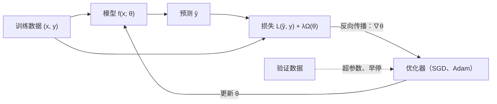

本课程讲的是用数据训练的神经网络：它们如何构造，参数如何求得，以及为什么得到的模型能有这样好的效果。第一章从两方面铺垫。第一部分说明深度学习是什么，它如何从七十年来对人工神经元的研究中成长起来，以及这样训练出的模型在 2026 年 10 月能做什么，从撰写经机器检验的证明到充当自主的**编程智能体**。第二部分汇集后续各章依赖的**机器学习**概念：学习算法由任务、性能度量和经验三者刻画；核心困难是泛化，即在训练数据上表现好与在新数据上表现好之间的差距；深度学习中的大多数损失函数都是负对数似然。这些内容在本站其他位置有更详细的论述：经典机器学习的视角见 4.6（[4.6.1](/4.6.1)、[4.6.2](/4.6.2)），统计理论见 3.2（**极大似然估计**，[3.2.3](/3.2.3)）与 3.3（模型选择，[3.3.11](/3.3.11)）；这里只按深度学习使用的形式陈述它们。[4.5.4](/4.5.4) 中关于神经元与**梯度下降法**的直观图景，将在下一章 [4.7.2](/4.7.2) 中精确化。

## 1.1. 什么是深度学习

### 1.1.1. 人工智能、机器学习与深度学习

**人工智能**（4.5）的目标是构造行为智能的系统。早期系统把人类知识直接编码为规则和知识库；**机器学习**（4.6）用能随数据改进的程序取代手写规则，但**支持向量机**、**朴素 Bayes 分类器**等经典方法仍依赖人设计的特征。深度学习连这最后一个人工设计的环节也去掉了。

**定义 1.1.1（深度学习）** **深度学习**是这样一类机器学习方法：它们从数据中端到端地学习由许多参数化、可微的变换（层）复合而成的函数 $f = f^{(L)} \circ \cdots \circ f^{(1)}$，通常以单一目标函数的梯度优化来训练。各层的中间输出是输入的习得*表示*。

因此深度学习是一种表示学习（representation learning）：网络不仅学习最终的映射，也学习这个映射所依据的特征。在一个对图像分类的网络里，最初几层逐渐对边缘和颜色对比作出响应，中间几层对纹理和物体部件作出响应，最后几层对整个物体作出响应（见 [4.7.3](/4.7.3)），这些检测器没有一个是手工编写的。"深"指变换链的长度。三个领域的嵌套关系是

$$
\text{深度学习} \subset \text{表示学习} \subset \text{机器学习} \subset \text{人工智能}.
$$

### 1.1.2. 简史

深度学习背后的思想由来已久；2010 年之后改变的是数据和算力的规模，是它们让这些思想真正奏效。下表列出后续各章会回到的里程碑。

| 年份 | 里程碑 | 章节 |
|---|---|---|
| 1943 | McCulloch 与 Pitts：用阈值神经元作为"神经网"的模型，这类单元组成的网络可计算任意 Boolean 函数 | [4.7.2](/4.7.2) |
| 1958 | Rosenblatt 的感知机，一种能从样例学习权重的神经元 | [4.7.2](/4.7.2) |
| 1969 | Minsky 与 Papert 的专著《Perceptrons》分析了感知机的局限：单层网络不能表示异或；人们对神经网络的兴趣下降 | [4.7.2](/4.7.2) |
| 1970–1986 | 反向模式微分（Linnainmaa，1970）、它在网络上的应用（Werbos，1974），以及 Rumelhart、Hinton 与 Williams（1986）使反向传播广为人知的论文 | [4.7.2](/4.7.2) |
| 1980–1998 | Fukushima 的 Neocognitron；LeCun 用反向传播训练的卷积网络，以读取支票的 LeNet-5 告一段落 | [4.7.3](/4.7.3) |
| 1997 | 长短期记忆（Hochreiter 与 Schmidhuber） | [4.7.5](/4.7.5) |
| 2006 | 深度信念网络（Hinton、Osindero 与 Teh）使深层网络的训练重新兴起 | |
| 2012 | AlexNet 以 GPU 训练的卷积网络赢得 ImageNet，top-5 错误率从 26% 降到 15% | [4.7.3](/4.7.3) |
| 2013–2015 | 词嵌入（word2vec）、序列到序列学习、注意力、生成对抗网络、152 层的残差网络 | [4.7.3](/4.7.3)、[4.7.5](/4.7.5) |
| 2017 | Transformer（"Attention Is All You Need"） | [4.7.6](/4.7.6) |
| 2018 | BERT 与 GPT：先在原始文本上预训练，再做适配；Hinton、LeCun 与 Bengio 获图灵奖 | [4.7.7](/4.7.7) |
| 2020–2022 | GPT-3 与规模定律；计算最优训练（Chinchilla）；扩散模型；用人类反馈强化学习训练的 ChatGPT（2022 年 11 月） | [4.7.9](/4.7.9) |
| 2024 | 训练成先思考后作答的推理模型（OpenAI o1）；因神经网络与蛋白质结构预测，物理学奖（Hopfield、Hinton）与化学奖（Baker、Hassabis、Jumper）授予相关工作 | [4.7.9](/4.7.9) |
| 2025 | DeepSeek-R1 表明，带可验证奖励的强化学习能在开放模型中激发推理能力；编程智能体成为日常工具 | [4.7.9](/4.7.9) |

这段历史有两点反复出现。第一，起决定作用的因素很少只是新架构：它们是大规模的有标注或无标注数据集（ImageNet、互联网）、并行硬件（GPU，后来是 TPU 和拥有超过 $10^5$ 个加速器的集群），以及使深层网络能稳定训练的技术（良好的初始化、ReLU、归一化、残差连接；[4.7.2](/4.7.2)–[4.7.4](/4.7.4)）。第二，表中每个系统背后都是同样几条原理：可微的模型、由似然给出的损失，以及由反向传播计算的随机梯度。

### 1.1.3. 为什么深度有帮助

只有一个隐藏层的网络就已能在紧集上逼近任意连续函数（见 [4.7.2](/4.7.2) 的万能逼近定理），所以原则上表达能力不需要深度；深度的作用在于效率。深层网络用适中数量的单元就能计算的许多函数，在浅层网络中需要指数多的单元；已知的分离结果（例如 Telgarsky 2016、Eldan 与 Shamir 2016）对特定的函数类把这一点精确化了。直观上，自然数据具有组合结构：像素组成边缘，边缘组成基本图案，图案组成部件，部件组成物体；词组成短语、句子和论证。深层网络可以在许多更高层的特征中重复利用每个中间特征，而浅层网络必须分别构造每种组合。每一层也改变数据的几何：在输入空间中远非**线性可分**的分类问题，在最后一个隐藏层算出的表示中可以变成线性可分，于是一个简单的线性分类器就能完成任务。

### 1.1.4. 2026 年的领域现状

2026 年最受公众关注的系统是基于 Transformer 的大模型（[4.7.6](/4.7.6)），它们在数万亿**词元**的文本、图像和视频上预训练（[4.7.7](/4.7.7)），再经监督微调和**强化学习**做后训练（[4.7.9](/4.7.9)）。截至 2026 年 10 月，它们的能力有以下一些迹象：

- 数学：2025 年 7 月，OpenAI 与 Google DeepMind 的实验模型在国际数学奥林匹克中达到金牌水平。2026 年 9 月，Anthropic 报告称 Claude 在基本自主的情况下工作 11 天，依照 Darmon–Diamond–Taylor 对 Wiles 证明的阐述，在证明助手 Lean 中给出了 Fermat 大定理的首个完整形式化；该结果由 Lean 仅依据其标准公理检验。这是把已知证明翻译成机器可检验的形式，不是新证明，但其规模（数百万行 Lean 代码）是人类形式化项目需要规划多年才能达到的。
- 编程：2025 年 9 月的 ICPC 世界总决赛上，Gemini 2.5 Deep Think 的高级版本解出 12 题中的 10 题，达到金牌水平，在人类队伍中可排第二；OpenAI 的一个系统解出了全部 12 题。Claude Code（2025 年 2 月作为研究预览发布）和 OpenAI Codex 等**编程智能体**现在能在代码库中找到相关文件、修改文件、运行测试并根据反馈迭代。
- 智能体：把模型放进带工具（搜索、代码解释器、浏览器、终端）的循环中，就能完成多步骤的任务。开源的个人智能体 OpenClaw 于 2026 年初流行，数月内成为 GitHub 上星标最多的项目之一。
- 前沿模型：2026 年 10 月最强的专有模型包括 OpenAI 的 GPT-6 Astra（2026 年 9 月 3 日发布）和 Anthropic 的 Claude Fable 5.1（2026 年 9 月 1 日）。OpenAI 没有公布 GPT-6 的架构；媒体关于它使用循环深度（looped Transformer，即同一批模块被重复应用多次）的报道尚未得到证实。
- 开放权重模型：最强的开放模型是带混合注意力的稀疏专家混合：阿里巴巴的 Qwen3.5（2026 年 2 月；最多 3970 亿参数，每个词元激活 170 亿；每一层完整注意力对应三层线性注意力的 Gated DeltaNet 层）、NVIDIA 的 Nemotron 3 Ultra（2026 年 6 月；5500 亿参数，激活 550 亿；以 Mamba-2 层为主，夹少量注意力层；用 4 位 NVFP4 算术预训练）和月之暗面的 Kimi K3（2026 年 7 月；2.8 万亿参数，激活 1040 亿，每个词元从 896 个专家中路由 16 个，上下文长度一百万词元）。

这些系统共有的趋势，正是本课程最后几章要解释的：在不增加每个词元计算量的前提下增加参数量的稀疏专家混合，面向长上下文的线性与稀疏注意力（[4.7.6](/4.7.6)、[4.7.9](/4.7.9)），在超大集群上以低精度算术训练（[4.7.8](/4.7.8)），以及面向推理的、基于可验证奖励的强化学习（[4.7.9](/4.7.9)）。它们的能力也带来安全与对齐的问题（如何保证一个比监督者更有能力的系统追求预期的目标），这已成为一个活跃的独立研究领域。产品名称与基准分数几个月就会变化；本课程中的原理变化要慢得多。

## 1.2. 学习算法

### 1.2.1. 任务、性能与经验

Mitchell（1997）给出的经典学习定义区分了三个要素（另见 [4.6.1](/4.6.1)）。

**定义 1.2.1（机器学习）** 称计算机程序就某类任务 $T$ 和性能度量 $P$ 从经验 $E$ 中学习，如果它在 $T$ 中任务上的性能（以 $P$ 度量）随经验 $E$ 而提高。在这个意义上能学习的程序称为**学习算法**；研究这类程序就是**机器学习**。

再加上模型 $M$，即程序从中选择的函数族，就得到四个组成部分 $(T, P, E, M)$，任何学习方法都可以用它们来描述。数据的基本单位是样例：在一个对象或事件上测得的一组特征，通常写成向量 $\boldsymbol{x} \in \mathbb{R}^n$（一只水桶的颜色、直径和高度；一幅图像的像素强度；一个句子的**词元**）。

### 1.2.2. 任务 T

任务规定系统应如何处理一个样例。常见类型有：

| 任务 | 输入 → 输出 | 例子 |
|---|---|---|
| 分类 | $\mathbb{R}^n \to \{1, \dots, k\}$，或 $k$ 个类别上的概率向量 | 物体识别、情感分析、垃圾邮件过滤 |
| 回归 | $\mathbb{R}^n \to \mathbb{R}$ | 价格或需求预测、分子的能量 |
| 转录 | 非结构化信号 → 文本 | 语音识别、光学字符识别 |
| 机器翻译 | 一种语言的序列 → 另一种语言的序列 | 把 "Deep learning is cool" 译成中文 |
| 结构化输出 | 输入 → 分量之间有依赖的向量或结构 | 句法分析、图像分割、图像描述 |
| 合成与采样 | （可选的条件）→ 与训练数据相像的新样例 | 图像和视频生成、语音合成、文本生成 |
| 去噪 | 受损的 $\tilde{\boldsymbol{x}}$ → 干净的 $\boldsymbol{x}$，或 $p(\boldsymbol{x} \mid \tilde{\boldsymbol{x}})$ | 图像复原、扩散模型的训练任务 |
| 密度估计 | $\boldsymbol{x} \mapsto p_{\mathrm{model}}(\boldsymbol{x})$ | 异常检测、语言建模 |
| 对话与智能体 | 交互历史 → 下一条消息或动作 | 助手、编程智能体 |

这些类型之间的界限并不分明。**语言模型**（[4.7.7](/4.7.7)）通过在每个位置上对下一个词元分类来估计文本的密度，并通过从该密度中采样来生成文本；翻译、摘要和问答于是都成了同一个"文本进、文本出"任务的实例。

### 1.2.3. 性能度量 P

对分类，自然的度量是准确率（正确分类的样例所占比例）和错误率 $1 - \text{准确率}$，后者是 0–1 损失 $\boldsymbol{1}\{\hat y \ne y\}$ 的平均。对回归，用**均方误差**或平均绝对误差。对密度估计，用模型赋予样例的平均对数概率（§1.5）。以下三点适用于所有这些度量。

- 性能在没有用于训练的样例构成的**测试集**上度量，因为目标是在新数据上的表现（§1.3）。
- 我们报告的量往往不是我们优化的量。准确率关于参数是分段常数，其梯度几乎处处为零；训练时最小化的是可微的替代量，如交叉熵（§1.5），准确率只在评估时计算。
- 选择 $P$ 本身就是问题的一部分：医学检验对假阴性与假阳性的看重程度不同，翻译或聊天机器人回答的质量也没有简单的公式（要用人类偏好判断和基于模型的评分器）。分类器与排序器的评估度量见 [4.6.2](/4.6.2)。

### 1.2.4. 经验 E

经验是算法在训练时被允许看到的数据。

- 在**有监督学习**中，每个样例 $\boldsymbol{x}$ 附有由教师给出的目标 $y$，算法学习由 $\boldsymbol{x}$ 预测 $y$，用概率的语言说就是估计 $p(y \mid \boldsymbol{x})$。
- 在**无监督学习**中只有样例 $\boldsymbol{x}$，算法学习它们的分布的某种性质：密度、聚类、低维表示。
- 在**自监督学习**中，目标是数据自身的一部分：被遮住的词、下一个词元、图像中被隐藏的一块。这把无标注的文本和图像变成了规模近乎无限的有监督问题，大模型就是这样预训练的（[4.7.7](/4.7.7)）。
- 在**强化学习**中，算法与环境交互，得到的是对其动作的奖励而不是正确答案；它用于依据人类偏好以及答案可检验的问题对语言模型做后训练（[4.7.9](/4.7.9)）。

含 $m$ 个样例的数据集常写成**设计矩阵** $X \in \mathbb{R}^{m \times n}$，其第 $i$ 行是 $\boldsymbol{x}^{(i)\mathsf T}$；在有监督情形还有目标向量 $\boldsymbol{y} \in \mathbb{R}^m$。大小可变的样例（分辨率不同的图像、长度不同的句子）则表示成集合 $\{\boldsymbol{x}^{(1)}, \dots, \boldsymbol{x}^{(m)}\}$。

### 1.2.5. 例：线性回归

线性回归以最简单的形式展示所有组成部分。任务是由 $\boldsymbol{x} \in \mathbb{R}^n$ 预测 $y \in \mathbb{R}$；模型是线性函数族 $\hat y = \boldsymbol{w}^{\mathsf T}\boldsymbol{x}$，参数为 $\boldsymbol{w} \in \mathbb{R}^n$（给 $\boldsymbol{x}$ 添加常数特征 $1$ 即可吸收截距）；性能度量是测试集上的**均方误差**，

$$
\mathrm{MSE}_{\mathrm{test}} = \frac{1}{m^{\mathrm{test}}} \sum_{i=1}^{m^{\mathrm{test}}} \bigl(\hat y^{(i)}_{\mathrm{test}} - y^{(i)}_{\mathrm{test}}\bigr)^2 = \frac{1}{m^{\mathrm{test}}} \bigl\|X^{\mathrm{test}}\boldsymbol{w} - \boldsymbol{y}^{\mathrm{test}}\bigr\|^2 ;
$$

经验是**训练集** $(X^{\mathrm{train}}, \boldsymbol{y}^{\mathrm{train}})$。由于不能使用测试集，算法转而最小化训练误差 $\mathrm{MSE}_{\mathrm{train}} = \frac{1}{m}\|X^{\mathrm{train}}\boldsymbol{w} - \boldsymbol{y}^{\mathrm{train}}\|^2$。令其**梯度** $\frac{2}{m}X^{\mathrm{train}\mathsf T}(X^{\mathrm{train}}\boldsymbol{w} - \boldsymbol{y}^{\mathrm{train}})$ 为零，得到正规方程；当 $X^{\mathrm{train}\mathsf T}X^{\mathrm{train}}$ 可逆时，

$$
\boldsymbol{w} = \bigl(X^{\mathrm{train}\mathsf T}X^{\mathrm{train}}\bigr)^{-1}X^{\mathrm{train}\mathsf T}\boldsymbol{y}^{\mathrm{train}},
$$

即 3.3 中的最小二乘估计（[3.3.7](/3.3.7)）。最小化训练误差为什么是得到小测试误差的合理办法并不显然，这是下一节的主题。神经网络保留这一结构，但把线性模型换成深层模型；深层模型没有闭式的最小值点，所以最小化要用随机梯度方法进行。

## 1.3. 容量、泛化与正则化

### 1.3.1. 训练误差与泛化误差

要把训练表现与测试表现联系起来，需要对数据的产生方式作出假设。标准的假设是：训练样例和测试样例是从同一个数据生成分布（data-generating distribution）$p_{\mathrm{data}}$ 中独立抽取的（独立同分布假设）。设 $L(\hat y, y) \ge 0$ 是度量损失的函数，表示真值为 $y$ 时预测 $\hat y$ 的代价。

**定义 1.3.1（泛化误差）** 对预测器 $f$，其**泛化误差**（或风险）是在新样例上的期望损失，

$$
R(f) = \mathbb{E}_{(\boldsymbol{x}, y) \sim p_{\mathrm{data}}}\bigl[L(f(\boldsymbol{x}), y)\bigr],
$$
而在**训练集** $\{(\boldsymbol{x}^{(i)}, y^{(i)})\}_{i=1}^m$ 上的**训练误差**（或经验风险）是 $\hat R_m(f) = \frac{1}{m}\sum_{i=1}^m L(f(\boldsymbol{x}^{(i)}), y^{(i)})$。差 $R(f) - \hat R_m(f)$ 称为**泛化差距**。

只要**测试集**没有被用来选择 $f$，测试误差就是 $R(f)$ 的无偏估计。对固定的 $f$，$\hat R_m(f)$ 也是 $R(f)$ 的无偏估计；但习得的 $\hat f$ 是为使 $\hat R_m$ 小而选出的，所以 $\mathbb{E}[\hat R_m(\hat f)] \le \mathbb{E}[R(\hat f)]$，训练误差偏于乐观。在模型类上通过最小化 $\hat R_m$ 来选择 $\hat f$，称为**经验风险最小化**。由此产生两个目标，它们的方向相反：

1. 使训练误差小，这要求模型足够丰富；
2. 使泛化差距小，这要求模型不能单靠记忆训练集。

### 1.3.2. 容量、欠拟合与过拟合

**定义 1.3.2（容量）** 模型的**容量**是它能拟合的函数范围。其*表示容量*是模型族中的函数集合；其*有效容量*是学习算法实际能达到的子集，由于优化器、训练量和正则化的影响，它可以更小。

当容量太低时，模型抓不住数据的结构，两种误差都居高不下：模型**欠拟合**。当容量相对数据量太高时，模型拟合了这一特定训练样本的噪声，训练误差小而差距大：模型**过拟合**。图中用多项式回归展示这两种情形，多项式的次数控制容量：1 次欠拟合，3 次恰当，12 次几乎精确地插值 15 个训练点，却在点与点之间剧烈振荡。

典型的行为是右图的 U 形曲线：随着容量增大，训练误差稳步下降，而测试误差先降后升。最佳容量在测试误差最小处，而不是最大的模型。对平方损失，这就是 [3.2.3](/3.2.3) 的**偏差–方差权衡**：低容量模型偏差大，高容量模型方差大。统计学习理论用 Vapnik–Chervonenkis 维数等量刻画容量，并用随容量增长、随样例数以 $1/\sqrt{m}$ 缩小的项来界定差距（关于错误率的相应置信区间见 [4.6.7](/4.6.7)）。

对深层网络，这一图景还有两点需要修正。

- 对所有可能的数据生成分布取平均，每个学习算法在未见点上的期望误差都相同，这就是没有免费午餐定理（no free lunch theorem）（Wolpert 1996）。学习算法之所以有效，只是因为它的假设，即它的归纳偏置（inductive bias），与我们关心的问题相符；网络的架构（用于图像的**卷积**，[4.7.3](/4.7.3)；用于序列的注意力，[4.7.6](/4.7.6)）就是这样一种假设。
- 现代网络的参数往往远多于训练样例，甚至能完美拟合随机重新标注的数据（Zhang 等 2017），却在真实数据上泛化得很好。当容量增加到超过模型能够插值训练集的那一点之后，测试误差常常再次下降，这一现象称为双下降（double descent）（Belkin 等 2019；深层网络见 Nakkiran 等 2020）。在拟合数据的众多函数中，从小初始值出发的**梯度下降法**倾向于找到简单的函数，这是一种仅凭参数个数无法刻画的隐式正则化。经典的 U 形曲线因此描述的是插值阈值以下的区域；在实践中，深层网络的容量与其说由规模控制，不如说由数据、正则化和训练时间控制。

### 1.3.3. 正则化

**定义 1.3.3（正则化）** **正则化**是对学习算法所作的任何修改，其目的是减小泛化误差而不是训练误差。

最常见的形式是在训练目标上加一个对参数的惩罚项 $\Omega(\boldsymbol{\theta})$，

$$
J(\boldsymbol{\theta}) = \hat R_m(f_{\boldsymbol{\theta}}) + \lambda\,\Omega(\boldsymbol{\theta}), \qquad \lambda \ge 0 .
$$

取 $\Omega(\boldsymbol{w}) = \frac12\|\boldsymbol{w}\|^2$，在线性情形就是**岭回归**，在神经网络中就是权重衰减（weight decay）：对 $J$ 的一步梯度下降是 $\boldsymbol{w} \leftarrow (1 - \eta\lambda)\boldsymbol{w} - \eta\nabla \hat R_m$，所以权重在顺着数据移动之外，每一步还要按固定因子收缩。（对 Adam 之类的自适应优化器，惩罚项与收缩不再等价；**AdamW** 直接施加收缩，见 [4.7.4](/4.7.4)。）取 $\Omega(\boldsymbol{w}) = \|\boldsymbol{w}\|_1$ 得到 **Lasso**，它把许多权重压到恰好为零。正则化并不消除拟合与泛化之间的权衡，而是让模型沿着这条权衡曲线移动：在对数据拟合得同样好的函数中，偏好更光滑或更简单的那些。带适当权重衰减的 12 次多项式，其表现与图中的 3 次拟合很相近。另一些正则化器作用于数据或训练过程而不是目标函数：**数据增强**、**随机失活**、早停（§1.4.3）以及随机梯度的噪声（[4.7.4](/4.7.4)）。

## 1.4. 超参数与数据划分

### 1.4.1. 超参数

**定义 1.4.1（超参数）** **超参数**是控制学习算法行为、且在训练中不由算法自身调整的设置。

上面多项式的次数和惩罚权重 $\lambda$ 都是**超参数**；网络的层数与宽度、学习率及其调度、批大小、训练步数和失活率也是。一个设置被当作超参数而不是参数，要么因为它难以优化（层数是离散的），要么更根本地，因为在**训练集**上学习它总会选中最复杂的选项：$\lambda = 0$ 与最高次数使训练误差最小。

### 1.4.2. 验证集与交叉验证

因此，超参数必须在模型没有用来训练的数据上选择，而**测试集**不能用于此，因为在影响过选择的数据上算出的误差估计是乐观的。通常的做法是把可用数据分成三部分：

| 部分 | 用途 | 典型占比 |
|---|---|---|
| 训练集 | 对每组超参数设置拟合参数 | 60–80% |
| 验证集 | 比较超参数设置，决定何时停止 | 10–20% |
| 测试集 | 在所有选择完成之后，对泛化误差作一次最终估计 | 10–20% |

单次留出划分代价低但耗费数据，而且验证集较小时比较结果有噪声。**交叉验证**更有效地利用数据：在 $k$ 折**交叉验证**中，把训练数据分成 $k$ 折，模型训练 $k$ 次，每次在不同的一折上验证，再把 $k$ 个验证误差取平均（常取 $k = 5$ 或 $10$）。它要训练 $k$ 次，对经典模型尚可接受（见 [4.6.2](/4.6.2) 与 [3.4.10](/3.4.10)），对大型网络则很少可行，因为那里的数据集足够大，单个验证集就能给出精确的估计。无论用哪种方法，测试集都要保持不动直到最后；一个研究群体多年来针对其调优的基准测试集，实际上已成了验证集，它们的误差估计也因同样的原因变得乐观。

### 1.4.3. 超参数搜索与早停

超参数少时，对所有组合做网格搜索是可行的。超参数多时，随机搜索更有效，因为通常只有少数几个超参数起作用，网格会把大部分试验浪费在改变不重要的超参数上（Bergstra 与 Bengio 2012）；Bayes 优化和逐次减半方法则把更多试验花在有希望的区域。对大模型，搜索在小模型上进行，再通过经验的规模规则把最优设置迁移到大模型上（[4.7.9](/4.7.9)）。

训练步数是一个几乎不花代价的超参数。训练高容量模型时，训练误差持续下降，而验证误差通常先下降、趋平，然后在模型开始过拟合时上升。早停（early stopping）定期监测验证误差，保存迄今所见最低值对应的参数副本，在连续若干次评估（耐心值）中都没有改进时停止，并返回保存的参数。对带平方损失的线性模型，从零出发的**梯度下降法**的早停近似等价于一个 $L^2$ 惩罚，其权重随步数增加而减小，所以它是定义 1.3.3 意义下的正则化器。

## 1.5. 极大似然与损失函数

### 1.5.1. 极大似然估计

损失函数从哪里来？深度学习中使用的大多数损失都由一条原理导出，即**极大似然估计**（[3.2.3](/3.2.3)）。考虑参数族 $p_{\mathrm{model}}(\boldsymbol{x}; \boldsymbol{\theta})$，以及来自 $p_{\mathrm{data}}$ 的独立同分布样例 $\boldsymbol{x}^{(1)}, \dots, \boldsymbol{x}^{(m)}$。**极大似然估计量**是

$$
\boldsymbol{\theta}_{\mathrm{ML}} = \operatorname*{arg\,max}_{\boldsymbol{\theta}} \prod_{i=1}^m p_{\mathrm{model}}(\boldsymbol{x}^{(i)}; \boldsymbol{\theta}) = \operatorname*{arg\,max}_{\boldsymbol{\theta}} \sum_{i=1}^m \log p_{\mathrm{model}}(\boldsymbol{x}^{(i)}; \boldsymbol{\theta}).
$$

取对数把乘积（$m$ 大时它在浮点运算中会下溢）变成和，而和可以由随机梯度方法用小批量来估计。除以 $m$ 不改变最大值点，所以

$$
\boldsymbol{\theta}_{\mathrm{ML}} = \operatorname*{arg\,max}_{\boldsymbol{\theta}}\ \mathbb{E}_{\boldsymbol{x} \sim \hat p_{\mathrm{data}}} \log p_{\mathrm{model}}(\boldsymbol{x}; \boldsymbol{\theta}),
$$

其中 $\hat p_{\mathrm{data}}$ 是经验分布，它在每个训练样例上赋质量 $1/m$。这个期望可以看作对分布的一种比较。

**定义 1.5.1（交叉熵）** 对同一空间上的概率分布 $p$ 与 $q$，$q$ 相对于 $p$ 的**交叉熵**是

$$
H(p, q) = -\mathbb{E}_{\boldsymbol{x} \sim p}\log q(\boldsymbol{x}),
$$
而 $p$ 的**熵**是 $H(p) = H(p, p)$。

用信息论的话说，$H(p, q)$ 是用针对 $q$ 优化的编码去编码来自 $p$ 的数据时的期望码长（以奈特计）。它超出最优值 $H(p)$ 的部分是 **Kullback–Leibler 散度**，

$$
D_{\mathrm{KL}}(p \,\|\, q) = \mathbb{E}_{\boldsymbol{x} \sim p}\Bigl[\log\frac{p(\boldsymbol{x})}{q(\boldsymbol{x})}\Bigr] = H(p, q) - H(p) \ge 0,
$$

等号成立当且仅当 $p = q$（Gibbs 不等式，由 Jensen 不等式作用于凹函数对数得到）。由于 $H(\hat p_{\mathrm{data}})$ 与 $\boldsymbol{\theta}$ 无关：

**命题 1.5.1** 关于 $\boldsymbol{\theta}$，最大化似然等价于最小化交叉熵 $H(\hat p_{\mathrm{data}}, p_{\mathrm{model}})$，也等价于最小化 **Kullback–Leibler 散度** $D_{\mathrm{KL}}(\hat p_{\mathrm{data}} \,\|\, p_{\mathrm{model}})$。

所以每个负对数似然都是经验分布与模型之间的交叉熵；"交叉熵损失"一词通常指下面的分类情形。在正则性条件下，极大似然估计量是相合的、渐近有效的（[3.2.3](/3.2.3)），这是偏爱它的理论原因。语言模型正是这样训练的：它的损失是下一个**词元**的平均负对数概率，该损失的 $\exp$ 就是 [4.7.7](/4.7.7) 中报告的**困惑度**。

### 1.5.2. 条件对数似然

在**有监督学习**中，我们对条件分布 $p_{\mathrm{model}}(y \mid \boldsymbol{x}; \boldsymbol{\theta})$ 建模，而不是对 $\boldsymbol{x}$ 的分布建模。条件极大似然估计量是

$$
\boldsymbol{\theta}_{\mathrm{ML}} = \operatorname*{arg\,max}_{\boldsymbol{\theta}} \sum_{i=1}^m \log p_{\mathrm{model}}\bigl(y^{(i)} \mid \boldsymbol{x}^{(i)}; \boldsymbol{\theta}\bigr),
$$

训练损失是负条件对数似然 $-\frac{1}{m}\sum_i \log p_{\mathrm{model}}(y^{(i)} \mid \boldsymbol{x}^{(i)}; \boldsymbol{\theta})$。神经网络以 $\boldsymbol{x}$ 的函数的形式给出条件分布的参数；分布的选择同时决定输出层和损失。

**例 1.5.1（Gauss 输出：平方误差）** 设网络输出 $\hat y(\boldsymbol{x}; \boldsymbol{\theta})$ 是方差固定的正态分布的均值，$p(y \mid \boldsymbol{x}) = \mathcal{N}(y; \hat y(\boldsymbol{x}; \boldsymbol{\theta}), \sigma^2)$。则

$$
\sum_{i=1}^m \log p\bigl(y^{(i)} \mid \boldsymbol{x}^{(i)}\bigr) = -m\log\sigma - \frac{m}{2}\log(2\pi) - \sum_{i=1}^m \frac{\bigl(\hat y^{(i)} - y^{(i)}\bigr)^2}{2\sigma^2},
$$
关于 $\boldsymbol{\theta}$ 最大化它，等价于最小化**均方误差**。最小二乘就是 Gauss 噪声下的极大似然；改为最小化平均绝对误差则对应 Laplace 噪声。

**例 1.5.2（Bernoulli 输出：二元交叉熵）** 对 $y \in \{0, 1\}$，让网络计算一个实数得分 $z(\boldsymbol{x}; \boldsymbol{\theta})$，并令 $p(y = 1 \mid \boldsymbol{x}) = \sigma(z)$，其中 $\sigma(z) = 1/(1 + \mathrm{e}^{-z})$ 是 logistic sigmoid。单个样例的负对数似然就是二元交叉熵

$$
-y\log\sigma(z) - (1 - y)\log\bigl(1 - \sigma(z)\bigr) = \log\bigl(1 + \mathrm{e}^{-(2y - 1)z}\bigr),
$$
它关于 $z$ 的导数简单地等于 $\sigma(z) - y$。取线性得分 $z = \boldsymbol{w}^{\mathsf T}\boldsymbol{x} + b$，这就是 **logistic 回归**；网络则把线性得分换成习得的非线性得分。

对 $k > 2$ 个类别，输出层必须产生一个概率向量，这是下面这个函数的任务。

**定义 1.5.2（softmax 函数）** **softmax 函数** $\operatorname{softmax}\colon \mathbb{R}^k \to \Delta^{k-1}$ 把得分向量（*logit*）$\boldsymbol{z}$ 映为概率向量

$$
\operatorname{softmax}(\boldsymbol{z})_j = \frac{\mathrm{e}^{z_j}}{\sum_{l=1}^k \mathrm{e}^{z_l}}, \qquad j = 1, \dots, k,
$$
其中 $\Delta^{k-1} = \{\boldsymbol{p} \in \mathbb{R}^k : p_j \ge 0,\ \sum_j p_j = 1\}$ 是概率单纯形。

这个名称反映出 softmax 是"最大分量的示性函数"的光滑版本：带**温度** $\tau$ 时，$\operatorname{softmax}(\boldsymbol{z}/\tau)$ 在 $\tau \to 0$ 时趋于 $\arg\max_j z_j$ 的**独热向量**，在 $\tau \to \infty$ 时趋于均匀分布。它对所有 logit 同时加一个常数是不变的，$\operatorname{softmax}(\boldsymbol{z} + c\boldsymbol{1}) = \operatorname{softmax}(\boldsymbol{z})$，计算时利用这一点，在取指数前先减去 $\max_j z_j$ 以保证数值稳定。当 $k = 2$ 时，它退化为两个 logit 之差的 sigmoid。

**定义 1.5.3（交叉熵损失）** 设分类器输出 logit $\boldsymbol{z} \in \mathbb{R}^k$ 和预测概率 $\hat{\boldsymbol{y}} = \operatorname{softmax}(\boldsymbol{z})$，真实类别为 $c$，编码成独热向量 $\boldsymbol{y} = \boldsymbol{e}_c$。**交叉熵损失**是

$$
L(\boldsymbol{z}, c) = -\sum_{j=1}^k y_j\log\hat y_j = -\log\hat y_c = -z_c + \log\sum_{l=1}^k \mathrm{e}^{z_l}.
$$

它是类别分布的负对数似然，也是目标分布与预测分布之间的交叉熵 $H(\boldsymbol{y}, \hat{\boldsymbol{y}})$；对软目标（标签平滑，从教师模型做**知识蒸馏**），用第一种形式，其中 $\boldsymbol{y}$ 是一般的概率向量。它关于 logit 的梯度是

$$
\frac{\partial L}{\partial \boldsymbol{z}} = \hat{\boldsymbol{y}} - \boldsymbol{y},
$$

即预测与目标之差，它是有界的，并且在预测自信地出错时也不会消失；[4.7.2](/4.7.2) 说明了为什么这使 softmax 加交叉熵在分类上优于平方误差。在代码中，最后一种形式用数值稳定的 log-sum-exp 计算，所以库提供的是一个以 logit 为输入的单一函数（`torch.nn.functional.cross_entropy`），而不是先 softmax 再取对数。

### 1.5.3. 最大后验估计与正则化

正则化也有概率的解读。给参数一个**先验分布** $p(\boldsymbol{\theta})$，则**最大后验估计**（[3.2.7](/3.2.7)）是

$$
\boldsymbol{\theta}_{\mathrm{MAP}} = \operatorname*{arg\,max}_{\boldsymbol{\theta}} \Bigl[\sum_{i=1}^m \log p\bigl(y^{(i)} \mid \boldsymbol{x}^{(i)}; \boldsymbol{\theta}\bigr) + \log p(\boldsymbol{\theta})\Bigr].
$$

Gauss 先验 $\boldsymbol{\theta} \sim \mathcal{N}(\boldsymbol{0}, \tau^2 I)$ 贡献 $-\|\boldsymbol{\theta}\|^2/(2\tau^2)$ 加一个常数，即权重衰减，其 $\lambda$ 与 $1/\tau^2$ 成正比；Laplace 先验则给出 **Lasso** 的 $L^1$ 惩罚。强先验（$\tau$ 小）意味着强正则化，而当 $m \to \infty$ 时似然占主导，先验的影响消失。完整的 Bayes 处理保留整个后验而不只是它的众数，这是 [4.6.3](/4.6.3) 和 3.2.7 的主题；对大型网络它很少负担得起，MAP 的观点主要用来解释正则化器。

### 1.5.4. 有监督学习的流程

本课程中几乎每个模型都用同一套流程训练，它综合了本章的各个要素：

1. 数据集，划分为训练集、验证集和**测试集**；
2. 模型 $f(\boldsymbol{x}; \boldsymbol{\theta})$，这里是架构蕴含先验假设的神经网络；
3. 损失，通常是负对数似然，外加正则化；
4. 优化器，用**随机梯度下降**或其变体（[3.5.5](/3.5.5)、[4.7.4](/4.7.4)）最小化损失，梯度由反向传播计算（[4.7.2](/4.7.2)）；
5. 在**验证集**上选择**超参数**，最后在测试集上做一次评估。

## 小结

- 深度学习端到端地学习由可微层组成的深层复合，使特征与预测器一同习得。它自 2012 年以来的成功建立在数据、算力以及能稳定训练深层网络的技术之上；到 2026 年，最大的模型是带混合注意力的、基于 Transformer 的稀疏专家混合，在数万亿**词元**上训练并经**强化学习**后训练，它们能形式化证明、解竞赛题并充当智能体。
- 学习算法由任务 $T$、性能度量 $P$ 和经验 $E$（有监督、无监督、自监督、强化）以及模型族 $M$ 确定。
- 目标是小的泛化误差。训练误差随容量下降，而测试误差呈 U 形（并在插值阈值之后常出现第二次下降）。正则化（例如权重衰减）降低泛化误差，而不以训练误差为目标。
- **超参数**在**验证集**上或通过**交叉验证**选择；早停选择训练时间；**测试集**只用一次。
- 极大似然等价于最小化交叉熵，也等价于最小化与经验分布之间的 **KL 散度**。Gauss 输出给出平方误差，Bernoulli 输出给出二元交叉熵，softmax 输出给出梯度为 $\hat{\boldsymbol{y}} - \boldsymbol{y}$ 的交叉熵损失；对权重施加先验使极大似然变成 MAP 估计，并给出权重衰减。
