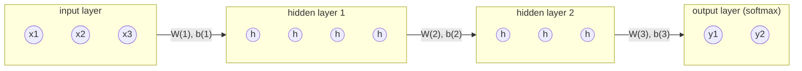
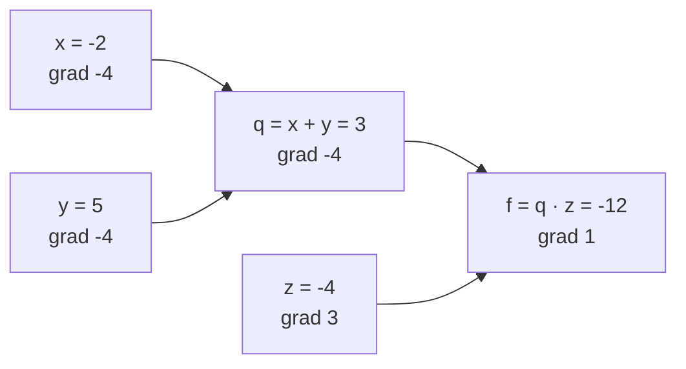

This chapter builds the basic model of **deep learning**, the multilayer perceptron, and the algorithm that trains it, backpropagation. We start from a single artificial neuron and Rosenblatt's perceptron, the first neural network that learned from examples, and prove that it finds a separating hyperplane whenever one exists. The XOR problem shows what a single layer cannot do, and adding hidden layers with nonlinear activations removes the limitation: a network with one hidden layer can approximate any continuous function. To train such networks we need the gradient of the loss with respect to every weight. Backpropagation computes all of them at the cost of about two forward passes; we derive it in matrix form and then see it as a special case of reverse-mode automatic differentiation on a computational graph, which is how PyTorch and JAX compute gradients for any model. The chapter ends with the practical choices that decide whether training works: the loss function, the activation function and the initialization of the weights.

The intuitive picture of neurons, **gradient descent** and backpropagation is in [4.5.4](/4.5.4); the loss functions come from maximum likelihood ([4.7.1](/4.7.1#sec-1.5)); gradient descent itself and its stochastic version are analyzed in [3.5.5](/3.5.5). The optimizers and training techniques built on top of backpropagation are the subject of [4.7.4](/4.7.4).

## 2.1. Neurons and Network Structures

### 2.1.1. From Biological to Artificial Neurons

A biological neuron receives signals from thousands of other neurons through synapses on its dendrites, integrates them in the cell body, and, when the membrane potential exceeds a threshold, fires an electrical spike along its axon to further neurons. The strength of each synapse changes with experience; Hebb (1949) proposed that a connection strengthens when the two neurons it joins are active together. McCulloch and Pitts (1943) abstracted this into a computational unit with binary inputs and a threshold, and the modern artificial neuron keeps the same structure with real-valued inputs and a general nonlinearity.

**Definition 2.1.1 (Artificial Neuron)** An **artificial neuron** with input $\boldsymbol{x} \in \mathbb{R}^n$ computes

$$
z = \sum_{k=1}^n w_k x_k + b = \boldsymbol{w}^{\mathsf T}\boldsymbol{x} + b, \qquad a = \varphi(z),
$$
where $\boldsymbol{w} \in \mathbb{R}^n$ are the weights (the synaptic strengths), $b \in \mathbb{R}$ is the bias (the negative of the threshold), $z$ is the pre-activation and $\varphi\colon \mathbb{R} \to \mathbb{R}$ is the **activation function**; $a$ is the output or activation of the neuron.

Appending a constant input $x_0 = 1$ with weight $w_0 = b$ absorbs the bias, $z = \tilde{\boldsymbol{w}}^{\mathsf T}\tilde{\boldsymbol{x}}$ with $\tilde{\boldsymbol{x}} = (1, x_1, \dots, x_n)^{\mathsf T}$; this "augmented" form shortens many formulas. With the step function $\varphi(z) = \boldsymbol{1}\{z \ge 0\}$ one obtains the McCulloch–Pitts threshold unit. Such units compute AND ($w_1 = w_2 = 1$, $b = -1.5$), OR ($b = -0.5$) and NOT ($w = -1$, $b = 0.5$), so networks of them can realize any Boolean function through its disjunctive normal form. The analogy with biology should not be taken far: real neurons communicate by spike timing, have complex dendritic computation and learn by local rules, whereas artificial networks are trained by a global gradient signal.

### 2.1.2. Network Structures

Neurons are combined into networks in three basic ways, which are the subjects of this and the following chapters.

| Structure | Connections | Typical data | Chapter |
|---|---|---|---|
| Feedforward network | layers in sequence; each layer receives the output of the previous one; no cycles | vectors of features | this chapter |
| Convolutional network | feedforward, but each unit sees a local window and the weights are shared across positions | images, audio, grids | [4.7.3](/4.7.3) |
| Recurrent network | a hidden state $\boldsymbol{h}_t$ is fed back with a delay, $\boldsymbol{h}_t = F(\boldsymbol{h}_{t-1}, \boldsymbol{x}_t)$ | sequences | [4.7.5](/4.7.5) |

A single-layer feedforward network connects the inputs directly to a layer of output neurons; a multilayer network inserts one or more layers of hidden neurons, whose activations are neither inputs nor outputs. The Transformer of [4.7.6](/4.7.6) is a feedforward network over a sequence in which attention, rather than recurrence, connects the positions.

## 2.2. The Perceptron

### 2.2.1. The Model and the Learning Rule

Rosenblatt's perceptron (1958) is a single threshold neuron with a learning rule. For binary classification it is convenient to use the labels $y \in \{-1, +1\}$ and the sign function.

**Definition 2.2.1 (Perceptron)** The **perceptron** with weight vector $\boldsymbol{w} \in \mathbb{R}^{n+1}$ classifies an augmented input $\tilde{\boldsymbol{x}} \in \mathbb{R}^{n+1}$ as

$$
\hat y = \operatorname{sgn}\bigl(\boldsymbol{w}^{\mathsf T}\tilde{\boldsymbol{x}}\bigr) \in \{-1, +1\}
$$
(with $\operatorname{sgn} 0 = +1$). Its decision boundary is the hyperplane $\{\boldsymbol{x} : \boldsymbol{w}^{\mathsf T}\tilde{\boldsymbol{x}} = 0\}$.

**Algorithm 2.2.1 (Perceptron Learning Algorithm)** Given training examples $(\tilde{\boldsymbol{x}}^{(i)}, y^{(i)})$, $i = 1, \dots, m$, and a learning rate $\eta > 0$:

1. Initialize $\boldsymbol{w} \leftarrow \boldsymbol{0}$ (or small random values).
2. Repeat over the examples (one pass is an epoch, usually in random order): if $y^{(i)}\boldsymbol{w}^{\mathsf T}\tilde{\boldsymbol{x}}^{(i)} \le 0$ (the example is misclassified or on the boundary), update
   $$
   \boldsymbol{w} \leftarrow \boldsymbol{w} + \eta\, y^{(i)}\tilde{\boldsymbol{x}}^{(i)} ;
   $$
   otherwise leave $\boldsymbol{w}$ unchanged.
3. Stop when a whole epoch passes without an update, or after a maximum number of epochs.

The update moves the hyperplane toward classifying the example correctly: after it, $y\boldsymbol{w}_{\mathrm{new}}^{\mathsf T}\tilde{\boldsymbol{x}} = y\boldsymbol{w}^{\mathsf T}\tilde{\boldsymbol{x}} + \eta\|\tilde{\boldsymbol{x}}\|^2$, which is larger than before. The rule is often written as $\boldsymbol{w} \leftarrow \boldsymbol{w} + \eta(y - \hat y)\tilde{\boldsymbol{x}}$, which updates only when $\hat y \ne y$; with labels $\pm 1$ a mistake gives $y - \hat y = 2y$, so the two forms agree up to a factor absorbed into $\eta$. The perceptron rule is also stochastic **gradient descent** on the loss $\max(0, -y\boldsymbol{w}^{\mathsf T}\tilde{\boldsymbol{x}})$, whose gradient is $-y\tilde{\boldsymbol{x}}$ on mistakes and $\boldsymbol{0}$ otherwise. For $k$ classes one uses $k$ perceptrons, one per class, and predicts the class with the largest score.

### 2.2.2. Linear Separability

**Definition 2.2.2 (Linear Separability)** A labeled set $\{(\boldsymbol{x}^{(i)}, y^{(i)})\}$ with $y^{(i)} \in \{-1, +1\}$ is **linearly separable** if there is a vector $\boldsymbol{u}$ with $y^{(i)}\boldsymbol{u}^{\mathsf T}\tilde{\boldsymbol{x}}^{(i)} > 0$ for all $i$. For a unit vector $\boldsymbol{u}$, the number $\gamma = \min_i y^{(i)}\boldsymbol{u}^{\mathsf T}\tilde{\boldsymbol{x}}^{(i)}$ is the **margin** of $\boldsymbol{u}$ on the set.

For a finite separable set the minimum is positive, so a separating $\boldsymbol{u}$ always has a positive margin. The margin is the distance of the closest augmented point to the separating hyperplane through the origin in $\mathbb{R}^{n+1}$; the **support vector machine** ([4.5.5](/4.5.5)) chooses the hyperplane that maximizes it.

### 2.2.3. The Perceptron Convergence Theorem

**Theorem 2.2.1 (Perceptron Convergence Theorem)** Suppose that $\|\tilde{\boldsymbol{x}}^{(i)}\| \le R$ for all $i$, and that there is a unit vector $\boldsymbol{u}$ with $y^{(i)}\boldsymbol{u}^{\mathsf T}\tilde{\boldsymbol{x}}^{(i)} \ge \gamma > 0$ for all $i$. Then the perceptron **learning algorithm** started from $\boldsymbol{w} = \boldsymbol{0}$ makes at most

$$
k \le \left(\frac{R}{\gamma}\right)^2
$$
updates, whatever the order in which the examples are presented and whatever the learning rate $\eta$. In particular, it stops after finitely many epochs with a weight vector that classifies every training example correctly.

**Proof** Since $\boldsymbol{w}$ starts at $\boldsymbol{0}$ and every update adds $\eta y\tilde{\boldsymbol{x}}$, the weight vector is always $\eta$ times what it would be for $\eta = 1$, and the signs $y\boldsymbol{w}^{\mathsf T}\tilde{\boldsymbol{x}}$ that trigger updates are the same; so we may take $\eta = 1$. Let $\boldsymbol{w}_j$ be the weight vector after the $j$-th update, $\boldsymbol{w}_0 = \boldsymbol{0}$, and let the $j$-th update be caused by the example $(\tilde{\boldsymbol{x}}, y)$, so that $\boldsymbol{w}_j = \boldsymbol{w}_{j-1} + y\tilde{\boldsymbol{x}}$ and $y\boldsymbol{w}_{j-1}^{\mathsf T}\tilde{\boldsymbol{x}} \le 0$.

The projection on $\boldsymbol{u}$ grows linearly: $\boldsymbol{u}^{\mathsf T}\boldsymbol{w}_j = \boldsymbol{u}^{\mathsf T}\boldsymbol{w}_{j-1} + y\boldsymbol{u}^{\mathsf T}\tilde{\boldsymbol{x}} \ge \boldsymbol{u}^{\mathsf T}\boldsymbol{w}_{j-1} + \gamma$, hence $\boldsymbol{u}^{\mathsf T}\boldsymbol{w}_k \ge k\gamma$ by induction.

The norm grows at most like a square root:

$$
\|\boldsymbol{w}_j\|^2 = \|\boldsymbol{w}_{j-1}\|^2 + 2y\boldsymbol{w}_{j-1}^{\mathsf T}\tilde{\boldsymbol{x}} + \|\tilde{\boldsymbol{x}}\|^2 \le \|\boldsymbol{w}_{j-1}\|^2 + R^2,
$$
because the middle term is $\le 0$ on a mistake; hence $\|\boldsymbol{w}_k\|^2 \le kR^2$.

By the Cauchy–Schwarz inequality and $\|\boldsymbol{u}\| = 1$, $k\gamma \le \boldsymbol{u}^{\mathsf T}\boldsymbol{w}_k \le \|\boldsymbol{w}_k\| \le \sqrt{k}R$, so $\sqrt{k} \le R/\gamma$. Since every epoch without convergence contains at least one update, the number of epochs is at most $k + 1$. $\square$

The theorem, due to Novikoff (1962), is remarkable in that the bound does not depend on the number of examples or on the dimension, only on the geometry: well-separated data (large $\gamma/R$) are learned quickly. It says nothing, however, about which separating hyperplane is found, and the hyperplane found may have a tiny margin and generalize poorly. If the data are not linearly separable the algorithm never stops and the weights cycle. Practical variants address both issues: the *pocket algorithm* keeps the best weights seen so far, and the *averaged perceptron* returns the average of all intermediate weight vectors, which has generalization guarantees similar to those of the **support vector machine** (Freund and Schapire 1999). The mistake bound is also the starting point of online learning theory.

### 2.2.4. A NumPy Implementation

The following implementation trains a perceptron on separable two-dimensional data with a gap around the true boundary, and compares the number of updates with the bound of Theorem 2.2.1 computed for the true separating direction.

```python
import numpy as np


def perceptron(X, y, eta=1.0, max_epochs=100, seed=0):
    """Rosenblatt's perceptron. X: (m, d), y in {-1, +1}. Returns w (d+1,), mistakes."""
    rng = np.random.default_rng(seed)
    Xa = np.hstack([X, np.ones((len(X), 1))])  # augment with a constant 1 for the bias
    w = np.zeros(Xa.shape[1])
    mistakes = 0
    for epoch in range(max_epochs):
        errors = 0
        for i in rng.permutation(len(Xa)):
            if y[i] * (w @ Xa[i]) <= 0:      # misclassified (or on the boundary)
                w += eta * y[i] * Xa[i]
                errors += 1
        mistakes += errors
        if errors == 0:                       # a full pass without mistakes: converged
            return w, mistakes, epoch + 1
    return w, mistakes, max_epochs


rng = np.random.default_rng(1)
w_true = np.array([2.0, -1.0])
X = rng.uniform(-1, 1, size=(200, 2))
margin = X @ w_true + 0.3
keep = np.abs(margin) > 0.2               # leave a gap, so that the margin is positive
X, y = X[keep], np.sign(margin[keep])
w, mistakes, epochs = perceptron(X, y)
Xa = np.hstack([X, np.ones((len(X), 1))])
R = np.linalg.norm(Xa, axis=1).max()
u = np.append(w_true, 0.3) / np.linalg.norm(np.append(w_true, 0.3))
gamma = (y * (Xa @ u)).min()
print(f"{len(X)} points, {epochs} epochs, {mistakes} mistakes")
print(f"bound (R/gamma)^2 = {(R / gamma) ** 2:.0f}")
print("training accuracy:", np.mean(np.sign(Xa @ w) == y))

# XOR: the algorithm never stops
X_xor = np.array([[0, 0], [0, 1], [1, 0], [1, 1]], dtype=float)
y_xor = np.array([-1, 1, 1, -1])
w, mistakes, epochs = perceptron(X_xor, y_xor, max_epochs=1000)
print(f"XOR: {epochs} epochs, {mistakes} mistakes, still wrong on",
      int(np.sum(np.sign(np.hstack([X_xor, np.ones((4, 1))]) @ w) != y_xor)), "points")
```

```text
174 points, 4 epochs, 21 mistakes
bound (R/gamma)^2 = 348
training accuracy: 1.0
XOR: 1000 epochs, 3383 mistakes, still wrong on 2 points
```

The algorithm converges after 21 updates, far below the worst-case bound. On XOR, the subject of the next section, it never converges.

### 2.2.5. The XOR Problem

The exclusive or of two bits is $1$ for the inputs $(0, 1)$ and $(1, 0)$ and $0$ for $(0, 0)$ and $(1, 1)$.

**Proposition 2.2.1** The XOR function is not linearly separable: there are no $w_1, w_2, b$ with $w_1x_1 + w_2x_2 + b > 0$ exactly on the inputs where XOR is $1$.

**Proof** Such parameters would satisfy $w_2 + b > 0$ and $w_1 + b > 0$ (from the inputs $(0,1)$, $(1,0)$), and $b \le 0$ and $w_1 + w_2 + b \le 0$ (from $(0,0)$, $(1,1)$). Adding the first two inequalities gives $w_1 + w_2 + 2b > 0$, adding the last two gives $w_1 + w_2 + 2b \le 0$, a contradiction. $\square$

The same argument shows that a perceptron cannot compute the parity of $n$ bits, and Minsky and Papert (1969) proved further limits for perceptrons with restricted connectivity. Their book was widely read as showing that neural networks were a dead end, although they knew that multilayer networks do not have this limitation; what was missing was a way to train them.

A second layer solves the problem, since $\mathrm{XOR}(x_1, x_2) = \mathrm{AND}\bigl(\mathrm{OR}(x_1, x_2), \mathrm{NAND}(x_1, x_2)\bigr)$. With step units $\varphi(z) = \boldsymbol{1}\{z \ge 0\}$:

| $x_1$ | $x_2$ | $h_1 = \varphi(x_1 + x_2 - 0.5)$ (OR) | $h_2 = \varphi(-x_1 - x_2 + 1.5)$ (NAND) | $\hat y = \varphi(h_1 + h_2 - 1.5)$ (AND) |
|---|---|---|---|---|
| 0 | 0 | 0 | 1 | 0 |
| 0 | 1 | 1 | 1 | 1 |
| 1 | 0 | 1 | 1 | 1 |
| 1 | 1 | 1 | 0 | 0 |

The hidden layer maps the four points to $(0,1)$, $(1,1)$, $(1,1)$, $(1,0)$, where the classes are linearly separable. This is the general mechanism: hidden layers transform the representation until a linear classifier suffices. The weights here were chosen by hand; the rest of the chapter shows how to learn them.

## 2.3. Multilayer Perceptrons

### 2.3.1. Why Smooth Nonlinear Activations

Two obstacles prevent us from simply stacking perceptrons and training them by **gradient descent**.

- The step function has derivative $0$ wherever it is differentiable and none at $0$. Every gradient through a step unit is zero, so gradient descent receives no signal about how to change the weights of earlier layers.
- Replacing the step by the identity does not help, because depth then adds nothing: $W_2(W_1\boldsymbol{x} + \boldsymbol{b}_1) + \boldsymbol{b}_2 = (W_2W_1)\boldsymbol{x} + (W_2\boldsymbol{b}_1 + \boldsymbol{b}_2)$, and by induction any composition of affine maps is a single affine map. A deep linear network represents exactly the same functions as one linear layer (although its training dynamics differ).

The solution is an activation function that is nonlinear and differentiable (at least almost everywhere), such as the logistic sigmoid $\sigma(z) = 1/(1 + \mathrm{e}^{-z})$, a smooth version of the step, or the rectifier $\max(0, z)$ of §2.6.

### 2.3.2. Architecture and Forward Computation

**Definition 2.3.1 (Multilayer Perceptron)** A **multilayer perceptron** (MLP, also called a fully connected feedforward network) with $L$ layers and widths $n_0, n_1, \dots, n_L$ computes, from the input $\boldsymbol{a}^{(0)} = \boldsymbol{x} \in \mathbb{R}^{n_0}$,

$$
\boldsymbol{z}^{(l)} = W^{(l)}\boldsymbol{a}^{(l-1)} + \boldsymbol{b}^{(l)}, \qquad \boldsymbol{a}^{(l)} = \varphi^{(l)}\bigl(\boldsymbol{z}^{(l)}\bigr), \qquad l = 1, \dots, L,
$$
with weight matrices $W^{(l)} \in \mathbb{R}^{n_l \times n_{l-1}}$, bias vectors $\boldsymbol{b}^{(l)} \in \mathbb{R}^{n_l}$ and activation functions $\varphi^{(l)}$ applied componentwise (except possibly at the output layer). The output is $\hat{\boldsymbol{y}} = \boldsymbol{a}^{(L)}$; layers $1, \dots, L-1$ are hidden layers.

The entry $w^{(l)}_{jk}$ is the weight of the connection from neuron $k$ of layer $l-1$ to neuron $j$ of layer $l$, so that $z^{(l)}_j = \sum_k w^{(l)}_{jk}a^{(l-1)}_k + b^{(l)}_j$. The network has $\sum_{l=1}^L n_l(n_{l-1} + 1)$ parameters. Every neuron of a layer receives input from every neuron of the previous layer and from no other layer; there are no connections within a layer and no feedback. The output activation is chosen by the task, following [4.7.1](/4.7.1#sec-1.5.2): the identity for regression, a sigmoid for binary and a **softmax** for multiclass classification.



In practice the network processes a mini-batch of $B$ examples at once. Stacking the inputs as the rows of a matrix $A^{(0)} = X \in \mathbb{R}^{B \times n_0}$, the forward pass becomes a sequence of matrix products,

$$
Z^{(l)} = A^{(l-1)}W^{(l)\mathsf T} + \boldsymbol{1}\boldsymbol{b}^{(l)\mathsf T}, \qquad A^{(l)} = \varphi^{(l)}\bigl(Z^{(l)}\bigr),
$$

which is the form that runs efficiently on GPUs and the convention of **deep learning** libraries (`torch.nn.Linear` stores $W$ with shape $(n_{\mathrm{out}}, n_{\mathrm{in}})$ and computes $XW^{\mathsf T} + \boldsymbol{b}$). A forward pass costs about $B\sum_l n_ln_{l-1}$ multiply-adds.

### 2.3.3. Universal Approximation

How expressive are such networks? A single hidden layer is already enough to approximate any continuous function, provided it may be wide.

**Theorem 2.3.1 (Universal Approximation Theorem)** Let $\varphi\colon \mathbb{R} \to \mathbb{R}$ be continuous and not a polynomial. Then for every compact set $K \subset \mathbb{R}^n$, every continuous function $f\colon K \to \mathbb{R}$ and every $\varepsilon > 0$ there are $N \in \mathbb{N}_+$, $\boldsymbol{w}_j \in \mathbb{R}^n$ and $b_j, c_j \in \mathbb{R}$ such that

$$
\sup_{\boldsymbol{x} \in K}\Bigl\lvert f(\boldsymbol{x}) - \sum_{j=1}^N c_j\,\varphi\bigl(\boldsymbol{w}_j^{\mathsf T}\boldsymbol{x} + b_j\bigr)\Bigr\rvert < \varepsilon .
$$

The right-hand sum is an MLP with one hidden layer of $N$ neurons and a linear output; for vector-valued $f$ one applies the theorem to each component. Cybenko (1989) proved the theorem for sigmoidal $\varphi$ and Hornik (1991) for bounded nonconstant $\varphi$; the form above, which includes ReLU, is due to Leshno, Lin, Pinkus and Schocken (1993), who showed that the non-polynomial condition is also necessary (a polynomial activation of degree $d$ only produces polynomials of degree at most $d$). For ReLU the idea is easy to see in one dimension: a combination of shifted ReLUs is a continuous piecewise linear function with arbitrary breakpoints, and such functions approximate any continuous function on an interval uniformly.

The theorem is an existence statement and has three important limitations.

- It does not bound $N$. For general Lipschitz functions on $[0,1]^n$ the number of neurons needed grows like $\varepsilon^{-n}$, exponentially in the dimension; better rates hold only for smaller function classes (Barron 1993 obtains error $O(1/\sqrt{N})$ independent of $n$ for functions with a finite first Fourier moment).
- It says nothing about whether gradient descent finds the approximating weights, or about generalization from finite data.
- Depth can be exponentially more efficient than width: there are functions computable by small deep networks that need exponentially many neurons in any shallow one (Telgarsky 2016; Eldan and Shamir 2016). Conversely, depth with bounded width is also universal: ReLU networks of width $n + 1$ approximate any continuous function on a compact subset of $\mathbb{R}^n$ (Hanin and Sellke 2017).

The figure shows the simplest case: a network with one hidden layer of four tanh neurons and a sigmoid output, trained by gradient descent on the **cross-entropy**, solves XOR by learning a curved decision boundary.


## 2.4. Backpropagation

### 2.4.1. Gradient-Based Training

Training an MLP means minimizing the average loss $E(\boldsymbol{\theta}) = \frac{1}{m}\sum_{i=1}^m E_i(\boldsymbol{\theta})$ over all weights and biases $\boldsymbol{\theta}$, where $E_i$ is the loss on the $i$-th example. As in [3.5.5](/3.5.5), **gradient descent** iterates $\boldsymbol{\theta} \leftarrow \boldsymbol{\theta} - \eta\nabla E(\boldsymbol{\theta})$ with a learning rate $\eta$, and **stochastic gradient descent** replaces the full gradient by the gradient on one example or, in **mini-batch gradient descent**, on a random batch $\mathcal{B}$, $\frac{1}{\lvert\mathcal{B}\rvert}\sum_{i \in \mathcal{B}}\nabla E_i$, an unbiased estimate obtained at a fraction of the cost. The loss of a network is not convex in its weights: it has many **saddle points** and local minima, and many global minima related by symmetries (permuting the hidden neurons of a layer leaves the function unchanged). In high dimensions most critical points with high loss are **saddle points** rather than poor local minima, and stochastic gradient methods escape them; why they nevertheless find good solutions is still only partly understood ([4.7.4](/4.7.4)).

Whatever the optimizer, it needs $\nabla E_i$, the derivative of the loss with respect to each of possibly billions of parameters. Approximating each partial derivative by a finite difference would cost one forward pass per parameter. Backpropagation computes all of them exactly in one backward pass.

### 2.4.2. Computational Graphs and a Scalar Example

**Definition 2.4.1 (Computational Graph)** A **computational graph** of a function is a directed acyclic graph whose nodes are the input variables and the results of elementary operations (addition, multiplication, matrix products, activation functions, …) and whose edges point from each operation's arguments to its result.

Consider $f(x, y, z) = (x + y)z$ at $x = -2$, $y = 5$, $z = -4$. The graph has an intermediate node $q = x + y = 3$ and the output $f = qz = -12$. Each operation knows its local derivatives: $\partial q/\partial x = \partial q/\partial y = 1$, $\partial f/\partial q = z = -4$, $\partial f/\partial z = q = 3$. By the **chain rule**, the derivative of $f$ with respect to a node is the derivative arriving from above (the upstream gradient) times the local derivative:

$$
\frac{\partial f}{\partial x} = \frac{\partial f}{\partial q}\frac{\partial q}{\partial x} = -4, \qquad \frac{\partial f}{\partial y} = -4, \qquad \frac{\partial f}{\partial z} = 3 .
$$



A network is a large graph of such units, and the gradient is computed unit by unit in four steps: (1) in the forward pass, each unit computes and stores its output and whatever it needs for its local derivatives; (2) the backward pass starts at the loss with $\partial E/\partial E = 1$, and each unit receives the upstream gradient $\partial E/\partial(\text{output})$; (3) it multiplies by its local derivatives to obtain the downstream gradients $\partial E/\partial(\text{input})$; (4) when a variable feeds several units, the gradients arriving from them are added, and the procedure continues backward through the graph in reverse topological order. Typical units behave simply: an addition copies the upstream gradient to all its inputs, a multiplication by a variable sends to each input the upstream gradient times the other input, and a $\max$ sends the gradient to the input that achieved the maximum.

### 2.4.3. The Backpropagation Equations

For the MLP of Definition 2.3.1 the procedure can be written in closed form with matrices. Fix one example and its loss $E$, a function of the output $\boldsymbol{a}^{(L)}$. Define the error signal of layer $l$ as the gradient of the loss with respect to the pre-activations,

$$
\boldsymbol{\delta}^{(l)} = \frac{\partial E}{\partial\boldsymbol{z}^{(l)}} \in \mathbb{R}^{n_l}, \qquad \delta^{(l)}_j = \frac{\partial E}{\partial z^{(l)}_j},
$$

and write $\odot$ for the componentwise product.

**Theorem 2.4.1 (Backpropagation Equations)** For an MLP with componentwise hidden activations $\varphi$,

1. at the output layer, $\boldsymbol{\delta}^{(L)} = \bigl(J^{(L)}\bigr)^{\mathsf T}\nabla_{\boldsymbol{a}^{(L)}}E$, where $J^{(L)} = \partial\boldsymbol{a}^{(L)}/\partial\boldsymbol{z}^{(L)}$ is the **Jacobian matrix** of the output activation; for a componentwise output activation this is $\boldsymbol{\delta}^{(L)} = \nabla_{\boldsymbol{a}^{(L)}}E \odot \varphi^{(L)\prime}(\boldsymbol{z}^{(L)})$;
2. for $l = L-1, \dots, 1$,
   $$
   \boldsymbol{\delta}^{(l)} = \bigl(W^{(l+1)\mathsf T}\boldsymbol{\delta}^{(l+1)}\bigr) \odot \varphi'\bigl(\boldsymbol{z}^{(l)}\bigr);
   $$
3. for $l = 1, \dots, L$,
   $$
   \frac{\partial E}{\partial W^{(l)}} = \boldsymbol{\delta}^{(l)}\boldsymbol{a}^{(l-1)\mathsf T}, \qquad \frac{\partial E}{\partial\boldsymbol{b}^{(l)}} = \boldsymbol{\delta}^{(l)} .
   $$

**Proof** (1) is the **chain rule** for the map $\boldsymbol{z}^{(L)} \mapsto \boldsymbol{a}^{(L)} \mapsto E$; if $a^{(L)}_j$ depends only on $z^{(L)}_j$, the Jacobian is the diagonal matrix $\operatorname{diag}(\varphi^{(L)\prime}(\boldsymbol{z}^{(L)}))$. For (2), $E$ depends on $z^{(l)}_j$ only through $a^{(l)}_j = \varphi(z^{(l)}_j)$, which enters every $z^{(l+1)}_k = \sum_i w^{(l+1)}_{ki}a^{(l)}_i + b^{(l+1)}_k$. By the multivariable chain rule,

$$
\delta^{(l)}_j = \sum_{k=1}^{n_{l+1}}\frac{\partial E}{\partial z^{(l+1)}_k}\frac{\partial z^{(l+1)}_k}{\partial a^{(l)}_j}\frac{\partial a^{(l)}_j}{\partial z^{(l)}_j} = \Bigl(\sum_{k=1}^{n_{l+1}} w^{(l+1)}_{kj}\delta^{(l+1)}_k\Bigr)\varphi'\bigl(z^{(l)}_j\bigr),
$$
and the sum is the $j$-th component of $W^{(l+1)\mathsf T}\boldsymbol{\delta}^{(l+1)}$. For (3), $w^{(l)}_{jk}$ and $b^{(l)}_j$ affect $E$ only through $z^{(l)}_j$, with $\partial z^{(l)}_j/\partial w^{(l)}_{jk} = a^{(l-1)}_k$ and $\partial z^{(l)}_j/\partial b^{(l)}_j = 1$; hence $\partial E/\partial w^{(l)}_{jk} = \delta^{(l)}_ja^{(l-1)}_k$, which is the $(j,k)$ entry of the outer product $\boldsymbol{\delta}^{(l)}\boldsymbol{a}^{(l-1)\mathsf T}$, and $\partial E/\partial b^{(l)}_j = \delta^{(l)}_j$. $\square$

The error signal propagates backward through the transposed weight matrices, the same matrices that carry activations forward, and is gated at each layer by the derivative of the activation. The weight gradient is local: it only involves the activity $a^{(l-1)}_k$ at the input of the connection and the error $\delta^{(l)}_j$ at its output, a structure reminiscent of Hebb's rule. For the two most common output layers, the output error takes a simple form.

**Proposition 2.4.1** (a) If $\hat{\boldsymbol{y}} = \operatorname{softmax}(\boldsymbol{z}^{(L)})$ and $E = -\sum_j y_j\log\hat y_j$ with $\sum_j y_j = 1$, then $\boldsymbol{\delta}^{(L)} = \hat{\boldsymbol{y}} - \boldsymbol{y}$. (b) If $\hat{\boldsymbol{y}} = \sigma(\boldsymbol{z}^{(L)})$ componentwise and $E = \frac12\|\hat{\boldsymbol{y}} - \boldsymbol{y}\|^2$, then $\boldsymbol{\delta}^{(L)} = (\hat{\boldsymbol{y}} - \boldsymbol{y}) \odot \hat{\boldsymbol{y}} \odot (\boldsymbol{1} - \hat{\boldsymbol{y}})$.

**Proof** (a) The **softmax** Jacobian is $\partial\hat y_j/\partial z_i = \hat y_j(\boldsymbol{1}\{i = j\} - \hat y_i)$, so

$$
\frac{\partial E}{\partial z_i} = -\sum_j\frac{y_j}{\hat y_j}\,\hat y_j\bigl(\boldsymbol{1}\{i = j\} - \hat y_i\bigr) = -y_i + \hat y_i\sum_j y_j = \hat y_i - y_i .
$$
(b) follows from part 1 of Theorem 2.4.1 with $\nabla_{\hat{\boldsymbol{y}}}E = \hat{\boldsymbol{y}} - \boldsymbol{y}$ and $\sigma' = \sigma(1 - \sigma)$. $\square$

**Algorithm 2.4.1 (Backpropagation)** For a mini-batch with inputs $X$ (rows are examples) and loss $E = \frac{1}{B}\sum_{i=1}^B E_i$:

1. Forward pass: compute and store $Z^{(l)}$ and $A^{(l)}$ for $l = 1, \dots, L$ with fixed weights.
2. Output error: $\Delta^{(L)} = \partial E/\partial Z^{(L)}$, for softmax with **cross-entropy** $\Delta^{(L)} = \frac{1}{B}(\hat Y - Y)$ with one-hot targets $Y$.
3. Backward pass, for $l = L, \dots, 1$: $\dfrac{\partial E}{\partial W^{(l)}} = \Delta^{(l)\mathsf T}A^{(l-1)}$, $\dfrac{\partial E}{\partial\boldsymbol{b}^{(l)}} = \Delta^{(l)\mathsf T}\boldsymbol{1}$, and, if $l > 1$, $\Delta^{(l-1)} = \bigl(\Delta^{(l)}W^{(l)}\bigr) \odot \varphi'\bigl(Z^{(l-1)}\bigr)$.
4. Update: $W^{(l)} \leftarrow W^{(l)} - \eta\,\partial E/\partial W^{(l)}$ and $\boldsymbol{b}^{(l)} \leftarrow \boldsymbol{b}^{(l)} - \eta\,\partial E/\partial\boldsymbol{b}^{(l)}$, or a more refined optimizer step ([4.7.4](/4.7.4)).

The row-wise formulas are the transposes of Theorem 2.4.1 summed over the batch. The backward pass needs two matrix products per layer (one for the weight gradient, one for the error signal) against one in the forward pass, so a training step costs about three forward passes; for large language models this gives the rule of thumb of about $6N$ **floating-point operations** per training **token** for $N$ parameters ([4.7.8](/4.7.8)). The stored activations $A^{(l)}$ are what makes training memory-hungry.

**Definition 2.4.2 (Backpropagation)** **Backpropagation** is the computation of the gradient of a scalar loss with respect to all parameters of a network by propagating error signals backward from the output through the computational graph, applying the chain rule at each node, as in Algorithm 2.4.1.

### 2.4.4. Automatic Differentiation

Backpropagation is the special case, for neural networks, of a general technique.

**Definition 2.4.3 (Automatic Differentiation)** **Automatic differentiation** computes derivatives of a function given as a program by decomposing it into elementary operations with known derivatives and combining them by the chain rule along the computational graph. The result is exact up to floating-point rounding. In *forward mode*, derivatives are propagated from the inputs along with the values; in *reverse mode*, the values are computed and stored in a forward sweep and the derivatives are then propagated from the output backward.

Automatic differentiation is neither symbolic differentiation, which manipulates formulas and can produce expressions of exploding size, nor numerical differentiation, which uses finite differences and suffers from truncation and rounding errors. For $F\colon \mathbb{R}^n \to \mathbb{R}^m$ with Jacobian $J_F$ the two modes compute different products:

| Mode | One sweep computes | Full Jacobian costs | Preferable when |
|---|---|---|---|
| forward | a Jacobian-vector product $J_F\boldsymbol{v}$ (a directional derivative) | $n$ sweeps | few inputs, many outputs |
| reverse | a vector-Jacobian product $\boldsymbol{u}^{\mathsf T}J_F$ | $m$ sweeps | many inputs, few outputs |

A training loss maps billions of parameters to one number ($m = 1$), so a single reverse sweep gives the whole gradient, at a cost that is a small constant multiple of evaluating the loss and independent of the number of parameters (the cheap gradient principle; Baur and Strassen 1983 for arithmetic circuits). The price is memory: reverse mode must keep the intermediate values of the forward sweep, which is why activation memory and techniques such as recomputing activations during the backward pass (gradient checkpointing) matter for large models ([4.7.8](/4.7.8)).

Frameworks implement reverse mode in two styles. PyTorch records the graph dynamically while the Python code runs (each tensor with `requires_grad=True` remembers the operation that produced it), and `loss.backward()` traverses it in reverse; JAX transforms functions into new functions (`jax.grad`, `jax.vjp`, `jax.jvp`) that can be compiled. In both, each operation defines its vector-Jacobian product, so a user who writes a new model never derives a gradient by hand. Hand-written gradients, when needed, should be checked against finite differences, as below.

### 2.4.5. Implementations

The following NumPy code implements an MLP with ReLU hidden layers, a softmax output and the **cross-entropy loss**, with the backward pass of Algorithm 2.4.1, checks one partial derivative against a central difference, and trains the network by mini-batch **SGD** on the two-moons dataset.

```python
import numpy as np


def relu(z):
    return np.maximum(z, 0.0)


def softmax(z):
    z = z - z.max(axis=1, keepdims=True)      # subtract the row maximum for stability
    e = np.exp(z)
    return e / e.sum(axis=1, keepdims=True)


class MLP:
    """Fully connected network: ReLU hidden layers, softmax output, cross-entropy loss.
    Rows of X are examples, so a layer computes Z = A W^T + b."""

    def __init__(self, sizes, seed=0):
        rng = np.random.default_rng(seed)
        self.W = [rng.normal(0.0, np.sqrt(2.0 / m), size=(n, m))   # He initialization
                  for m, n in zip(sizes[:-1], sizes[1:])]
        self.b = [np.zeros(n) for n in sizes[1:]]

    def forward(self, X):
        A, cache = X, [X]
        for l, (W, b) in enumerate(zip(self.W, self.b)):
            Z = A @ W.T + b
            A = softmax(Z) if l == len(self.W) - 1 else relu(Z)
            cache.append(A)
        return A, cache

    def loss_and_grads(self, X, y):
        m = len(X)
        P, cache = self.forward(X)
        loss = -np.mean(np.log(P[np.arange(m), y] + 1e-12))
        Y = np.eye(P.shape[1])[y]
        delta = (P - Y) / m                       # dE/dZ at the output (softmax + cross-entropy)
        gW, gb = [None] * len(self.W), [None] * len(self.W)
        for l in range(len(self.W) - 1, -1, -1):
            A_prev = cache[l]
            gW[l] = delta.T @ A_prev                # dE/dW = delta^T A_prev
            gb[l] = delta.sum(axis=0)
            if l > 0:                               # dE/dZ of the previous layer
                delta = (delta @ self.W[l]) * (A_prev > 0)
        return loss, gW, gb


def two_moons(m, noise, rng):
    t = rng.uniform(0, np.pi, m)
    lab = rng.integers(0, 2, m)
    x = np.where(lab == 0, np.cos(t), 1 - np.cos(t))
    yy = np.where(lab == 0, np.sin(t), 0.5 - np.sin(t))
    return np.c_[x, yy] + noise * rng.standard_normal((m, 2)), lab


rng = np.random.default_rng(0)
X, y = two_moons(400, 0.15, rng)
net = MLP([2, 32, 32, 2])

# gradient check on one weight against a central difference
loss, gW, _ = net.loss_and_grads(X, y)
h = 1e-6
net.W[0][3, 1] += h
lp, _, _ = net.loss_and_grads(X, y)
net.W[0][3, 1] -= 2 * h
lm, _, _ = net.loss_and_grads(X, y)
net.W[0][3, 1] += h
print(f"backprop {gW[0][3, 1]:.8f}  finite difference {(lp - lm) / (2 * h):.8f}")

eta, batch = 0.1, 32
for epoch in range(200):
    perm = rng.permutation(len(X))
    for k in range(0, len(X), batch):
        idx = perm[k:k + batch]
        loss, gW, gb = net.loss_and_grads(X[idx], y[idx])
        for l in range(len(net.W)):
            net.W[l] -= eta * gW[l]
            net.b[l] -= eta * gb[l]
    if epoch % 50 == 0 or epoch == 199:
        P, _ = net.forward(X)
        full_loss = -np.mean(np.log(P[np.arange(len(X)), y]))
        print(f"epoch {epoch:3d}  loss {full_loss:.4f}  accuracy {np.mean(P.argmax(1) == y):.3f}")

X_test, y_test = two_moons(2000, 0.15, rng)
P, _ = net.forward(X_test)
print(f"test accuracy {np.mean(P.argmax(1) == y_test):.3f}")
```

```text
backprop 0.03433257  finite difference 0.03433257
epoch   0  loss 0.3556  accuracy 0.848
epoch  50  loss 0.0336  accuracy 0.998
epoch 100  loss 0.0118  accuracy 0.998
epoch 150  loss 0.0090  accuracy 1.000
epoch 199  loss 0.0045  accuracy 1.000
test accuracy 0.987
```

Here the ReLU derivative is evaluated as `A_prev > 0`, which equals $\boldsymbol{1}\{z > 0\}$ because $\operatorname{ReLU}(z) > 0$ exactly when $z > 0$. The training accuracy reaches 100% while the test accuracy is 98.7%: with noisy labels near the boundary, a perfect fit of the **training set** is slightly too flexible, the **generalization gap** of [4.7.1](/4.7.1#sec-1.3).

The same model in PyTorch (version 2.14, CPU) needs no hand-written backward pass. The first lines also reproduce the scalar example of §2.4.2.

```python
import torch
from torch import nn

# reverse-mode automatic differentiation on f = (x + y) z
x = torch.tensor(-2.0, requires_grad=True)
y = torch.tensor(5.0, requires_grad=True)
z = torch.tensor(-4.0, requires_grad=True)
f = (x + y) * z
f.backward()
print(f.item(), x.grad.item(), y.grad.item(), z.grad.item())

# the MLP of the NumPy example, trained with autograd and SGD
torch.manual_seed(0)
def two_moons(m, noise):
    t = torch.rand(m) * torch.pi
    lab = torch.randint(0, 2, (m,))
    x = torch.where(lab == 0, torch.cos(t), 1 - torch.cos(t))
    yy = torch.where(lab == 0, torch.sin(t), 0.5 - torch.sin(t))
    return torch.stack([x, yy], 1) + noise * torch.randn(m, 2), lab

X, labels = two_moons(400, 0.15)
model = nn.Sequential(nn.Linear(2, 32), nn.ReLU(), nn.Linear(32, 32), nn.ReLU(), nn.Linear(32, 2))
opt = torch.optim.SGD(model.parameters(), lr=0.1)
loss_fn = nn.CrossEntropyLoss()          # takes logits: softmax is applied inside
for epoch in range(200):
    for idx in torch.randperm(len(X)).split(32):
        loss = loss_fn(model(X[idx]), labels[idx])
        opt.zero_grad()
        loss.backward()                  # backpropagation
        opt.step()                       # w <- w - lr * grad
with torch.no_grad():
    X_test, y_test = two_moons(2000, 0.15)
    print(f"test accuracy {(model(X_test).argmax(1) == y_test).float().mean():.3f}")
```

```text
-12.0 -4.0 -4.0 3.0
test accuracy 0.983
```

Note that `nn.CrossEntropyLoss` takes the logits $\boldsymbol{z}^{(L)}$, not probabilities: it combines the softmax and the logarithm in a numerically stable log-sum-exp, and the last layer of the model is therefore linear. `opt.zero_grad()` is needed because PyTorch accumulates gradients into `.grad`, which is step (4) of §2.4.2 applied across calls.

## 2.5. Loss Functions

The loss compares the network output with the target. Following [4.7.1](/4.7.1#sec-1.5.2), the standard losses are negative log-likelihoods, and each is paired with an output activation so that the error signal at the output is simple.

| Loss | Formula (one example) | Output layer | $\partial E/\partial\boldsymbol{z}^{(L)}$ | Use |
|---|---|---|---|---|
| mean squared error | $\frac12\Vert\hat{\boldsymbol{y}} - \boldsymbol{y}\Vert^2$ | identity | $\hat{\boldsymbol{y}} - \boldsymbol{y}$ | regression (Gaussian likelihood) |
| binary cross-entropy | $-y\log\hat y - (1 - y)\log(1 - \hat y)$ | sigmoid | $\hat y - y$ | binary and multi-label classification |
| cross-entropy | $-\sum_j y_j\log\hat y_j$ | softmax | $\hat{\boldsymbol{y}} - \boldsymbol{y}$ | multiclass classification, language modeling |
| hinge | $\max(0, 1 - yz)$, $y \in \{-1, +1\}$ | identity (score $z$) | $-y\,\boldsymbol{1}\{yz < 1\}$ (a subgradient) | margin-based classification, as in the SVM |

Why not use squared error for classification? With a sigmoid output and squared error, Proposition 2.4.1(b) gives $\delta^{(L)} = (\hat y - y)\hat y(1 - \hat y)$, which is tiny whenever the output saturates, including when it is confidently wrong. For $z = -5$ and $y = 1$, $\hat y = \sigma(-5) \approx 0.0067$ and $\delta^{(L)} \approx -0.0066$, while the **cross-entropy** gives $\delta^{(L)} = \hat y - y \approx -0.993$, a gradient 150 times larger exactly where learning is most needed. The logarithm in the cross-entropy cancels the exponential flatness of the sigmoid and **softmax**. Squared error remains the default for regression, sometimes replaced by the Huber loss, which is quadratic for small and linear for large errors and therefore less sensitive to outliers.

## 2.6. Activation Functions

The activation function decides how gradients flow through the hidden layers, and its choice has changed with the depth of the networks.

**Definition 2.6.1 (Rectified Linear Unit)** The **rectified linear unit** (ReLU) is the activation function $\operatorname{ReLU}(z) = \max(0, z)$, with derivative $\boldsymbol{1}\{z > 0\}$ for $z \ne 0$ (by convention $0$ at $z = 0$).

| Activation | $\varphi(z)$ | $\varphi'(z)$ | Range | Notes |
|---|---|---|---|---|
| sigmoid | $\sigma(z) = \dfrac{1}{1 + \mathrm{e}^{-z}}$ | $\sigma(z)(1 - \sigma(z)) \le \frac14$ | $(0, 1)$ | saturates; outputs not centered; now used for gates and binary outputs |
| tanh | $\tanh z = 2\sigma(2z) - 1$ | $1 - \tanh^2 z \in (0, 1]$ | $(-1, 1)$ | zero-centered; saturates; used in recurrent networks |
| ReLU | $\max(0, z)$ | $\boldsymbol{1}\{z > 0\}$ | $[0, \infty)$ | cheap; no saturation for $z > 0$; sparse activations; units can "die" |
| leaky ReLU, PReLU | $z$ for $z > 0$, $\alpha z$ otherwise | $1$ or $\alpha$ | $\mathbb{R}$ | small slope $\alpha$ (e.g. $0.01$) avoids dead units; PReLU learns $\alpha$ |
| ELU | $z$ for $z > 0$, $\alpha(\mathrm{e}^z - 1)$ otherwise | $1$ or $\alpha\mathrm{e}^z$ | $(-\alpha, \infty)$ | smooth negative part, mean activation closer to zero |
| GELU | $z\,\Phi(z)$ | $\Phi(z) + z\,\phi(z)$ | $[-0.17, \infty)$ | smooth ReLU; standard in BERT, GPT and vision Transformers |
| SiLU (Swish) | $z\,\sigma(z)$ | $\sigma(z)\bigl(1 + z(1 - \sigma(z))\bigr)$ | $[-0.28, \infty)$ | smooth, non-monotone; used inside SwiGLU |

Here $\Phi$ and $\phi$ are the distribution function and density of the standard normal distribution; GELU is often computed with the approximation $\frac12 z\bigl(1 + \tanh\bigl(\sqrt{2/\pi}(z + 0.044715z^3)\bigr)\bigr)$.

![Seven activation functions (left) and their derivatives (right) on [-4, 4]: sigmoid and tanh saturate on both sides, ReLU and its variants are linear for positive inputs, GELU and SiLU are smooth versions of ReLU with a small negative dip](./plots/activation-functions.py)

The history of this table is a history of gradient flow. Backpropagation through $L$ sigmoid layers multiplies the error signal by $L$ derivatives that are at most $\frac14$, so in deep sigmoid networks the gradients of early layers vanish; tanh is better but still saturates. The ReLU (Nair and Hinton 2010; Glorot, Bordes and Bengio 2011) has derivative exactly $1$ on its active half, which made it possible to train deep networks without layer-wise pre-training and was one of the ingredients of AlexNet ([4.7.3](/4.7.3)). Its weakness is that a unit whose pre-activation is negative for all inputs receives no gradient and never recovers, which leaky ReLU, PReLU (He et al. 2015) and ELU (Clevert et al. 2015) address. GELU (Hendrycks and Gimpel 2016) weights the input by the probability $\Phi(z)$ that a standard normal variable is smaller than it, a smooth version of the gate $\boldsymbol{1}\{z > 0\}$; SiLU (Elfwing et al. 2017; called Swish by Ramachandran et al. 2017, who found it by automated search) is similar with the logistic function in place of $\Phi$.

The feedforward blocks of most large language models since 2022 (PaLM, LLaMA, Qwen, DeepSeek) use a gated linear unit instead of a plain activation. The SwiGLU block of Shazeer (2020) computes

$$
\operatorname{FFN}_{\mathrm{SwiGLU}}(\boldsymbol{x}) = W_2\bigl(\operatorname{SiLU}(W_1\boldsymbol{x}) \odot W_3\boldsymbol{x}\bigr),
$$

where one linear projection, passed through SiLU, gates another componentwise. It has three weight matrices instead of two, so the hidden width is usually reduced from $4d$ to about $\frac83 d$ to keep the parameter count of a standard block; empirically it gives a lower loss at the same computation ([4.7.6](/4.7.6)).

Practical defaults: ReLU (or GELU) for hidden layers of MLPs and CNNs, GELU or SwiGLU in Transformers, sigmoid and tanh for gates in recurrent networks ([4.7.5](/4.7.5)), and the output activation from §2.5. Vanishing and exploding gradients and the normalization layers that tame them are treated in [4.7.4](/4.7.4).

## 2.7. Weight Initialization

Training starts from initial weights, and their choice is not innocent. If all weights of a layer start equal (for example zero), all its neurons compute the same function, receive the same gradient by Theorem 2.4.1 and stay identical forever: the symmetry is never broken, and the layer behaves like a single neuron. The weights are therefore drawn at random, and *weight initialization* is the choice of their distribution, usually zero-mean with a variance that depends on the layer's width. The biases are usually set to zero. The variance matters because the signal is multiplied by a weight matrix in every layer: if each layer amplifies the variance of the activations, they explode exponentially with depth, and if it attenuates it, they vanish, and the same holds for the error signals in the backward pass.

**Proposition 2.7.1** Let $z_j = \sum_{k=1}^{n_{\mathrm{in}}} w_{jk}a_k$, where the weights $w_{jk}$ are independent with mean $0$ and variance $\sigma_w^2$, and independent of the inputs $a_k$, which are identically distributed. Then $\mathbb{E}[z_j] = 0$ and $\operatorname{Var}(z_j) = n_{\mathrm{in}}\sigma_w^2\,\mathbb{E}[a_k^2]$. If moreover $a_k = \operatorname{ReLU}(z'_k)$ for pre-activations $z'_k$ of the previous layer that are symmetric about $0$, then $\mathbb{E}[a_k^2] = \frac12\operatorname{Var}(z'_k)$.

**Proof** By independence and zero mean of the weights, $\mathbb{E}[z_j] = \sum_k\mathbb{E}[w_{jk}]\mathbb{E}[a_k] = 0$, and the terms $w_{jk}a_k$ are uncorrelated, since $\mathbb{E}[w_{jk}a_kw_{jl}a_l] = \mathbb{E}[w_{jk}]\mathbb{E}[w_{jl}]\mathbb{E}[a_ka_l] = 0$ for $k \ne l$. Hence $\operatorname{Var}(z_j) = \sum_k\mathbb{E}[w_{jk}^2]\mathbb{E}[a_k^2] = n_{\mathrm{in}}\sigma_w^2\mathbb{E}[a_k^2]$. For the second claim, symmetry of $z'_k$ gives $\mathbb{E}[\max(0, z'_k)^2] = \frac12\mathbb{E}[z_k'^2] = \frac12\operatorname{Var}(z'_k)$, the last step because $\mathbb{E}[z'_k] = 0$. $\square$

To keep the variance of the pre-activations constant from layer to layer we need $n_{\mathrm{in}}\sigma_w^2\,\mathbb{E}[a^2] = \operatorname{Var}(z')$. This gives the standard schemes:

| Scheme | Weight variance $\sigma_w^2$ | Derived for | Reference |
|---|---|---|---|
| LeCun | $1/n_{\mathrm{in}}$ | activations that are approximately the identity near $0$ (tanh, SELU) | LeCun et al. 1998 |
| Xavier (Glorot) | $2/(n_{\mathrm{in}} + n_{\mathrm{out}})$ | the same, compromising between the forward condition $n_{\mathrm{in}}\sigma_w^2 = 1$ and the backward condition $n_{\mathrm{out}}\sigma_w^2 = 1$ | Glorot and Bengio 2010 |
| He (Kaiming) | $2/n_{\mathrm{in}}$ | ReLU, by Proposition 2.7.1 | He et al. 2015 |

The weights are drawn from a normal distribution with this variance or from the uniform distribution $\mathrm{U}(-c, c)$ with $c^2/3 = \sigma_w^2$. The NumPy MLP above uses He initialization; PyTorch's `nn.Linear` uses by default a uniform distribution with variance $1/(3n_{\mathrm{in}})$, a conservative choice that works well in combination with normalization layers. Very deep networks need more than a good variance: residual connections ([4.7.3](/4.7.3)) and normalization ([4.7.4](/4.7.4)) keep the signal stable, and Transformers are typically initialized with a small standard deviation such as $0.02$, with the output projections of residual blocks scaled by $1/\sqrt{2L}$ so that the sum of $2L$ residual branches does not grow with depth (as in GPT-2). Parameterizations such as μP (Yang and Hu 2021) go further and scale initialization and learning rates with the width so that **hyperparameters** tuned on a small model transfer to a large one.

## 2.8. Training in Practice

The pieces combine into the training loop of Algorithm 2.4.1. A few practical points, developed further in [4.7.4](/4.7.4):

- Modes. One pass over the **training set** is an epoch, with the examples shuffled anew each time. Online (or sequential) training updates after every example and is classic **stochastic gradient descent**; full-batch training updates once per epoch; mini-batch training, the standard, updates after each batch of $B$ examples (typically $32$ to several thousand, and millions of **tokens** for language models), trading gradient noise against hardware efficiency.
- Learning rate. A smaller $\eta$ gives smaller weight changes and a smoother, more stable trajectory, at the price of slower progress; too large an $\eta$ makes the loss oscillate or diverge. In practice $\eta$ is scheduled, with a warm-up followed by a decay.
- Stopping. Training stops when the norm of the gradient falls below a threshold, when the relative decrease of the loss per epoch becomes small, or, most commonly for networks that can overfit, by **early stopping** on the validation error ([4.7.1](/4.7.1#sec-1.4.3)).
- Checking. A new implementation should first be able to overfit a tiny subset of the data; if it cannot, there is a bug. Hand-written gradients are compared with finite differences, as in §2.4.5.

## Summary

- An artificial neuron computes $\varphi(\boldsymbol{w}^{\mathsf T}\boldsymbol{x} + b)$. The perceptron adds the rule $\boldsymbol{w} \leftarrow \boldsymbol{w} + \eta y\tilde{\boldsymbol{x}}$ on mistakes, which makes at most $(R/\gamma)^2$ updates on linearly separable data (Novikoff), but cannot represent XOR.
- Hidden layers with nonlinear differentiable activations remove the limitation. An MLP computes $\boldsymbol{a}^{(l)} = \varphi(W^{(l)}\boldsymbol{a}^{(l-1)} + \boldsymbol{b}^{(l)})$; with one wide hidden layer and any non-polynomial continuous activation it approximates any continuous function on a compact set, while depth makes many functions exponentially cheaper to represent.
- Backpropagation computes all gradients in one backward pass: $\boldsymbol{\delta}^{(l)} = (W^{(l+1)\mathsf T}\boldsymbol{\delta}^{(l+1)}) \odot \varphi'(\boldsymbol{z}^{(l)})$, $\partial E/\partial W^{(l)} = \boldsymbol{\delta}^{(l)}\boldsymbol{a}^{(l-1)\mathsf T}$; with **softmax** and **cross-entropy** the output error is $\hat{\boldsymbol{y}} - \boldsymbol{y}$. It is reverse-mode automatic differentiation on the computational graph, costing a small multiple of the forward pass but storing the activations.
- Losses are negative log-likelihoods paired with output activations; cross-entropy avoids the saturation that squared error suffers with sigmoid outputs.
- ReLU replaced sigmoid and tanh in hidden layers because it does not saturate; GELU and the gated SwiGLU are standard in Transformers.
- Random initialization breaks symmetry; Xavier ($2/(n_{\mathrm{in}} + n_{\mathrm{out}})$) and He ($2/n_{\mathrm{in}}$) variances keep activations and gradients from exploding or vanishing with depth.
