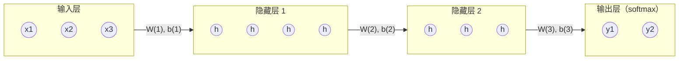
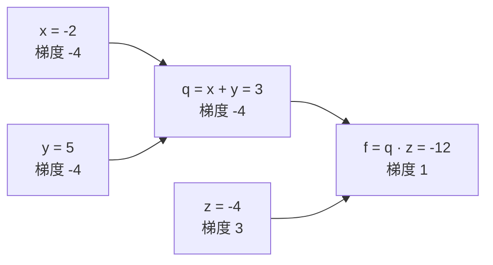

本章建立**深度学习**的基本模型，即多层感知机，以及训练它的算法，即反向传播。我们从单个人工神经元和 Rosenblatt 的感知机出发，后者是第一个能从样例中学习的神经网络，我们将证明只要分离超平面存在它就能找到。异或问题说明单层网络做不到什么，而加入带非线性激活的隐藏层就消除了这一限制：只有一个隐藏层的网络可以逼近任意连续函数。要训练这样的网络，需要损失对每个权重的梯度。反向传播以约两次前向传播的代价算出所有这些梯度；我们先以矩阵形式推导它，再把它看作计算图上反向模式自动微分的特例，PyTorch 和 JAX 正是这样为任意模型计算梯度的。本章最后讨论决定训练能否奏效的实际选择：损失函数、激活函数与权重的初始化。

关于神经元、**梯度下降法**与反向传播的直观图景见 [4.5.4](/4.5.4)；损失函数来自极大似然（[4.7.1](/4.7.1#sec-1.5)）；梯度下降本身及其随机版本的分析见 [3.5.5](/3.5.5)。建立在反向传播之上的优化器与训练技术是 [4.7.4](/4.7.4) 的主题。

## 2.1. 神经元与网络结构

### 2.1.1. 从生物神经元到人工神经元

生物神经元通过树突上的突触接收来自成千上万个其他神经元的信号，在细胞体内加以整合，当膜电位超过阈值时，沿轴突向更多神经元发放一个电脉冲。每个突触的强度随经验而改变；Hebb（1949）提出，当一个连接所连的两个神经元同时活动时，该连接就会增强。McCulloch 与 Pitts（1943）把这些抽象为一个输入为二值、带阈值的计算单元，现代的人工神经元保留同样的结构，只是输入取实数值、非线性取一般的函数。

**定义 2.1.1（人工神经元）** 输入为 $\boldsymbol{x} \in \mathbb{R}^n$ 的**人工神经元**计算

$$
z = \sum_{k=1}^n w_k x_k + b = \boldsymbol{w}^{\mathsf T}\boldsymbol{x} + b, \qquad a = \varphi(z),
$$
其中 $\boldsymbol{w} \in \mathbb{R}^n$ 是权重（突触强度），$b \in \mathbb{R}$ 是偏置（阈值的相反数），$z$ 是预激活值，$\varphi\colon \mathbb{R} \to \mathbb{R}$ 是**激活函数**；$a$ 是神经元的输出或激活值。

添加一个恒为 $1$ 的输入 $x_0 = 1$，其权重取 $w_0 = b$，就吸收了偏置：$z = \tilde{\boldsymbol{w}}^{\mathsf T}\tilde{\boldsymbol{x}}$，其中 $\tilde{\boldsymbol{x}} = (1, x_1, \dots, x_n)^{\mathsf T}$；这种"增广"形式使许多公式变得简短。取阶跃函数 $\varphi(z) = \boldsymbol{1}\{z \ge 0\}$ 就得到 McCulloch–Pitts 阈值单元。这样的单元可以计算 AND（$w_1 = w_2 = 1$，$b = -1.5$）、OR（$b = -0.5$）和 NOT（$w = -1$，$b = 0.5$），所以由它们组成的网络可以通过析取范式实现任意 Boolean 函数。与生物学的类比不应走得太远：真实神经元靠脉冲的时序通信，有复杂的树突计算，并按局部规则学习，而人工网络由全局的梯度信号训练。

### 2.1.2. 网络结构

神经元以三种基本方式组合成网络，它们分别是本章及后续各章的主题。

| 结构 | 连接 | 典型数据 | 章节 |
|---|---|---|---|
| 前馈网络 | 各层依次排列；每层接收前一层的输出；无环 | 特征向量 | 本章 |
| 卷积网络 | 前馈，但每个单元只看局部窗口，且权重在各位置间共享 | 图像、音频、网格 | [4.7.3](/4.7.3) |
| 循环网络 | 隐状态 $\boldsymbol{h}_t$ 带延迟地反馈，$\boldsymbol{h}_t = F(\boldsymbol{h}_{t-1}, \boldsymbol{x}_t)$ | 序列 | [4.7.5](/4.7.5) |

单层前馈网络把输入直接连到一层输出神经元；多层网络则插入一层或多层隐藏神经元，其激活值既不是输入也不是输出。[4.7.6](/4.7.6) 的 Transformer 是作用于序列的前馈网络，其中各位置之间由注意力而不是循环连接。

## 2.2. 感知机

### 2.2.1. 模型与学习规则

Rosenblatt 的感知机（1958）是带学习规则的单个阈值神经元。对二分类，方便的做法是取标签 $y \in \{-1, +1\}$ 并使用符号函数。

**定义 2.2.1（感知机）** 权重向量为 $\boldsymbol{w} \in \mathbb{R}^{n+1}$ 的**感知机**把增广输入 $\tilde{\boldsymbol{x}} \in \mathbb{R}^{n+1}$ 分类为

$$
\hat y = \operatorname{sgn}\bigl(\boldsymbol{w}^{\mathsf T}\tilde{\boldsymbol{x}}\bigr) \in \{-1, +1\}
$$
（约定 $\operatorname{sgn} 0 = +1$）。它的决策边界是超平面 $\{\boldsymbol{x} : \boldsymbol{w}^{\mathsf T}\tilde{\boldsymbol{x}} = 0\}$。

**算法 2.2.1（感知机学习算法）** 给定训练样例 $(\tilde{\boldsymbol{x}}^{(i)}, y^{(i)})$，$i = 1, \dots, m$，以及学习率 $\eta > 0$：

1. 初始化 $\boldsymbol{w} \leftarrow \boldsymbol{0}$（或取小的随机值）。
2. 在样例上反复进行（遍历一次为一个轮次，通常按随机顺序）：若 $y^{(i)}\boldsymbol{w}^{\mathsf T}\tilde{\boldsymbol{x}}^{(i)} \le 0$（该样例被误分类或落在边界上），则更新
   $$
   \boldsymbol{w} \leftarrow \boldsymbol{w} + \eta\, y^{(i)}\tilde{\boldsymbol{x}}^{(i)} ;
   $$
   否则保持 $\boldsymbol{w}$ 不变。
3. 当整个轮次都没有更新时停止，或在达到最大轮次数后停止。

更新使超平面朝着正确分类该样例的方向移动：更新之后 $y\boldsymbol{w}_{\mathrm{new}}^{\mathsf T}\tilde{\boldsymbol{x}} = y\boldsymbol{w}^{\mathsf T}\tilde{\boldsymbol{x}} + \eta\|\tilde{\boldsymbol{x}}\|^2$，比之前更大。这条规则常写成 $\boldsymbol{w} \leftarrow \boldsymbol{w} + \eta(y - \hat y)\tilde{\boldsymbol{x}}$，它只在 $\hat y \ne y$ 时更新；标签为 $\pm 1$ 时，出错意味着 $y - \hat y = 2y$，所以两种形式只差一个可并入 $\eta$ 的因子。感知机规则也是对损失 $\max(0, -y\boldsymbol{w}^{\mathsf T}\tilde{\boldsymbol{x}})$ 的随机**梯度下降法**，该损失的梯度在出错时为 $-y\tilde{\boldsymbol{x}}$，否则为 $\boldsymbol{0}$。对 $k$ 个类别，用 $k$ 个感知机，每类一个，预测得分最大的类别。

### 2.2.2. 线性可分性

**定义 2.2.2（线性可分性）** 带标签的集合 $\{(\boldsymbol{x}^{(i)}, y^{(i)})\}$，$y^{(i)} \in \{-1, +1\}$，称为**线性可分**的，如果存在向量 $\boldsymbol{u}$ 使得对所有 $i$ 有 $y^{(i)}\boldsymbol{u}^{\mathsf T}\tilde{\boldsymbol{x}}^{(i)} > 0$。对单位向量 $\boldsymbol{u}$，数 $\gamma = \min_i y^{(i)}\boldsymbol{u}^{\mathsf T}\tilde{\boldsymbol{x}}^{(i)}$ 称为 $\boldsymbol{u}$ 在该集合上的**间隔**。

对有限的可分集合，该最小值为正，所以分离向量 $\boldsymbol{u}$ 的间隔总是正的。间隔是最近的增广点到 $\mathbb{R}^{n+1}$ 中过原点的分离超平面的距离；**支持向量机**（[4.5.5](/4.5.5)）选择使它最大的超平面。

### 2.2.3. 感知机收敛定理

**定理 2.2.1（感知机收敛定理）** 设对所有 $i$ 有 $\|\tilde{\boldsymbol{x}}^{(i)}\| \le R$，且存在单位向量 $\boldsymbol{u}$ 使得对所有 $i$ 有 $y^{(i)}\boldsymbol{u}^{\mathsf T}\tilde{\boldsymbol{x}}^{(i)} \ge \gamma > 0$。则从 $\boldsymbol{w} = \boldsymbol{0}$ 出发的感知机**学习算法**至多更新

$$
k \le \left(\frac{R}{\gamma}\right)^2
$$
次，无论样例以什么顺序呈现，也无论学习率 $\eta$ 取何值。特别地，它在有限个轮次之后停止，所得权重向量能正确分类每个训练样例。

**证明** 由于 $\boldsymbol{w}$ 从 $\boldsymbol{0}$ 出发，每次更新加上 $\eta y\tilde{\boldsymbol{x}}$，权重向量始终是 $\eta = 1$ 时对应向量的 $\eta$ 倍，触发更新的符号 $y\boldsymbol{w}^{\mathsf T}\tilde{\boldsymbol{x}}$ 也相同；所以可取 $\eta = 1$。设 $\boldsymbol{w}_j$ 是第 $j$ 次更新之后的权重向量，$\boldsymbol{w}_0 = \boldsymbol{0}$，并设第 $j$ 次更新由样例 $(\tilde{\boldsymbol{x}}, y)$ 引起，于是 $\boldsymbol{w}_j = \boldsymbol{w}_{j-1} + y\tilde{\boldsymbol{x}}$ 且 $y\boldsymbol{w}_{j-1}^{\mathsf T}\tilde{\boldsymbol{x}} \le 0$。

在 $\boldsymbol{u}$ 上的投影线性增长：$\boldsymbol{u}^{\mathsf T}\boldsymbol{w}_j = \boldsymbol{u}^{\mathsf T}\boldsymbol{w}_{j-1} + y\boldsymbol{u}^{\mathsf T}\tilde{\boldsymbol{x}} \ge \boldsymbol{u}^{\mathsf T}\boldsymbol{w}_{j-1} + \gamma$，由归纳得 $\boldsymbol{u}^{\mathsf T}\boldsymbol{w}_k \ge k\gamma$。

范数至多按平方根增长：

$$
\|\boldsymbol{w}_j\|^2 = \|\boldsymbol{w}_{j-1}\|^2 + 2y\boldsymbol{w}_{j-1}^{\mathsf T}\tilde{\boldsymbol{x}} + \|\tilde{\boldsymbol{x}}\|^2 \le \|\boldsymbol{w}_{j-1}\|^2 + R^2,
$$
因为出错时中间项 $\le 0$；于是 $\|\boldsymbol{w}_k\|^2 \le kR^2$。

由 Cauchy–Schwarz 不等式及 $\|\boldsymbol{u}\| = 1$，$k\gamma \le \boldsymbol{u}^{\mathsf T}\boldsymbol{w}_k \le \|\boldsymbol{w}_k\| \le \sqrt{k}R$，所以 $\sqrt{k} \le R/\gamma$。由于每个尚未收敛的轮次至少含一次更新，轮次数至多为 $k + 1$。$\square$

该定理归功于 Novikoff（1962），其值得注意之处在于，界与样例个数和维数都无关，只依赖于几何：分得开的数据（$\gamma/R$ 大）学得快。但它没有说明找到的是哪一个分离超平面，找到的超平面的间隔可能很小，泛化能力也可能很差。若数据线性不可分，算法永不停止，权重循环往复。实用的变体针对这两个问题：口袋算法（pocket algorithm）保留迄今所见最好的权重，平均感知机（averaged perceptron）返回所有中间权重向量的平均，它具有与**支持向量机**相近的泛化保证（Freund 与 Schapire 1999）。这个错误数界也是在线学习理论的起点。

### 2.2.4. NumPy 实现

下面的实现在二维可分数据上训练感知机，数据在真实边界周围留有间隙，并把更新次数与按真实分离方向算出的定理 2.2.1 的界作比较。

```python
import numpy as np


def perceptron(X, y, eta=1.0, max_epochs=100, seed=0):
    """Rosenblatt's perceptron. X: (m, d), y in {-1, +1}. Returns w (d+1,), mistakes."""
    rng = np.random.default_rng(seed)
    Xa = np.hstack([X, np.ones((len(X), 1))])  # augment with a constant 1 for the bias
    w = np.zeros(Xa.shape[1])
    mistakes = 0
    for epoch in range(max_epochs):
        errors = 0
        for i in rng.permutation(len(Xa)):
            if y[i] * (w @ Xa[i]) <= 0:      # misclassified (or on the boundary)
                w += eta * y[i] * Xa[i]
                errors += 1
        mistakes += errors
        if errors == 0:                       # a full pass without mistakes: converged
            return w, mistakes, epoch + 1
    return w, mistakes, max_epochs


rng = np.random.default_rng(1)
w_true = np.array([2.0, -1.0])
X = rng.uniform(-1, 1, size=(200, 2))
margin = X @ w_true + 0.3
keep = np.abs(margin) > 0.2               # leave a gap, so that the margin is positive
X, y = X[keep], np.sign(margin[keep])
w, mistakes, epochs = perceptron(X, y)
Xa = np.hstack([X, np.ones((len(X), 1))])
R = np.linalg.norm(Xa, axis=1).max()
u = np.append(w_true, 0.3) / np.linalg.norm(np.append(w_true, 0.3))
gamma = (y * (Xa @ u)).min()
print(f"{len(X)} points, {epochs} epochs, {mistakes} mistakes")
print(f"bound (R/gamma)^2 = {(R / gamma) ** 2:.0f}")
print("training accuracy:", np.mean(np.sign(Xa @ w) == y))

# XOR: the algorithm never stops
X_xor = np.array([[0, 0], [0, 1], [1, 0], [1, 1]], dtype=float)
y_xor = np.array([-1, 1, 1, -1])
w, mistakes, epochs = perceptron(X_xor, y_xor, max_epochs=1000)
print(f"XOR: {epochs} epochs, {mistakes} mistakes, still wrong on",
      int(np.sum(np.sign(np.hstack([X_xor, np.ones((4, 1))]) @ w) != y_xor)), "points")
```

```text
174 points, 4 epochs, 21 mistakes
bound (R/gamma)^2 = 348
training accuracy: 1.0
XOR: 1000 epochs, 3383 mistakes, still wrong on 2 points
```

算法在 21 次更新后收敛，远低于最坏情形的界。在下一节讨论的异或问题上，它永不收敛。

### 2.2.5. 异或问题

两个比特的异或在输入 $(0, 1)$ 与 $(1, 0)$ 上为 $1$，在 $(0, 0)$ 与 $(1, 1)$ 上为 $0$。

**命题 2.2.1** 异或函数不是线性可分的：不存在 $w_1, w_2, b$ 使 $w_1x_1 + w_2x_2 + b > 0$ 恰在异或为 $1$ 的输入上成立。

**证明** 这样的参数应满足 $w_2 + b > 0$ 与 $w_1 + b > 0$（来自输入 $(0,1)$、$(1,0)$），以及 $b \le 0$ 与 $w_1 + w_2 + b \le 0$（来自 $(0,0)$、$(1,1)$）。前两个不等式相加得 $w_1 + w_2 + 2b > 0$，后两个相加得 $w_1 + w_2 + 2b \le 0$，矛盾。$\square$

同样的论证表明感知机不能计算 $n$ 个比特的奇偶性，Minsky 与 Papert（1969）还证明了连接受限的感知机的其他局限。他们的书被广泛解读为表明神经网络是死路，尽管他们知道多层网络没有这个限制；缺少的是训练它们的方法。

再加一层就解决了这个问题，因为 $\mathrm{XOR}(x_1, x_2) = \mathrm{AND}\bigl(\mathrm{OR}(x_1, x_2), \mathrm{NAND}(x_1, x_2)\bigr)$。取阶跃单元 $\varphi(z) = \boldsymbol{1}\{z \ge 0\}$：

| $x_1$ | $x_2$ | $h_1 = \varphi(x_1 + x_2 - 0.5)$（OR） | $h_2 = \varphi(-x_1 - x_2 + 1.5)$（NAND） | $\hat y = \varphi(h_1 + h_2 - 1.5)$（AND） |
|---|---|---|---|---|
| 0 | 0 | 0 | 1 | 0 |
| 0 | 1 | 1 | 1 | 1 |
| 1 | 0 | 1 | 1 | 1 |
| 1 | 1 | 1 | 0 | 0 |

隐藏层把四个点映为 $(0,1)$、$(1,1)$、$(1,1)$、$(1,0)$，在那里两个类别是线性可分的。这就是一般的机制：隐藏层不断变换表示，直到线性分类器就够用。这里的权重是手工选定的；本章其余部分说明如何学习它们。

## 2.3. 多层感知机

### 2.3.1. 为什么需要光滑的非线性激活

有两个障碍使我们不能简单地把感知机堆叠起来再用**梯度下降法**训练。

- 阶跃函数在可导处导数为 $0$，在 $0$ 处不可导。经过阶跃单元的每个梯度都是零，所以梯度下降得不到任何关于如何改变前面各层权重的信号。
- 把阶跃换成恒等函数也无济于事，因为这样深度什么也没有增加：$W_2(W_1\boldsymbol{x} + \boldsymbol{b}_1) + \boldsymbol{b}_2 = (W_2W_1)\boldsymbol{x} + (W_2\boldsymbol{b}_1 + \boldsymbol{b}_2)$，由归纳，任意多个仿射映射的复合仍是一个仿射映射。深层线性网络所表示的函数与单个线性层完全相同（尽管它们的训练动力学不同）。

解决办法是使用非线性且（至少几乎处处）可微的激活函数，例如 logistic sigmoid $\sigma(z) = 1/(1 + \mathrm{e}^{-z})$，它是阶跃的光滑版本，或 §2.6 的整流函数 $\max(0, z)$。

### 2.3.2. 结构与前向计算

**定义 2.3.1（多层感知机）** 具有 $L$ 层、宽度为 $n_0, n_1, \dots, n_L$ 的**多层感知机**（MLP，也称全连接前馈网络）从输入 $\boldsymbol{a}^{(0)} = \boldsymbol{x} \in \mathbb{R}^{n_0}$ 出发计算

$$
\boldsymbol{z}^{(l)} = W^{(l)}\boldsymbol{a}^{(l-1)} + \boldsymbol{b}^{(l)}, \qquad \boldsymbol{a}^{(l)} = \varphi^{(l)}\bigl(\boldsymbol{z}^{(l)}\bigr), \qquad l = 1, \dots, L,
$$
其中权重矩阵 $W^{(l)} \in \mathbb{R}^{n_l \times n_{l-1}}$，偏置向量 $\boldsymbol{b}^{(l)} \in \mathbb{R}^{n_l}$，激活函数 $\varphi^{(l)}$ 逐分量作用（输出层可能例外）。输出是 $\hat{\boldsymbol{y}} = \boldsymbol{a}^{(L)}$；第 $1, \dots, L-1$ 层是隐藏层。

元素 $w^{(l)}_{jk}$ 是从第 $l-1$ 层的神经元 $k$ 到第 $l$ 层的神经元 $j$ 的连接权重，所以 $z^{(l)}_j = \sum_k w^{(l)}_{jk}a^{(l-1)}_k + b^{(l)}_j$。网络共有 $\sum_{l=1}^L n_l(n_{l-1} + 1)$ 个参数。一层中的每个神经元接收前一层每个神经元的输入，不接收其他层的输入；层内没有连接，也没有反馈。输出激活按任务选择，依 [4.7.1](/4.7.1#sec-1.5.2)：回归用恒等函数，二分类用 sigmoid，多分类用 **softmax 函数**。



在实践中，网络一次处理 $B$ 个样例组成的小批量。把输入按行堆成矩阵 $A^{(0)} = X \in \mathbb{R}^{B \times n_0}$，前向传播就成为一连串矩阵乘法，

$$
Z^{(l)} = A^{(l-1)}W^{(l)\mathsf T} + \boldsymbol{1}\boldsymbol{b}^{(l)\mathsf T}, \qquad A^{(l)} = \varphi^{(l)}\bigl(Z^{(l)}\bigr),
$$

这是在 GPU 上高效运行的形式，也是**深度学习**库的约定（`torch.nn.Linear` 把 $W$ 存成形状 $(n_{\mathrm{out}}, n_{\mathrm{in}})$ 并计算 $XW^{\mathsf T} + \boldsymbol{b}$）。一次前向传播约需 $B\sum_l n_ln_{l-1}$ 次乘加。

### 2.3.3. 万能逼近

这样的网络表达能力有多强？只要允许足够宽，单个隐藏层就足以逼近任意连续函数。

**定理 2.3.1（万能逼近定理）** 设 $\varphi\colon \mathbb{R} \to \mathbb{R}$ 连续且不是多项式。则对每个紧集 $K \subset \mathbb{R}^n$、每个连续函数 $f\colon K \to \mathbb{R}$ 和每个 $\varepsilon > 0$，存在 $N \in \mathbb{N}_+$、$\boldsymbol{w}_j \in \mathbb{R}^n$ 以及 $b_j, c_j \in \mathbb{R}$，使得

$$
\sup_{\boldsymbol{x} \in K}\Bigl\lvert f(\boldsymbol{x}) - \sum_{j=1}^N c_j\,\varphi\bigl(\boldsymbol{w}_j^{\mathsf T}\boldsymbol{x} + b_j\bigr)\Bigr\rvert < \varepsilon .
$$

右端的和就是带一个含 $N$ 个神经元的隐藏层、线性输出的 MLP；对向量值的 $f$，对每个分量分别应用该定理。Cybenko（1989）对 sigmoid 型的 $\varphi$ 证明了该定理，Hornik（1991）推广到有界非常值的 $\varphi$；上面包含 ReLU 的形式归功于 Leshno、Lin、Pinkus 与 Schocken（1993），他们还证明了非多项式这一条件也是必要的（次数为 $d$ 的多项式激活只能产生次数至多为 $d$ 的多项式）。对 ReLU，在一维情形下想法很容易看出：平移后的 ReLU 的组合是断点任意的连续分段线性函数，而这类函数能在区间上一致逼近任意连续函数。

该定理是一个存在性陈述，有三点重要的局限。

- 它没有给出 $N$ 的界。对 $[0,1]^n$ 上一般的 Lipschitz 函数，所需神经元数按 $\varepsilon^{-n}$ 增长，关于维数是指数的；更好的速率只对更小的函数类成立（Barron 1993 对 Fourier 一阶矩有限的函数得到与 $n$ 无关的误差 $O(1/\sqrt{N})$）。
- 它没有说明梯度下降能否找到逼近用的权重，也没有说明从有限数据出发的泛化。
- 深度可能比宽度高效得多：存在能被小的深层网络计算、却在任何浅层网络中需要指数多神经元的函数（Telgarsky 2016；Eldan 与 Shamir 2016）。反过来，宽度有界的深度同样是万能的：宽度为 $n + 1$ 的 ReLU 网络可以逼近 $\mathbb{R}^n$ 的紧子集上的任意连续函数（Hanin 与 Sellke 2017）。

图中展示最简单的情形：一个含四个 tanh 神经元的隐藏层加 sigmoid 输出的网络，用梯度下降在**交叉熵**上训练，学得一条弯曲的决策边界，从而解决了异或问题。


## 2.4. 反向传播

### 2.4.1. 基于梯度的训练

训练 MLP 就是对所有权重和偏置 $\boldsymbol{\theta}$ 最小化平均损失 $E(\boldsymbol{\theta}) = \frac{1}{m}\sum_{i=1}^m E_i(\boldsymbol{\theta})$，其中 $E_i$ 是第 $i$ 个样例上的损失。如 [3.5.5](/3.5.5) 所述，**梯度下降法**以学习率 $\eta$ 迭代 $\boldsymbol{\theta} \leftarrow \boldsymbol{\theta} - \eta\nabla E(\boldsymbol{\theta})$；**随机梯度下降**用单个样例上的梯度代替完整梯度，而**小批量梯度下降**用随机批 $\mathcal{B}$ 上的梯度 $\frac{1}{\lvert\mathcal{B}\rvert}\sum_{i \in \mathcal{B}}\nabla E_i$，这是以很小的代价得到的无偏估计。网络的损失关于其权重不是凸的：它有许多**鞍点**和局部极小点，也有许多由对称性联系的全局极小点（置换一层中的隐藏神经元不改变函数）。在高维中，大多数损失较高的临界点是**鞍点**而不是不好的局部极小点，随机梯度方法能逃离它们；它们为什么仍能找到好的解，至今只被部分地理解（[4.7.4](/4.7.4)）。

无论用什么优化器，它都需要 $\nabla E_i$，即损失对可能多达数十亿个参数中每一个的导数。用有限差分去近似每个偏导数，每个参数要花一次前向传播。反向传播只用一次反向传播就精确算出全部导数。

### 2.4.2. 计算图与标量例子

**定义 2.4.1（计算图）** 函数的**计算图**是一个有向无环图，其结点是输入变量和各个基本运算（加法、乘法、矩阵乘积、激活函数等）的结果，其边由每个运算的参数指向它的结果。

考虑 $f(x, y, z) = (x + y)z$，在 $x = -2$、$y = 5$、$z = -4$ 处。图中有一个中间结点 $q = x + y = 3$ 和输出 $f = qz = -12$。每个运算都知道自己的局部导数：$\partial q/\partial x = \partial q/\partial y = 1$，$\partial f/\partial q = z = -4$，$\partial f/\partial z = q = 3$。由**链式法则**，$f$ 对某个结点的导数等于从上方传来的导数（上游梯度）乘以局部导数：

$$
\frac{\partial f}{\partial x} = \frac{\partial f}{\partial q}\frac{\partial q}{\partial x} = -4, \qquad \frac{\partial f}{\partial y} = -4, \qquad \frac{\partial f}{\partial z} = 3 .
$$



网络是由这类单元组成的大图，梯度逐个单元分四步算出：（1）在前向传播中，每个单元计算并存储其输出以及计算局部导数所需的量；（2）反向传播从损失开始，$\partial E/\partial E = 1$，每个单元接收上游梯度 $\partial E/\partial(\text{输出})$；（3）它乘以局部导数，得到下游梯度 $\partial E/\partial(\text{输入})$；（4）当一个变量被多个单元使用时，把来自这些单元的梯度相加，并按反拓扑序继续向图的后方传播。典型单元的行为很简单：加法把上游梯度复制给所有输入，两个变量相乘则把上游梯度乘以另一个输入后送给每个输入，$\max$ 把梯度送给取到最大值的那个输入。

### 2.4.3. 反向传播方程

对定义 2.3.1 的 MLP，这个过程可以用矩阵写成闭式。固定一个样例及其损失 $E$，它是输出 $\boldsymbol{a}^{(L)}$ 的函数。定义第 $l$ 层的误差信号为损失对预激活值的梯度，

$$
\boldsymbol{\delta}^{(l)} = \frac{\partial E}{\partial\boldsymbol{z}^{(l)}} \in \mathbb{R}^{n_l}, \qquad \delta^{(l)}_j = \frac{\partial E}{\partial z^{(l)}_j},
$$

并用 $\odot$ 表示逐分量乘积。

**定理 2.4.1（反向传播方程）** 对隐藏层激活 $\varphi$ 逐分量作用的 MLP，

1. 在输出层，$\boldsymbol{\delta}^{(L)} = \bigl(J^{(L)}\bigr)^{\mathsf T}\nabla_{\boldsymbol{a}^{(L)}}E$，其中 $J^{(L)} = \partial\boldsymbol{a}^{(L)}/\partial\boldsymbol{z}^{(L)}$ 是输出激活的 **Jacobi 矩阵**；对逐分量的输出激活，这就是 $\boldsymbol{\delta}^{(L)} = \nabla_{\boldsymbol{a}^{(L)}}E \odot \varphi^{(L)\prime}(\boldsymbol{z}^{(L)})$；
2. 对 $l = L-1, \dots, 1$，
   $$
   \boldsymbol{\delta}^{(l)} = \bigl(W^{(l+1)\mathsf T}\boldsymbol{\delta}^{(l+1)}\bigr) \odot \varphi'\bigl(\boldsymbol{z}^{(l)}\bigr);
   $$
3. 对 $l = 1, \dots, L$，
   $$
   \frac{\partial E}{\partial W^{(l)}} = \boldsymbol{\delta}^{(l)}\boldsymbol{a}^{(l-1)\mathsf T}, \qquad \frac{\partial E}{\partial\boldsymbol{b}^{(l)}} = \boldsymbol{\delta}^{(l)} .
   $$

**证明** （1）是映射 $\boldsymbol{z}^{(L)} \mapsto \boldsymbol{a}^{(L)} \mapsto E$ 的**链式法则**；若 $a^{(L)}_j$ 只依赖 $z^{(L)}_j$，则 Jacobi 矩阵是对角矩阵 $\operatorname{diag}(\varphi^{(L)\prime}(\boldsymbol{z}^{(L)}))$。对（2），$E$ 依赖 $z^{(l)}_j$ 只是通过 $a^{(l)}_j = \varphi(z^{(l)}_j)$，而它进入每一个 $z^{(l+1)}_k = \sum_i w^{(l+1)}_{ki}a^{(l)}_i + b^{(l+1)}_k$。由多元链式法则，

$$
\delta^{(l)}_j = \sum_{k=1}^{n_{l+1}}\frac{\partial E}{\partial z^{(l+1)}_k}\frac{\partial z^{(l+1)}_k}{\partial a^{(l)}_j}\frac{\partial a^{(l)}_j}{\partial z^{(l)}_j} = \Bigl(\sum_{k=1}^{n_{l+1}} w^{(l+1)}_{kj}\delta^{(l+1)}_k\Bigr)\varphi'\bigl(z^{(l)}_j\bigr),
$$
而这个和正是 $W^{(l+1)\mathsf T}\boldsymbol{\delta}^{(l+1)}$ 的第 $j$ 个分量。对（3），$w^{(l)}_{jk}$ 与 $b^{(l)}_j$ 只通过 $z^{(l)}_j$ 影响 $E$，且 $\partial z^{(l)}_j/\partial w^{(l)}_{jk} = a^{(l-1)}_k$，$\partial z^{(l)}_j/\partial b^{(l)}_j = 1$；因此 $\partial E/\partial w^{(l)}_{jk} = \delta^{(l)}_ja^{(l-1)}_k$，这是外积 $\boldsymbol{\delta}^{(l)}\boldsymbol{a}^{(l-1)\mathsf T}$ 的 $(j,k)$ 元素，而 $\partial E/\partial b^{(l)}_j = \delta^{(l)}_j$。$\square$

误差信号通过转置的权重矩阵向后传播，这些矩阵正是向前传递激活值的那些矩阵，并在每一层被激活函数的导数门控。权重梯度是局部的：它只涉及连接输入端的活动 $a^{(l-1)}_k$ 与输出端的误差 $\delta^{(l)}_j$，这一结构令人想起 Hebb 规则。对两种最常见的输出层，输出误差有简单的形式。

**命题 2.4.1** （a）若 $\hat{\boldsymbol{y}} = \operatorname{softmax}(\boldsymbol{z}^{(L)})$，$E = -\sum_j y_j\log\hat y_j$ 且 $\sum_j y_j = 1$，则 $\boldsymbol{\delta}^{(L)} = \hat{\boldsymbol{y}} - \boldsymbol{y}$。（b）若 $\hat{\boldsymbol{y}} = \sigma(\boldsymbol{z}^{(L)})$ 逐分量作用，且 $E = \frac12\|\hat{\boldsymbol{y}} - \boldsymbol{y}\|^2$，则 $\boldsymbol{\delta}^{(L)} = (\hat{\boldsymbol{y}} - \boldsymbol{y}) \odot \hat{\boldsymbol{y}} \odot (\boldsymbol{1} - \hat{\boldsymbol{y}})$。

**证明** （a）**softmax 函数**的 Jacobi 矩阵为 $\partial\hat y_j/\partial z_i = \hat y_j(\boldsymbol{1}\{i = j\} - \hat y_i)$，所以

$$
\frac{\partial E}{\partial z_i} = -\sum_j\frac{y_j}{\hat y_j}\,\hat y_j\bigl(\boldsymbol{1}\{i = j\} - \hat y_i\bigr) = -y_i + \hat y_i\sum_j y_j = \hat y_i - y_i .
$$
（b）由定理 2.4.1 的第 1 部分，取 $\nabla_{\hat{\boldsymbol{y}}}E = \hat{\boldsymbol{y}} - \boldsymbol{y}$ 及 $\sigma' = \sigma(1 - \sigma)$ 即得。$\square$

**算法 2.4.1（反向传播）** 对输入为 $X$（行是样例）、损失为 $E = \frac{1}{B}\sum_{i=1}^B E_i$ 的小批量：

1. 前向传播：在权重固定的情况下，对 $l = 1, \dots, L$ 计算并存储 $Z^{(l)}$ 和 $A^{(l)}$。
2. 输出误差：$\Delta^{(L)} = \partial E/\partial Z^{(L)}$；对 softmax 加**交叉熵**，在独热目标 $Y$ 下 $\Delta^{(L)} = \frac{1}{B}(\hat Y - Y)$。
3. 反向传播，对 $l = L, \dots, 1$：$\dfrac{\partial E}{\partial W^{(l)}} = \Delta^{(l)\mathsf T}A^{(l-1)}$，$\dfrac{\partial E}{\partial\boldsymbol{b}^{(l)}} = \Delta^{(l)\mathsf T}\boldsymbol{1}$，并且当 $l > 1$ 时 $\Delta^{(l-1)} = \bigl(\Delta^{(l)}W^{(l)}\bigr) \odot \varphi'\bigl(Z^{(l-1)}\bigr)$。
4. 更新：$W^{(l)} \leftarrow W^{(l)} - \eta\,\partial E/\partial W^{(l)}$，$\boldsymbol{b}^{(l)} \leftarrow \boldsymbol{b}^{(l)} - \eta\,\partial E/\partial\boldsymbol{b}^{(l)}$，或采用更精细的优化器步骤（[4.7.4](/4.7.4)）。

按行写的公式是定理 2.4.1 对批量求和后的转置。反向传播每层需要两次矩阵乘法（一次求权重梯度，一次求误差信号），前向只需一次，所以一个训练步骤约花三次前向传播的代价；对大语言模型，这给出经验法则：对 $N$ 个参数，每个训练**词元**约需 $6N$ 次**浮点运算**（[4.7.8](/4.7.8)）。存储下来的激活值 $A^{(l)}$ 正是训练耗费大量内存的原因。

**定义 2.4.2（反向传播）** **反向传播**是这样一种计算：通过把误差信号从输出沿计算图向后传播，在每个结点上应用链式法则，算出标量损失对网络所有参数的梯度，如算法 2.4.1 所示。

### 2.4.4. 自动微分

反向传播是一项一般技术在神经网络上的特例。

**定义 2.4.3（自动微分）** **自动微分**对以程序形式给出的函数求导：把它分解成导数已知的基本运算，再沿计算图用链式法则把它们组合起来。结果在浮点舍入误差范围内是精确的。在*前向模式*中，导数与函数值一起从输入向前传播；在*反向模式*中，先在一次前向扫描中算出并存储各个值，再从输出向后传播导数。

自动微分既不是符号微分（它操纵公式，可能产生规模爆炸的表达式），也不是数值微分（它使用有限差分，受截断误差和舍入误差之累）。对 Jacobi 矩阵为 $J_F$ 的 $F\colon \mathbb{R}^n \to \mathbb{R}^m$，两种模式计算不同的乘积：

| 模式 | 一次扫描计算 | 完整 Jacobi 矩阵的代价 | 适用情形 |
|---|---|---|---|
| 前向 | Jacobi 矩阵–向量积 $J_F\boldsymbol{v}$（方向导数） | $n$ 次扫描 | 输入少、输出多 |
| 反向 | 向量–Jacobi 矩阵积 $\boldsymbol{u}^{\mathsf T}J_F$ | $m$ 次扫描 | 输入多、输出少 |

训练损失把数十亿个参数映为一个数（$m = 1$），所以一次反向扫描就给出整个梯度，代价是求值损失的一个小常数倍，且与参数个数无关（廉价梯度原理；Baur 与 Strassen 1983 对算术电路给出）。代价是内存：反向模式必须保存前向扫描的中间值，这就是激活内存以及在反向传播中重新计算激活值的技术（梯度检查点）对大模型很重要的原因（[4.7.8](/4.7.8)）。

框架以两种风格实现反向模式。PyTorch 在 Python 代码运行时动态记录计算图（每个 `requires_grad=True` 的张量都记得产生它的运算），`loss.backward()` 按相反顺序遍历它；JAX 则把函数变换成可以编译的新函数（`jax.grad`、`jax.vjp`、`jax.jvp`）。在两者中，每个运算都定义自己的向量–Jacobi 矩阵积，所以写新模型的人不必手推梯度。需要手写梯度时，应像下面这样用有限差分检验。

### 2.4.5. 实现

下面的 NumPy 代码实现了带 ReLU 隐藏层、softmax 输出和**交叉熵损失**的 MLP，用算法 2.4.1 的反向传播，用中心差分检验一个偏导数，并在双月数据集上用小批量**随机梯度下降**训练该网络。

```python
import numpy as np


def relu(z):
    return np.maximum(z, 0.0)


def softmax(z):
    z = z - z.max(axis=1, keepdims=True)      # subtract the row maximum for stability
    e = np.exp(z)
    return e / e.sum(axis=1, keepdims=True)


class MLP:
    """Fully connected network: ReLU hidden layers, softmax output, cross-entropy loss.
    Rows of X are examples, so a layer computes Z = A W^T + b."""

    def __init__(self, sizes, seed=0):
        rng = np.random.default_rng(seed)
        self.W = [rng.normal(0.0, np.sqrt(2.0 / m), size=(n, m))   # He initialization
                  for m, n in zip(sizes[:-1], sizes[1:])]
        self.b = [np.zeros(n) for n in sizes[1:]]

    def forward(self, X):
        A, cache = X, [X]
        for l, (W, b) in enumerate(zip(self.W, self.b)):
            Z = A @ W.T + b
            A = softmax(Z) if l == len(self.W) - 1 else relu(Z)
            cache.append(A)
        return A, cache

    def loss_and_grads(self, X, y):
        m = len(X)
        P, cache = self.forward(X)
        loss = -np.mean(np.log(P[np.arange(m), y] + 1e-12))
        Y = np.eye(P.shape[1])[y]
        delta = (P - Y) / m                       # dE/dZ at the output (softmax + cross-entropy)
        gW, gb = [None] * len(self.W), [None] * len(self.W)
        for l in range(len(self.W) - 1, -1, -1):
            A_prev = cache[l]
            gW[l] = delta.T @ A_prev                # dE/dW = delta^T A_prev
            gb[l] = delta.sum(axis=0)
            if l > 0:                               # dE/dZ of the previous layer
                delta = (delta @ self.W[l]) * (A_prev > 0)
        return loss, gW, gb


def two_moons(m, noise, rng):
    t = rng.uniform(0, np.pi, m)
    lab = rng.integers(0, 2, m)
    x = np.where(lab == 0, np.cos(t), 1 - np.cos(t))
    yy = np.where(lab == 0, np.sin(t), 0.5 - np.sin(t))
    return np.c_[x, yy] + noise * rng.standard_normal((m, 2)), lab


rng = np.random.default_rng(0)
X, y = two_moons(400, 0.15, rng)
net = MLP([2, 32, 32, 2])

# gradient check on one weight against a central difference
loss, gW, _ = net.loss_and_grads(X, y)
h = 1e-6
net.W[0][3, 1] += h
lp, _, _ = net.loss_and_grads(X, y)
net.W[0][3, 1] -= 2 * h
lm, _, _ = net.loss_and_grads(X, y)
net.W[0][3, 1] += h
print(f"backprop {gW[0][3, 1]:.8f}  finite difference {(lp - lm) / (2 * h):.8f}")

eta, batch = 0.1, 32
for epoch in range(200):
    perm = rng.permutation(len(X))
    for k in range(0, len(X), batch):
        idx = perm[k:k + batch]
        loss, gW, gb = net.loss_and_grads(X[idx], y[idx])
        for l in range(len(net.W)):
            net.W[l] -= eta * gW[l]
            net.b[l] -= eta * gb[l]
    if epoch % 50 == 0 or epoch == 199:
        P, _ = net.forward(X)
        full_loss = -np.mean(np.log(P[np.arange(len(X)), y]))
        print(f"epoch {epoch:3d}  loss {full_loss:.4f}  accuracy {np.mean(P.argmax(1) == y):.3f}")

X_test, y_test = two_moons(2000, 0.15, rng)
P, _ = net.forward(X_test)
print(f"test accuracy {np.mean(P.argmax(1) == y_test):.3f}")
```

```text
backprop 0.03433257  finite difference 0.03433257
epoch   0  loss 0.3556  accuracy 0.848
epoch  50  loss 0.0336  accuracy 0.998
epoch 100  loss 0.0118  accuracy 0.998
epoch 150  loss 0.0090  accuracy 1.000
epoch 199  loss 0.0045  accuracy 1.000
test accuracy 0.987
```

这里 ReLU 的导数用 `A_prev > 0` 计算，它等于 $\boldsymbol{1}\{z > 0\}$，因为 $\operatorname{ReLU}(z) > 0$ 当且仅当 $z > 0$。训练准确率达到 100%，而测试准确率为 98.7%：在边界附近标签带噪声时，对**训练集**的完美拟合稍嫌太灵活，这就是 [4.7.1](/4.7.1#sec-1.3) 的**泛化差距**。

同一个模型用 PyTorch（2.14 版，CPU）实现时不需要手写反向传播。开头几行也重现了 §2.4.2 的标量例子。

```python
import torch
from torch import nn

# reverse-mode automatic differentiation on f = (x + y) z
x = torch.tensor(-2.0, requires_grad=True)
y = torch.tensor(5.0, requires_grad=True)
z = torch.tensor(-4.0, requires_grad=True)
f = (x + y) * z
f.backward()
print(f.item(), x.grad.item(), y.grad.item(), z.grad.item())

# the MLP of the NumPy example, trained with autograd and SGD
torch.manual_seed(0)
def two_moons(m, noise):
    t = torch.rand(m) * torch.pi
    lab = torch.randint(0, 2, (m,))
    x = torch.where(lab == 0, torch.cos(t), 1 - torch.cos(t))
    yy = torch.where(lab == 0, torch.sin(t), 0.5 - torch.sin(t))
    return torch.stack([x, yy], 1) + noise * torch.randn(m, 2), lab

X, labels = two_moons(400, 0.15)
model = nn.Sequential(nn.Linear(2, 32), nn.ReLU(), nn.Linear(32, 32), nn.ReLU(), nn.Linear(32, 2))
opt = torch.optim.SGD(model.parameters(), lr=0.1)
loss_fn = nn.CrossEntropyLoss()          # takes logits: softmax is applied inside
for epoch in range(200):
    for idx in torch.randperm(len(X)).split(32):
        loss = loss_fn(model(X[idx]), labels[idx])
        opt.zero_grad()
        loss.backward()                  # backpropagation
        opt.step()                       # w <- w - lr * grad
with torch.no_grad():
    X_test, y_test = two_moons(2000, 0.15)
    print(f"test accuracy {(model(X_test).argmax(1) == y_test).float().mean():.3f}")
```

```text
-12.0 -4.0 -4.0 3.0
test accuracy 0.983
```

注意 `nn.CrossEntropyLoss` 的输入是 logit $\boldsymbol{z}^{(L)}$ 而不是概率：它把 softmax 与对数合并成数值稳定的 log-sum-exp，因此模型的最后一层是线性的。需要 `opt.zero_grad()` 是因为 PyTorch 把梯度累加到 `.grad` 中，这就是 §2.4.2 的步骤（4）在多次调用之间的体现。

## 2.5. 损失函数

损失把网络输出与目标作比较。依 [4.7.1](/4.7.1#sec-1.5.2)，标准的损失都是负对数似然，每个都与一种输出激活配对，使输出处的误差信号很简单。

| 损失 | 公式（单个样例） | 输出层 | $\partial E/\partial\boldsymbol{z}^{(L)}$ | 用途 |
|---|---|---|---|---|
| 均方误差 | $\frac12\Vert\hat{\boldsymbol{y}} - \boldsymbol{y}\Vert^2$ | 恒等 | $\hat{\boldsymbol{y}} - \boldsymbol{y}$ | 回归（Gauss 似然） |
| 二元交叉熵 | $-y\log\hat y - (1 - y)\log(1 - \hat y)$ | sigmoid | $\hat y - y$ | 二分类与多标签分类 |
| 交叉熵 | $-\sum_j y_j\log\hat y_j$ | softmax | $\hat{\boldsymbol{y}} - \boldsymbol{y}$ | 多分类、语言建模 |
| 合页损失 | $\max(0, 1 - yz)$，$y \in \{-1, +1\}$ | 恒等（得分 $z$） | $-y\,\boldsymbol{1}\{yz < 1\}$（次梯度） | 基于间隔的分类，如 SVM |

为什么不对分类使用平方误差？取 sigmoid 输出加平方误差时，由命题 2.4.1(b) 得 $\delta^{(L)} = (\hat y - y)\hat y(1 - \hat y)$，只要输出饱和，它就很小，包括自信地出错的情形。对 $z = -5$、$y = 1$，$\hat y = \sigma(-5) \approx 0.0067$，$\delta^{(L)} \approx -0.0066$，而**交叉熵**给出 $\delta^{(L)} = \hat y - y \approx -0.993$，在最需要学习的地方梯度大 150 倍。交叉熵中的对数抵消了 sigmoid 与 **softmax 函数**的指数式平坦。平方误差仍是回归的默认选择，有时代之以 Huber 损失，它对小误差是二次的、对大误差是线性的，因此对离群点不那么敏感。

## 2.6. 激活函数

激活函数决定梯度如何流过隐藏层，它的选择随网络深度的变化而变化。

**定义 2.6.1（线性整流单元）** **线性整流单元**（ReLU）是激活函数 $\operatorname{ReLU}(z) = \max(0, z)$，其导数在 $z \ne 0$ 时为 $\boldsymbol{1}\{z > 0\}$（约定在 $z = 0$ 处为 $0$）。

| 激活函数 | $\varphi(z)$ | $\varphi'(z)$ | 值域 | 说明 |
|---|---|---|---|---|
| sigmoid | $\sigma(z) = \dfrac{1}{1 + \mathrm{e}^{-z}}$ | $\sigma(z)(1 - \sigma(z)) \le \frac14$ | $(0, 1)$ | 饱和；输出不以零为中心；现用于门和二元输出 |
| tanh | $\tanh z = 2\sigma(2z) - 1$ | $1 - \tanh^2 z \in (0, 1]$ | $(-1, 1)$ | 以零为中心；饱和；用于循环网络 |
| ReLU | $\max(0, z)$ | $\boldsymbol{1}\{z > 0\}$ | $[0, \infty)$ | 计算便宜；$z > 0$ 时不饱和；激活稀疏；单元可能"死亡" |
| leaky ReLU、PReLU | $z > 0$ 时为 $z$，否则为 $\alpha z$ | $1$ 或 $\alpha$ | $\mathbb{R}$ | 小斜率 $\alpha$（如 $0.01$）避免单元死亡；PReLU 学习 $\alpha$ |
| ELU | $z > 0$ 时为 $z$，否则为 $\alpha(\mathrm{e}^z - 1)$ | $1$ 或 $\alpha\mathrm{e}^z$ | $(-\alpha, \infty)$ | 负半部分光滑，平均激活更接近零 |
| GELU | $z\,\Phi(z)$ | $\Phi(z) + z\,\phi(z)$ | $[-0.17, \infty)$ | 光滑的 ReLU；BERT、GPT 与视觉 Transformer 的标准选择 |
| SiLU（Swish） | $z\,\sigma(z)$ | $\sigma(z)\bigl(1 + z(1 - \sigma(z))\bigr)$ | $[-0.28, \infty)$ | 光滑、非单调；用于 SwiGLU 内部 |

这里 $\Phi$ 与 $\phi$ 是标准正态分布的分布函数与密度；GELU 常用近似 $\frac12 z\bigl(1 + \tanh\bigl(\sqrt{2/\pi}(z + 0.044715z^3)\bigr)\bigr)$ 计算。

![七种激活函数（左）及其导数（右），区间 [-4, 4]：sigmoid 与 tanh 在两侧饱和，ReLU 及其变体在正输入上是线性的，GELU 与 SiLU 是 ReLU 的光滑版本，带一个小的负向凹陷](./plots/activation-functions.py)

这张表的历史就是梯度流动的历史。经过 $L$ 个 sigmoid 层的反向传播，把误差信号乘上 $L$ 个至多为 $\frac14$ 的导数，所以在深层 sigmoid 网络中，早期各层的梯度会消失；tanh 好一些，但仍会饱和。ReLU（Nair 与 Hinton 2010；Glorot、Bordes 与 Bengio 2011）在其激活的一半上导数恰为 $1$，这使得不经逐层预训练就能训练深层网络，也是 AlexNet（[4.7.3](/4.7.3)）的成分之一。它的弱点是，预激活值对所有输入都为负的单元得不到梯度，永远无法恢复，leaky ReLU、PReLU（He 等 2015）和 ELU（Clevert 等 2015）正是为了解决这一点。GELU（Hendrycks 与 Gimpel 2016）用标准正态变量小于输入的概率 $\Phi(z)$ 给输入加权，是门 $\boldsymbol{1}\{z > 0\}$ 的光滑版本；SiLU（Elfwing 等 2017；Ramachandran 等 2017 通过自动搜索发现并称之为 Swish）与之类似，只是以 logistic 函数代替 $\Phi$。

2022 年以来大多数大语言模型（PaLM、LLaMA、Qwen、DeepSeek）的前馈块使用门控线性单元而不是普通的激活函数。Shazeer（2020）的 SwiGLU 块计算

$$
\operatorname{FFN}_{\mathrm{SwiGLU}}(\boldsymbol{x}) = W_2\bigl(\operatorname{SiLU}(W_1\boldsymbol{x}) \odot W_3\boldsymbol{x}\bigr),
$$

其中一个经 SiLU 的线性投影逐分量地门控另一个。它有三个权重矩阵而不是两个，所以隐藏宽度通常从 $4d$ 减到约 $\frac83 d$，以保持标准块的参数量；经验上，它在相同计算量下给出更低的损失（[4.7.6](/4.7.6)）。

实用的默认选择：MLP 和 CNN 的隐藏层用 ReLU（或 GELU），Transformer 中用 GELU 或 SwiGLU，循环网络的门用 sigmoid 与 tanh（[4.7.5](/4.7.5)），输出激活按 §2.5 选取。梯度消失与梯度爆炸以及抑制它们的归一化层见 [4.7.4](/4.7.4)。

## 2.7. 权重初始化

训练从初始权重出发，而它们的选择并非无关紧要。如果一层的所有权重起始时相等（例如为零），则它的所有神经元计算同一个函数，由定理 2.4.1 得到同样的梯度，并永远保持相同：对称性永远打不破，该层的行为就像单个神经元。因此权重要随机抽取，权重初始化（weight initialization）就是对其分布的选择，通常均值为零，方差依赖于该层的宽度。偏置通常设为零。方差之所以重要，是因为信号在每一层都要乘以一个权重矩阵：如果每层都放大激活值的方差，它们就随深度指数地爆炸；如果衰减，它们就消失；反向传播中的误差信号同理。

**命题 2.7.1** 设 $z_j = \sum_{k=1}^{n_{\mathrm{in}}} w_{jk}a_k$，其中权重 $w_{jk}$ 相互独立，均值为 $0$、方差为 $\sigma_w^2$，且与同分布的输入 $a_k$ 独立。则 $\mathbb{E}[z_j] = 0$，$\operatorname{Var}(z_j) = n_{\mathrm{in}}\sigma_w^2\,\mathbb{E}[a_k^2]$。若进一步 $a_k = \operatorname{ReLU}(z'_k)$，其中前一层的预激活值 $z'_k$ 关于 $0$ 对称，则 $\mathbb{E}[a_k^2] = \frac12\operatorname{Var}(z'_k)$。

**证明** 由权重的独立性和零均值，$\mathbb{E}[z_j] = \sum_k\mathbb{E}[w_{jk}]\mathbb{E}[a_k] = 0$，且各项 $w_{jk}a_k$ 不相关，因为当 $k \ne l$ 时 $\mathbb{E}[w_{jk}a_kw_{jl}a_l] = \mathbb{E}[w_{jk}]\mathbb{E}[w_{jl}]\mathbb{E}[a_ka_l] = 0$。因此 $\operatorname{Var}(z_j) = \sum_k\mathbb{E}[w_{jk}^2]\mathbb{E}[a_k^2] = n_{\mathrm{in}}\sigma_w^2\mathbb{E}[a_k^2]$。对第二个结论，$z'_k$ 的对称性给出 $\mathbb{E}[\max(0, z'_k)^2] = \frac12\mathbb{E}[z_k'^2] = \frac12\operatorname{Var}(z'_k)$，最后一步是因为 $\mathbb{E}[z'_k] = 0$。$\square$

要使预激活值的方差逐层保持不变，需要 $n_{\mathrm{in}}\sigma_w^2\,\mathbb{E}[a^2] = \operatorname{Var}(z')$。由此得到标准的方案：

| 方案 | 权重方差 $\sigma_w^2$ | 推导所依据的激活 | 文献 |
|---|---|---|---|
| LeCun | $1/n_{\mathrm{in}}$ | 在 $0$ 附近近似为恒等的激活（tanh、SELU） | LeCun 等 1998 |
| Xavier（Glorot） | $2/(n_{\mathrm{in}} + n_{\mathrm{out}})$ | 同上，在前向条件 $n_{\mathrm{in}}\sigma_w^2 = 1$ 与反向条件 $n_{\mathrm{out}}\sigma_w^2 = 1$ 之间折中 | Glorot 与 Bengio 2010 |
| He（Kaiming） | $2/n_{\mathrm{in}}$ | ReLU，由命题 2.7.1 | He 等 2015 |

权重从具有该方差的正态分布中抽取，或从均匀分布 $\mathrm{U}(-c, c)$ 中抽取，其中 $c^2/3 = \sigma_w^2$。上面的 NumPy MLP 使用 He 初始化；PyTorch 的 `nn.Linear` 默认使用方差为 $1/(3n_{\mathrm{in}})$ 的均匀分布，这是一个保守的选择，与归一化层配合效果良好。很深的网络需要的不只是好的方差：残差连接（[4.7.3](/4.7.3)）与归一化（[4.7.4](/4.7.4)）使信号保持稳定，Transformer 通常用 $0.02$ 之类的小标准差初始化，并把残差块输出投影按 $1/\sqrt{2L}$ 缩放，使 $2L$ 个残差分支之和不随深度增长（如 GPT-2）。μP（Yang 与 Hu 2021）等参数化方式走得更远，让初始化和学习率随宽度缩放，使在小模型上调好的**超参数**可迁移到大模型。

## 2.8. 实践中的训练

这些部件合起来就是算法 2.4.1 的训练循环。几点实用的说明，在 [4.7.4](/4.7.4) 中进一步展开：

- 模式。对**训练集**遍历一次为一个轮次，每次重新打乱样例。在线（或顺序）训练在每个样例之后更新，是经典的**随机梯度下降**；全批量训练每个轮次更新一次；小批量训练是标准做法，每 $B$ 个样例更新一次（通常 $32$ 到数千，语言模型则是数百万**词元**），在梯度噪声与硬件效率之间折中。
- 学习率。较小的 $\eta$ 使权重变化较小、轨迹更平滑稳定，代价是进展较慢；$\eta$ 太大则使损失振荡或发散。实践中 $\eta$ 要加以调度，先预热再衰减。
- 停止。当梯度范数降到阈值以下、每轮损失的相对下降变得很小时停止；对可能过拟合的网络，最常见的是依据验证误差**早停**（[4.7.1](/4.7.1#sec-1.4.3)）。
- 检验。新的实现应当首先能够过拟合一小部分数据；如果不能，就有错误。手写的梯度要像 §2.4.5 那样与有限差分比较。

## 小结

- 人工神经元计算 $\varphi(\boldsymbol{w}^{\mathsf T}\boldsymbol{x} + b)$。感知机增加了出错时 $\boldsymbol{w} \leftarrow \boldsymbol{w} + \eta y\tilde{\boldsymbol{x}}$ 的规则，在线性可分数据上至多更新 $(R/\gamma)^2$ 次（Novikoff），但不能表示异或。
- 带非线性可微激活的隐藏层消除了这一限制。MLP 计算 $\boldsymbol{a}^{(l)} = \varphi(W^{(l)}\boldsymbol{a}^{(l-1)} + \boldsymbol{b}^{(l)})$；有一个宽的隐藏层和任意非多项式连续激活时，它能逼近紧集上的任意连续函数，而深度使许多函数的表示代价指数地降低。
- 反向传播用一次反向传播算出全部梯度：$\boldsymbol{\delta}^{(l)} = (W^{(l+1)\mathsf T}\boldsymbol{\delta}^{(l+1)}) \odot \varphi'(\boldsymbol{z}^{(l)})$，$\partial E/\partial W^{(l)} = \boldsymbol{\delta}^{(l)}\boldsymbol{a}^{(l-1)\mathsf T}$；softmax 加**交叉熵**时输出误差为 $\hat{\boldsymbol{y}} - \boldsymbol{y}$。它是计算图上的反向模式自动微分，代价是前向传播的几倍，但需要存储激活值。
- 损失是与输出激活配对的负对数似然；交叉熵避免了平方误差在 sigmoid 输出下的饱和。
- ReLU 因不饱和而在隐藏层取代了 sigmoid 与 tanh；GELU 和带门控的 SwiGLU 是 Transformer 中的标准选择。
- 随机初始化打破对称性；Xavier（$2/(n_{\mathrm{in}} + n_{\mathrm{out}})$）与 He（$2/n_{\mathrm{in}}$）的方差使激活值与梯度不随深度爆炸或消失。
