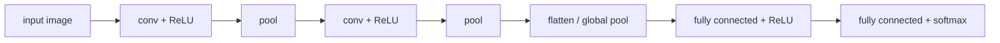
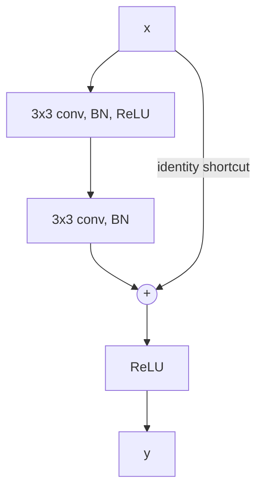

A **fully connected network** ignores the structure of its input: if we permute the pixels of all images in the same way, it learns equally well. Images, audio and many other signals are not like that. Their structure is local (nearby pixels are strongly related) and stationary (an edge or an eye looks the same wherever it appears), and a network that knows this needs far fewer parameters and far less data. Convolutional neural networks build these two assumptions into the architecture. A convolutional layer applies the same small filter at every position of its input, which detects a local pattern wherever it occurs; pooling layers summarize neighborhoods, which makes the representation tolerant to small shifts; and stacking such layers builds a hierarchy from edges to textures, parts and objects, much as the visual cortex does.

This chapter starts from that biological motivation, then defines the operations: the cross-correlation that **deep learning** calls **convolution** (the **convolution** of analysis is defined in [2.5.6](/2.5.6)), convolutional layers with many channels, padding and stride, pooling and the receptive field. We derive **backpropagation** through these layers, building on [4.7.2](/4.7.2), and follow the classic architectures from LeNet-5 to residual networks, whose residual connections are also the backbone of the Transformer ([4.7.6](/4.7.6)). The chapter closes with modern convolutional networks and their relation to vision Transformers. The training techniques that made deep CNNs work, such as batch normalization, dropout and data augmentation, are treated in [4.7.4](/4.7.4).

## 3.1. Visual Processing

### 3.1.1. Simple and Complex Cells

In a series of experiments beginning in 1959, Hubel and Wiesel recorded from single **neurons** in the primary visual cortex (V1) of cats and monkeys while showing them simple stimuli. Each neuron responds only to stimuli in a small region of the visual field, its receptive field, and most respond best to a bar or edge of a particular orientation. They distinguished two types:

- simple cells respond to an edge of a given orientation at a given position, and can be modeled as a linear filter followed by a threshold;
- complex cells respond to an edge of a given orientation anywhere within a larger region; they behave as if they pooled the outputs of several simple cells with the same orientation at neighboring positions.

Hubel and Wiesel (1962) proposed that this pattern repeats: higher visual areas (V2, V4, the inferotemporal cortex) combine the outputs of earlier areas into detectors of increasingly complex and increasingly position-invariant features, from edges to contours, shapes, object parts and whole objects. Their work was awarded the 1981 Nobel Prize in Physiology or Medicine (shared with Roger Sperry).

### 3.1.2. From the Neocognitron to Convolutional Networks

This picture suggests an artificial vision system: alternate layers of "simple cells" (local feature detectors replicated across positions) and "complex cells" (pooling over neighboring positions), stack several such stages so that higher stages compute more global and more invariant features, and put a classifier on top. Fukushima's Neocognitron (1980) was the first such model. Its S-layers performed what we now call **convolution** and its C-layers pooling, but it was trained by an unsupervised self-organizing rule: repeated presentation of patterns strengthened the input connections of the most strongly responding S-cell, which thereby became tuned to that pattern. The HMAX model of Riesenhuber and Poggio (1999) used the same architecture, with maximum pooling, as a model of object recognition in the cortex.

The decisive step was to train the whole hierarchy end to end by **backpropagation** ([4.7.2](/4.7.2)). LeCun et al. (1989) did this for handwritten zip codes, and the resulting convolutional networks, culminating in LeNet-5 (1998), read a large fraction of the checks written in the United States around 2000. The filters are no longer designed or self-organized but learned, together with the classifier, for the task at hand.

## 3.2. Convolution and Cross-Correlation

### 3.2.1. Matching a Template

Suppose we want to find where a short pattern $\boldsymbol{k} = (k_0, \dots, k_{K-1})$ occurs in a longer sequence $\boldsymbol{x}$. A natural approach slides the pattern along the sequence and computes at every offset $i$ the similarity $\sum_{u} x_{i+u}k_u$, an inner product between the pattern and the window of $\boldsymbol{x}$ starting at $i$. The response is large where the window resembles the pattern. In two dimensions the same procedure slides a small image $K$ over a larger image $X$. For instance, the $3 \times 3$ filter with columns $(-1, -1, -1)$, $(0, 0, 0)$, $(1, 1, 1)$ responds where intensity increases from left to right, that is, to vertical edges. The small image is called the filter or kernel, and the array of responses a *feature map*. This sliding inner product is the basic operation of convolutional networks.

### 3.2.2. Convolution and Cross-Correlation

The **convolution** of integrable functions, $(f * g)(t) = \int_{\mathbb{R}} f(\tau)g(t - \tau)\,\mathrm{d}\tau$ ([2.5.6](/2.5.6)), has a discrete counterpart for sequences, $(f * g)[n] = \sum_m f[m]\,g[n - m]$, and for two-dimensional arrays,

$$
(X * K)[i, j] = \sum_{u}\sum_{v} X[u, v]\,K[i - u, j - v] = \sum_{u}\sum_{v} X[i - u, j - v]\,K[u, v] .
$$

In the second form the kernel is indexed backward: **convolution** flips the kernel before sliding it. The template matching of §3.2.1 does not flip it.

**Definition 3.2.1 (Cross-Correlation)** The (discrete, two-dimensional) **cross-correlation** of an array $X$ with a kernel $K$ of size $k_h \times k_w$ is

$$
(X \star K)[i, j] = \sum_{u=0}^{k_h-1}\sum_{v=0}^{k_w-1} X[i + u, j + v]\,K[u, v] .
$$

Cross-correlation is convolution with the kernel rotated by $180^\circ$: $X \star K = X * \tilde K$ with $\tilde K[u, v] = K[-u, -v]$ (after re-indexing the kernel to start at $0$, $\tilde K[u, v] = K[k_h - 1 - u, k_w - 1 - v]$). The two operations have different algebraic properties. Convolution is commutative and associative and is diagonalized by the Fourier transform (the **convolution theorem**, [2.5.6](/2.5.6)), which makes it the natural operation of linear time-invariant systems in signal processing and of probability (the density of a sum of independent random variables is the convolution of their densities). Cross-correlation is not commutative but expresses similarity directly. **Deep learning** libraries implement cross-correlation and call it convolution. Since the kernel is learned, the distinction does not matter: a network trained with cross-correlation learns the flipped kernel of one trained with convolution. In the rest of the chapter, "convolution" in the context of a layer means cross-correlation.

### 3.2.3. Valid, Same and Full

At the borders the kernel does not fit entirely inside the input, and there are three conventions. For a one-dimensional input of length $n$ and a kernel of length $k \le n$:

| Mode | Positions computed | Output length |
|---|---|---|
| valid | only where the kernel lies entirely inside the input | $n - k + 1$ |
| same | output centered on the input, with zeros assumed outside | $n$ |
| full | every position where kernel and input overlap at all | $n + k - 1$ |

Full convolution equals valid convolution of the input padded with $k - 1$ zeros on each side; same convolution pads with about $(k-1)/2$ zeros. In NumPy and SciPy:

```python
import numpy as np
from scipy.signal import convolve2d

f = [0, 1, 2, -1, 3]
g = [1, 1, 0]
print(np.convolve(f, g, "full"))
print(np.convolve(f, g, "same"))
print(np.convolve(f, g, "valid"))
print(np.correlate(f, g, "valid"))     # no flip: the deep-learning "convolution"

A = np.array([[0, 0, 1, 2], [2, 2, 0, 0], [2, 1, 2, 2], [3, 0, 1, 1]])
B = np.array([[0, 0, -1], [1, -1, 1], [-1, 1, 1]])
print(convolve2d(A, B, "valid"))
print(convolve2d(A, B, "full").shape)
```

```text
[0 1 3 1 2 3 0]
[1 3 1 2 3]
[3 1 2]
[1 3 1]
[[-3  0]
 [ 4  3]]
(6, 6)
```

For example, the first valid output is $f[2]g[0] + f[1]g[1] + f[0]g[2] = 2 + 1 + 0 = 3$, with the kernel flipped, while the first cross-correlation output is $f[0]g[0] + f[1]g[1] + f[2]g[2] = 0 + 1 + 0 = 1$.

### 3.2.4. Hand-Designed Filters

Before deep learning, image processing used filters designed by hand. A few classic $3 \times 3$ examples (written as cross-correlation kernels):

| Filter | Kernel | Effect |
|---|---|---|
| identity | $\begin{bmatrix}0&0&0\\0&1&0\\0&0&0\end{bmatrix}$ | leaves the image unchanged |
| box blur | $\frac19\begin{bmatrix}1&1&1\\1&1&1\\1&1&1\end{bmatrix}$ | local average |
| Gaussian blur | $\frac{1}{16}\begin{bmatrix}1&2&1\\2&4&2\\1&2&1\end{bmatrix}$ | smooth average, approximately a sampled Gaussian |
| Sobel ($x$) | $\begin{bmatrix}-1&0&1\\-2&0&2\\-1&0&1\end{bmatrix}$ | horizontal derivative, responds to vertical edges |
| Laplacian | $\begin{bmatrix}0&1&0\\1&-4&1\\0&1&0\end{bmatrix}$ | second derivative, responds to edges in all directions |
| sharpen | $\begin{bmatrix}0&-1&0\\-1&5&-1\\0&-1&0\end{bmatrix}$ | identity minus the Laplacian, enhances detail |


A convolutional network learns its filters instead. The filters in the first layer of a trained image classifier indeed resemble oriented edge detectors and color-contrast detectors, close to the Gabor-like receptive fields of simple cells, while the later layers learn detectors for which no hand design exists.

## 3.3. Convolutional Layers

### 3.3.1. Channels and Feature Maps

An image is not a single array but several channels, three for an RGB image, and a layer should produce many feature maps, one per learned filter. A convolutional layer therefore maps a stack of $C_{\mathrm{in}}$ feature maps to a stack of $C_{\mathrm{out}}$ feature maps.

**Definition 3.3.1 (Convolutional Layer)** A **convolutional layer** with $C_{\mathrm{in}}$ input channels, $C_{\mathrm{out}}$ output channels and kernel size $k_h \times k_w$ has a kernel tensor $K \in \mathbb{R}^{C_{\mathrm{out}} \times C_{\mathrm{in}} \times k_h \times k_w}$ and a bias $\boldsymbol{b} \in \mathbb{R}^{C_{\mathrm{out}}}$, and maps an input $X \in \mathbb{R}^{C_{\mathrm{in}} \times H \times W}$ to

$$
Y[o, i, j] = b_o + \sum_{c=1}^{C_{\mathrm{in}}}\sum_{u=0}^{k_h-1}\sum_{v=0}^{k_w-1}K[o, c, u, v]\,X[c, si + u, sj + v],
$$
for $o = 1, \dots, C_{\mathrm{out}}$, where $s$ is the stride (§3.3.2), usually followed by a componentwise activation. Each output channel $o$ is the sum over input channels of the cross-correlations $X[c] \star K[o, c]$, plus a bias.

A filter thus spans all input channels, and the layer has $C_{\mathrm{out}}(C_{\mathrm{in}}k_hk_w + 1)$ parameters regardless of the image size. Computing it costs $H_{\mathrm{out}}W_{\mathrm{out}}C_{\mathrm{out}}C_{\mathrm{in}}k_hk_w$ multiply-adds. A batch of $N$ inputs is stored as a four-dimensional tensor of shape $(N, C, H, W)$, the layout used by PyTorch.

### 3.3.2. Padding, Stride and Dilation

**Definition 3.3.2 (Padding and Stride)** **Padding** surrounds the input with $p$ rows and columns of zeros (or of reflected or replicated values) on each side before the convolution, so that the borders are covered and the spatial size can be preserved. The **stride** $s$ is the step by which the kernel moves: the output keeps only every $s$-th position in each direction. A *dilated* convolution with dilation $d$ spaces the kernel taps $d$ positions apart, $\sum_{u, v} X[i + du, j + dv]K[u, v]$, so that a $k \times k$ kernel covers a $(d(k-1) + 1) \times (d(k-1) + 1)$ region.

**Proposition 3.3.1** Along one spatial dimension, an input of size $n$ convolved with a kernel of size $k$, dilation $d$, padding $p$ on both sides and stride $s$ gives an output of size

$$
n_{\mathrm{out}} = \left\lfloor\frac{n + 2p - d(k - 1) - 1}{s}\right\rfloor + 1,
$$
which for $d = 1$ is $\lfloor (n + 2p - k)/s\rfloor + 1$.

**Proof** The padded input has size $n + 2p$, and the dilated kernel has effective size $k' = d(k-1) + 1$. The kernel can start at positions $0, s, 2s, \dots, ts$ as long as $ts + k' \le n + 2p$, that is, $t \le (n + 2p - k')/s$. The number of positions is $\lfloor (n + 2p - k')/s\rfloor + 1$. $\square$

With $s = 1$ the three modes of §3.2.3 correspond to $p = 0$ (valid), $p = (k-1)/2$ for odd $k$ (same) and $p = k - 1$ (full). Examples: a $5 \times 5$ input with a $3 \times 3$ kernel and stride $2$ without padding gives $\lfloor (5 - 3)/2\rfloor + 1 = 2$, a $2 \times 2$ output; a $7 \times 7$ input with a $3 \times 3$ kernel of dilation $2$ gives $7 - 5 + 1 = 3$. Odd kernel sizes are preferred because they have a center and allow symmetric same padding. A stride larger than $1$ downsamples the feature map, as pooling does, and dilation enlarges the region seen without adding parameters or reducing resolution, which is useful for dense prediction such as segmentation.

### 3.3.3. Sparse Connectivity, Parameter Sharing and Equivariance

Compared with a fully connected layer from the same input to the same output, a convolutional layer makes two restrictions.

- Sparse connectivity: each output depends only on a $k_h \times k_w$ window of each input channel, not on the whole input.
- *Parameter sharing*: the same kernel is used at every position, so the weights of the connections are tied across the whole feature map.

A fully connected layer from a $5 \times 5$ input to a $3 \times 3$ output has $25 \cdot 9 + 9 = 234$ parameters; the convolutional layer with one $3 \times 3$ kernel computing an output of the same size has $9 + 1 = 10$. For a $224 \times 224 \times 3$ image mapped to 64 feature maps of the same size, a fully connected layer would need about $4.8 \times 10^{11}$ weights, a $3 \times 3$ **convolution** needs $1{,}792$. Conversely, a fully connected layer is a special case of convolution: on a $32 \times 32$ input, a convolution with a $32 \times 32$ kernel and no padding produces a $1 \times 1$ output per filter, and $C_{\mathrm{out}}$ such filters form exactly a fully connected layer with $C_{\mathrm{out}}$ outputs. A convolutional layer is thus a fully connected layer with an infinitely strong prior that most weights are zero and the rest are shared, a prior that is right for images and wrong for data without spatial structure.

Parameter sharing has a precise consequence. For an array $X$ on $\mathbb{Z}^2$ and a shift $\boldsymbol{t} = (t_1, t_2) \in \mathbb{Z}^2$, define the translation $(T_{\boldsymbol{t}}X)[i, j] = X[i - t_1, j - t_2]$.

**Proposition 3.3.2 (Translation Equivariance)** Cross-correlation (and convolution) with any kernel commutes with translations: $(T_{\boldsymbol{t}}X) \star K = T_{\boldsymbol{t}}(X \star K)$ for all $X$, $K$ and $\boldsymbol{t}$.

**Proof** $((T_{\boldsymbol{t}}X) \star K)[i, j] = \sum_{u,v}X[i + u - t_1, j + v - t_2]K[u, v] = (X \star K)[i - t_1, j - t_2] = (T_{\boldsymbol{t}}(X \star K))[i, j]$. $\square$

In the language of representation theory, convolution is an **equivariant map** for the action of the translation group $\mathbb{Z}^2$ ([1.3.6](/1.3.6)); conversely, a linear map on finitely supported arrays that commutes with all translations is a convolution, whose kernel is its response to a unit impulse. Shifting the input shifts the feature maps by the same amount, so a feature detector learned at one position works at all positions. Equivariance is not invariance: the output moves with the input. Invariance, the output not changing at all, is approximated by pooling (§3.4) and obtained exactly by global pooling at the end of the network. Two caveats: equivariance holds exactly only for stride $1$ and away from the borders, since striding and pooling break it for shifts that are not multiples of the stride, so real CNNs are less shift-invariant than often assumed (Azulay and Weiss 2019); and convolution is not equivariant to rotations or scalings, which group-equivariant networks (Cohen and Welling 2016) build in for other symmetry groups.

### 3.3.4. Variants of Convolution

- A *1×1 convolution* combines the channels at each position without mixing positions: it is a fully connected layer applied independently to every pixel. It changes the number of channels cheaply and is used to reduce the channels before expensive convolutions (GoogLeNet, ResNet bottlenecks).
- A *depthwise separable convolution* factors a $k \times k$ convolution into a depthwise convolution (one $k \times k$ filter per channel, no mixing) followed by a $1 \times 1$ convolution, reducing the cost by a factor of about $k^2$ (MobileNet, Xception, ConvNeXt).
- A grouped convolution splits the channels into $g$ groups and convolves each separately, with $1/g$ of the parameters (AlexNet, ResNeXt); depthwise convolution is the extreme case $g = C_{\mathrm{in}}$.
- A *transposed convolution* is the linear map whose matrix is the transpose of that of a strided convolution; it upsamples feature maps in decoders and generators (§3.5.3 explains why it is also the backward pass of a convolution).
- Deformable convolutions learn offsets for the kernel taps; three-dimensional convolutions process video and volumetric data; one-dimensional convolutions over word embeddings classify sentences (Kim 2014) and process audio.

### 3.3.5. Implementations

A convolutional layer can be written with explicit loops, which shows the definition directly, or vectorized by extracting all windows at once (the idea behind the `im2col` transformation used by many libraries, which turns convolution into one large matrix product).

```python
import numpy as np
from numpy.lib.stride_tricks import sliding_window_view


def conv2d(X, K, b, stride=1, padding=0):
    """Convolutional layer (cross-correlation, as in deep-learning libraries).
    X: (N, C_in, H, W), K: (C_out, C_in, k_h, k_w), b: (C_out,).
    Returns Y: (N, C_out, H_out, W_out)."""
    if padding:
        X = np.pad(X, ((0, 0), (0, 0), (padding, padding), (padding, padding)))
    kh, kw = K.shape[2:]
    # patches[n, c, i, j, u, v] = X[n, c, i + u, j + v]
    patches = sliding_window_view(X, (kh, kw), axis=(2, 3))[:, :, ::stride, ::stride]
    return np.einsum("ncijuv,ocuv->noij", patches, K) + b[None, :, None, None]


def conv2d_loops(X, K, b, stride=1, padding=0):
    """The same computation written with explicit loops."""
    X = np.pad(X, ((0, 0), (0, 0), (padding, padding), (padding, padding)))
    N, C, H, W = X.shape
    O, _, kh, kw = K.shape
    Ho, Wo = (H - kh) // stride + 1, (W - kw) // stride + 1
    Y = np.zeros((N, O, Ho, Wo))
    for n in range(N):
        for o in range(O):
            for i in range(Ho):
                for j in range(Wo):
                    window = X[n, :, i * stride:i * stride + kh, j * stride:j * stride + kw]
                    Y[n, o, i, j] = np.sum(window * K[o]) + b[o]
    return Y


rng = np.random.default_rng(0)
X = rng.standard_normal((2, 3, 7, 7))
K = rng.standard_normal((4, 3, 3, 3))
b = rng.standard_normal(4)
Y = conv2d(X, K, b, stride=2, padding=1)
print(Y.shape)                                       # (7 + 2 - 3) // 2 + 1 = 4
print(np.allclose(Y, conv2d_loops(X, K, b, stride=2, padding=1)))
```

```text
(2, 4, 4, 4)
True
```

In PyTorch (version 2.14, CPU) the same layer is `torch.nn.functional.conv2d`, or the module `nn.Conv2d`, which holds the kernel as a parameter; with the arrays above, `F.conv2d(torch.tensor(X), torch.tensor(K), torch.tensor(b), stride=2, padding=1)` agrees with `conv2d` to rounding error.

```python
import torch
from torch import nn

layer = nn.Conv2d(in_channels=3, out_channels=64, kernel_size=3, padding=1)
print(layer.weight.shape, sum(p.numel() for p in layer.parameters()))
```

```text
torch.Size([64, 3, 3, 3]) 1792
```

## 3.4. Pooling and Receptive Fields

### 3.4.1. Pooling

**Definition 3.4.1 (Pooling)** A **pooling** layer replaces each window of a feature map by a summary statistic, computed separately for each channel: *max pooling* takes the maximum and average pooling the mean of the window. With window size $k$ and stride $s$ (usually $k = s = 2$, non-overlapping windows) the spatial size is reduced as in Proposition 3.3.1. *Global average pooling* averages each channel over the whole feature map and returns one number per channel.

Pooling serves three purposes.

- It reduces the size of the representation. With 400 learned $8 \times 8$ filters on a $96 \times 96$ image, valid **convolution** produces $(96 - 8 + 1)^2 \cdot 400 = 3{,}168{,}400$ features per image; $2 \times 2$ pooling divides this by four, and every subsequent layer becomes cheaper.
- It makes the representation approximately invariant to small translations. If a feature moves by one pixel within a pooling window, the maximum over the window does not change. Pooling over the outputs of filters for different orientations or deformations (*maxout*) gives invariance to those transformations instead.
- It enlarges the receptive field of the units in later layers (§3.4.2), as the receptive fields of visual **neurons** grow along the visual hierarchy, which is the role of complex cells in the Hubel–Wiesel model.

Pooling has no parameters. Modern architectures often replace it by convolutions with stride $2$, which downsample with learned weights (Springenberg et al. 2015), and end with global average pooling instead of large fully connected layers, which removes most of the parameters of older designs and lets the network accept inputs of any size.

### 3.4.2. Receptive Fields

**Definition 3.4.2 (Receptive Field)** The **receptive field** of a unit in a convolutional network is the set of input positions that can influence its value.

**Proposition 3.4.1** Consider a chain of convolution or pooling layers $l = 1, \dots, L$ with kernel sizes $k_l$ (or effective sizes $d_l(k_l - 1) + 1$ with dilation) and strides $s_l$. Along one dimension, the receptive field of a unit of layer $L$ has size

$$
r_L = 1 + \sum_{l=1}^{L}(k_l - 1)\prod_{i=1}^{l-1}s_i .
$$

**Proof** Let $j_l = \prod_{i \le l}s_i$ be the distance in input pixels between adjacent units of layer $l$ (with $j_0 = 1$), and $r_0 = 1$. A unit of layer $l$ depends on $k_l$ adjacent units of layer $l-1$, whose receptive fields have size $r_{l-1}$ and are offset from each other by $j_{l-1}$; their union has size $r_l = r_{l-1} + (k_l - 1)j_{l-1}$. Unrolling the recursion gives the formula. $\square$

Without striding the receptive field grows linearly with depth: $L$ layers of $3 \times 3$ convolutions see a $(2L + 1) \times (2L + 1)$ patch. Strides make it grow geometrically, because every later layer is multiplied by the product of earlier strides. The figure illustrates both cases.


For example, two stacked $3 \times 3$ convolutions have the receptive field of one $5 \times 5$ convolution, $1 + 2 + 2 = 5$, with $2 \cdot 9C^2 = 18C^2$ instead of $25C^2$ weights for $C$ channels and with an extra nonlinearity in between; three have that of a $7 \times 7$ convolution with $27C^2$ instead of $49C^2$ weights. This observation is the design principle of VGG (§3.6.3). A classifier needs units whose receptive fields cover the whole object, which is one reason for depth. The theoretical receptive field overstates what a unit actually uses: the influence of input pixels, measured by the gradient, falls off roughly like a Gaussian from the center, so the *effective receptive field* is considerably smaller (Luo et al. 2016).

## 3.5. Convolutional Networks and Their Training

### 3.5.1. Typical Structure

**Definition 3.5.1 (Convolutional Neural Network)** A **convolutional neural network** (CNN) is a neural network in which at least some layers are convolutional layers. A typical image classifier consists of several stages of convolution, activation and pooling (or strided convolution), in which the spatial resolution decreases and the number of channels increases, followed by global pooling or flattening and one or more fully connected layers with a softmax output.

The modules can be combined freely with the other layers of [4.7.2](/4.7.2) (fully connected layers, **ReLU** or other activations, **cross-entropy** or squared-error losses) and with normalization and dropout layers ([4.7.4](/4.7.4)). The classic pattern is



and the whole network is trained end to end, by **backpropagation** of the **cross-entropy loss**, as an **MLP** is.

### 3.5.2. Backpropagation Through Convolution

The backward pass through a convolutional layer follows from Theorem 2.4.1 of [4.7.2](/4.7.2) once we account for the shared weights. Consider one channel, stride $1$ and valid cross-correlation, $Y = X \star K$, that is, $Y[i, j] = \sum_{u,v}X[i + u, j + v]K[u, v]$, and let $G = \partial E/\partial Y$ be the upstream gradient.

**Proposition 3.5.1** The gradients with respect to the kernel and the input are

$$
\frac{\partial E}{\partial K} = X \star G, \qquad \frac{\partial E}{\partial X} = G * K \ \text{(full convolution)},
$$
that is, $\frac{\partial E}{\partial K}[u, v] = \sum_{i,j}G[i, j]X[i + u, j + v]$ and $\frac{\partial E}{\partial X}[p, q] = \sum_{i,j}G[i, j]K[p - i, q - j]$, where $K$ is taken to be zero outside its support.

**Proof** $K[u, v]$ influences every output $Y[i, j]$, with $\partial Y[i, j]/\partial K[u, v] = X[i + u, j + v]$; by the **chain rule** the contributions of all positions add up, which gives the first formula, a valid cross-correlation of $X$ with $G$. The input $X[p, q]$ influences $Y[i, j]$ with coefficient $K[p - i, q - j]$ whenever $0 \le p - i < k_h$ and $0 \le q - j < k_w$; summing over $(i, j)$ gives $\sum_{i,j}G[i, j]K[p - i, q - j] = (G * K)[p, q]$, a **convolution** in the sense of §3.2.2 evaluated at every position where $G$ and $K$ overlap. $\square$

So the gradient with respect to a shared weight is the sum of the gradients over all positions where it is used, and the gradient with respect to the input is a full convolution, equivalently a cross-correlation of the zero-padded $G$ with the kernel rotated by $180^\circ$. With several channels the formulas hold for every pair of input channel $c$ and output channel $o$, and $\partial E/\partial X[c]$ sums over $o$; the bias gradient is $\partial E/\partial b_o = \sum_{i,j}G_o[i, j]$. With stride $s$, $G$ is first dilated by inserting $s - 1$ zeros between its entries; the map from $G$ to $\partial E/\partial X$ is then exactly the transposed convolution of §3.3.4. A numerical check:

```python
import numpy as np
from scipy.signal import convolve2d, correlate2d

rng = np.random.default_rng(0)
X = rng.standard_normal((6, 6))
K = rng.standard_normal((3, 3))
G = rng.standard_normal((4, 4))         # upstream gradient dE/dY for E = sum(G * Y)

def E(X, K):
    return np.sum(G * correlate2d(X, K, "valid"))

dK = correlate2d(X, G, "valid")          # dE/dK = X cross-correlated with G
dX = convolve2d(G, K, "full")            # dE/dX = full convolution of G with K

h, eK, eX = 1e-6, np.zeros((3, 3)), np.zeros((6, 6))
eK[1, 2], eX[2, 4] = h, h
print(np.isclose(dK[1, 2], (E(X, K + eK) - E(X, K - eK)) / (2 * h)),
      np.isclose(dX[2, 4], (E(X + eX, K) - E(X - eX, K)) / (2 * h)))
```

```text
True True
```

### 3.5.3. Backpropagation Through Pooling

Pooling layers have no parameters, so only the gradient with respect to the input is needed.

- Average pooling over a window of $k \times k$ entries computes $y = \frac{1}{k^2}\sum x$, so each input of the window receives $\frac{1}{k^2}$ of the upstream gradient $\partial E/\partial y$.
- Max pooling computes $y = \max x$, whose derivative is $1$ for the input that attains the maximum and $0$ for the others (ties are broken by an arbitrary choice). The upstream gradient is routed entirely to the position of the maximum, which the forward pass records.

With these rules and Proposition 3.5.1, the backward pass through a whole CNN is Algorithm 2.4.1 of [4.7.2](/4.7.2) with convolutions in place of matrix products; in practice **automatic differentiation** does this bookkeeping.

## 3.6. Classic Architectures

The history of CNN architectures between 1998 and 2016 is largely a history of the ImageNet Large Scale Visual Recognition Challenge (ILSVRC), a classification task with 1.28 million training images in 1,000 classes, scored by the top-5 error (the true class is not among the five most probable).

| Network | Year | Depth (weight layers) | Parameters | ImageNet top-5 error | Key ideas |
|---|---|---|---|---|---|
| LeNet-5 | 1998 | 5 (+ output) | 0.06 M | (MNIST digits) | convolution, pooling, end-to-end backpropagation |
| AlexNet | 2012 | 8 | 60 M | 15.3% | ReLU, dropout, data augmentation, GPUs |
| VGG-16 | 2014 | 16 | 138 M | 7.3% | stacks of $3 \times 3$ convolutions |
| GoogLeNet | 2014 | 22 | about 7 M | 6.7% | Inception modules, $1 \times 1$ bottlenecks |
| ResNet-152 | 2015 | 152 | 60 M | 3.6% (ensemble) | residual connections, batch normalization |

### 3.6.1. LeNet-5

LeNet-5 (LeCun et al. 1998) recognizes $32 \times 32$ grayscale digits. In the commonly used modern simplification, with tanh activations and average pooling, its layers are:

| Layer | Output shape (C, H, W) | Parameters | Activation |
|---|---|---|---|
| input | (1, 32, 32) | | |
| conv $5 \times 5$, $1 \to 6$ channels, valid | (6, 28, 28) | $6(25 + 1) = 156$ | tanh |
| average pool $2 \times 2$, stride 2 | (6, 14, 14) | | |
| conv $5 \times 5$, $6 \to 16$ channels, valid | (16, 10, 10) | $16(6 \cdot 25 + 1) = 2{,}416$ | tanh |
| average pool $2 \times 2$, stride 2 | (16, 5, 5) | | |
| flatten | (400) | | |
| fully connected $400 \to 120$ | (120) | $48{,}120$ | tanh |
| fully connected $120 \to 84$ | (84) | $10{,}164$ | tanh |
| fully connected $84 \to 10$ | (10) | $850$ | softmax |

These numbers were checked with PyTorch; the total is $61{,}706$ parameters. Two features are typical of CNNs: the size of the feature maps first grows (from 1,024 input values to 4,704) and then shrinks, and the fully connected layers hold about 95% of the parameters while the **convolutions** hold most of the computation. The original LeNet-5 differs in details: its pooling layers had a trainable coefficient and bias, the second convolution connected each output map to only a subset of the input maps (1,516 parameters), the layer with 120 units was a $5 \times 5$ convolution (equivalent here to a fully connected layer), and the output used Euclidean radial basis function units instead of a **softmax**.

### 3.6.2. AlexNet

AlexNet (Krizhevsky, Sutskever and Hinton 2012) won ILSVRC 2012 with a top-5 error of 15.3%, against 26.2% for the best entry not based on **deep learning**, and started the deep learning era in computer vision. Its five convolutional layers (the first with 96 kernels of size $11 \times 11$ and stride $4$) and three fully connected layers have about 60 million parameters, some 50 times the number of training images, and it combined several ingredients that became standard: **ReLU** activations, which made training several times faster than with tanh; dropout in the fully connected layers and data augmentation (random crops, flips, color perturbations) against **overfitting**; overlapping max pooling; and training on two GPUs, between which the channels were split (an early form of grouped convolution and model parallelism). It also used local response normalization, later abandoned. The lesson was less any single trick than that a large network, a large labeled dataset and GPU computation together outperform hand-designed features by a wide margin.

### 3.6.3. VGG

The VGG networks (Simonyan and Zisserman 2014) asked how far depth alone goes with the simplest possible design: only $3 \times 3$ convolutions with stride $1$ and padding $1$, grouped into five stages separated by $2 \times 2$ max pooling, with the number of channels doubling from 64 to 512, and three fully connected layers. As computed in §3.4.2, a stack of $3 \times 3$ convolutions has the receptive field of a larger kernel with fewer parameters and more nonlinearities. VGG-16 and VGG-19 (16 and 19 weight layers) placed second in the ILSVRC 2014 classification task. With 138 million parameters, most in the first fully connected layer, VGG is expensive, but its uniform design made it a standard feature extractor, for example for perceptual losses in image generation.

### 3.6.4. GoogLeNet and Inception

GoogLeNet (Szegedy et al. 2014), the winner of ILSVRC 2014 with a top-5 error of 6.7%, pursued efficiency instead. Its building block, the *Inception module*, applies $1 \times 1$, $3 \times 3$ and $5 \times 5$ convolutions and a $3 \times 3$ max pooling to the same input in parallel and concatenates the results along the channel dimension, so that the network can combine features at several scales; $1 \times 1$ convolutions before the larger ones reduce the number of channels and keep the cost down. The network is 22 weight layers deep but has about 12 times fewer parameters than AlexNet, mainly because it replaces the large fully connected layers by global average pooling. Two auxiliary classifiers attached to intermediate layers added their losses during training to strengthen the gradient signal reaching the lower layers, a remedy for vanishing gradients that batch normalization and residual connections later made unnecessary. Later versions (Inception v2–v4, Xception) added batch normalization and factorized convolutions.

### 3.6.5. ResNet and Residual Connections

Depth should not hurt: a deeper network can always copy a shallower one and set its extra layers to the identity. Yet He et al. (2015) observed that plain networks with 56 layers had higher *training* error than networks with 20 layers. This degradation is not overfitting but an optimization difficulty: it is hard for a stack of nonlinear layers to learn the identity, or functions close to it.

**Definition 3.6.1 (Residual Connection)** A **residual connection** (skip connection) adds the input of a block of layers $F$ to its output, so that the block computes

$$
\boldsymbol{y} = \boldsymbol{x} + F(\boldsymbol{x}; \boldsymbol{\theta}),
$$
and $F$ only has to learn the residual $\boldsymbol{y} - \boldsymbol{x}$. A network built from such residual blocks is a **residual network** (ResNet). When the shapes of $\boldsymbol{x}$ and $F(\boldsymbol{x})$ differ, $\boldsymbol{x}$ is replaced by a linear projection $W_s\boldsymbol{x}$, typically a $1 \times 1$ convolution with stride.



If the identity is close to optimal, the block only needs to drive $F$ toward zero, which **weight decay** and small initialization do anyway. The backward pass shows a second advantage. For a chain of residual blocks $\boldsymbol{x}_{l+1} = \boldsymbol{x}_l + F_l(\boldsymbol{x}_l)$,

$$
\frac{\partial E}{\partial\boldsymbol{x}_l} = \frac{\partial E}{\partial\boldsymbol{x}_{L}}\Bigl(I + \frac{\partial F_{L-1}}{\partial\boldsymbol{x}_{L-1}}\Bigr)\Bigl(I + \frac{\partial F_{L-2}}{\partial\boldsymbol{x}_{L-2}}\Bigr)\cdots\Bigl(I + \frac{\partial F_l}{\partial\boldsymbol{x}_l}\Bigr),
$$

with the gradients written as row vectors and $\partial F_i/\partial\boldsymbol{x}_i$ the **Jacobian matrices** of the blocks. Expanding the product shows that the gradient at the top reaches every lower block directly through the identity term, instead of only through a long product of layer Jacobians that may vanish. In the "pre-activation" variant of He et al. (2016), with the normalization and ReLU moved inside $F$ so that the shortcut is a pure identity, $\boldsymbol{x}_L = \boldsymbol{x}_l + \sum_{i=l}^{L-1}F_i(\boldsymbol{x}_i)$ exactly, and networks with 1,000 layers train. A residual network can also be read as an ensemble of many paths of different lengths, most of them short (Veit et al. 2016).

Deeper ResNets use a *bottleneck* block, $1 \times 1$ convolution to reduce the channels, $3 \times 3$ convolution, $1 \times 1$ convolution to restore them, together with batch normalization after each convolution ([4.7.4](/4.7.4)). ResNet-50 has 25.6 million parameters and about 4 billion multiply-adds per $224 \times 224$ image, and ResNet-152 is eight times deeper than VGG while needing less computation. An ensemble of ResNets won ILSVRC 2015 with a top-5 error of 3.57%, as well as the detection and segmentation tasks of ImageNet and COCO; human performance on this task had been estimated at about 5%. Residual connections are now universal: every Transformer layer consists of two residual blocks ([4.7.6](/4.7.6)), and the residual stream through which they communicate is the central object in the analysis of large language models.

## 3.7. Modern Convolutional Networks

### 3.7.1. Efficient Architectures

After ResNet, research turned to accuracy per unit of computation. DenseNet (2017) connects every layer to all later layers in a block by concatenation; MobileNet (2017) and its successors use depthwise separable **convolutions** and inverted bottlenecks (expanding the channels inside the block and projecting them back) for mobile devices; EfficientNet (2019) scales depth, width and input resolution jointly by fixed ratios found by search. Squeeze-and-excitation blocks (2018) reweight the channels using global pooled statistics, an early form of attention in CNNs.

### 3.7.2. Vision Transformers and ConvNeXt

The Vision Transformer (ViT; Dosovitskiy et al. 2020) splits an image into $16 \times 16$ patches, embeds each patch linearly as a **token** and processes the sequence with a standard Transformer ([4.7.6](/4.7.6)). It has almost no image-specific **inductive bias**, no locality and no weight sharing across positions beyond the patch embedding, and with ImageNet-scale data it is worse than a ResNet; pre-trained on hundreds of millions of images, it is better. Self-attention lets every patch interact with every other from the first layer, and the same architecture serves text, images and video, which made ViT the standard vision encoder of multimodal models. Hierarchical Transformers such as Swin (2021) reintroduced local windows and downsampling stages, borrowing from CNNs.

ConvNeXt (Liu et al. 2022) asked the converse question: how far does a pure CNN get when modernized with the design choices of Transformers? Starting from ResNet-50, it uses a "patchify" stem (a $4 \times 4$ convolution with stride $4$), a stage layout like Swin's, $7 \times 7$ depthwise convolutions (larger kernels, as attention windows are large), an inverted bottleneck with four times as many hidden channels, GELU instead of **ReLU**, fewer activation and normalization layers, layer normalization instead of batch normalization, and the training recipe of Transformers (AdamW, long schedules, heavy data augmentation). ConvNeXt-T, with 28 million parameters, reaches 82.1% top-1 accuracy on ImageNet-1k, slightly above the comparable Swin Transformer (81.3%), and ConvNeXt V2 (2023) added masked-autoencoder pre-training. The lesson is that much of the advantage attributed to attention came from the training recipe and macro design, and that at moderate scale convolutions remain competitive; at the largest scales, and wherever images must be combined with text, Transformers dominate.

In 2026 the division of labor is roughly the following. Vision Transformers and their hybrids are the encoders of multimodal foundation models; convolutional networks remain the choice where locality and efficiency matter, on mobile and embedded devices, in real-time detection and segmentation, in medical imaging with limited data, and as components of larger systems (the autoencoders of latent diffusion models are convolutional, and many image generators combine convolutional and attention layers). The convolutional ideas themselves, local connectivity, weight sharing and hierarchical downsampling, live on in the patch embeddings, local attention windows and multi-scale designs of vision Transformers.

### 3.7.3. What CNNs Learn

Visualizing what the units of a trained CNN respond to (Zeiler and Fergus 2014; Lee et al. 2009 for convolutional deep belief networks) confirms the hierarchy suggested by Hubel and Wiesel: first-layer filters are oriented edges and color blobs, the second layer responds to corners and simple textures, middle layers to repeated patterns and object parts (eyes, wheels, text), and the last layers to whole objects and faces. The features of a network trained on ImageNet are useful far beyond ImageNet, which made "pre-train on a large dataset, then fine-tune" the standard approach in vision, years before it became the standard in language ([4.7.7](/4.7.7)).

## Summary

- CNNs encode two assumptions about images, locality and stationarity, inspired by the simple and complex cells of the visual cortex and first realized in the Neocognitron; LeCun's networks trained the whole hierarchy by **backpropagation**.
- **Deep learning** libraries compute cross-correlation $X \star K$ and call it **convolution**; it equals convolution with the flipped kernel, and since the kernel is learned the difference is immaterial. Valid, same and full modes correspond to padding $0$, $(k-1)/2$ and $k - 1$; the output size is $\lfloor (n + 2p - d(k-1) - 1)/s\rfloor + 1$.
- A convolutional layer maps $C_{\mathrm{in}}$ to $C_{\mathrm{out}}$ feature maps with $C_{\mathrm{out}}(C_{\mathrm{in}}k^2 + 1)$ parameters. Sparse connectivity and parameter sharing make it far cheaper than a fully connected layer and translation-equivariant; pooling adds approximate invariance and enlarges the receptive field $r_L = 1 + \sum_l (k_l - 1)\prod_{i<l}s_i$.
- Backpropagation through a convolution gives $\partial E/\partial K = X \star G$ and $\partial E/\partial X = G * K$ (full); max pooling routes the gradient to the maximum, average pooling spreads it evenly.
- LeNet-5, AlexNet, VGG, GoogLeNet and ResNet trace the growth of depth from 5 to 152 layers. Residual connections $\boldsymbol{y} = \boldsymbol{x} + F(\boldsymbol{x})$ solve the degradation problem and give gradients a direct path, and they are the backbone of Transformers.
- Vision Transformers dominate at large scale and in multimodal models; ConvNeXt shows that modernized CNNs remain competitive, and CNNs remain the efficient choice for many applications.
