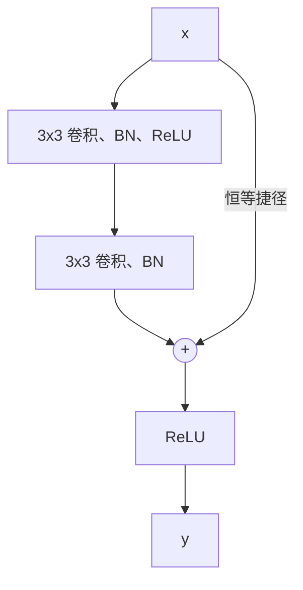

**全连接网络**忽略输入的结构：如果把所有图像的像素按同一方式置换，它学得同样好。图像、音频和许多其他信号并非如此。它们的结构是局部的（相邻像素强相关）和平稳的（边缘或眼睛无论出现在何处看起来都一样），懂得这一点的网络需要的参数和数据都少得多。卷积神经网络把这两个假设构建进架构。卷积层在输入的每个位置应用同一个小滤波器，无论局部模式出现在哪里都能检测到；池化层概括邻域，使表示能容忍小的平移；把这样的层堆叠起来，就建立起从边缘到纹理、部件和物体的层次结构，很像视觉皮层的做法。

本章从这一生物学动机出发，然后定义各种运算：被**深度学习**称为**卷积**的互相关（分析学中的**卷积**见 [2.5.6](/2.5.6)）、多通道的卷积层、填充与步幅、池化与感受野。我们在 [4.7.2](/4.7.2) 的基础上推导经过这些层的**反向传播**，并沿着从 LeNet-5 到残差网络的经典架构往下讲，残差网络的残差连接也是 Transformer 的骨干（[4.7.6](/4.7.6)）。本章最后讨论现代卷积网络及其与视觉 Transformer 的关系。使深层 CNN 奏效的训练技术，如批归一化、随机失活与数据增强，见 [4.7.4](/4.7.4)。

## 3.1. 视觉处理

### 3.1.1. 简单细胞与复杂细胞

从 1959 年开始的一系列实验中，Hubel 与 Wiesel 在向猫和猴子展示简单刺激的同时，记录了它们初级视皮层（V1）中单个**神经元**的活动。每个神经元只对视野中一小块区域内的刺激有响应，这块区域就是它的感受野，而且大多数神经元对某个特定朝向的条形或边缘响应最强。他们区分了两种类型：

- 简单细胞对给定位置上给定朝向的边缘响应，可以建模为线性滤波器后接阈值；
- 复杂细胞对较大区域内任何位置上给定朝向的边缘响应；它们的行为就像对相邻位置上朝向相同的若干简单细胞的输出作了池化。

Hubel 与 Wiesel（1962）提出，这一模式会重复出现：更高的视觉区（V2、V4、下颞叶皮层）把更早区域的输出组合成越来越复杂、越来越与位置无关的特征检测器，从边缘到轮廓、形状、物体部件和整个物体。他们的工作获得了 1981 年诺贝尔生理学或医学奖（与 Roger Sperry 共享）。

### 3.1.2. 从 Neocognitron 到卷积网络

这一图景启发了一种人工视觉系统：交替排列"简单细胞"层（在各位置复制的局部特征检测器）与"复杂细胞"层（对相邻位置做池化），堆叠若干这样的阶段，使较高的阶段计算更全局、更不变的特征，最后在顶部放一个分类器。Fukushima 的 Neocognitron（1980）是第一个这样的模型。它的 S 层完成我们现在称为**卷积**的运算，C 层完成池化，但它用无监督的自组织规则训练：反复呈现模式会增强响应最强的 S 细胞的输入连接，使它因而被调谐到该模式。Riesenhuber 与 Poggio 的 HMAX 模型（1999）采用同样的架构并使用最大池化，作为皮层中物体识别的模型。

决定性的一步是用**反向传播**（[4.7.2](/4.7.2)）端到端地训练整个层次结构。LeCun 等（1989）为手写邮政编码做到了这一点，由此产生的卷积网络，以 LeNet-5（1998）为顶点，在 2000 年前后读取了美国开出的相当大比例的支票。滤波器不再是设计或自组织得到的，而是针对手头的任务与分类器一起学习得到的。

## 3.2. 卷积与互相关

### 3.2.1. 模板匹配

设我们想找出一个短模式 $\boldsymbol{k} = (k_0, \dots, k_{K-1})$ 在较长序列 $\boldsymbol{x}$ 中出现的位置。自然的做法是让模式沿序列滑动，并在每个偏移 $i$ 处计算相似度 $\sum_{u} x_{i+u}k_u$，即模式与 $\boldsymbol{x}$ 中从 $i$ 开始的窗口之间的内积。窗口与模式相像时响应大。在二维情形，同样的过程让一幅小图像 $K$ 在较大的图像 $X$ 上滑动。例如，列为 $(-1, -1, -1)$、$(0, 0, 0)$、$(1, 1, 1)$ 的 $3 \times 3$ 滤波器在强度从左到右增加处响应，也就是对竖直边缘响应。这幅小图像称为滤波器或核，响应构成的数组称为特征图（feature map）。这种滑动内积是卷积网络的基本运算。

### 3.2.2. 卷积与互相关

可积函数的**卷积** $(f * g)(t) = \int_{\mathbb{R}} f(\tau)g(t - \tau)\,\mathrm{d}\tau$（[2.5.6](/2.5.6)）对序列有离散的对应物 $(f * g)[n] = \sum_m f[m]\,g[n - m]$，对二维数组则为

$$
(X * K)[i, j] = \sum_{u}\sum_{v} X[u, v]\,K[i - u, j - v] = \sum_{u}\sum_{v} X[i - u, j - v]\,K[u, v] .
$$

在第二种形式中，核的下标是反向的：**卷积**在滑动之前要把核翻转。§3.2.1 的模板匹配则不翻转。

**定义 3.2.1（互相关）** 数组 $X$ 与大小为 $k_h \times k_w$ 的核 $K$ 的（离散、二维）**互相关**是

$$
(X \star K)[i, j] = \sum_{u=0}^{k_h-1}\sum_{v=0}^{k_w-1} X[i + u, j + v]\,K[u, v] .
$$

互相关是把核旋转 $180^\circ$ 之后的卷积：$X \star K = X * \tilde K$，其中 $\tilde K[u, v] = K[-u, -v]$（把核的下标重新编排为从 $0$ 开始后，$\tilde K[u, v] = K[k_h - 1 - u, k_w - 1 - v]$）。这两种运算的代数性质不同。卷积满足交换律和结合律，并被 Fourier 变换对角化（**卷积定理**，[2.5.6](/2.5.6)），这使它成为信号处理中线性时不变系统和概率论中的自然运算（独立随机变量之和的密度是它们密度的卷积）。互相关不满足交换律，但直接表达相似性。**深度学习**库实现的是互相关，却称之为卷积。由于核是学出来的，这一区别并不要紧：用互相关训练的网络学到的是用卷积训练的网络所学核的翻转。在本章其余部分，层的语境中的"卷积"指互相关。

### 3.2.3. Valid、same 与 full

在边界处，核不能完全落在输入之内，有三种约定。对长度为 $n$ 的一维输入和长度 $k \le n$ 的核：

| 模式 | 计算的位置 | 输出长度 |
|---|---|---|
| valid | 仅限核完全落在输入之内的位置 | $n - k + 1$ |
| same | 输出以输入为中心，假定输入之外为零 | $n$ |
| full | 核与输入有任何重叠的每个位置 | $n + k - 1$ |

full 卷积等于对两侧各补 $k - 1$ 个零的输入做 valid 卷积；same 卷积补约 $(k-1)/2$ 个零。在 NumPy 与 SciPy 中：

```python
import numpy as np
from scipy.signal import convolve2d

f = [0, 1, 2, -1, 3]
g = [1, 1, 0]
print(np.convolve(f, g, "full"))
print(np.convolve(f, g, "same"))
print(np.convolve(f, g, "valid"))
print(np.correlate(f, g, "valid"))     # no flip: the deep-learning "convolution"

A = np.array([[0, 0, 1, 2], [2, 2, 0, 0], [2, 1, 2, 2], [3, 0, 1, 1]])
B = np.array([[0, 0, -1], [1, -1, 1], [-1, 1, 1]])
print(convolve2d(A, B, "valid"))
print(convolve2d(A, B, "full").shape)
```

```text
[0 1 3 1 2 3 0]
[1 3 1 2 3]
[3 1 2]
[1 3 1]
[[-3  0]
 [ 4  3]]
(6, 6)
```

例如，第一个 valid 输出是 $f[2]g[0] + f[1]g[1] + f[0]g[2] = 2 + 1 + 0 = 3$（核已翻转），而第一个互相关输出是 $f[0]g[0] + f[1]g[1] + f[2]g[2] = 0 + 1 + 0 = 1$。

### 3.2.4. 手工设计的滤波器

在深度学习之前，图像处理使用手工设计的滤波器。几个经典的 $3 \times 3$ 例子（写成互相关核）：

| 滤波器 | 核 | 效果 |
|---|---|---|
| 恒等 | $\begin{bmatrix}0&0&0\\0&1&0\\0&0&0\end{bmatrix}$ | 图像保持不变 |
| 方框模糊 | $\frac19\begin{bmatrix}1&1&1\\1&1&1\\1&1&1\end{bmatrix}$ | 局部平均 |
| Gauss 模糊 | $\frac{1}{16}\begin{bmatrix}1&2&1\\2&4&2\\1&2&1\end{bmatrix}$ | 平滑平均，近似于采样后的 Gauss 函数 |
| Sobel（$x$） | $\begin{bmatrix}-1&0&1\\-2&0&2\\-1&0&1\end{bmatrix}$ | 水平方向导数，对竖直边缘响应 |
| Laplace | $\begin{bmatrix}0&1&0\\1&-4&1\\0&1&0\end{bmatrix}$ | 二阶导数，对各方向的边缘响应 |
| 锐化 | $\begin{bmatrix}0&-1&0\\-1&5&-1\\0&-1&0\end{bmatrix}$ | 恒等减去 Laplace，增强细节 |


卷积网络则自己学习滤波器。训练好的图像分类器第一层的滤波器确实像有朝向的边缘检测器和颜色对比检测器，接近简单细胞的类 Gabor 感受野，而后面各层学到的是没有手工设计可循的检测器。

## 3.3. 卷积层

### 3.3.1. 通道与特征图

图像不是单个数组，而是若干通道（RGB 图像有三个），一个层应当产生许多特征图，每个习得的滤波器一个。因此卷积层把 $C_{\mathrm{in}}$ 张特征图的堆叠映为 $C_{\mathrm{out}}$ 张特征图的堆叠。

**定义 3.3.1（卷积层）** 有 $C_{\mathrm{in}}$ 个输入通道、$C_{\mathrm{out}}$ 个输出通道、核大小为 $k_h \times k_w$ 的**卷积层**，具有核张量 $K \in \mathbb{R}^{C_{\mathrm{out}} \times C_{\mathrm{in}} \times k_h \times k_w}$ 和偏置 $\boldsymbol{b} \in \mathbb{R}^{C_{\mathrm{out}}}$，把输入 $X \in \mathbb{R}^{C_{\mathrm{in}} \times H \times W}$ 映为

$$
Y[o, i, j] = b_o + \sum_{c=1}^{C_{\mathrm{in}}}\sum_{u=0}^{k_h-1}\sum_{v=0}^{k_w-1}K[o, c, u, v]\,X[c, si + u, sj + v],
$$
$o = 1, \dots, C_{\mathrm{out}}$，其中 $s$ 是步幅（§3.3.2），后面通常接逐分量的激活。每个输出通道 $o$ 是各输入通道上的互相关 $X[c] \star K[o, c]$ 之和再加偏置。

因此一个滤波器跨越所有输入通道，而不论图像大小，该层都有 $C_{\mathrm{out}}(C_{\mathrm{in}}k_hk_w + 1)$ 个参数。计算它需要 $H_{\mathrm{out}}W_{\mathrm{out}}C_{\mathrm{out}}C_{\mathrm{in}}k_hk_w$ 次乘加。含 $N$ 个输入的一个批量存成形状为 $(N, C, H, W)$ 的四维张量，这是 PyTorch 使用的布局。

### 3.3.2. 填充、步幅与空洞

**定义 3.3.2（填充与步幅）** **填充**在卷积之前，在输入的每一侧各围上 $p$ 行、$p$ 列零（或反射、复制的值），使边界被覆盖，并使空间尺寸得以保持。**步幅** $s$ 是核移动的步长：输出在每个方向上只保留每隔 $s$ 个的位置。膨胀系数为 $d$ 的*空洞*卷积把核的各个取样点相隔 $d$ 个位置，$\sum_{u, v} X[i + du, j + dv]K[u, v]$，使 $k \times k$ 的核覆盖 $(d(k-1) + 1) \times (d(k-1) + 1)$ 的区域。

**命题 3.3.1** 沿一个空间维度，大小为 $n$ 的输入与大小为 $k$、膨胀系数为 $d$ 的核做卷积，两侧填充均为 $p$、步幅为 $s$，输出的大小为

$$
n_{\mathrm{out}} = \left\lfloor\frac{n + 2p - d(k - 1) - 1}{s}\right\rfloor + 1,
$$
当 $d = 1$ 时为 $\lfloor (n + 2p - k)/s\rfloor + 1$。

**证明** 填充后的输入大小为 $n + 2p$，空洞核的有效大小为 $k' = d(k-1) + 1$。只要 $ts + k' \le n + 2p$，即 $t \le (n + 2p - k')/s$，核就可以从位置 $0, s, 2s, \dots, ts$ 开始。位置的个数是 $\lfloor (n + 2p - k')/s\rfloor + 1$。$\square$

当 $s = 1$ 时，§3.2.3 的三种模式分别对应 $p = 0$（valid）、奇数 $k$ 的 $p = (k-1)/2$（same）和 $p = k - 1$（full）。例子：$5 \times 5$ 的输入、$3 \times 3$ 的核、步幅 $2$、不填充，给出 $\lfloor (5 - 3)/2\rfloor + 1 = 2$，即 $2 \times 2$ 的输出；$7 \times 7$ 的输入与膨胀系数为 $2$ 的 $3 \times 3$ 核给出 $7 - 5 + 1 = 3$。人们偏爱奇数的核大小，因为它们有中心，并允许对称的 same 填充。大于 $1$ 的步幅像池化一样对特征图下采样，而空洞在不增加参数、不降低分辨率的情况下扩大所见区域，这对分割等稠密预测很有用。

### 3.3.3. 稀疏连接、参数共享与等变性

与同样输入到同样输出的全连接层相比，卷积层有两个限制。

- 稀疏连接：每个输出只依赖于每个输入通道上 $k_h \times k_w$ 的窗口，而不是整个输入。
- 参数共享（parameter sharing）：在每个位置使用同一个核，所以连接的权重在整张特征图上是捆绑的。

从 $5 \times 5$ 输入到 $3 \times 3$ 输出的全连接层有 $25 \cdot 9 + 9 = 234$ 个参数；用一个 $3 \times 3$ 核计算同样大小输出的卷积层有 $9 + 1 = 10$ 个。把 $224 \times 224 \times 3$ 的图像映为 64 张同样大小的特征图，全连接层需要约 $4.8 \times 10^{11}$ 个权重，$3 \times 3$ **卷积**只需要 $1{,}792$ 个。反过来，全连接层是卷积的特例：在 $32 \times 32$ 的输入上，用 $32 \times 32$ 的核、不填充的卷积，每个滤波器产生一个 $1 \times 1$ 的输出，而 $C_{\mathrm{out}}$ 个这样的滤波器恰好构成有 $C_{\mathrm{out}}$ 个输出的全连接层。因此卷积层是一个带有无限强先验的全连接层，该先验认为大多数权重为零、其余权重是共享的，这一先验对图像是对的，对没有空间结构的数据则是错的。

参数共享有一个精确的推论。对 $\mathbb{Z}^2$ 上的数组 $X$ 和平移量 $\boldsymbol{t} = (t_1, t_2) \in \mathbb{Z}^2$，定义平移 $(T_{\boldsymbol{t}}X)[i, j] = X[i - t_1, j - t_2]$。

**命题 3.3.2（平移等变性）** 与任意核的互相关（及卷积）与平移可交换：对所有 $X$、$K$ 和 $\boldsymbol{t}$ 有 $(T_{\boldsymbol{t}}X) \star K = T_{\boldsymbol{t}}(X \star K)$。

**证明** $((T_{\boldsymbol{t}}X) \star K)[i, j] = \sum_{u,v}X[i + u - t_1, j + v - t_2]K[u, v] = (X \star K)[i - t_1, j - t_2] = (T_{\boldsymbol{t}}(X \star K))[i, j]$。$\square$

用表示论的语言说，卷积是平移群 $\mathbb{Z}^2$ 作用下的**等变映射**（[1.3.6](/1.3.6)）；反过来，有限支撑数组上与所有平移可交换的线性映射都是卷积，其核是它对单位脉冲的响应。平移输入会使特征图平移同样的量，所以在一个位置学到的特征检测器在所有位置都有效。等变性不是不变性：输出随输入移动。不变性，即输出完全不变，由池化（§3.4）近似实现，并由网络末端的全局池化精确实现。有两点要注意：等变性只对步幅 $1$ 且远离边界时才严格成立，因为步幅和池化会对不是步幅整数倍的平移破坏它，所以真实的 CNN 的平移不变性比通常以为的要差（Azulay 与 Weiss 2019）；卷积对旋转或缩放不是等变的，群等变网络（Cohen 与 Welling 2016）把其他对称群的等变性构建了进去。

### 3.3.4. 卷积的变体

- 1×1 卷积（1×1 convolution）在每个位置上组合各通道，而不混合不同位置：它是独立作用于每个像素的全连接层。它能以很低的代价改变通道数，用于在昂贵的卷积之前减少通道（GoogLeNet、ResNet 的瓶颈）。
- 深度可分离卷积（depthwise separable convolution）把 $k \times k$ 卷积分解为逐通道卷积（每个通道一个 $k \times k$ 滤波器，不混合通道）与随后的 $1 \times 1$ 卷积，把代价降低约 $k^2$ 倍（MobileNet、Xception、ConvNeXt）。
- 分组卷积把通道分成 $g$ 组，每组单独卷积，参数只有 $1/g$（AlexNet、ResNeXt）；逐通道卷积是极端情形 $g = C_{\mathrm{in}}$。
- 转置卷积（transposed convolution）是这样的线性映射，其矩阵是带步幅卷积的矩阵的转置；它在解码器和生成器中对特征图上采样（§3.5.3 解释了为什么它也是卷积的反向传播）。
- 可变形卷积学习核取样点的偏移；三维卷积处理视频和体数据；作用于词嵌入的一维卷积用于句子分类（Kim 2014）和音频处理。

### 3.3.5. 实现

卷积层可以用显式循环写出，这直接展示定义；也可以通过一次提取所有窗口来向量化（许多库使用的 `im2col` 变换就基于这一想法，它把卷积变成一个大的矩阵乘法）。

```python
import numpy as np
from numpy.lib.stride_tricks import sliding_window_view


def conv2d(X, K, b, stride=1, padding=0):
    """Convolutional layer (cross-correlation, as in deep-learning libraries).
    X: (N, C_in, H, W), K: (C_out, C_in, k_h, k_w), b: (C_out,).
    Returns Y: (N, C_out, H_out, W_out)."""
    if padding:
        X = np.pad(X, ((0, 0), (0, 0), (padding, padding), (padding, padding)))
    kh, kw = K.shape[2:]
    # patches[n, c, i, j, u, v] = X[n, c, i + u, j + v]
    patches = sliding_window_view(X, (kh, kw), axis=(2, 3))[:, :, ::stride, ::stride]
    return np.einsum("ncijuv,ocuv->noij", patches, K) + b[None, :, None, None]


def conv2d_loops(X, K, b, stride=1, padding=0):
    """The same computation written with explicit loops."""
    X = np.pad(X, ((0, 0), (0, 0), (padding, padding), (padding, padding)))
    N, C, H, W = X.shape
    O, _, kh, kw = K.shape
    Ho, Wo = (H - kh) // stride + 1, (W - kw) // stride + 1
    Y = np.zeros((N, O, Ho, Wo))
    for n in range(N):
        for o in range(O):
            for i in range(Ho):
                for j in range(Wo):
                    window = X[n, :, i * stride:i * stride + kh, j * stride:j * stride + kw]
                    Y[n, o, i, j] = np.sum(window * K[o]) + b[o]
    return Y


rng = np.random.default_rng(0)
X = rng.standard_normal((2, 3, 7, 7))
K = rng.standard_normal((4, 3, 3, 3))
b = rng.standard_normal(4)
Y = conv2d(X, K, b, stride=2, padding=1)
print(Y.shape)                                       # (7 + 2 - 3) // 2 + 1 = 4
print(np.allclose(Y, conv2d_loops(X, K, b, stride=2, padding=1)))
```

```text
(2, 4, 4, 4)
True
```

在 PyTorch（2.14 版，CPU）中，同样的层是 `torch.nn.functional.conv2d`，或把核作为参数保存的模块 `nn.Conv2d`；对上面的数组，`F.conv2d(torch.tensor(X), torch.tensor(K), torch.tensor(b), stride=2, padding=1)` 与 `conv2d` 在舍入误差范围内一致。

```python
import torch
from torch import nn

layer = nn.Conv2d(in_channels=3, out_channels=64, kernel_size=3, padding=1)
print(layer.weight.shape, sum(p.numel() for p in layer.parameters()))
```

```text
torch.Size([64, 3, 3, 3]) 1792
```

## 3.4. 池化与感受野

### 3.4.1. 池化

**定义 3.4.1（池化）** **池化**层把特征图的每个窗口替换为一个汇总统计量，对每个通道分别计算：最大池化（max pooling）取窗口中的最大值，平均池化取窗口的均值。窗口大小为 $k$、步幅为 $s$ 时（通常 $k = s = 2$，窗口不重叠），空间尺寸按命题 3.3.1 缩小。全局平均池化（global average pooling）把每个通道在整张特征图上取平均，每个通道返回一个数。

池化有三个作用。

- 它缩小表示的规模。在 $96 \times 96$ 的图像上用 400 个习得的 $8 \times 8$ 滤波器做 valid **卷积**，每幅图像产生 $(96 - 8 + 1)^2 \cdot 400 = 3{,}168{,}400$ 个特征；$2 \times 2$ 池化把这个数除以四，后续每一层都变得更便宜。
- 它使表示近似地对小的平移不变。如果某个特征在池化窗口内移动一个像素，窗口上的最大值不变。对不同朝向或形变的滤波器的输出做池化（maxout）则给出对这些变换的不变性。
- 它扩大后面各层单元的感受野（§3.4.2），就像视觉**神经元**的感受野沿视觉层次增大一样，这正是 Hubel–Wiesel 模型中复杂细胞的作用。

池化没有参数。现代架构常用步幅为 $2$ 的卷积代替它，以习得的权重下采样（Springenberg 等 2015），并用全局平均池化而不是大的全连接层收尾，这去掉了旧设计中的大部分参数，并使网络能接受任意大小的输入。

### 3.4.2. 感受野

**定义 3.4.2（感受野）** 卷积网络中某个单元的**感受野**是能影响其值的输入位置的集合。

**命题 3.4.1** 考虑由卷积或池化层 $l = 1, \dots, L$ 组成的链，核大小为 $k_l$（有空洞时为有效大小 $d_l(k_l - 1) + 1$），步幅为 $s_l$。沿一个维度，第 $L$ 层某个单元的感受野的大小为

$$
r_L = 1 + \sum_{l=1}^{L}(k_l - 1)\prod_{i=1}^{l-1}s_i .
$$

**证明** 设 $j_l = \prod_{i \le l}s_i$ 是第 $l$ 层相邻单元之间以输入像素计的距离（$j_0 = 1$），并设 $r_0 = 1$。第 $l$ 层的一个单元依赖第 $l-1$ 层的 $k_l$ 个相邻单元，它们的感受野大小为 $r_{l-1}$，彼此相距 $j_{l-1}$；它们的并集大小为 $r_l = r_{l-1} + (k_l - 1)j_{l-1}$。展开这个递推式即得公式。$\square$

没有步幅时，感受野随深度线性增长：$L$ 层 $3 \times 3$ 卷积看到的是 $(2L + 1) \times (2L + 1)$ 的块。步幅使它几何地增长，因为后面每一层都要乘以前面各步幅的乘积。图展示了这两种情形。


例如，两层堆叠的 $3 \times 3$ 卷积具有一个 $5 \times 5$ 卷积的感受野，$1 + 2 + 2 = 5$，对 $C$ 个通道，权重数是 $2 \cdot 9C^2 = 18C^2$ 而不是 $25C^2$，而且中间多了一次非线性；三层的感受野与 $7 \times 7$ 卷积相同，权重数是 $27C^2$ 而不是 $49C^2$。这一观察是 VGG（§3.6.3）的设计原则。分类器需要感受野覆盖整个物体的单元，这是需要深度的原因之一。理论的感受野高估了单元实际用到的范围：以梯度度量的输入像素的影响从中心向外大致按 Gauss 函数衰减，所以有效感受野（effective receptive field）要小得多（Luo 等 2016）。

## 3.5. 卷积网络及其训练

### 3.5.1. 典型结构

**定义 3.5.1（卷积神经网络）** **卷积神经网络**（CNN）是至少有一些层是卷积层的神经网络。典型的图像分类器由若干个卷积、激活与池化（或带步幅的卷积）的阶段组成，其中空间分辨率下降、通道数增加，随后是全局池化或展平，以及一个或多个以 softmax 为输出的全连接层。

这些模块可以与 [4.7.2](/4.7.2) 的其他层（全连接层、**线性整流单元** 或其他激活、**交叉熵**或平方误差损失）以及归一化层和随机失活层（[4.7.4](/4.7.4)）自由组合。经典的模式是


整个网络与 **多层感知机** 一样，通过**交叉熵损失**的**反向传播**端到端地训练。

### 3.5.2. 经卷积的反向传播

计入共享的权重之后，经过卷积层的反向传播可由 [4.7.2](/4.7.2) 的定理 2.4.1 得到。考虑单个通道、步幅 $1$ 的 valid 互相关 $Y = X \star K$，即 $Y[i, j] = \sum_{u,v}X[i + u, j + v]K[u, v]$，并设 $G = \partial E/\partial Y$ 是上游梯度。

**命题 3.5.1** 关于核与关于输入的梯度是

$$
\frac{\partial E}{\partial K} = X \star G, \qquad \frac{\partial E}{\partial X} = G * K \ \text{（full 卷积）},
$$
即 $\frac{\partial E}{\partial K}[u, v] = \sum_{i,j}G[i, j]X[i + u, j + v]$ 以及 $\frac{\partial E}{\partial X}[p, q] = \sum_{i,j}G[i, j]K[p - i, q - j]$，其中 $K$ 在其支撑之外取为零。

**证明** $K[u, v]$ 影响每个输出 $Y[i, j]$，$\partial Y[i, j]/\partial K[u, v] = X[i + u, j + v]$；由**链式法则**，所有位置的贡献相加，得第一个公式，即 $X$ 与 $G$ 的 valid 互相关。输入 $X[p, q]$ 在 $0 \le p - i < k_h$ 且 $0 \le q - j < k_w$ 时以系数 $K[p - i, q - j]$ 影响 $Y[i, j]$；对 $(i, j)$ 求和得 $\sum_{i,j}G[i, j]K[p - i, q - j] = (G * K)[p, q]$，这是 §3.2.2 意义下的**卷积**，在 $G$ 与 $K$ 有重叠的每个位置上取值。$\square$

所以关于共享权重的梯度，是它被使用的所有位置上的梯度之和；关于输入的梯度是 full 卷积，等价于补零后的 $G$ 与旋转 $180^\circ$ 的核的互相关。多通道时，公式对每一对输入通道 $c$ 与输出通道 $o$ 成立，而 $\partial E/\partial X[c]$ 对 $o$ 求和；偏置的梯度是 $\partial E/\partial b_o = \sum_{i,j}G_o[i, j]$。步幅为 $s$ 时，先在 $G$ 的元素之间插入 $s - 1$ 个零把它膨胀；这时从 $G$ 到 $\partial E/\partial X$ 的映射恰好就是 §3.3.4 的转置卷积。一个数值检验：

```python
import numpy as np
from scipy.signal import convolve2d, correlate2d

rng = np.random.default_rng(0)
X = rng.standard_normal((6, 6))
K = rng.standard_normal((3, 3))
G = rng.standard_normal((4, 4))         # upstream gradient dE/dY for E = sum(G * Y)

def E(X, K):
    return np.sum(G * correlate2d(X, K, "valid"))

dK = correlate2d(X, G, "valid")          # dE/dK = X cross-correlated with G
dX = convolve2d(G, K, "full")            # dE/dX = full convolution of G with K

h, eK, eX = 1e-6, np.zeros((3, 3)), np.zeros((6, 6))
eK[1, 2], eX[2, 4] = h, h
print(np.isclose(dK[1, 2], (E(X, K + eK) - E(X, K - eK)) / (2 * h)),
      np.isclose(dX[2, 4], (E(X + eX, K) - E(X - eX, K)) / (2 * h)))
```

```text
True True
```

### 3.5.3. 经池化的反向传播

池化层没有参数，所以只需要关于输入的梯度。

- 在 $k \times k$ 个元素的窗口上做平均池化，计算 $y = \frac{1}{k^2}\sum x$，所以窗口的每个输入得到上游梯度 $\partial E/\partial y$ 的 $\frac{1}{k^2}$。
- 最大池化计算 $y = \max x$，其导数对取到最大值的输入为 $1$，对其他输入为 $0$（并列时任意选一个）。上游梯度全部送到最大值所在的位置，该位置由前向传播记录。

有了这些规则和命题 3.5.1，经过整个 CNN 的反向传播就是 [4.7.2](/4.7.2) 的算法 2.4.1，只是把矩阵乘积换成卷积；实践中由**自动微分**完成这些记账工作。

## 3.6. 经典架构

1998 年至 2016 年间 CNN 架构的历史，在很大程度上就是 ImageNet 大规模视觉识别挑战赛（ILSVRC）的历史，这是一个分类任务，有 128 万张训练图像、1,000 个类别，以 top-5 错误率评分（真实类别不在概率最高的五个之内）。

| 网络 | 年份 | 深度（权重层数） | 参数量 | ImageNet top-5 错误率 | 关键思想 |
|---|---|---|---|---|---|
| LeNet-5 | 1998 | 5（+ 输出） | 0.06 M | （MNIST 数字） | 卷积、池化、端到端反向传播 |
| AlexNet | 2012 | 8 | 60 M | 15.3% | ReLU、随机失活、数据增强、GPU |
| VGG-16 | 2014 | 16 | 138 M | 7.3% | $3 \times 3$ 卷积的堆叠 |
| GoogLeNet | 2014 | 22 | 约 7 M | 6.7% | Inception 模块、$1 \times 1$ 瓶颈 |
| ResNet-152 | 2015 | 152 | 60 M | 3.6%（集成） | 残差连接、批归一化 |

### 3.6.1. LeNet-5

LeNet-5（LeCun 等 1998）识别 $32 \times 32$ 的灰度数字。以现在常用的简化形式，即用 tanh 激活和平均池化，它的各层是：

| 层 | 输出形状 (C, H, W) | 参数量 | 激活 |
|---|---|---|---|
| 输入 | (1, 32, 32) | | |
| 卷积 $5 \times 5$，$1 \to 6$ 通道，valid | (6, 28, 28) | $6(25 + 1) = 156$ | tanh |
| 平均池化 $2 \times 2$，步幅 2 | (6, 14, 14) | | |
| 卷积 $5 \times 5$，$6 \to 16$ 通道，valid | (16, 10, 10) | $16(6 \cdot 25 + 1) = 2{,}416$ | tanh |
| 平均池化 $2 \times 2$，步幅 2 | (16, 5, 5) | | |
| 展平 | (400) | | |
| 全连接 $400 \to 120$ | (120) | $48{,}120$ | tanh |
| 全连接 $120 \to 84$ | (84) | $10{,}164$ | tanh |
| 全连接 $84 \to 10$ | (10) | $850$ | softmax |

这些数字已用 PyTorch 核对；总参数量为 $61{,}706$。有两个特点是 CNN 的典型特征：特征图的大小先增大（从 1,024 个输入值到 4,704 个）再缩小；全连接层占约 95% 的参数，而**卷积**占大部分计算量。原始的 LeNet-5 在细节上有所不同：它的池化层带有可训练的系数和偏置，第二个卷积把每张输出图只连到输入图的一个子集（1,516 个参数），含 120 个单元的层是 $5 \times 5$ 卷积（这里等价于全连接层），输出使用 Euclid 径向基函数单元而不是 **softmax 函数**。

### 3.6.2. AlexNet

AlexNet（Krizhevsky、Sutskever 与 Hinton 2012）以 15.3% 的 top-5 错误率赢得 ILSVRC 2012，而不基于**深度学习**的最佳参赛作品是 26.2%，它开启了计算机视觉中的深度学习时代。它的五个卷积层（第一层有 96 个大小为 $11 \times 11$、步幅为 $4$ 的核）和三个全连接层共有约 6000 万个参数，约为训练图像数的 50 倍，并综合了几项后来成为标准的成分：**线性整流单元** 激活，使训练比用 tanh 快数倍；全连接层中的随机失活和数据增强（随机裁剪、翻转、颜色扰动）以对付**过拟合**；重叠的最大池化；以及在两块 GPU 上训练，通道在二者之间划分（分组卷积和模型并行的早期形式）。它还使用了局部响应归一化，后来被放弃。它给出的教训，与其说是某个单独的技巧，不如说是：大网络、大规模有标注数据集和 GPU 计算合在一起，远远胜过手工设计的特征。

### 3.6.3. VGG

VGG 网络（Simonyan 与 Zisserman 2014）问的是，在尽可能简单的设计下，单靠深度能走多远：只用步幅为 $1$、填充为 $1$ 的 $3 \times 3$ 卷积，分成由 $2 \times 2$ 最大池化隔开的五个阶段，通道数从 64 翻倍增长到 512，最后是三个全连接层。如 §3.4.2 所算，$3 \times 3$ 卷积的堆叠以更少的参数和更多的非线性具有更大核的感受野。VGG-16 与 VGG-19（16 层与 19 层权重层）在 ILSVRC 2014 的分类任务中名列第二。它有 1.38 亿个参数，大部分在第一个全连接层中，VGG 代价高昂，但其统一的设计使它成为标准的特征提取器，例如用于图像生成中的感知损失。

### 3.6.4. GoogLeNet 与 Inception

GoogLeNet（Szegedy 等 2014）以 6.7% 的 top-5 错误率赢得 ILSVRC 2014，它追求的是效率。它的构件，即 Inception 模块（Inception module），对同一输入并行应用 $1 \times 1$、$3 \times 3$、$5 \times 5$ 卷积和 $3 \times 3$ 最大池化，并把结果沿通道维拼接，使网络能组合多个尺度的特征；在较大的卷积之前用 $1 \times 1$ 卷积减少通道数，使代价保持在较低水平。网络深 22 个权重层，但参数量比 AlexNet 少约 12 倍，主要因为它用全局平均池化代替了大的全连接层。训练时，连在中间层上的两个辅助分类器加上各自的损失，以加强到达较低层的梯度信号，这是对**梯度消失**的补救，后来批归一化和残差连接使它不再必要。后来的版本（Inception v2–v4、Xception）加入了批归一化和分解卷积。

### 3.6.5. ResNet 与残差连接

深度不应有害：更深的网络总可以复制较浅的网络，并把多出的层设为恒等。然而 He 等（2015）观察到，56 层的普通网络的*训练*误差比 20 层的网络更高。这种退化不是过拟合，而是优化的困难：一叠非线性层很难学到恒等函数或接近恒等的函数。

**定义 3.6.1（残差连接）** **残差连接**（跳跃连接）把一块层 $F$ 的输入加到它的输出上，使该块计算

$$
\boldsymbol{y} = \boldsymbol{x} + F(\boldsymbol{x}; \boldsymbol{\theta}),
$$
而 $F$ 只需学习残差 $\boldsymbol{y} - \boldsymbol{x}$。由这类残差块构成的网络是**残差网络**（ResNet）。当 $\boldsymbol{x}$ 与 $F(\boldsymbol{x})$ 的形状不同时，$\boldsymbol{x}$ 换成线性投影 $W_s\boldsymbol{x}$，通常是带步幅的 $1 \times 1$ 卷积。



如果恒等映射接近最优，该块只需把 $F$ 推向零，而**权重衰减**和小的初始化本来就在这样做。反向传播显示出第二个优点。对残差块的链 $\boldsymbol{x}_{l+1} = \boldsymbol{x}_l + F_l(\boldsymbol{x}_l)$，

$$
\frac{\partial E}{\partial\boldsymbol{x}_l} = \frac{\partial E}{\partial\boldsymbol{x}_{L}}\Bigl(I + \frac{\partial F_{L-1}}{\partial\boldsymbol{x}_{L-1}}\Bigr)\Bigl(I + \frac{\partial F_{L-2}}{\partial\boldsymbol{x}_{L-2}}\Bigr)\cdots\Bigl(I + \frac{\partial F_l}{\partial\boldsymbol{x}_l}\Bigr),
$$

其中梯度写成行向量，$\partial F_i/\partial\boldsymbol{x}_i$ 是各块的 **Jacobi 矩阵**。展开乘积可见，顶部的梯度通过恒等项直接到达每个较低的块，而不是只经过可能消失的层 Jacobi 矩阵的长乘积。在 He 等（2016）的"预激活"变体中，归一化和 ReLU 被移到 $F$ 内部，使捷径是纯粹的恒等映射，于是 $\boldsymbol{x}_L = \boldsymbol{x}_l + \sum_{i=l}^{L-1}F_i(\boldsymbol{x}_i)$ 严格成立，1,000 层的网络也能训练。残差网络也可以看作许多长度不同的路径的集成，其中大多数路径很短（Veit 等 2016）。

更深的 ResNet 使用*瓶颈*块：用 $1 \times 1$ 卷积减少通道，接 $3 \times 3$ 卷积，再用 $1 \times 1$ 卷积恢复通道，并在每个卷积之后做批归一化（[4.7.4](/4.7.4)）。ResNet-50 有 2560 万个参数，每幅 $224 \times 224$ 的图像约需 40 亿次乘加，ResNet-152 比 VGG 深八倍，计算量却更少。一个 ResNet 集成以 3.57% 的 top-5 错误率赢得 ILSVRC 2015，也赢得了 ImageNet 和 COCO 的检测与分割任务；此前估计人类在该任务上的表现约为 5%。残差连接现在无处不在：每个 Transformer 层由两个残差块组成（[4.7.6](/4.7.6)），它们借以交流信息的残差流是分析大语言模型的核心对象。

## 3.7. 现代卷积网络

### 3.7.1. 高效架构

ResNet 之后，研究转向单位计算量的精度。DenseNet（2017）通过拼接把块中的每一层连到所有后面的层；MobileNet（2017）及其后继者为移动设备使用深度可分离**卷积**和倒置瓶颈（在块内扩展通道再投影回去）；EfficientNet（2019）按搜索得到的固定比例同时缩放深度、宽度和输入分辨率。Squeeze-and-excitation 块（2018）利用全局池化的统计量对通道重新加权，是 CNN 中注意力的早期形式。

### 3.7.2. 视觉 Transformer 与 ConvNeXt

视觉 Transformer（ViT；Dosovitskiy 等 2020）把图像分成 $16 \times 16$ 的图像块，把每个块线性嵌入为一个**词元**，并用标准的 Transformer（[4.7.6](/4.7.6)）处理该序列。它几乎没有针对图像的**归纳偏置**，没有局部性，除了图像块嵌入之外也没有跨位置的权重共享，在 ImageNet 规模的数据上它比 ResNet 差；在数亿幅图像上预训练之后，它更好。自注意力使每个图像块从第一层起就能与其他每个块相互作用，同一架构可用于文本、图像和视频，这使 ViT 成为多模态模型的标准视觉编码器。Swin（2021）等层次式 Transformer 借鉴 CNN，重新引入了局部窗口和下采样阶段。

ConvNeXt（Liu 等 2022）问的是相反的问题：用 Transformer 的设计选择把纯 CNN 现代化，它能走多远？它从 ResNet-50 出发，使用"分块"的茎（步幅为 $4$ 的 $4 \times 4$ 卷积）、与 Swin 类似的阶段布局、$7 \times 7$ 的逐通道卷积（核更大，因为注意力窗口很大）、隐藏通道数为四倍的倒置瓶颈、用 GELU 代替 **线性整流单元**、更少的激活和归一化层、用层归一化代替批归一化，以及 Transformer 的训练配方（AdamW、长时间的调度、大量的数据增强）。ConvNeXt-T 有 2800 万个参数，在 ImageNet-1k 上达到 82.1% 的 top-1 准确率，略高于可比的 Swin Transformer（81.3%），ConvNeXt V2（2023）又加入了掩码自编码器预训练。其教训是，归功于注意力的许多优势其实来自训练配方和宏观设计，在中等规模上卷积仍有竞争力；在最大的规模上，以及凡是必须把图像与文本结合起来的地方，Transformer 占主导。

2026 年的分工大致如下。视觉 Transformer 及其混合体是多模态基础模型的编码器；在局部性和效率重要的地方，卷积网络仍是首选，包括移动和嵌入式设备、实时检测与分割、数据有限的医学影像，以及作为更大系统的组件（潜在扩散模型的自编码器是卷积的，许多图像生成器把卷积层与注意力层结合起来）。卷积的思想本身，即局部连接、权重共享和层次式下采样，在视觉 Transformer 的图像块嵌入、局部注意力窗口和多尺度设计中延续下来。

### 3.7.3. CNN 学到了什么

对训练好的 CNN 的单元所响应的内容做可视化（Zeiler 与 Fergus 2014；卷积深度信念网络见 Lee 等 2009），证实了 Hubel 与 Wiesel 所提示的层次：第一层滤波器是有朝向的边缘和颜色斑块，第二层响应角点和简单纹理，中间各层响应重复的图案和物体部件（眼睛、车轮、文字），最后几层响应整个物体和人脸。在 ImageNet 上训练的网络的特征，其用处远远超出 ImageNet，这使"在大数据集上预训练，再做微调"成为视觉中的标准方法，比它成为语言中的标准（[4.7.7](/4.7.7)）早了多年。

## 小结

- CNN 编码了关于图像的两个假设，即局部性和平稳性，其灵感来自视觉皮层的简单细胞与复杂细胞，最早在 Neocognitron 中实现；LeCun 的网络用**反向传播**训练了整个层次结构。
- **深度学习**库计算互相关 $X \star K$ 并称之为**卷积**；它等于用翻转后的核做卷积，由于核是学出来的，这一差别无关紧要。valid、same 与 full 三种模式分别对应填充 $0$、$(k-1)/2$ 与 $k - 1$；输出尺寸为 $\lfloor (n + 2p - d(k-1) - 1)/s\rfloor + 1$。
- 卷积层把 $C_{\mathrm{in}}$ 张特征图映为 $C_{\mathrm{out}}$ 张，参数量为 $C_{\mathrm{out}}(C_{\mathrm{in}}k^2 + 1)$。稀疏连接与参数共享使它比全连接层便宜得多，并具有平移等变性；池化增加近似的不变性，并扩大感受野 $r_L = 1 + \sum_l (k_l - 1)\prod_{i<l}s_i$。
- 经过卷积的反向传播给出 $\partial E/\partial K = X \star G$ 与 $\partial E/\partial X = G * K$（full）；最大池化把梯度送到最大值处，平均池化把它均匀分摊。
- LeNet-5、AlexNet、VGG、GoogLeNet 与 ResNet 勾勒出深度从 5 层增长到 152 层的历程。残差连接 $\boldsymbol{y} = \boldsymbol{x} + F(\boldsymbol{x})$ 解决了退化问题，并为梯度提供直接通路，它们是 Transformer 的骨干。
- 视觉 Transformer 在大规模和多模态模型中占主导；ConvNeXt 表明现代化的 CNN 仍有竞争力，在许多应用中 CNN 仍是高效的选择。
