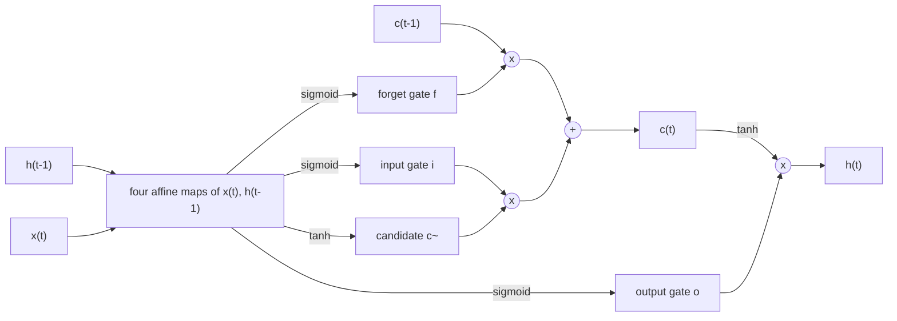

Text, speech, music, video and time series are sequences: their elements come in an order, their length varies, and the meaning of an element depends on what came before. The networks of the previous chapters do not fit such data well. A **multilayer perceptron** ([4.7.2](/4.7.2)) maps an input of fixed size to an output of fixed size and has no notion of time; a sequence could be padded to a maximum length or averaged into a single vector, but the first wastes parameters on positions and the second discards the order. Recurrent neural networks solve the problem by processing a sequence one element at a time while carrying a hidden state, a learned summary of the past, from step to step, with the same weights at every step. This chapter develops them and the representation of language that makes them applicable to text.

The first half covers recurrent networks: the simple recurrent network, its training by **backpropagation** through time, the vanishing and **exploding gradients** that make long-range dependencies hard to learn (the general phenomenon of [4.7.4](/4.7.4) §4.5 in its most extreme form), and the gated architectures LSTM and GRU that address them. We then use recurrent networks for language modeling and for sequence-to-sequence tasks such as translation, together with the decoding algorithms that turn a model of the next **token** into generated text. The second half asks how words become vectors: from one-hot codes to dense word embeddings learned by word2vec and GloVe from the contexts in which words occur, and how text is split into tokens in the first place. Classical probabilistic sequence models, Markov chains and **hidden Markov models**, are treated in [4.6.8](/4.6.8); the attention mechanism that removes the bottleneck of recurrent sequence-to-sequence models leads to the Transformer of [4.7.6](/4.7.6), and contextual word representations learned by pre-training are the subject of [4.7.7](/4.7.7).

## 5.1. Sequence Modeling

### 5.1.1. Sequences and Tasks

A sequence $\boldsymbol{x}_1, \dots, \boldsymbol{x}_T$ of vectors (or of symbols, which §5.5 turns into vectors) can be the input of a task, its output, or both. Typical combinations:

| Input | Output | Examples |
|---|---|---|
| vector | vector | standard classification and regression ([4.7.2](/4.7.2)) |
| sequence | vector or label | sentiment classification, natural language inference, multiple-choice question answering, speaker identification |
| vector | sequence | image captioning, music generation from a description |
| sequence | sequence of the same length (aligned) | part-of-speech tagging, named-entity recognition, Chinese word segmentation, frame-wise speech labeling |
| sequence | sequence of a different length | machine translation, speech recognition, summarization, open-ended question answering, video captioning |

Two requirements follow. The model must accept sequences of any length, and it should share what it learns across positions: a rule such as "an adjective precedes the noun it modifies" should be learned once, not separately for every position, just as a **convolution** ([4.7.3](/4.7.3)) shares a filter across locations.

### 5.1.2. A Dynamical-Systems View

A discrete-time dynamical system evolves a state by a fixed rule, $\boldsymbol{s}_t = f(\boldsymbol{s}_{t-1}; \boldsymbol{\theta})$. Driven by an input sequence and observed through an output map, it becomes
$$
\boldsymbol{h}_t = f(\boldsymbol{h}_{t-1}, \boldsymbol{x}_t; \boldsymbol{\theta}), \qquad \hat{\boldsymbol{y}}_t = g(\boldsymbol{h}_t; \boldsymbol{\theta}),
$$
where the state $\boldsymbol{h}_t$ summarizes everything about $\boldsymbol{x}_1, \dots, \boldsymbol{x}_t$ that matters for the future. Unrolling the recursion over $T$ steps writes $\boldsymbol{h}_T$ as a composition of $T$ copies of $f$, $\boldsymbol{h}_T = f(f(\cdots f(\boldsymbol{h}_0, \boldsymbol{x}_1)\cdots, \boldsymbol{x}_{T-1}), \boldsymbol{x}_T)$, so the unrolled system is a deep **feedforward network** whose depth is the sequence length and whose layers all share the parameters $\boldsymbol{\theta}$. Both properties matter: the shared parameters give a fixed model for every length, and the depth explains both the power of recurrent networks and the difficulty of training them. Compared with a **Markov model** of order $n$ ([4.6.8](/4.6.8)), whose state is the last $n$ symbols, the state of a recurrent network is a continuous vector that can in principle retain information from arbitrarily far back.

## 5.2. Recurrent Neural Networks

### 5.2.1. The Simple Recurrent Network

**Definition 5.2.1 (Recurrent Neural Network)** A (simple, or Elman) **recurrent neural network** (RNN) with input size $n_x$, hidden size $n_h$ and output size $n_y$ computes from an initial state $\boldsymbol{h}_0$ (usually $\boldsymbol{0}$), for $t = 1, \dots, T$,
$$
\boldsymbol{h}_t = \tanh\bigl(W_{hh}\boldsymbol{h}_{t-1} + W_{xh}\boldsymbol{x}_t + \boldsymbol{b}_h\bigr), \qquad \boldsymbol{o}_t = W_{hy}\boldsymbol{h}_t + \boldsymbol{b}_y, \qquad \hat{\boldsymbol{y}}_t = \operatorname{softmax}(\boldsymbol{o}_t),
$$
with $W_{hh} \in \mathbb{R}^{n_h \times n_h}$, $W_{xh} \in \mathbb{R}^{n_h \times n_x}$, $W_{hy} \in \mathbb{R}^{n_y \times n_h}$ and biases $\boldsymbol{b}_h, \boldsymbol{b}_y$ shared by all time steps. The total loss is the sum of the per-step losses, for classification the **cross-entropy loss** $L = \sum_{t=1}^T L_t$, $L_t = -\log\hat y_{t, y_t}$ for targets $y_t$.

Elman (1990) introduced this network, building on Jordan's (1986), in which the output rather than the hidden state was fed back. The output map and loss depend on the task: per-step outputs for tagging and language modeling, only the last output (or a pooled one) for classifying a whole sequence. In code the forward pass is a loop:

```python
import numpy as np


def rnn_forward(X, h0, W_xh, W_hh, b_h, W_hy, b_y):
    """X: (T, n_x) one sequence. Returns hidden states (T, n_h) and output logits (T, n_y)."""
    h, H, O = h0, [], []
    for x in X:                                       # one step per element, same weights
        h = np.tanh(W_hh @ h + W_xh @ x + b_h)
        H.append(h)
        O.append(W_hy @ h + b_y)
    return np.array(H), np.array(O)
```

The number of parameters, $n_h(n_h + n_x + 1) + n_y(n_h + 1)$, does not depend on the sequence length. Siegelmann and Sontag (1995) showed that RNNs with rational weights and unbounded precision are Turing complete; in practice their memory is limited by the difficulty of training rather than by expressiveness. The tanh keeps the state bounded; **ReLU** recurrences are possible but prone to explosion unless $W_{hh}$ is initialized near the identity (Le, Jaitly and Hinton 2015).

### 5.2.2. Backpropagation Through Time

Because the unrolled RNN is a **feedforward network** with shared weights, its gradient is computed by **backpropagation** ([4.7.2](/4.7.2)) on the unrolled **computational graph**, summing the contributions of all time steps to each shared weight.

**Definition 5.2.2 (Backpropagation Through Time)** **Backpropagation through time** (BPTT; Werbos 1990) computes the gradient of $L = \sum_t L_t$ with respect to the parameters of a recurrent network by running the forward pass over the whole sequence while storing all states, then propagating gradients backward from $t = T$ to $t = 1$ through the unrolled graph.

**Theorem 5.2.1** For the RNN of Definition 5.2.1, write $\boldsymbol{\varepsilon}_t = \partial L/\partial\boldsymbol{h}_t$ and $D_t = \operatorname{diag}(1 - \boldsymbol{h}_t \odot \boldsymbol{h}_t)$, the derivative of tanh at step $t$. Then $\boldsymbol{\varepsilon}_T = W_{hy}^{\mathsf T}(\hat{\boldsymbol{y}}_T - \boldsymbol{y}_T)$ and, for $t = T-1, \dots, 1$,
$$
\boldsymbol{\varepsilon}_t = W_{hy}^{\mathsf T}(\hat{\boldsymbol{y}}_t - \boldsymbol{y}_t) + W_{hh}^{\mathsf T}D_{t+1}\boldsymbol{\varepsilon}_{t+1},
$$
where $\boldsymbol{y}_t$ is the one-hot target. With $\boldsymbol{\delta}_t = D_t\boldsymbol{\varepsilon}_t$, the gradient with respect to the pre-activation of step $t$,
$$
\frac{\partial L}{\partial W_{hh}} = \sum_{t=1}^T\boldsymbol{\delta}_t\boldsymbol{h}_{t-1}^{\mathsf T}, \qquad \frac{\partial L}{\partial W_{xh}} = \sum_{t=1}^T\boldsymbol{\delta}_t\boldsymbol{x}_t^{\mathsf T}, \qquad \frac{\partial L}{\partial\boldsymbol{b}_h} = \sum_{t=1}^T\boldsymbol{\delta}_t, \qquad \frac{\partial L}{\partial W_{hy}} = \sum_{t=1}^T(\hat{\boldsymbol{y}}_t - \boldsymbol{y}_t)\boldsymbol{h}_t^{\mathsf T}.
$$

**Proof** The state $\boldsymbol{h}_t$ influences $L$ through the output $\boldsymbol{o}_t$ (hence $L_t$) and through the next state $\boldsymbol{h}_{t+1}$, and through nothing else. By the **chain rule**, $\boldsymbol{\varepsilon}_t = (\partial\boldsymbol{o}_t/\partial\boldsymbol{h}_t)^{\mathsf T}\partial L_t/\partial\boldsymbol{o}_t + (\partial\boldsymbol{h}_{t+1}/\partial\boldsymbol{h}_t)^{\mathsf T}\boldsymbol{\varepsilon}_{t+1}$. The first term is $W_{hy}^{\mathsf T}(\hat{\boldsymbol{y}}_t - \boldsymbol{y}_t)$ by Proposition 2.4.1(a), and $\partial\boldsymbol{h}_{t+1}/\partial\boldsymbol{h}_t = D_{t+1}W_{hh}$ because $\tanh' = 1 - \tanh^2$; at $t = T$ the second term is absent. Each shared weight is used once per time step; the gradient is the sum over the uses, and each use contributes as in Theorem 2.4.1, an outer product of the error at the output of the connection, $\boldsymbol{\delta}_t$ or $\hat{\boldsymbol{y}}_t - \boldsymbol{y}_t$, with the activity at its input. $\square$

BPTT costs about as much as the forward pass, but its memory grows linearly with $T$, since all states must be stored. For long sequences, *truncated BPTT* splits the sequence into chunks of $k$ steps (say $k = 100$), carries the hidden state forward across chunk boundaries but backpropagates only within each chunk; the model can still use information from the distant past through the state, but gets no gradient signal to learn to keep it.

### 5.2.3. Vanishing and Exploding Gradients Through Time

The gradient of a loss $L_t$ at time $t$ with respect to the state at an earlier time $k < t$ is a product of $t - k$ Jacobians:
$$
\frac{\partial L_t}{\partial\boldsymbol{h}_k} = \Bigl(\frac{\partial\boldsymbol{h}_t}{\partial\boldsymbol{h}_k}\Bigr)^{\mathsf T}\frac{\partial L_t}{\partial\boldsymbol{h}_t}, \qquad \frac{\partial\boldsymbol{h}_t}{\partial\boldsymbol{h}_k} = \prod_{j=k+1}^{t}D_jW_{hh} = D_tW_{hh}D_{t-1}W_{hh}\cdots D_{k+1}W_{hh} .
$$
Unlike in a feedforward network, the same matrix $W_{hh}$ appears in every factor, so the behavior is governed by its spectrum.

**Proposition 5.2.1** For the tanh RNN, $\bigl\|\partial\boldsymbol{h}_t/\partial\boldsymbol{h}_k\bigr\|_2 \le \|W_{hh}\|_2^{\,t-k}$. Hence if the largest **singular value** of $W_{hh}$ is less than $1$, the contribution of step $k$ to the gradient at step $t$ vanishes exponentially in $t - k$. Conversely, for a linear recurrence $\boldsymbol{h}_t = W_{hh}\boldsymbol{h}_{t-1} + \dots$ with a diagonalizable $W_{hh}$ whose **spectral radius** exceeds $1$, the Jacobian $W_{hh}^{t-k}$ grows exponentially along the corresponding eigenvector.

**Proof** $\|D_j\|_2 = \max_i(1 - h_{j,i}^2) \le 1$, and the spectral norm is submultiplicative. For the linear case, if $W_{hh}\boldsymbol{u} = \lambda\boldsymbol{u}$ with $\lvert\lambda\rvert > 1$ then $W_{hh}^{t-k}\boldsymbol{u} = \lambda^{t-k}\boldsymbol{u}$. $\square$

So $\|W_{hh}\|_2 > 1$ is necessary for gradients to explode in a tanh RNN, and if the largest singular value is below $1$ they must vanish (Pascanu, Mikolov and Bengio 2013). Bengio, Simard and Frasconi (1994), after Hochreiter's analysis of 1991, showed the dilemma behind this: for a recurrent network to store information robustly against small perturbations, its dynamics must be contracting near the stored state, which is exactly the regime where gradients vanish. In practice the gradient of the total loss is dominated by short-range terms, and the network learns dependencies over about $10$ to $20$ steps, failing to learn that in "I went to China for graduate study … two years later I finally speak fluent Chinese" the last word depends on a word far back, while "the clouds are in the sky" is easy.

![Spectral norm of the Jacobian from the hidden state at time t to the hidden state 1 to 100 steps later, for a tanh RNN with 64 hidden units, random recurrent weights with gain g and random inputs (left; geometric mean of three networks): for small gains the norm decays exponentially, for g = 3 the network is chaotic and the norm grows exponentially. Right: along the cell-state path of an LSTM the corresponding product is the product of the forget gates; with a forget-gate bias of 4 or 6 it stays close to 1 over 100 steps](./plots/rnn-gradient-norms.py)

The two failures call for different remedies.

- **Exploding gradients** are rare but catastrophic: a single huge step destroys the parameters. **Gradient clipping** ([4.7.4](/4.7.4)) by the global norm, introduced for RNNs by Mikolov (2012) and Pascanu et al. (2013), handles them reliably.
- **Vanishing gradients** cannot be fixed at the optimizer level, since the information is not in the gradient. Pascanu et al. proposed a regularizer that encourages $\partial\boldsymbol{h}_{t+1}/\partial\boldsymbol{h}_t$ to preserve the norm of the backpropagated error; orthogonal or identity initialization of $W_{hh}$ helps at the start of training; **layer normalization** ([4.7.4](/4.7.4)) stabilizes the dynamics. The decisive solution was architectural: gated units with an additive memory path.

## 5.3. Gated Recurrent Networks

### 5.3.1. Long Short-Term Memory

The LSTM (Hochreiter and Schmidhuber 1997) keeps two states: a cell state $\boldsymbol{c}_t$, a memory that is changed only by elementwise multiplication and addition, and a hidden state $\boldsymbol{h}_t$, the output read from it. Three gates, each a sigmoid layer with values in $(0, 1)$, decide what to forget, what to write and what to read.

**Definition 5.3.1 (Long Short-Term Memory)** A **long short-term memory** (LSTM) layer with input $\boldsymbol{x}_t \in \mathbb{R}^{n_x}$ and hidden size $n_h$ computes, with $\sigma$ the logistic sigmoid,
$$
\begin{aligned}
\boldsymbol{f}_t &= \sigma(W_f\boldsymbol{x}_t + U_f\boldsymbol{h}_{t-1} + \boldsymbol{b}_f) && \text{(forget gate)} \\
\boldsymbol{i}_t &= \sigma(W_i\boldsymbol{x}_t + U_i\boldsymbol{h}_{t-1} + \boldsymbol{b}_i) && \text{(input gate)} \\
\boldsymbol{o}_t &= \sigma(W_o\boldsymbol{x}_t + U_o\boldsymbol{h}_{t-1} + \boldsymbol{b}_o) && \text{(output gate)} \\
\tilde{\boldsymbol{c}}_t &= \tanh(W_c\boldsymbol{x}_t + U_c\boldsymbol{h}_{t-1} + \boldsymbol{b}_c) && \text{(candidate)} \\
\boldsymbol{c}_t &= \boldsymbol{f}_t \odot \boldsymbol{c}_{t-1} + \boldsymbol{i}_t \odot \tilde{\boldsymbol{c}}_t && \text{(cell state)} \\
\boldsymbol{h}_t &= \boldsymbol{o}_t \odot \tanh(\boldsymbol{c}_t) && \text{(hidden state)}
\end{aligned}
$$
with $W_\bullet \in \mathbb{R}^{n_h \times n_x}$, $U_\bullet \in \mathbb{R}^{n_h \times n_h}$, $\boldsymbol{b}_\bullet \in \mathbb{R}^{n_h}$ and $\boldsymbol{c}_0 = \boldsymbol{h}_0 = \boldsymbol{0}$.



The forget gate scales the old memory, the input gate scales the new content, and the output gate decides how much of the memory is exposed in $\boldsymbol{h}_t$, which feeds the next step and the output layer. The key is the cell update. Along the direct path from $\boldsymbol{c}_{t-1}$ to $\boldsymbol{c}_t$,
$$
\frac{\partial\boldsymbol{c}_t}{\partial\boldsymbol{c}_{t-1}}\Big|_{\text{direct}} = \operatorname{diag}(\boldsymbol{f}_t), \qquad \frac{\partial\boldsymbol{c}_t}{\partial\boldsymbol{c}_k}\Big|_{\text{direct}} = \operatorname{diag}\Bigl(\prod_{j=k+1}^t\boldsymbol{f}_j\Bigr),
$$
a diagonal matrix with no repeated multiplication by a weight matrix and no squashing derivative. When the forget gates are close to $1$, the error flows back over many steps essentially unchanged; Hochreiter and Schmidhuber called this the *constant error carousel*. (The original LSTM had no forget gate, effectively $\boldsymbol{f}_t = \boldsymbol{1}$; Gers, Schmidhuber and Cummins (2000) added it so that the network can also reset its memory.) Unlike in a simple RNN, the decay along this path is learned and input-dependent, as the right half of the figure in §5.2.3 shows. Practical consequences:

- Initialize the forget-gate bias $\boldsymbol{b}_f$ to $1$ or larger, so that the network remembers by default at the start of training (Gers et al. 2000; Jozefowicz, Zaremba and Sutskever 2015 found this the most important single improvement).
- An LSTM layer has $4n_h(n_x + n_h + 1)$ parameters, four times a simple RNN of the same width, and the four affine maps are computed as one matrix product.
- Large ablation studies (Greff et al. 2017) found the forget gate and the output activation to be the most important components; variants such as peephole connections, which let the gates see the cell state, make little difference.

LSTMs learned dependencies over hundreds of steps and were the state of the art in speech recognition, handwriting recognition, language modeling and machine translation from about 2007 until Transformers replaced them around 2018–2019.

### 5.3.2. Gated Recurrent Unit

**Definition 5.3.2 (Gated Recurrent Unit)** A **gated recurrent unit** (GRU; Cho et al. 2014) has a single state $\boldsymbol{h}_t$ and two gates:
$$
\begin{aligned}
\boldsymbol{z}_t &= \sigma(W_z\boldsymbol{x}_t + U_z\boldsymbol{h}_{t-1} + \boldsymbol{b}_z) && \text{(update gate)} \\
\boldsymbol{r}_t &= \sigma(W_r\boldsymbol{x}_t + U_r\boldsymbol{h}_{t-1} + \boldsymbol{b}_r) && \text{(reset gate)} \\
\tilde{\boldsymbol{h}}_t &= \tanh\bigl(W_h\boldsymbol{x}_t + U_h(\boldsymbol{r}_t \odot \boldsymbol{h}_{t-1}) + \boldsymbol{b}_h\bigr) && \text{(candidate)} \\
\boldsymbol{h}_t &= (\boldsymbol{1} - \boldsymbol{z}_t) \odot \boldsymbol{h}_{t-1} + \boldsymbol{z}_t \odot \tilde{\boldsymbol{h}}_t .
\end{aligned}
$$

The update gate interpolates between keeping the old state and writing the candidate, playing the role of the forget and input gates of the LSTM with the constraint that they sum to $1$; the reset gate decides how much of the old state enters the candidate, so that the unit can ignore the past when a new segment begins. The GRU merges the cell and hidden states and has no output gate, so it has three instead of four blocks of weights, $3n_h(n_x + n_h + 1)$ parameters. (Conventions differ: PyTorch's `nn.GRU` writes $\boldsymbol{h}_t = (\boldsymbol{1} - \boldsymbol{z}_t) \odot \tilde{\boldsymbol{h}}_t + \boldsymbol{z}_t \odot \boldsymbol{h}_{t-1}$ and applies the reset gate after the matrix product $U_h\boldsymbol{h}_{t-1}$.)

Empirical comparisons (Chung et al. 2014; Jozefowicz et al. 2015; Greff et al. 2017) found GRUs and LSTMs comparable on most tasks, with no consistent winner, and both far better than simple RNNs. The GRU is cheaper; the LSTM is somewhat more expressive, for instance it can learn to count, which the GRU's interpolating update cannot do in a stable way (Weiss, Goldberg and Yahav 2018). Rough statements that a simple RNN remembers about 100 steps, an LSTM 500 and a GRU 1000 should not be taken literally: the usable memory depends on the task, the training and the gate initialization, and the GRU does not in general retain information longer than the LSTM.

### 5.3.3. Implementation

The following NumPy code implements an LSTM cell and runs it over a sequence; the four gate blocks are stacked in the order input, forget, candidate, output, which is PyTorch's layout.

```python
import numpy as np


def sigmoid(z):
    return 1.0 / (1.0 + np.exp(-z))


def lstm_cell(x, h, c, W_x, W_h, b):
    """One LSTM step for a batch. x: (B, n_x), h, c: (B, n_h).
    W_x: (4 n_h, n_x), W_h: (4 n_h, n_h), b: (4 n_h,), gates stacked as [i, f, g, o]."""
    z = x @ W_x.T + h @ W_h.T + b
    i, f, g, o = np.split(z, 4, axis=1)
    i, f, o = sigmoid(i), sigmoid(f), sigmoid(o)   # input, forget and output gates
    g = np.tanh(g)                                   # candidate cell state
    c_new = f * c + i * g                            # additive memory update
    h_new = o * np.tanh(c_new)
    return h_new, c_new


def lstm(X, W_x, W_h, b):
    """Run over a sequence X: (T, B, n_x) from zero states; return all hidden states."""
    T, B, _ = X.shape
    n_h = W_h.shape[1]
    h, c = np.zeros((B, n_h)), np.zeros((B, n_h))
    H = []
    for t in range(T):
        h, c = lstm_cell(X[t], h, c, W_x, W_h, b)
        H.append(h)
    return np.stack(H), (h, c)


rng = np.random.default_rng(0)
n_x, n_h, T, B = 3, 5, 7, 2
k = 1 / np.sqrt(n_h)
W_x = rng.uniform(-k, k, (4 * n_h, n_x))
W_h = rng.uniform(-k, k, (4 * n_h, n_h))
b = np.zeros(4 * n_h)
b[n_h:2 * n_h] = 1.0                                 # forget-gate bias 1: remember by default
X = rng.standard_normal((T, B, n_x))
H, (h_T, c_T) = lstm(X, W_x, W_h, b)
print("hidden states:", H.shape, " last h[0]:", np.round(h_T[0], 4))
```

```text
hidden states: (7, 2, 5)  last h[0]: [-0.004  -0.1063  0.0993 -0.0595 -0.002 ]
```

Loading the same weights into `torch.nn.LSTM` (PyTorch 2.14, CPU), which has two bias vectors per layer whose sum plays the role of $\boldsymbol{b}$, reproduces the hidden states:

```python
import numpy as np
import torch

lstm_t = torch.nn.LSTM(n_x, n_h)                     # input shape (T, B, n_x)
with torch.no_grad():
    lstm_t.weight_ih_l0.copy_(torch.tensor(W_x))
    lstm_t.weight_hh_l0.copy_(torch.tensor(W_h))
    lstm_t.bias_ih_l0.copy_(torch.tensor(b))
    lstm_t.bias_hh_l0.zero_()
    H_t, (h_t, c_t) = lstm_t(torch.tensor(X, dtype=torch.float32))
print(f"max |torch - numpy| = {np.abs(H_t.numpy() - H).max():.1e}")
```

```text
max |torch - numpy| = 5.6e-08
```

In practice one uses the library modules, which run the whole sequence in optimized kernels (cuDNN on GPUs), accept `num_layers`, `bidirectional=True` and `dropout` arguments, and handle batches of sequences of different lengths through **padding** with `pack_padded_sequence`.

### 5.3.4. Stacked and Bidirectional RNNs

Recurrent layers are combined in two ways. A *stacked* (deep) RNN feeds the hidden states of one layer as inputs to the next, $\boldsymbol{h}^{(l)}_t = f^{(l)}(\boldsymbol{h}^{(l)}_{t-1}, \boldsymbol{h}^{(l-1)}_t)$ with $\boldsymbol{h}^{(0)}_t = \boldsymbol{x}_t$; two to four LSTM layers were typical, deeper stacks needing **residual connections**, as in Google's eight-layer translation system (Wu et al. 2016). **Dropout** is applied between layers but not on the recurrent connections, or with the same mask at every time step (Gal and Ghahramani 2016).

A unidirectional RNN summarizes only the prefix $\boldsymbol{x}_1, \dots, \boldsymbol{x}_t$ in $\boldsymbol{h}_t$. For tagging, the label of a word often depends on what follows: in *He said, "Teddy bears are on sale!"* and *He said, "Teddy Roosevelt was a great President!"* the word "Teddy" is a common noun in the first sentence and part of a name in the second, which only the following word reveals.

**Definition 5.3.3 (Bidirectional RNN)** A **bidirectional RNN** (Schuster and Paliwal 1997) runs two recurrent layers over the sequence, one forward and one backward,
$$
\overrightarrow{\boldsymbol{h}}_t = f\bigl(\overrightarrow{\boldsymbol{h}}_{t-1}, \boldsymbol{x}_t\bigr), \qquad \overleftarrow{\boldsymbol{h}}_t = f'\bigl(\overleftarrow{\boldsymbol{h}}_{t+1}, \boldsymbol{x}_t\bigr), \qquad \boldsymbol{h}_t = \bigl[\overrightarrow{\boldsymbol{h}}_t; \overleftarrow{\boldsymbol{h}}_t\bigr],
$$
with separate parameters, and represents position $t$ by the concatenation, which depends on the prefix and the suffix context.

Bidirectional LSTMs (BiLSTMs), often with a conditional random field on top, were the standard architecture for tagging tasks such as named-entity recognition, and the encoder of attention-based translation (§5.4.3, [4.7.6](/4.7.6)). They require the whole input in advance, so they cannot be used for generation or for streaming.

## 5.4. Language Models and Sequence-to-Sequence Learning

### 5.4.1. Language Models

**Definition 5.4.1 (Language Model)** A **language model** is a probability distribution over sequences of tokens $w_1, \dots, w_T$ from a vocabulary $V$, almost always represented through the chain rule of probability as a product of next-token distributions:
$$
\mathbb{P}(w_1, \dots, w_T) = \prod_{t=1}^T\mathbb{P}(w_t \mid w_1, \dots, w_{t-1}).
$$

A model of the next-token **conditional probability** assigns probabilities to sentences, which ranks the outputs of speech recognizers, translation systems and input methods ([4.5.2](/4.5.2)), and generates text by sampling one **token** at a time. The classical approach truncates the history to the last $n - 1$ tokens, a Markov assumption, and estimates the conditional probabilities by smoothed counts (n-gram models, [4.6.8](/4.6.8)). Counts do not generalize: the number of possible histories grows as $\lvert V\rvert^{n-1}$, most never occur in the training data, and observing "the cat is walking in the bedroom" says nothing about "a dog was running in a room", although the two are similar.

Neural language models address both problems by representing each word by a learned vector, so that similar words get similar vectors and the probability function is smooth in them. Bengio et al. (2003) concatenated the vectors of the $n - 1$ previous words, passed them through a tanh hidden layer and a **softmax** over the vocabulary, and trained the word vectors jointly with the network by maximum likelihood; the word vectors learned this way are the ancestors of the embeddings of §5.5. An RNN language model (Mikolov et al. 2010) removes the fixed window: the hidden state $\boldsymbol{h}_{t-1}$ summarizes the whole prefix, and $\hat{\boldsymbol{y}}_t = \operatorname{softmax}(W_{hy}\boldsymbol{h}_{t-1} + \boldsymbol{b}_y)$ predicts $w_t$, with the input at step $t$ being the vector of $w_{t-1}$. Training minimizes the **cross-entropy** of each next token, which is maximum likelihood for the factorization above ([4.7.1](/4.7.1)).

Language models are evaluated by the **perplexity** on held-out text,
$$
\operatorname{PP} = \exp\Bigl(-\frac1T\sum_{t=1}^T\log\mathbb{P}(w_t \mid w_{<t})\Bigr),
$$
the exponential of the average cross-entropy per token. A model that spreads its probability uniformly over $k$ tokens at every step has perplexity $k$, so perplexity is the effective number of choices the model is uncertain between. On the Penn Treebank benchmark, Kneser–Ney-smoothed 5-gram models reach a perplexity of about $141$, the RNN language model of Mikolov et al. about $124$ (and $80$ to $90$ in combination with other models), and well-regularized LSTMs about $58$ (Merity, Keskar and Socher 2018). Perplexities are only comparable for the same tokenization and **test set**.

### 5.4.2. Recurrent Networks for Language Tasks

With words represented as vectors, the task taxonomy of §5.1.1 maps onto recurrent architectures directly.

- Text classification (sentiment, topic, entailment between two sentences, multiple choice): encode the text with an RNN or BiLSTM and classify a single vector, the last hidden state $\boldsymbol{h}_T$ or the average $\frac1T\sum_t\boldsymbol{h}_t$ (or the maximum over time); averaging is often more robust, since the last state of a long text is dominated by its end.
- Sequence labeling (part-of-speech tagging, named-entity recognition, Chinese word segmentation as a labeling of characters with tags such as begin, inside and end of a word): apply a softmax classifier to every $\boldsymbol{h}_t$ of a BiLSTM.
- Language modeling and generation: a unidirectional RNN predicts the next token from $\boldsymbol{h}_t$.
- Transduction (translation, dialogue, summarization): an encoder–decoder, below.

### 5.4.3. Sequence-to-Sequence Models

**Definition 5.4.2 (Sequence-to-Sequence Model)** A **sequence-to-sequence model** (encoder–decoder model) maps an input sequence $\boldsymbol{x}_1, \dots, \boldsymbol{x}_S$ to an output sequence $y_1, \dots, y_T$ of possibly different length by two networks: an *encoder*, which reads the input and produces a representation $\boldsymbol{c}$, and a *decoder*, a conditional language model
$$
\mathbb{P}(y_1, \dots, y_T \mid \boldsymbol{x}) = \prod_{t=1}^T\mathbb{P}(y_t \mid y_1, \dots, y_{t-1}, \boldsymbol{c}),
$$
which generates the output one token at a time, starting from a beginning-of-sequence token `<bos>` and ending when it emits an end-of-sequence token `<eos>`.

In the RNN version (Sutskever, Vinyals and Le 2014; Cho et al. 2014) the encoder is an LSTM or GRU whose final state $\boldsymbol{c} = \boldsymbol{h}_S$ initializes the decoder RNN, $\boldsymbol{s}_t = f(\boldsymbol{s}_{t-1}, \boldsymbol{e}(y_{t-1}))$ with $\boldsymbol{s}_0 = \boldsymbol{c}$ and $\boldsymbol{e}(y)$ the embedding of token $y$, and $\mathbb{P}(y_t \mid \cdot) = \operatorname{softmax}(W\boldsymbol{s}_t)$. Sutskever et al. used four-layer LSTMs with 1000 units per layer and found that reversing the order of the source sentence helped, because it shortens the distance between the first words of the source and of the target; their ensemble reached a BLEU score of 34.8 on WMT'14 English-to-French, close to the best phrase-based systems of the time.

The model is trained by maximum likelihood on pairs $(\boldsymbol{x}, \boldsymbol{y})$, which raises the question of what the decoder receives as input at step $t$.

**Definition 5.4.3 (Teacher Forcing)** **Teacher forcing** (Williams and Zipser 1989) trains an autoregressive model by feeding it, at every step, the ground-truth previous tokens $y_1, \dots, y_{t-1}$ rather than its own predictions, and minimizing $-\sum_t\log\mathbb{P}(y_t \mid y_{<t}, \boldsymbol{x})$. At inference time, when no ground truth is available, the model's own outputs are fed back (*free running*).

Teacher forcing makes the loss of each step independent of the model's earlier mistakes and, for Transformers, allows all positions of a sequence to be trained in parallel ([4.7.6](/4.7.6)). Its drawback is *exposure bias*: during training the model never sees its own errors, so at inference a mistake leads it into states it was never trained on, and errors can compound. Remedies include scheduled sampling, which gradually replaces ground-truth inputs by model samples during training (Bengio et al. 2015), and sequence-level training with **reinforcement learning**, which optimizes the evaluation metric of whole generated outputs; at the scale of modern language models, exposure bias matters less than once feared, and post-training with reinforcement learning on the model's own outputs addresses it directly ([4.7.9](/4.7.9)).

The encoder–decoder of Definition 5.4.2 squeezes the whole input into one fixed-size vector $\boldsymbol{c}$, and its translation quality dropped sharply for sentences longer than about 20 words (Cho et al. 2014). Bahdanau, Cho and Bengio (2015) removed this bottleneck by letting the decoder look back at all encoder states at every step, the attention mechanism of [4.7.6](/4.7.6).

### 5.4.4. Decoding

Given a trained model of $\mathbb{P}(y_t \mid y_{<t}, \boldsymbol{x})$, generating an output is a **search problem**: the most probable output $\arg\max_{\boldsymbol{y}}\mathbb{P}(\boldsymbol{y} \mid \boldsymbol{x})$ cannot be found exactly, since the number of sequences grows exponentially with their length.

- Greedy decoding chooses the most probable token at every step. It is fast but can commit early to a prefix that leads to a poor overall sequence.
- Sampling draws $y_t$ from the predicted distribution, usually after rescaling the logits $\boldsymbol{z}$ by a *temperature* $\tau > 0$, $\mathbb{P}_\tau(y_t = i) \propto \exp(z_i/\tau)$: $\tau < 1$ sharpens the distribution toward greedy decoding, $\tau > 1$ flattens it. Sampling produces diverse outputs, but the many low-probability tokens in the long tail of the distribution together carry substantial mass, and sampling one of them can derail the text.
- Top-$k$ sampling (Fan, Lewis and Dauphin 2018) samples only from the $k$ most probable tokens, renormalized. *Nucleus sampling* or top-$p$ sampling (Holtzman et al. 2020) samples from the smallest set of most probable tokens whose total probability is at least $p$ (e.g. $p = 0.9$): the set is small when the model is confident ("I ate the pizza while it was still" is followed by "hot" or "warm") and large when many continuations are plausible ("She said, 'I never'" can continue in many ways), which a fixed $k$ cannot adapt to. Min-$p$ sampling keeps the tokens whose probability is at least a fraction of the top token's.

**Algorithm 5.4.1 (Beam Search)** Beam search with beam width $k$ keeps the $k$ highest-scoring partial outputs (hypotheses). At each step it extends every hypothesis by every token, scores the extensions by their total log-probability $\sum_{s \le t}\log\mathbb{P}(y_s \mid y_{<s}, \boldsymbol{x})$, and keeps the best $k$; hypotheses that emit `<eos>` are set aside as finished. It stops when $k$ hypotheses have finished or a maximum length is reached, and returns the finished hypothesis with the best score, usually normalized by the length (raw log-probabilities favor short outputs).

Beam search with $k = 1$ is greedy decoding; widths of $4$ to $10$ are typical for translation and summarization, where there is essentially one correct output. For open-ended generation the most probable sequences are often bland and repetitive (Holtzman et al. 2020 call this *degeneration*), and sampling with a temperature around $0.7$ to $1$ together with top-$p$ is preferred. Large language models in 2026 are mostly decoded by sampling; **reasoning models** are typically sampled at temperature around $1$, and several samples can be drawn and compared ([4.7.9](/4.7.9)).

## 5.5. Representing Words

### 5.5.1. One-Hot Vectors

Neural networks compute with real numbers, and images supply them directly as pixel intensities. Text consists of discrete symbols. The simplest numeric representation fixes a vocabulary $V = \{v_1, \dots, v_{\lvert V\rvert}\}$ and represents the $i$-th word by the *one-hot vector* $\boldsymbol{e}_i \in \{0, 1\}^{\lvert V\rvert}$, with a $1$ in position $i$ and $0$ elsewhere; a document is then represented by the sum of the one-hot vectors of its words, its *bag of words* (counts, possibly reweighted, as in tf–idf).

One-hot vectors have two fatal flaws. They are huge and sparse: vocabularies have $10^4$ to $10^6$ entries. And they carry no notion of similarity: any two distinct one-hot vectors are orthogonal and have **Euclidean distance** $\sqrt2$, so "hotel" is as far from "motel" as from "banana". With bags of words, the documents "I like **deep learning**" and "we love neural networks" share no word and have **cosine similarity** $0$, although they say nearly the same thing. Traditional NLP compensated by hand-built resources (thesauri such as WordNet) and feature engineering, at great cost in expertise. Deep learning instead learns low-dimensional, dense vectors from data.

### 5.5.2. The Distributional Hypothesis

Where does the meaning of a word come from, if not from a dictionary? Linguists answered: from its use.

**Definition 5.5.1 (Distributional Hypothesis)** The **distributional hypothesis** states that words occurring in similar contexts tend to have similar meanings (Harris 1954); in Firth's (1957) formulation, "you shall know a word by the company it keeps."

If we see "a bottle of tezgüino is on the table", "everybody likes tezgüino", "tezgüino makes you drunk" and "we make tezgüino out of corn", we can guess that tezgüino is an alcoholic drink, because "wine" or "beer" fit the same contexts. The hypothesis turns semantics into statistics: represent each word by the distribution of words around it. A count-based method builds the co-occurrence matrix $X \in \mathbb{R}^{\lvert V\rvert \times \lvert V\rvert}$, where $X_{wc}$ counts how often word $c$ occurs within a window of, say, $\pm 5$ words around word $w$. Raw counts are dominated by frequent words such as "the", so they are reweighted by the *pointwise mutual information*
$$
\operatorname{PMI}(w, c) = \log\frac{\mathbb{P}(w, c)}{\mathbb{P}(w)\mathbb{P}(c)} \approx \log\frac{X_{wc}\cdot\sum_{w', c'}X_{w'c'}}{\sum_{c'}X_{wc'}\cdot\sum_{w'}X_{w'c}},
$$
which measures how much more often $w$ and $c$ co-occur than they would if they were independent (positive PMI replaces negative values by $0$). The rows of the PMI matrix are long, sparse word vectors; a truncated **singular value decomposition** compresses them to a few hundred dense dimensions, as in latent semantic analysis (Deerwester et al. 1990). The prediction-based methods of §5.6 learn dense vectors directly, and turn out to be closely related to this factorization.

### 5.5.3. Word Embeddings

**Definition 5.5.2 (Word Embedding)** A **word embedding** maps each word $w$ of a vocabulary $V$ to a dense vector $\boldsymbol{v}_w \in \mathbb{R}^d$, with $d$ typically $50$ to $1000$, much smaller than $\lvert V\rvert$, such that the geometry of the vectors reflects relations between the words; the vectors are the columns of an *embedding matrix* $E \in \mathbb{R}^{d \times \lvert V\rvert}$, so that $\boldsymbol{v}_{v_i} = E\boldsymbol{e}_i$.

Multiplying a one-hot vector by a matrix selects a column, so an embedding layer is a linear layer applied to one-hot inputs and implemented as a table lookup (`torch.nn.Embedding`); its parameters are trained by **backpropagation** like any others, either as part of the model for a task, or in advance on unlabeled text and then reused. A sentence becomes a sequence of vectors that an RNN, **CNN** or Transformer can process. Embeddings in this sense are distributed representations (Hinton 1986): each word is described by many features, and each feature is shared by many words, so that, in a toy three-dimensional example with axes "animal", "plant" and "food", pig $(1.0, 0.1, 1.0)$ and sheep $(1.0, 0.2, 1.0)$ are close, while panda $(1.0, 0.3, 0.0)$ shares the first feature with them and bamboo $(0.0, 1.0, 0.1)$ shares little. Learned dimensions are not individually interpretable in this way, but directions in the space often are (§5.6.5).

## 5.6. Learning Word Embeddings

### 5.6.1. word2vec

The neural language model of Bengio et al. learned word vectors as a by-product, at the cost of a large hidden layer and a full **softmax** for every training **token**. Mikolov et al. (2013) observed that if the goal is only the vectors, the model can be radically simplified: drop the hidden layer and train a log-linear model to predict words from their neighbors, so that it can be trained on billions of words in hours.

**Definition 5.6.1 (word2vec)** **word2vec** (Mikolov et al. 2013) is a family of shallow models that learn word embeddings from unlabeled text by predicting words from their context within a window of $\pm m$ positions. Each word $w$ has an input vector $\boldsymbol{v}_w$ and an output vector $\boldsymbol{u}_w$ in $\mathbb{R}^d$. The **continuous bag-of-words** model (CBOW) predicts the center word $w_t$ from the average of the input vectors of its context, $\bar{\boldsymbol{v}}_t = \frac{1}{2m}\sum_{0 < \lvert j\rvert \le m}\boldsymbol{v}_{w_{t+j}}$, with $\mathbb{P}(w_t \mid \text{context}) = \operatorname{softmax}_{w}(\boldsymbol{u}_w^{\mathsf T}\bar{\boldsymbol{v}}_t)$. The **skip-gram** model predicts each context word from the center word,
$$
\mathbb{P}(o \mid c) = \frac{\exp(\boldsymbol{u}_o^{\mathsf T}\boldsymbol{v}_c)}{\sum_{w \in V}\exp(\boldsymbol{u}_w^{\mathsf T}\boldsymbol{v}_c)},
$$
and maximizes $\sum_t\sum_{0 < \lvert j\rvert \le m}\log\mathbb{P}(w_{t+j} \mid w_t)$ over the corpus. After training, the input vectors $\boldsymbol{v}_w$ (sometimes averaged with the $\boldsymbol{u}_w$) are the embeddings.

The supervision is constructed from unlabeled text itself, an early instance of **self-supervised learning**. Skip-gram works better for rare words and small corpora, CBOW is faster. The gradient of the skip-gram log-probability with respect to the center vector,
$$
\frac{\partial}{\partial\boldsymbol{v}_c}\log\mathbb{P}(o \mid c) = \boldsymbol{u}_o - \sum_{w \in V}\mathbb{P}(w \mid c)\,\boldsymbol{u}_w,
$$
pulls $\boldsymbol{v}_c$ toward the observed context word and away from the expected one; words that appear in similar contexts receive similar updates and end up with similar vectors, the distributional hypothesis at work. The problem is the normalization: the softmax sums over the whole vocabulary, $10^5$ to $10^6$ words, for every training pair. Two approximations avoid it.

### 5.6.2. Hierarchical Softmax

The *hierarchical softmax* (Morin and Bengio 2005; Mnih and Hinton 2009) arranges the vocabulary as the leaves of a **binary tree** and replaces the flat softmax by a sequence of binary decisions along the path from the root to the target word. Each internal node $n$ has a vector $\boldsymbol{u}_n$, and the probability of going left at $n$ is $\sigma(\boldsymbol{u}_n^{\mathsf T}\boldsymbol{v}_c)$, of going right $\sigma(-\boldsymbol{u}_n^{\mathsf T}\boldsymbol{v}_c) = 1 - \sigma(\boldsymbol{u}_n^{\mathsf T}\boldsymbol{v}_c)$. The probability of a word is the product of the probabilities of the decisions on its path,
$$
\mathbb{P}(w \mid c) = \prod_{j=1}^{L(w)}\sigma\bigl(\pm\boldsymbol{u}_{n(w, j)}^{\mathsf T}\boldsymbol{v}_c\bigr),
$$
with $+$ for a left and $-$ for a right turn at the $j$-th node $n(w, j)$ of the path. Since the two branches at every node have probabilities summing to $1$, these probabilities sum to $1$ over the leaves without any normalization. The tree has $\lvert V\rvert - 1$ internal nodes, so the parameter count is about the same as that of the output vectors of a flat softmax, but a training pair costs $O(\log\lvert V\rvert)$ instead of $O(\lvert V\rvert)$. word2vec uses a **Huffman tree** built from word frequencies, which gives frequent words short paths and minimizes the expected cost. The sequential path of dependent decisions parallelizes poorly on GPUs, which is one reason negative sampling became more popular.

### 5.6.3. Negative Sampling

Instead of computing a normalized distribution, one can train the model to distinguish observed (word, context) pairs from pairs made up at random: "I like **deep learning**" is an observed sentence, while "I hate deep learning", "I code with deep learning" or "I play deep learning" with a random replacement of the center word are *noise* samples.

**Definition 5.6.2 (Negative Sampling)** **Negative sampling** (Mikolov et al. 2013) replaces the term $\log\mathbb{P}(o \mid c)$ of the skip-gram objective for an observed pair $(c, o)$ by
$$
\log\sigma\bigl(\boldsymbol{u}_o^{\mathsf T}\boldsymbol{v}_c\bigr) + \sum_{k=1}^K\log\sigma\bigl(-\boldsymbol{u}_{n_k}^{\mathsf T}\boldsymbol{v}_c\bigr), \qquad n_1, \dots, n_K \overset{\text{iid}}{\sim} P_n,
$$
which is the log-likelihood of a **logistic regression** that classifies the observed pair as real and $K$ pairs $(c, n_k)$ with words drawn from a noise distribution $P_n$ as fake. The standard noise distribution is the unigram distribution raised to the power $\frac34$, $P_n(w) \propto \#(w)^{3/4}$, with $K = 5$ to $20$ for small and $2$ to $5$ for large corpora.

Each pair now costs $K + 1$ dot products instead of $\lvert V\rvert$. The power $\frac34$ was found empirically; it raises the probability of rare words relative to their frequency. word2vec also subsamples frequent words, discarding each occurrence of $w$ with probability $1 - \sqrt{t/f(w)}$ for its relative frequency $f(w)$ and a threshold $t \approx 10^{-5}$, which speeds up training and improves the vectors of rare words. Negative sampling is a simplification of noise-contrastive estimation (Gutmann and Hyvärinen 2010), and it no longer models $\mathbb{P}(o \mid c)$; what it does learn was characterized by Levy and Goldberg (2014).

**Proposition 5.6.1** Let $\#(c, o)$ be the number of times $o$ occurs in the context of $c$, $\#(c) = \sum_o\#(c, o)$, $D = \sum_c\#(c)$, and let the noise distribution be the unigram context distribution $P_n(o) = \#(o)/D$ with $\#(o) = \sum_c \#(c, o)$. If the scores $x_{co} = \boldsymbol{u}_o^{\mathsf T}\boldsymbol{v}_c$ could be chosen independently for all pairs, the expected skip-gram negative sampling objective would be maximized by
$$
x_{co} = \log\frac{\#(c, o)\,D}{\#(c)\,\#(o)} - \log K = \operatorname{PMI}(c, o) - \log K .
$$

**Proof** Summing over the corpus and taking the expectation over the noise words, the objective is
$$
\ell = \sum_{c, o}\#(c, o)\log\sigma(x_{co}) + \sum_c\#(c)\,K\sum_o P_n(o)\log\sigma(-x_{co}),
$$
so the terms involving one $x_{co}$ are $\#(c, o)\log\sigma(x_{co}) + K\#(c)P_n(o)\log\sigma(-x_{co})$. With $(\log\sigma)'(x) = \sigma(-x)$ and $(\log\sigma(-x))' = -\sigma(x)$, the derivative is $\#(c, o)\sigma(-x_{co}) - K\#(c)P_n(o)\sigma(x_{co})$. Setting it to zero and using $\sigma(x)/\sigma(-x) = \mathrm{e}^x$ gives $\mathrm{e}^{x_{co}} = \#(c, o)/(K\#(c)P_n(o)) = \#(c, o)D/(K\#(c)\#(o))$; the objective is concave in $x_{co}$, so this is the maximum. $\square$

So skip-gram with negative sampling implicitly factorizes the PMI matrix, shifted by $\log K$, into the low-rank product $U^{\mathsf T}V$: the prediction-based method of word2vec and the count-based methods of §5.5.2 are two routes to the same object. In practice the differences in quality come largely from **hyperparameters** such as the window size, subsampling and the $\frac34$ smoothing, which can be transferred to count-based methods (Levy, Goldberg and Dagan 2015).

### 5.6.4. GloVe

**Definition 5.6.3 (GloVe)** **GloVe** (global vectors; Pennington, Socher and Manning 2014) learns word vectors $\boldsymbol{w}_i$, context vectors $\tilde{\boldsymbol{w}}_j$ and biases $b_i, \tilde b_j$ by weighted least squares on the logarithms of the co-occurrence counts $X_{ij}$:
$$
J = \sum_{i, j:\,X_{ij} > 0}f(X_{ij})\bigl(\boldsymbol{w}_i^{\mathsf T}\tilde{\boldsymbol{w}}_j + b_i + \tilde b_j - \log X_{ij}\bigr)^2, \qquad f(x) = \begin{cases}(x/x_{\max})^{\alpha}, & x < x_{\max}, \\ 1, & \text{otherwise},\end{cases}
$$
with $x_{\max} = 100$ and $\alpha = \frac34$; the embedding of word $i$ is $\boldsymbol{w}_i + \tilde{\boldsymbol{w}}_i$.

The motivation is that ratios of co-occurrence probabilities carry meaning: $\mathbb{P}(\text{solid} \mid \text{ice})/\mathbb{P}(\text{solid} \mid \text{steam})$ is large, $\mathbb{P}(\text{gas} \mid \text{ice})/\mathbb{P}(\text{gas} \mid \text{steam})$ small, and the ratio is near $1$ for words related to both (water) or to neither (fashion). Requiring $\boldsymbol{w}_i^{\mathsf T}\tilde{\boldsymbol{w}}_j \approx \log X_{ij}$ up to biases makes differences of vectors encode log-ratios. The weighting $f$ ignores pairs that never co-occur, down-weights rare and noisy co-occurrences and caps the influence of very frequent ones. GloVe trains on the nonzero entries of the global co-occurrence matrix rather than on individual windows, which makes it efficient for large corpora. Pre-trained GloVe and word2vec vectors (for example GloVe trained on 6 billion tokens of Wikipedia and newswire, and the word2vec vectors trained on 100 billion words of Google News) were standard inputs to NLP models between 2013 and 2018. fastText (Bojanowski et al. 2017) extended skip-gram by representing each word as the sum of vectors of its character n-grams, which gives vectors to unseen words and helps morphologically rich languages.

### 5.6.5. Properties and Limitations

Learned embeddings have striking properties.

- Similarity: nearest neighbors under **cosine similarity** are semantically related; for the word2vec vectors the nearest neighbors of "Sweden" are Norway ($0.760$), Denmark ($0.715$), Finland ($0.620$), Switzerland, Belgium and the Netherlands.
- Linear analogies: differences of vectors encode relations, so that $\boldsymbol{v}_{\text{king}} - \boldsymbol{v}_{\text{man}} + \boldsymbol{v}_{\text{woman}}$ is closest (excluding the three query words) to $\boldsymbol{v}_{\text{queen}}$, and similarly for capital–country, verb tense and comparative relations (Mikolov, Yih and Zweig 2013). By Proposition 5.6.1 this is a statement about PMI: the analogy holds when the log-ratios of co-occurrence probabilities with context words agree.
- Transfer: initializing the embedding layer of a task-specific model with pre-trained vectors improved most NLP tasks with limited labeled data, the first widespread form of transfer learning in NLP.

They also have limitations. Embeddings absorb the biases of their training text, for instance gender stereotypes of occupations (Bolukbasi et al. 2016). Most fundamentally, they are static: each word type has one vector, whatever its context. In "I went to the bank to deposit money" and "the little girl fell off the river bank", "bank" gets the same vector, an average of its senses, and resolving the sense (**word sense disambiguation**) is left to the downstream model. As Firth already wrote in 1935, "the complete meaning of a word is always contextual". Contextual representations compute a vector for each occurrence of a word from the whole sentence: ELMo (Peters et al. 2018) used the states of a bidirectional LSTM language model, and BERT and GPT the layers of a pre-trained Transformer; these are the subject of [4.7.7](/4.7.7).

## 5.7. Tokenization

### 5.7.1. Word, Character and Subword Units

Before text can be embedded it must be split into units.

**Definition 5.7.1 (Tokenization)** **Tokenization** is the segmentation of text into a sequence of units from a fixed vocabulary, the **tokens** of a language model, each of which is mapped to an integer identifier and then to an embedding; a *tokenizer* implements the segmentation and its inverse.

The choice of unit is a trade-off between vocabulary size and sequence length.

| Unit | Vocabulary | Sequence length | Problems |
|---|---|---|---|
| words (split at spaces and punctuation) | $10^5$–$10^6$, still incomplete | short | unknown words mapped to `<unk>`; no sharing between "walk", "walks", "walked"; languages without spaces (Chinese, Japanese) need a word segmenter |
| characters or bytes | $10^2$ (bytes: 256) | 4–5 times longer for English | long sequences are expensive; the model must learn spelling and words from scratch |
| subwords | $3 \times 10^4$–$3 \times 10^5$ | about 0.75 English words per token | segmentation does not follow morphology exactly; arithmetic and spelling are harder |

Subword tokenization keeps frequent words as single **tokens** and splits rare words into frequent pieces ("tokenization" → "token" + "ization"), so the vocabulary is closed (every string can be encoded) and moderate in size. It is the standard for all modern language models.

### 5.7.2. Byte-Pair Encoding

**Algorithm 5.7.1 (Byte-Pair Encoding)** Byte-pair encoding (BPE), adapted to subword tokenization by Sennrich, Haddow and Birch (2016) from a compression algorithm of Gage (1994), learns a vocabulary from a training corpus:

1. Start with the vocabulary of all characters (or all 256 byte values), and write each word of the corpus as a sequence of symbols, with an end-of-word marker.
2. Count all pairs of adjacent symbols, weighted by word frequency, and merge the most frequent pair $(a, b)$ into a new symbol $ab$ everywhere; add $ab$ to the vocabulary and record the merge.
3. Repeat step 2 until the vocabulary has the desired size.

A new text is tokenized by splitting it into characters and applying the recorded merges in order.

The following implementation reproduces the example of Sennrich et al.:

```python
from collections import Counter


def learn_bpe(word_counts, num_merges):
    """Learn byte-pair-encoding merges from a dict {word: count} (Sennrich et al. 2016)."""
    vocab = {tuple(w) + ("</w>",): n for w, n in word_counts.items()}   # end-of-word marker
    merges = []
    for _ in range(num_merges):
        pairs = Counter()
        for symbols, n in vocab.items():
            for a, b in zip(symbols, symbols[1:]):
                pairs[a, b] += n
        if not pairs:
            break
        best = max(pairs, key=pairs.get)             # most frequent adjacent pair
        merges.append(best)
        new_vocab = {}
        for symbols, n in vocab.items():
            out, i = [], 0
            while i < len(symbols):
                if i + 1 < len(symbols) and (symbols[i], symbols[i + 1]) == best:
                    out.append(symbols[i] + symbols[i + 1])
                    i += 2
                else:
                    out.append(symbols[i])
                    i += 1
            new_vocab[tuple(out)] = n
        vocab = new_vocab
    return merges


def apply_bpe(word, merges):
    """Segment a new word by applying the learned merges in order."""
    symbols = list(word) + ["</w>"]
    for a, b in merges:
        i = 0
        while i < len(symbols) - 1:
            if symbols[i] == a and symbols[i + 1] == b:
                symbols[i:i + 2] = [a + b]
            else:
                i += 1
    return symbols


corpus = {"low": 5, "lower": 2, "newest": 6, "widest": 3}
merges = learn_bpe(corpus, 10)
print("merges:", [a + "+" + b for a, b in merges])
for w in ["lowest", "newer", "wider"]:
    print(w, "->", apply_bpe(w, merges))
```

```text
merges: ['e+s', 'es+t', 'est+</w>', 'l+o', 'lo+w', 'n+e', 'ne+w', 'new+est</w>', 'low+</w>', 'w+i']
lowest -> ['low', 'est</w>']
newer -> ['new', 'e', 'r', '</w>']
wider -> ['wi', 'd', 'e', 'r', '</w>']
```

The unseen word "lowest" is segmented into the known pieces "low" and "est", with the end-of-word marker distinguishing the suffix "est" from "est" inside a word. Production tokenizers use the same algorithm with tens of thousands of merges and efficient data structures. GPT-2 introduced *byte-level BPE*, which starts from the 256 byte values of the UTF-8 encoding, so that any string, in any language or containing emoji or code, can be encoded without unknown tokens, and pre-splits the text by a regular expression so that merges do not cross word, number and punctuation boundaries.

### 5.7.3. WordPiece, the Unigram Model and SentencePiece

Two other algorithms are widely used.

- WordPiece (Schuster and Nakajima 2012; used by BERT with $30{,}522$ tokens) builds the vocabulary by merges like BPE but chooses the pair that most increases the likelihood of the training data under a unigram model of the symbols, which amounts to the largest $\#(ab)/(\#(a)\#(b))$, a PMI-like criterion; it marks word-internal pieces with `##`, as in "token ##ization", and tokenizes greedily by longest match.
- The *unigram language model* tokenizer (Kudo 2018) goes the other way: it starts from a large set of candidate subwords, models a segmentation as a sequence of independently drawn subwords with probabilities $p(s)$, estimates them by the EM algorithm ([3.5.6](/3.5.6)), and repeatedly removes the subwords whose removal decreases the likelihood least. A text is tokenized by the most probable segmentation, found by the **Viterbi algorithm**; sampling segmentations instead (*subword regularization*) is a **data augmentation** that makes models robust to segmentation.

SentencePiece (Kudo and Richardson 2018) is a library implementing BPE and the unigram model directly on raw text: it treats the input as a sequence of Unicode characters including the space, which it replaces by a visible symbol "▁", so no language-specific pre-tokenization is needed and decoding is lossless; this matters for Chinese and Japanese, which have no spaces. T5, LLaMA 1 and 2 and Gemma use SentencePiece tokenizers.

Vocabularies have grown with model size and multilinguality: GPT-2 had $50{,}257$ tokens, Llama 3 has about $128{,}000$, the Qwen models about $150{,}000$, OpenAI's tokenizer for GPT-4o and later models about $200{,}000$ and Gemma 3 about $262{,}000$. A larger vocabulary shortens sequences, which reduces computation and lengthens the effective **context window** ([4.2.14](/4.2.14)), especially for non-English text, at the cost of a larger embedding matrix and rarer, less well-trained tokens. Tokenization explains several quirks of language models: costs and context limits are counted in tokens, a Chinese character may be one token or several, numbers are split inconsistently (which hurts arithmetic unless digits are tokenized individually), and a model "sees" tokens rather than letters, which is why counting the letters in a word is surprisingly hard for it.

## Summary

- A recurrent network processes a sequence with a state $\boldsymbol{h}_t = \tanh(W_{hh}\boldsymbol{h}_{t-1} + W_{xh}\boldsymbol{x}_t + \boldsymbol{b})$ and weights shared across time; unrolled, it is a deep network trained by **backpropagation** through time, with memory linear in the length (truncated BPTT bounds it).
- The gradient over $t - k$ steps is a product of $t - k$ Jacobians $D_jW_{hh}$; it vanishes when $\|W_{hh}\|_2 < 1$ and can explode otherwise. Clipping handles explosion; vanishing requires gating.
- The LSTM adds a cell state updated additively, $\boldsymbol{c}_t = \boldsymbol{f}_t \odot \boldsymbol{c}_{t-1} + \boldsymbol{i}_t \odot \tilde{\boldsymbol{c}}_t$, through which gradients flow multiplied only by the forget gates; the GRU achieves the same with an update gate interpolating between old and new state. Stacked RNNs add depth, bidirectional RNNs add right context.
- A language model factorizes $\mathbb{P}(w_1, \dots, w_T)$ into next-token probabilities and is evaluated by perplexity. Sequence-to-sequence models encode the input and decode the output with a conditional language model trained by teacher forcing; outputs are produced by greedy decoding, beam search or sampling with temperature, top-$k$ or top-$p$.
- One-hot vectors are sparse and carry no similarity. By the distributional hypothesis, words are represented by their contexts: count-based PMI matrices with **SVD**, or the dense embeddings of word2vec (CBOW, skip-gram, with hierarchical **softmax** or negative sampling, which implicitly factorizes the shifted PMI matrix) and GloVe (weighted least squares on log co-occurrence counts). Static embeddings cannot represent polysemy, which contextual representations ([4.7.7](/4.7.7)) solve.
- Modern models tokenize text into subwords by BPE (merging frequent pairs, byte-level in GPT models), WordPiece or the unigram model, with vocabularies of $3 \times 10^4$ to $3 \times 10^5$ **tokens**.
