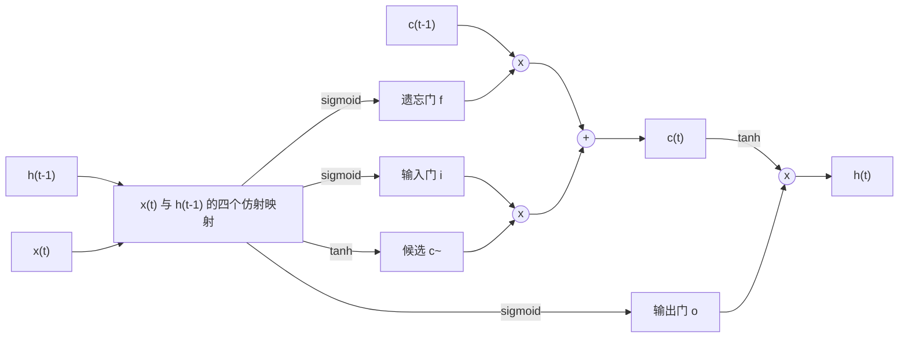

文本、语音、音乐、视频和时间序列都是序列：它们的元素有先后顺序，长度可变，一个元素的含义取决于此前出现的内容。前面各章的网络并不适合这类数据。**多层感知机**（[4.7.2](/4.7.2)）把固定大小的输入映射为固定大小的输出，没有时间的概念；序列可以填充到最大长度，或者平均成一个向量，但前者把参数浪费在各个位置上，后者则丢掉了顺序。循环神经网络解决这个问题的办法，是一次处理序列的一个元素，同时携带一个隐状态（对过去的学习得到的摘要）从一步传到下一步，每一步使用相同的权重。本章讨论循环网络，以及使它们能够用于文本的语言表示。

前半部分讲循环网络：简单循环网络、用**反向传播**穿过时间的训练方法、使长程依赖难以学习的梯度消失与**梯度爆炸**（即 [4.7.4](/4.7.4) §4.5 中一般现象的最极端形式），以及应对它们的门控结构 LSTM 与 GRU。然后用循环网络做语言建模和翻译等序列到序列任务，并介绍把下一个**词元**的模型变成生成文本的解码算法。后半部分讨论词如何变成向量：从独热编码，到 word2vec 与 GloVe 根据词的上下文学到的稠密词嵌入，以及文本一开始是如何切分成词元的。经典的概率序列模型，即 Markov 链与**隐 Markov 模型**，见 [4.6.8](/4.6.8)；注意力机制消除了循环序列到序列模型的瓶颈，由此引出 [4.7.6](/4.7.6) 的 Transformer，而通过预训练学到的上下文词表示是 [4.7.7](/4.7.7) 的主题。

## 5.1. 序列建模

### 5.1.1. 序列与任务

向量（或符号，§5.5 会把符号变成向量）的序列 $\boldsymbol{x}_1, \dots, \boldsymbol{x}_T$ 可以是任务的输入、输出，或者两者兼而有之。典型的组合有：

| 输入 | 输出 | 例子 |
|---|---|---|
| 向量 | 向量 | 标准的分类与回归（[4.7.2](/4.7.2)） |
| 序列 | 向量或标签 | 情感分类、自然语言推断、多项选择问答、说话人识别 |
| 向量 | 序列 | 图像描述生成、根据描述生成音乐 |
| 序列 | 等长（对齐）的序列 | 词性标注、命名实体识别、中文分词、语音的逐帧标注 |
| 序列 | 不等长的序列 | 机器翻译、语音识别、摘要、开放式问答、视频描述生成 |

由此得到两点要求。模型必须能接受任意长度的序列，并且应当在各个位置之间共享所学的内容：诸如"形容词位于它所修饰的名词之前"这样的规则应当只学一次，而不是在每个位置上分别学习，正如**卷积**（[4.7.3](/4.7.3)）在各个位置共享同一个滤波器。

### 5.1.2. 动力系统的观点

离散时间的动力系统按固定的规则演化状态，$\boldsymbol{s}_t = f(\boldsymbol{s}_{t-1}; \boldsymbol{\theta})$。由输入序列驱动，并通过输出映射观测，它就成为
$$
\boldsymbol{h}_t = f(\boldsymbol{h}_{t-1}, \boldsymbol{x}_t; \boldsymbol{\theta}), \qquad \hat{\boldsymbol{y}}_t = g(\boldsymbol{h}_t; \boldsymbol{\theta}),
$$
其中状态 $\boldsymbol{h}_t$ 概括了 $\boldsymbol{x}_1, \dots, \boldsymbol{x}_t$ 中对未来有用的一切信息。把递推式展开 $T$ 步，就把 $\boldsymbol{h}_T$ 写成 $f$ 的 $T$ 个副本的复合，$\boldsymbol{h}_T = f(f(\cdots f(\boldsymbol{h}_0, \boldsymbol{x}_1)\cdots, \boldsymbol{x}_{T-1}), \boldsymbol{x}_T)$，所以展开后的系统是一个深度**前馈网络**，其深度就是序列长度，各层共享参数 $\boldsymbol{\theta}$。这两点都很重要：共享参数使同一个模型适用于任意长度，而深度既说明了循环网络的能力，也说明了训练它们的困难。**Markov 模型**（[4.6.8](/4.6.8)）的状态是最近的 $n$ 个符号，与 $n$ 阶 Markov 模型相比，循环网络的状态是一个连续向量，原则上可以保留任意久远之前的信息。

## 5.2. 循环神经网络

### 5.2.1. 简单循环网络

**定义 5.2.1（循环神经网络）** 输入维数为 $n_x$、隐层维数为 $n_h$、输出维数为 $n_y$ 的（简单的，或称 Elman）**循环神经网络**（RNN），从初始状态 $\boldsymbol{h}_0$（通常取 $\boldsymbol{0}$）出发，对 $t = 1, \dots, T$ 计算
$$
\boldsymbol{h}_t = \tanh\bigl(W_{hh}\boldsymbol{h}_{t-1} + W_{xh}\boldsymbol{x}_t + \boldsymbol{b}_h\bigr), \qquad \boldsymbol{o}_t = W_{hy}\boldsymbol{h}_t + \boldsymbol{b}_y, \qquad \hat{\boldsymbol{y}}_t = \operatorname{softmax}(\boldsymbol{o}_t),
$$
其中 $W_{hh} \in \mathbb{R}^{n_h \times n_h}$，$W_{xh} \in \mathbb{R}^{n_h \times n_x}$，$W_{hy} \in \mathbb{R}^{n_y \times n_h}$，偏置 $\boldsymbol{b}_h, \boldsymbol{b}_y$，它们为所有时间步共享。总损失是各步损失之和；对分类问题，取**交叉熵损失** $L = \sum_{t=1}^T L_t$，其中对目标 $y_t$ 有 $L_t = -\log\hat y_{t, y_t}$。

这种网络由 Elman（1990）提出，建立在 Jordan（1986）的网络之上，后者反馈的是输出而不是隐状态。输出映射与损失取决于任务：标注与语言建模要在每一步输出，对整个序列分类则只用最后一个输出（或汇聚后的输出）。用代码表示，前向传播是一个循环：

```python
import numpy as np


def rnn_forward(X, h0, W_xh, W_hh, b_h, W_hy, b_y):
    """X: (T, n_x) one sequence. Returns hidden states (T, n_h) and output logits (T, n_y)."""
    h, H, O = h0, [], []
    for x in X:                                       # one step per element, same weights
        h = np.tanh(W_hh @ h + W_xh @ x + b_h)
        H.append(h)
        O.append(W_hy @ h + b_y)
    return np.array(H), np.array(O)
```

参数个数 $n_h(n_h + n_x + 1) + n_y(n_h + 1)$ 与序列长度无关。Siegelmann 与 Sontag（1995）证明，权重为有理数且精度不受限的 RNN 是图灵完备的；实践中，它们的记忆受限于训练的困难，而不是表达能力。tanh 使状态保持有界；用**线性整流单元**做递推也是可能的，但容易爆炸，除非把 $W_{hh}$ 初始化在单位矩阵附近（Le、Jaitly 与 Hinton 2015）。

### 5.2.2. 随时间反向传播

展开后的 RNN 是一个共享权重的**前馈网络**，所以它的梯度由展开的**计算图**上的**反向传播**（[4.7.2](/4.7.2)）计算，把所有时间步对每个共享权重的贡献相加。

**定义 5.2.2（随时间反向传播）** **随时间反向传播**（BPTT；Werbos 1990）计算 $L = \sum_t L_t$ 对循环网络参数的梯度：先在整个序列上做前向传播并存储所有状态，然后沿展开的图从 $t = T$ 到 $t = 1$ 反向传播梯度。

**定理 5.2.1** 对定义 5.2.1 的 RNN，记 $\boldsymbol{\varepsilon}_t = \partial L/\partial\boldsymbol{h}_t$，并记 $D_t = \operatorname{diag}(1 - \boldsymbol{h}_t \odot \boldsymbol{h}_t)$，即 tanh 在第 $t$ 步的导数。则 $\boldsymbol{\varepsilon}_T = W_{hy}^{\mathsf T}(\hat{\boldsymbol{y}}_T - \boldsymbol{y}_T)$，且对 $t = T-1, \dots, 1$，
$$
\boldsymbol{\varepsilon}_t = W_{hy}^{\mathsf T}(\hat{\boldsymbol{y}}_t - \boldsymbol{y}_t) + W_{hh}^{\mathsf T}D_{t+1}\boldsymbol{\varepsilon}_{t+1},
$$
其中 $\boldsymbol{y}_t$ 是独热目标。令 $\boldsymbol{\delta}_t = D_t\boldsymbol{\varepsilon}_t$，即对第 $t$ 步预激活值的梯度，则
$$
\frac{\partial L}{\partial W_{hh}} = \sum_{t=1}^T\boldsymbol{\delta}_t\boldsymbol{h}_{t-1}^{\mathsf T}, \qquad \frac{\partial L}{\partial W_{xh}} = \sum_{t=1}^T\boldsymbol{\delta}_t\boldsymbol{x}_t^{\mathsf T}, \qquad \frac{\partial L}{\partial\boldsymbol{b}_h} = \sum_{t=1}^T\boldsymbol{\delta}_t, \qquad \frac{\partial L}{\partial W_{hy}} = \sum_{t=1}^T(\hat{\boldsymbol{y}}_t - \boldsymbol{y}_t)\boldsymbol{h}_t^{\mathsf T}.
$$

**证明** 状态 $\boldsymbol{h}_t$ 通过输出 $\boldsymbol{o}_t$（从而通过 $L_t$）和下一个状态 $\boldsymbol{h}_{t+1}$ 影响 $L$，除此之外没有别的途径。由**链式法则**，$\boldsymbol{\varepsilon}_t = (\partial\boldsymbol{o}_t/\partial\boldsymbol{h}_t)^{\mathsf T}\partial L_t/\partial\boldsymbol{o}_t + (\partial\boldsymbol{h}_{t+1}/\partial\boldsymbol{h}_t)^{\mathsf T}\boldsymbol{\varepsilon}_{t+1}$。第一项由命题 2.4.1(a) 等于 $W_{hy}^{\mathsf T}(\hat{\boldsymbol{y}}_t - \boldsymbol{y}_t)$，而因为 $\tanh' = 1 - \tanh^2$，有 $\partial\boldsymbol{h}_{t+1}/\partial\boldsymbol{h}_t = D_{t+1}W_{hh}$；在 $t = T$ 时没有第二项。每个共享权重在每个时间步各用一次；梯度是各次使用的贡献之和，每次使用的贡献与定理 2.4.1 相同，即该连接输出端的误差（$\boldsymbol{\delta}_t$ 或 $\hat{\boldsymbol{y}}_t - \boldsymbol{y}_t$）与其输入端活动的外积。$\square$

BPTT 的计算量与前向传播相当，但由于必须存储所有状态，它的内存随 $T$ 线性增长。对长序列，截断的随时间反向传播（truncated BPTT）把序列切成每段 $k$ 步（比如 $k = 100$），隐状态跨越段的边界向前传递，但只在每段之内反向传播；模型仍可以通过状态利用久远过去的信息，但得不到梯度信号来学会保留这些信息。

### 5.2.3. 梯度随时间的消失与爆炸

时刻 $t$ 的损失 $L_t$ 对较早时刻 $k < t$ 的状态的梯度，是 $t - k$ 个 Jacobi 矩阵的乘积：
$$
\frac{\partial L_t}{\partial\boldsymbol{h}_k} = \Bigl(\frac{\partial\boldsymbol{h}_t}{\partial\boldsymbol{h}_k}\Bigr)^{\mathsf T}\frac{\partial L_t}{\partial\boldsymbol{h}_t}, \qquad \frac{\partial\boldsymbol{h}_t}{\partial\boldsymbol{h}_k} = \prod_{j=k+1}^{t}D_jW_{hh} = D_tW_{hh}D_{t-1}W_{hh}\cdots D_{k+1}W_{hh} .
$$
与前馈网络不同，同一个矩阵 $W_{hh}$ 出现在每个因子中，所以行为由它的谱决定。

**命题 5.2.1** 对 tanh RNN，$\bigl\|\partial\boldsymbol{h}_t/\partial\boldsymbol{h}_k\bigr\|_2 \le \|W_{hh}\|_2^{\,t-k}$。因此，若 $W_{hh}$ 的最大**奇异值**小于 $1$，则第 $k$ 步对第 $t$ 步梯度的贡献随 $t - k$ 指数消失。反之，对线性递推 $\boldsymbol{h}_t = W_{hh}\boldsymbol{h}_{t-1} + \dots$，若 $W_{hh}$ 可对角化且**谱半径**大于 $1$，则 Jacobi 矩阵 $W_{hh}^{t-k}$ 沿相应的特征向量指数增长。

**证明** $\|D_j\|_2 = \max_i(1 - h_{j,i}^2) \le 1$，且谱范数是次可乘的。对线性情形，若 $W_{hh}\boldsymbol{u} = \lambda\boldsymbol{u}$ 且 $\lvert\lambda\rvert > 1$，则 $W_{hh}^{t-k}\boldsymbol{u} = \lambda^{t-k}\boldsymbol{u}$。$\square$

所以在 tanh RNN 中，$\|W_{hh}\|_2 > 1$ 是梯度爆炸的必要条件，而若最大奇异值小于 $1$，梯度必然消失（Pascanu、Mikolov 与 Bengio 2013）。Bengio、Simard 与 Frasconi（1994）在 Hochreiter 1991 年的分析之后，指出了其背后的两难：循环网络要使存储的信息对小扰动保持稳健，其动力学在被存储的状态附近必须是收缩的，而这恰好是梯度消失的区域。实际上，总损失的梯度由短程的项主导，网络学到的依赖大约只有 $10$ 到 $20$ 步，学不会像"我去中国读研究生……两年后我终于能说一口流利的汉语"这样，最后一个词依赖于很久以前的某个词，而"云在天上"这样的依赖却很容易。


这两种失败需要不同的补救办法。

- **梯度爆炸**很少出现，但后果严重：一个巨大的步长就会毁掉参数。按全局范数的**梯度裁剪**（[4.7.4](/4.7.4)）由 Mikolov（2012）与 Pascanu 等人（2013）引入 RNN，可以可靠地处理它。
- **梯度消失**无法在优化器层面解决，因为信息并不在梯度之中。Pascanu 等人提出了一个正则项，鼓励 $\partial\boldsymbol{h}_{t+1}/\partial\boldsymbol{h}_t$ 保持反向传播误差的范数；把 $W_{hh}$ 初始化为正交矩阵或单位矩阵，对训练初期有帮助；**层归一化**（[4.7.4](/4.7.4)）可以稳定动力学。决定性的解决办法来自架构：带有加性记忆通路的门控单元。

## 5.3. 门控循环网络

### 5.3.1. 长短期记忆网络

LSTM（Hochreiter 与 Schmidhuber 1997）保存两个状态：细胞状态 $\boldsymbol{c}_t$，这是一块只通过逐元素乘法与加法来改变的记忆；以及隐状态 $\boldsymbol{h}_t$，即从中读出的输出。三个门（每个都是取值在 $(0, 1)$ 内的 sigmoid 层）决定遗忘什么、写入什么、读出什么。

**定义 5.3.1（长短期记忆网络）** 输入为 $\boldsymbol{x}_t \in \mathbb{R}^{n_x}$、隐层维数为 $n_h$ 的**长短期记忆网络**（LSTM）层计算如下，其中 $\sigma$ 是 logistic sigmoid：
$$
\begin{aligned}
\boldsymbol{f}_t &= \sigma(W_f\boldsymbol{x}_t + U_f\boldsymbol{h}_{t-1} + \boldsymbol{b}_f) && \text{（遗忘门）} \\
\boldsymbol{i}_t &= \sigma(W_i\boldsymbol{x}_t + U_i\boldsymbol{h}_{t-1} + \boldsymbol{b}_i) && \text{（输入门）} \\
\boldsymbol{o}_t &= \sigma(W_o\boldsymbol{x}_t + U_o\boldsymbol{h}_{t-1} + \boldsymbol{b}_o) && \text{（输出门）} \\
\tilde{\boldsymbol{c}}_t &= \tanh(W_c\boldsymbol{x}_t + U_c\boldsymbol{h}_{t-1} + \boldsymbol{b}_c) && \text{（候选）} \\
\boldsymbol{c}_t &= \boldsymbol{f}_t \odot \boldsymbol{c}_{t-1} + \boldsymbol{i}_t \odot \tilde{\boldsymbol{c}}_t && \text{（细胞状态）} \\
\boldsymbol{h}_t &= \boldsymbol{o}_t \odot \tanh(\boldsymbol{c}_t) && \text{（隐状态）}
\end{aligned}
$$
其中 $W_\bullet \in \mathbb{R}^{n_h \times n_x}$，$U_\bullet \in \mathbb{R}^{n_h \times n_h}$，$\boldsymbol{b}_\bullet \in \mathbb{R}^{n_h}$，$\boldsymbol{c}_0 = \boldsymbol{h}_0 = \boldsymbol{0}$。



遗忘门缩放旧的记忆，输入门缩放新的内容，输出门决定记忆有多少暴露在 $\boldsymbol{h}_t$ 中，而 $\boldsymbol{h}_t$ 送入下一步和输出层。关键在于细胞的更新。沿着从 $\boldsymbol{c}_{t-1}$ 到 $\boldsymbol{c}_t$ 的直接路径，
$$
\frac{\partial\boldsymbol{c}_t}{\partial\boldsymbol{c}_{t-1}}\Big|_{\text{直接}} = \operatorname{diag}(\boldsymbol{f}_t), \qquad \frac{\partial\boldsymbol{c}_t}{\partial\boldsymbol{c}_k}\Big|_{\text{直接}} = \operatorname{diag}\Bigl(\prod_{j=k+1}^t\boldsymbol{f}_j\Bigr),
$$
这是一个对角矩阵，没有重复乘以权重矩阵，也没有压缩性的导数。当遗忘门接近 $1$ 时，误差可以跨越许多步向后流动而基本不变；Hochreiter 与 Schmidhuber 把它称为恒定误差传送带（constant error carousel）。（最初的 LSTM 没有遗忘门，相当于 $\boldsymbol{f}_t = \boldsymbol{1}$；Gers、Schmidhuber 与 Cummins（2000）加入了遗忘门，使网络也能重置记忆。）与简单 RNN 不同，沿这条路径的衰减是学习得到的，并依赖于输入，如 §5.2.3 的图的右半部分所示。实际应用中的几点结论：

- 把遗忘门偏置 $\boldsymbol{b}_f$ 初始化为 $1$ 或更大，使网络在训练初期默认进行记忆（Gers 等 2000；Jozefowicz、Zaremba 与 Sutskever 2015 发现这是单项最重要的改进）。
- 一个 LSTM 层有 $4n_h(n_x + n_h + 1)$ 个参数，是同样宽度的简单 RNN 的四倍，四个仿射映射可作为一次矩阵乘法计算。
- 大规模的消融研究（Greff 等 2017）发现，遗忘门与输出激活函数是最重要的组成部分；窥孔连接（让门看到细胞状态）等变体几乎没有差别。

LSTM 学到了跨越数百步的依赖，从 2007 年前后到 2018–2019 年前后 Transformer 取而代之之前，它一直是语音识别、手写识别、语言建模和机器翻译的最先进技术。

### 5.3.2. 门控循环单元

**定义 5.3.2（门控循环单元）** **门控循环单元**（GRU；Cho 等 2014）只有一个状态 $\boldsymbol{h}_t$ 和两个门：
$$
\begin{aligned}
\boldsymbol{z}_t &= \sigma(W_z\boldsymbol{x}_t + U_z\boldsymbol{h}_{t-1} + \boldsymbol{b}_z) && \text{（更新门）} \\
\boldsymbol{r}_t &= \sigma(W_r\boldsymbol{x}_t + U_r\boldsymbol{h}_{t-1} + \boldsymbol{b}_r) && \text{（重置门）} \\
\tilde{\boldsymbol{h}}_t &= \tanh\bigl(W_h\boldsymbol{x}_t + U_h(\boldsymbol{r}_t \odot \boldsymbol{h}_{t-1}) + \boldsymbol{b}_h\bigr) && \text{（候选）} \\
\boldsymbol{h}_t &= (\boldsymbol{1} - \boldsymbol{z}_t) \odot \boldsymbol{h}_{t-1} + \boldsymbol{z}_t \odot \tilde{\boldsymbol{h}}_t .
\end{aligned}
$$

更新门在保留旧状态与写入候选之间插值，相当于 LSTM 的遗忘门与输入门，只是约束二者之和为 $1$；重置门决定旧状态有多少进入候选，使单元可以在新的片段开始时忽略过去。GRU 合并了细胞状态与隐状态，且没有输出门，所以只有三块而不是四块权重，参数个数为 $3n_h(n_x + n_h + 1)$。（约定因实现而异：PyTorch 的 `nn.GRU` 写作 $\boldsymbol{h}_t = (\boldsymbol{1} - \boldsymbol{z}_t) \odot \tilde{\boldsymbol{h}}_t + \boldsymbol{z}_t \odot \boldsymbol{h}_{t-1}$，并且把重置门作用在矩阵乘积 $U_h\boldsymbol{h}_{t-1}$ 之后。）

实证比较（Chung 等 2014；Jozefowicz 等 2015；Greff 等 2017）发现，GRU 与 LSTM 在大多数任务上相当，没有稳定的胜者，而两者都远好于简单 RNN。GRU 更廉价；LSTM 的表达能力稍强，例如它能学会计数，而 GRU 的插值式更新无法稳定地做到这一点（Weiss、Goldberg 与 Yahav 2018）。一些粗略的说法，如简单 RNN 能记住约 100 步、LSTM 500 步、GRU 1000 步，不应当照字面理解：可用的记忆取决于任务、训练与门的初始化，而且一般而言 GRU 保留信息的时间并不比 LSTM 更长。

### 5.3.3. 实现

下面的 NumPy 代码实现了一个 LSTM 单元，并让它在一个序列上运行；四个门的权重块按输入、遗忘、候选、输出的顺序堆叠，这是 PyTorch 的布局。

```python
import numpy as np


def sigmoid(z):
    return 1.0 / (1.0 + np.exp(-z))


def lstm_cell(x, h, c, W_x, W_h, b):
    """One LSTM step for a batch. x: (B, n_x), h, c: (B, n_h).
    W_x: (4 n_h, n_x), W_h: (4 n_h, n_h), b: (4 n_h,), gates stacked as [i, f, g, o]."""
    z = x @ W_x.T + h @ W_h.T + b
    i, f, g, o = np.split(z, 4, axis=1)
    i, f, o = sigmoid(i), sigmoid(f), sigmoid(o)   # input, forget and output gates
    g = np.tanh(g)                                   # candidate cell state
    c_new = f * c + i * g                            # additive memory update
    h_new = o * np.tanh(c_new)
    return h_new, c_new


def lstm(X, W_x, W_h, b):
    """Run over a sequence X: (T, B, n_x) from zero states; return all hidden states."""
    T, B, _ = X.shape
    n_h = W_h.shape[1]
    h, c = np.zeros((B, n_h)), np.zeros((B, n_h))
    H = []
    for t in range(T):
        h, c = lstm_cell(X[t], h, c, W_x, W_h, b)
        H.append(h)
    return np.stack(H), (h, c)


rng = np.random.default_rng(0)
n_x, n_h, T, B = 3, 5, 7, 2
k = 1 / np.sqrt(n_h)
W_x = rng.uniform(-k, k, (4 * n_h, n_x))
W_h = rng.uniform(-k, k, (4 * n_h, n_h))
b = np.zeros(4 * n_h)
b[n_h:2 * n_h] = 1.0                                 # forget-gate bias 1: remember by default
X = rng.standard_normal((T, B, n_x))
H, (h_T, c_T) = lstm(X, W_x, W_h, b)
print("hidden states:", H.shape, " last h[0]:", np.round(h_T[0], 4))
```

```text
hidden states: (7, 2, 5)  last h[0]: [-0.004  -0.1063  0.0993 -0.0595 -0.002 ]
```

把同样的权重装入 `torch.nn.LSTM`（PyTorch 2.14，CPU）后可以复现隐状态；它每层有两个偏置向量，二者之和相当于 $\boldsymbol{b}$：

```python
import numpy as np
import torch

lstm_t = torch.nn.LSTM(n_x, n_h)                     # input shape (T, B, n_x)
with torch.no_grad():
    lstm_t.weight_ih_l0.copy_(torch.tensor(W_x))
    lstm_t.weight_hh_l0.copy_(torch.tensor(W_h))
    lstm_t.bias_ih_l0.copy_(torch.tensor(b))
    lstm_t.bias_hh_l0.zero_()
    H_t, (h_t, c_t) = lstm_t(torch.tensor(X, dtype=torch.float32))
print(f"max |torch - numpy| = {np.abs(H_t.numpy() - H).max():.1e}")
```

```text
max |torch - numpy| = 5.6e-08
```

实际使用的是库中的模块，它们在优化过的内核（GPU 上是 cuDNN）中运行整个序列，接受 `num_layers`、`bidirectional=True` 与 `dropout` 参数，并通过 `pack_padded_sequence` 以**填充**处理长度不同的序列批。

### 5.3.4. 堆叠与双向 RNN

循环层有两种组合方式。堆叠（深层）RNN 把一层的隐状态作为下一层的输入，$\boldsymbol{h}^{(l)}_t = f^{(l)}(\boldsymbol{h}^{(l)}_{t-1}, \boldsymbol{h}^{(l-1)}_t)$，其中 $\boldsymbol{h}^{(0)}_t = \boldsymbol{x}_t$；两到四层 LSTM 是典型配置，更深的堆叠需要**残差连接**，如 Google 的八层翻译系统（Wu 等 2016）。**随机失活**施加在层与层之间，而不施加在循环连接上，或者在每个时间步使用相同的掩码（Gal 与 Ghahramani 2016）。

单向 RNN 在 $\boldsymbol{h}_t$ 中只概括前缀 $\boldsymbol{x}_1, \dots, \boldsymbol{x}_t$。对于标注任务，一个词的标签往往取决于它后面的内容：在 *He said, "Teddy bears are on sale!"* 与 *He said, "Teddy Roosevelt was a great President!"* 中，"Teddy" 在第一句里是普通名词，在第二句里是人名的一部分，这只有看到后面的词才能知道。

**定义 5.3.3（双向循环神经网络）** **双向循环神经网络**（Schuster 与 Paliwal 1997）在序列上运行两个循环层，一个正向、一个反向，
$$
\overrightarrow{\boldsymbol{h}}_t = f\bigl(\overrightarrow{\boldsymbol{h}}_{t-1}, \boldsymbol{x}_t\bigr), \qquad \overleftarrow{\boldsymbol{h}}_t = f'\bigl(\overleftarrow{\boldsymbol{h}}_{t+1}, \boldsymbol{x}_t\bigr), \qquad \boldsymbol{h}_t = \bigl[\overrightarrow{\boldsymbol{h}}_t; \overleftarrow{\boldsymbol{h}}_t\bigr],
$$
二者参数各自独立，并用拼接来表示位置 $t$，它依赖于前缀与后缀两侧的上下文。

双向 LSTM（BiLSTM）常常在顶部加一个条件随机场，是命名实体识别等标注任务的标准架构，也是基于注意力的翻译的编码器（§5.4.3，[4.7.6](/4.7.6)）。它们需要预先得到整个输入，所以不能用于生成或流式处理。

## 5.4. 语言模型与序列到序列学习

### 5.4.1. 语言模型

**定义 5.4.1（语言模型）** **语言模型**是词表 $V$ 中词元序列 $w_1, \dots, w_T$ 上的概率分布，几乎总是通过概率的链式法则表示成各个下一词元分布的乘积：
$$
\mathbb{P}(w_1, \dots, w_T) = \prod_{t=1}^T\mathbb{P}(w_t \mid w_1, \dots, w_{t-1}).
$$

下一词元**条件概率**的模型给句子赋予概率，可以对语音识别器、翻译系统与输入法（[4.5.2](/4.5.2)）的输出排序，并通过一次采样一个**词元**来生成文本。经典方法把历史截断为最后 $n - 1$ 个词元，即 Markov 假设，并用平滑后的计数来估计条件概率（n 元模型，[4.6.8](/4.6.8)）。计数不能泛化：可能的历史数按 $\lvert V\rvert^{n-1}$ 增长，其中大多数从未在训练数据中出现，而且观察到 "the cat is walking in the bedroom" 并不能说明 "a dog was running in a room"，尽管这两句话很相似。

神经语言模型用一个学习得到的向量来表示每个词，使相似的词得到相似的向量，概率函数对它们是光滑的，从而同时解决了这两个问题。Bengio 等人（2003）把前 $n - 1$ 个词的向量拼接起来，经过一个 tanh 隐层和对词表的 **softmax 函数**，并用极大似然把词向量与网络一起训练；这样学到的词向量是 §5.5 的词嵌入的前身。RNN 语言模型（Mikolov 等 2010）去掉了固定的窗口：隐状态 $\boldsymbol{h}_{t-1}$ 概括整个前缀，$\hat{\boldsymbol{y}}_t = \operatorname{softmax}(W_{hy}\boldsymbol{h}_{t-1} + \boldsymbol{b}_y)$ 预测 $w_t$，第 $t$ 步的输入是 $w_{t-1}$ 的向量。训练极小化每个下一词元的**交叉熵**，这就是上面分解式的极大似然（[4.7.1](/4.7.1)）。

语言模型用留出文本上的**困惑度**来评价，
$$
\operatorname{PP} = \exp\Bigl(-\frac1T\sum_{t=1}^T\log\mathbb{P}(w_t \mid w_{<t})\Bigr),
$$
即每个词元平均交叉熵的指数。若模型每一步都把概率均匀地分配给 $k$ 个词元，则困惑度为 $k$，所以困惑度是模型在其间犹豫不决的有效选择数。在 Penn Treebank 基准上，Kneser–Ney 平滑的 5 元模型的困惑度约为 $141$，Mikolov 等人的 RNN 语言模型约为 $124$（与其他模型结合后为 $80$ 到 $90$），而正则化良好的 LSTM 约为 $58$（Merity、Keskar 与 Socher 2018）。困惑度只有在分词方式和**测试集**相同时才可比较。

### 5.4.2. 用于语言任务的循环网络

词表示成向量后，§5.1.1 的任务分类可以直接对应到循环架构上。

- 文本分类（情感、主题、两个句子间的蕴含、多项选择）：用 RNN 或 BiLSTM 编码文本，对单个向量分类，即最后的隐状态 $\boldsymbol{h}_T$ 或平均值 $\frac1T\sum_t\boldsymbol{h}_t$（或沿时间取最大值）；平均通常更稳健，因为长文本的最后状态由其结尾主导。
- 序列标注（词性标注、命名实体识别、把中文分词看作给字符标注词首、词中、词尾等标签）：对 BiLSTM 的每个 $\boldsymbol{h}_t$ 施加 softmax 分类器。
- 语言建模与生成：单向 RNN 根据 $\boldsymbol{h}_t$ 预测下一个词元。
- 转换（翻译、对话、摘要）：编码器–解码器，见下。

### 5.4.3. 序列到序列模型

**定义 5.4.2（序列到序列模型）** **序列到序列模型**（编码器–解码器模型）用两个网络把输入序列 $\boldsymbol{x}_1, \dots, \boldsymbol{x}_S$ 映射为长度可能不同的输出序列 $y_1, \dots, y_T$：*编码器*读取输入并产生表示 $\boldsymbol{c}$，*解码器*是一个条件语言模型
$$
\mathbb{P}(y_1, \dots, y_T \mid \boldsymbol{x}) = \prod_{t=1}^T\mathbb{P}(y_t \mid y_1, \dots, y_{t-1}, \boldsymbol{c}),
$$
它从序列开始词元 `<bos>` 出发，每次生成一个词元，直到输出序列结束词元 `<eos>` 为止。

在 RNN 版本中（Sutskever、Vinyals 与 Le 2014；Cho 等 2014），编码器是 LSTM 或 GRU，其最终状态 $\boldsymbol{c} = \boldsymbol{h}_S$ 初始化解码器 RNN，$\boldsymbol{s}_t = f(\boldsymbol{s}_{t-1}, \boldsymbol{e}(y_{t-1}))$，其中 $\boldsymbol{s}_0 = \boldsymbol{c}$，$\boldsymbol{e}(y)$ 是词元 $y$ 的嵌入，且 $\mathbb{P}(y_t \mid \cdot) = \operatorname{softmax}(W\boldsymbol{s}_t)$。Sutskever 等人使用了每层 1000 个单元的四层 LSTM，并发现把源句子的顺序反过来有帮助，因为这缩短了源句与目标句开头几个词之间的距离；他们的集成模型在 WMT'14 英法翻译上达到 34.8 的 BLEU 分数，接近当时最好的基于短语的系统。

模型在句对 $(\boldsymbol{x}, \boldsymbol{y})$ 上用极大似然训练，这就提出了一个问题：解码器在第 $t$ 步接收什么作为输入？

**定义 5.4.3（教师强制）** **教师强制**（Williams 与 Zipser 1989）训练自回归模型的方式是：每一步都给它输入真实的前面的词元 $y_1, \dots, y_{t-1}$，而不是它自己的预测，并极小化 $-\sum_t\log\mathbb{P}(y_t \mid y_{<t}, \boldsymbol{x})$。在推断时没有真值可用，模型自己的输出被反馈回去（*自由运行*）。

教师强制使每一步的损失与模型早先的错误无关，并且对 Transformer 而言，允许序列的所有位置并行训练（[4.7.6](/4.7.6)）。它的缺点是暴露偏差（exposure bias）：训练时模型从未见过自己的错误，所以推断时一个错误会把它带入从未训练过的状态，错误可能累积。补救办法包括计划采样，即在训练中逐步用模型的样本取代真实的输入（Bengio 等 2015），以及用**强化学习**做序列级训练，直接优化整个生成输出的评价指标；在现代语言模型的规模下，暴露偏差的影响不像曾经担心的那样严重，而用强化学习在模型自身的输出上做后训练则直接解决了这个问题（[4.7.9](/4.7.9)）。

定义 5.4.2 的编码器–解码器把整个输入压缩进一个固定大小的向量 $\boldsymbol{c}$，对于长于约 20 个词的句子，它的翻译质量急剧下降（Cho 等 2014）。Bahdanau、Cho 与 Bengio（2015）消除了这一瓶颈，办法是让解码器在每一步回顾所有编码器状态，这就是 [4.7.6](/4.7.6) 的注意力机制。

### 5.4.4. 解码

给定训练好的 $\mathbb{P}(y_t \mid y_{<t}, \boldsymbol{x})$ 模型，生成输出是一个**搜索问题**：最可能的输出 $\arg\max_{\boldsymbol{y}}\mathbb{P}(\boldsymbol{y} \mid \boldsymbol{x})$ 无法精确求出，因为序列的数目随长度指数增长。

- 贪心解码在每一步选择最可能的词元。它很快，但可能过早地选定一个导致整体序列很差的前缀。
- 采样从预测的分布中抽取 $y_t$，通常先用温度（temperature）$\tau > 0$ 重新缩放 logit $\boldsymbol{z}$，$\mathbb{P}_\tau(y_t = i) \propto \exp(z_i/\tau)$：$\tau < 1$ 使分布变尖，趋向贪心解码，$\tau > 1$ 使分布变平。采样产生多样的输出，但分布长尾中的大量低概率词元合起来占有可观的质量，采到其中之一可能使文本跑偏。
- Top-$k$ 采样（Fan、Lewis 与 Dauphin 2018）只从 $k$ 个最可能的词元中采样，并重新归一化。核采样（nucleus sampling）或 top-$p$ 采样（Holtzman 等 2020）从总概率至少为 $p$（例如 $p = 0.9$）的最小的最可能词元集合中采样：模型有把握时（"I ate the pizza while it was still" 之后是 "hot" 或 "warm"）这个集合很小，而许多续写都合理时（"She said, 'I never'" 可以有很多种续写）这个集合很大，固定的 $k$ 无法这样自适应。Min-$p$ 采样则保留概率至少为最高概率词元的某个比例的词元。

**算法 5.4.1（束搜索）** 束宽为 $k$ 的**束搜索**保留得分最高的 $k$ 个部分输出（假设）。每一步它用每个词元扩展每个假设，以扩展后的总对数概率 $\sum_{s \le t}\log\mathbb{P}(y_s \mid y_{<s}, \boldsymbol{x})$ 打分，保留最好的 $k$ 个；输出 `<eos>` 的假设被放到一边，作为已完成的假设。当有 $k$ 个假设完成或达到最大长度时停止，返回得分最高的已完成假设，得分通常按长度归一化（原始的对数概率偏向短输出）。

$k = 1$ 的束搜索就是贪心解码；翻译与摘要中的束宽通常为 $4$ 到 $10$，这类任务基本上只有一个正确输出。对于开放式生成，最可能的序列往往平淡而重复（Holtzman 等 2020 称之为*退化*），更适合采用温度约为 $0.7$ 到 $1$ 的采样，并结合 top-$p$。2026 年的大语言模型大多通过采样解码；**推理模型**通常在温度约为 $1$ 下采样，还可以抽取多个样本进行比较（[4.7.9](/4.7.9)）。

## 5.5. 词的表示

### 5.5.1. 独热向量

神经网络用实数计算，图像以像素强度的形式直接提供实数。文本则由离散的符号构成。最简单的数值表示是固定词表 $V = \{v_1, \dots, v_{\lvert V\rvert}\}$，把第 $i$ 个词表示为独热向量（one-hot vector）$\boldsymbol{e}_i \in \{0, 1\}^{\lvert V\rvert}$，第 $i$ 位为 $1$，其余为 $0$；文档则表示为其中各词的独热向量之和，即它的词袋（bag of words），也就是计数（可能经过重新加权，如 tf–idf）。

独热向量有两个致命的缺陷。它们又大又稀疏：词表有 $10^4$ 到 $10^6$ 项。而且它们没有相似性的概念：任意两个不同的独热向量都正交，**欧氏距离**为 $\sqrt2$，所以 "hotel" 与 "motel" 的距离和它与 "banana" 的距离一样远。对词袋来说，文档 "I like deep learning" 与 "we love neural networks" 没有共同的词，**余弦相似度**为 $0$，尽管它们说的几乎是同一件事。传统的自然语言处理靠手工构建的资源（如 WordNet 之类的词典）和特征工程来弥补，需要付出巨大的专业知识成本。深度学习则从数据中学习低维的稠密向量。

### 5.5.2. 分布假设

如果一个词的含义不是来自词典，那么来自何处？语言学家回答：来自它的用法。

**定义 5.5.1（分布假设）** **分布假设**认为，出现在相似上下文中的词往往具有相似的含义（Harris 1954）；Firth（1957）的表述是："观其伴而知其词"（you shall know a word by the company it keeps）。

如果我们看到 "a bottle of tezgüino is on the table"、"everybody likes tezgüino"、"tezgüino makes you drunk" 和 "we make tezgüino out of corn"，就可以猜出 tezgüino 是一种含酒精的饮料，因为 "wine" 或 "beer" 也适合同样的上下文。这一假设把语义变成统计：用词周围词的分布来表示每个词。基于计数的方法构造共现矩阵 $X \in \mathbb{R}^{\lvert V\rvert \times \lvert V\rvert}$，其中 $X_{wc}$ 统计词 $c$ 出现在词 $w$ 周围 $\pm 5$ 个词的窗口内的次数。原始计数由 "the" 之类的高频词主导，所以要用点互信息（pointwise mutual information）重新加权：
$$
\operatorname{PMI}(w, c) = \log\frac{\mathbb{P}(w, c)}{\mathbb{P}(w)\mathbb{P}(c)} \approx \log\frac{X_{wc}\cdot\sum_{w', c'}X_{w'c'}}{\sum_{c'}X_{wc'}\cdot\sum_{w'}X_{w'c}},
$$
它度量 $w$ 与 $c$ 共现的频率比二者相互独立时高多少（正 PMI 把负值替换为 $0$）。PMI 矩阵的行是长而稀疏的词向量；截断的**奇异值分解**把它们压缩到几百个稠密维度，就是潜在语义分析（Deerwester 等 1990）。§5.6 的基于预测的方法则直接学习稠密向量，并且事实证明它们与这种分解密切相关。

### 5.5.3. 词嵌入

**定义 5.5.2（词嵌入）** **词嵌入**把词表 $V$ 中的每个词 $w$ 映射为稠密向量 $\boldsymbol{v}_w \in \mathbb{R}^d$，其中 $d$ 通常为 $50$ 到 $1000$，远小于 $\lvert V\rvert$，使得向量的几何反映词之间的关系；这些向量是嵌入矩阵（embedding matrix）$E \in \mathbb{R}^{d \times \lvert V\rvert}$ 的列，即 $\boldsymbol{v}_{v_i} = E\boldsymbol{e}_i$。

独热向量乘以矩阵就是选出一列，所以嵌入层是作用在独热输入上的线性层，实现为查表（`torch.nn.Embedding`）；它的参数与其他参数一样通过**反向传播**训练，或者作为某个任务的模型的一部分，或者预先在无标注文本上训练，再加以复用。句子变成向量序列，可供 RNN、**卷积神经网络**或 Transformer 处理。这个意义上的嵌入是分布式表示（Hinton 1986）：每个词由许多特征来描述，每个特征被许多词共享。例如在一个以 "动物"、"植物"、"食物" 为坐标轴的三维玩具例子中，猪 $(1.0, 0.1, 1.0)$ 与绵羊 $(1.0, 0.2, 1.0)$ 很接近，熊猫 $(1.0, 0.3, 0.0)$ 与它们共享第一个特征，而竹子 $(0.0, 1.0, 0.1)$ 与它们几乎没有共同点。学到的维度并不能这样逐个解释，但空间中的方向往往可以（§5.6.5）。

## 5.6. 学习词嵌入

### 5.6.1. word2vec

Bengio 等人的神经语言模型把词向量作为副产品学到，代价是一个很大的隐层，以及每个训练**词元**都要做一次完整的 **softmax 函数**。Mikolov 等人（2013）观察到，如果目标只是向量，模型可以大幅简化：去掉隐层，训练一个对数线性模型，由邻近的词预测词，这样就能在数小时内训练数十亿词。

**定义 5.6.1（word2vec）** **word2vec**（Mikolov 等 2013）是一族浅层模型，通过由 $\pm m$ 个位置的窗口内的上下文预测词，从无标注文本中学习词嵌入。每个词 $w$ 在 $\mathbb{R}^d$ 中有一个输入向量 $\boldsymbol{v}_w$ 和一个输出向量 $\boldsymbol{u}_w$。**连续词袋模型**（CBOW）由上下文输入向量的平均 $\bar{\boldsymbol{v}}_t = \frac{1}{2m}\sum_{0 < \lvert j\rvert \le m}\boldsymbol{v}_{w_{t+j}}$ 预测中心词 $w_t$，其中 $\mathbb{P}(w_t \mid \text{上下文}) = \operatorname{softmax}_{w}(\boldsymbol{u}_w^{\mathsf T}\bar{\boldsymbol{v}}_t)$。**跳字模型**（skip-gram）则由中心词预测每个上下文词，
$$
\mathbb{P}(o \mid c) = \frac{\exp(\boldsymbol{u}_o^{\mathsf T}\boldsymbol{v}_c)}{\sum_{w \in V}\exp(\boldsymbol{u}_w^{\mathsf T}\boldsymbol{v}_c)},
$$
并在语料上极大化 $\sum_t\sum_{0 < \lvert j\rvert \le m}\log\mathbb{P}(w_{t+j} \mid w_t)$。训练之后，输入向量 $\boldsymbol{v}_w$（有时与 $\boldsymbol{u}_w$ 取平均）就是词嵌入。

监督信号由无标注文本自身构造，这是**自监督学习**的早期实例。跳字模型对罕见词与小语料效果更好，CBOW 更快。跳字模型的对数概率对中心向量的梯度
$$
\frac{\partial}{\partial\boldsymbol{v}_c}\log\mathbb{P}(o \mid c) = \boldsymbol{u}_o - \sum_{w \in V}\mathbb{P}(w \mid c)\,\boldsymbol{u}_w,
$$
把 $\boldsymbol{v}_c$ 拉向观察到的上下文词，推离期望的上下文词；出现在相似上下文中的词受到相似的更新，最终得到相似的向量，这就是分布假设在起作用。问题在于归一化：对每个训练对，softmax 都要对整个词表求和，而词表有 $10^5$ 到 $10^6$ 个词。有两种近似可以避免它。

### 5.6.2. 层次 softmax

层次 softmax（hierarchical softmax）（Morin 与 Bengio 2005；Mnih 与 Hinton 2009）把词表排成一棵**二叉树**的叶子，用沿着从根到目标词的路径的一系列二元决策取代扁平的 softmax。每个内部结点 $n$ 有一个向量 $\boldsymbol{u}_n$，在 $n$ 处向左的概率是 $\sigma(\boldsymbol{u}_n^{\mathsf T}\boldsymbol{v}_c)$，向右的概率是 $\sigma(-\boldsymbol{u}_n^{\mathsf T}\boldsymbol{v}_c) = 1 - \sigma(\boldsymbol{u}_n^{\mathsf T}\boldsymbol{v}_c)$。一个词的概率是其路径上各决策的概率之积，
$$
\mathbb{P}(w \mid c) = \prod_{j=1}^{L(w)}\sigma\bigl(\pm\boldsymbol{u}_{n(w, j)}^{\mathsf T}\boldsymbol{v}_c\bigr),
$$
其中路径的第 $j$ 个结点 $n(w, j)$ 处向左转取 $+$，向右转取 $-$。由于每个结点处两个分支的概率之和为 $1$，这些概率在叶子上的总和也为 $1$，无需任何归一化。树有 $\lvert V\rvert - 1$ 个内部结点，所以参数个数与扁平 softmax 的输出向量大致相同，但一个训练对的代价是 $O(\log\lvert V\rvert)$ 而不是 $O(\lvert V\rvert)$。word2vec 使用按词频构造的 **Huffman 树**，它使高频词的路径较短，并使期望代价最小。这条由相互依赖的决策组成的顺序路径在 GPU 上并行性很差，这是负采样更流行的原因之一。

### 5.6.3. 负采样

我们也可以不去计算归一化的分布，而是训练模型把观察到的（词，上下文）对与随机凑出的对区分开来："I like deep learning" 是一个观察到的句子，而随机替换中心词得到的 "I hate deep learning"、"I code with deep learning" 或 "I play deep learning" 则是*噪声*样本。

**定义 5.6.2（负采样）** **负采样**（Mikolov 等 2013）把对观察到的对 $(c, o)$ 的跳字模型目标中的项 $\log\mathbb{P}(o \mid c)$ 替换为
$$
\log\sigma\bigl(\boldsymbol{u}_o^{\mathsf T}\boldsymbol{v}_c\bigr) + \sum_{k=1}^K\log\sigma\bigl(-\boldsymbol{u}_{n_k}^{\mathsf T}\boldsymbol{v}_c\bigr), \qquad n_1, \dots, n_K \overset{\text{iid}}{\sim} P_n,
$$
这是一个 **logistic 回归**的对数似然，该回归把观察到的对分类为真，把 $K$ 个词取自噪声分布 $P_n$ 的对 $(c, n_k)$ 分类为假。标准的噪声分布是一元分布的 $\frac34$ 次幂，$P_n(w) \propto \#(w)^{3/4}$，小语料取 $K = 5$ 到 $20$，大语料取 $2$ 到 $5$。

现在每个对的代价是 $K + 1$ 次点积，而不是 $\lvert V\rvert$ 次。$\frac34$ 次幂是经验发现的；它相对于词频提高了罕见词的概率。word2vec 还对高频词做下采样，把词 $w$ 的每次出现以概率 $1 - \sqrt{t/f(w)}$ 丢弃，其中 $f(w)$ 是其相对频率，阈值 $t \approx 10^{-5}$，这加快了训练，并改善了罕见词的向量。负采样是噪声对比估计（Gutmann 与 Hyvärinen 2010）的简化，它不再对 $\mathbb{P}(o \mid c)$ 建模；它究竟学到了什么，由 Levy 与 Goldberg（2014）给出了刻画。

**命题 5.6.1** 设 $\#(c, o)$ 为 $o$ 出现在 $c$ 的上下文中的次数，$\#(c) = \sum_o\#(c, o)$，$D = \sum_c\#(c)$，并设噪声分布为一元上下文分布 $P_n(o) = \#(o)/D$，其中 $\#(o) = \sum_c \#(c, o)$。如果各对的得分 $x_{co} = \boldsymbol{u}_o^{\mathsf T}\boldsymbol{v}_c$ 可以独立选取，则跳字负采样目标的期望在
$$
x_{co} = \log\frac{\#(c, o)\,D}{\#(c)\,\#(o)} - \log K = \operatorname{PMI}(c, o) - \log K .
$$
处取得最大值。

**证明** 对语料求和并对噪声词取期望，目标为
$$
\ell = \sum_{c, o}\#(c, o)\log\sigma(x_{co}) + \sum_c\#(c)\,K\sum_o P_n(o)\log\sigma(-x_{co}),
$$
所以涉及某个 $x_{co}$ 的项是 $\#(c, o)\log\sigma(x_{co}) + K\#(c)P_n(o)\log\sigma(-x_{co})$。由 $(\log\sigma)'(x) = \sigma(-x)$ 与 $(\log\sigma(-x))' = -\sigma(x)$，导数为 $\#(c, o)\sigma(-x_{co}) - K\#(c)P_n(o)\sigma(x_{co})$。令它为零并利用 $\sigma(x)/\sigma(-x) = \mathrm{e}^x$，得 $\mathrm{e}^{x_{co}} = \#(c, o)/(K\#(c)P_n(o)) = \#(c, o)D/(K\#(c)\#(o))$；目标关于 $x_{co}$ 是凹的，所以这是最大值。$\square$

所以带负采样的跳字模型隐含地把平移了 $\log K$ 的 PMI 矩阵分解为低秩乘积 $U^{\mathsf T}V$：word2vec 基于预测的方法与 §5.5.2 基于计数的方法是通向同一个对象的两条路。实际上，质量上的差别主要来自窗口大小、下采样与 $\frac34$ 平滑等**超参数**，这些做法也可以迁移到基于计数的方法中（Levy、Goldberg 与 Dagan 2015）。

### 5.6.4. GloVe

**定义 5.6.3（GloVe）** **GloVe**（global vectors；Pennington、Socher 与 Manning 2014）对共现计数 $X_{ij}$ 的对数做加权最小二乘，学习词向量 $\boldsymbol{w}_i$、上下文向量 $\tilde{\boldsymbol{w}}_j$ 与偏置 $b_i, \tilde b_j$：
$$
J = \sum_{i, j:\,X_{ij} > 0}f(X_{ij})\bigl(\boldsymbol{w}_i^{\mathsf T}\tilde{\boldsymbol{w}}_j + b_i + \tilde b_j - \log X_{ij}\bigr)^2, \qquad f(x) = \begin{cases}(x/x_{\max})^{\alpha}, & x < x_{\max}, \\ 1, & \text{其他},\end{cases}
$$
其中 $x_{\max} = 100$，$\alpha = \frac34$；词 $i$ 的嵌入是 $\boldsymbol{w}_i + \tilde{\boldsymbol{w}}_i$。

其动机是，共现概率之比携带含义：$\mathbb{P}(\text{solid} \mid \text{ice})/\mathbb{P}(\text{solid} \mid \text{steam})$ 很大，$\mathbb{P}(\text{gas} \mid \text{ice})/\mathbb{P}(\text{gas} \mid \text{steam})$ 很小，而对于与两者都相关（water）或都无关（fashion）的词，比值接近 $1$。要求 $\boldsymbol{w}_i^{\mathsf T}\tilde{\boldsymbol{w}}_j \approx \log X_{ij}$（至多差偏置），使向量之差编码对数比。权重函数 $f$ 忽略从未共现的对，降低罕见而嘈杂的共现的权重，并限制极高频共现的影响。GloVe 在全局共现矩阵的非零元素上训练，而不是在单个窗口上训练，这使它对大语料很高效。预训练的 GloVe 与 word2vec 向量（例如在 60 亿词元的维基百科与新闻语料上训练的 GloVe，以及在 1000 亿词的 Google 新闻上训练的 word2vec 向量）在 2013 到 2018 年间是自然语言处理模型的标准输入。fastText（Bojanowski 等 2017）扩展了跳字模型，把每个词表示为其字符 n 元组向量之和，从而给未见过的词也赋予向量，并有助于形态丰富的语言。

### 5.6.5. 性质与局限

学到的词嵌入具有引人注目的性质。

- 相似性：按**余弦相似度**的最近邻在语义上相关；对于 word2vec 向量，"Sweden" 的最近邻是 Norway（$0.760$）、Denmark（$0.715$）、Finland（$0.620$）、Switzerland、Belgium 与 Netherlands。
- 线性类比：向量之差编码关系，使得 $\boldsymbol{v}_{\text{king}} - \boldsymbol{v}_{\text{man}} + \boldsymbol{v}_{\text{woman}}$ 最接近（排除三个查询词之后）$\boldsymbol{v}_{\text{queen}}$，首都–国家、动词时态与比较级等关系同理（Mikolov、Yih 与 Zweig 2013）。由命题 5.6.1，这是关于 PMI 的陈述：当与各上下文词的共现概率的对数比一致时，类比成立。
- 迁移：用预训练向量初始化特定任务模型的嵌入层，改善了大多数标注数据有限的自然语言处理任务，这是自然语言处理中第一种广泛使用的迁移学习形式。

它们也有局限。词嵌入会吸收训练文本中的偏见，例如职业的性别刻板印象（Bolukbasi 等 2016）。最根本的是，它们是静态的：每个词型只有一个向量，不论其上下文如何。在 "I went to the bank to deposit money" 与 "the little girl fell off the river bank" 中，"bank" 得到同一个向量，即各个词义的平均，而确定词义（**词义消歧**）要留给下游模型。正如 Firth 早在 1935 年所写："词的完整含义总是语境性的"。上下文表示则根据整个句子为词的每次出现计算一个向量：ELMo（Peters 等 2018）使用双向 LSTM 语言模型的状态，BERT 与 GPT 使用预训练 Transformer 的各层；它们是 [4.7.7](/4.7.7) 的主题。

## 5.7. 分词

### 5.7.1. 词、字符与子词单元

文本在嵌入之前必须先切分成单元。

**定义 5.7.1（分词）** **分词**（tokenization）是把文本切分成来自固定词表的单元序列，即语言模型的**词元**，每个词元映射为一个整数标识符，再映射为一个嵌入；*分词器*实现这种切分及其逆运算。

单元的选择是词表大小与序列长度之间的折中。

| 单元 | 词表 | 序列长度 | 问题 |
|---|---|---|---|
| 词（按空格与标点切分） | $10^5$–$10^6$，仍不完备 | 短 | 未登录词映射为 `<unk>`；"walk"、"walks"、"walked" 之间无法共享；没有空格的语言（中文、日文）需要分词器 |
| 字符或字节 | $10^2$（字节：256） | 英文长 4–5 倍 | 长序列代价高；模型必须从头学习拼写与词 |
| 子词 | $3 \times 10^4$–$3 \times 10^5$ | 每个词元约 0.75 个英文单词 | 切分不严格遵循词法；算术与拼写更难 |

子词分词把高频词保留为单个**词元**，把罕见词切分成高频的片段（"tokenization" → "token" + "ization"），所以词表是封闭的（每个字符串都可以编码），规模适中。它是所有现代语言模型的标准做法。

### 5.7.2. 字节对编码

**算法 5.7.1（字节对编码）** 字节对编码（BPE）由 Sennrich、Haddow 与 Birch（2016）从 Gage（1994）的一种压缩算法改造为子词分词，它从训练语料中学习词表：

1. 从所有字符（或全部 256 个字节值）的词表出发，把语料中的每个词写成符号序列，并加上词尾标记。
2. 统计所有相邻符号对，按词频加权，把最频繁的对 $(a, b)$ 在各处合并为新符号 $ab$；把 $ab$ 加入词表并记录这次合并。
3. 重复第 2 步，直到词表达到所需的大小。

新文本的分词方法是：把它切成字符，再按顺序应用记录下的合并。

下面的实现复现了 Sennrich 等人的例子：

```python
from collections import Counter


def learn_bpe(word_counts, num_merges):
    """Learn byte-pair-encoding merges from a dict {word: count} (Sennrich et al. 2016)."""
    vocab = {tuple(w) + ("</w>",): n for w, n in word_counts.items()}   # end-of-word marker
    merges = []
    for _ in range(num_merges):
        pairs = Counter()
        for symbols, n in vocab.items():
            for a, b in zip(symbols, symbols[1:]):
                pairs[a, b] += n
        if not pairs:
            break
        best = max(pairs, key=pairs.get)             # most frequent adjacent pair
        merges.append(best)
        new_vocab = {}
        for symbols, n in vocab.items():
            out, i = [], 0
            while i < len(symbols):
                if i + 1 < len(symbols) and (symbols[i], symbols[i + 1]) == best:
                    out.append(symbols[i] + symbols[i + 1])
                    i += 2
                else:
                    out.append(symbols[i])
                    i += 1
            new_vocab[tuple(out)] = n
        vocab = new_vocab
    return merges


def apply_bpe(word, merges):
    """Segment a new word by applying the learned merges in order."""
    symbols = list(word) + ["</w>"]
    for a, b in merges:
        i = 0
        while i < len(symbols) - 1:
            if symbols[i] == a and symbols[i + 1] == b:
                symbols[i:i + 2] = [a + b]
            else:
                i += 1
    return symbols


corpus = {"low": 5, "lower": 2, "newest": 6, "widest": 3}
merges = learn_bpe(corpus, 10)
print("merges:", [a + "+" + b for a, b in merges])
for w in ["lowest", "newer", "wider"]:
    print(w, "->", apply_bpe(w, merges))
```

```text
merges: ['e+s', 'es+t', 'est+</w>', 'l+o', 'lo+w', 'n+e', 'ne+w', 'new+est</w>', 'low+</w>', 'w+i']
lowest -> ['low', 'est</w>']
newer -> ['new', 'e', 'r', '</w>']
wider -> ['wi', 'd', 'e', 'r', '</w>']
```

未见过的词 "lowest" 被切分成已知的片段 "low" 与 "est"，其中词尾标记把后缀 "est" 与词内部的 "est" 区分开来。实际的分词器使用同样的算法，只是合并次数达到数万，并使用高效的数据结构。GPT-2 引入了字节级 BPE（byte-level BPE），它从 UTF-8 编码的 256 个字节值出发，因此任何字符串，不论是哪种语言，或含有表情符号或代码，都可以编码而没有未登录词元，并且用正则表达式对文本做预切分，使合并不跨越词、数字与标点的边界。

### 5.7.3. WordPiece、一元语言模型与 SentencePiece

另外两种算法也得到了广泛使用。

- WordPiece（Schuster 与 Nakajima 2012；BERT 使用，词表有 $30{,}522$ 个词元）像 BPE 一样通过合并构建词表，但选择的是使训练数据在符号的一元模型下的似然增加最多的对，这相当于 $\#(ab)/(\#(a)\#(b))$ 最大，是一个类似 PMI 的准则；它用 `##` 标记词内部的片段，如 "token ##ization"，并按最长匹配贪心地分词。
- 一元语言模型分词（unigram language model）分词器（Kudo 2018）则反其道而行之：从一个很大的候选子词集合出发，把切分建模为独立抽取的子词序列，其概率为 $p(s)$，用 EM 算法（[3.5.6](/3.5.6)）估计，并反复删除那些删除后使似然降低最少的子词。文本按最可能的切分来分词，该切分由 **Viterbi 算法**求出；改为对切分进行采样（子词正则化（subword regularization））则是一种**数据增强**，使模型对切分方式具有稳健性。

SentencePiece（Kudo 与 Richardson 2018）是直接在原始文本上实现 BPE 与一元模型的库：它把输入看作包括空格在内的 Unicode 字符序列，并把空格替换为可见符号 "▁"，所以不需要特定语言的预分词，解码也是无损的；这对没有空格的中文与日文很重要。T5、LLaMA 1 与 2 以及 Gemma 使用 SentencePiece 分词器。

词表随模型规模与多语言能力而增大：GPT-2 有 $50{,}257$ 个词元，Llama 3 约有 $128{,}000$ 个，Qwen 系列模型约有 $150{,}000$ 个，OpenAI 用于 GPT-4o 及之后模型的分词器约有 $200{,}000$ 个，Gemma 3 约有 $262{,}000$ 个。更大的词表缩短序列，减少计算，并延长有效的**上下文窗口**（[4.2.14](/4.2.14)），对非英文文本尤其如此，代价是更大的嵌入矩阵，以及更罕见、训练不足的词元。分词解释了语言模型的几个怪癖：费用与上下文长度限制按词元计，一个汉字可能是一个词元也可能是几个，数字被不一致地切分（这会损害算术能力，除非把数字逐位切分），而模型"看到"的是词元而不是字母，这就是为什么数一个词里有几个字母对它来说出奇地困难。

## 小结

- 循环网络用状态 $\boldsymbol{h}_t = \tanh(W_{hh}\boldsymbol{h}_{t-1} + W_{xh}\boldsymbol{x}_t + \boldsymbol{b})$ 处理序列，权重在时间上共享；展开后它是一个深度网络，用**反向传播**穿过时间来训练，内存随长度线性增长（截断的 BPTT 限制了这一点）。
- 跨越 $t - k$ 步的梯度是 $t - k$ 个 Jacobi 矩阵 $D_jW_{hh}$ 的乘积；当 $\|W_{hh}\|_2 < 1$ 时它消失，否则可能爆炸。裁剪处理爆炸；消失则需要门控。
- LSTM 增加了以加性方式更新的细胞状态 $\boldsymbol{c}_t = \boldsymbol{f}_t \odot \boldsymbol{c}_{t-1} + \boldsymbol{i}_t \odot \tilde{\boldsymbol{c}}_t$，梯度穿过它时只被遗忘门相乘；GRU 用在新旧状态之间插值的更新门达到同样的效果。堆叠 RNN 增加深度，双向 RNN 增加右侧上下文。
- 语言模型把 $\mathbb{P}(w_1, \dots, w_T)$ 分解为下一词元的概率，用困惑度评价。序列到序列模型对输入编码，并用以教师强制训练的条件语言模型解码输出；输出通过贪心解码、束搜索，或带温度、top-$k$ 或 top-$p$ 的采样产生。
- 独热向量稀疏且不携带相似性。按分布假设，词由其上下文表示：基于计数的 PMI 矩阵加 **奇异值分解**，或 word2vec（CBOW、跳字模型，配合层次 softmax 或隐含分解平移后 PMI 矩阵的负采样）与 GloVe（对对数共现计数的加权最小二乘）的稠密词嵌入。静态词嵌入无法表示多义性，上下文表示（[4.7.7](/4.7.7)）解决了这一点。
- 现代模型用 BPE（合并高频对，GPT 模型中是字节级的）、WordPiece 或一元模型把文本分词为子词，词表大小为 $3 \times 10^4$ 到 $3 \times 10^5$ 个**词元**。
