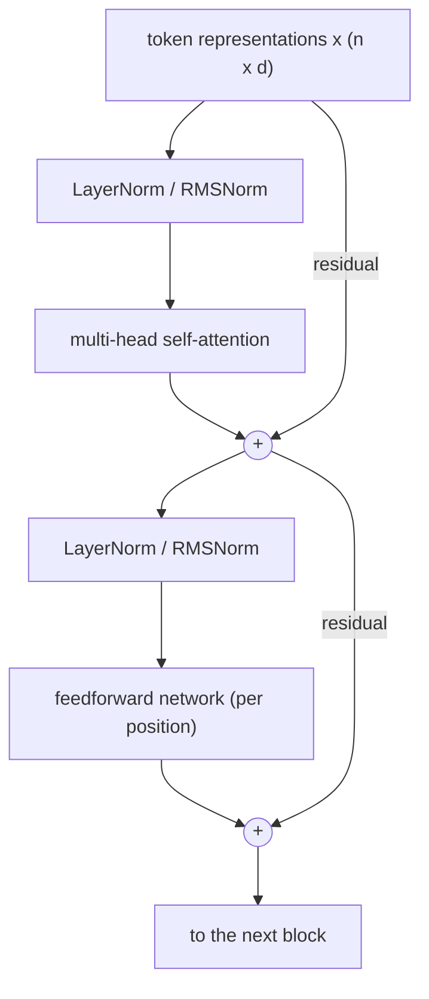
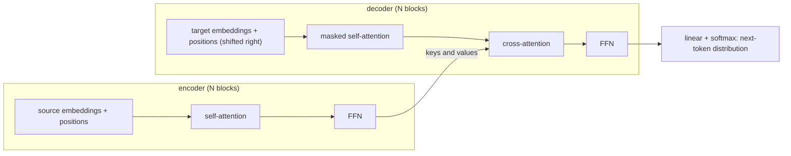

Recurrent networks ([4.7.5](/4.7.5)) process a sequence one step at a time, which has two costs. The computation cannot be parallelized over the positions of a sequence, so training on long texts is slow on hardware built for large matrix products; and information between distant positions must pass through many steps of a recurrence, where it fades, so long-range dependencies are hard to learn even with gating. Attention removes both limitations. It lets every position look directly at every other position, with weights computed from the content of the positions themselves, in a single parallel matrix operation. Attention was first added to recurrent translation models to overcome their fixed-size bottleneck; Vaswani et al. (2017) then showed, in a paper titled "Attention Is All You Need", that a network built from attention and position-wise feedforward layers alone, the Transformer, is both better and much faster to train. Within a few years the Transformer replaced recurrent networks in language processing and, in its vision form, competed with convolutional networks; in 2026 it is the architecture of essentially all large **language models** and multimodal foundation models.

This chapter builds the Transformer from its components: the attention mechanism and its scaled dot-product form, self-attention and multi-head attention, the Transformer block with its **feedforward network**, **residual connections** ([4.7.3](/4.7.3)) and **layer normalization** ([4.7.4](/4.7.4)), and the positional encodings that tell an otherwise order-blind model where each **token** is. We then assemble the **encoder–decoder model**, explain masked self-attention and training with **teacher forcing**, and follow a model at inference time, where the KV cache dominates the memory cost; this motivates the efficient attention variants that make long contexts affordable. The chapter ends with the vision Transformer. Pre-training of Transformers (BERT, GPT and their successors) is the subject of [4.7.7](/4.7.7), the systems techniques for training and serving them, including FlashAttention, of [4.7.8](/4.7.8), and large language models and alternative architectures such as state space models of [4.7.9](/4.7.9).

## 6.1. From Recurrence to Attention

### 6.1.1. Attention in Encoder–Decoder Models

A recurrent **sequence-to-sequence model** compresses the source sentence into the final encoder state and decodes the translation from it (Definition 5.4.2). Bahdanau, Cho and Bengio (2015) let the decoder instead consult all encoder states $\boldsymbol{h}_1, \dots, \boldsymbol{h}_S$ (from a **bidirectional RNN**) at every step. Before emitting the $t$-th target word, the decoder in state $\boldsymbol{s}_{t-1}$ scores each source position,
$$
e_{tj} = \boldsymbol{w}_a^{\mathsf T}\tanh\bigl(W_a\boldsymbol{s}_{t-1} + U_a\boldsymbol{h}_j\bigr), \qquad \alpha_{tj} = \frac{\exp(e_{tj})}{\sum_{k=1}^S\exp(e_{tk})}, \qquad \boldsymbol{c}_t = \sum_{j=1}^S\alpha_{tj}\boldsymbol{h}_j ,
$$
and feeds the context vector $\boldsymbol{c}_t$, a weighted average of the encoder states, into the decoder update and the output layer. The weights $\alpha_{tj}$ form a soft alignment between target and source words, which the model learns without supervision; visualized as a matrix, they recover the word alignments of translation, including reorderings such as adjective–noun order between English and French. Translation quality no longer collapsed for long sentences. Luong, Pham and Manning (2015) simplified the score to a multiplicative form, $e_{tj} = \boldsymbol{s}_t^{\mathsf T}\boldsymbol{h}_j$ or $\boldsymbol{s}_t^{\mathsf T}W\boldsymbol{h}_j$.

### 6.1.2. Queries, Keys and Values

These models share a structure that becomes the definition of attention: a *query* (the decoder state, "what am I looking for") is compared with a set of *keys* (one per source position, "what do I contain"), the comparisons are normalized into weights, and the output is the weighted average of the corresponding *values* ("what do I provide"). In the **RNN** model keys and values are both the encoder states; separating them adds flexibility. Attention is a differentiable, soft version of looking up a key in a dictionary: instead of returning the value of the one matching key, it returns a mixture of all values, weighted by how well their keys match.

**Definition 6.1.1 (Attention Mechanism)** An **attention mechanism** with a score function $a\colon \mathbb{R}^{d_q} \times \mathbb{R}^{d_k} \to \mathbb{R}$ maps a query $\boldsymbol{q}$ and key–value pairs $(\boldsymbol{k}_1, \boldsymbol{v}_1), \dots, (\boldsymbol{k}_m, \boldsymbol{v}_m)$ to
$$
\operatorname{Attn}\bigl(\boldsymbol{q}, \{(\boldsymbol{k}_j, \boldsymbol{v}_j)\}\bigr) = \sum_{j=1}^m\alpha_j\boldsymbol{v}_j, \qquad (\alpha_1, \dots, \alpha_m) = \operatorname{softmax}\bigl(a(\boldsymbol{q}, \boldsymbol{k}_1), \dots, a(\boldsymbol{q}, \boldsymbol{k}_m)\bigr).
$$
The *additive* score is $a(\boldsymbol{q}, \boldsymbol{k}) = \boldsymbol{w}^{\mathsf T}\tanh(W_q\boldsymbol{q} + W_k\boldsymbol{k})$ (Bahdanau et al.), the *dot-product* score $a(\boldsymbol{q}, \boldsymbol{k}) = \boldsymbol{q}^{\mathsf T}\boldsymbol{k}$ (for $d_q = d_k$).

The weights are nonnegative and sum to $1$, so the output lies in the convex hull of the values. Attention has two properties that recurrence lacks: the output depends directly on every value, through one weight, whatever its position; and the computation for different queries is independent and can run in parallel. This raises the question of the Transformer: can attention alone, without any recurrence, model sequences?

## 6.2. Self-Attention

### 6.2.1. Scaled Dot-Product Attention

We write sequences as matrices whose rows are the vectors of the positions, as for mini-batches in [4.7.2](/4.7.2): $Q \in \mathbb{R}^{n \times d_k}$ holds $n$ queries, $K \in \mathbb{R}^{m \times d_k}$ and $V \in \mathbb{R}^{m \times d_v}$ hold $m$ keys and values. Projections are written as right multiplications $XW$ with $W \in \mathbb{R}^{d \times d_k}$, the transpose of the column convention used for single vectors (`torch.nn.Linear` stores $W^{\mathsf T}$).

**Definition 6.2.1 (Scaled Dot-Product Attention)** **Scaled dot-product attention** is
$$
\operatorname{Attention}(Q, K, V) = \operatorname{softmax}\Bigl(\frac{QK^{\mathsf T}}{\sqrt{d_k}}\Bigr)V \in \mathbb{R}^{n \times d_v},
$$
where the **softmax function** is applied to each row of the $n \times m$ matrix of scores. Row $i$ of the result is $\sum_j\alpha_{ij}\boldsymbol{v}_j$ with $\alpha_{ij} = \operatorname{softmax}_j(\boldsymbol{q}_i^{\mathsf T}\boldsymbol{k}_j/\sqrt{d_k})$.

The whole operation is two matrix products and a row-wise **softmax**, which GPUs execute efficiently. Why divide by $\sqrt{d_k}$? The **dot product** of two vectors grows with their dimension.

**Proposition 6.2.1** If the components of $\boldsymbol{q}, \boldsymbol{k} \in \mathbb{R}^{d_k}$ are independent random variables with mean $0$ and variance $1$, then $\boldsymbol{q}^{\mathsf T}\boldsymbol{k}$ has mean $0$ and variance $d_k$.

**Proof** $\mathbb{E}[q_ik_i] = \mathbb{E}[q_i]\mathbb{E}[k_i] = 0$ and $\operatorname{Var}(q_ik_i) = \mathbb{E}[q_i^2]\mathbb{E}[k_i^2] - 0 = 1$; the $d_k$ terms $q_ik_i$ are independent, so their variances add. $\square$

Without scaling, the scores of a model with $d_k = 64$ would have standard deviation $8$ at initialization. The softmax of such scores is nearly one-hot, and its Jacobian $\operatorname{diag}(\boldsymbol{\alpha}) - \boldsymbol{\alpha}\boldsymbol{\alpha}^{\mathsf T}$ is then nearly zero, so almost no gradient flows through the attention weights. Dividing by $\sqrt{d_k}$, the standard deviation of the dot product, keeps the scores at unit scale. Vaswani et al. observed that unscaled dot-product attention performs worse than additive attention for large $d_k$, and the scaled version better; it is also much faster, since additive attention needs a small **MLP** for every query–key pair.

### 6.2.2. Self-Attention and Permutation Equivariance

**Definition 6.2.2 (Self-Attention)** **Self-attention** computes the queries, keys and values from the same sequence $X \in \mathbb{R}^{n \times d}$ by learned projections,
$$
\operatorname{SA}(X) = \operatorname{Attention}(XW_Q, XW_K, XW_V), \qquad W_Q, W_K \in \mathbb{R}^{d \times d_k}, \quad W_V \in \mathbb{R}^{d \times d_v},
$$
so that every position attends to every position of the same sequence, itself included. When the queries come from one sequence and the keys and values from another, as in the decoder of §6.5, it is called *cross-attention*.

Each output row is a new representation of a **token** computed from the whole context: in "the animal didn't cross the street because it was too tired", the representation of "it" can draw on "animal". The weights are computed from the input and so differ for every sentence, unlike the fixed weights of a **convolution**; self-attention is a layer whose connectivity is itself a function of the data. One property is crucial for what follows: self-attention ignores the order of its input.

**Proposition 6.2.2** For every permutation matrix $P \in \mathbb{R}^{n \times n}$, $\operatorname{SA}(PX) = P\operatorname{SA}(X)$.

**Proof** Let $S = XW_QW_K^{\mathsf T}X^{\mathsf T}/\sqrt{d_k}$. Replacing $X$ by $PX$ replaces $S$ by $PSP^{\mathsf T}$, which permutes the rows and the columns of $S$ in the same way. The row-wise softmax commutes with both: permuting the rows permutes the output rows, and permuting the entries within each row permutes the softmax outputs in the same way, so $\operatorname{softmax}(PSP^{\mathsf T}) = P\operatorname{softmax}(S)P^{\mathsf T}$. Hence $\operatorname{SA}(PX) = P\operatorname{softmax}(S)P^{\mathsf T}PXW_V = P\operatorname{softmax}(S)XW_V = P\operatorname{SA}(X)$, using $P^{\mathsf T}P = I$. $\square$

Self-attention is thus an **equivariant map** for the action of the symmetric group on the positions: it treats its input as a set, and shuffling the words of a sentence merely shuffles the outputs. A recurrent network, by contrast, is order-sensitive by construction. Since word order carries meaning ("dog bites man" and "man bites dog"), a Transformer must be given the positions explicitly (§6.4).

### 6.2.3. Multi-Head Attention

A single attention distribution per position averages over everything that position attends to, and a token often needs several kinds of information at once: its syntactic head, the antecedent of a pronoun, the previous token. Multi-head attention runs several attention operations in parallel in lower-dimensional subspaces.

**Definition 6.2.3 (Multi-Head Attention)** **Multi-head attention** with $h$ heads and model dimension $d$ (with $d_k = d_v = d/h$) computes
$$
\operatorname{head}_i = \operatorname{Attention}\bigl(XW_Q^{(i)}, YW_K^{(i)}, YW_V^{(i)}\bigr), \qquad \operatorname{MHA}(X, Y) = \bigl[\operatorname{head}_1, \dots, \operatorname{head}_h\bigr]W_O ,
$$
with $W_Q^{(i)}, W_K^{(i)}, W_V^{(i)} \in \mathbb{R}^{d \times d/h}$ and $W_O \in \mathbb{R}^{d \times d}$, where the brackets denote concatenation of the $n \times (d/h)$ outputs into an $n \times d$ matrix; $Y = X$ for self-attention.

Stacking the per-head matrices gives $W_Q, W_K, W_V \in \mathbb{R}^{d \times d}$: the layer has $4d^2$ weights (plus biases if used), and its cost equals that of single-head attention with full dimension, since the heads split the $d$ dimensions. The original Transformer used $d = 512$ and $h = 8$ heads of dimension $64$. Different heads learn visibly different patterns: some attend to the previous or next token, some to syntactic dependents, some to coreferent mentions, some broadly to the whole sentence. In trained **language models**, pairs of heads in consecutive layers form *induction heads* that find an earlier occurrence of the current token and copy the token that followed it, a mechanism behind in-context learning (Olsson et al. 2022). Many heads can be pruned after training with little loss (Michel, Levy and Neubig 2019), so heads are redundant, but the multi-head structure helps optimization.

The figure shows two heads constructed by hand to illustrate the two basic mechanisms, attending by position and attending by content.


### 6.2.4. Implementation

The following NumPy code implements scaled dot-product attention with an optional mask and multi-head attention, and applies a causal mask (§6.5.2) so that each position only attends to itself and earlier positions.

```python
import numpy as np


def softmax(z, axis=-1):
    z = z - z.max(axis=axis, keepdims=True)
    e = np.exp(z)
    return e / e.sum(axis=axis, keepdims=True)


def attention(Q, K, V, mask=None):
    """Scaled dot-product attention. Q: (..., n_q, d_k), K: (..., n_k, d_k), V: (..., n_k, d_v).
    mask: boolean (n_q, n_k), True where attention is allowed."""
    scores = Q @ np.swapaxes(K, -1, -2) / np.sqrt(Q.shape[-1])
    if mask is not None:
        scores = np.where(mask, scores, -np.inf)       # disallowed positions get weight 0
    A = softmax(scores, axis=-1)
    return A @ V, A


def multi_head_attention(X, Y, W_q, W_k, W_v, W_o, h, mask=None):
    """Queries from X: (n, d), keys and values from Y: (m, d); weights (d, d); h heads."""
    n, d = X.shape
    d_k = d // h
    split = lambda Z: Z.reshape(Z.shape[0], h, d_k).transpose(1, 0, 2)   # (h, len, d_k)
    Q, K, V = split(X @ W_q), split(Y @ W_k), split(Y @ W_v)
    out, A = attention(Q, K, V, mask)                  # (h, n, d_k), (h, n, m)
    out = out.transpose(1, 0, 2).reshape(n, d)         # concatenate the heads
    return out @ W_o, A


rng = np.random.default_rng(0)
n, d, h = 5, 8, 2
X = rng.standard_normal((n, d))
W_q, W_k, W_v, W_o = (rng.standard_normal((d, d)) / np.sqrt(d) for _ in range(4))
causal = np.tril(np.ones((n, n), dtype=bool))          # position i may attend to j <= i
out, A = multi_head_attention(X, X, W_q, W_k, W_v, W_o, h, mask=causal)
print("output", out.shape, " attention weights", A.shape)
print("head 0 weights:\n", np.round(A[0], 3))
print("rows sum to 1:", np.allclose(A.sum(-1), 1))
```

```text
output (5, 8)  attention weights (2, 5, 5)
head 0 weights:
 [[1.    0.    0.    0.    0.   ]
 [0.412 0.588 0.    0.    0.   ]
 [0.485 0.189 0.325 0.    0.   ]
 [0.297 0.324 0.198 0.181 0.   ]
 [0.212 0.056 0.407 0.162 0.162]]
rows sum to 1: True
```

Reshaping the projected matrix into $h$ blocks of $d/h$ columns is all it takes to split the heads, and the heads are processed as a batch. PyTorch (version 2.14, CPU) provides the same computation as a module and as a fused function, which on GPUs dispatches to memory-efficient kernels such as FlashAttention ([4.7.8](/4.7.8)); continuing the example:

```python
import numpy as np
import torch
import torch.nn.functional as F

mha = torch.nn.MultiheadAttention(d, h, bias=False, batch_first=True)
with torch.no_grad():   # PyTorch computes x W^T, so it stores our matrices transposed
    mha.in_proj_weight.copy_(torch.tensor(np.concatenate([W_q.T, W_k.T, W_v.T]), dtype=torch.float32))
    mha.out_proj.weight.copy_(torch.tensor(W_o.T, dtype=torch.float32))
    x = torch.tensor(X, dtype=torch.float32)[None]          # batch of one
    out_t, A_t = mha(x, x, x, attn_mask=~torch.tensor(causal), average_attn_weights=False)
print(f"max |torch - numpy|: output {np.abs(out_t[0].numpy() - out).max():.1e}, "
      f"weights {np.abs(A_t[0].numpy() - A).max():.1e}")
q = torch.randn(1, h, n, d // h)
k, v = torch.randn(1, h, n, d // h), torch.randn(1, h, n, d // h)
ref, _ = attention(q.numpy(), k.numpy(), v.numpy(), causal)
print(f"fused kernel vs numpy: {np.abs(F.scaled_dot_product_attention(q, k, v, is_causal=True).numpy() - ref).max():.1e}")
```

```text
max |torch - numpy|: output 2.1e-07, weights 7.4e-08
fused kernel vs numpy: 2.0e-07
```

Note the opposite mask conventions: our `mask` and the boolean `attn_mask` of `F.scaled_dot_product_attention` mark allowed positions with `True`, while `nn.MultiheadAttention` marks *disallowed* positions with `True`, hence the `~`.

## 6.3. The Transformer Block

### 6.3.1. Position-Wise Feedforward Network

Attention mixes information across positions but is, apart from the **softmax**, linear in the values. Each Transformer layer therefore follows it with a nonlinear transformation applied to every position separately, a two-layer **multilayer perceptron** with shared weights:
$$
\operatorname{FFN}(\boldsymbol{x}) = W_2\,\varphi(W_1\boldsymbol{x} + \boldsymbol{b}_1) + \boldsymbol{b}_2, \qquad W_1 \in \mathbb{R}^{d_{\mathrm{ff}} \times d}, \quad W_2 \in \mathbb{R}^{d \times d_{\mathrm{ff}}},
$$
with hidden width $d_{\mathrm{ff}} = 4d$ (2048 in the original model) and $\varphi$ = **ReLU** in the original model, GELU in BERT and GPT; most large **language models** since 2022 use the gated SwiGLU form of [4.7.2](/4.7.2) §2.6 with $d_{\mathrm{ff}} \approx \frac83d$. The FFN holds two thirds of the parameters of a block ($8d^2$ of $12d^2$). One interpretation sees it as a key–value memory: the rows of $W_1$ are keys matched against the **token**'s representation and the columns of $W_2$ the values added to it, and much of the factual knowledge of language models is stored in these layers (Geva et al. 2021). In mixture-of-experts models the FFN is replaced by many expert FFNs of which a router selects a few per token ([4.7.9](/4.7.9)).

### 6.3.2. Residual Connections and Layer Normalization

**Definition 6.3.1 (Transformer)** A **Transformer** (Vaswani et al. 2017) is a neural network for sequences built from a stack of $N$ identical blocks with separate parameters, each consisting of two sublayers, multi-head self-attention and a position-wise feedforward network, each wrapped in a residual connection and a layer normalization; the input is the sum of token embeddings and positional encodings, and decoder blocks add a cross-attention sublayer and a causal mask (§6.5). In the original *post-norm* arrangement each sublayer computes
$$
\boldsymbol{x} \leftarrow \operatorname{LN}\bigl(\boldsymbol{x} + \operatorname{Sublayer}(\boldsymbol{x})\bigr),
$$
and in the *pre-norm* arrangement, standard since GPT-2,
$$
\boldsymbol{x} \leftarrow \boldsymbol{x} + \operatorname{Sublayer}\bigl(\operatorname{LN}(\boldsymbol{x})\bigr),
$$
with a final layer normalization after the last block.



The diagram shows a pre-norm block. Its two **residual connections** create a *residual stream*, $\boldsymbol{x}_{l+1} = \boldsymbol{x}_l + F_l(\boldsymbol{x}_l)$, to which every sublayer adds its contribution and from which every later sublayer reads. As in a **ResNet** ([4.7.3](/4.7.3) §3.6.5), the identity path gives gradients a direct route to every layer and makes depth trainable; it also carries the positional information added at the input up to the higher layers. **Layer normalization** rather than **batch normalization** is used because the statistics should not depend on the other sequences of a batch or on the **padding**, and it is applied to the $d$-dimensional vector of each token separately.

The two arrangements behave differently. In post-norm the residual stream itself is normalized after every sublayer, so the gradient reaching the lower layers passes through $2N$ normalizations; Xiong et al. (2020) showed that at initialization the gradients of the parameters near the output are then large, which is why post-norm Transformers need a **learning-rate warmup** ([4.7.4](/4.7.4)) and become unstable when deep. In pre-norm the residual stream is never normalized and gradients flow through the identity path unchanged, so training is stable even without warmup and for hundreds of layers; the price is that the stream grows with depth and later layers contribute relatively less, and well-tuned post-norm models are sometimes reported to reach slightly better results when they do converge. Early models (the original Transformer, BERT, RoBERTa) are post-norm; GPT-2, T5, LLaMA and nearly all later large models are pre-norm, usually with **RMSNorm** in place of layer normalization. Variants add normalizations at further places to keep activations bounded, for example on the output of each sublayer before it is added to the stream (Gemma 2 and 3, OLMo 2) or on the queries and keys (QK-norm).

### 6.3.3. Parameters and Computation

Per block, attention has $4d^2$ and the FFN $8d^2$ weights, about $12d^2$ in total (biases and normalization gains are negligible). A decoder-only model with $N$ blocks and vocabulary $V$ has about
$$
P \approx 12Nd^2 + Vd
$$
parameters, the second term for the **embedding matrix** (often shared with the output layer). For GPT-3, with $N = 96$ and $d = 12{,}288$, $12Nd^2 \approx 1.74 \times 10^{11}$, the quoted 175 billion. The cost of a block on a sequence of length $n$ consists of the projections and the FFN, $O(nd^2)$, and the attention scores and weighted sums, $O(n^2d)$: the former dominates for short sequences ($n < d$, e.g. a few thousand tokens for large models), the latter for long ones. Compared with the other layers of this course (Vaswani et al. 2017, Table 1):

| Layer | Computation per layer | Sequential operations | Maximum path length between positions |
|---|---|---|---|
| self-attention | $O(n^2d)$ | $O(1)$ | $O(1)$ |
| recurrent | $O(nd^2)$ | $O(n)$ | $O(n)$ |
| convolutional, kernel size $k$ | $O(knd^2)$ | $O(1)$ | $O(\log_k n)$ with dilated convolutions, $O(n/k)$ otherwise |
| self-attention restricted to a window of size $r$ | $O(rnd)$ | $O(1)$ | $O(n/r)$ |

Self-attention connects any two positions by a path of length $1$, which makes long-range dependencies easy to learn, and needs no sequential computation, which makes training parallel; its quadratic cost in $n$ is the price, the subject of §6.7.

## 6.4. Positional Encoding

### 6.4.1. Why Positions Must Be Encoded

By Proposition 6.2.2 the attention layers are permutation-equivariant, and the FFN acts on each position separately, so a Transformer without position information computes the same representation for a word wherever it occurs, and its output for a sentence is a permutation of its output for any reordering of the sentence. The fix is to make the representation of a **token** depend on its position.

**Definition 6.4.1 (Positional Encoding)** A **positional encoding** injects the position of each token into a Transformer, either *absolutely*, by adding a vector $\boldsymbol{p}_t \in \mathbb{R}^d$ that depends on the position $t$ to the token embedding at the input, $\boldsymbol{x}_t = \boldsymbol{e}(w_t) + \boldsymbol{p}_t$, or *relatively*, by making the attention score between positions $i$ and $j$ depend on the offset $i - j$.

What should such an encoding provide? It should give every position a distinct code, generalize to sequences of lengths not seen in training, and make the relative position of two tokens easy to compute, since what matters for language is mostly how far apart two words are; ideally, the dependence between two tokens should also be able to decay as their distance grows. A naive encoding by the binary digits of the position, or by the integer $t$ itself, fails these criteria: the scale grows without bound, and offsets are not linear functions of the codes.

### 6.4.2. Sinusoidal Encodings

**Definition 6.4.2 (Sinusoidal Positional Encoding)** The **sinusoidal positional encoding** of Vaswani et al. (2017) assigns to position $t$ the vector $\boldsymbol{p}_t \in \mathbb{R}^d$ ($d$ even) with
$$
p_{t, 2i} = \sin(t\,\theta_i), \qquad p_{t, 2i+1} = \cos(t\,\theta_i), \qquad \theta_i = 10000^{-2i/d}, \quad i = 0, \dots, d/2 - 1 .
$$

Each pair of coordinates is a point rotating on the unit circle with its own frequency, from $\theta_0 = 1$ radian per position (period $2\pi$) down to periods of about $2\pi \cdot 10^4$ positions, a geometric sequence of wavelengths like the hands of a clock running at many speeds; nearby positions differ in the fast coordinates, distant ones also in the slow ones.

**Proposition 6.4.1** For every offset $k$ there is a matrix $M_k$, independent of $t$, with $\boldsymbol{p}_{t+k} = M_k\boldsymbol{p}_t$ for all $t$: $M_k$ is block diagonal with the $2 \times 2$ rotation blocks $\begin{bmatrix}\cos k\theta_i & \sin k\theta_i\\ -\sin k\theta_i & \cos k\theta_i\end{bmatrix}$. Consequently $\boldsymbol{p}_s^{\mathsf T}\boldsymbol{p}_t = \sum_{i}\cos\bigl((s - t)\theta_i\bigr)$ depends only on $s - t$.

**Proof** By the addition formulas, $\sin((t + k)\theta) = \sin(t\theta)\cos(k\theta) + \cos(t\theta)\sin(k\theta)$ and $\cos((t + k)\theta) = \cos(t\theta)\cos(k\theta) - \sin(t\theta)\sin(k\theta)$, which is the stated $2 \times 2$ block applied to $(\sin t\theta_i, \cos t\theta_i)$. For the dot product, $\sin(s\theta)\sin(t\theta) + \cos(s\theta)\cos(t\theta) = \cos((s - t)\theta)$. $\square$

So a linear map, which attention can learn in its query and key projections, turns the code of a position into the code of the position $k$ steps away; the positional head in the figure of §6.2.3 uses exactly this. The dot products are symmetric in the offset and decrease, with oscillations, as the offset grows.


### 6.4.3. Learned and Relative Encodings

Instead of designing the encoding, one can learn it: BERT and GPT-2 learn an absolute position embedding $\boldsymbol{p}_t$ for every $t$ up to a maximum length ($512$ and $1024$), which performs as well as the sinusoidal one but cannot represent positions beyond the maximum. What these embeddings learn differs between models: in GPT-2 the similarities between position embeddings are smooth and periodic, in BERT noisier (Wang and Chen 2020). Relative encodings act on the attention scores instead. Shaw, Uszkoreit and Vaswani (2018) added learned vectors for clipped relative distances to the keys; T5 (Raffel et al. 2020) adds a learned scalar bias $b_{h}(i - j)$ per head to the score $\boldsymbol{q}_i^{\mathsf T}\boldsymbol{k}_j/\sqrt{d_k}$, with relative distances grouped into $32$ logarithmically spaced buckets. ALiBi (attention with linear biases; Press, Smith and Lewis 2022) uses no learned parameters and no position vectors at all: it adds $-m_h\lvert i - j\rvert$ to the scores of head $h$, with fixed slopes $m_h = 2^{-8h/H}$ for $H$ heads, a recency bias of different strength per head, and extrapolates gracefully to sequences longer than those seen in training.

### 6.4.4. Rotary Position Embedding

The most widely used encoding today combines the rotation structure of Proposition 6.4.1 with relative attention scores.

**Definition 6.4.3 (Rotary Position Embedding)** **Rotary position embedding** (RoPE; Su et al. 2021) multiplies the query and the key at position $t$, in every attention layer, by the block-diagonal **orthogonal matrix**
$$
R_t = \operatorname{diag}\bigl(R(t\theta_0), \dots, R(t\theta_{d_k/2 - 1})\bigr), \qquad R(\phi) = \begin{bmatrix}\cos\phi & -\sin\phi\\ \sin\phi & \cos\phi\end{bmatrix}, \qquad \theta_i = b^{-2i/d_k},
$$
so that the score between positions $m$ and $n$ is $(R_m\boldsymbol{q}_m)^{\mathsf T}(R_n\boldsymbol{k}_n)$; the values are not rotated. The base is $b = 10000$ in the original and up to $500{,}000$ or more in models with long contexts.

**Proposition 6.4.2** $(R_m\boldsymbol{q})^{\mathsf T}(R_n\boldsymbol{k}) = \boldsymbol{q}^{\mathsf T}R_{n-m}\boldsymbol{k}$: the rotated score depends on the positions only through the offset $n - m$.

**Proof** $(R_m\boldsymbol{q})^{\mathsf T}R_n\boldsymbol{k} = \boldsymbol{q}^{\mathsf T}R_m^{\mathsf T}R_n\boldsymbol{k}$, and blockwise $R(m\theta)^{\mathsf T}R(n\theta) = R(-m\theta)R(n\theta) = R((n - m)\theta)$, since rotations of the plane compose by adding angles. $\square$

In complex notation, pairing coordinates as $\tilde q_i = q_{2i} + \mathrm{i}\,q_{2i+1}$, RoPE multiplies $\tilde q_i$ by $\mathrm{e}^{\mathrm{i}m\theta_i}$, and the score is $\operatorname{Re}\sum_i\tilde q_i\bar{\tilde k}_i\,\mathrm{e}^{\mathrm{i}(m - n)\theta_i}$. RoPE thus has the advantages of both kinds of encoding: it is applied to each token separately (so it works with the KV cache of §6.6 and with efficient attention kernels), the attention score is a function of content and relative position only, and no parameters are learned. Su et al. also showed a long-term decay: by summation by parts, the score is bounded by a constant times $\sum_j\lvert S_j\rvert$ with $S_j = \sum_{i<j}\mathrm{e}^{\mathrm{i}(m - n)\theta_i}$, which decreases on average as $\lvert m - n\rvert$ grows (right panel of the figure), so distant tokens interact more weakly by default.

RoPE is used in GPT-J and GPT-NeoX, PaLM, the LLaMA, Qwen, Mistral and Gemma families and, in a decoupled form, in DeepSeek's models (§6.7.3). A model trained with RoPE on sequences of length $L$ does not automatically work beyond $L$, since it never saw the larger rotation angles of the slow frequencies. Context-extension methods rescale them: position interpolation (Chen et al. 2023) compresses positions by $L/L'$, "NTK-aware" scaling increases the base $b$, and YaRN (Peng et al. 2023) interpolates the low frequencies while keeping the high ones, followed by a short fine-tuning on long sequences; this is how models trained mostly on 4k–8k-token sequences reach **context windows** of $128$k tokens and more.

## 6.5. The Encoder–Decoder Transformer

### 6.5.1. Architecture

The original Transformer is a **sequence-to-sequence model** for translation. The source **tokens** are embedded, scaled by $\sqrt d$, added to sinusoidal positional encodings, and processed by an encoder of $N = 6$ blocks, each with self-attention over the whole source and an FFN. The decoder of $N = 6$ blocks has three sublayers: masked self-attention over the target prefix (§6.5.2), *encoder–decoder attention* (cross-attention), whose queries come from the decoder and whose keys and values are the outputs of the last encoder block, and an FFN. Cross-attention plays the role of the Bahdanau attention of §6.1.1: at every layer, each target position looks at the whole source. A final linear layer, whose weights are tied to the **embedding matrix**, and a **softmax** give the distribution of the next token.



The base model ($d = 512$, $h = 8$, $d_{\mathrm{ff}} = 2048$, 65 million parameters) and the big model ($d = 1024$, $h = 16$, $d_{\mathrm{ff}} = 4096$, 213 million) set new records on WMT 2014 translation (BLEU 28.4 on English–German and 41.8 on English–French for the big model), after 3.5 days of training on eight GPUs, a fraction of the cost of the best recurrent and convolutional models. Three families of models descend from it, distinguished by which half they keep: encoder-only models such as BERT, which produce contextual representations for understanding tasks; decoder-only models such as GPT and nearly all large **language models**, which are pure language models; and encoder–decoder models such as T5, BART and the speech recognizer Whisper ([4.7.7](/4.7.7)).

### 6.5.2. Masked Self-Attention and Teacher Forcing

The decoder is an autoregressive language model, $\mathbb{P}(\boldsymbol{y} \mid \boldsymbol{x}) = \prod_t\mathbb{P}(y_t \mid y_{<t}, \boldsymbol{x})$, so the representation at position $t$ must not depend on the tokens at positions after $t$, which it is supposed to predict.

**Definition 6.5.1 (Causal Mask)** A **causal mask** (look-ahead mask) restricts self-attention so that position $i$ attends only to positions $j \le i$, by adding to the score matrix the mask
$$
M_{ij} = \begin{cases}0, & j \le i, \\ -\infty, & j > i,\end{cases} \qquad \operatorname{MaskedAttention}(Q, K, V) = \operatorname{softmax}\Bigl(\frac{QK^{\mathsf T}}{\sqrt{d_k}} + M\Bigr)V .
$$
Since $\mathrm{e}^{-\infty} = 0$, the future positions receive weight $0$ and the softmax renormalizes over the past.

With the mask, the output at every position of every layer depends only on the current and earlier tokens, by induction over the layers. This allows **teacher forcing** (Definition 5.4.3) to be implemented in parallel: the decoder receives the target sequence shifted right by one position, `<bos>` $y_1 \dots y_{T-1}$, and is trained to output $y_1 \dots y_T$ `<eos>` at the corresponding positions; one forward pass computes all $T$ next-token distributions, and the loss is the sum of their **cross-entropy losses**. A recurrent decoder needs $T$ sequential steps for the same computation. This parallelism over positions during training is the main practical advantage of the Transformer. The same masking trick yields decoder-only language models (a stack of masked self-attention blocks without an encoder), which are trained on every position of every training text at once. **Padding** tokens in batches of sequences of different lengths are excluded by a second mask over the keys.

### 6.5.3. Training

Vaswani et al. trained with **Adam** ($\beta_1 = 0.9$, $\beta_2 = 0.98$, $\varepsilon = 10^{-9}$), the inverse-square-root schedule with $4000$ **warmup** steps ([4.7.4](/4.7.4) §4.4), **dropout** $0.1$ on the sublayer outputs and the attention weights, and label smoothing $0.1$. Transformers are more delicate to train than recurrent networks: they work poorly with plain **SGD**, and post-norm models diverge without warmup. Adaptive optimizers (**AdamW**, and more recently Muon), warmup, **gradient clipping**, pre-normalization and careful initialization are the standard recipe ([4.7.4](/4.7.4)).

## 6.6. Inference and the KV Cache

### 6.6.1. Autoregressive Decoding

At inference time the target is unknown, and the decoder generates one **token** at a time (*free running*, Definition 5.4.3): starting from `<bos>` (and, for a **language model**, from the prompt), it computes the next-token distribution, chooses a token by greedy decoding, **beam search** or sampling ([4.7.5](/4.7.5) §5.4.4), appends it to the input and repeats until it emits `<eos>`. Training is parallel over positions; generation is inherently sequential. Serving systems therefore distinguish two phases: *prefill*, which processes the whole prompt in one parallel pass, like training, and is limited by computation; and *decode*, which produces one token per step and is limited by memory bandwidth, because every step must read all the model weights to do a small amount of computation.

### 6.6.2. The KV Cache

Recomputing the whole prefix at every step would be wasteful. Because of the causal mask, the keys and values of the earlier positions do not change when a new token is appended: at step $t$, only the query, key and value of the new token are new, and its output attends to the keys and values of all positions $\le t$.

**Definition 6.6.1 (KV Cache)** The **KV cache** stores, during autoregressive decoding, the keys and values of all previous positions in every attention layer, so that each decoding step computes the projections only for the new token, appends its key and value to the cache, and evaluates attention between the new query and the cached keys and values.

The following code checks, for one attention layer, that decoding with a cache gives exactly the same outputs as masked attention over the whole sequence (it reuses the `attention` function of §6.2.4):

```python
import numpy as np

rng = np.random.default_rng(1)
n, d = 6, 8
X = rng.standard_normal((n, d))                         # inputs of one attention layer
W_q, W_k, W_v = (rng.standard_normal((d, d)) / np.sqrt(d) for _ in range(3))

full, _ = attention(X @ W_q, X @ W_k, X @ W_v, np.tril(np.ones((n, n), dtype=bool)))

K_cache, V_cache, outs = np.zeros((0, d)), np.zeros((0, d)), []
for t in range(n):                                      # one new token per decoding step
    x = X[t:t + 1]
    K_cache = np.vstack([K_cache, x @ W_k])             # append this token's key and value
    V_cache = np.vstack([V_cache, x @ W_v])
    o, _ = attention(x @ W_q, K_cache, V_cache)         # the new query attends to the cache
    outs.append(o)
print("cached decoding equals masked attention:", np.allclose(np.vstack(outs), full))
```

```text
cached decoding equals masked attention: True
```

With the cache, step $t$ costs $O(td)$ for attention and $O(d^2)$ for the projections and FFN per layer, and generating $n$ tokens costs $O(n^2d)$ in total for attention, instead of $O(n^3d)$ when the prefix is recomputed. The price is memory. For a model with $N$ layers, $n_{\mathrm{kv}}$ key–value heads of dimension $d_{\mathrm{head}}$, a batch of $B$ sequences of length $n$ and $b$ bytes per number,
$$
\text{KV cache size} = 2 \cdot N \cdot n_{\mathrm{kv}} \cdot d_{\mathrm{head}} \cdot n \cdot B \cdot b \ \text{bytes},
$$
the factor $2$ counting keys and values. For Llama 3 8B ($N = 32$, $n_{\mathrm{kv}} = 8$, $d_{\mathrm{head}} = 128$, 16-bit numbers) this is $128$ KiB per token, or $16$ GiB for a single sequence of $131{,}072$ tokens, as much as the $16$ GB of model weights; for Llama 3 70B ($N = 80$) it is $320$ KiB per token and $40$ GiB for the same sequence. With $64$ key–value heads, one per query head, these numbers would be eight times larger. The cache grows linearly with the context and the batch, limits how many requests a server can process concurrently, and must be read at every decoding step, so it also bounds the speed. Serving systems page it in blocks like virtual memory (PagedAttention, Kwon et al. 2023), quantize it to 8 or 4 bits, and reuse the cache of shared prefixes across requests, which is what providers sell as **prompt caching** ([4.2.14](/4.2.14)). Reducing the cache itself is the goal of the compact attention variants below.

## 6.7. Efficient Attention

The quadratic cost of attention in the context length and the linear growth of the KV cache are the main obstacles to long contexts. Methods to address them fall into four groups:

| Group | Idea | Examples |
|---|---|---|
| hardware-efficient | compute exact attention with fewer memory accesses | FlashAttention 1–3 ([4.7.8](/4.7.8)) |
| compact | share or compress keys and values to shrink the KV cache | multi-query, grouped-query and multi-head latent attention |
| sparse | each query attends to a subset of the keys | sliding windows, Longformer, BigBird, NSA, DeepSeek Sparse Attention |
| linear | replace the softmax kernel so that attention becomes a recurrence with a fixed-size state | linear Transformers, RetNet, Mamba-2, Gated DeltaNet, RWKV |

### 6.7.1. Hardware-Efficient Attention

A naive implementation materializes the $n \times n$ score matrix in GPU memory, writes it, reads it for the **softmax**, writes the weights and reads them again, so for long sequences it is limited by memory traffic rather than by arithmetic. FlashAttention (Dao et al. 2022) computes the same result exactly, without ever storing the full matrix: it processes the keys and values in blocks that fit in fast on-chip memory and combines the partial softmax results with running maxima and sums (the online softmax), reducing the memory of attention from $O(n^2)$ to $O(n)$ and speeding it up several times. It changes how attention is computed, not what is computed, and is treated in [4.7.8](/4.7.8).

### 6.7.2. Multi-Query and Grouped-Query Attention

In multi-head attention every head has its own keys and values, and the KV cache stores $2hd_{\mathrm{head}} = 2d$ numbers per **token** and layer. Shazeer (2019) observed that the queries need to be different per head, but the keys and values can be shared.

**Definition 6.7.1 (Grouped-Query Attention)** **Grouped-query attention** (GQA; Ainslie et al. 2023) divides the $h$ query heads into $g$ groups and gives each group a single shared key head and value head, so that the keys and values have $g$ heads instead of $h$; the case $g = 1$, a single key–value head for all query heads, is *multi-query attention* (MQA; Shazeer 2019), and $g = h$ is standard multi-head attention.

The KV cache and the memory traffic of decoding shrink by the factor $h/g$, while the quality stays close to that of multi-head attention for moderate $g$; MQA degrades quality more noticeably. Ainslie et al. also showed that a multi-head checkpoint can be converted ("uptrained") to GQA by averaging the key and value heads within each group and continuing training for about 5% of the original compute. GQA with $8$ key–value heads is the standard choice of open models since Llama 2 70B (2023), including Llama 3, Mistral and Qwen; in Llama 3 70B, $64$ query heads share $8$ key–value heads, the factor $8$ of §6.6.2. PyTorch's `scaled_dot_product_attention` supports it directly with `enable_gqa=True`.

### 6.7.3. Multi-Head Latent Attention

DeepSeek-V2 (2024) compresses the keys and values instead of sharing them. *Multi-head latent attention* (MLA) projects the hidden state $\boldsymbol{x}_t$ of each token to a small latent vector $\boldsymbol{c}_t = W_{\mathrm{DKV}}\boldsymbol{x}_t \in \mathbb{R}^{d_c}$, which is the only thing cached, and reconstructs the keys and values of all heads from it by up-projections, $\boldsymbol{k}_t^{(i)} = W_{\mathrm{UK}}^{(i)}\boldsymbol{c}_t$ and $\boldsymbol{v}_t^{(i)} = W_{\mathrm{UV}}^{(i)}\boldsymbol{c}_t$. At inference the up-projections need not be computed: since $\boldsymbol{q}^{(i)\mathsf T}W_{\mathrm{UK}}^{(i)}\boldsymbol{c}_t$, the matrix $W_{\mathrm{UK}}^{(i)}$ can be absorbed into the query projection, and $W_{\mathrm{UV}}^{(i)}$ into the output projection, so attention operates directly on the latent vectors. This absorption is incompatible with RoPE, whose position-dependent rotation would sit between the two matrices; MLA therefore carries the position information in a separate small key component $\boldsymbol{k}_t^{R}$ with RoPE applied, shared by all heads and cached alongside $\boldsymbol{c}_t$ (decoupled RoPE). In DeepSeek-V2 and V3, with $128$ heads of dimension $128$, the cache holds $d_c + d^R = 512 + 64 = 576$ numbers per token and layer instead of $2 \cdot 128 \cdot 128 = 32{,}768$ for multi-head attention, the size of GQA with $2.25$ groups, while the quality matches or exceeds that of multi-head attention. MLA is used in DeepSeek-V3 and R1 and in Moonshot's Kimi K2, and multi-head models can be converted to it after training.

### 6.7.4. Sparse Attention

Most attention weights in trained models are close to zero, which suggests computing only the important ones. Fixed patterns came first: the Sparse Transformer (Child et al. 2019) combined local and strided attention for $O(n\sqrt n)$ cost; Longformer (Beltagy, Peters and Cohan 2020) and BigBird (Zaheer et al. 2020) combined a sliding window with a few global tokens that attend to and are attended by everything (BigBird adds random connections). Sliding-window attention, in which each token attends to the previous $w$ tokens, is used in Mistral 7B ($w = 4096$) and, interleaved with global layers, in the Gemma 2 and 3 models: information beyond the window travels through the stack, $w$ positions per layer, and the KV cache of the local layers is bounded by $w$. Learned, content-dependent sparsity is the current direction. Native Sparse Attention (NSA; Yuan et al. 2025) combines three branches per query, attention over compressed blocks, attention over the top-ranked blocks selected from the compressed scores, and a sliding window, and is designed to match GPU memory access patterns and to be trained from scratch. DeepSeek-V3.2 (2025) introduced DeepSeek Sparse Attention, in which a lightweight "lightning indexer" scores all previous tokens cheaply and each query attends exactly only to the top $2048$, reducing the cost of long-context inference substantially with little loss in quality.

### 6.7.5. Linear Attention

Write the attention output of position $i$ as $\sum_j\kappa(\boldsymbol{q}_i, \boldsymbol{k}_j)\boldsymbol{v}_j/\sum_j\kappa(\boldsymbol{q}_i, \boldsymbol{k}_j)$ with the kernel $\kappa(\boldsymbol{q}, \boldsymbol{k}) = \exp(\boldsymbol{q}^{\mathsf T}\boldsymbol{k}/\sqrt{d_k})$. Replacing the kernel by a dot product of **feature maps**, $\kappa(\boldsymbol{q}, \boldsymbol{k}) = \phi(\boldsymbol{q})^{\mathsf T}\phi(\boldsymbol{k})$ with, for example, $\phi(\boldsymbol{x}) = \operatorname{ELU}(\boldsymbol{x}) + 1$ (Katharopoulos et al. 2020), allows the sums to be reordered. In the causal case,
$$
\boldsymbol{o}_i^{\mathsf T} = \frac{\phi(\boldsymbol{q}_i)^{\mathsf T}S_i}{\phi(\boldsymbol{q}_i)^{\mathsf T}\boldsymbol{z}_i}, \qquad S_i = S_{i-1} + \phi(\boldsymbol{k}_i)\boldsymbol{v}_i^{\mathsf T}, \qquad \boldsymbol{z}_i = \boldsymbol{z}_{i-1} + \phi(\boldsymbol{k}_i),
$$
so the model is a recurrent network with a matrix-valued state $S_i \in \mathbb{R}^{d_k \times d_v}$: training can still be parallel, the cost is $O(nd^2)$, linear in $n$, and generation needs only the fixed-size state instead of a growing KV cache. The catch is quality: a state of fixed size cannot store an unbounded context, and plain linear attention is notably worse than softmax attention, especially at recalling specific earlier tokens. Successors improve the state update: RetNet and gated linear attention add a decay $S_i = \gamma_iS_{i-1} + \dots$ that forgets old content, Mamba-2 connects these models to state space models ([4.7.9](/4.7.9)), DeltaNet and Gated DeltaNet (Yang et al. 2024, 2025) replace the additive update by the delta rule $S_i = S_{i-1}(I - \beta_i\boldsymbol{k}_i\boldsymbol{k}_i^{\mathsf T}) + \beta_i\boldsymbol{v}_i\boldsymbol{k}_i^{\mathsf T}$ (written for $S$ mapping keys to values), which overwrites the value stored for a key instead of accumulating, and RWKV-7 follows a similar design. Since pure linear models still lag on retrieval from long contexts, recent large models are hybrids that interleave linear-attention layers with a few full-attention layers, for example MiniMax-01 (2025), Qwen3-Next (2025, Gated DeltaNet and gated attention in a 3:1 ratio) and Kimi Linear (2025).

## 6.8. Transformers and Recurrent Networks Compared

| Aspect | Recurrent network | Transformer |
|---|---|---|
| order information | built in (sequential processing) | must be added by positional encodings |
| training parallelism | sequential over positions | parallel over positions (with causal masks for decoders) |
| path length between positions | $O(n)$ | $O(1)$ |
| cost per layer | $O(nd^2)$ | $O(n^2d + nd^2)$ |
| memory during generation | fixed-size state | KV cache growing with the context |
| training stability | stable with SGD or Adam and clipping | needs Adam-type optimizers, warmup, careful normalization |
| scaling with data and model size | saturates early | continues to improve over many orders of magnitude |

The Transformer trades the efficient inference of recurrent networks for parallel training and direct long-range interactions, and the trade has proved overwhelmingly favorable at scale, because training compute, not inference, limited model quality. The linear-attention and state-space models of §6.7.5 and [4.7.9](/4.7.9) try to recover the fixed-size state of recurrent networks without losing parallel training, and the most successful designs of 2025–2026 combine both kinds of layers.

## 6.9. The Vision Transformer

The Transformer makes no assumption that its input is text: any data that can be cut into a sequence of **tokens** can be processed. Dosovitskiy et al. (2021) applied it to images with as few changes as possible.

**Definition 6.9.1 (Vision Transformer)** A **vision Transformer** (ViT) splits an image of size $H \times W$ with $C$ channels into $N = HW/P^2$ non-overlapping patches of $P \times P$ pixels, flattens each patch into a vector $\boldsymbol{x}_p^{(k)} \in \mathbb{R}^{P^2C}$, embeds it linearly, prepends a learnable classification token and adds learned position embeddings,
$$
Z_0 = \bigl[\boldsymbol{x}_{\mathrm{cls}};\ \boldsymbol{x}_p^{(1)}E;\ \dots;\ \boldsymbol{x}_p^{(N)}E\bigr] + E_{\mathrm{pos}}, \qquad E \in \mathbb{R}^{P^2C \times d},\quad E_{\mathrm{pos}} \in \mathbb{R}^{(N+1) \times d},
$$
processes the $N + 1$ tokens with a standard pre-norm Transformer encoder, and classifies the image from the final representation of the classification token.

A $224 \times 224$ image with $16 \times 16$ patches becomes a sequence of $196$ tokens, "an image is worth $16 \times 16$ words". The patch embedding is a **convolution** with kernel size and **stride** $P$ ([4.7.3](/4.7.3)); apart from it, and from the 2D structure implicit in the patches, the model has no image-specific **inductive bias**: no locality, no translation equivariance, no hierarchy. The base model ViT-B/16 has $12$ layers, $d = 768$, $12$ heads and $86$ million parameters, ViT-L/16 $24$ layers, $d = 1024$ and $307$ million. Trained on ImageNet alone, ViT is worse than a **ResNet** of similar size; pre-trained on the $300$ million images of JFT-300M, ViT-H/14 reached $88.6\%$ top-1 accuracy on ImageNet, better than the best convolutional networks at lower training cost. The lack of inductive bias is compensated by data: with enough of it, the model learns locality where useful (the attention distances of many heads in the lower layers are small) and global interactions where needed.

Later work removed the need for huge labeled datasets: DeiT (Touvron et al. 2021) trained ViTs on ImageNet alone with strong **data augmentation**, **regularization** and distillation, and self-supervised methods such as DINO (Caron et al. 2021) and masked autoencoders (He et al. 2022), which reconstruct randomly masked patches from the visible $25\%$, learn excellent features without labels; contrastive image–text training as in CLIP (Radford et al. 2021) produces the ViT encoders that serve as the eyes of multimodal **language models**. Hierarchical variants such as the Swin Transformer reintroduce local windows and downsampling for dense prediction tasks, and the comparison with modernized **CNNs** is discussed in [4.7.3](/4.7.3) §3.7.2. The same recipe of cutting the input into patches and feeding them to a Transformer is used for audio spectrograms, video (spatio-temporal patches) and the latent representations of diffusion models (diffusion Transformers).

## Summary

- Attention computes a weighted average of values, with weights given by a **softmax** over the similarities of a query to keys; it was introduced to remove the fixed-size bottleneck of recurrent encoder–decoders. Scaled dot-product attention $\operatorname{softmax}(QK^{\mathsf T}/\sqrt{d_k})V$ divides by $\sqrt{d_k}$ because dot products of random vectors have variance $d_k$, which would saturate the softmax.
- Self-attention takes queries, keys and values from the same sequence and is permutation-equivariant; multi-head attention runs $h$ attentions in subspaces of dimension $d/h$ and has $4d^2$ parameters.
- A Transformer block combines multi-head self-attention and a position-wise FFN ($8d^2$ parameters) with **residual connections** and **layer normalization**, pre-norm in modern models; a model has about $12Nd^2$ parameters, and attention costs $O(n^2d)$ per layer with $O(1)$ path length and full parallelism.
- Positions are injected by sinusoidal or learned absolute encodings, by relative biases (T5, ALiBi), or by rotary embeddings, which rotate queries and keys so that scores depend only on content and relative position; RoPE is the standard of current models, and rescaling its frequencies extends the context.
- Encoder–decoder Transformers use cross-attention from decoder to encoder; causal masks make decoders autoregressive and allow **teacher forcing** in parallel over positions.
- Autoregressive decoding with a KV cache stores keys and values of all previous **tokens**, $2Nn_{\mathrm{kv}}d_{\mathrm{head}}$ numbers per token; grouped-query and multi-head latent attention shrink it, sparse attention reduces the number of attended tokens, and linear attention turns attention into a recurrence with a fixed-size state, often in hybrids with full attention.
- The vision Transformer treats an image as a sequence of patch tokens; with large-scale or self-supervised pre-training it matches or surpasses **CNNs** and is the standard image encoder of multimodal models.
