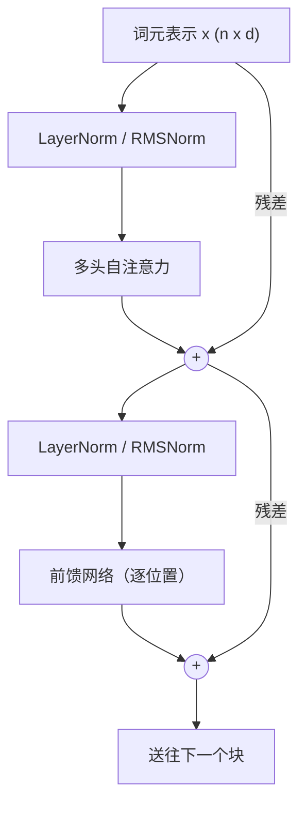
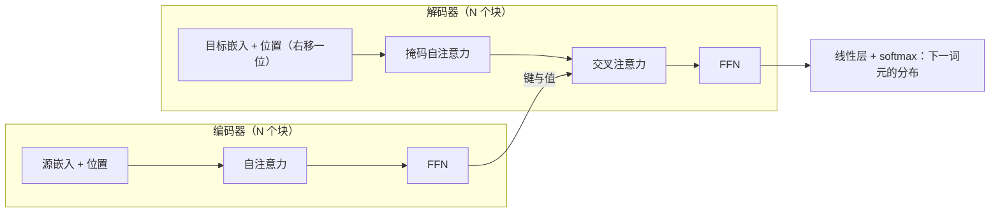

循环网络（[4.7.5](/4.7.5)）一次处理序列的一步，这有两个代价。计算无法在序列的各位置上并行，所以在为大型矩阵乘法设计的硬件上，训练长文本很慢；距离很远的位置之间的信息必须经过循环的许多步，在其中逐渐衰减，所以即使有门控，长程依赖也很难学习。注意力消除了这两个限制。它让每个位置直接看到其他每个位置，权重由各位置自身的内容计算，并且只需一次并行的矩阵运算。注意力最初是加到循环翻译模型上，以克服其固定大小的瓶颈；Vaswani 等人（2017）随后在题为 "Attention Is All You Need" 的论文中表明，一个仅由注意力与逐位置前馈层构成的网络，即 Transformer，不仅效果更好，训练也快得多。几年之内，Transformer 在语言处理中取代了循环网络，并以其视觉形式与卷积网络竞争；2026 年，它是几乎所有大**语言模型**与多模态基础模型的架构。

本章从组成部分出发搭建 Transformer：注意力机制及其缩放点积形式，自注意力与多头注意力，带**前馈网络**、**残差连接**（[4.7.3](/4.7.3)）与**层归一化**（[4.7.4](/4.7.4)）的 Transformer 块，以及告诉这个本来对顺序不敏感的模型每个**词元**位于何处的位置编码。然后组装**编码器–解码器模型**，解释掩码自注意力与用**教师强制**的训练，并跟随模型进入推断阶段，在那里 KV 缓存主导了内存开销；这推动了使长上下文变得可承受的各种高效注意力变体。本章以视觉 Transformer 结束。Transformer 的预训练（BERT、GPT 及其后继者）是 [4.7.7](/4.7.7) 的主题，训练与部署它们的系统技术（包括 FlashAttention）见 [4.7.8](/4.7.8)，大语言模型与状态空间模型等替代架构见 [4.7.9](/4.7.9)。

## 6.1. 从循环到注意力

### 6.1.1. 编码器–解码器模型中的注意力

循环的**序列到序列模型**把源句子压缩成编码器的最终状态，并由它解码出译文（定义 5.4.2）。Bahdanau、Cho 与 Bengio（2015）转而让解码器在每一步查阅所有编码器状态 $\boldsymbol{h}_1, \dots, \boldsymbol{h}_S$（来自**双向循环神经网络**）。在输出第 $t$ 个目标词之前，处于状态 $\boldsymbol{s}_{t-1}$ 的解码器给每个源位置打分，
$$
e_{tj} = \boldsymbol{w}_a^{\mathsf T}\tanh\bigl(W_a\boldsymbol{s}_{t-1} + U_a\boldsymbol{h}_j\bigr), \qquad \alpha_{tj} = \frac{\exp(e_{tj})}{\sum_{k=1}^S\exp(e_{tk})}, \qquad \boldsymbol{c}_t = \sum_{j=1}^S\alpha_{tj}\boldsymbol{h}_j ,
$$
并把上下文向量 $\boldsymbol{c}_t$（编码器状态的加权平均）送入解码器的更新与输出层。权重 $\alpha_{tj}$ 构成目标词与源词之间的软对齐，模型无需监督就能学到它；把它画成矩阵，就能还原翻译中的词对齐，包括英语与法语之间形容词与名词顺序这样的调序。对长句子，翻译质量不再崩溃。Luong、Pham 与 Manning（2015）把打分简化为乘性形式，$e_{tj} = \boldsymbol{s}_t^{\mathsf T}\boldsymbol{h}_j$ 或 $\boldsymbol{s}_t^{\mathsf T}W\boldsymbol{h}_j$。

### 6.1.2. 查询、键与值

这些模型共有一种结构，它后来成为注意力的定义：*查询*（解码器状态，"我在找什么"）与一组*键*（每个源位置一个，"我包含什么"）比较，比较的结果被归一化为权重，输出是相应的*值*（"我提供什么"）的加权平均。在**循环神经网络**模型中，键与值都是编码器状态；把它们分开则增加了灵活性。注意力是在字典中查找键的一个可微的软版本：它不是返回恰好匹配的那个键的值，而是返回所有值的混合，权重取决于它们的键匹配得有多好。

**定义 6.1.1（注意力机制）** 打分函数为 $a\colon \mathbb{R}^{d_q} \times \mathbb{R}^{d_k} \to \mathbb{R}$ 的**注意力机制**把查询 $\boldsymbol{q}$ 与键值对 $(\boldsymbol{k}_1, \boldsymbol{v}_1), \dots, (\boldsymbol{k}_m, \boldsymbol{v}_m)$ 映为
$$
\operatorname{Attn}\bigl(\boldsymbol{q}, \{(\boldsymbol{k}_j, \boldsymbol{v}_j)\}\bigr) = \sum_{j=1}^m\alpha_j\boldsymbol{v}_j, \qquad (\alpha_1, \dots, \alpha_m) = \operatorname{softmax}\bigl(a(\boldsymbol{q}, \boldsymbol{k}_1), \dots, a(\boldsymbol{q}, \boldsymbol{k}_m)\bigr).
$$
*加性*打分是 $a(\boldsymbol{q}, \boldsymbol{k}) = \boldsymbol{w}^{\mathsf T}\tanh(W_q\boldsymbol{q} + W_k\boldsymbol{k})$（Bahdanau 等），*点积*打分是 $a(\boldsymbol{q}, \boldsymbol{k}) = \boldsymbol{q}^{\mathsf T}\boldsymbol{k}$（要求 $d_q = d_k$）。

权重非负且总和为 $1$，所以输出位于各个值的凸包内。注意力具有循环所缺乏的两个性质：输出通过一个权重直接依赖于每个值，与其位置无关；不同查询的计算相互独立，可以并行进行。这引出了 Transformer 的问题：只用注意力，不用任何循环，能否对序列建模？

## 6.2. 自注意力

### 6.2.1. 缩放点积注意力

我们把序列写成矩阵，其各行是各位置的向量，与 [4.7.2](/4.7.2) 中的小批量相同：$Q \in \mathbb{R}^{n \times d_k}$ 含 $n$ 个查询，$K \in \mathbb{R}^{m \times d_k}$ 与 $V \in \mathbb{R}^{m \times d_v}$ 含 $m$ 个键与值。投影写成右乘 $XW$，其中 $W \in \mathbb{R}^{d \times d_k}$，这是单个向量所用的列约定的转置（`torch.nn.Linear` 存储的是 $W^{\mathsf T}$）。

**定义 6.2.1（缩放点积注意力）** **缩放点积注意力**为
$$
\operatorname{Attention}(Q, K, V) = \operatorname{softmax}\Bigl(\frac{QK^{\mathsf T}}{\sqrt{d_k}}\Bigr)V \in \mathbb{R}^{n \times d_v},
$$
其中 **softmax 函数**作用于 $n \times m$ 得分矩阵的每一行。结果的第 $i$ 行是 $\sum_j\alpha_{ij}\boldsymbol{v}_j$，其中 $\alpha_{ij} = \operatorname{softmax}_j(\boldsymbol{q}_i^{\mathsf T}\boldsymbol{k}_j/\sqrt{d_k})$。

整个运算是两次矩阵乘法加一次逐行 softmax，GPU 可以高效执行。为什么要除以 $\sqrt{d_k}$？两个向量的**点积**随维数增长。

**命题 6.2.1** 若 $\boldsymbol{q}, \boldsymbol{k} \in \mathbb{R}^{d_k}$ 的各分量是均值为 $0$、方差为 $1$ 的独立随机变量，则 $\boldsymbol{q}^{\mathsf T}\boldsymbol{k}$ 的均值为 $0$，方差为 $d_k$。

**证明** $\mathbb{E}[q_ik_i] = \mathbb{E}[q_i]\mathbb{E}[k_i] = 0$，且 $\operatorname{Var}(q_ik_i) = \mathbb{E}[q_i^2]\mathbb{E}[k_i^2] - 0 = 1$；这 $d_k$ 项 $q_ik_i$ 相互独立，所以方差相加。$\square$

若不缩放，$d_k = 64$ 的模型在初始化时的得分标准差为 $8$。这样的得分经 softmax 后近乎独热，其 Jacobi 矩阵 $\operatorname{diag}(\boldsymbol{\alpha}) - \boldsymbol{\alpha}\boldsymbol{\alpha}^{\mathsf T}$ 因而近乎为零，几乎没有梯度能通过注意力权重。除以点积的标准差 $\sqrt{d_k}$，使得分保持单位尺度。Vaswani 等人观察到，当 $d_k$ 较大时，不缩放的点积注意力不如加性注意力，而缩放后的版本更好；它也快得多，因为加性注意力对每个查询–键对都需要一个小的 **多层感知机**。

### 6.2.2. 自注意力与置换等变性

**定义 6.2.2（自注意力）** **自注意力**通过学习得到的投影，从同一个序列 $X \in \mathbb{R}^{n \times d}$ 计算查询、键与值，
$$
\operatorname{SA}(X) = \operatorname{Attention}(XW_Q, XW_K, XW_V), \qquad W_Q, W_K \in \mathbb{R}^{d \times d_k}, \quad W_V \in \mathbb{R}^{d \times d_v},
$$
于是每个位置都关注同一序列的每个位置，包括它自己。当查询来自一个序列，而键与值来自另一个序列时，如 §6.5 的解码器中那样，称为交叉注意力（cross-attention）。

每个输出行都是根据整个上下文计算出的一个**词元**的新表示：在 "the animal didn't cross the street because it was too tired" 中，"it" 的表示可以利用 "animal"。权重由输入计算，所以对每个句子都不同，不像**卷积**的权重是固定的；自注意力是一个连接方式本身就是数据的函数的层。有一个性质对接下来的内容至关重要：自注意力忽略输入的顺序。

**命题 6.2.2** 对每个置换矩阵 $P \in \mathbb{R}^{n \times n}$，$\operatorname{SA}(PX) = P\operatorname{SA}(X)$。

**证明** 令 $S = XW_QW_K^{\mathsf T}X^{\mathsf T}/\sqrt{d_k}$。把 $X$ 换成 $PX$ 就把 $S$ 换成 $PSP^{\mathsf T}$，即以同样的方式置换 $S$ 的行与列。逐行的 softmax 与这两种置换都可交换：置换行就置换输出行，置换每行内的元素就以同样的方式置换 softmax 的输出，所以 $\operatorname{softmax}(PSP^{\mathsf T}) = P\operatorname{softmax}(S)P^{\mathsf T}$。因此，利用 $P^{\mathsf T}P = I$，$\operatorname{SA}(PX) = P\operatorname{softmax}(S)P^{\mathsf T}PXW_V = P\operatorname{softmax}(S)XW_V = P\operatorname{SA}(X)$。$\square$

因此，自注意力是对称群在各位置上的作用下的**等变映射**：它把输入当作一个集合，打乱句子中的词只会打乱输出。相反，循环网络在构造上就对顺序敏感。由于词序携带含义（"dog bites man" 与 "man bites dog"），Transformer 必须被显式地告知位置（§6.4）。

### 6.2.3. 多头注意力

每个位置只有一个注意力分布，就会对它所关注的一切取平均，而一个词元往往同时需要几种信息：它的句法中心词、代词的先行词、前一个词元。多头注意力在低维子空间中并行地运行多个注意力运算。

**定义 6.2.3（多头注意力）** 有 $h$ 个头、模型维数为 $d$（取 $d_k = d_v = d/h$）的**多头注意力**计算
$$
\operatorname{head}_i = \operatorname{Attention}\bigl(XW_Q^{(i)}, YW_K^{(i)}, YW_V^{(i)}\bigr), \qquad \operatorname{MHA}(X, Y) = \bigl[\operatorname{head}_1, \dots, \operatorname{head}_h\bigr]W_O ,
$$
其中 $W_Q^{(i)}, W_K^{(i)}, W_V^{(i)} \in \mathbb{R}^{d \times d/h}$，$W_O \in \mathbb{R}^{d \times d}$，方括号表示把 $n \times (d/h)$ 的各输出拼接成 $n \times d$ 的矩阵；对于自注意力，$Y = X$。

把各头的矩阵叠起来，就得到 $W_Q, W_K, W_V \in \mathbb{R}^{d \times d}$：该层有 $4d^2$ 个权重（如果用偏置则还要加上偏置），其计算量与全维度的单头注意力相同，因为各头瓜分了 $d$ 个维度。最初的 Transformer 使用 $d = 512$ 与 $h = 8$ 个维数为 $64$ 的头。不同的头学到明显不同的模式：有的关注前一个或后一个词元，有的关注句法上的依存成分，有的关注共指的提及，有的则宽泛地关注整个句子。在训练好的**语言模型**中，相邻层中成对的头构成**归纳头**（induction head），它们找到当前词元更早的一次出现，并复制其后面的词元，这是上下文学习背后的一种机制（Olsson 等 2022）。训练后许多头可以被剪掉而损失很小（Michel、Levy 与 Neubig 2019），所以头是冗余的，但多头结构有助于优化。

下图展示了两个手工构造的头，用来说明两种基本机制：按位置关注与按内容关注。


### 6.2.4. 实现

下面的 NumPy 代码实现带可选掩码的缩放点积注意力与多头注意力，并施加因果掩码（§6.5.2），使每个位置只关注自己与更早的位置。

```python
import numpy as np


def softmax(z, axis=-1):
    z = z - z.max(axis=axis, keepdims=True)
    e = np.exp(z)
    return e / e.sum(axis=axis, keepdims=True)


def attention(Q, K, V, mask=None):
    """Scaled dot-product attention. Q: (..., n_q, d_k), K: (..., n_k, d_k), V: (..., n_k, d_v).
    mask: boolean (n_q, n_k), True where attention is allowed."""
    scores = Q @ np.swapaxes(K, -1, -2) / np.sqrt(Q.shape[-1])
    if mask is not None:
        scores = np.where(mask, scores, -np.inf)       # disallowed positions get weight 0
    A = softmax(scores, axis=-1)
    return A @ V, A


def multi_head_attention(X, Y, W_q, W_k, W_v, W_o, h, mask=None):
    """Queries from X: (n, d), keys and values from Y: (m, d); weights (d, d); h heads."""
    n, d = X.shape
    d_k = d // h
    split = lambda Z: Z.reshape(Z.shape[0], h, d_k).transpose(1, 0, 2)   # (h, len, d_k)
    Q, K, V = split(X @ W_q), split(Y @ W_k), split(Y @ W_v)
    out, A = attention(Q, K, V, mask)                  # (h, n, d_k), (h, n, m)
    out = out.transpose(1, 0, 2).reshape(n, d)         # concatenate the heads
    return out @ W_o, A


rng = np.random.default_rng(0)
n, d, h = 5, 8, 2
X = rng.standard_normal((n, d))
W_q, W_k, W_v, W_o = (rng.standard_normal((d, d)) / np.sqrt(d) for _ in range(4))
causal = np.tril(np.ones((n, n), dtype=bool))          # position i may attend to j <= i
out, A = multi_head_attention(X, X, W_q, W_k, W_v, W_o, h, mask=causal)
print("output", out.shape, " attention weights", A.shape)
print("head 0 weights:\n", np.round(A[0], 3))
print("rows sum to 1:", np.allclose(A.sum(-1), 1))
```

```text
output (5, 8)  attention weights (2, 5, 5)
head 0 weights:
 [[1.    0.    0.    0.    0.   ]
 [0.412 0.588 0.    0.    0.   ]
 [0.485 0.189 0.325 0.    0.   ]
 [0.297 0.324 0.198 0.181 0.   ]
 [0.212 0.056 0.407 0.162 0.162]]
rows sum to 1: True
```

把投影后的矩阵重塑为 $h$ 块、每块 $d/h$ 列，就完成了头的拆分，各头作为一个批来处理。PyTorch（2.14 版，CPU）把同样的计算提供为一个模块和一个融合函数，后者在 GPU 上会调度到 FlashAttention（[4.7.8](/4.7.8)）等节省内存的内核；接着上面的例子：

```python
import numpy as np
import torch
import torch.nn.functional as F

mha = torch.nn.MultiheadAttention(d, h, bias=False, batch_first=True)
with torch.no_grad():   # PyTorch computes x W^T, so it stores our matrices transposed
    mha.in_proj_weight.copy_(torch.tensor(np.concatenate([W_q.T, W_k.T, W_v.T]), dtype=torch.float32))
    mha.out_proj.weight.copy_(torch.tensor(W_o.T, dtype=torch.float32))
    x = torch.tensor(X, dtype=torch.float32)[None]          # batch of one
    out_t, A_t = mha(x, x, x, attn_mask=~torch.tensor(causal), average_attn_weights=False)
print(f"max |torch - numpy|: output {np.abs(out_t[0].numpy() - out).max():.1e}, "
      f"weights {np.abs(A_t[0].numpy() - A).max():.1e}")
q = torch.randn(1, h, n, d // h)
k, v = torch.randn(1, h, n, d // h), torch.randn(1, h, n, d // h)
ref, _ = attention(q.numpy(), k.numpy(), v.numpy(), causal)
print(f"fused kernel vs numpy: {np.abs(F.scaled_dot_product_attention(q, k, v, is_causal=True).numpy() - ref).max():.1e}")
```

```text
max |torch - numpy|: output 2.1e-07, weights 7.4e-08
fused kernel vs numpy: 2.0e-07
```

注意掩码的约定正好相反：我们的 `mask` 与 `F.scaled_dot_product_attention` 的布尔 `attn_mask` 用 `True` 标记允许的位置，而 `nn.MultiheadAttention` 用 `True` 标记*不允许*的位置，所以要加 `~`。

## 6.3. Transformer 块

### 6.3.1. 逐位置前馈网络

注意力在各位置之间混合信息，但除了 **softmax 函数** 之外，它对值是线性的。所以每个 Transformer 层在注意力之后，都接着对每个位置分别施加一个非线性变换，即一个权重共享的两层**多层感知机**：
$$
\operatorname{FFN}(\boldsymbol{x}) = W_2\,\varphi(W_1\boldsymbol{x} + \boldsymbol{b}_1) + \boldsymbol{b}_2, \qquad W_1 \in \mathbb{R}^{d_{\mathrm{ff}} \times d}, \quad W_2 \in \mathbb{R}^{d \times d_{\mathrm{ff}}},
$$
隐层宽度 $d_{\mathrm{ff}} = 4d$（原始模型中为 2048），$\varphi$ 在原始模型中是 **线性整流单元**，在 BERT 与 GPT 中是 GELU；2022 年以来的大多数大**语言模型**使用 [4.7.2](/4.7.2) §2.6 的门控 SwiGLU 形式，取 $d_{\mathrm{ff}} \approx \frac83d$。FFN 占一个块参数的三分之二（$12d^2$ 中的 $8d^2$）。一种解释把它看作键值记忆：$W_1$ 的各行是与**词元**表示匹配的键，$W_2$ 的各列是加到它上面的值，语言模型的大量事实知识就存储在这些层中（Geva 等 2021）。在混合专家模型中，FFN 被许多专家 FFN 取代，路由器为每个词元从中选出几个（[4.7.9](/4.7.9)）。

### 6.3.2. 残差连接与层归一化

**定义 6.3.1（Transformer）** **Transformer**（Vaswani 等 2017）是用于序列的神经网络，由 $N$ 个参数各自独立的相同的块堆叠而成，每个块由两个子层构成，即多头自注意力与逐位置前馈网络，每个子层都包在一个残差连接与一个层归一化中；输入是词元嵌入与位置编码之和，解码器块还要加上交叉注意力子层与因果掩码（§6.5）。在最初的后归一化（post-norm）排布中，每个子层计算
$$
\boldsymbol{x} \leftarrow \operatorname{LN}\bigl(\boldsymbol{x} + \operatorname{Sublayer}(\boldsymbol{x})\bigr),
$$
而在自 GPT-2 以来成为标准的前归一化（pre-norm）排布中，
$$
\boldsymbol{x} \leftarrow \boldsymbol{x} + \operatorname{Sublayer}\bigl(\operatorname{LN}(\boldsymbol{x})\bigr),
$$
并在最后一个块之后加一个最终的层归一化。



图中是一个前归一化块。它的两个**残差连接**形成一条残差流（residual stream），$\boldsymbol{x}_{l+1} = \boldsymbol{x}_l + F_l(\boldsymbol{x}_l)$，每个子层向其中加入自己的贡献，之后的每个子层又从中读取。与 **残差网络**（[4.7.3](/4.7.3) §3.6.5）一样，恒等路径给梯度提供了通向每一层的直接通路，使深度可以训练；它还把输入处加入的位置信息带到更高的层。这里用**层归一化**而不是**批归一化**，因为统计量不应当依赖于批中的其他序列或**填充**，并且它对每个词元的 $d$ 维向量分别进行。

两种排布的行为不同。在后归一化中，残差流本身在每个子层之后都被归一化，所以到达较低层的梯度要经过 $2N$ 次归一化；Xiong 等人（2020）表明，初始化时靠近输出的参数的梯度因此很大，这就是后归一化的 Transformer 需要**学习率预热**（[4.7.4](/4.7.4)），并且在很深时变得不稳定的原因。在前归一化中，残差流从不被归一化，梯度沿恒等路径不变地流动，所以即使不预热、有数百层，训练也是稳定的；代价是残差流随深度增大，较后的层贡献相对较小，而且有报告称，调好的后归一化模型在收敛时有时能达到略好的结果。早期的模型（最初的 Transformer、BERT、RoBERTa）是后归一化的；GPT-2、T5、LLaMA 以及几乎所有后来的大模型都是前归一化的，通常用 **RMSNorm** 代替层归一化。一些变体在更多的位置添加归一化以保持激活值有界，例如在每个子层的输出加入残差流之前（Gemma 2 与 3、OLMo 2），或对查询与键（QK-norm）。

### 6.3.3. 参数与计算

每个块中，注意力有 $4d^2$ 个权重，FFN 有 $8d^2$ 个，共约 $12d^2$（偏置与归一化的增益可以忽略）。含 $N$ 个块、词表大小为 $V$ 的仅解码器模型约有
$$
P \approx 12Nd^2 + Vd
$$
个参数，第二项来自**嵌入矩阵**（常与输出层共享）。对 GPT-3，$N = 96$，$d = 12{,}288$，$12Nd^2 \approx 1.74 \times 10^{11}$，即所称的 1750 亿。一个块在长为 $n$ 的序列上的计算量由投影与 FFN（$O(nd^2)$），以及注意力得分与加权和（$O(n^2d)$）构成：前者在序列较短时占主导（$n < d$，对大模型例如几千个词元），后者在序列较长时占主导。与本课程中其他层的比较如下（Vaswani 等 2017，表 1）：

| 层 | 每层的计算量 | 串行运算数 | 位置之间的最大路径长度 |
|---|---|---|---|
| 自注意力 | $O(n^2d)$ | $O(1)$ | $O(1)$ |
| 循环 | $O(nd^2)$ | $O(n)$ | $O(n)$ |
| 卷积，核大小 $k$ | $O(knd^2)$ | $O(1)$ | 用膨胀卷积为 $O(\log_k n)$，否则为 $O(n/k)$ |
| 限制在大小为 $r$ 的窗口内的自注意力 | $O(rnd)$ | $O(1)$ | $O(n/r)$ |

自注意力用长度为 $1$ 的路径连接任意两个位置，使长程依赖容易学习，并且不需要串行计算，使训练可以并行；它的代价是关于 $n$ 的二次开销，这是 §6.7 的主题。

## 6.4. 位置编码

### 6.4.1. 为什么必须编码位置

由命题 6.2.2，注意力层是置换等变的，而 FFN 对每个位置分别作用，所以没有位置信息的 Transformer 不论一个词出现在哪里，都计算出相同的表示，并且它对一个句子的输出，是它对该句子任何重排的输出的一个置换。补救的办法是使**词元**的表示依赖于它的位置。

**定义 6.4.1（位置编码）** **位置编码**把每个词元的位置注入 Transformer，办法是要么*绝对地*在输入处把依赖于位置 $t$ 的向量 $\boldsymbol{p}_t \in \mathbb{R}^d$ 加到词元嵌入上，$\boldsymbol{x}_t = \boldsymbol{e}(w_t) + \boldsymbol{p}_t$，要么*相对地*使位置 $i$ 与 $j$ 之间的注意力得分依赖于偏移 $i - j$。

这样的编码应当提供什么？它应当给每个位置一个不同的编码，能泛化到训练中没见过的序列长度，并使两个词元的相对位置容易计算，因为对语言来说，重要的主要是两个词相距多远；理想情况下，两个词元之间的依赖还应当能随距离增大而衰减。用位置的二进制数字，或用整数 $t$ 本身做朴素编码，不满足这些准则：尺度无界增长，且偏移不是编码的线性函数。

### 6.4.2. 正弦编码

**定义 6.4.2（正弦位置编码）** Vaswani 等人（2017）的**正弦位置编码**给位置 $t$ 赋予向量 $\boldsymbol{p}_t \in \mathbb{R}^d$（$d$ 为偶数），其中
$$
p_{t, 2i} = \sin(t\,\theta_i), \qquad p_{t, 2i+1} = \cos(t\,\theta_i), \qquad \theta_i = 10000^{-2i/d}, \quad i = 0, \dots, d/2 - 1 .
$$

每一对坐标是单位圆上以各自频率旋转的点，频率从 $\theta_0 = 1$ 弧度每位置（周期 $2\pi$）到周期约为 $2\pi \cdot 10^4$ 个位置，波长构成几何数列，就像以多种速度走动的钟表指针；相邻的位置在快的坐标上不同，相距远的位置在慢的坐标上也不同。

**命题 6.4.1** 对每个偏移 $k$，存在与 $t$ 无关的矩阵 $M_k$，使得对所有 $t$ 有 $\boldsymbol{p}_{t+k} = M_k\boldsymbol{p}_t$：$M_k$ 是分块对角矩阵，各块是 $2 \times 2$ 旋转矩阵 $\begin{bmatrix}\cos k\theta_i & \sin k\theta_i\\ -\sin k\theta_i & \cos k\theta_i\end{bmatrix}$。因此 $\boldsymbol{p}_s^{\mathsf T}\boldsymbol{p}_t = \sum_{i}\cos\bigl((s - t)\theta_i\bigr)$ 只依赖于 $s - t$。

**证明** 由加法公式，$\sin((t + k)\theta) = \sin(t\theta)\cos(k\theta) + \cos(t\theta)\sin(k\theta)$，$\cos((t + k)\theta) = \cos(t\theta)\cos(k\theta) - \sin(t\theta)\sin(k\theta)$，这正是所述的 $2 \times 2$ 块作用于 $(\sin t\theta_i, \cos t\theta_i)$。对于点积，$\sin(s\theta)\sin(t\theta) + \cos(s\theta)\cos(t\theta) = \cos((s - t)\theta)$。$\square$

所以，一个线性映射（注意力可以在其查询与键的投影中学到）就能把某个位置的编码变成相距 $k$ 步的位置的编码；§6.2.3 的图中的位置头用的正是这一点。点积关于偏移是对称的，并随偏移增大而带着振荡减小。


### 6.4.3. 学习得到的编码与相对编码

也可以不去设计编码，而是学习它：BERT 与 GPT-2 对直到最大长度（$512$ 与 $1024$）的每个 $t$ 学习一个绝对位置嵌入 $\boldsymbol{p}_t$，其表现与正弦编码相当，但不能表示超过最大长度的位置。这些嵌入学到的内容因模型而异：在 GPT-2 中，位置嵌入之间的相似性是光滑而周期性的，在 BERT 中则噪声更大（Wang 与 Chen 2020）。相对编码则作用于注意力得分。Shaw、Uszkoreit 与 Vaswani（2018）在键上加入针对截断后的相对距离学习得到的向量；T5（Raffel 等 2020）对每个头在得分 $\boldsymbol{q}_i^{\mathsf T}\boldsymbol{k}_j/\sqrt{d_k}$ 上加一个学习得到的标量偏置 $b_{h}(i - j)$，相对距离按对数间隔分成 $32$ 个桶。ALiBi（attention with linear biases；Press、Smith 与 Lewis 2022）完全不用学习得到的参数，也不用位置向量：它在头 $h$ 的得分上加 $-m_h\lvert i - j\rvert$，对 $H$ 个头取固定的斜率 $m_h = 2^{-8h/H}$，即每个头强度不同的近因偏置，并能平缓地外推到比训练中所见更长的序列。

### 6.4.4. 旋转位置编码

当今应用最广的编码，把命题 6.4.1 的旋转结构与相对注意力得分结合起来。

**定义 6.4.3（旋转位置编码）** **旋转位置编码**（RoPE；Su 等 2021）在每个注意力层中，把位置 $t$ 处的查询与键乘以分块对角的**正交矩阵**
$$
R_t = \operatorname{diag}\bigl(R(t\theta_0), \dots, R(t\theta_{d_k/2 - 1})\bigr), \qquad R(\phi) = \begin{bmatrix}\cos\phi & -\sin\phi\\ \sin\phi & \cos\phi\end{bmatrix}, \qquad \theta_i = b^{-2i/d_k},
$$
于是位置 $m$ 与 $n$ 之间的得分为 $(R_m\boldsymbol{q}_m)^{\mathsf T}(R_n\boldsymbol{k}_n)$；值不做旋转。基 $b$ 在原始方法中为 $10000$，在长上下文的模型中可达 $500{,}000$ 或更大。

**命题 6.4.2** $(R_m\boldsymbol{q})^{\mathsf T}(R_n\boldsymbol{k}) = \boldsymbol{q}^{\mathsf T}R_{n-m}\boldsymbol{k}$：旋转后的得分只通过偏移 $n - m$ 依赖于位置。

**证明** $(R_m\boldsymbol{q})^{\mathsf T}R_n\boldsymbol{k} = \boldsymbol{q}^{\mathsf T}R_m^{\mathsf T}R_n\boldsymbol{k}$，而逐块地有 $R(m\theta)^{\mathsf T}R(n\theta) = R(-m\theta)R(n\theta) = R((n - m)\theta)$，因为平面上的旋转复合时角度相加。$\square$

用复数记号，把坐标配对为 $\tilde q_i = q_{2i} + \mathrm{i}\,q_{2i+1}$，RoPE 把 $\tilde q_i$ 乘以 $\mathrm{e}^{\mathrm{i}m\theta_i}$，得分为 $\operatorname{Re}\sum_i\tilde q_i\bar{\tilde k}_i\,\mathrm{e}^{\mathrm{i}(m - n)\theta_i}$。因此 RoPE 兼具两种编码的优点：它分别作用于每个词元（所以能与 §6.6 的 KV 缓存和高效的注意力内核一起使用），注意力得分只是内容与相对位置的函数，并且不学习任何参数。Su 等人还证明了长程衰减：由分部求和，得分以一个常数乘以 $\sum_j\lvert S_j\rvert$ 为界，其中 $S_j = \sum_{i<j}\mathrm{e}^{\mathrm{i}(m - n)\theta_i}$，它平均而言随 $\lvert m - n\rvert$ 增大而减小（见图的右半部分），所以距离远的词元默认相互作用较弱。

RoPE 用于 GPT-J 与 GPT-NeoX、PaLM、LLaMA、Qwen、Mistral 与 Gemma 系列，并以解耦的形式用于 DeepSeek 的模型（§6.7.3）。用 RoPE 在长度为 $L$ 的序列上训练的模型，并不会自动在超过 $L$ 的长度上工作，因为它从未见过慢频率的更大旋转角。上下文扩展方法对它们重新缩放：位置插值（Chen 等 2023）把位置按 $L/L'$ 压缩，"NTK 感知"缩放增大基 $b$，YaRN（Peng 等 2023）对低频插值而保持高频不变，随后在长序列上做短时间的微调；以 4k–8k 个词元的序列为主训练的模型就是这样达到 $128$k 个词元乃至更长的**上下文窗口**的。

## 6.5. 编码器–解码器 Transformer

### 6.5.1. 架构

最初的 Transformer 是用于翻译的**序列到序列模型**。源**词元**被嵌入，乘以 $\sqrt d$，加上正弦位置编码，由 $N = 6$ 个块组成的编码器处理，每个块含对整个源序列的自注意力与一个 FFN。由 $N = 6$ 个块组成的解码器有三个子层：对目标前缀的掩码自注意力（§6.5.2）、编码器–解码器注意力（即交叉注意力），其查询来自解码器，键与值是最后一个编码器块的输出，以及一个 FFN。交叉注意力起着 §6.1.1 的 Bahdanau 注意力的作用：在每一层，每个目标位置都查看整个源序列。最后的线性层（其权重与**嵌入矩阵**绑定）与一个 **softmax 函数**给出下一个词元的分布。



基础模型（$d = 512$，$h = 8$，$d_{\mathrm{ff}} = 2048$，6500 万参数）与大模型（$d = 1024$，$h = 16$，$d_{\mathrm{ff}} = 4096$，2.13 亿参数）在 WMT 2014 翻译上刷新了纪录（大模型在英德翻译上 BLEU 为 28.4，在英法翻译上为 41.8），在八块 GPU 上训练 3.5 天，只是最好的循环与卷积模型的成本的一小部分。由它衍生出三类模型，区别在于保留哪一半：仅编码器模型，如 BERT，为理解类任务产生上下文表示；仅解码器模型，如 GPT 和几乎所有大**语言模型**，是纯粹的语言模型；以及编码器–解码器模型，如 T5、BART 与语音识别器 Whisper（[4.7.7](/4.7.7)）。

### 6.5.2. 掩码自注意力与教师强制

解码器是一个自回归语言模型，$\mathbb{P}(\boldsymbol{y} \mid \boldsymbol{x}) = \prod_t\mathbb{P}(y_t \mid y_{<t}, \boldsymbol{x})$，所以位置 $t$ 的表示不能依赖于位置 $t$ 之后的词元，那些正是它要预测的。

**定义 6.5.1（因果掩码）** **因果掩码**（look-ahead mask）限制自注意力，使位置 $i$ 只关注位置 $j \le i$，办法是在得分矩阵上加上掩码
$$
M_{ij} = \begin{cases}0, & j \le i, \\ -\infty, & j > i,\end{cases} \qquad \operatorname{MaskedAttention}(Q, K, V) = \operatorname{softmax}\Bigl(\frac{QK^{\mathsf T}}{\sqrt{d_k}} + M\Bigr)V .
$$
由于 $\mathrm{e}^{-\infty} = 0$，未来的位置得到权重 $0$，softmax 在过去的位置上重新归一化。

有了掩码，对层数归纳可知，每一层每个位置的输出都只依赖于当前与更早的词元。这使得**教师强制**（定义 5.4.3）可以并行实现：解码器接收右移一位的目标序列，即 `<bos>` $y_1 \dots y_{T-1}$，并被训练在相应位置输出 $y_1 \dots y_T$ `<eos>`；一次前向传播计算全部 $T$ 个下一词元的分布，损失是它们的**交叉熵损失**之和。循环解码器要完成同样的计算则需要 $T$ 个串行步骤。训练时在各位置上的这种并行性，是 Transformer 的主要实际优势。同样的掩码技巧产生了仅解码器的语言模型（没有编码器的掩码自注意力块堆叠），它们在每个训练文本的每个位置上同时训练。由不同长度的序列组成的批中的**填充**词元，通过键上的第二个掩码排除。

### 6.5.3. 训练

Vaswani 等人使用 **Adam**（$\beta_1 = 0.9$，$\beta_2 = 0.98$，$\varepsilon = 10^{-9}$）、$4000$ 步**预热**的逆平方根调度（[4.7.4](/4.7.4) §4.4）、对子层输出与注意力权重取 $0.1$ 的**随机失活**，以及 $0.1$ 的标签平滑进行训练。Transformer 比循环网络更难训练：它们用朴素的**随机梯度下降**效果很差，后归一化的模型没有预热就会发散。自适应优化器（**AdamW**，以及近来的 Muon）、预热、**梯度裁剪**、前归一化与细致的初始化是标准配方（[4.7.4](/4.7.4)）。

## 6.6. 推断与 KV 缓存

### 6.6.1. 自回归解码

在推断时目标是未知的，解码器一次生成一个**词元**（*自由运行*，定义 5.4.3）：从 `<bos>` 出发（对**语言模型**则从提示出发），计算下一词元的分布，用贪心解码、**束搜索**或采样选出一个词元（[4.7.5](/4.7.5) §5.4.4），把它附加到输入上，重复直到它输出 `<eos>`。训练在各位置上是并行的；生成则本质上是串行的。因此，部署系统区分两个阶段：预填充（prefill），像训练一样在一次并行传递中处理整个提示，受计算量限制；以及解码（decode），每步产生一个词元，受内存带宽限制，因为每一步都必须读取全部模型权重，才能完成少量计算。

### 6.6.2. KV 缓存

每一步都重新计算整个前缀会很浪费。由于因果掩码，在附加新词元时，较早位置的键与值不会改变：在第 $t$ 步，只有新词元的查询、键与值是新的，它的输出关注所有位置 $\le t$ 的键与值。

**定义 6.6.1（KV 缓存）** **KV 缓存**在自回归解码过程中，存储每个注意力层中所有先前位置的键与值，使每个解码步只为新词元计算投影，把它的键与值附加到缓存中，并计算新查询与缓存中的键与值之间的注意力。

下面的代码检验，对一个注意力层，用缓存解码给出的输出与对整个序列做掩码注意力完全相同（它复用了 §6.2.4 的 `attention` 函数）：

```python
import numpy as np

rng = np.random.default_rng(1)
n, d = 6, 8
X = rng.standard_normal((n, d))                         # inputs of one attention layer
W_q, W_k, W_v = (rng.standard_normal((d, d)) / np.sqrt(d) for _ in range(3))

full, _ = attention(X @ W_q, X @ W_k, X @ W_v, np.tril(np.ones((n, n), dtype=bool)))

K_cache, V_cache, outs = np.zeros((0, d)), np.zeros((0, d)), []
for t in range(n):                                      # one new token per decoding step
    x = X[t:t + 1]
    K_cache = np.vstack([K_cache, x @ W_k])             # append this token's key and value
    V_cache = np.vstack([V_cache, x @ W_v])
    o, _ = attention(x @ W_q, K_cache, V_cache)         # the new query attends to the cache
    outs.append(o)
print("cached decoding equals masked attention:", np.allclose(np.vstack(outs), full))
```

```text
cached decoding equals masked attention: True
```

有了缓存，第 $t$ 步每层的注意力代价为 $O(td)$，投影与 FFN 的代价为 $O(d^2)$，生成 $n$ 个词元的注意力总代价为 $O(n^2d)$，而重新计算前缀则是 $O(n^3d)$。代价是内存。对于有 $N$ 层、$n_{\mathrm{kv}}$ 个维数为 $d_{\mathrm{head}}$ 的键值头、批含 $B$ 个长为 $n$ 的序列、每个数占 $b$ 字节的模型，
$$
\text{KV 缓存大小} = 2 \cdot N \cdot n_{\mathrm{kv}} \cdot d_{\mathrm{head}} \cdot n \cdot B \cdot b \ \text{字节},
$$
其中因子 $2$ 对应键与值。对于 Llama 3 8B（$N = 32$，$n_{\mathrm{kv}} = 8$，$d_{\mathrm{head}} = 128$，16 位数），这是每个词元 $128$ KiB，对一个 $131{,}072$ 词元的序列就是 $16$ GiB，与 $16$ GB 的模型权重一样多；对于 Llama 3 70B（$N = 80$），每个词元为 $320$ KiB，同样的序列为 $40$ GiB。如果有 $64$ 个键值头，即每个查询头一个，这些数字会大八倍。缓存随上下文与批线性增长，限制了服务器能并发处理的请求数，并且每个解码步都必须读取它，所以它也限制了速度。部署系统像虚拟内存那样对它分块分页（PagedAttention，Kwon 等 2023），把它量化到 8 位或 4 位，并在请求之间复用共享前缀的缓存，这就是服务商所出售的**提示缓存**（[4.2.14](/4.2.14)）。缩小缓存本身，是下面各种紧凑注意力变体的目标。

## 6.7. 高效注意力

注意力在上下文长度上的二次开销，以及 KV 缓存的线性增长，是长上下文的主要障碍。应对它们的方法分为四类：

| 类别 | 思想 | 例子 |
|---|---|---|
| 硬件高效 | 以更少的内存访问计算精确的注意力 | FlashAttention 1–3（[4.7.8](/4.7.8)） |
| 紧凑 | 共享或压缩键与值，以缩小 KV 缓存 | 多查询、分组查询与多头潜在注意力 |
| 稀疏 | 每个查询只关注键的一个子集 | 滑动窗口、Longformer、BigBird、NSA、DeepSeek Sparse Attention |
| 线性 | 替换 softmax 核，使注意力成为状态大小固定的递推 | 线性 Transformer、RetNet、Mamba-2、Gated DeltaNet、RWKV |

### 6.7.1. 硬件高效注意力

朴素的实现会在 GPU 内存中物化 $n \times n$ 的得分矩阵：写入，再读出做 **softmax 函数**，写入权重，再次读出，所以对长序列它受内存流量而不是算术运算的限制。FlashAttention（Dao 等 2022）精确地算出同样的结果，而从不存储完整的矩阵：它分块处理键与值，使每块都能放进快速的片上内存，并用滑动的最大值与和（在线 softmax）合并 softmax 的部分结果，把注意力的内存从 $O(n^2)$ 降到 $O(n)$，并使其加速数倍。它改变的是注意力的计算方式，而不是计算什么，在 [4.7.8](/4.7.8) 中讨论。

### 6.7.2. 多查询注意力与分组查询注意力

在多头注意力中，每个头有自己的键与值，KV 缓存每个**词元**每层存储 $2hd_{\mathrm{head}} = 2d$ 个数。Shazeer（2019）观察到，查询需要因头而异，但键与值可以共享。

**定义 6.7.1（分组查询注意力）** **分组查询注意力**（GQA；Ainslie 等 2023）把 $h$ 个查询头分成 $g$ 组，给每组一个共享的键头与值头，于是键与值有 $g$ 个头而不是 $h$ 个；$g = 1$ 的情形，即所有查询头共用一个键值头，称为多查询注意力（multi-query attention）（MQA；Shazeer 2019），而 $g = h$ 就是标准的多头注意力。

KV 缓存与解码的内存流量缩小为原来的 $g/h$，而在 $g$ 适中时，质量仍接近多头注意力；MQA 的质量下降更明显。Ainslie 等人还表明，可以把多头检查点转换（"追加训练"）为 GQA：对每组内的键头与值头取平均，再用约 5% 的原训练计算量继续训练。含 $8$ 个键值头的 GQA 是 2023 年 Llama 2 70B 以来开源模型的标准选择，包括 Llama 3、Mistral 与 Qwen；在 Llama 3 70B 中，$64$ 个查询头共享 $8$ 个键值头，即 §6.6.2 中的因子 $8$。PyTorch 的 `scaled_dot_product_attention` 通过 `enable_gqa=True` 直接支持它。

### 6.7.3. 多头潜在注意力

DeepSeek-V2（2024）压缩键与值，而不是共享它们。多头潜在注意力（multi-head latent attention）（MLA）把每个词元的隐状态 $\boldsymbol{x}_t$ 投影为一个小的潜向量 $\boldsymbol{c}_t = W_{\mathrm{DKV}}\boldsymbol{x}_t \in \mathbb{R}^{d_c}$，只缓存它，并通过上投影由它重构所有头的键与值，$\boldsymbol{k}_t^{(i)} = W_{\mathrm{UK}}^{(i)}\boldsymbol{c}_t$，$\boldsymbol{v}_t^{(i)} = W_{\mathrm{UV}}^{(i)}\boldsymbol{c}_t$。推断时不必计算上投影：由于有 $\boldsymbol{q}^{(i)\mathsf T}W_{\mathrm{UK}}^{(i)}\boldsymbol{c}_t$，矩阵 $W_{\mathrm{UK}}^{(i)}$ 可以并入查询投影，$W_{\mathrm{UV}}^{(i)}$ 可以并入输出投影，于是注意力直接作用于潜向量。这种吸收与 RoPE 不相容，因为 RoPE 随位置变化的旋转会夹在这两个矩阵之间；所以 MLA 用一个单独的小键分量 $\boldsymbol{k}_t^{R}$ 携带位置信息，对它施加 RoPE，为所有头共享，并与 $\boldsymbol{c}_t$ 一起缓存（解耦 RoPE）。在 DeepSeek-V2 与 V3 中，有 $128$ 个维数为 $128$ 的头，缓存每个词元每层存 $d_c + d^R = 512 + 64 = 576$ 个数，而多头注意力是 $2 \cdot 128 \cdot 128 = 32{,}768$ 个，相当于 $2.25$ 组的 GQA 的大小，而质量持平或超过多头注意力。MLA 用于 DeepSeek-V3 与 R1 以及月之暗面的 Kimi K2，并且多头模型可以在训练后转换为它。

### 6.7.4. 稀疏注意力

训练好的模型中，大多数注意力权重接近零，这提示我们只计算重要的那些。最先出现的是固定模式：Sparse Transformer（Child 等 2019）把局部注意力与跨步注意力结合起来，代价为 $O(n\sqrt n)$；Longformer（Beltagy、Peters 与 Cohan 2020）与 BigBird（Zaheer 等 2020）把滑动窗口与少数全局词元结合起来，这些全局词元关注所有词元，也被所有词元关注（BigBird 还加入随机连接）。滑动窗口注意力中每个词元关注前 $w$ 个词元，用于 Mistral 7B（$w = 4096$），并以与全局层交错的方式用于 Gemma 2 与 3 模型：窗口之外的信息通过层的堆叠传播，每层 $w$ 个位置，局部层的 KV 缓存以 $w$ 为界。学习得到的、依赖内容的稀疏性是当前的方向。原生稀疏注意力（NSA；Yuan 等 2025）为每个查询结合三个分支：对压缩块的注意力、对由压缩后得分选出的排名靠前的块的注意力，以及滑动窗口，并且设计为与 GPU 的内存访问模式相匹配，可以从头训练。DeepSeek-V3.2（2025）引入了 DeepSeek Sparse Attention，其中一个轻量的"闪电索引器"廉价地给所有先前的词元打分，每个查询只对排名前 $2048$ 的词元做精确的注意力，使长上下文推断的代价大幅降低，质量损失很小。

### 6.7.5. 线性注意力

把位置 $i$ 的注意力输出写成 $\sum_j\kappa(\boldsymbol{q}_i, \boldsymbol{k}_j)\boldsymbol{v}_j/\sum_j\kappa(\boldsymbol{q}_i, \boldsymbol{k}_j)$，其中核 $\kappa(\boldsymbol{q}, \boldsymbol{k}) = \exp(\boldsymbol{q}^{\mathsf T}\boldsymbol{k}/\sqrt{d_k})$。把这个核换成**特征图**的点积，$\kappa(\boldsymbol{q}, \boldsymbol{k}) = \phi(\boldsymbol{q})^{\mathsf T}\phi(\boldsymbol{k})$，例如取 $\phi(\boldsymbol{x}) = \operatorname{ELU}(\boldsymbol{x}) + 1$（Katharopoulos 等 2020），就可以重新排列求和的顺序。在因果情形下，
$$
\boldsymbol{o}_i^{\mathsf T} = \frac{\phi(\boldsymbol{q}_i)^{\mathsf T}S_i}{\phi(\boldsymbol{q}_i)^{\mathsf T}\boldsymbol{z}_i}, \qquad S_i = S_{i-1} + \phi(\boldsymbol{k}_i)\boldsymbol{v}_i^{\mathsf T}, \qquad \boldsymbol{z}_i = \boldsymbol{z}_{i-1} + \phi(\boldsymbol{k}_i),
$$
所以模型是一个状态为矩阵 $S_i \in \mathbb{R}^{d_k \times d_v}$ 的循环网络：训练仍可并行，代价为 $O(nd^2)$，关于 $n$ 是线性的，而生成只需要固定大小的状态，而不是不断增长的 KV 缓存。问题在于质量：固定大小的状态无法存储无界的上下文，朴素的线性注意力明显差于 softmax 注意力，尤其是在回忆特定的早先词元时。后继者改进了状态更新：RetNet 与门控线性注意力加入衰减 $S_i = \gamma_iS_{i-1} + \dots$ 来遗忘旧内容，Mamba-2 把这些模型与状态空间模型（[4.7.9](/4.7.9)）联系起来，DeltaNet 与 Gated DeltaNet（Yang 等 2024，2025）把加性更新换成 delta 规则 $S_i = S_{i-1}(I - \beta_i\boldsymbol{k}_i\boldsymbol{k}_i^{\mathsf T}) + \beta_i\boldsymbol{v}_i\boldsymbol{k}_i^{\mathsf T}$（按 $S$ 把键映到值来写），它覆盖为某个键存储的值，而不是累加，RWKV-7 采用类似的设计。由于纯线性模型在从长上下文中检索时仍然落后，近期的大模型都是混合模型，把线性注意力层与少数完整注意力层交错排列，例如 MiniMax-01（2025）、Qwen3-Next（2025，Gated DeltaNet 与门控注意力按 3:1 的比例）与 Kimi Linear（2025）。

## 6.8. Transformer 与循环网络的比较

| 方面 | 循环网络 | Transformer |
|---|---|---|
| 顺序信息 | 内置（顺序处理） | 必须由位置编码加入 |
| 训练并行性 | 在各位置上串行 | 在各位置上并行（解码器配合因果掩码） |
| 位置之间的路径长度 | $O(n)$ | $O(1)$ |
| 每层的代价 | $O(nd^2)$ | $O(n^2d + nd^2)$ |
| 生成时的内存 | 固定大小的状态 | 随上下文增长的 KV 缓存 |
| 训练稳定性 | 用 SGD 或 Adam 加裁剪即可稳定 | 需要 Adam 类优化器、预热与细致的归一化 |
| 随数据与模型规模的扩展 | 过早饱和 | 在许多个数量级上持续改善 |

Transformer 用循环网络的高效推断换来了并行训练与直接的长程相互作用，而事实证明这个交换在大规模下极为有利，因为限制模型质量的是训练计算量，而不是推断。§6.7.5 与 [4.7.9](/4.7.9) 的线性注意力与状态空间模型试图恢复循环网络的固定大小状态，同时不失并行训练，而 2025–2026 年最成功的设计把两种层结合在一起。

## 6.9. 视觉 Transformer

Transformer 并不假定其输入是文本：任何可以切成**词元**序列的数据都可以处理。Dosovitskiy 等人（2021）以尽可能少的改动把它应用到图像上。

**定义 6.9.1（视觉 Transformer）** **视觉 Transformer**（ViT）把 $C$ 个通道、大小为 $H \times W$ 的图像切成 $N = HW/P^2$ 个互不重叠的 $P \times P$ 像素的图像块，把每个块展平成向量 $\boldsymbol{x}_p^{(k)} \in \mathbb{R}^{P^2C}$，对其做线性嵌入，在最前面加上一个可学习的分类词元，并加上学习得到的位置嵌入，
$$
Z_0 = \bigl[\boldsymbol{x}_{\mathrm{cls}};\ \boldsymbol{x}_p^{(1)}E;\ \dots;\ \boldsymbol{x}_p^{(N)}E\bigr] + E_{\mathrm{pos}}, \qquad E \in \mathbb{R}^{P^2C \times d},\quad E_{\mathrm{pos}} \in \mathbb{R}^{(N+1) \times d},
$$
再用标准的前归一化 Transformer 编码器处理这 $N + 1$ 个词元，并根据分类词元的最终表示对图像分类。

一幅 $224 \times 224$ 的图像配 $16 \times 16$ 的图像块，成为 $196$ 个词元的序列，即"一张图像抵得上 $16 \times 16$ 个词"。图像块嵌入是核大小与**步幅**均为 $P$ 的**卷积**（[4.7.3](/4.7.3)）；除此之外，以及图像块中隐含的二维结构之外，该模型没有任何针对图像的**归纳偏置**：没有局部性，没有平移等变性，没有层次结构。基础模型 ViT-B/16 有 $12$ 层，$d = 768$，$12$ 个头，8600 万参数；ViT-L/16 有 $24$ 层，$d = 1024$，3.07 亿参数。仅在 ImageNet 上训练时，ViT 比同等规模的 **残差网络** 差；在 JFT-300M 的 $3$ 亿张图像上预训练后，ViT-H/14 在 ImageNet 上达到 $88.6\%$ 的 top-1 准确率，比最好的卷积网络更好，训练成本更低。缺乏归纳偏置由数据弥补：只要数据足够，模型就会在有用的地方学到局部性（较低层中许多头的注意力距离很小），在需要的地方学到全局相互作用。

后来的工作消除了对巨大的标注数据集的需求：DeiT（Touvron 等 2021）用强**数据增强**、**正则化**与蒸馏仅在 ImageNet 上训练 ViT；DINO（Caron 等 2021）与掩码自编码器（He 等 2022）等自监督方法，由可见的 $25\%$ 重建随机被掩码的图像块，无需标签就学到了出色的特征；CLIP（Radford 等 2021）那样的图文对比训练产生了充当多模态**语言模型**之眼的 ViT 编码器。Swin Transformer 等层次化变体为稠密预测任务重新引入局部窗口与下采样，与现代化的 **卷积神经网络** 的比较见 [4.7.3](/4.7.3) §3.7.2。把输入切成图像块并送入 Transformer 的同样做法，也用于音频频谱图、视频（时空图像块）以及扩散模型的潜表示（扩散 Transformer）。

## 小结

- 注意力计算值的加权平均，权重由查询与各键的相似度的 **softmax 函数**给出；它的引入是为了消除循环编码器–解码器的固定大小瓶颈。缩放点积注意力 $\operatorname{softmax}(QK^{\mathsf T}/\sqrt{d_k})V$ 除以 $\sqrt{d_k}$，因为随机向量的点积方差为 $d_k$，否则会使 softmax 饱和。
- 自注意力从同一个序列取查询、键与值，是置换等变的；多头注意力在维数为 $d/h$ 的子空间中运行 $h$ 个注意力，有 $4d^2$ 个参数。
- Transformer 块把多头自注意力与逐位置 FFN（$8d^2$ 个参数）同**残差连接**与**层归一化**结合起来，现代模型中是前归一化；一个模型约有 $12Nd^2$ 个参数，注意力每层的代价为 $O(n^2d)$，路径长度为 $O(1)$，并且完全并行。
- 位置通过正弦或学习得到的绝对编码、相对偏置（T5、ALiBi）或旋转嵌入注入，旋转嵌入旋转查询与键，使得分只依赖于内容与相对位置；RoPE 是当前模型的标准，对其频率重新缩放可以扩展上下文。
- 编码器–解码器 Transformer 使用从解码器到编码器的交叉注意力；因果掩码使解码器成为自回归的，并允许**教师强制**在各位置上并行。
- 用 KV 缓存的自回归解码存储所有先前**词元**的键与值，每个词元 $2Nn_{\mathrm{kv}}d_{\mathrm{head}}$ 个数；分组查询注意力与多头潜在注意力缩小它，稀疏注意力减少被关注的词元数，线性注意力把注意力变成状态大小固定的递推，常与完整注意力组成混合模型。
- 视觉 Transformer 把图像当作图像块词元的序列；经过大规模或自监督的预训练，它持平或超过 **卷积神经网络**，是多模态模型的标准图像编码器。
