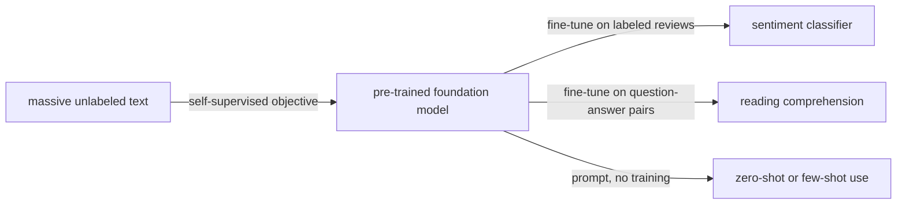

Training a deep network from scratch for every task needs a large labeled dataset for that task, and labels are expensive. The idea that changed natural language processing after 2018, and later most of deep learning, is to separate learning in two stages: first *pre-train* one large model on a huge amount of data that need no human labels, so that it learns general representations of language (or images), and then *adapt* it to each task with little labeled data, or with none at all. This chapter follows that idea from its beginnings to the present. It starts from supervised pre-training in computer vision and from the static word vectors of [4.7.5](/4.7.5), explains why a word's representation must depend on its context, and then studies the two families of Transformer-based pre-trained models ([4.7.6](/4.7.6)): bidirectional encoders such as BERT, which are pre-trained by filling in masked words, and autoregressive decoders such as GPT, which are pre-trained by predicting the next **token**. The second half is about adaptation: fine-tuning with a task-specific output layer, reformulating tasks as text with prompts, in-context learning without any gradient step, instruction tuning, and parameter-efficient methods such as LoRA that train less than one percent of the parameters. How such models are trained on thousands of GPUs is the subject of [4.7.8](/4.7.8); how pre-trained language models are scaled up and aligned with human intentions, which turns them into assistants and reasoning models, is the subject of [4.7.9](/4.7.9).

## 7.1. The Pre-training Paradigm

### 7.1.1. The Limits of Supervised Learning

In **supervised learning** ([4.7.1](/4.7.1#sec-1.2.4)) each task comes with its own labeled dataset: images labeled cat or dog, handwritten digits labeled $0, \dots, 9$, sentences labeled positive or negative. Three problems arise when every task is learned separately.

- Annotation is expensive. ImageNet's 14 million labeled images took years of crowd work; labeling the answer spans of a reading comprehension dataset requires trained annotators.
- Many tasks have few labels. A classifier for a rare disease, a new language or a new product category may have only hundreds of examples, too few for a deep network (the regime of *few-shot* or, with no examples at all, *zero-shot* learning).
- Nothing is shared. Recognizing cats and recognizing digits both require detecting edges and shapes; understanding a movie review and answering a question about a news article both require knowing English. Training each model from random initialization relearns this common knowledge every time.

### 7.1.2. Transfer Learning

**Definition 7.1.1 (Transfer Learning)** **Transfer learning** is the use of a model, or the representations it has learned, on a source task or dataset to improve learning on a different target task.

**Definition 7.1.2 (Pre-training and Fine-tuning)** **Pre-training** is the training of a model on a large, general source dataset with an objective that does not depend on any particular target task. **Fine-tuning** is the continued training of a pre-trained model, usually with a smaller learning rate and possibly an added output layer, on the data of a target task. A large model pre-trained on broad data so that it can be adapted to a wide range of tasks is called a **foundation model**.

In computer vision the source task was long a supervised one: a **convolutional neural network** ([4.7.3](/4.7.3)) such as ResNet is trained to classify ImageNet, its last layer is removed, and the remaining network serves as the *backbone* of an object detector (Faster R-CNN) or a segmentation network (U-Net), which is then fine-tuned on a much smaller detection or segmentation dataset. This works because the early and middle layers of the classifier compute edges, textures and object parts, which are useful for any visual task. The paradigm has three advantages that recur throughout this chapter:

1. the model benefits from large-scale data and learns general representations;
2. the features are task-agnostic and transfer to many tasks that share the input format;
3. with a good pre-trained model, a target task needs few labeled examples, sometimes none.

### 7.1.3. Self-Supervised Pre-training

Supervised pre-training still needs one large labeled dataset. Text is different: the web offers trillions of words without labels, and the structure of language itself provides a training signal.

The way out is **self-supervised learning** ([4.6.1](/4.6.1)): hide or corrupt part of each example and train the model to predict the hidden part from the rest. The targets are constructed automatically from the data, so the problem is formally supervised, but no human annotation is required. Typical self-supervised tasks are: predicting the next word of a text from the words before it; predicting a masked word from the words around it ("I like deep [MASK] very much" → "learning"); in vision, reconstructing masked patches of an image (masked autoencoders) or recognizing that two random crops come from the same image (contrastive learning). The word2vec models of [4.7.5](/4.7.5) were already self-supervised: CBOW predicts a word from its context and skip-gram predicts the context from the word, so word vectors are trained on raw text. Because the data are essentially unlimited, self-supervised pre-training can train far larger models than any labeled dataset would support, and the scale of the model and the data becomes the main lever on quality ([4.7.9](/4.7.9)).



## 7.2. Contextualized Representations

### 7.2.1. Static Word Vectors and Their Limitation

Word vectors such as word2vec map each word type to one fixed vector. They can be plugged into any neural text model, are cheap to train, and capture semantic similarity and analogies (the vector arithmetic $\text{king} - \text{man} + \text{woman} \approx \text{queen}$). Their limitation is that they are *static*: the vector of a word is the same in every sentence. In

1. "I go to the bank to deposit some money" and
2. "The little girl fell off the bank of the river"

the word "bank" has different meanings, but word2vec gives it a single vector, an average over all its senses. The linguist J. R. Firth stated the principle that the solution follows: "the complete meaning of a word is always contextual" (1935), and "you shall know a word by the company it keeps" (1957). A representation of a word in a sentence should therefore be computed from the whole sentence.

### 7.2.2. ELMo

ELMo (Embeddings from Language Models; Peters et al., NAACL 2018) was the first widely used contextualized word representation. It pre-trains two LSTM language models ([4.7.5](/4.7.5)) on a large corpus, a forward model that predicts each word from the words to its left and a backward model that predicts it from the words to its right, each with $L = 2$ layers on top of a character-based token encoder. For token $k$, let $\boldsymbol{h}_{k,0}$ be the token encoding and $\boldsymbol{h}_{k,j}$, $j = 1, \dots, L$, the concatenation of the forward and backward hidden states in layer $j$. A downstream task uses the weighted combination

$$
\mathrm{ELMo}_k = \gamma \sum_{j=0}^{L} s_j\,\boldsymbol{h}_{k,j},
$$

where the weights $\boldsymbol{s} = \operatorname{softmax}(\boldsymbol{w})$ and the scale $\gamma$ are learned for the task while the language models stay fixed. The lower layers turn out to capture syntax (part of speech) and the upper layers semantics (word sense), so different tasks choose different mixtures. Adding ELMo vectors to existing task models improved the state of the art on six benchmarks, including question answering and named entity recognition. ELMo is still a feature extractor, however: the two directions are trained separately and only concatenated, and the task model on top is designed and trained from scratch.

### 7.2.3. Why Transformers

From 2017 to 2018 the field moved from recurrent networks to Transformers ([4.7.6](/4.7.6)) as the architecture for pre-training, for three reasons.

- Generality: full self-attention connects every position to every other and makes no strong assumption about the data format, whereas a recurrent network assumes sequential processing and a convolutional network assumes locality and translation invariance.
- Scalability: Transformers keep improving as parameters and data grow, to 175 billion parameters in GPT-3 and far beyond.
- Parallelism: all positions of a sequence are processed at once during training, which suits GPUs and TPUs; a recurrent network must process the positions one after another.

### 7.2.4. A Taxonomy of Pre-trained Models

Pre-trained Transformers differ in which part of the original encoder–decoder Transformer they use, and correspondingly in their pre-training objective.

| Structure | Attention | Pre-training objective | Examples | Strength |
|---|---|---|---|---|
| Encoder only | bidirectional | masked language modeling, replaced-token detection | BERT, RoBERTa, ELECTRA, DeBERTa | understanding: classification, tagging, retrieval embeddings |
| Decoder only | causal (left to right) | next-token prediction | GPT series, Llama, Qwen, DeepSeek, Claude | generation; with scale, every task |
| Encoder–decoder | bidirectional encoder, causal decoder with cross-attention | span corruption, denoising | T5, BART | conditional generation: translation, summarization |
| Prefix LM, blank infilling | bidirectional on a prefix, causal on the rest | autoregressive blank infilling | GLM, UniLM | both, in one model |

The next two sections study the first two rows in detail. Since about 2020 the decoder-only design has become dominant for large models (§7.4.5).

## 7.3. BERT: Pre-training for Understanding

### 7.3.1. Architecture and Input

**Definition 7.3.1 (BERT)** **BERT** (Bidirectional Encoder Representations from Transformers; Devlin et al., NAACL 2019) is a stack of Transformer encoder layers with full bidirectional self-attention, pre-trained on unlabeled text with masked language modeling and next-sentence prediction, and then fine-tuned with a small task-specific output layer.

The input is one or two text segments, tokenized into WordPiece tokens (a vocabulary of 30,000), framed by two special tokens: `[CLS] segment A [SEP] segment B [SEP]`. The input vector of each position is the sum of three learned embeddings: the token embedding, a segment embedding (A or B) and a learned position embedding (up to 512 positions). The final hidden vector of `[CLS]` serves as a summary of the whole input for classification. Two sizes were released: BERT-base with 12 layers, hidden size 768 and 12 heads (110 million parameters), and BERT-large with 24 layers, hidden size 1,024 and 16 heads (340 million parameters). They were pre-trained on BooksCorpus and English Wikipedia, about 3.3 billion words.

Bidirectional attention is what distinguishes BERT from a language model: the representation of every position depends on the words on both sides, in every layer. A left-to-right language model cannot use bidirectional attention, because predicting the next word would then be trivial: the word could attend to itself. BERT therefore needs a different pre-training task.

### 7.3.2. Masked Language Modeling

**Definition 7.3.2 (Masked Language Modeling)** Let $\boldsymbol{x} = (x_1, \dots, x_T)$ be a token sequence. **Masked language modeling** (MLM) chooses a random subset $M \subset \{1, \dots, T\}$ of positions, replaces them by a corrupted sequence $\tilde{\boldsymbol{x}}$, and trains the model to recover the original tokens by minimizing

$$
\mathcal{L}_{\mathrm{MLM}}(\boldsymbol{\theta}) = -\mathbb{E}_{\boldsymbol{x},M}\sum_{t \in M}\log p_{\boldsymbol{\theta}}\bigl(x_t \mid \tilde{\boldsymbol{x}}\bigr),
$$
where $p_{\boldsymbol{\theta}}(\cdot \mid \tilde{\boldsymbol{x}})$ is a softmax over the vocabulary computed from the final hidden vector at position $t$.

BERT selects 15% of the tokens. Of the selected positions, 80% are replaced by the special token `[MASK]`, 10% by a random token and 10% are left unchanged:

| Choice | Probability | Example ("my dog is hairy", target "hairy") |
|---|---|---|
| replace by `[MASK]` | 80% | my dog is `[MASK]` |
| replace by a random token | 10% | my dog is apple |
| keep unchanged | 10% | my dog is hairy |

The mixture addresses a mismatch between pre-training and fine-tuning: `[MASK]` never appears in downstream inputs. Since the model does not know which tokens have been replaced or kept, it must maintain a good contextual representation of *every* token, not only of the masked ones. The objective is a denoising autoencoder on text: corrupt the input, reconstruct it. The loss is computed only on the 15% of selected positions, which is the main inefficiency of MLM compared with next-token prediction, where every position contributes a target. ELECTRA (Clark et al. 2020) recovers this efficiency by *replaced-token detection*: a small generator fills the masked positions with plausible tokens, and the main model classifies every position as original or replaced.

The corruption procedure is a few lines of NumPy; the labels mark with $-100$ the positions that are not predicted, the convention of PyTorch's cross-entropy loss.

```python
import numpy as np

def mask_tokens(ids, vocab_size, mask_id, special, rng, p=0.15):
    """BERT-style corruption: choose 15% of the positions as targets;
    of these, 80% become [MASK], 10% a random token, 10% stay unchanged."""
    ids = np.asarray(ids)
    labels = np.full_like(ids, -100)              # -100: position not predicted
    candidates = ~np.isin(ids, special)           # never mask [CLS], [SEP], padding
    target = candidates & (rng.random(ids.shape) < p)
    labels[target] = ids[target]
    corrupted = ids.copy()
    u = rng.random(ids.shape)
    corrupted[target & (u < 0.8)] = mask_id
    rand = target & (u >= 0.8) & (u < 0.9)
    corrupted[rand] = rng.integers(5, vocab_size, rand.sum())
    return corrupted, labels                      # remaining 10%: unchanged

rng = np.random.default_rng(0)
ids = rng.integers(5, 30000, size=(64, 512))      # 64 sequences of 512 tokens
ids[:, 0], ids[:, -1] = 1, 2                      # [CLS] = 1, [SEP] = 2
x, y = mask_tokens(ids, 30000, mask_id=3, special=[0, 1, 2], rng=rng)
t = y != -100
print(f"targets {t.mean():.3f}  [MASK] {(x[t] == 3).mean():.3f}  "
      f"random {((x[t] != 3) & (x[t] != ids[t])).mean():.3f}  kept {(x[t] == ids[t]).mean():.3f}")
```

```text
targets 0.151  [MASK] 0.792  random 0.102  kept 0.106
```

### 7.3.3. Next-Sentence Prediction and Why It Was Dropped

BERT's second pre-training task, *next-sentence prediction* (NSP), aims at relations between sentences, which question answering and natural language inference require. For half of the training pairs segment B is the sentence that actually follows A in the corpus, for the other half a random sentence; a binary classifier on the `[CLS]` vector predicts which case holds. The total pre-training loss is the sum of the MLM and NSP losses.

Later work showed that NSP is not needed. RoBERTa (Liu et al. 2019) retrained BERT with dynamic masking (a new mask each time a sequence is seen), ten times more data (160 GB of text), larger batches, longer training and full-length inputs of contiguous text, and found that removing NSP matched or slightly improved downstream results. The explanation is that the NSP task is too easy: a random sentence usually comes from a different document, so the classifier can solve the task by detecting a change of *topic*, which MLM already captures, without learning coherence. ALBERT (Lan et al. 2020) replaced it with *sentence-order prediction*, which asks whether two consecutive sentences are in the right order and thus cannot be solved by topic alone. The general lesson, confirmed many times since, is that data, compute and training duration mattered more than the particular auxiliary objectives.

### 7.3.4. Results

Fine-tuned BERT-large raised the GLUE benchmark score (nine sentence-level understanding tasks) to 80.5, an absolute improvement of 7.7 points over the previous best, and reached an F1 score of 93.2 on the SQuAD v1.1 reading comprehension task, above the human baseline. The architecture of the task models no longer had to be designed: one pre-trained network plus one output layer was enough. Encoder models of the BERT family remain in wide use where an input must be mapped to a label or a vector, for example in classification and in the embedding models of search and retrieval systems.

## 7.4. Generative Pre-training

### 7.4.1. Language Models

**Definition 7.4.1 (Language Model)** A **language model** is a probability distribution over sequences of tokens. An *autoregressive* (causal) language model factorizes it by the chain rule of probability,

$$
p_{\boldsymbol{\theta}}(x_1, \dots, x_T) = \prod_{t=1}^{T} p_{\boldsymbol{\theta}}(x_t \mid x_1, \dots, x_{t-1}),
$$
and models each conditional, the distribution of the next token given the prefix, by a neural network with a softmax output over the vocabulary.

Training by **maximum likelihood estimation** minimizes the average negative log-likelihood of the next token,

$$
\mathcal{L}_{\mathrm{LM}}(\boldsymbol{\theta}) = -\frac{1}{T}\sum_{t=1}^{T}\log p_{\boldsymbol{\theta}}(x_t \mid x_{<t}),
$$

which is the **cross-entropy loss** of [4.7.1](/4.7.1#sec-1.5) applied at every position. In a Transformer decoder the conditionals are computed with *causal* (masked) self-attention, in which position $t$ attends only to positions $1, \dots, t$ ([4.7.6](/4.7.6)). Consequently one forward pass over a training sequence computes all $T$ conditionals at once, and the loss is obtained at every position in parallel; a recurrent language model obtains the same loss but must process the positions sequentially.

**Definition 7.4.2 (Generative Pre-training)** **Generative pre-training** is the pre-training of a Transformer decoder as an autoregressive language model on a large unlabeled corpus, by minimizing $\mathcal{L}_{\mathrm{LM}}$. The name comes from the first GPT paper (Radford et al. 2018, "Improving Language Understanding by Generative Pre-Training").

The task looks modest, but predicting the next token well requires a great deal of knowledge. To continue "This person suddenly started to" with "run" rather than "is", the model must know syntax; to continue "The boiling point of water is" with "100 °C" rather than "50 °C", it must know facts; to continue a proof or a program, it must follow the reasoning. Probing studies (for example Zhang et al., ACL 2021, "When Do You Need Billions of Words of Pretraining Data?") found that syntactic knowledge is acquired from about 10–100 million words, whereas factual and commonsense knowledge requires billions.

### 7.4.2. GPT-1 to GPT-3

| Model | Year | Parameters | Data | How it is used |
|---|---|---|---|---|
| GPT-1 | 2018 | 117 million (12 layers) | BooksCorpus, about 5 GB | fine-tuned per task, with the input rewritten as one token sequence (for example premise, delimiter, hypothesis) |
| GPT-2 | 2019 | 1.5 billion (48 layers) | WebText, 40 GB from 8 million web pages | zero-shot: tasks posed as text continuation, without fine-tuning |
| GPT-3 | 2020 | 175 billion (96 layers, width 12,288) | about 300 billion tokens of filtered web text, books and Wikipedia | few-shot in-context learning (§7.5.3) |

GPT-1 appeared a few months before BERT and was the first Transformer pre-trained for transfer; BERT's bidirectional encoder outperformed it on understanding benchmarks. GPT-2 showed that a larger language model trained on diverse text could perform translation, summarization and question answering to some extent with no task-specific training at all, simply by being given a suitable text to continue ("TL;DR:" after an article for summarization). GPT-3 showed that at 175 billion parameters a model could learn a new task from a few examples written into its input. The growth in parameters, data and training compute, summarized by the scaling laws of [4.7.9](/4.7.9), is the main difference between the three; their architecture is nearly the same.

### 7.4.3. Generating Text

A pre-trained language model generates text by repeatedly sampling a token from $p_{\boldsymbol{\theta}}(\cdot \mid x_{<t})$, appending it to the input and continuing, until an end-of-sequence token or a length limit. With logits $\boldsymbol{z} \in \mathbb{R}^{V}$ at the last position, the common decoding rules are:

- greedy decoding: choose $\arg\max_v z_v$; deterministic, but long greedy outputs tend to repeat themselves;
- temperature sampling: sample from $\operatorname{softmax}(\boldsymbol{z}/\tau)$; $\tau < 1$ sharpens the distribution, $\tau > 1$ flattens it, and $\tau \to 0$ recovers greedy decoding;
- top-$k$ sampling: keep the $k$ most probable tokens, renormalize and sample;
- **nucleus sampling** (top-$p$; Holtzman et al. 2020): keep the smallest set of most probable tokens whose total probability is at least $p$ (for example $0.9$), renormalize and sample, so that the candidate set adapts to how peaked the distribution is.

Only the newly generated token must be processed at each step, because the keys and values of the earlier tokens are kept in the KV cache ([4.7.6](/4.7.6)). The cost of generation on real hardware is analyzed in [4.7.8](/4.7.8#sec-8.9).

### 7.4.4. Encoder–Decoder and Blank-Infilling Models

T5 (Raffel et al. 2020) casts every task, classification included, as text to text: the input "translate English to German: That is good." has the output "Das ist gut.", and "sst2 sentence: it was a delightful film" has the output "positive". It is pre-trained by *span corruption*: random spans of the input are replaced by sentinel tokens `<X>`, `<Y>`, and the decoder generates the missing spans, on the 750 GB C4 web corpus. BART (Lewis et al. 2020) similarly trains an encoder–decoder to reconstruct a text from a corrupted version. These models are strong at conditional generation, where the whole input is available before any output is produced.

GLM (Du et al., ACL 2022) combines the two kinds of attention in one Transformer by *autoregressive blank infilling*. Spans of the text are removed; the corrupted text (part A) is encoded with bidirectional attention as in BERT, and the removed spans (part B) are generated one token at a time as in GPT, each attending to all of part A and to its own earlier tokens. The pattern is realized entirely by the self-attention mask. Varying the span lengths (15% of the tokens in short spans for understanding; one span of half a document for long generation) trains one model for both kinds of task.

### 7.4.5. Why Decoder-Only Models Prevailed

Encoder models are strong at understanding but cannot generate fluently; encoder–decoder models need a division of every task into input and output. A decoder-only model does everything with one architecture and one objective, and several practical properties favor it at scale:

- every token is a training target, whereas MLM learns from 15% of the positions;
- generation reuses the cached keys and values of the whole context, and a conversation can be extended without re-encoding it;
- any task, understanding included, can be posed as continuation of a text, and in-context learning (§7.5.3) emerges with scale;
- one decoder stack is simpler to scale, parallelize and serve than two.

Since GPT-3, nearly all large language models are decoder-only Transformers trained with next-token prediction. The open-weight Qwen series of Alibaba illustrates how the design has evolved while the objective stayed fixed:

| | Qwen | Qwen2.5 | Qwen3 |
|---|---|---|---|
| Release | 2023 | 2024 | 2025 |
| Architecture | dense | dense | dense and mixture of experts |
| Attention | multi-head | grouped-query | grouped-query |
| Largest model | 72B | 72B | 235B total, 22B active per token |
| Pre-training data | about 3T tokens | 18T tokens | 36T tokens |

Its 2026 successor Qwen3.5 replaces three of every four attention layers by linear-attention layers, one of the new architectures of [4.7.9](/4.7.9).

## 7.5. Fine-tuning and Prompting

### 7.5.1. Fine-tuning with Task-Specific Heads

The standard way to use BERT is to add a small output layer, a *head*, on top of the pre-trained encoder and to fine-tune all parameters on the labeled task data with a learning rate around $10^{-5}$ for a few epochs.

| Task | Input | Head |
|---|---|---|
| single-sentence classification (sentiment) | `[CLS] sentence [SEP]` | softmax layer on the `[CLS]` vector: $\operatorname{softmax}(W\boldsymbol{h}_{\mathrm{CLS}})$ |
| sentence-pair classification (entailment, paraphrase) | `[CLS] A [SEP] B [SEP]` | softmax layer on the `[CLS]` vector |
| sequence labeling (named entities) | `[CLS] sentence [SEP]` | softmax layer on every token vector |
| span extraction (reading comprehension) | `[CLS] question [SEP] passage [SEP]` | two vectors $\boldsymbol{s}, \boldsymbol{e}$: start position $\operatorname{softmax}_i(\boldsymbol{s}^{\mathsf T}\boldsymbol{h}_i)$, end position $\operatorname{softmax}_j(\boldsymbol{e}^{\mathsf T}\boldsymbol{h}_j)$ |

The head adds few new parameters ($768 \times 2$ for binary classification with BERT-base); everything else starts from the pre-trained weights. The approach is simple and handles complex outputs, but it introduces new, randomly initialized parameters that need enough labeled data, and the pre-training task (predicting words) differs from the fine-tuning task (predicting labels).

### 7.5.2. Prompts

**Definition 7.5.1 (Prompt)** A **prompt** is the text given to a language model as input, from which the model's continuation is computed. In the narrower sense used for adapting models, it is a template that rewrites an instance of a task as a text whose continuation, or whose masked word, gives the answer.

Prompts remove the mismatch between pre-training and the task. For sentiment classification of "I like deep learning very much.":

- with a masked language model: "I like deep learning very much. It was a `[MASK]` sentiment." The model's probabilities for "good" and "bad" at the masked position decide the label; a *verbalizer* maps label words to classes (good → positive, bad → negative);
- with an autoregressive model: "I like deep learning very much. It is so", and the probabilities of the continuations "good" and "bad" are compared.

Fine-tuning through a prompt (pattern-exploiting training, Schick and Schütze 2021) updates the model with the same language modeling head it was pre-trained with and needs no new parameters. It is markedly better than fine-tuning with a head when only tens of labeled examples are available, and it lets autoregressive models compete with BERT on understanding tasks.

| | Task-specific head | Prompt-based fine-tuning |
|---|---|---|
| New parameters | an output layer | none |
| Low-resource performance | weak | strong |
| Complex outputs (spans, tags) | straightforward | needs careful formulation |
| Main difficulty | enough labeled data | designing prompts and verbalizers |

### 7.5.3. In-Context Learning

GPT-3 went one step further: no fine-tuning at all.

**Definition 7.5.2 (In-Context Learning)** **In-context learning** is the performance of a task by a pre-trained language model, without any update of its parameters, from a prompt that contains a description of the task and, optionally, a few input–output examples (*demonstrations*), followed by the new input. With $k$ demonstrations it is called $k$-shot; with only the description it is *zero-shot*.

A few-shot prompt for translation looks like this, and the model is expected to continue with "fromage":

```text
Translate English to French:
sea otter => loutre de mer
peppermint => menthe poivrée
plush giraffe => girafe peluche
cheese =>
```

In the GPT-3 paper (Brown et al. 2020) few-shot performance improved much more steeply with model size than zero-shot performance; on some benchmarks the 175-billion-parameter model with 32 examples approached fine-tuned models, and on few-shot translation into English it surpassed earlier unsupervised translation systems. In-context learning is limited by the **context window** and is sensitive to the choice, format and even order of the demonstrations. How a network learns from examples without changing its weights is still studied; one mechanism that has been identified in small Transformers is the **induction head**, a pair of attention heads that finds an earlier occurrence of the current token and copies what followed it. The ability matters well beyond benchmarks: every instruction, document or tool result placed in the context of an assistant or a **coding agent** ([4.2.14](/4.2.14)) is used in this way.

### 7.5.4. Instruction Tuning

A pre-trained language model continues text; it does not follow instructions. Asked "What are the names of some famous actors?", a raw model may continue with further similar questions, as a web page of questions would. Instruction tuning closes this gap.

**Definition 7.5.3 (Instruction Tuning)** **Instruction tuning**, also called **supervised fine-tuning** (SFT) in the context of assistants, is the fine-tuning of a pre-trained language model with the language modeling loss on a collection of (instruction, response) pairs covering many tasks, so that the model learns to respond to instructions, including instructions for tasks not seen during fine-tuning. The loss is usually computed only on the response tokens.

FLAN (Wei et al., ICLR 2022, "Finetuned Language Models Are Zero-Shot Learners") fine-tuned a 137-billion-parameter model on more than 60 NLP datasets rewritten as natural-language instructions and found that zero-shot performance on held-out task types improved substantially, and more so for larger models. The data come from three kinds of sources: existing academic datasets rewritten with instruction templates; real user requests (the prompts that users had sent to the OpenAI API were the basis of InstructGPT, [4.7.9](/4.7.9)); and synthetic data generated by language models themselves, as in Self-Instruct (Wang et al. 2023), which bootstraps 52,000 instructions from 175 human-written seeds, or Evol-Instruct (WizardLM), which makes instructions progressively more complex. Experience since then can be summarized briefly:

- a specialized model for one task may need only a few thousand examples; a general assistant needs hundreds of thousands, covering mathematics, code, reasoning, conversation, tool use, many languages and safety;
- quality and diversity matter more than quantity: LIMA (Zhou et al. 2023) obtained a competitive assistant from 1,000 carefully chosen examples, and data selection methods filter out low-quality pairs;
- the format matters: conversations are serialized with a *chat template* that marks system, user and assistant turns with special tokens, and a model must be used with the template it was trained with.

Instruction tuning is the first stage of post-training. Making the responses helpful, honest and harmless beyond what demonstrations can teach requires preference data and reinforcement learning, the alignment methods of [4.7.9](/4.7.9).

## 7.6. Parameter-Efficient Fine-tuning

### 7.6.1. The Cost of Full Fine-tuning

Fine-tuning all parameters of a large model is expensive in two ways.

- Memory: training with Adam needs, besides the weights, their gradients and two optimizer states per parameter, kept in FP32 for numerical stability; in mixed precision this is 16 bytes per parameter, eight times the 2 bytes of the weights alone ([4.7.8](/4.7.8#sec-8.1)). A 7-billion-parameter model then needs about 112 GB before any activations, more than one 80 GB GPU.
- Storage: every task gets its own copy of all weights, about 20 GB for a 10-billion-parameter model in 16-bit precision; serving a hundred customized models means storing and loading a hundred such copies.

**Definition 7.6.1 (Parameter-Efficient Fine-tuning)** **Parameter-efficient fine-tuning** (PEFT) adapts a pre-trained model to a task by training only a small number of parameters, either a small subset of the existing ones or a small number of new ones, while all other pre-trained parameters stay frozen.

Gradients and optimizer states are then needed only for the trainable parameters, which reduces memory (the frozen weights and the activations still have to be stored), and each task is stored as a small difference from the shared base model. The three standard approaches modify the network in different places.

### 7.6.2. Adapters

**Definition 7.6.2 (Adapter)** An **adapter** (Houlsby et al., ICML 2019) is a small bottleneck network inserted into each Transformer layer, after the attention and the feed-forward sublayers, that computes

$$
\boldsymbol{h} \mapsto \boldsymbol{h} + W_{\mathrm{up}}\,\varphi\bigl(W_{\mathrm{down}}\boldsymbol{h}\bigr), \qquad W_{\mathrm{down}} \in \mathbb{R}^{m \times d},\ W_{\mathrm{up}} \in \mathbb{R}^{d \times m},\ m \ll d,
$$
with a nonlinearity $\varphi$; during fine-tuning only the adapters (and the layer normalizations) are trained.

The residual form means that an adapter initialized near zero leaves the pre-trained network unchanged at the start. With bottleneck widths of a few dozen, adapters train a few percent of the parameters or less and reached within 0.4 points of full fine-tuning on GLUE in the original paper. Their drawback is that they add sequential computation to every layer and therefore latency at inference.

### 7.6.3. Prefix Tuning and Prompt Tuning

Instead of searching for a good prompt in words, one can learn it. *Prompt tuning* (Lester et al., EMNLP 2021) prepends $l$ trainable vectors, *soft tokens* that correspond to no word, to the input embeddings and trains only them. *Prefix tuning* (Li and Liang, ACL 2021) prepends trainable key and value vectors to the attention of every layer, so that every layer attends to a learned prefix. Only the prefix is stored per task, a few hundred kilobytes. Prompt tuning has a notable scaling behavior: for small models it is far worse than fine-tuning, but with T5 models of about 10 billion parameters it matches full fine-tuning. Its costs are that the soft tokens occupy part of the context and that optimization is less stable than for the other methods.

### 7.6.4. Low-Rank Adaptation

LoRA starts from the observation that fine-tuning can be written as adding a change to the frozen weights, $W = W_0 + \Delta W$, and from the hypothesis that the change needed to adapt a large pre-trained model has a low *intrinsic rank*: the adaptation lives in a low-dimensional subspace (Aghajanyan et al. 2021 found that fine-tuning succeeds when it is restricted to a random subspace of a few hundred dimensions).

**Definition 7.6.3 (Low-Rank Adaptation)** **Low-rank adaptation** (LoRA; Hu et al., ICLR 2022) fine-tunes a weight matrix $W_0 \in \mathbb{R}^{d \times k}$ of a pre-trained network by freezing it and learning a low-rank update,

$$
\boldsymbol{y} = W_0\boldsymbol{x} + \frac{\alpha}{r}\,BA\boldsymbol{x}, \qquad B \in \mathbb{R}^{d \times r},\ A \in \mathbb{R}^{r \times k},\ r \ll \min(d, k),
$$
where $A$ is initialized randomly, $B$ is initialized to zero, and the scale $\alpha$ is a hyperparameter.

Several properties follow directly from the form.

- The update $BA$ has **rank** at most $r$. By the **Eckart–Young theorem** the best rank-$r$ approximation of a full update is given by its truncated singular value decomposition; LoRA does not compute that decomposition but learns a rank-$r$ update directly.
- Since $B = O$ initially, the model starts exactly at the pre-trained one, and the update grows from zero.
- A $d \times k$ matrix receives $r(d + k)$ trainable parameters instead of $dk$; for $d = k = 4096$ and $r = 8$ this is $0.39\%$. Dividing by $r$ keeps the effective learning rate roughly unchanged when $r$ is varied.
- After training, the update can be merged, $W = W_0 + \frac{\alpha}{r}BA$, so inference costs exactly as much as for the original model; alternatively many task-specific $(A, B)$ pairs can be kept and swapped on one shared base model.

LoRA can be applied to any weight matrix; the original paper adapted the query and value projections of attention, and later practice applies it to all linear layers. On GPT-3 175B it matched full fine-tuning while reducing the number of trainable parameters by a factor of 10,000 and the GPU memory of training by a factor of 3.

The forward pass, the effect of the zero initialization and the merge can be checked in NumPy:

```python
import numpy as np

rng = np.random.default_rng(0)
d_in, d_out, r, alpha = 4096, 4096, 8, 16
W0 = rng.standard_normal((d_out, d_in)) / np.sqrt(d_in)   # frozen pre-trained weight
A = rng.standard_normal((r, d_in)) / np.sqrt(d_in)         # trainable, random init
B = np.zeros((d_out, r))                                    # trainable, zero init
scale = alpha / r

def lora_forward(X):
    # X: (tokens, d_in). Two thin matmuls instead of forming B @ A.
    return X @ W0.T + scale * (X @ A.T) @ B.T

X = rng.standard_normal((16, d_in))
print("at initialization equal to W0:", np.allclose(lora_forward(X), X @ W0.T))

B = 0.01 * rng.standard_normal((d_out, r))                  # pretend training changed B
W_merged = W0 + scale * B @ A                               # merge for inference
print("merged weight gives the same output:", np.allclose(lora_forward(X), X @ W_merged.T))
print("rank of the update:", np.linalg.matrix_rank(scale * B @ A))
print(f"trainable parameters: {A.size + B.size:,} of {W0.size:,} "
      f"({(A.size + B.size) / W0.size:.2%})")
```

```text
at initialization equal to W0: True
merged weight gives the same output: True
rank of the update: 8
trainable parameters: 65,536 of 16,777,216 (0.39%)
```

In PyTorch (version 2.14, CPU) a LoRA layer wraps an existing linear layer. In the toy problem below the target task requires a rank-2 change of the pre-trained weight, which a rank-4 adapter learns from 3% of the layer's parameters; only those parameters are given to the optimizer.

```python
import torch
from torch import nn

class LoRALinear(nn.Module):
    """y = W0 x + (alpha / r) B A x with W0 frozen."""
    def __init__(self, base: nn.Linear, r=4, alpha=8):
        super().__init__()
        self.base = base.requires_grad_(False)                  # freeze W0 and bias
        self.A = nn.Parameter(torch.randn(r, base.in_features) / base.in_features**0.5)
        self.B = nn.Parameter(torch.zeros(base.out_features, r))
        self.scale = alpha / r

    def forward(self, x):
        return self.base(x) + self.scale * (x @ self.A.T) @ self.B.T

torch.manual_seed(0)
d = 256
base = nn.Linear(d, d)                                          # the "pre-trained" layer
# the downstream task needs W0 + a rank-2 change
U, V = torch.randn(d, 2), torch.randn(2, d)
W_task = base.weight.detach() + 0.05 * U @ V
X = torch.randn(4096, d)
Y = X @ W_task.T + base.bias.detach()

layer = LoRALinear(base, r=4)
trainable = sum(p.numel() for p in layer.parameters() if p.requires_grad)
total = sum(p.numel() for p in layer.parameters())
print(f"trainable {trainable:,} of {total:,} parameters")
opt = torch.optim.AdamW([p for p in layer.parameters() if p.requires_grad], lr=1e-2)
for step in range(301):
    idx = torch.randint(0, len(X), (128,))
    loss = nn.functional.mse_loss(layer(X[idx]), Y[idx])
    opt.zero_grad()
    loss.backward()
    opt.step()
    if step % 100 == 0:
        print(f"step {step:3d}  loss {loss.item():.2e}")
```

```text
trainable 2,048 of 67,840 parameters
step   0  loss 1.41e+00
step 100  loss 2.41e-04
step 200  loss 3.17e-07
step 300  loss 1.89e-07
```

Libraries such as Hugging Face PEFT apply the same wrapping to the chosen layers of a pre-trained model automatically.

### 7.6.5. QLoRA

LoRA removes the optimizer states of the frozen weights but still stores those weights in 16 bits. *QLoRA* (Dettmers et al., NeurIPS 2023) stores the frozen base model in 4 bits and trains LoRA adapters in 16-bit precision on top of it. Three ingredients make this work without loss of quality:

1. the 4-bit *NormalFloat* (NF4) data type, whose 16 levels are quantiles of a normal distribution, matching the roughly normal distribution of pre-trained weights; each block of 64 weights has its own scale;
2. *double quantization*: the per-block scales are themselves quantized, saving about 0.4 bits per parameter;
3. *paged optimizers*, which move optimizer states to CPU memory when GPU memory spikes.

During the forward and backward pass each weight block is dequantized to BF16 on the fly; gradients flow through the frozen quantized weights into the adapters. QLoRA fine-tuned a 65-billion-parameter model on a single 48 GB GPU and matched 16-bit full fine-tuning on the benchmarks studied. Number formats such as BF16 and 4-bit floating point are explained in [4.7.8](/4.7.8#sec-8.2).

### 7.6.6. Comparison

He et al. (ICLR 2022) observed that the three approaches have a common form: each adds a learned modification $\Delta\boldsymbol{h}$ to some hidden state of the frozen network, $\boldsymbol{h} \leftarrow \boldsymbol{h} + \Delta\boldsymbol{h}$, and they differ in where $\Delta\boldsymbol{h}$ is computed and how it is parameterized.

| Method | Where | Trainable parameters per task | Inference overhead | Notes |
|---|---|---|---|---|
| Full fine-tuning | all weights | 100% | none | best with ample data; one full copy per task |
| Adapters | after sublayers, sequentially | about 0.5–5% | extra layers on the critical path | stable |
| Prefix / prompt tuning | attention keys and values, or input embeddings | < 0.1% | longer context | strong only for large models |
| LoRA | parallel to weight matrices | about 0.1–1% | none after merging | the default in practice |
| QLoRA | LoRA on a 4-bit base | as LoRA | dequantization, unless merged | fine-tuning on a single GPU |

## 7.7. Evaluating Pre-trained Models

### 7.7.1. Perplexity

The training objective of a language model gives a task-independent measure of its quality.

**Definition 7.7.1 (Perplexity)** The **perplexity** of a language model on a held-out token sequence $x_1, \dots, x_T$ is

$$
\operatorname{PPL} = \exp\Bigl(-\frac{1}{T}\sum_{t=1}^{T}\log p_{\boldsymbol{\theta}}(x_t \mid x_{<t})\Bigr),
$$
the exponential of the average cross-entropy loss per token.

Perplexity is the effective number of equally likely choices the model faces at each step: a model that spreads its probability uniformly over $V$ tokens has perplexity $V$, and a perfect model has perplexity 1. It is the exponential of the cross-entropy between the empirical distribution of the text and the model, and therefore measures how far the model is from the data in the sense of the **Kullback–Leibler divergence** ([4.7.1](/4.7.1#sec-1.5.1)). Two cautions apply: perplexities are comparable only for the same tokenizer and the same test text, because a different vocabulary changes what one "step" is; and lower perplexity does not guarantee better behavior on the tasks users care about. Masked language models such as BERT do not define a left-to-right probability and are not evaluated this way.

### 7.7.2. Benchmarks

Downstream evaluation moved with the capabilities of the models.

| Period | Representative benchmarks | What they measure |
|---|---|---|
| 2018–2020 | GLUE, SuperGLUE, SQuAD | sentence classification, inference, extractive reading comprehension, after fine-tuning |
| 2020–2023 | MMLU (multiple-choice exam questions in 57 subjects), GSM8K (grade-school math word problems), HumanEval (Python functions) | knowledge and skills in few-shot or zero-shot use |
| 2024– | GPQA Diamond (graduate-level science), AIME and other competition mathematics, Humanity's Last Exam, SWE-bench Verified and Terminal-Bench (agentic coding) | expert-level reasoning and multi-step tasks with tools |

Each generation was saturated within a few years; GLUE was surpassed by human-level scores in 2019 and MMLU by about 2024. Three problems affect all of them: *contamination*, when test items appear in the pre-training data; *sensitivity to the prompt format* and to the evaluation harness; and the difficulty of grading open-ended outputs, for which human preference comparisons (such as the LMArena leaderboard, which ranks chat models by pairwise votes) and grading by another language model are used, each with its own biases. The benchmarks for code models are discussed in more detail in [4.2.14](/4.2.14#sec-14.2.4).

## Summary

- Pre-training learns general representations from large, cheap data; fine-tuning adapts them to a task with little labeled data. In vision the source task was long ImageNet classification; in language it is self-supervised: predicting hidden parts of text from the rest.
- Static word vectors give one vector per word type; contextualized representations, first with ELMo's bidirectional LSTM language models, give one vector per occurrence. Transformers replaced recurrent networks because they are general, scale well and train in parallel.
- BERT is a bidirectional Transformer encoder pre-trained by masked language modeling (15% of tokens; 80% `[MASK]`, 10% random, 10% unchanged). Next-sentence prediction turned out to be unnecessary (RoBERTa). Fine-tuning one pre-trained encoder with a small head set the state of the art across understanding tasks.
- GPT models are Transformer decoders pre-trained as autoregressive language models, with the loss computed at every position in parallel. From GPT-1 to GPT-3 the architecture barely changed while scale grew by a factor of 1,500, and the mode of use changed from fine-tuning to zero-shot prompting to few-shot in-context learning. Decoder-only models now dominate.
- Tasks can be adapted through heads, through prompts (no new parameters, strong with few examples), through in-context learning (no training at all) and through instruction tuning (fine-tuning on many instruction–response pairs, the first stage of post-training).
- Parameter-efficient fine-tuning trains a small set of parameters: adapters (bottleneck layers), prefix and prompt tuning (learned soft tokens), and LoRA (a low-rank update $\frac{\alpha}{r}BA$ with $B$ initialized to zero, mergeable into the weights). QLoRA trains LoRA adapters on a 4-bit base model.
- Language models are evaluated intrinsically by perplexity, the exponential of the per-token cross-entropy, and extrinsically by benchmarks, which saturate quickly and suffer from contamination and format sensitivity.
