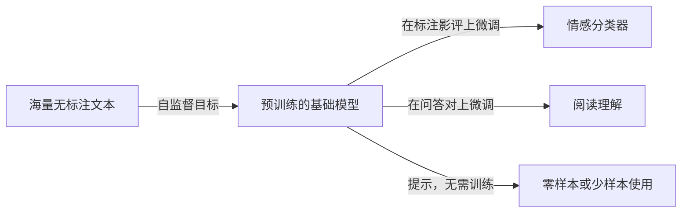

为每个任务从头训练一个深度网络，都需要该任务的大规模标注数据，而标注代价高昂。2018 年之后改变了自然语言处理、后来又改变了大部分**深度学习**的想法，是把学习拆成两个阶段：先在海量无需人工标注的数据上*预训练*一个大模型，使它学到语言（或图像）的通用表示；再用少量标注数据甚至不用标注数据，把它*适配*到各个任务上。本章从这一想法的源头讲到今天。先从计算机视觉中的有监督预训练和 [4.7.5](/4.7.5) 的静态**词向量**出发，说明为什么词的表示必须依赖上下文；然后研究两类基于 Transformer（[4.7.6](/4.7.6)）的预训练模型：以填补被遮盖的词来预训练的双向编码器（如 BERT），以及以预测下一个**词元**来预训练的自回归解码器（如 GPT）。后半部分讨论适配：加任务专用输出层的微调、用提示把任务改写成文本、无需任何梯度更新的上下文学习、指令微调，以及只训练不到百分之一参数的 LoRA 等参数高效方法。这类模型怎样在数千块 GPU 上训练，见 [4.7.8](/4.7.8)；预训练的**语言模型**怎样继续放大、怎样与人类意图对齐并成为助手和**推理模型**，见 [4.7.9](/4.7.9)。

## 7.1. 预训练范式

### 7.1.1. 有监督学习的局限

**有监督学习**（[4.7.1](/4.7.1#sec-1.2.4)）中每个任务都有自己的标注数据集：标为猫或狗的图像，标为 $0, \dots, 9$ 的手写数字，标为正面或负面的句子。每个任务单独学习时会遇到三个问题。

- 标注昂贵。ImageNet 的 1400 万张标注图像花了数年的众包劳动；为阅读理解数据集标注答案片段，需要受过训练的标注员。
- 许多任务标注很少。罕见疾病、新语种或新商品类别的分类器可能只有几百个样本，不足以训练深度网络（这就是*少样本*学习，完全没有样本时称为*零样本*学习）。
- 知识没有共享。识别猫和识别数字都要检测边缘与形状；理解影评和回答新闻问题都需要懂英语。每个模型都从随机初始化训练，等于每次都重新学习这些共同知识。

### 7.1.2. 迁移学习

**定义 7.1.1（迁移学习）** **迁移学习**是指利用在源任务或源数据集上学到的模型或其表示，改进在另一个不同的目标任务上的学习。

**定义 7.1.2（预训练与微调）** **预训练**是指在大规模通用源数据集上、用与任何具体目标任务无关的目标函数训练模型。**微调**是指在目标任务的数据上继续训练预训练模型，通常使用较小的学习率，并可能添加一个输出层。在广泛数据上预训练、以便适配大量任务的大模型称为**基础模型**。

在计算机视觉中，源任务长期是有监督任务：先训练一个**卷积神经网络**（[4.7.3](/4.7.3)），如**残差网络**，去分类 ImageNet；去掉最后一层，剩下的网络作为目标检测器（Faster R-CNN）或分割网络（U-Net）的*骨干网络*，再在规模小得多的检测或分割数据集上微调。这样做有效，是因为分类器的浅层和中间层计算的是边缘、纹理和物体部件，对任何视觉任务都有用。这一范式有三个优点，在本章中会反复出现：

1. 模型受益于大规模数据，学到通用表示；
2. 特征与任务无关，可以迁移到输入格式相同的许多任务；
3. 有了好的预训练模型，目标任务只需很少的标注样本，有时完全不需要。

### 7.1.3. 自监督预训练

有监督预训练仍然需要一个大规模标注数据集。文本则不同：网络上有数万亿个无标注的词，语言自身的结构就提供了训练信号。

出路是**自监督学习**（[4.6.1](/4.6.1)）：把每个样本的一部分隐藏或破坏，训练模型根据其余部分预测被隐藏的部分。目标由数据自动构造，所以问题在形式上是有监督的，但不需要人工标注。典型的自监督任务有：根据前面的词预测文本的下一个词；根据周围的词预测被遮盖的词（"I like deep [MASK] very much" → "learning"）；在视觉中，重建图像中被遮盖的图块（掩码自编码器），或判断两个随机裁剪是否来自同一张图像（对比学习）。[4.7.5](/4.7.5) 的 **word2vec** 模型已经是自监督的：**连续词袋模型**根据上下文预测词，**跳字模型**根据词预测上下文，所以**词向量**可以在原始文本上训练。由于数据近乎无限，自监督预训练可以训练远大于任何标注数据集所能支撑的模型，模型与数据的规模成为影响质量的主要杠杆（[4.7.9](/4.7.9)）。



## 7.2. 上下文词表示

### 7.2.1. 静态词向量及其局限

**词向量**（如 **word2vec**）把每个词类型映射到一个固定的向量。它们可以接入任何神经文本模型，训练代价低，并能刻画语义相似性和类比关系（向量运算 $\text{king} - \text{man} + \text{woman} \approx \text{queen}$）。它们的局限在于是*静态*的：一个词在每个句子里的向量都相同。在

1. "I go to the bank to deposit some money" 与
2. "The little girl fell off the bank of the river"

中，"bank" 的含义不同，但 word2vec 只给它一个向量，即它所有词义的平均。语言学家 J. R. Firth 提出了解决办法所依据的原则："一个词的完整意义总是上下文的"（1935），"观其伴而知其词"（1957）。因此，句子中词的表示应当由整个句子计算得出。

### 7.2.2. ELMo

ELMo（Embeddings from Language Models；Peters 等，NAACL 2018）是第一个被广泛使用的上下文词表示。它在大规模语料上预训练两个**长短期记忆网络**语言模型（[4.7.5](/4.7.5)）：一个前向模型根据左侧的词预测每个词，一个后向模型根据右侧的词预测它，两者都有 $L = 2$ 层，底层是基于字符的**词元**编码器。对第 $k$ 个词元，记 $\boldsymbol{h}_{k,0}$ 为词元编码，$\boldsymbol{h}_{k,j}$（$j = 1, \dots, L$）为第 $j$ 层前向与后向隐状态的拼接。下游任务使用加权组合

$$
\mathrm{ELMo}_k = \gamma \sum_{j=0}^{L} s_j\,\boldsymbol{h}_{k,j},
$$

其中权重 $\boldsymbol{s} = \operatorname{softmax}(\boldsymbol{w})$ 与缩放因子 $\gamma$ 随任务学习，语言模型本身保持不变。实验发现低层捕获句法（词性），高层捕获语义（词义），因此不同任务会选择不同的混合比例。把 ELMo 向量加入已有的任务模型，在包括问答和命名实体识别在内的六个基准上刷新了最好成绩。不过 ELMo 仍然只是特征提取器：两个方向分别训练、事后才拼接，上面的任务模型仍需从头设计和训练。

### 7.2.3. 为什么选择 Transformer

2017 到 2018 年间，预训练的架构从循环网络转向 **Transformer**（[4.7.6](/4.7.6)），原因有三。

- 通用性：完整的**自注意力**把每个位置与其他所有位置相连，对数据格式没有很强的假设；循环网络假设顺序处理，卷积网络假设局部性和平移不变性。
- 可扩展性：随着参数和数据增长，Transformer 持续改进，GPT-3 达到 1750 亿参数，之后的模型更大。
- 并行性：训练时序列的所有位置同时处理，适合 GPU 和 TPU；循环网络必须逐个位置处理。

### 7.2.4. 预训练模型的分类

预训练的 Transformer 因使用原始编码器–解码器 Transformer 的哪一部分而不同，预训练目标也随之不同。

| 结构 | 注意力 | 预训练目标 | 例子 | 擅长 |
|---|---|---|---|---|
| 仅编码器 | 双向 | 掩码语言建模、替换词元检测 | BERT、RoBERTa、ELECTRA、DeBERTa | 理解：分类、标注、检索嵌入 |
| 仅解码器 | 因果（从左到右） | 下一个词元预测 | GPT 系列、Llama、Qwen、DeepSeek、Claude | 生成；规模足够大时可做任何任务 |
| 编码器–解码器 | 双向编码器，带交叉注意力的因果解码器 | 片段破坏、去噪 | T5、BART | 条件生成：翻译、摘要 |
| 前缀语言模型、空白填充 | 前缀上双向，其余部分因果 | 自回归空白填充 | GLM、UniLM | 一个模型兼顾两者 |

接下来两节详细讨论前两行。2020 年前后起，仅解码器的设计成为大模型的主流（§7.4.5）。

## 7.3. BERT：面向理解的预训练

### 7.3.1. 架构与输入

**定义 7.3.1（BERT）** **BERT**（Bidirectional Encoder Representations from Transformers；Devlin 等，NAACL 2019）是由 Transformer 编码器层堆叠而成、带有完整双向自注意力的模型，用掩码语言建模与下一句预测在无标注文本上预训练，再加一个小的任务专用输出层进行微调。

输入是一两段文本，切分为 WordPiece **词元**（词表大小 30000），前后加两个特殊词元：`[CLS] segment A [SEP] segment B [SEP]`。每个位置的输入向量是三个可学习嵌入之和：词元嵌入、段嵌入（A 或 B）和可学习的**位置嵌入**（最多 512 个位置）。`[CLS]` 的最终隐向量用作整个输入的摘要，供分类使用。BERT 发布了两种规模：BERT-base 有 12 层、隐层宽度 768、12 个头（1.1 亿参数），BERT-large 有 24 层、隐层宽度 1024、16 个头（3.4 亿参数）。它们在 BooksCorpus 和英文维基百科上预训练，共约 33 亿词。

双向注意力是 BERT 区别于**语言模型**之处：每一层中，每个位置的表示都依赖两侧的词。从左到右的语言模型不能使用双向注意力，因为那样预测下一个词就变得平凡：这个词可以关注自己。因此 BERT 需要另一种预训练任务。

### 7.3.2. 掩码语言建模

**定义 7.3.2（掩码语言建模）** 设 $\boldsymbol{x} = (x_1, \dots, x_T)$ 为词元序列。**掩码语言建模**（MLM）随机选取位置子集 $M \subset \{1, \dots, T\}$，把序列替换为被破坏的序列 $\tilde{\boldsymbol{x}}$，并通过最小化

$$
\mathcal{L}_{\mathrm{MLM}}(\boldsymbol{\theta}) = -\mathbb{E}_{\boldsymbol{x},M}\sum_{t \in M}\log p_{\boldsymbol{\theta}}\bigl(x_t \mid \tilde{\boldsymbol{x}}\bigr),
$$
训练模型恢复原词元，其中 $p_{\boldsymbol{\theta}}(\cdot \mid \tilde{\boldsymbol{x}})$ 是由位置 $t$ 的最终隐向量算出的、在词表上的 **softmax 函数**。

BERT 选取 15% 的词元。被选中的位置中，80% 替换为特殊词元 `[MASK]`，10% 替换为随机词元，10% 保持不变：

| 选择 | 概率 | 例子（"my dog is hairy"，目标 "hairy"） |
|---|---|---|
| 替换为 `[MASK]` | 80% | my dog is `[MASK]` |
| 替换为随机词元 | 10% | my dog is apple |
| 保持不变 | 10% | my dog is hairy |

这种混合是为了缓解预训练与微调之间的不一致：下游输入中从不出现 `[MASK]`。由于模型不知道哪些词元被替换或保留，它必须为*每个*词元维持良好的上下文表示，而不只是被遮盖的那些。这个目标是文本上的去噪自编码器：破坏输入，再重建它。损失只在被选中的 15% 位置上计算，这是 MLM 相比下一个词元预测的主要低效之处，后者的每个位置都贡献一个目标。ELECTRA（Clark 等，2020）用*替换词元检测*弥补了这一效率：一个小的生成器用合理的词元填充被遮盖的位置，主模型则把每个位置分类为原词元或被替换的词元。

这一破坏过程用几行 NumPy 就能写出；标签用 $-100$ 标记不参与预测的位置，这是 PyTorch **交叉熵损失**的约定。

```python
import numpy as np

def mask_tokens(ids, vocab_size, mask_id, special, rng, p=0.15):
    """BERT-style corruption: choose 15% of the positions as targets;
    of these, 80% become [MASK], 10% a random token, 10% stay unchanged."""
    ids = np.asarray(ids)
    labels = np.full_like(ids, -100)              # -100: position not predicted
    candidates = ~np.isin(ids, special)           # never mask [CLS], [SEP], padding
    target = candidates & (rng.random(ids.shape) < p)
    labels[target] = ids[target]
    corrupted = ids.copy()
    u = rng.random(ids.shape)
    corrupted[target & (u < 0.8)] = mask_id
    rand = target & (u >= 0.8) & (u < 0.9)
    corrupted[rand] = rng.integers(5, vocab_size, rand.sum())
    return corrupted, labels                      # remaining 10%: unchanged

rng = np.random.default_rng(0)
ids = rng.integers(5, 30000, size=(64, 512))      # 64 sequences of 512 tokens
ids[:, 0], ids[:, -1] = 1, 2                      # [CLS] = 1, [SEP] = 2
x, y = mask_tokens(ids, 30000, mask_id=3, special=[0, 1, 2], rng=rng)
t = y != -100
print(f"targets {t.mean():.3f}  [MASK] {(x[t] == 3).mean():.3f}  "
      f"random {((x[t] != 3) & (x[t] != ids[t])).mean():.3f}  kept {(x[t] == ids[t]).mean():.3f}")
```

```text
targets 0.151  [MASK] 0.792  random 0.102  kept 0.106
```

### 7.3.3. 下一句预测及其被弃用的原因

BERT 的第二个预训练任务是*下一句预测*（NSP），旨在学习句子间的关系，问答和自然语言推断都需要这种关系。训练样本对中，一半的段 B 确实是语料中紧跟在 A 后面的句子，另一半是随机句子；`[CLS]` 向量上的二分类器预测属于哪种情形。总预训练损失是 MLM 损失与 NSP 损失之和。

后来的工作表明 NSP 并不必要。RoBERTa（Liu 等，2019）用动态掩码（每次看到一个序列时重新生成掩码）、十倍的数据（160 GB 文本）、更大的批量、更长的训练和由连续文本构成的整长输入重新训练 BERT，发现去掉 NSP 后下游结果持平或略有提升。解释是 NSP 任务太容易：随机句子通常来自另一篇文档，分类器只需检测*主题*的变化就能解决任务，而这一点 MLM 已经捕获，并不需要学会连贯性。ALBERT（Lan 等，2020）把它换成了*句序预测*，即判断两个连续句子的顺序是否正确，这就不能仅靠主题解决。此后多次得到印证的一般性教训是：数据、算力和训练时长比某个具体的辅助目标更重要。

### 7.3.4. 结果

微调后的 BERT-large 把 GLUE 基准（九个句子级理解任务）的得分提高到 80.5，比此前最好成绩绝对提升 7.7 分，并在 SQuAD v1.1 阅读理解任务上达到 93.2 的 **F1 值**，超过人类基线。任务模型的架构不再需要专门设计：一个预训练网络加一个输出层就够了。BERT 系列的编码器模型至今仍广泛用于需要把输入映射为标签或向量的场合，例如分类，以及搜索与检索系统中的嵌入模型。

## 7.4. 生成式预训练

### 7.4.1. 语言模型

**定义 7.4.1（语言模型）** **语言模型**是词元序列上的概率分布。*自回归*（因果）语言模型用概率的链式法则把它分解为

$$
p_{\boldsymbol{\theta}}(x_1, \dots, x_T) = \prod_{t=1}^{T} p_{\boldsymbol{\theta}}(x_t \mid x_1, \dots, x_{t-1}),
$$
并用一个输出为词表上 **softmax 函数** 的神经网络对每个条件分布（给定前缀时下一个**词元**的分布）建模。

用**极大似然估计**训练，即最小化下一个词元的平均负对数似然，

$$
\mathcal{L}_{\mathrm{LM}}(\boldsymbol{\theta}) = -\frac{1}{T}\sum_{t=1}^{T}\log p_{\boldsymbol{\theta}}(x_t \mid x_{<t}),
$$

这就是 [4.7.1](/4.7.1#sec-1.5) 的**交叉熵损失**在每个位置上的应用。在 **Transformer** 解码器中，条件分布由*因果*（带掩码的）**自注意力**计算，位置 $t$ 只关注位置 $1, \dots, t$（[4.7.6](/4.7.6)）。因此对一个训练序列做一次前向传播就能同时算出全部 $T$ 个条件分布，各位置的损失并行得到；循环**语言模型**得到的损失相同，但必须顺序处理各位置。

**定义 7.4.2（生成式预训练）** **生成式预训练**是在大规模无标注语料上，通过最小化 $\mathcal{L}_{\mathrm{LM}}$，把 Transformer 解码器作为自回归语言模型来预训练。这一名称来自第一篇 GPT 论文（Radford 等，2018，"Improving Language Understanding by Generative Pre-Training"）。

这个任务看起来不起眼，但把下一个词元预测好需要大量知识。要用 "run" 而不是 "is" 接续 "This person suddenly started to"，模型必须懂句法；要用 "100 °C" 而不是 "50 °C" 接续 "The boiling point of water is"，它必须懂事实；要接续一个证明或一段程序，它必须跟上推理。探测研究（例如 Zhang 等，ACL 2021，"When Do You Need Billions of Words of Pretraining Data?"）发现，句法知识在约 1000 万至 1 亿词时即可获得，而事实与常识知识需要数十亿词。

### 7.4.2. 从 GPT-1 到 GPT-3

| 模型 | 年份 | 参数量 | 数据 | 使用方式 |
|---|---|---|---|---|
| GPT-1 | 2018 | 1.17 亿（12 层） | BooksCorpus，约 5 GB | 逐任务微调，输入被改写为单个词元序列（如前提、分隔符、假设） |
| GPT-2 | 2019 | 15 亿（48 层） | WebText，来自 800 万个网页的 40 GB | 零样本：把任务表述为文本续写，不做微调 |
| GPT-3 | 2020 | 1750 亿（96 层，宽度 12288） | 约 3000 亿词元的过滤网页文本、书籍与维基百科 | 少样本上下文学习（§7.5.3） |

GPT-1 比 BERT 早几个月出现，是第一个为迁移而预训练的 Transformer；BERT 的双向编码器在理解类基准上超过了它。GPT-2 表明，在多样文本上训练的更大语言模型，只需给出合适的待续写文本（摘要任务在文章后接 "TL;DR:"），不做任何针对任务的训练，就能在一定程度上完成翻译、摘要和问答。GPT-3 表明，在 1750 亿参数时，模型可以从写在输入里的几个例子中学会新任务。三者的主要差别在于参数、数据和训练算力的增长（[4.7.9](/4.7.9) 的规模定律对此作了总结），架构则几乎相同。

### 7.4.3. 生成文本

预训练语言模型生成文本的方式是：反复从 $p_{\boldsymbol{\theta}}(\cdot \mid x_{<t})$ 中采样一个词元，把它附加到输入后继续，直到遇到序列结束词元或达到长度上限。设最后一个位置的 logits 为 $\boldsymbol{z} \in \mathbb{R}^{V}$，常用的解码规则有：

- 贪心解码：选择 $\arg\max_v z_v$；确定性的，但很长的贪心输出容易重复；
- **温度**采样：从 $\operatorname{softmax}(\boldsymbol{z}/\tau)$ 采样；$\tau < 1$ 使分布变尖，$\tau > 1$ 使分布变平，$\tau \to 0$ 时回到贪心解码；
- top-$k$ 采样：保留概率最大的 $k$ 个词元，重新归一化后采样；
- **核采样**（top-$p$；Holtzman 等，2020）：保留总概率不小于 $p$（例如 $0.9$）的最小高概率词元集合，重新归一化后采样，使候选集合随分布的尖锐程度而自适应。

每一步只需处理新生成的词元，因为之前词元的键和值保存在 **KV 缓存**（[4.7.6](/4.7.6)）中。生成在实际硬件上的代价分析见 [4.7.8](/4.7.8#sec-8.9)。

### 7.4.4. 编码器–解码器与空白填充模型

T5（Raffel 等，2020）把每个任务（包括分类）都转化为文本到文本：输入 "translate English to German: That is good." 对应输出 "Das ist gut."，"sst2 sentence: it was a delightful film" 对应输出 "positive"。它用*片段破坏*预训练：输入中的随机片段被哨兵词元 `<X>`、`<Y>` 替换，解码器生成缺失的片段，语料是 750 GB 的 C4 网页语料。BART（Lewis 等，2020）类似地训练编码器–解码器，由被破坏的文本重建原文。这些模型擅长条件生成，即在产生任何输出之前整个输入都已可见的情形。

GLM（Du 等，ACL 2022）通过*自回归空白填充*，在一个 Transformer 中结合了两种注意力。文本中的若干片段被移除；被破坏的文本（A 部分）像 BERT 那样用双向注意力编码，被移除的片段（B 部分）像 GPT 那样逐词元生成，每个词元关注整个 A 部分和自己之前的词元。这种模式完全由自注意力掩码实现。改变片段长度（理解任务用占 15% 词元的短片段；长文本生成用占半篇文档的单个片段），就能用一个模型训练出两类任务的能力。

### 7.4.5. 为什么仅解码器模型占了上风

编码器模型擅长理解，但不能流畅生成；**编码器–解码器模型**要求把每个任务划分为输入与输出。仅解码器模型用一种架构和一个目标完成所有事情，在大规模下有几个实际的优势：

- 每个词元都是训练目标，而 MLM 只从 15% 的位置学习；
- 生成时复用整个上下文已缓存的键和值，对话可以延续而无需重新编码；
- 任何任务（包括理解任务）都可以表述为文本续写，上下文学习（§7.5.3）随规模涌现；
- 一个解码器堆叠比两个更易于扩展、并行和部署。

自 GPT-3 以来，几乎所有大语言模型都是用下一个词元预测训练的仅解码器 Transformer。阿里巴巴的开放权重 Qwen 系列说明了设计如何演进而目标保持不变：

| | Qwen | Qwen2.5 | Qwen3 |
|---|---|---|---|
| 发布 | 2023 | 2024 | 2025 |
| 架构 | 稠密 | 稠密 | 稠密与混合专家 |
| 注意力 | 多头 | 分组查询 | 分组查询 |
| 最大模型 | 72B | 72B | 总计 235B，每词元激活 22B |
| 预训练数据 | 约 3T 词元 | 18T 词元 | 36T 词元 |

它在 2026 年的后继者 Qwen3.5 把每四层注意力中的三层换成了线性注意力层，这是 [4.7.9](/4.7.9) 的新架构之一。

## 7.5. 微调与提示

### 7.5.1. 带任务头的微调

使用 BERT 的标准方式，是在预训练编码器上加一个小的输出层（*头*），用约 $10^{-5}$ 的学习率在标注的任务数据上微调所有参数，训练几个轮次。

| 任务 | 输入 | 头 |
|---|---|---|
| 单句分类（情感） | `[CLS] sentence [SEP]` | `[CLS]` 向量上的 softmax 层：$\operatorname{softmax}(W\boldsymbol{h}_{\mathrm{CLS}})$ |
| 句对分类（蕴含、复述） | `[CLS] A [SEP] B [SEP]` | `[CLS]` 向量上的 softmax 层 |
| 序列标注（命名实体） | `[CLS] sentence [SEP]` | 每个词元向量上的 softmax 层 |
| 片段抽取（阅读理解） | `[CLS] question [SEP] passage [SEP]` | 两个向量 $\boldsymbol{s}, \boldsymbol{e}$：起始位置 $\operatorname{softmax}_i(\boldsymbol{s}^{\mathsf T}\boldsymbol{h}_i)$，结束位置 $\operatorname{softmax}_j(\boldsymbol{e}^{\mathsf T}\boldsymbol{h}_j)$ |

头只增加很少的新参数（BERT-base 做二分类时为 $768 \times 2$）；其余部分都从预训练权重出发。这种方法简单，也能处理复杂输出，但它引入了随机初始化的新参数，需要足够的标注数据，而且预训练任务（预测词）与微调任务（预测标签）并不一致。

### 7.5.2. 提示

**定义 7.5.1（提示）** **提示**是给语言模型作为输入的文本，模型的续写由它算出。在用于适配模型的狭义下，提示是一个模板，它把任务的一个实例改写成一段文本，其续写或被遮盖的词给出答案。

提示消除了预训练与任务之间的不一致。以对 "I like deep learning very much." 做情感分类为例：

- 用掩码**语言模型**：写成 "I like deep learning very much. It was a `[MASK]` sentiment."，模型在被遮盖位置上对 "good" 与 "bad" 的概率决定标签；*标签词映射器*（verbalizer）把标签词映射到类别（good → 正面，bad → 负面）；
- 用自回归模型：写成 "I like deep learning very much. It is so"，比较续写 "good" 与 "bad" 的概率。

通过提示做微调（模式利用训练，Schick 和 Schütze，2021）用预训练时相同的语言建模头更新模型，不需要新参数。当只有几十个标注样本时，它明显优于带头的微调，并使自回归模型在理解任务上能与 BERT 竞争。

| | 任务专用头 | 基于提示的微调 |
|---|---|---|
| 新参数 | 一个输出层 | 无 |
| 低资源表现 | 较弱 | 较强 |
| 复杂输出（片段、标签序列） | 直接 | 需要精心设计表述 |
| 主要困难 | 足够的标注数据 | 设计提示与标签词映射器 |

### 7.5.3. 上下文学习

GPT-3 更进一步：完全不微调。

**定义 7.5.2（上下文学习）** **上下文学习**是指预训练语言模型不更新任何参数，仅凭一个提示完成任务：提示中包含任务描述，以及可选的少量输入–输出样例（*示范*），后面跟着新的输入。有 $k$ 个示范时称为 $k$ 样本；只有任务描述时称为*零样本*。

翻译任务的少样本提示如下，期望模型接续 "fromage"：

```text
Translate English to French:
sea otter => loutre de mer
peppermint => menthe poivrée
plush giraffe => girafe peluche
cheese =>
```

在 GPT-3 论文（Brown 等，2020）中，少样本性能随模型规模的提升比零样本陡峭得多；在一些基准上，带 32 个样例的 1750 亿参数模型接近微调模型，在少样本翻译成英语的任务上超过了此前的无监督翻译系统。上下文学习受**上下文窗口**限制，并且对示范的选择、格式乃至顺序都很敏感。网络如何在不改变权重的情况下从样例中学习，至今仍在研究；在小型 **Transformer** 中已经识别出的一种机制是**归纳头**，即一对注意力头：它找到当前**词元**之前的某次出现，并复制其后面的内容。这种能力的意义远超基准测试：放入助手或**编程智能体**（[4.2.14](/4.2.14)）上下文中的每一条指令、文档或工具结果，都是以这种方式被使用的。

### 7.5.4. 指令微调

预训练语言模型是续写文本，而不是遵循指令。被问到 "What are the names of some famous actors?" 时，原始模型可能接着写出更多类似的问题，就像一个问题列表网页那样。指令微调弥合了这一差距。

**定义 7.5.3（指令微调）** **指令微调**在助手场景中也称为**监督微调**（SFT），是在覆盖众多任务的（指令，回复）对集合上，用语言建模损失对预训练语言模型做微调，使模型学会响应指令，包括微调时没有见过的任务的指令。损失通常只在回复词元上计算。

FLAN（Wei 等，ICLR 2022，"Finetuned Language Models Are Zero-Shot Learners"）在 60 多个被改写成自然语言指令的 NLP 数据集上微调了一个 1370 亿参数的模型，发现在留出的任务类型上零样本性能大幅提升，模型越大提升越多。数据来自三类来源：用指令模板改写的现有学术数据集；真实的用户请求（用户发给 OpenAI API 的提示是 InstructGPT 的基础，见 [4.7.9](/4.7.9)）；以及由语言模型自己生成的合成数据，如 Self-Instruct（Wang 等，2023）从 175 条人工撰写的种子出发扩展出 52000 条指令，或 Evol-Instruct（WizardLM）把指令逐步变得更复杂。此后的经验可以简要概括如下：

- 针对单一任务的专用模型可能只需几千个样本；通用助手则需要数十万个，涵盖数学、代码、推理、对话、工具使用、多种语言和安全；
- 质量与多样性比数量更重要：LIMA（Zhou 等，2023）用 1000 个精心挑选的样本得到了有竞争力的助手，数据选择方法会过滤掉低质量的样本对；
- 格式很重要：对话要用*对话模板*序列化，用特殊词元标记系统、用户与助手的轮次，模型必须使用训练时的模板。

指令微调是后训练的第一阶段。要让回复在示范所能教会的程度之外更有帮助、更诚实、更无害，需要偏好数据和**强化学习**，即 [4.7.9](/4.7.9) 的对齐方法。

## 7.6. 参数高效微调

### 7.6.1. 全参数微调的代价

对大模型的全部参数做微调，代价有两方面。

- 内存：用 **Adam** 训练时，除权重外，每个参数还需要其梯度和两个优化器状态，为数值稳定性以 FP32 保存；混合精度下每个参数共 16 字节，是仅存权重所需 2 字节的八倍（[4.7.8](/4.7.8#sec-8.1)）。因此一个 70 亿参数的模型在算任何激活值之前就需要约 112 GB，超过一块 80 GB 的 GPU。
- 存储：每个任务都有自己的一份全部权重，100 亿参数的模型以 16 位精度存储约 20 GB；部署一百个定制模型意味着存储和加载一百份这样的副本。

**定义 7.6.1（参数高效微调）** **参数高效微调**（PEFT）只训练少量参数（现有参数中的一小部分子集，或少量新增参数）来使预训练模型适配任务，其余预训练参数保持冻结。

这样只需为可训练参数保存梯度和优化器状态，从而降低内存（冻结的权重和激活值仍然要存储），并且每个任务只需存储相对于共享基座模型的一小份差异。三类标准做法在网络的不同位置做修改。

### 7.6.2. 适配器

**定义 7.6.2（适配器）** **适配器**（Houlsby 等，ICML 2019）是插入每个 Transformer 层中的小型瓶颈网络，位于注意力子层与前馈子层之后，计算

$$
\boldsymbol{h} \mapsto \boldsymbol{h} + W_{\mathrm{up}}\,\varphi\bigl(W_{\mathrm{down}}\boldsymbol{h}\bigr), \qquad W_{\mathrm{down}} \in \mathbb{R}^{m \times d},\ W_{\mathrm{up}} \in \mathbb{R}^{d \times m},\ m \ll d,
$$
其中 $\varphi$ 为非线性函数；微调时只训练适配器（以及**层归一化**）。

残差形式意味着，初始化在零附近的适配器一开始不改变预训练网络。瓶颈宽度取几十时，适配器只训练百分之几或更少的参数，在原论文中于 GLUE 上与全参数微调相差不超过 0.4 分。它的缺点是给每一层增加了顺序计算，因而增加了推理延迟。

### 7.6.3. 前缀微调与提示微调

与其用文字去寻找好的提示，不如直接学习它。*提示微调*（Lester 等，EMNLP 2021）在输入嵌入前添加 $l$ 个可训练向量，即不对应任何词的*软词元*，并且只训练它们。*前缀微调*（Li 和 Liang，ACL 2021）在每一层的注意力前添加可训练的键向量和值向量，使每一层都关注一段学到的前缀。每个任务只需存储前缀，大小为几百 KB。提示微调有值得注意的规模行为：对小模型它远不如微调，但对约 100 亿参数的 T5 模型，它与全参数微调相当。它的代价是软**词元**占用一部分上下文，并且优化比其他方法更不稳定。

### 7.6.4. 低秩适配

LoRA 出发于一个观察和一个假设：观察是微调可以写成给冻结权重加上一个改变量，$W = W_0 + \Delta W$；假设是适配大型预训练模型所需的改变量具有较低的*本征秩*，即适配发生在低维子空间中（Aghajanyan 等，2021 发现，把微调限制在几百维的随机子空间中也能成功）。

**定义 7.6.3（低秩适配）** **低秩适配**（LoRA；Hu 等，ICLR 2022）冻结预训练网络的权重矩阵 $W_0 \in \mathbb{R}^{d \times k}$，转而学习一个低秩更新，

$$
\boldsymbol{y} = W_0\boldsymbol{x} + \frac{\alpha}{r}\,BA\boldsymbol{x}, \qquad B \in \mathbb{R}^{d \times r},\ A \in \mathbb{R}^{r \times k},\ r \ll \min(d, k),
$$
其中 $A$ 随机初始化，$B$ 初始化为零，缩放系数 $\alpha$ 是**超参数**。

这一形式直接给出若干性质。

- 更新 $BA$ 的**秩**至多为 $r$。由 **Eckart–Young 定理**，对完整更新的最佳秩 $r$ 逼近由其截断**奇异值分解**给出；LoRA 并不计算这一分解，而是直接学习秩为 $r$ 的更新。
- 由于初始时 $B = O$，模型恰好从预训练模型出发，更新从零开始增长。
- $d \times k$ 矩阵有 $r(d + k)$ 个可训练参数，而不是 $dk$ 个；对 $d = k = 4096$、$r = 8$，这是 $0.39\%$。除以 $r$ 使得改变 $r$ 时有效学习率大致不变。
- 训练后更新可以合并，$W = W_0 + \frac{\alpha}{r}BA$，因此推理代价与原模型完全相同；也可以保留许多任务专用的 $(A, B)$ 对，在一个共享的基座模型上切换。

LoRA 可用于任何权重矩阵；原论文适配的是注意力的查询与值投影，后来的实践则应用于所有线性层。在 GPT-3 175B 上，它与全参数微调效果相当，同时把可训练参数量减少为万分之一，把训练的 GPU 内存减少为三分之一。

前向传播、零初始化的效果以及合并，都可以用 NumPy 验证：

```python
import numpy as np

rng = np.random.default_rng(0)
d_in, d_out, r, alpha = 4096, 4096, 8, 16
W0 = rng.standard_normal((d_out, d_in)) / np.sqrt(d_in)   # frozen pre-trained weight
A = rng.standard_normal((r, d_in)) / np.sqrt(d_in)         # trainable, random init
B = np.zeros((d_out, r))                                    # trainable, zero init
scale = alpha / r

def lora_forward(X):
    # X: (tokens, d_in). Two thin matmuls instead of forming B @ A.
    return X @ W0.T + scale * (X @ A.T) @ B.T

X = rng.standard_normal((16, d_in))
print("at initialization equal to W0:", np.allclose(lora_forward(X), X @ W0.T))

B = 0.01 * rng.standard_normal((d_out, r))                  # pretend training changed B
W_merged = W0 + scale * B @ A                               # merge for inference
print("merged weight gives the same output:", np.allclose(lora_forward(X), X @ W_merged.T))
print("rank of the update:", np.linalg.matrix_rank(scale * B @ A))
print(f"trainable parameters: {A.size + B.size:,} of {W0.size:,} "
      f"({(A.size + B.size) / W0.size:.2%})")
```

```text
at initialization equal to W0: True
merged weight gives the same output: True
rank of the update: 8
trainable parameters: 65,536 of 16,777,216 (0.39%)
```

在 PyTorch（2.14 版，CPU）中，LoRA 层包装一个已有的线性层。下面的玩具问题里，目标任务需要对预训练权重做秩为 2 的改变，一个秩为 4 的适配器用该层 3% 的参数就学会了它；只有这些参数交给优化器。

```python
import torch
from torch import nn

class LoRALinear(nn.Module):
    """y = W0 x + (alpha / r) B A x with W0 frozen."""
    def __init__(self, base: nn.Linear, r=4, alpha=8):
        super().__init__()
        self.base = base.requires_grad_(False)                  # freeze W0 and bias
        self.A = nn.Parameter(torch.randn(r, base.in_features) / base.in_features**0.5)
        self.B = nn.Parameter(torch.zeros(base.out_features, r))
        self.scale = alpha / r

    def forward(self, x):
        return self.base(x) + self.scale * (x @ self.A.T) @ self.B.T

torch.manual_seed(0)
d = 256
base = nn.Linear(d, d)                                          # the "pre-trained" layer
# the downstream task needs W0 + a rank-2 change
U, V = torch.randn(d, 2), torch.randn(2, d)
W_task = base.weight.detach() + 0.05 * U @ V
X = torch.randn(4096, d)
Y = X @ W_task.T + base.bias.detach()

layer = LoRALinear(base, r=4)
trainable = sum(p.numel() for p in layer.parameters() if p.requires_grad)
total = sum(p.numel() for p in layer.parameters())
print(f"trainable {trainable:,} of {total:,} parameters")
opt = torch.optim.AdamW([p for p in layer.parameters() if p.requires_grad], lr=1e-2)
for step in range(301):
    idx = torch.randint(0, len(X), (128,))
    loss = nn.functional.mse_loss(layer(X[idx]), Y[idx])
    opt.zero_grad()
    loss.backward()
    opt.step()
    if step % 100 == 0:
        print(f"step {step:3d}  loss {loss.item():.2e}")
```

```text
trainable 2,048 of 67,840 parameters
step   0  loss 1.41e+00
step 100  loss 2.41e-04
step 200  loss 3.17e-07
step 300  loss 1.89e-07
```

Hugging Face PEFT 等库会自动对预训练模型的指定层做同样的包装。

### 7.6.5. QLoRA

LoRA 去掉了冻结权重的优化器状态，但仍以 16 位存储这些权重。*QLoRA*（Dettmers 等，NeurIPS 2023）把冻结的基座模型存为 4 位，并在其上以 16 位精度训练 LoRA 适配器。三个要素使它在不损失质量的前提下可行：

1. 4 位的 *NormalFloat*（NF4）数据类型，其 16 个取值是正态分布的分位数，与预训练权重近似正态的分布相匹配；每 64 个权重的块有自己的缩放因子；
2. *双重量化*：把每块的缩放因子本身再量化，每个参数约节省 0.4 位；
3. *分页优化器*，在 GPU 内存出现峰值时把优化器状态移到 CPU 内存。

前向和反向传播时，每个权重块被即时反量化为 BF16；梯度穿过冻结的量化权重流入适配器。QLoRA 在一块 48 GB 的 GPU 上微调了一个 650 亿参数的模型，并在所研究的基准上与 16 位全参数微调相当。BF16 与 4 位浮点等数值格式在 [4.7.8](/4.7.8#sec-8.2) 中说明。

### 7.6.6. 比较

He 等（ICLR 2022）观察到三类方法有共同的形式：每种方法都给冻结网络的某个隐状态加上一个学到的修改量 $\Delta\boldsymbol{h}$，即 $\boldsymbol{h} \leftarrow \boldsymbol{h} + \Delta\boldsymbol{h}$，区别只在于 $\Delta\boldsymbol{h}$ 在何处计算以及如何参数化。

| 方法 | 位置 | 每个任务的可训练参数 | 推理开销 | 说明 |
|---|---|---|---|---|
| 全参数微调 | 所有权重 | 100% | 无 | 数据充足时最好；每个任务一份完整副本 |
| 适配器 | 子层之后，顺序连接 | 约 0.5–5% | 关键路径上增加层 | 稳定 |
| 前缀 / 提示微调 | 注意力的键和值，或输入嵌入 | < 0.1% | 上下文变长 | 仅对大模型有效 |
| LoRA | 与权重矩阵并行 | 约 0.1–1% | 合并后无 | 实践中的默认选择 |
| QLoRA | 在 4 位基座上做 LoRA | 同 LoRA | 反量化，除非已合并 | 单 GPU 微调 |

## 7.7. 评估预训练模型

### 7.7.1. 困惑度

**语言模型**的训练目标给出了一个与任务无关的质量度量。

**定义 7.7.1（困惑度）** 语言模型在留出词元序列 $x_1, \dots, x_T$ 上的**困惑度**为

$$
\operatorname{PPL} = \exp\Bigl(-\frac{1}{T}\sum_{t=1}^{T}\log p_{\boldsymbol{\theta}}(x_t \mid x_{<t})\Bigr),
$$
即每个**词元**平均**交叉熵损失**的指数。

困惑度是模型在每一步面对的等可能选项的有效个数：把概率均匀分配到 $V$ 个词元上的模型，困惑度为 $V$，完美模型的困惑度为 1。它是文本的经验分布与模型之间的**交叉熵**的指数，因而在 **Kullback–Leibler 散度**（[4.7.1](/4.7.1#sec-1.5.1)）的意义上度量了模型与数据的距离。有两点需要注意：只有分词器和测试文本相同时，困惑度才可比，因为不同的词表会改变"一步"的含义；困惑度低也不保证在用户关心的任务上表现更好。BERT 这样的掩码语言模型没有定义从左到右的概率，不按这种方式评估。

### 7.7.2. 基准

下游评测随模型能力一起演进。

| 时期 | 代表性基准 | 衡量什么 |
|---|---|---|
| 2018–2020 | GLUE、SuperGLUE、SQuAD | 微调后的句子分类、推断、抽取式阅读理解 |
| 2020–2023 | MMLU（57 个学科的选择题考试）、GSM8K（小学数学应用题）、HumanEval（Python 函数） | 少样本或零样本使用时的知识与技能 |
| 2024– | GPQA Diamond（研究生水平科学题）、AIME 等竞赛数学、Humanity's Last Exam、SWE-bench Verified 与 Terminal-Bench（智能体式编程） | 专家水平的推理和使用工具的多步任务 |

每一代基准都在几年内被饱和：GLUE 在 2019 年被人类水平的得分超越，MMLU 在 2024 年前后被超越。所有基准都面临三个问题：*污染*，即测试题出现在预训练数据中；*对提示格式*和评测框架的*敏感性*；以及开放式输出难以评分，为此人们采用人类偏好比较（如 LMArena 排行榜，按成对投票给聊天模型排名）和由另一个语言模型打分，两者各有偏差。代码模型的基准在 [4.2.14](/4.2.14#sec-14.2.4) 中有更详细的讨论。

## 小结

- 预训练从大规模、廉价的数据中学习通用表示；微调用少量标注数据把它们适配到任务。在视觉中，源任务长期是 ImageNet 分类；在语言中是自监督的：根据其余部分预测文本中被隐藏的部分。
- 静态**词向量**给每个词类型一个向量；上下文表示（最早是 ELMo 的双向**长短期记忆网络**的**语言模型**）给每次出现一个向量。**Transformer** 取代循环网络，因为它通用、可扩展且训练可并行。
- BERT 是用掩码语言建模预训练的双向 Transformer 编码器（15% 的**词元**；80% 为 `[MASK]`，10% 为随机词元，10% 不变）。下一句预测被证明并不必要（RoBERTa）。用一个小的头微调同一个预训练编码器，在各类理解任务上刷新了最好成绩。
- GPT 模型是以自回归语言模型预训练的 Transformer 解码器，各位置的损失并行计算。从 GPT-1 到 GPT-3，架构几乎没有变化，规模增长了 1500 倍，使用方式则从微调变为零样本提示，再变为少样本上下文学习。仅解码器模型如今占据主导。
- 任务可以通过头、提示（无新参数，样本少时效果好）、上下文学习（完全无需训练）和指令微调（在大量指令–回复对上微调，是后训练的第一阶段）来适配。
- 参数高效微调只训练一小部分参数：适配器（瓶颈层）、前缀微调与提示微调（学到的软词元），以及 LoRA（低秩更新 $\frac{\alpha}{r}BA$，$B$ 初始化为零，可合并进权重）。QLoRA 在 4 位基座模型上训练 LoRA 适配器。
- 语言模型的内在评估用困惑度，即每词元**交叉熵**的指数；外在评估用基准，基准很快饱和，并受污染和格式敏感性困扰。
