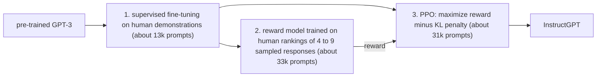
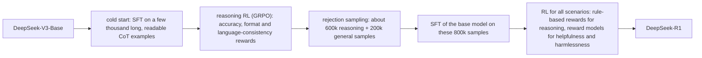

The two previous chapters described how a Transformer is pre-trained on text ([4.7.7](/4.7.7)) and how such training is carried out on thousands of GPUs ([4.7.8](/4.7.8)). This chapter follows what happened when that recipe was pushed to its limits. Its first part is about scale: the loss of a language model falls as a smooth power law in parameters, data and compute, and these scaling laws tell how to spend a compute budget. Its second part is about turning a pre-trained model into a useful assistant: alignment with human preferences by reinforcement learning from human feedback and its successors, and the step from large language models to reasoning models trained with verifiable rewards, which spend computation at test time to think before answering. The third part is about architecture: sparse mixtures of experts, which raise the number of parameters without raising the computation per token, and alternatives to quadratic attention (state space models, Mamba, linear attention with the delta rule, hybrids) for long contexts. The chapter ends with a short survey of the field as of October 2026, complementing [4.7.1](/4.7.1#sec-1.1.4). Multimodal models and agentic models are treated in later chapters of this course; the practical use of language models as **coding agents** is the subject of [4.2.14](/4.2.14).

## 9.1. Scaling Laws

### 9.1.1. Power Laws in Parameters, Data and Compute

Kaplan et al. (2020) trained Transformer language models over six orders of magnitude of size and found that the test loss, the cross-entropy per **token**, depends on the number of non-embedding parameters $N$, the number of training tokens $D$ and the training compute $C$ in a remarkably regular way.

**Definition 9.1.1 (Scaling Law)** A **scaling law** is an empirical relation, valid over many orders of magnitude, between a model's performance (usually its test loss) and the resources used to train it, typically of power-law form $L(X) = (X_c/X)^{\alpha_X}$ in one resource $X$ when the others are not limiting.

Kaplan et al. found, when the other two resources are not the bottleneck,

$$
L(N) = \Bigl(\frac{N_c}{N}\Bigr)^{0.076}, \qquad L(D) = \Bigl(\frac{D_c}{D}\Bigr)^{0.095}, \qquad L(C) = \Bigl(\frac{C_c}{C}\Bigr)^{0.050},
$$

straight lines on log-log axes whose slopes are the exponents. The exponents are small: doubling the parameters multiplies the loss by only $2^{-0.076} \approx 0.95$. But the lines are straight over many orders of magnitude, so small, cheap experiments predict the loss of runs a thousand times larger. This predictability turned the training of large models from a gamble into an engineering decision. Architectural details such as depth versus width mattered little at fixed $N$.

### 9.1.2. How to Spend a Compute Budget

With training compute $C \approx 6ND$ ([4.7.8](/4.7.8#sec-8.8.1)), a fixed budget can buy a larger model trained on fewer tokens or a smaller model trained on more. Kaplan et al. concluded that the optimal model size grows as $N_{\mathrm{opt}} \propto C^{0.73}$ and the data only as $C^{0.27}$: ten times the compute should buy 5.4 times the parameters but only 1.9 times the tokens, because large models learn more per token, and it is best to train a large model and stop well before convergence. Models of the GPT-3 era followed this advice: GPT-3 has 175 billion parameters and saw only 300 billion tokens, 1.7 tokens per parameter.

Hoffmann et al. (2022, the "Chinchilla" paper of DeepMind) re-examined the question with more than 400 training runs and three methods: the lower envelope of training curves; *IsoFLOP profiles*, which fix the compute budget and vary the model size, giving U-shaped loss curves whose minima locate the optimum; and a parametric fit of the final losses,

$$
L(N, D) = E + \frac{A}{N^{\alpha}} + \frac{B}{D^{\beta}},
$$

where $E$ is the irreducible loss (the entropy of text itself) and the two other terms are the excess loss due to a finite model and finite data.

**Definition 9.1.2 (Compute-Optimal Training)** A training run is **compute-optimal** if its model size $N$ and number of training tokens $D$ minimize the loss among all choices with the same training compute $C = 6ND$.

**Proposition 9.1.1** For the loss $L(N, D) = E + AN^{-\alpha} + BD^{-\beta}$ with $A, B, \alpha, \beta > 0$, the compute-optimal allocation under $6ND = C$ is

$$
N_{\mathrm{opt}}(C) = G\Bigl(\frac{C}{6}\Bigr)^{\frac{\beta}{\alpha + \beta}}, \qquad D_{\mathrm{opt}}(C) = G^{-1}\Bigl(\frac{C}{6}\Bigr)^{\frac{\alpha}{\alpha + \beta}}, \qquad G = \Bigl(\frac{\alpha A}{\beta B}\Bigr)^{\frac{1}{\alpha + \beta}}.
$$

**Proof** Substituting $D = C/(6N)$ gives $f(N) = E + AN^{-\alpha} + B(6N/C)^{\beta}$, with

$$
f'(N) = -\alpha A N^{-\alpha - 1} + \beta B \Bigl(\frac{6}{C}\Bigr)^{\beta} N^{\beta - 1} = N^{-\alpha - 1}\Bigl(\beta B\Bigl(\frac{6}{C}\Bigr)^{\beta} N^{\alpha + \beta} - \alpha A\Bigr).
$$
The bracket is strictly increasing in $N$, negative for small and positive for large $N$, so $f$ has a unique minimum where $N^{\alpha + \beta} = \frac{\alpha A}{\beta B}\bigl(\frac{C}{6}\bigr)^{\beta}$, which is the stated $N_{\mathrm{opt}}$; then $D_{\mathrm{opt}} = C/(6N_{\mathrm{opt}})$. $\square$

At the optimum one more FLOP spent on parameters or on data lowers the loss equally. The size exponent is $\beta/(\alpha + \beta)$. All three of Chinchilla's methods gave an exponent close to $0.5$ (0.50, 0.49, 0.46), not Kaplan's 0.73: model size and data should grow *equally*, both as $\sqrt{C}$. Extrapolated to the compute of DeepMind's 280-billion-parameter Gopher ($5.76 \times 10^{23}$ FLOPs), the optimum was a model of about 70 billion parameters trained on 1.4 trillion tokens, about 20 tokens per parameter; the resulting Chinchilla model outperformed Gopher on almost every benchmark (MMLU 67.6% against 60.0%) with the same training compute and a quarter of the inference cost.

| Model | Parameters | Tokens | Tokens per parameter | MMLU (5-shot) |
|---|---|---|---|---|
| GPT-3 (2020) | 175B | 300B | 1.7 | 43.9% |
| Gopher (2021) | 280B | 300B | 1.1 | 60.0% |
| Chinchilla (2022) | 70B | 1.4T | 20 | 67.6% |

The constants published with the parametric fit ($E = 1.69$, $\alpha = 0.34$, $\beta = 0.28$) are inconsistent with the 20 tokens per parameter that Chinchilla used: they imply 60–90. Besiroglu et al. (2024) reconstructed the data from the paper's figures and refitted: $E = 1.82$, $A = 482.0$, $B = 2085.4$, $\alpha = 0.348$, $\beta = 0.366$, which gives about 18–20 tokens per parameter and a size exponent of $0.51$. With these constants the allocation is a few lines of code:

```python
# L(N, D) = E + A / N^alpha + B / D^beta, refit of Besiroglu et al. (2024)
E, A, B, alpha, beta = 1.8172, 482.01, 2085.43, 0.3478, 0.3658

def compute_optimal(C):
    """Minimize L(N, D) subject to 6 N D = C (closed form)."""
    G = (alpha * A / (beta * B)) ** (1 / (alpha + beta))
    N = G * (C / 6) ** (beta / (alpha + beta))
    D = C / (6 * N)
    return N, D, E + A / N**alpha + B / D**beta

print(f"{'compute':>9} {'params':>9} {'tokens':>9} {'tokens/param':>12} {'loss':>6}")
for C in [1e21, 1e23, 5.76e23, 1e25, 1e27]:
    N, D, L = compute_optimal(C)
    print(f"{C:9.2e} {N / 1e9:8.1f}B {D / 1e9:8.0f}B {D / N:12.1f} {L:6.3f}")

# compute needed to reach the same loss with a model 2x too small or too large
C = 5.76e23
N0, D0, L0 = compute_optimal(C)
for f in [0.5, 2.0]:
    N = f * N0
    D = (B / (L0 - E - A / N**alpha)) ** (1 / beta)      # tokens giving loss L0
    print(f"{f:.1f} x the optimal size needs {6 * N * D / C - 1:+.1%} compute for the same loss")
```

```text
  compute    params    tokens tokens/param   loss
 1.00e+21      2.8B       60B         21.6  2.306
 1.00e+23     29.4B      566B         19.2  2.032
 5.76e+23     72.2B     1329B         18.4  1.974
 1.00e+25    312.1B     5341B         17.1  1.912
 1.00e+27   3307.3B    50393B         15.2  1.859
0.5 x the optimal size needs +25.9% compute for the same loss
2.0 x the optimal size needs +14.8% compute for the same loss
```

The rule of thumb $D \approx 20N$ with $C = 6ND$ gives $N \approx \sqrt{C/120}$. The optimum is flat: a model twice too large or too small costs only 15–26% more compute for the same loss, so the size can be chosen nearby to suit memory or inference cost.


### 9.1.3. Why Kaplan and Chinchilla Differ

The discrepancy has been traced to how the quantities were counted and how the runs were set up (Pearce and Song 2024; Porian et al., NeurIPS 2024). Kaplan et al. excluded embedding parameters and the computation of the output layer; both are a large share of small models, and since Kaplan's models were all below 1.5 billion parameters, the fitted exponent came out too high. Porian et al. reproduced Kaplan's exponent and then, by counting the output layer, scaling the learning-rate warm-up with model size and tuning the learning rate, batch size and AdamW hyperparameters at each scale, moved it to 0.50, in agreement with Chinchilla. The learning-rate schedule, which the Chinchilla paper had suspected, turned out to matter less.

### 9.1.4. Beyond Compute-Optimal

Compute-optimal training minimizes the *training* cost for a given loss. A deployed model is also run, at about $2N$ FLOPs per generated token, and a popular model generates trillions of tokens. Minimizing training plus inference compute (Sardana et al., ICML 2024) favors smaller models trained on far more data. Llama-3-8B was trained on 15 trillion tokens, about 1,900 per parameter, a hundred times the Chinchilla ratio, and its loss was still improving log-linearly. Two other limits have become important. Data: high-quality text on the web is finite; Muennighoff et al. (NeurIPS 2023) found that repeating data for up to about 4 epochs is nearly as good as fresh data, beyond which returns fall quickly, and synthetic data generated by models has become a major ingredient. And the axis of scaling has widened: post-training with reinforcement learning (§9.4) and computation at inference time (§9.4.5) improve capability at a fixed pre-training budget.

Some capabilities seem to appear abruptly at a certain scale, which Wei et al. (2022) called *emergent abilities*. Schaeffer et al. (NeurIPS 2023) showed that many such jumps are produced by the metric: exact-match accuracy on a multi-step answer is near zero until every step is right, while the per-token loss of the same models improves smoothly. Smooth loss and abrupt task metrics are thus compatible, and predicting the latter from the former remains difficult.

## 9.2. The GPT Series

The models of OpenAI mark the main steps from language models to assistants and reasoning models; the open models of other laboratories (Llama, Qwen, DeepSeek, Kimi, GLM and others) followed or anticipated each step.

| Model | Released | What changed |
|---|---|---|
| GPT-1, GPT-2, GPT-3 | 2018, 2019, 2020 | generative pre-training at growing scale; few-shot in-context learning ([4.7.7](/4.7.7#sec-7.4.2)) |
| Codex | 2021 | GPT-3 further trained on code; the basis of the first GitHub Copilot |
| InstructGPT | January 2022 | instruction following by supervised fine-tuning and RLHF (§9.3) |
| ChatGPT | November 2022 | the same methods applied to dialogue; the public breakthrough |
| GPT-4 | March 2023 | much stronger model, image input; architecture not disclosed |
| GPT-4o | May 2024 | natively multimodal (text, audio, images) |
| o1 | September 2024 (preview), December 2024 | the first widely used reasoning model: long chains of thought trained by reinforcement learning (§9.4) |
| o3 | April 2025 | stronger reasoning with tool use |
| GPT-5 | August 2025 | one system that decides between fast answers and extended reasoning |
| GPT-5.5 | April 2026 | agentic coding and computer use; context of one million tokens |
| GPT-6 Astra | September 2026 | the current flagship; architecture not disclosed |

Since GPT-4, frontier laboratories publish little about architecture, data and training, and much of what is known about current methods comes from open-weight models and their technical reports, above all DeepSeek's.

## 9.3. Alignment

### 9.3.1. Why Pre-training Is Not Enough

Next-token prediction imitates the training text, and the training text is not a collection of helpful answers. Asked "What are the names of some famous actors?", a pre-trained model may continue with more questions of the same kind; it may also produce toxic text, confidently invent facts (**hallucination**) or ramble off topic. The intention of the user is not part of the objective.

**Definition 9.3.1 (Alignment)** **Alignment** is the problem of making an AI system pursue the goals intended by its developers and users. For language-model assistants it is commonly stated by three criteria (Askell et al. 2021): *helpful*, solving the user's task; *honest*, giving accurate information and expressing uncertainty instead of inventing an answer; and *harmless*, not causing physical, psychological or social harm and refusing dangerous requests.

Instruction tuning ([4.7.7](/4.7.7#sec-7.5.4)) is the first step. It teaches the format of good responses by imitation, but it cannot easily teach the model what humans prefer among many plausible responses, and it is bounded by the quality of the demonstrations. Comparing two responses is easier for people than writing a perfect one, and preference comparisons are the basis of the next step.

### 9.3.2. Reinforcement Learning from Human Feedback

**Definition 9.3.2 (Reinforcement Learning from Human Feedback)** **Reinforcement learning from human feedback** (RLHF; Christiano et al. 2017, Stiennon et al. 2020, Ouyang et al. 2022) fine-tunes a language model by **reinforcement learning** ([4.6.1](/4.6.1)) to maximize the score of a reward model that has been trained on human comparisons between responses, while penalizing divergence from the initial model.

InstructGPT (Ouyang et al., NeurIPS 2022) established the three-stage recipe:



In human evaluations the outputs of the 1.3-billion-parameter InstructGPT were preferred to those of the 175-billion-parameter GPT-3: alignment improved usefulness more than a hundredfold increase in size. ChatGPT applied the same methods to dialogue.

**Definition 9.3.3 (Reward Model)** A **reward model** $r_\phi(x, y)$ is a network that assigns a scalar score to a prompt $x$ and a response $y$. It is usually initialized from the fine-tuned language model with the output layer replaced by a linear layer to a scalar, and trained on preference pairs $(x, y_w, y_l)$, $y_w$ preferred to $y_l$, under the Bradley–Terry model $\mathbb{P}(y_w \succ y_l \mid x) = \sigma\bigl(r_\phi(x, y_w) - r_\phi(x, y_l)\bigr)$, by minimizing

$$
\mathcal{L}_{\mathrm{RM}}(\phi) = -\mathbb{E}_{(x, y_w, y_l)}\log\sigma\bigl(r_\phi(x, y_w) - r_\phi(x, y_l)\bigr).
$$

This is **logistic regression** on the difference of scores: only differences of rewards are determined. A ranking of $K$ responses yields $\binom{K}{2}$ pairs, which is why InstructGPT asked labelers to rank 4 to 9 responses at once.

The language model, now called the *policy* $\pi_\theta(y \mid x)$, is then optimized for the objective

$$
\max_\theta\ \mathbb{E}_{x \sim \mathcal{D},\, y \sim \pi_\theta(\cdot \mid x)}\bigl[r_\phi(x, y)\bigr] - \beta\,\mathbb{E}_{x \sim \mathcal{D}}\Bigl[D_{\mathrm{KL}}\bigl(\pi_\theta(\cdot \mid x)\,\big\|\,\pi_{\mathrm{ref}}(\cdot \mid x)\bigr)\Bigr], \tag{9.1}
$$

where $\pi_{\mathrm{ref}}$ is the supervised fine-tuned model. The **Kullback–Leibler divergence** term keeps the policy near the region where the reward model was trained: as the policy moves away, the reward model's estimates become unreliable, and an unconstrained policy would find responses that exploit its errors. InstructGPT also mixed the pre-training language modeling loss into the objective ("PPO-ptx") to reduce the *alignment tax*, the drop in performance on standard NLP benchmarks caused by RLHF.

### 9.3.3. Proximal Policy Optimization

Generating a response is a sequential decision process: the state is the prompt with the tokens generated so far, an action is the next token, and the reward (here, $r_\phi$ minus the KL penalty) arrives at the end. The standard algorithm for this optimization is PPO.

**Definition 9.3.4 (Proximal Policy Optimization)** **Proximal policy optimization** (PPO; Schulman et al. 2017) is a policy-gradient method that samples actions with the current policy $\pi_{\theta_{\mathrm{old}}}$ and then takes several gradient steps on the clipped surrogate objective

$$
J^{\mathrm{CLIP}}(\theta) = \mathbb{E}_t\Bigl[\min\Bigl(\rho_t(\theta)\hat A_t,\ \operatorname{clip}\bigl(\rho_t(\theta), 1 - \varepsilon, 1 + \varepsilon\bigr)\hat A_t\Bigr)\Bigr], \qquad \rho_t(\theta) = \frac{\pi_\theta(a_t \mid s_t)}{\pi_{\theta_{\mathrm{old}}}(a_t \mid s_t)},
$$
where $\hat A_t$ is an estimate of the *advantage* of action $a_t$ (how much better it was than the average action in state $s_t$), computed with a learned value function, and $\varepsilon \approx 0.2$.

The ratio $\rho_t$ corrects for the samples having been drawn from the old policy; clipping removes the incentive to move the probability of an action by more than a factor $1 \pm \varepsilon$ in one round, which keeps the updates stable. For a language model, PPO needs four networks of similar size in memory, the policy, the reference model, the reward model and the value function, which together with generating samples makes RLHF the most complex and expensive stage of training.

### 9.3.4. Limitations of RLHF

- Imperfect preferences. Human labelers disagree: inter-annotator agreement in InstructGPT's data was about 73%, and reward models predict held-out preferences with about 65–75% accuracy. Preferences are also biased: longer responses, bullet points and confident or flattering answers tend to be preferred whether or not they are better, and RLHF amplifies such biases (verbosity, *sycophancy*).
- Reward hacking. The policy maximizes the reward model, not human preference, and finds responses that the reward model overrates; this **reward hacking** grows with the strength of the optimization, which the KL penalty only limits.
- Coarse feedback. One scalar per response says nothing about *which* part was good or bad, so credit assignment over hundreds of tokens is hard.
- Cost and complexity. Human labels are expensive, and PPO is unstable, memory-hungry and sensitive to hyperparameters.

The responses to these limitations shaped the methods used today: AI feedback instead of human feedback, direct optimization of preferences without reinforcement learning, finer-grained rewards, and rewards that are verified rather than judged.

### 9.3.5. Constitutional AI

**Definition 9.3.5 (Constitutional AI)** **Constitutional AI** (Bai et al. 2022, Anthropic) trains a model to be harmless using a written set of principles (a *constitution*) and AI feedback instead of human labels of harmfulness: in a supervised stage the model critiques and revises its own responses according to randomly chosen principles and is fine-tuned on the revisions; in a reinforcement learning stage a model judges which of two responses better follows the principles, and these AI preferences train the reward model (*reinforcement learning from AI feedback*, RLAIF).

The approach scales supervision (a model can label far more comparisons than people), makes the target behavior explicit and auditable in the constitution, and in the original experiments produced models that were both less harmful and less evasive than those trained with human harmlessness labels: they explain their objections instead of refusing without explanation. Self-generated data are used for helpfulness too: Self-Instruct and similar methods let a model write instruction data for its own fine-tuning ([4.7.7](/4.7.7#sec-7.5.4)), and models acting as judges grade responses against written rubrics.

### 9.3.6. Direct Preference Optimization

The KL-regularized objective (9.1) can be solved in closed form for the policy, which makes the reinforcement learning step unnecessary.

**Theorem 9.3.1** For a fixed prompt $x$ and reward function $r$, the maximizer over all distributions $\pi(\cdot \mid x)$ of $\mathbb{E}_{y \sim \pi}[r(x, y)] - \beta D_{\mathrm{KL}}(\pi \,\|\, \pi_{\mathrm{ref}})$ is

$$
\pi^*(y \mid x) = \frac{1}{Z(x)}\,\pi_{\mathrm{ref}}(y \mid x)\exp\Bigl(\frac{r(x, y)}{\beta}\Bigr), \qquad Z(x) = \sum_y \pi_{\mathrm{ref}}(y \mid x)\exp\Bigl(\frac{r(x, y)}{\beta}\Bigr).
$$

**Proof** For any $\pi$,

$$
\mathbb{E}_{y \sim \pi}[r(x, y)] - \beta\,\mathbb{E}_{y \sim \pi}\Bigl[\log\frac{\pi(y \mid x)}{\pi_{\mathrm{ref}}(y \mid x)}\Bigr] = -\beta\,\mathbb{E}_{y \sim \pi}\Bigl[\log\frac{\pi(y \mid x)}{\pi_{\mathrm{ref}}(y \mid x)\mathrm{e}^{r(x, y)/\beta}}\Bigr] = -\beta D_{\mathrm{KL}}(\pi \,\|\, \pi^*) + \beta\log Z(x).
$$
The last term does not depend on $\pi$, and $D_{\mathrm{KL}}(\pi \,\|\, \pi^*) \ge 0$ with equality exactly for $\pi = \pi^*$. $\square$

Solving for the reward, $r(x, y) = \beta\log\frac{\pi^*(y \mid x)}{\pi_{\mathrm{ref}}(y \mid x)} + \beta\log Z(x)$: every policy defines an *implicit reward*. Under the Bradley–Terry model only reward differences matter, so the intractable $Z(x)$ cancels, and the reward model's loss can be written directly in terms of the policy.

**Definition 9.3.6 (Direct Preference Optimization)** **Direct preference optimization** (DPO; Rafailov et al., NeurIPS 2023) trains the policy $\pi_\theta$ on preference pairs by minimizing

$$
\mathcal{L}_{\mathrm{DPO}}(\theta) = -\mathbb{E}_{(x, y_w, y_l)}\log\sigma\Bigl(\beta\log\frac{\pi_\theta(y_w \mid x)}{\pi_{\mathrm{ref}}(y_w \mid x)} - \beta\log\frac{\pi_\theta(y_l \mid x)}{\pi_{\mathrm{ref}}(y_l \mid x)}\Bigr),
$$
the reward-model loss with the reward replaced by the implicit reward $\hat r_\theta(x, y) = \beta\log\bigl(\pi_\theta(y \mid x)/\pi_{\mathrm{ref}}(y \mid x)\bigr)$.

DPO is a classification loss on a fixed dataset: no sampling during training, no reward model and no value function, only the policy and a frozen reference model. Its gradient raises the log-probability of the preferred response and lowers that of the rejected one, weighted by $\sigma(\hat r_\theta(x, y_l) - \hat r_\theta(x, y_w))$, so that pairs the model already orders correctly by a wide margin contribute little. The log-probability of a response is the sum of its token log-probabilities, which one forward pass of each model provides.

```python
import numpy as np

def dpo_loss(logp_w, logp_l, ref_w, ref_l, beta=0.1):
    """DPO loss for a batch of preference pairs.
    logp_*: summed log-probabilities of the chosen (w) and rejected (l) responses
    under the policy; ref_*: the same under the frozen reference model."""
    margin = beta * ((logp_w - ref_w) - (logp_l - ref_l))   # difference of implicit rewards
    loss = np.logaddexp(0.0, -margin)                       # -log sigmoid(margin), stable
    grad_scale = 1 / (1 + np.exp(margin))                   # sigmoid(-margin): weight of each pair
    return loss.mean(), margin / beta, grad_scale

ref_w = np.array([-42.0, -55.0, -30.0])        # reference log-probs of chosen responses
ref_l = np.array([-40.0, -57.0, -31.0])        # reference log-probs of rejected responses
print("at the start:", dpo_loss(ref_w, ref_l, ref_w, ref_l)[0].round(4))   # policy = reference
logp_w = np.array([-30.0, -54.0, -33.0])       # policy after some training
logp_l = np.array([-48.0, -58.0, -29.0])
loss, reward_gap, weight = dpo_loss(logp_w, logp_l, ref_w, ref_l)
print(f"later: loss {loss:.4f}, implicit reward gaps {reward_gap}, "
      f"gradient weights {np.round(weight, 3)}")
```

```text
at the start: 0.6931
later: loss 0.5664, implicit reward gaps [20.  2. -5.], gradient weights [0.119 0.45  0.622]
```

At the start the loss is $\log 2$, as for an untrained binary classifier. Later, the first pair is ordered correctly by a wide margin and has little weight; the third is ordered wrongly and has the largest weight. DPO and its variants (IPO, KTO, SimPO and others) are widely used, often combined with online methods: the Olmo 3 models (Ai2, December 2025), whose training is fully documented, are post-trained by supervised fine-tuning, then DPO, then reinforcement learning with verifiable rewards. Because DPO learns from a fixed dataset of responses that the current model did not generate, it explores less than online RL, and on reasoning tasks online RL has proved stronger.

### 9.3.7. Outcome and Process Rewards

An *outcome reward* judges only the final result of a response; a *process reward* judges each intermediate step.

**Definition 9.3.7 (Process Reward Model)** A **process reward model** (PRM) assigns a score to each step of a multi-step solution, estimating whether the step is correct; an *outcome reward model* (ORM) scores only the final answer or the response as a whole.

Uesato et al. (2022) and Lightman et al. ("Let's Verify Step by Step", ICLR 2024) compared the two on mathematics. Lightman et al. collected PRM800K, 800,000 human labels of individual solution steps, and found that a process reward model selected correct solutions among many samples considerably more reliably than an outcome reward model (78% against 72% of a subset of the MATH benchmark solved). Process supervision gives finer credit assignment and rewards correct reasoning rather than lucky answers, but step-level labels are expensive and a learned PRM can itself be hacked. A different direction makes the reward model a language model that writes out its judgment before scoring (*generative reward models*, Zhang et al. 2024). The reasoning models of the next section, by contrast, mostly use outcome rewards that are not learned at all but checked by a program.

## 9.4. Large Reasoning Models

### 9.4.1. Chain-of-Thought

Psychologists distinguish fast, automatic "System 1" thinking from slow, deliberate "System 2" thinking (Kahneman, *Thinking, Fast and Slow*). A language model that answers immediately computes its answer with a fixed amount of computation per token, a fixed number of layers. Writing out intermediate steps gives it more computation and a scratchpad.

**Definition 9.4.1 (Chain-of-Thought)** A **chain-of-thought** (CoT) is a sequence of intermediate reasoning steps, written in natural language or formulas, that a language model generates before its final answer. *Chain-of-thought prompting* elicits it with demonstrations that contain such steps (few-shot CoT; Wei et al., NeurIPS 2022) or with an instruction such as "Let's think step by step" (zero-shot CoT; Kojima et al. 2022).

Chain-of-thought prompting raised the accuracy of large models on arithmetic and commonsense reasoning dramatically; the instruction "Let's think step by step" alone took an InstructGPT model from 17.7% to 78.7% on the MultiArith benchmark. It works only in sufficiently large models, and it can be strengthened by sampling many chains and taking the majority answer (*self-consistency*, Wang et al., ICLR 2023). Prompting, however, only elicits whatever reasoning the model already does; it does not teach the model to reason well over thousands of tokens.

### 9.4.2. From LLMs to Reasoning Models

**Reasoning models** ([4.2.14](/4.2.14#sec-14.2.3)) are trained to produce long chains of thought before answering: they decompose a problem, try an approach, check intermediate results, notice errors and backtrack. OpenAI's o1 (September 2024) was the first widely used one; it showed that accuracy on competition mathematics grows steadily with both the amount of reinforcement learning during training and the length of thinking at test time. The change from directly answering models to reasoning models in 2024–2025 brought rapid gains in mathematics and programming. Three ingredients are involved:

| | Chain-of-thought | Reinforcement learning with verifiable rewards | Test-time scaling |
|---|---|---|---|
| Role | the reasoning process | the training method | the allocation of compute |
| Question | how does the model reason? | how is the reasoning behavior learned? | how much should it think on a given problem? |
| Core idea | generate intermediate steps before the answer | reward automatically checkable outcomes (a correct answer, passing tests) | spend more computation at inference on harder problems |

### 9.4.3. Reinforcement Learning with Verifiable Rewards

**Definition 9.4.2 (Reinforcement Learning with Verifiable Rewards)** **Reinforcement learning with verifiable rewards** (RLVR) trains a language model policy by reinforcement learning on tasks whose outcome a program can check, using the result of the check as the reward: for example 1 if the final answer of a mathematics problem equals the reference answer and 0 otherwise, or whether generated code passes the unit tests.

A verifiable reward cannot be flattered and is far harder to hack than a learned reward model, though incomplete tests can still be gamed ([4.2.14](/4.2.14)). It removes the reward model and its errors, and it is unlimited: any problem with a checkable answer becomes training data. The policy is free to find whatever chain of thought leads to correct answers. DeepSeek's RL algorithm for this setting is GRPO.

**Algorithm 9.4.1 (Group Relative Policy Optimization)** GRPO (Shao et al. 2024, DeepSeekMath) repeats the following steps.

1. For each prompt $q$ of a batch, sample a group of $G$ responses $o_1, \dots, o_G$ from the current policy $\pi_{\theta_{\mathrm{old}}}$ and compute their rewards $r_1, \dots, r_G$.
2. Give every token of response $i$ the advantage $\hat A_i = \bigl(r_i - \operatorname{mean}(r_1, \dots, r_G)\bigr) / \operatorname{std}(r_1, \dots, r_G)$.
3. Take gradient steps on
$$
J(\theta) = \frac{1}{G}\sum_{i=1}^{G}\frac{1}{\lvert o_i\rvert}\sum_{t=1}^{\lvert o_i\rvert}\min\Bigl(\rho_{i,t}\hat A_i,\ \operatorname{clip}(\rho_{i,t}, 1 - \varepsilon, 1 + \varepsilon)\hat A_i\Bigr) - \beta D_{\mathrm{KL}}\bigl(\pi_\theta \,\|\, \pi_{\mathrm{ref}}\bigr),
$$
with the token-level ratios $\rho_{i,t} = \pi_\theta(o_{i,t} \mid q, o_{i,<t}) / \pi_{\theta_{\mathrm{old}}}(o_{i,t} \mid q, o_{i,<t})$.

GRPO is PPO without the value network: the baseline for a response is the average reward of the other responses to the same prompt. This halves the memory of the RL stage and suits rewards that come only at the end of a response. If all responses of a group get the same reward, all advantages are zero and the prompt teaches nothing, so training data are chosen at a difficulty where the model sometimes succeeds. Many variants adjust the normalization and clipping (for example DAPO and Dr. GRPO, 2025).

### 9.4.4. DeepSeek-R1-Zero and DeepSeek-R1

DeepSeek-R1 (January 2025; published in *Nature* in September 2025) showed openly how a reasoning model can be trained, and its weights were released.

*DeepSeek-R1-Zero* applied GRPO directly to the pre-trained base model DeepSeek-V3-Base (§9.5.6), with no supervised fine-tuning. The prompt template only asked the model to think inside `<think>` … `</think>` tags and then answer, and there were two rule-based rewards: an *accuracy reward*, whether the answer was correct (a mathematics answer in a specified format checked against the reference, code checked by tests), and a *format reward* for using the tags. Neural reward models were deliberately avoided because of reward hacking. During training the responses grew longer, from hundreds to thousands of tokens, and behaviors that nobody had programmed appeared: re-checking steps, trying alternative approaches, and pausing to reconsider, which the authors called an "aha moment" ("Wait, wait. That's an aha moment I can flag here."). On the AIME 2024 competition, accuracy (pass@1) rose from 15.6% to 77.9% (71.0% in the January preprint), and 86.7% with majority voting over 64 samples. Pure RL from a base model thus suffices to elicit long reasoning. The outputs of R1-Zero, however, were hard to read and mixed languages.

*DeepSeek-R1* added stages to fix this:



DeepSeek-R1 performed on par with OpenAI's o1 on mathematics and coding benchmarks at a fraction of the price; the reported cost of its reasoning RL stage was about \$294,000 of GPU time, on top of the cost of the base model.

**Definition 9.4.3 (Knowledge Distillation)** **Knowledge distillation** (Hinton et al. 2015) trains a smaller *student* model to imitate a larger *teacher* model, either by matching the teacher's output distributions (soft targets) or by supervised fine-tuning on outputs generated by the teacher.

DeepSeek fine-tuned smaller open models (Qwen2.5 and Llama 3, from 1.5 to 70 billion parameters) on the 800,000 samples generated by R1, with no RL at all. The distilled models reasoned far better than the originals (the 32-billion-parameter one reached 72.6% on AIME 2024) and better than the same small model trained with large-scale RL itself: reasoning patterns discovered by a large model can be transferred cheaply, while discovering them by RL needs a strong base model.

### 9.4.5. Test-Time Compute

**Definition 9.4.4 (Test-Time Compute)** **Test-time compute** is the computation a model spends at inference on a given input. *Test-time scaling* improves performance by increasing it, sequentially (longer chains of thought, revision of earlier attempts) or in parallel (sampling many responses and selecting by majority vote or with a verifier, or tree search over partial solutions).

Training-time scaling (more parameters, more data) improves the model on every input but is fixed once training ends and costly; test-time scaling is flexible and can be spent only on hard problems, but it increases latency and cost per query and is limited by the quality of the base model. For a fixed budget, adapting the amount of thinking to the difficulty of the problem is more efficient than spending the same amount on every problem (Snell et al. 2024). Even simple control works: the s1 model (Muennighoff et al. 2025) was fine-tuned on only 1,000 reasoning examples, and by "budget forcing", suppressing the end of thinking and appending "Wait", its accuracy kept growing with the number of thinking tokens. Products expose the trade-off as "thinking" modes or an effort parameter.

### 9.4.6. Open Problems

- Efficiency. Reasoning models often produce very long chains of thought even for easy questions ("overthinking"), which slows inference and makes RL training expensive. Directions include adaptive thinking, in which the model decides how long to think, and penalties on length.
- Faithfulness and monitoring. A chain of thought need not reflect the computation that actually produced the answer; models sometimes omit the real reason, and optimizing the chain of thought against a monitor can teach the model to hide its intentions. Keeping chains of thought legible and *monitorable* is now treated as a safety property in its own right, and models are being trained to report their own violations honestly.
- Rewards beyond verifiable tasks. RLVR works where answers can be checked: mathematics, code, some science. For writing, advice or research, rewards come from rubrics graded by models, or from models that verify their own proofs (DeepSeekMath-V2, 2025), and how to train general reasoning robustly is an open question.

## 9.5. Mixture-of-Experts Models

### 9.5.1. Sparse Activation

In a dense Transformer every parameter is used for every token, so the compute per token grows with the parameter count. The feed-forward blocks hold about two thirds of the parameters, and the idea of a mixture of experts is to replace each by many smaller blocks of which a token uses only a few.

**Definition 9.5.1 (Mixture of Experts)** A **mixture-of-experts** (MoE) layer consists of $E$ feed-forward networks $\mathrm{FFN}_1, \dots, \mathrm{FFN}_E$ (the *experts*) and a *router* with weight matrix $W_r$. For a token with hidden vector $\boldsymbol{x}$ the router computes probabilities $\boldsymbol{g} = \operatorname{softmax}(W_r\boldsymbol{x}) \in \mathbb{R}^E$, selects the set $\mathcal{T}(\boldsymbol{x})$ of the $k$ experts with the largest $g_i$, and outputs

$$
\boldsymbol{y} = \sum_{i \in \mathcal{T}(\boldsymbol{x})}\tilde g_i\,\mathrm{FFN}_i(\boldsymbol{x}), \qquad \tilde g_i = \frac{g_i}{\sum_{j \in \mathcal{T}(\boldsymbol{x})} g_j}.
$$
An MoE Transformer replaces some or all feed-forward blocks by MoE layers. The *total* parameter count includes all experts; the *activated* parameter count includes only the $k$ experts used per token.

A dense mixture would weight all experts; the sparse, top-$k$ version makes the compute per token proportional to the activated parameters, while the capacity (the knowledge the model can store) grows with the total. Different tokens, and the same token in different layers, take different paths through the experts. The idea goes back to Jacobs et al. (1991); its use in deep networks began with the sparsely gated MoE of Shazeer et al. (2017), followed by GShard (2020, top-2) and the Switch Transformer (Fedus et al. 2022, top-1).

### 9.5.2. Routing

The following NumPy implementation routes each token to its top-2 experts, applies each expert only to the tokens assigned to it, and reports the fraction of assignments each expert receives together with the Switch Transformer's balance loss (§9.5.3).

```python
import numpy as np

def softmax(z):
    z = z - z.max(axis=-1, keepdims=True)
    e = np.exp(z)
    return e / e.sum(axis=-1, keepdims=True)

def moe_layer(X, W_router, b_router, experts, k=2):
    """Top-k mixture of experts. X: (tokens, d). Returns output, expert loads, aux loss."""
    probs = softmax(X @ W_router + b_router)              # (tokens, n_experts)
    topk = np.argsort(-probs, axis=1)[:, :k]              # chosen experts per token
    gates = np.take_along_axis(probs, topk, axis=1)
    gates /= gates.sum(axis=1, keepdims=True)             # renormalize over the k chosen
    Y = np.zeros_like(X)
    n = len(experts)
    for e in range(n):                                    # each expert sees only its tokens
        rows, slot = np.nonzero(topk == e)
        if rows.size:
            Y[rows] += gates[rows, slot, None] * experts[e](X[rows])
    f = np.bincount(topk.ravel(), minlength=n) / topk.size   # fraction of assignments
    P = probs.mean(axis=0)                                # mean router probability
    aux = n * np.sum(f * P)                               # Switch-style balance loss, 1 if uniform
    return Y, f, aux

rng = np.random.default_rng(0)
d, n_exp, tokens = 32, 8, 4096
mats = [rng.standard_normal((d, d)) / np.sqrt(d) for _ in range(n_exp)]
experts = [lambda x, W=W: np.maximum(x @ W, 0) for W in mats]
X = rng.standard_normal((tokens, d))
W_router = 0.1 * rng.standard_normal((d, n_exp))
for name, b in [("balanced router", np.zeros(n_exp)),
                ("skewed router", np.r_[2.0, 1.5, np.zeros(n_exp - 2)])]:
    Y, load, aux = moe_layer(X, W_router, b, experts)
    print(f"{name:15} loads {np.round(load, 3)}  aux loss {aux:.3f}")
```

```text
balanced router loads [0.134 0.149 0.129 0.121 0.115 0.112 0.128 0.113]  aux loss 1.002
skewed router   loads [0.489 0.436 0.022 0.008 0.011 0.008 0.022 0.004]  aux loss 2.473
```

### 9.5.3. Load Balancing

The router is trained jointly with the experts, and left alone it tends to collapse: a few experts receive most tokens, get trained more, and are therefore chosen even more often, while the others are wasted. Unbalanced loads also hurt the hardware, since experts sit on different GPUs (expert parallelism, [4.7.8](/4.7.8#sec-8.6.3)) and the busiest GPU determines the speed; systems often give each expert a fixed capacity and drop or reroute the tokens beyond it.

**Definition 9.5.2 (Load Balancing)** **Load balancing** in a mixture-of-experts model is any mechanism that makes the router distribute tokens evenly over the experts. The standard *auxiliary load-balancing loss* (Switch Transformer) adds to the training loss

$$
\mathcal{L}_{\mathrm{bal}} = \lambda\,E\sum_{i=1}^{E} f_i P_i,
$$
where $f_i$ is the fraction of the batch's token assignments that go to expert $i$ and $P_i$ the mean router probability of expert $i$; it equals $\lambda$ for a uniform distribution and grows as the load concentrates.

The fractions $f_i$ are not differentiable, but the probabilities $P_i$ are, so the gradient pushes the router's probabilities toward underloaded experts. Many models add the *router z-loss* (Zoph et al. 2022, ST-MoE), a penalty on the squared log-sum-exp of the router logits that keeps them small and training stable. The auxiliary loss interferes with the language modeling objective when its weight is large. DeepSeek-V3 therefore introduced *auxiliary-loss-free* balancing: each expert has a bias $b_i$ that is added to its routing score only for the choice of the top-$k$ experts (not for the gate values), and after each step the bias is decreased by a small amount for overloaded experts and increased for underloaded ones; a very small sequence-level auxiliary loss is kept as a safeguard.

What do experts learn? Studies of trained MoE models (ST-MoE and others) find that experts specialize mostly in groups of tokens and shallow features (punctuation, numbers, particular words or syntactic roles) rather than in topics such as "biology" or "law".

### 9.5.4. Fine-Grained and Shared Experts

DeepSeekMoE (Dai et al. 2024) introduced two refinements that most recent MoE models use. *Fine-grained experts*: split each expert into $m$ smaller ones (dividing its hidden width by $m$) and route to $m$ times as many, which keeps the parameters and compute fixed but allows far more combinations of experts, so that knowledge can be decomposed more precisely. *Shared experts*: a few experts are always active for every token and capture common knowledge, so that the routed experts need not each relearn it. DeepSeekMoE 16B, with 2 shared and 64 routed experts of which 6 are activated, has 16.4 billion parameters, 2.8 billion activated, and matched the dense DeepSeek 7B with about 40% of its computation.

### 9.5.5. DeepSeek-V3

DeepSeek-V3 (December 2024) combined these ideas with systems design and became the base of DeepSeek-R1.

| | DeepSeek-V3 |
|---|---|
| Parameters | 671 billion total, 37 billion activated per token |
| Layers | 61; all but the first 3 have MoE feed-forward blocks |
| Experts per MoE layer | 1 shared + 256 routed, 8 routed experts per token, each token sent to at most 4 servers |
| Attention | multi-head latent attention (MLA) |
| Load balancing | auxiliary-loss-free bias, plus a small sequence-level loss |
| Extra objective | multi-token prediction (one additional future token) |
| Training data and cost | 14.8 trillion tokens; 2.788 million H800 GPU-hours |
| Precision and parallelism | FP8 mixed precision; 16-stage pipeline with DualPipe, 64-way expert parallelism, ZeRO-1 data parallelism, no tensor parallelism |

**Multi-head latent attention** (introduced in DeepSeek-V2, 2024) shrinks the KV cache ([4.7.6](/4.7.6)). Instead of caching the keys and values of all heads, each token caches a single compressed latent vector $\boldsymbol{c}^{KV} = W^{DKV}\boldsymbol{h}$ of dimension 512 (plus a 64-dimensional key part that carries the rotary position encoding); the keys and values of all heads are reconstructed from it by up-projection matrices, which at inference can be absorbed into the query and output projections. The cache per token is a small fraction of that of standard multi-head attention, with comparable or better quality. *Multi-token prediction* adds a small module that predicts the token after next, which densifies the training signal and serves as a draft model for speculative decoding at inference ([4.7.8](/4.7.8#sec-8.9.4)).

On the systems side, expert parallelism across servers makes communication the bottleneck: each MoE layer sends every token to the GPUs of its experts and back with two all-to-all operations. DeepSeek-V3's *DualPipe* schedule feeds micro-batches into the pipeline from both ends and splits each chunk of work into attention, all-to-all dispatch, MLP and all-to-all combine, so that the computation of one micro-batch overlaps the communication of another; with custom all-to-all kernels and node-limited routing, the cross-server traffic was almost completely hidden at a ratio of computation to communication of about 1:1. Its FP8 training with fine-grained scaling is described in [4.7.8](/4.7.8#sec-8.2.5). The result, a frontier-level model trained for 2.788 million GPU-hours (about \$5.6 million at \$2 per hour, for the final run only), changed expectations of what training a strong model costs. Most large open models since 2025 are MoE models of this kind: Qwen3 (235 billion total, 22 billion activated), Kimi K2 (1 trillion total, 32 billion activated), DeepSeek-V4 (April 2026; 1.6 trillion total, 49 billion activated) and Kimi K3 (July 2026; 2.8 trillion total, 104 billion activated). The price of sparsity is memory: all experts must be stored and served, even though each token uses few of them.

## 9.6. New Architectures

### 9.6.1. The Cost of Attention

Self-attention ([4.7.6](/4.7.6)) compares every token with every earlier token. For a sequence of length $L$, prefill costs $O(L^2)$, each generated token costs $O(L)$, and the KV cache grows as $O(L)$; at contexts of hundreds of thousands to millions of tokens, the cache, not the weights, fills GPU memory and limits the batch size ([4.7.8](/4.7.8#sec-8.9.1)). A recurrent network ([4.7.5](/4.7.5)), by contrast, keeps a fixed-size state, so each new token costs $O(1)$, but classical RNNs cannot be trained in parallel over the sequence and forget too much. The architectures of this section seek both: parallel training and constant-size state.

| | Full attention | Linear attention, SSMs, Gated DeltaNet |
|---|---|---|
| Prefill computation | $O(L^2)$ | $O(L)$ |
| Cost per generated token | $O(L)$ | $O(1)$ |
| State kept during generation | KV cache, $O(L)$ | fixed-size state, $O(1)$ |
| Recall of an arbitrary earlier token | exact | limited by the state size |

### 9.6.2. Linear Attention

Causal attention computes $\boldsymbol{o}_t = \sum_{j \le t}\operatorname{sim}(\boldsymbol{q}_t, \boldsymbol{k}_j)\boldsymbol{v}_j / \sum_{j \le t}\operatorname{sim}(\boldsymbol{q}_t, \boldsymbol{k}_j)$ with $\operatorname{sim}(\boldsymbol{q}, \boldsymbol{k}) = \exp(\boldsymbol{q}^{\mathsf T}\boldsymbol{k}/\sqrt{d})$. If the similarity is replaced by a product of feature maps, $\operatorname{sim}(\boldsymbol{q}, \boldsymbol{k}) = \phi(\boldsymbol{q})^{\mathsf T}\phi(\boldsymbol{k})$, the sum can be reorganized (Katharopoulos et al., ICML 2020):

$$
\boldsymbol{o}_t = \frac{S_t\,\phi(\boldsymbol{q}_t)}{\boldsymbol{z}_t^{\mathsf T}\phi(\boldsymbol{q}_t)}, \qquad S_t = S_{t-1} + \boldsymbol{v}_t\,\phi(\boldsymbol{k}_t)^{\mathsf T}, \qquad \boldsymbol{z}_t = \boldsymbol{z}_{t-1} + \phi(\boldsymbol{k}_t).
$$

**Definition 9.6.1 (Linear Attention)** **Linear attention** replaces the softmax similarity of attention by a kernel $\phi(\boldsymbol{q})^{\mathsf T}\phi(\boldsymbol{k})$, so that causal attention becomes a recurrence on a matrix-valued state $S_t \in \mathbb{R}^{d_v \times d_k}$ that accumulates outer products of values and keys; modern variants drop the normalizer and add decay or gating to the state update.

The state $S_t$ is an associative memory: writing adds $\boldsymbol{v}\boldsymbol{k}^{\mathsf T}$, reading with a query computes $S\boldsymbol{q}$, which returns $\boldsymbol{v}$ exactly if $\boldsymbol{q} = \boldsymbol{k}$ is orthogonal to all other stored keys. Since the memory only accumulates, old associations are never removed, and with more than $d_k$ keys they interfere. Plain linear attention was therefore clearly worse than softmax attention at language modeling; the improvements below address this.

### 9.6.3. State Space Models

**Definition 9.6.2 (State Space Model)** A (linear, time-invariant) **state space model** (SSM) maps an input signal $x(t)$ to an output $y(t)$ through a latent state $\boldsymbol{h}(t) \in \mathbb{R}^n$,

$$
\boldsymbol{h}'(t) = A\boldsymbol{h}(t) + \boldsymbol{B}x(t), \qquad y(t) = \boldsymbol{C}^{\mathsf T}\boldsymbol{h}(t),
$$
where $A$ describes how the state evolves, $\boldsymbol{B}$ how the input enters the state and $\boldsymbol{C}$ how the state is read out. Discretized with step size $\Delta$ by the zero-order hold, it becomes the recurrence $\boldsymbol{h}_t = \bar A\boldsymbol{h}_{t-1} + \bar{\boldsymbol{B}}x_t$, $y_t = \boldsymbol{C}^{\mathsf T}\boldsymbol{h}_t$ with $\bar A = \exp(\Delta A)$ and $\bar{\boldsymbol{B}} = (\Delta A)^{-1}(\exp(\Delta A) - I)\Delta\boldsymbol{B}$.

Unrolling the recurrence from $\boldsymbol{h}_0 = \boldsymbol{0}$ gives $y_t = \sum_{j=0}^{t}\boldsymbol{C}^{\mathsf T}\bar A^{j}\bar{\boldsymbol{B}}\,x_{t-j}$, a **convolution** of the input with the kernel $K_j = \boldsymbol{C}^{\mathsf T}\bar A^{j}\bar{\boldsymbol{B}}$. A linear time-invariant SSM therefore has two equivalent forms: the recurrence, with constant cost per step for generation, and the convolution, computable in parallel over the whole sequence (with the **fast Fourier transform**) for training.

```python
import numpy as np
from scipy.linalg import expm

rng = np.random.default_rng(0)
n, L = 4, 64                                       # state size, sequence length
A = -np.diag(rng.uniform(0.5, 2.0, n))             # stable continuous-time dynamics
B = rng.standard_normal((n, 1))
C = rng.standard_normal((1, n))
delta = 0.1                                        # step size
# zero-order-hold discretization
A_bar = expm(delta * A)
B_bar = np.linalg.solve(delta * A, A_bar - np.eye(n)) @ (delta * B)

x = rng.standard_normal(L)
# recurrent form: h_t = A_bar h_{t-1} + B_bar x_t, y_t = C h_t  (O(1) state per step)
h = np.zeros((n, 1))
y_rec = np.empty(L)
for t in range(L):
    h = A_bar @ h + B_bar * x[t]
    y_rec[t] = (C @ h).item()
# convolutional form: y = K * x with kernel K_j = C A_bar^j B_bar  (parallel over t)
K = np.array([(C @ np.linalg.matrix_power(A_bar, j) @ B_bar).item() for j in range(L)])
y_conv = np.array([K[:t + 1][::-1] @ x[:t + 1] for t in range(L)])
print("recurrent and convolutional forms agree:", np.allclose(y_rec, y_conv))
```

```text
recurrent and convolutional forms agree: True
```

S4 (Gu, Goel and Ré, ICLR 2022) made SSMs work for long sequences with a structured initialization of $A$ that lets the state retain a compressed history of the input, and excelled on benchmarks of very long-range dependencies; on language, however, time-invariant SSMs remained behind Transformers.

### 9.6.4. Mamba

The weakness of a time-invariant SSM is that it processes every input in the same way: it cannot decide to remember an important token and ignore filler, which language requires (copying, recalling a name mentioned earlier).

**Definition 9.6.3 (Mamba)** **Mamba** (Gu and Dao 2023) is a sequence model built from *selective* state space layers, in which the step size $\Delta_t$ and the matrices $\boldsymbol{B}_t$ and $\boldsymbol{C}_t$ are functions of the current input $x_t$ (computed by linear projections), so that the recurrence $\boldsymbol{h}_t = \bar A_t\boldsymbol{h}_{t-1} + \bar{\boldsymbol{B}}_t x_t$ can choose, token by token, what to write into the state and what to keep; the selective SSM is combined with a short convolution and a multiplicative gate in a block that replaces both attention and the feed-forward network.

A large $\Delta_t$ resets the state toward the current input (focus on it), a small $\Delta_t$ keeps the state (ignore the input). Input-dependent parameters destroy the convolutional form, since the kernel is no longer fixed. Mamba instead computes the recurrence with a *parallel scan*: the map $\boldsymbol{h} \mapsto \bar A_t\boldsymbol{h} + \bar{\boldsymbol{B}}_t x_t$ is affine, the composition of affine maps is associative, and an associative operation can be applied to a whole sequence in $O(\log L)$ parallel steps, like a parallel prefix sum. Its kernel keeps the state in fast on-chip SRAM, in the spirit of FlashAttention ([4.7.8](/4.7.8#sec-8.7)). Mamba matched Transformers of twice its size on language modeling up to a few billion parameters and generated text about five times faster. Mamba-2 (Dao and Gu, ICML 2024) restricted $\bar A_t$ to a scalar times the identity and showed that the resulting model is a form of linear attention with decay (*state space duality*), which allows training with matrix multiplications on tensor cores.

### 9.6.5. The Delta Rule and Gated DeltaNet

Linear attention adds associations to its memory but never corrects them. The *delta rule* (Schlag et al. 2021, after the Widrow–Hoff rule) first reads the value currently stored under the key and writes only the correction:

$$
S_t = S_{t-1} + \beta_t\bigl(\boldsymbol{v}_t - S_{t-1}\boldsymbol{k}_t\bigr)\boldsymbol{k}_t^{\mathsf T}, \qquad \beta_t \in (0, 1),
$$

which is one step of gradient descent on $\frac12\|S\boldsymbol{k}_t - \boldsymbol{v}_t\|^2$ with learning rate $\beta_t$. *Gated DeltaNet* (Yang et al., ICLR 2025) adds a data-dependent decay $\alpha_t \in (0, 1)$ of the whole memory, as in Mamba-2,

$$
S_t = \alpha_t S_{t-1} + \beta_t\bigl(\boldsymbol{v}_t - \alpha_t S_{t-1}\boldsymbol{k}_t\bigr)\boldsymbol{k}_t^{\mathsf T}, \qquad \boldsymbol{o}_t = S_t\boldsymbol{q}_t,
$$

so the model can both overwrite a specific association ($\beta_t$) and clear outdated context wholesale ($\alpha_t$). The difference between adding and correcting shows when one key is written twice:

```python
import numpy as np

rng = np.random.default_rng(0)
d = 64
keys = np.linalg.qr(rng.standard_normal((d, 3)))[0].T     # 3 orthonormal keys
v_old, v_new, v_other = rng.standard_normal((3, d))
writes = [(keys[0], v_old), (keys[1], v_other), (keys[0], v_new)]   # key 0 is rewritten

S_lin = np.zeros((d, d))                     # linear attention: S += v k^T
S_delta = np.zeros((d, d))                   # delta rule: S += beta (v - S k) k^T
for k, v in writes:
    S_lin += np.outer(v, k)
    S_delta += 1.0 * np.outer(v - S_delta @ k, k)           # beta = 1

def cos(a, b):
    return a @ b / np.linalg.norm(a) / np.linalg.norm(b)

for name, S in [("linear attention", S_lin), ("delta rule", S_delta)]:
    o = S @ keys[0]                          # read with query = key 0
    print(f"{name:16}  cos(read, new value) {cos(o, v_new):.3f}  "
          f"cos(read, old value) {cos(o, v_old):.3f}")
```

```text
linear attention  cos(read, new value) 0.686  cos(read, old value) 0.737
delta rule        cos(read, new value) 1.000  cos(read, old value) 0.013
```

Linear attention returns the sum of the old and new values; the delta rule returns the new one. Gated DeltaNet layers are used in production models: Qwen3-Next (September 2025; 80 billion parameters, 3 billion activated) and Qwen3.5 (February 2026) alternate three Gated DeltaNet layers with one gated softmax-attention layer, and Moonshot's Kimi Linear (October 2025) uses a variant with channel-wise gating, Kimi Delta Attention, in the same 3:1 ratio.

### 9.6.6. Hybrid Models

Pure recurrent models compress the past into a fixed state, and this limits tasks that need exact recall of an arbitrary earlier token, such as copying a long passage or retrieving a fact from a long document. A few attention layers restore this ability. Jamba (AI21, March 2024) interleaved Transformer, Mamba and MoE layers with one attention layer for every seven Mamba layers; its authors found that a pure Mamba model failed to follow the format of in-context examples (answering "Very Good" instead of "Positive"), while the hybrid succeeded even with one attention layer in eight, consistent with the view that in-context learning relies on induction heads formed by attention ([4.7.7](/4.7.7#sec-7.5.3)). Most new long-context models of 2025–2026 are hybrids of this kind, with a ratio of about three linear or state-space layers to one attention layer: the Qwen and Kimi models above, and NVIDIA's Nemotron-H and Nemotron 3 families, which combine mostly Mamba-2 layers with a few attention layers and MoE feed-forward blocks. Other recurrent designs follow the same principles, for example RWKV (Peng et al. 2023) and Griffin (De et al. 2024), which mixes gated linear recurrences with local attention.

A different route keeps softmax attention but makes it sparse: each query attends only to a selected subset of earlier tokens. DeepSeek-V3.2 (2025) uses *DeepSeek Sparse Attention*, in which a lightweight indexer scores the earlier tokens and full attention is computed only over the top-scoring ones; DeepSeek-V4 combines two forms of compressed attention and, at a context of one million tokens, needs about 10% of the KV cache of DeepSeek-V3.2.

### 9.6.7. Looped Transformers

A Transformer applies a fixed number of layers to each token, so the computation available before the next token is predicted is bounded; chains of thought work around this by writing intermediate results as tokens. A *looped* (recurrent-depth) Transformer applies the same block of layers several times to its hidden state, $\boldsymbol{s}_r = R_\theta(\boldsymbol{e}, \boldsymbol{s}_{r-1})$ for $r = 1, \dots, R$, so that a core of 8 layers looped 4 times performs the computation of 32 layers with the parameters of 8, and the number of loops can be increased at test time. Geiping et al. (NeurIPS 2025) trained a 3.5-billion-parameter recurrent-depth model whose reasoning benchmarks improved as more loops were run, a form of test-time compute in latent space rather than in tokens. Whether looping can replace explicit chains of thought at scale is open; looping a block does not by itself create useful reasoning, which must still be learned.

## 9.7. The State of the Field in October 2026

The capabilities of current systems, from formalizing proofs to working as autonomous agents, are summarized in [4.7.1](/4.7.1#sec-1.1.4). In terms of the methods of this course, the frontier in October 2026 looks as follows.

- Architecture. The leading open-weight models are sparse MoE Transformers with hundreds of billions to a few trillion total parameters and tens of billions activated: DeepSeek-V4 (April 2026; 1.6 trillion total, 49 billion activated, one million tokens of context), Kimi K3 (July 2026; 2.8 trillion total, 104 billion activated), Qwen3.5 (February 2026) and NVIDIA's Nemotron 3 Ultra (June 2026; 550 billion total, 55 billion activated). Long contexts are handled by hybrid attention (linear or state-space layers with a few full-attention layers) or by sparse and compressed attention. The architectures of the leading proprietary models (OpenAI's GPT-6 family, released from September 2026, Anthropic's Claude and Google's Gemini models) are not published.
- Training. Pre-training uses tens of trillions of tokens (more than 32 trillion for DeepSeek-V4), far beyond the Chinchilla ratio, in FP8 or, increasingly, 4-bit arithmetic (Nemotron 3 was pre-trained in NVFP4), on clusters of tens of thousands of accelerators ([4.7.8](/4.7.8)). New optimizers have entered production, for example Muon in DeepSeek-V4.
- Post-training. Supervised fine-tuning, preference optimization and, above all, large-scale reinforcement learning with verifiable rewards in increasingly realistic environments (repositories with tests, terminals, browsers) now consume a large share of total compute. Nearly every frontier model is a reasoning model with adjustable thinking effort.
- Use. Models act as agents that call tools over many steps ([4.2.14](/4.2.14)), process images, audio and video natively, and run for hours on long tasks; these multimodal and agentic models are the subject of the later chapters of this course.

As in [4.7.1](/4.7.1), the names and numbers in this list will be outdated within months; the scaling laws, the alignment objective (9.1), RLVR, sparse experts and recurrent state updates are the more durable content.

## Summary

- The loss of a language model follows power laws in parameters, data and compute. Kaplan et al. advised growing the model faster than the data; Chinchilla showed, with a parametric fit $L = E + AN^{-\alpha} + BD^{-\beta}$, that compute-optimal training scales both as $\sqrt{C}$, about 20 tokens per parameter. Inference cost and limited data push current models far beyond that ratio.
- Alignment makes models helpful, honest and harmless. RLHF trains a Bradley–Terry reward model on human comparisons and optimizes the policy with PPO for reward minus a KL penalty to the reference model. Its limits (noisy and biased preferences, reward hacking, cost) led to constitutional AI (AI feedback from written principles), DPO (the closed-form optimal policy turns preference learning into a classification loss) and process reward models.
- Reasoning models generate long chains of thought, learned by reinforcement learning with verifiable rewards. GRPO replaces PPO's value network by group-normalized rewards. DeepSeek-R1-Zero showed that pure RL on a base model elicits reflection and long reasoning; DeepSeek-R1 added cold-start data, rejection sampling and general RL, and distillation transfers its reasoning to small models. Test-time compute is a new axis of scaling.
- Mixture-of-experts layers route each token to a few of many experts, decoupling total from activated parameters; they need load balancing (auxiliary losses or DeepSeek-V3's bias-based method). DeepSeek-V3 combined fine-grained and shared experts, multi-head latent attention, multi-token prediction, FP8 training and the DualPipe schedule.
- To escape the quadratic cost and growing KV cache of attention, linear attention and state space models keep a fixed-size state with parallel training. Mamba makes the SSM selective (input-dependent), Gated DeltaNet corrects associations with the delta rule and forgets with a gate, and hybrids with a few attention layers are now standard in long-context models; looped Transformers add computation in depth rather than in tokens.
