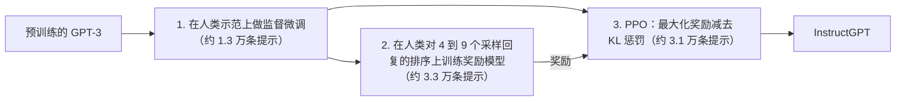
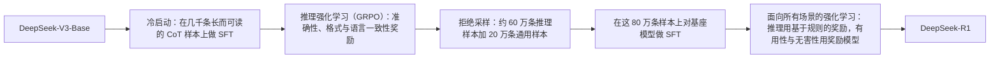

前面两章讲了 **Transformer** 怎样在文本上预训练（[4.7.7](/4.7.7)），以及这样的训练怎样在数千块 GPU 上进行（[4.7.8](/4.7.8)）。本章讲的是把这套方案推向极限之后发生了什么。第一部分关于规模：**语言模型**的损失随参数、数据和算力按光滑的幂律下降，这些规模定律告诉我们怎样花掉一份算力预算。第二部分关于怎样把预训练模型变成有用的助手：基于人类反馈的**强化学习**及其后继方法实现的与人类偏好的对齐，以及从大语言模型到用可验证奖励训练的**推理模型**，后者在测试时花费算力，先思考再作答。第三部分关于架构：稀疏的混合专家，它在不增加每个**词元**计算量的前提下增加参数数量；以及面向长上下文的、二次注意力的替代方案（状态空间模型、Mamba、带 delta 规则的线性注意力、混合架构）。本章最后简要概览 2026 年 10 月的领域现状，与 [4.7.1](/4.7.1#sec-1.1.4) 互为补充。多模态模型与智能体模型在本课程后面的章节中讨论；把语言模型作为**编程智能体**的实际使用，见 [4.2.14](/4.2.14)。

## 9.1. 规模定律

### 9.1.1. 参数、数据与算力的幂律

Kaplan 等（2020）在跨越六个数量级的规模上训练了 **Transformer** **语言模型**，发现测试损失（每个**词元**的**交叉熵**）以惊人的规律性依赖于非嵌入参数个数 $N$、训练词元数 $D$ 和训练算力 $C$。

**定义 9.1.1（规模定律）** **规模定律**是在许多数量级上成立的、模型性能（通常是测试损失）与训练所用资源之间的经验关系，通常取幂律形式：当其他资源不构成限制时，对某一资源 $X$ 有 $L(X) = (X_c/X)^{\alpha_X}$。

Kaplan 等发现，当另外两种资源不是瓶颈时，

$$
L(N) = \Bigl(\frac{N_c}{N}\Bigr)^{0.076}, \qquad L(D) = \Bigl(\frac{D_c}{D}\Bigr)^{0.095}, \qquad L(C) = \Bigl(\frac{C_c}{C}\Bigr)^{0.050},
$$

它们在双对数坐标下是直线，斜率就是指数。这些指数很小：参数翻倍，损失只乘以 $2^{-0.076} \approx 0.95$。但这些直线在许多数量级上都是直的，所以小而廉价的实验可以预测大一千倍的训练的损失。这种可预测性把大模型的训练从一场赌博变成了工程决策。在固定 $N$ 时，深度与宽度之类的架构细节影响很小。

### 9.1.2. 怎样花掉一份算力预算

训练算力 $C \approx 6ND$（[4.7.8](/4.7.8#sec-8.8.1)），固定的预算既可以买一个更大的、训练词元更少的模型，也可以买一个更小的、训练词元更多的模型。Kaplan 等得出结论：最优模型规模按 $N_{\mathrm{opt}} \propto C^{0.73}$ 增长，数据只按 $C^{0.27}$ 增长：十倍的算力应当买到 5.4 倍的参数，却只有 1.9 倍的词元，因为大模型每个词元学到的更多，最好训练一个大模型并在远未收敛时就停止。GPT-3 时代的模型遵循了这一建议：GPT-3 有 1750 亿参数，只见过 3000 亿词元，每个参数 1.7 个词元。

Hoffmann 等（2022，DeepMind 的 "Chinchilla" 论文）用 400 多次训练运行和三种方法重新检验了这个问题：训练曲线的下包络；*IsoFLOP 剖面*，即固定算力预算、改变模型规模，得到 U 形损失曲线，其极小值标出最优点；以及对最终损失的参数化拟合，

$$
L(N, D) = E + \frac{A}{N^{\alpha}} + \frac{B}{D^{\beta}},
$$

其中 $E$ 是不可约损失（文本自身的**信息熵**），另外两项是由有限模型和有限数据造成的超额损失。

**定义 9.1.2（计算最优训练）** 如果一次训练的模型规模 $N$ 与训练词元数 $D$ 在训练算力同为 $C = 6ND$ 的所有选择中使损失最小，则这次训练是**计算最优**的。

**命题 9.1.1** 对损失 $L(N, D) = E + AN^{-\alpha} + BD^{-\beta}$，其中 $A, B, \alpha, \beta > 0$，在约束 $6ND = C$ 下的计算最优分配为

$$
N_{\mathrm{opt}}(C) = G\Bigl(\frac{C}{6}\Bigr)^{\frac{\beta}{\alpha + \beta}}, \qquad D_{\mathrm{opt}}(C) = G^{-1}\Bigl(\frac{C}{6}\Bigr)^{\frac{\alpha}{\alpha + \beta}}, \qquad G = \Bigl(\frac{\alpha A}{\beta B}\Bigr)^{\frac{1}{\alpha + \beta}}.
$$

**证明** 代入 $D = C/(6N)$ 得 $f(N) = E + AN^{-\alpha} + B(6N/C)^{\beta}$，其中

$$
f'(N) = -\alpha A N^{-\alpha - 1} + \beta B \Bigl(\frac{6}{C}\Bigr)^{\beta} N^{\beta - 1} = N^{-\alpha - 1}\Bigl(\beta B\Bigl(\frac{6}{C}\Bigr)^{\beta} N^{\alpha + \beta} - \alpha A\Bigr).
$$
括号内关于 $N$ 严格递增，$N$ 小时为负，$N$ 大时为正，所以 $f$ 有唯一的极小值点，满足 $N^{\alpha + \beta} = \frac{\alpha A}{\beta B}\bigl(\frac{C}{6}\bigr)^{\beta}$，这就是所述的 $N_{\mathrm{opt}}$；再由 $D_{\mathrm{opt}} = C/(6N_{\mathrm{opt}})$ 得出 $D_{\mathrm{opt}}$。$\square$

在最优点，多花一次**浮点运算**在参数上或在数据上，使损失下降的量相同。规模的指数是 $\beta/(\alpha + \beta)$。Chinchilla 的三种方法都给出接近 $0.5$ 的指数（0.50、0.49、0.46），而不是 Kaplan 的 0.73：模型规模与数据应当*同样*增长，都按 $\sqrt{C}$。外推到 DeepMind 的 2800 亿参数 Gopher 的算力（$5.76 \times 10^{23}$ 次浮点运算），最优点是一个约 700 亿参数、在 1.4 万亿词元上训练的模型，约为每个参数 20 个词元；由此得到的 Chinchilla 模型在几乎所有基准上都优于 Gopher（MMLU 67.6%，Gopher 为 60.0%），训练算力相同，推理成本只有四分之一。

| 模型 | 参数量 | 词元数 | 每参数词元数 | MMLU（5 样本） |
|---|---|---|---|---|
| GPT-3（2020） | 175B | 300B | 1.7 | 43.9% |
| Gopher（2021） | 280B | 300B | 1.1 | 60.0% |
| Chinchilla（2022） | 70B | 1.4T | 20 | 67.6% |

与参数化拟合一同发表的常数（$E = 1.69$，$\alpha = 0.34$，$\beta = 0.28$）与 Chinchilla 实际使用的每参数 20 个词元不一致：它们推出的是 60–90。Besiroglu 等（2024）从论文的图中重建数据并重新拟合，得到 $E = 1.82$，$A = 482.0$，$B = 2085.4$，$\alpha = 0.348$，$\beta = 0.366$，对应约每参数 18–20 个词元，规模指数为 $0.51$。用这些常数，计算最优分配只需几行代码：

```python
# L(N, D) = E + A / N^alpha + B / D^beta, refit of Besiroglu et al. (2024)
E, A, B, alpha, beta = 1.8172, 482.01, 2085.43, 0.3478, 0.3658

def compute_optimal(C):
    """Minimize L(N, D) subject to 6 N D = C (closed form)."""
    G = (alpha * A / (beta * B)) ** (1 / (alpha + beta))
    N = G * (C / 6) ** (beta / (alpha + beta))
    D = C / (6 * N)
    return N, D, E + A / N**alpha + B / D**beta

print(f"{'compute':>9} {'params':>9} {'tokens':>9} {'tokens/param':>12} {'loss':>6}")
for C in [1e21, 1e23, 5.76e23, 1e25, 1e27]:
    N, D, L = compute_optimal(C)
    print(f"{C:9.2e} {N / 1e9:8.1f}B {D / 1e9:8.0f}B {D / N:12.1f} {L:6.3f}")

# compute needed to reach the same loss with a model 2x too small or too large
C = 5.76e23
N0, D0, L0 = compute_optimal(C)
for f in [0.5, 2.0]:
    N = f * N0
    D = (B / (L0 - E - A / N**alpha)) ** (1 / beta)      # tokens giving loss L0
    print(f"{f:.1f} x the optimal size needs {6 * N * D / C - 1:+.1%} compute for the same loss")
```

```text
  compute    params    tokens tokens/param   loss
 1.00e+21      2.8B       60B         21.6  2.306
 1.00e+23     29.4B      566B         19.2  2.032
 5.76e+23     72.2B     1329B         18.4  1.974
 1.00e+25    312.1B     5341B         17.1  1.912
 1.00e+27   3307.3B    50393B         15.2  1.859
0.5 x the optimal size needs +25.9% compute for the same loss
2.0 x the optimal size needs +14.8% compute for the same loss
```

经验法则 $D \approx 20N$ 配合 $C = 6ND$，给出 $N \approx \sqrt{C/120}$。最优点附近很平坦：模型大一倍或小一倍，要达到相同的损失只多花 15–26% 的算力，因此可以在附近选取规模，以适应内存或推理成本。


### 9.1.3. Kaplan 与 Chinchilla 为什么不同

这一差异已被追溯到数量的计数方式和训练运行的设置（Pearce 和 Song，2024；Porian 等，NeurIPS 2024）。Kaplan 等排除了嵌入参数和输出层的计算；两者在小模型中占很大比例，而 Kaplan 的模型全都不到 15 亿参数，所以拟合出的指数偏高。Porian 等重现了 Kaplan 的指数，随后通过计入输出层、让学习率预热随模型规模缩放、并在每个规模上调整学习率、批量大小和 **AdamW** **超参数**，把它修正为 0.50，与 Chinchilla 一致。Chinchilla 论文曾怀疑的**学习率调度**，结果表明影响较小。

### 9.1.4. 超越计算最优

计算最优训练在给定损失下最小化*训练*成本。而部署的模型还要运行，每生成一个词元约需 $2N$ 次浮点运算，一个受欢迎的模型会生成万亿级的词元。最小化训练加推理的总算力（Sardana 等，ICML 2024）倾向于更小的、在多得多的数据上训练的模型。Llama-3-8B 在 15 万亿词元上训练，约为每参数 1900 个词元，是 Chinchilla 比例的一百倍，其损失仍在按对数线性方式改进。另外两个限制变得重要。数据：网络上的高质量文本是有限的；Muennighoff 等（NeurIPS 2023）发现，重复数据至多约 4 个轮次时几乎与新数据一样好，超过后收益迅速下降，而由模型生成的合成数据已成为重要的组成部分。其次，规模扩展的轴线已经拓宽：用**强化学习**做的后训练（§9.4）以及推理时的计算（§9.4.5），可以在**预训练**预算不变的情况下提升能力。

有些能力似乎在某个规模处突然出现，Wei 等（2022）称之为*涌现能力*。Schaeffer 等（NeurIPS 2023）表明，许多这样的跃变是由度量产生的：多步答案的精确匹配准确率在每一步都正确之前接近零，而同一些模型的每词元损失却是光滑改进的。因此光滑的损失与突变的任务指标是相容的，由前者预测后者仍然困难。

## 9.2. GPT 系列

OpenAI 的模型标示出从**语言模型**到助手和**推理模型**的主要步骤；其他实验室的开放模型（Llama、Qwen、DeepSeek、Kimi、GLM 等）跟随或预见了每一步。

| 模型 | 发布时间 | 变化 |
|---|---|---|
| GPT-1、GPT-2、GPT-3 | 2018、2019、2020 | 规模不断增长的生成式预训练；少样本上下文学习（[4.7.7](/4.7.7#sec-7.4.2)） |
| Codex | 2021 | 在代码上继续训练的 GPT-3；第一代 GitHub Copilot 的基础 |
| InstructGPT | 2022 年 1 月 | 通过监督微调与 RLHF 遵循指令（§9.3） |
| ChatGPT | 2022 年 11 月 | 同样的方法用于对话；公众层面的突破 |
| GPT-4 | 2023 年 3 月 | 强得多的模型，支持图像输入；架构未公开 |
| GPT-4o | 2024 年 5 月 | 原生多模态（文本、音频、图像） |
| o1 | 2024 年 9 月（预览版），2024 年 12 月 | 第一个被广泛使用的推理模型：通过强化学习训练的长思维链（§9.4） |
| o3 | 2025 年 4 月 | 更强的推理，并能使用工具 |
| GPT-5 | 2025 年 8 月 | 一个系统自行决定快速回答还是延长推理 |
| GPT-5.5 | 2026 年 4 月 | 智能体式编程与计算机使用；上下文为一百万词元 |
| GPT-6 Astra | 2026 年 9 月 | 当前旗舰；架构未公开 |

自 GPT-4 以来，前沿实验室很少公开架构、数据和训练的信息，目前对现行方法的了解大多来自开放权重模型及其技术报告，尤其是 DeepSeek 的。

## 9.3. 对齐

### 9.3.1. 为什么只靠预训练不够

下一个词元预测模仿的是训练文本，而训练文本并不是一批有用的回答。被问到 "What are the names of some famous actors?" 时，预训练模型可能接着写出更多同类的问题；它也可能生成有毒的文本、自信地编造事实（**幻觉**）或者漫无边际地跑题。用户的意图并不在目标函数里。

**定义 9.3.1（对齐）** **对齐**是指让 AI 系统追求其开发者和用户所意图的目标的问题。对语言模型助手，通常用三条标准来陈述（Askell 等，2021）：*有帮助*，即解决用户的任务；*诚实*，即给出准确的信息并表达不确定性，而不是编造答案；*无害*，即不造成身体、心理或社会伤害，并拒绝危险的请求。

**指令微调**（[4.7.7](/4.7.7#sec-7.5.4)）是第一步。它通过模仿教会模型好回复的格式，但很难教会模型在许多合理回复中人类更偏好哪一个，并且受示范质量的限制。比较两个回复比写出一个完美的回复更容易，偏好比较是下一步的基础。

### 9.3.2. 基于人类反馈的强化学习

**定义 9.3.2（基于人类反馈的强化学习）** **基于人类反馈的强化学习**（RLHF；Christiano 等，2017；Stiennon 等，2020；Ouyang 等，2022）用**强化学习**（[4.6.1](/4.6.1)）微调语言模型，使其最大化奖励模型的得分，同时惩罚它对初始模型的偏离；奖励模型是在人类对回复的比较上训练得到的。

InstructGPT（Ouyang 等，NeurIPS 2022）确立了三阶段方案：



在人类评估中，13 亿参数的 InstructGPT 的输出比 1750 亿参数的 GPT-3 更受偏好：对齐对有用性的提升超过了规模放大一百多倍的效果。ChatGPT 把同样的方法用于对话。

**定义 9.3.3（奖励模型）** **奖励模型** $r_\phi(x, y)$ 是为提示 $x$ 与回复 $y$ 给出一个标量分数的网络。它通常由微调后的语言模型初始化，输出层换成一个到标量的线性层，并在偏好对 $(x, y_w, y_l)$（$y_w$ 优于 $y_l$）上，按 Bradley–Terry 模型 $\mathbb{P}(y_w \succ y_l \mid x) = \sigma\bigl(r_\phi(x, y_w) - r_\phi(x, y_l)\bigr)$，通过最小化

$$
\mathcal{L}_{\mathrm{RM}}(\phi) = -\mathbb{E}_{(x, y_w, y_l)}\log\sigma\bigl(r_\phi(x, y_w) - r_\phi(x, y_l)\bigr)
$$
来训练。

这是对分数之差的 **logistic 回归**：只有奖励之差是确定的。对 $K$ 个回复的一次排序产生 $\binom{K}{2}$ 个偏好对，这就是 InstructGPT 让标注员一次对 4 到 9 个回复排序的原因。

此时的**语言模型**称为*策略* $\pi_\theta(y \mid x)$，对如下目标进行优化：

$$
\max_\theta\ \mathbb{E}_{x \sim \mathcal{D},\, y \sim \pi_\theta(\cdot \mid x)}\bigl[r_\phi(x, y)\bigr] - \beta\,\mathbb{E}_{x \sim \mathcal{D}}\Bigl[D_{\mathrm{KL}}\bigl(\pi_\theta(\cdot \mid x)\,\big\|\,\pi_{\mathrm{ref}}(\cdot \mid x)\bigr)\Bigr], \tag{9.1}
$$

其中 $\pi_{\mathrm{ref}}$ 是监督微调后的模型。**Kullback–Leibler 散度**项使策略保持在奖励模型被训练的区域附近：策略一旦远离，奖励模型的估计就变得不可靠，不受约束的策略会找到利用其误差的回复。InstructGPT 还把**预训练**的语言建模损失混入目标（"PPO-ptx"），以减少*对齐税*，即 RLHF 造成的标准 NLP 基准上性能的下降。

### 9.3.3. 近端策略优化

生成一个回复是一个序贯决策过程：状态是**提示**加上到目前为止已生成的**词元**，动作是下一个词元，奖励（这里是 $r_\phi$ 减去 KL 惩罚）在结尾才出现。这一优化的标准算法是 PPO。

**定义 9.3.4（近端策略优化）** **近端策略优化**（PPO；Schulman 等，2017）是一种策略梯度方法：它用当前策略 $\pi_{\theta_{\mathrm{old}}}$ 采样动作，然后在截断的代理目标

$$
J^{\mathrm{CLIP}}(\theta) = \mathbb{E}_t\Bigl[\min\Bigl(\rho_t(\theta)\hat A_t,\ \operatorname{clip}\bigl(\rho_t(\theta), 1 - \varepsilon, 1 + \varepsilon\bigr)\hat A_t\Bigr)\Bigr], \qquad \rho_t(\theta) = \frac{\pi_\theta(a_t \mid s_t)}{\pi_{\theta_{\mathrm{old}}}(a_t \mid s_t)},
$$
上走若干梯度步，其中 $\hat A_t$ 是动作 $a_t$ 的*优势*估计（它比状态 $s_t$ 下的平均动作好多少），由学到的价值函数计算，$\varepsilon \approx 0.2$。

比值 $\rho_t$ 修正了样本是从旧策略抽取的这一事实；截断消除了在一轮中把某个动作的概率改变超过 $1 \pm \varepsilon$ 倍的动机，使更新保持稳定。对语言模型，PPO 需要在内存中同时放四个大小相近的网络：策略、参考模型、奖励模型和价值函数，再加上生成样本，使 RLHF 成为训练中最复杂、最昂贵的阶段。

### 9.3.4. RLHF 的局限

- 偏好不完美。人类标注员会有分歧：InstructGPT 数据中标注员之间的一致率约为 73%，奖励模型预测留出偏好的准确率约为 65–75%。偏好也存在偏差：更长的回复、要点列表以及自信或讨好的回答往往更受偏好，无论是否真的更好，而 RLHF 会放大这类偏差（冗长、*谄媚*）。
- **奖励投机**。策略最大化的是奖励模型，而不是人类偏好，它会找到被奖励模型高估的回复；这种**奖励投机**随优化强度而加剧，KL 惩罚只能限制它。
- 反馈粗糙。每个回复只有一个标量，不能说明*哪一部分*好或不好，所以在数百个词元上做信用分配很困难。
- 成本与复杂性。人类标注昂贵，PPO 不稳定、占内存大，并且对**超参数**敏感。

对这些局限的回应塑造了今天使用的方法：用 AI 反馈代替人类反馈，不用**强化学习**而直接优化偏好，更细粒度的奖励，以及被验证而不是被评判的奖励。

### 9.3.5. 宪法式 AI

**定义 9.3.5（宪法式 AI）** **宪法式 AI**（Bai 等，2022，Anthropic）用一套书面原则（一部*宪法*）和 AI 反馈代替人类对有害性的标注，来训练模型变得无害：在监督阶段，模型按随机选取的原则对自己的回复做批评和修改，并在修改后的回复上微调；在强化学习阶段，由模型判断两个回复中哪一个更好地遵循原则，这些 AI 偏好用来训练奖励模型（*基于 AI 反馈的强化学习*，RLAIF）。

这种方法扩展了监督的规模（模型能标注的比较远多于人），使目标行为在宪法中明确且可审计，并且在原始实验中得到的模型比用人类无害性标注训练的模型既更无害又更少回避：它们会解释自己的反对意见，而不是不加解释地拒绝。自生成数据也用于有用性：Self-Instruct 等方法让模型为自己的**微调**（[4.7.7](/4.7.7#sec-7.5.4)）编写指令数据，充当评判者的模型则按书面评分标准给回复打分。

### 9.3.6. 直接偏好优化

带 KL 正则的目标式 (9.1) 可以对策略解出闭式解，这使得强化学习这一步不再必要。

**定理 9.3.1** 对固定的提示 $x$ 和奖励函数 $r$，在所有分布 $\pi(\cdot \mid x)$ 上使 $\mathbb{E}_{y \sim \pi}[r(x, y)] - \beta D_{\mathrm{KL}}(\pi \,\|\, \pi_{\mathrm{ref}})$ 最大的是

$$
\pi^*(y \mid x) = \frac{1}{Z(x)}\,\pi_{\mathrm{ref}}(y \mid x)\exp\Bigl(\frac{r(x, y)}{\beta}\Bigr), \qquad Z(x) = \sum_y \pi_{\mathrm{ref}}(y \mid x)\exp\Bigl(\frac{r(x, y)}{\beta}\Bigr).
$$

**证明** 对任意 $\pi$，

$$
\mathbb{E}_{y \sim \pi}[r(x, y)] - \beta\,\mathbb{E}_{y \sim \pi}\Bigl[\log\frac{\pi(y \mid x)}{\pi_{\mathrm{ref}}(y \mid x)}\Bigr] = -\beta\,\mathbb{E}_{y \sim \pi}\Bigl[\log\frac{\pi(y \mid x)}{\pi_{\mathrm{ref}}(y \mid x)\mathrm{e}^{r(x, y)/\beta}}\Bigr] = -\beta D_{\mathrm{KL}}(\pi \,\|\, \pi^*) + \beta\log Z(x).
$$
最后一项与 $\pi$ 无关，并且 $D_{\mathrm{KL}}(\pi \,\|\, \pi^*) \ge 0$，当且仅当 $\pi = \pi^*$ 时取等号。$\square$

由此解出奖励，$r(x, y) = \beta\log\frac{\pi^*(y \mid x)}{\pi_{\mathrm{ref}}(y \mid x)} + \beta\log Z(x)$：每个策略都定义了一个*隐式奖励*。在 Bradley–Terry 模型下只有奖励之差起作用，所以难以计算的 $Z(x)$ 被消掉，奖励模型的损失可以直接用策略来表示。

**定义 9.3.6（直接偏好优化）** **直接偏好优化**（DPO；Rafailov 等，NeurIPS 2023）通过最小化

$$
\mathcal{L}_{\mathrm{DPO}}(\theta) = -\mathbb{E}_{(x, y_w, y_l)}\log\sigma\Bigl(\beta\log\frac{\pi_\theta(y_w \mid x)}{\pi_{\mathrm{ref}}(y_w \mid x)} - \beta\log\frac{\pi_\theta(y_l \mid x)}{\pi_{\mathrm{ref}}(y_l \mid x)}\Bigr)
$$
在偏好对上训练策略 $\pi_\theta$，这就是把奖励换成隐式奖励 $\hat r_\theta(x, y) = \beta\log\bigl(\pi_\theta(y \mid x)/\pi_{\mathrm{ref}}(y \mid x)\bigr)$ 的奖励模型损失。

DPO 是固定数据集上的分类损失：训练中无需采样，没有奖励模型和价值函数，只有策略和一个冻结的参考模型。它的梯度提高被偏好回复的对数概率、降低被拒绝回复的对数概率，权重为 $\sigma(\hat r_\theta(x, y_l) - \hat r_\theta(x, y_w))$，使模型已经以很大间隔正确排序的偏好对贡献很小。一个回复的对数概率是其各词元对数概率之和，每个模型各做一次前向传播就能得到。

```python
import numpy as np

def dpo_loss(logp_w, logp_l, ref_w, ref_l, beta=0.1):
    """DPO loss for a batch of preference pairs.
    logp_*: summed log-probabilities of the chosen (w) and rejected (l) responses
    under the policy; ref_*: the same under the frozen reference model."""
    margin = beta * ((logp_w - ref_w) - (logp_l - ref_l))   # difference of implicit rewards
    loss = np.logaddexp(0.0, -margin)                       # -log sigmoid(margin), stable
    grad_scale = 1 / (1 + np.exp(margin))                   # sigmoid(-margin): weight of each pair
    return loss.mean(), margin / beta, grad_scale

ref_w = np.array([-42.0, -55.0, -30.0])        # reference log-probs of chosen responses
ref_l = np.array([-40.0, -57.0, -31.0])        # reference log-probs of rejected responses
print("at the start:", dpo_loss(ref_w, ref_l, ref_w, ref_l)[0].round(4))   # policy = reference
logp_w = np.array([-30.0, -54.0, -33.0])       # policy after some training
logp_l = np.array([-48.0, -58.0, -29.0])
loss, reward_gap, weight = dpo_loss(logp_w, logp_l, ref_w, ref_l)
print(f"later: loss {loss:.4f}, implicit reward gaps {reward_gap}, "
      f"gradient weights {np.round(weight, 3)}")
```

```text
at the start: 0.6931
later: loss 0.5664, implicit reward gaps [20.  2. -5.], gradient weights [0.119 0.45  0.622]
```

开始时损失为 $\log 2$，与未训练的二分类器相同。之后，第一个偏好对被以很大的间隔正确排序，权重很小；第三个被错误排序，权重最大。DPO 及其变体（IPO、KTO、SimPO 等）被广泛使用，常与在线方法结合：训练过程完整公开的 Olmo 3 模型（Ai2，2025 年 12 月）的后训练依次是监督微调、DPO，再是**基于可验证奖励的强化学习**。由于 DPO 从当前模型并未生成的固定回复数据集中学习，它的探索不如在线强化学习，而在推理任务上，在线强化学习已被证明更强。

### 9.3.7. 结果奖励与过程奖励

*结果奖励*只评判回复的最终结果；*过程奖励*评判每个中间步骤。

**定义 9.3.7（过程奖励模型）** **过程奖励模型**（PRM）为多步解答的每一步打分，估计该步是否正确；*结果奖励模型*（ORM）只对最终答案或回复整体打分。

Uesato 等（2022）和 Lightman 等（"Let's Verify Step by Step"，ICLR 2024）在数学上比较了两者。Lightman 等收集了 PRM800K，即对解答中单个步骤的 80 万个人类标注，发现过程奖励模型在许多样本中挑选出正确解答比结果奖励模型可靠得多（在 MATH 基准的一个子集上，解出 78% 对 72%）。过程监督给出更细的信用分配，奖励的是正确的推理而不是碰巧对的答案，但步骤级标注昂贵，学出的 PRM 本身也可能被投机。另一个方向是让奖励模型成为在打分前先写出判断的语言模型（*生成式奖励模型*，Zhang 等，2024）。相比之下，下一节的**推理模型**大多使用不是学出来的、而是由程序检查的结果奖励。

## 9.4. 大型推理模型

### 9.4.1. 思维链

心理学家区分快速、自动的"系统 1"思维与缓慢、审慎的"系统 2"思维（Kahneman，《思考，快与慢》）。直接作答的**语言模型**对每个**词元**用固定量的计算（固定的层数）算出答案。把中间步骤写出来，就给了它更多的计算量和一块草稿纸。

**定义 9.4.1（思维链）** **思维链**（CoT）是语言模型在给出最终答案之前生成的、用自然语言或公式写出的一系列中间推理步骤。*思维链提示*通过包含这类步骤的示范（少样本 CoT；Wei 等，NeurIPS 2022）或 "Let's think step by step" 这样的指令（零样本 CoT；Kojima 等，2022）来引出它。

思维链提示大幅提高了大模型在算术和常识推理上的准确率；仅凭 "Let's think step by step" 这句指令，就使一个 InstructGPT 模型在 MultiArith 基准上的准确率从 17.7% 提高到 78.7%。它只对足够大的模型有效，并且可以通过采样许多条链、取多数答案来增强（*自洽性*，Wang 等，ICLR 2023）。不过，提示只是引出模型本来就会的推理，并不能教会模型在数千个词元上做好推理。

### 9.4.2. 从大语言模型到推理模型

**推理模型**（[4.2.14](/4.2.14#sec-14.2.3)）被训练成在作答前生成长思维链：它们分解问题、尝试一种方法、检查中间结果、发现错误并回溯。OpenAI 的 o1（2024 年 9 月）是第一个被广泛使用的推理模型；它表明，竞赛数学上的准确率随训练期间**强化学习**的量和测试时思考的长度而稳步增长。2024–2025 年从直接作答的模型转向**推理模型**，带来了数学和编程上的快速进步。其中涉及三个要素：

| | 思维链 | 基于可验证奖励的强化学习 | 测试时扩展 |
|---|---|---|---|
| 角色 | 推理过程 | 训练方法 | 算力分配 |
| 问题 | 模型怎样推理？ | 推理行为是怎样学到的？ | 对给定问题应该思考多少？ |
| 核心思想 | 在答案之前生成中间步骤 | 奖励可自动检查的结果（正确答案、通过测试） | 对更难的问题在推理时花更多计算 |

### 9.4.3. 基于可验证奖励的强化学习

**定义 9.4.2（基于可验证奖励的强化学习）** **基于可验证奖励的强化学习**（RLVR）在结果可由程序检查的任务上，用强化学习训练语言模型策略，并把检查结果用作奖励：例如数学题的最终答案与参考答案相等时为 1，否则为 0，或者生成的代码是否通过单元测试。

可验证奖励无法被讨好，也比学出的奖励模型难以投机得多，不过不完整的测试仍可能被钻空子（[4.2.14](/4.2.14)）。它去掉了奖励模型及其误差，并且没有上限：任何有可检查答案的问题都成为训练数据。策略可以自由地找到任何能得出正确答案的思维链。DeepSeek 用于这一场景的强化学习算法是 GRPO。

**算法 9.4.1（组相对策略优化）** GRPO（Shao 等，2024，DeepSeekMath）重复以下步骤。

1. 对一个批次中的每个**提示** $q$，从当前策略 $\pi_{\theta_{\mathrm{old}}}$ 采样一组 $G$ 个回复 $o_1, \dots, o_G$，并计算它们的奖励 $r_1, \dots, r_G$。
2. 给回复 $i$ 的每个词元赋予优势 $\hat A_i = \bigl(r_i - \operatorname{mean}(r_1, \dots, r_G)\bigr) / \operatorname{std}(r_1, \dots, r_G)$。
3. 对
$$
J(\theta) = \frac{1}{G}\sum_{i=1}^{G}\frac{1}{\lvert o_i\rvert}\sum_{t=1}^{\lvert o_i\rvert}\min\Bigl(\rho_{i,t}\hat A_i,\ \operatorname{clip}(\rho_{i,t}, 1 - \varepsilon, 1 + \varepsilon)\hat A_i\Bigr) - \beta D_{\mathrm{KL}}\bigl(\pi_\theta \,\|\, \pi_{\mathrm{ref}}\bigr),
$$
走梯度步，其中词元级比值为 $\rho_{i,t} = \pi_\theta(o_{i,t} \mid q, o_{i,<t}) / \pi_{\theta_{\mathrm{old}}}(o_{i,t} \mid q, o_{i,<t})$。

GRPO 就是去掉价值网络的 PPO：一个回复的基线是对同一提示的其他回复的平均奖励。这使强化学习阶段的内存减半，并适合只在回复结尾才给出的奖励。如果一组回复的奖励全部相同，所有优势都为零，该提示就学不到任何东西，所以训练数据要选在模型有时成功的难度上。许多变体调整了归一化和截断（例如 2025 年的 DAPO 和 Dr. GRPO）。

### 9.4.4. DeepSeek-R1-Zero 与 DeepSeek-R1

DeepSeek-R1（2025 年 1 月；2025 年 9 月发表于 *Nature*）公开展示了推理模型是怎样训练的，并发布了权重。

*DeepSeek-R1-Zero* 把 GRPO 直接用于预训练的基座模型 DeepSeek-V3-Base（§9.5.5），不做**监督微调**。提示模板只要求模型在 `<think>` … `</think>` 标签内思考，然后作答，并有两个基于规则的奖励：*准确性奖励*，即答案是否正确（数学答案按指定格式与参考答案核对，代码用测试检查），以及使用标签的*格式奖励*。因为**奖励投机**，有意避免了神经奖励模型。训练中回复变得越来越长，从几百个词元增长到几千个，并出现了没有人编程过的行为：重新检查步骤、尝试其他方法、停下来重新考虑，作者称之为"顿悟时刻"（"Wait, wait. That's an aha moment I can flag here."）。在 AIME 2024 竞赛上，准确率（pass@1）从 15.6% 升至 77.9%（1 月预印本中为 71.0%），对 64 个样本做多数投票后为 86.7%。因此，仅对基座模型做纯强化学习就足以引出长推理。不过 R1-Zero 的输出难以阅读，并且混用多种语言。

*DeepSeek-R1* 增加了若干阶段来解决这一问题：



DeepSeek-R1 在数学和编程基准上与 OpenAI 的 o1 表现相当，价格只是其一小部分；其推理强化学习阶段的报告成本约为 \$294,000 的 GPU 时间，这还不含基座模型的成本。

**定义 9.4.3（知识蒸馏）** **知识蒸馏**（Hinton 等，2015）训练较小的*学生*模型去模仿较大的*教师*模型，方式是匹配教师的输出分布（软目标），或在教师生成的输出上做监督微调。

DeepSeek 用 R1 生成的 80 万条样本，在完全不做强化学习的情况下，微调了较小的开放模型（Qwen2.5 与 Llama 3，参数量从 15 亿到 700 亿）。蒸馏后的模型推理能力远好于原模型（320 亿参数的那个在 AIME 2024 上达到 72.6%），也好于用大规模强化学习自己训练的同一小模型：大模型发现的推理模式可以廉价地迁移，而通过强化学习发现它们需要强大的基座模型。

### 9.4.5. 测试时计算

**定义 9.4.4（测试时计算）** **测试时计算**是模型在推理时对给定输入所花费的计算。*测试时扩展*通过增加它来提升性能：顺序地（更长的思维链、对先前尝试的修订），或并行地（采样许多回复并用多数投票或验证器挑选，或对部分解做树搜索）。

训练时扩展（更多参数、更多数据）对每个输入都改进模型，但在训练结束后就固定了，而且代价高；测试时扩展灵活，可以只用在难题上，但会增加每次查询的延迟和成本，并受基座模型质量的限制。在固定预算下，让思考量适应问题的难度，比对每个问题花同样多更高效（Snell 等，2024）。即使简单的控制也有效：s1 模型（Muennighoff 等，2025）只在 1000 个推理样本上微调，通过"预算强制"（抑制思考的结束并追加 "Wait"），其准确率随思考词元数持续增长。产品把这种权衡暴露为"思考"模式或强度参数。

### 9.4.6. 开放问题

- 效率。推理模型即使对简单问题也常常产生很长的思维链（"过度思考"），这拖慢推理，并使强化学习训练昂贵。研究方向包括自适应思考（由模型决定思考多久）和对长度的惩罚。
- 忠实性与监控。思维链不一定反映真正产生答案的计算；模型有时会省略真实原因，而针对监控器优化思维链可能教会模型隐藏意图。保持思维链可读且*可监控*，现在本身就被视为一种安全属性，模型也在被训练诚实地报告自己的违规行为。
- 可验证任务之外的奖励。**基于可验证奖励的强化学习**适用于答案可检查的领域：数学、代码、部分科学。对写作、建议或研究，奖励来自由模型按评分标准打的分，或来自验证自己证明的模型（DeepSeekMath-V2，2025），而怎样稳健地训练通用推理仍是一个开放问题。

## 9.5. 混合专家模型

### 9.5.1. 稀疏激活

在稠密 **Transformer** 中，每个参数对每个**词元**都被使用，所以每个词元的计算量随参数个数增长。前馈块约占参数的三分之二，混合专家的想法是把每个前馈块换成许多更小的块，而一个词元只使用其中少数几个。

**定义 9.5.1（混合专家）** **混合专家**（MoE）层由 $E$ 个前馈网络 $\mathrm{FFN}_1, \dots, \mathrm{FFN}_E$（*专家*）和一个权重矩阵为 $W_r$ 的*路由器*构成。对隐向量为 $\boldsymbol{x}$ 的词元，路由器计算概率 $\boldsymbol{g} = \operatorname{softmax}(W_r\boldsymbol{x}) \in \mathbb{R}^E$，选出 $g_i$ 最大的 $k$ 个专家构成集合 $\mathcal{T}(\boldsymbol{x})$，并输出

$$
\boldsymbol{y} = \sum_{i \in \mathcal{T}(\boldsymbol{x})}\tilde g_i\,\mathrm{FFN}_i(\boldsymbol{x}), \qquad \tilde g_i = \frac{g_i}{\sum_{j \in \mathcal{T}(\boldsymbol{x})} g_j}.
$$
MoE Transformer 把部分或全部前馈块换成 MoE 层。*总*参数量包含所有专家；*激活*参数量只包含每个词元用到的 $k$ 个专家。

稠密混合会给所有专家加权；稀疏的 top-$k$ 版本使每个词元的计算量与激活参数成正比，而容量（模型能存储的知识）随总参数增长。不同的词元，以及同一词元在不同的层，会走过专家的不同路径。这一想法可以追溯到 Jacobs 等（1991）；它在深度网络中的应用始于 Shazeer 等（2017）的稀疏门控 MoE，随后有 GShard（2020，top-2）和 Switch Transformer（Fedus 等，2022，top-1）。

### 9.5.2. 路由

下面的 NumPy 实现把每个词元路由给它的 top-2 专家，只对分配给每个专家的词元应用该专家，并报告每个专家收到的分配比例，以及 Switch Transformer 的均衡损失（§9.5.3）。

```python
import numpy as np

def softmax(z):
    z = z - z.max(axis=-1, keepdims=True)
    e = np.exp(z)
    return e / e.sum(axis=-1, keepdims=True)

def moe_layer(X, W_router, b_router, experts, k=2):
    """Top-k mixture of experts. X: (tokens, d). Returns output, expert loads, aux loss."""
    probs = softmax(X @ W_router + b_router)              # (tokens, n_experts)
    topk = np.argsort(-probs, axis=1)[:, :k]              # chosen experts per token
    gates = np.take_along_axis(probs, topk, axis=1)
    gates /= gates.sum(axis=1, keepdims=True)             # renormalize over the k chosen
    Y = np.zeros_like(X)
    n = len(experts)
    for e in range(n):                                    # each expert sees only its tokens
        rows, slot = np.nonzero(topk == e)
        if rows.size:
            Y[rows] += gates[rows, slot, None] * experts[e](X[rows])
    f = np.bincount(topk.ravel(), minlength=n) / topk.size   # fraction of assignments
    P = probs.mean(axis=0)                                # mean router probability
    aux = n * np.sum(f * P)                               # Switch-style balance loss, 1 if uniform
    return Y, f, aux

rng = np.random.default_rng(0)
d, n_exp, tokens = 32, 8, 4096
mats = [rng.standard_normal((d, d)) / np.sqrt(d) for _ in range(n_exp)]
experts = [lambda x, W=W: np.maximum(x @ W, 0) for W in mats]
X = rng.standard_normal((tokens, d))
W_router = 0.1 * rng.standard_normal((d, n_exp))
for name, b in [("balanced router", np.zeros(n_exp)),
                ("skewed router", np.r_[2.0, 1.5, np.zeros(n_exp - 2)])]:
    Y, load, aux = moe_layer(X, W_router, b, experts)
    print(f"{name:15} loads {np.round(load, 3)}  aux loss {aux:.3f}")
```

```text
balanced router loads [0.134 0.149 0.129 0.121 0.115 0.112 0.128 0.113]  aux loss 1.002
skewed router   loads [0.489 0.436 0.022 0.008 0.011 0.008 0.022 0.004]  aux loss 2.473
```

### 9.5.3. 负载均衡

路由器与专家联合训练，放任不管时它容易塌缩：少数专家接到大部分词元，得到更多训练，因而被选得更频繁，而其他专家则被浪费。负载不均衡也会损害硬件，因为专家位于不同的 GPU 上（专家并行，[4.7.8](/4.7.8#sec-8.6.3)），最忙的 GPU 决定速度；系统通常给每个专家一个固定容量，并丢弃或重新路由超出容量的词元。

**定义 9.5.2（负载均衡）** 混合专家模型中的**负载均衡**是任何使路由器把词元均匀分配给各专家的机制。标准的*辅助负载均衡损失*（Switch Transformer）在训练损失上增加

$$
\mathcal{L}_{\mathrm{bal}} = \lambda\,E\sum_{i=1}^{E} f_i P_i,
$$
其中 $f_i$ 是批中分配给专家 $i$ 的词元分配所占的比例，$P_i$ 是专家 $i$ 的平均路由概率；均匀分布时它等于 $\lambda$，负载越集中它越大。

比例 $f_i$ 不可微，但概率 $P_i$ 可微，所以梯度会把路由器的概率推向负载不足的专家。许多模型还加入*路由器 z 损失*（Zoph 等，2022，ST-MoE），即对路由器 logits 的对数和指数平方的惩罚，使它们保持较小，训练稳定。辅助损失的权重大时会干扰语言建模目标。因此 DeepSeek-V3 提出了*无辅助损失*的均衡：每个专家有一个偏置 $b_i$，只在选择 top-$k$ 专家时加到它的路由分数上（不加到门控值上），每一步之后，对过载的专家把偏置减少一点，对负载不足的专家把偏置增加一点；还保留一个很小的序列级辅助损失作为保障。

专家学到了什么？对训练好的 MoE 模型的研究（ST-MoE 等）发现，专家主要专精于某类词元和浅层特征（标点、数字、特定词或句法角色），而不是"生物"或"法律"这样的主题。

### 9.5.4. 细粒度专家与共享专家

DeepSeekMoE（Dai 等，2024）提出了两项改进，多数近期的 MoE 模型都采用了。*细粒度专家*：把每个专家拆成 $m$ 个更小的专家（把其隐层宽度除以 $m$），并路由给 $m$ 倍多的专家，这使参数和计算量不变，却允许多得多的专家组合，从而更精确地分解知识。*共享专家*：少数专家对每个词元始终激活，捕获共同知识，使被路由的专家不必各自重新学习它。DeepSeekMoE 16B 有 2 个共享专家和 64 个路由专家，其中激活 6 个，共 164 亿参数，激活 28 亿，用约 40% 的计算量就达到了稠密 DeepSeek 7B 的水平。

### 9.5.5. DeepSeek-V3

DeepSeek-V3（2024 年 12 月）把这些想法与系统设计结合起来，成为 DeepSeek-R1 的基座。

| | DeepSeek-V3 |
|---|---|
| 参数量 | 总计 6710 亿，每个词元激活 370 亿 |
| 层数 | 61 层；除前 3 层外都有 MoE 前馈块 |
| 每个 MoE 层的专家 | 1 个共享专家 + 256 个路由专家，每个词元 8 个路由专家，每个词元至多发往 4 台服务器 |
| 注意力 | 多头潜在注意力（MLA） |
| 负载均衡 | 无辅助损失的偏置，加一个小的序列级损失 |
| 额外目标 | 多词元预测（多预测一个未来词元） |
| 训练数据与成本 | 14.8 万亿词元；278.8 万个 H800 GPU 小时 |
| 精度与并行 | FP8 混合精度；用 DualPipe 的 16 阶段流水线、64 路专家并行、ZeRO-1 数据并行，无张量并行 |

**多头潜在注意力**（在 DeepSeek-V2 中提出，2024）缩小了 **KV 缓存**（[4.7.6](/4.7.6)）。它不缓存所有头的键和值，而是让每个词元缓存单个压缩的潜在向量 $\boldsymbol{c}^{KV} = W^{DKV}\boldsymbol{h}$，维数为 512（外加一个 64 维、携带旋转位置编码的键部分）；所有头的键和值由它通过上投影矩阵重建，这些矩阵在推理时可以吸收进查询与输出投影。每个词元的缓存只是标准**多头注意力**的一小部分，质量相当或更好。*多词元预测*增加了一个预测下下个词元的小模块，使训练信号更密，并在推理时用作**投机解码**的草稿模型（[4.7.8](/4.7.8#sec-8.9.4)）。

在系统方面，跨服务器的专家并行使通信成为瓶颈：每个 MoE 层用两次全交换把每个词元送到其专家所在的 GPU 再送回来。DeepSeek-V3 的 *DualPipe* 调度从两端把微批次送入流水线，并把每块工作拆成注意力、全交换分发、**多层感知机** 和全交换合并，使一个微批次的计算与另一个微批次的通信重叠；配合定制的全交换核和限制节点数的路由，在计算与通信之比约为 1:1 时，跨服务器的通信几乎被完全隐藏。它采用细粒度缩放的 FP8 训练，见 [4.7.8](/4.7.8#sec-8.2.5)。结果是，一个前沿水平的模型只用 278.8 万个 GPU 小时训练（仅最终运行，按每小时 \$2 约合 \$560 万），改变了人们对训练强模型成本的预期。2025 年以来大多数大型开放模型都是这类 MoE 模型：Qwen3（总计 2350 亿，激活 220 亿）、Kimi K2（总计 1 万亿，激活 320 亿）、DeepSeek-V4（2026 年 4 月；总计 1.6 万亿，激活 490 亿）和 Kimi K3（2026 年 7 月；总计 2.8 万亿，激活 1040 亿）。稀疏的代价是内存：所有专家都必须存储和部署，尽管每个词元只用其中很少一部分。

## 9.6. 新架构

### 9.6.1. 注意力的代价

**自注意力**（[4.7.6](/4.7.6)）把每个**词元**与之前的每个词元比较。对长度为 $L$ 的序列，**预填充**的代价是 $O(L^2)$，每生成一个词元的代价是 $O(L)$，**KV 缓存**按 $O(L)$ 增长；在几十万到数百万词元的上下文下，占满 GPU 内存并限制批量大小的是缓存，而不是权重（[4.7.8](/4.7.8#sec-8.9.1)）。相比之下，循环网络（[4.7.5](/4.7.5)）保持固定大小的状态，所以每个新词元的代价是 $O(1)$，但经典的**循环神经网络** 不能沿序列并行训练，并且遗忘太多。本节的架构追求两者兼得：并行训练和常数大小的状态。

| | 完整注意力 | 线性注意力、SSM、Gated DeltaNet |
|---|---|---|
| 预填充计算量 | $O(L^2)$ | $O(L)$ |
| 每个生成词元的代价 | $O(L)$ | $O(1)$ |
| 生成期间保留的状态 | KV 缓存，$O(L)$ | 固定大小的状态，$O(1)$ |
| 对任意较早词元的回忆 | 精确 | 受状态大小限制 |

### 9.6.2. 线性注意力

因果注意力计算 $\boldsymbol{o}_t = \sum_{j \le t}\operatorname{sim}(\boldsymbol{q}_t, \boldsymbol{k}_j)\boldsymbol{v}_j / \sum_{j \le t}\operatorname{sim}(\boldsymbol{q}_t, \boldsymbol{k}_j)$，其中 $\operatorname{sim}(\boldsymbol{q}, \boldsymbol{k}) = \exp(\boldsymbol{q}^{\mathsf T}\boldsymbol{k}/\sqrt{d})$。如果把相似度换成**特征图**的乘积 $\operatorname{sim}(\boldsymbol{q}, \boldsymbol{k}) = \phi(\boldsymbol{q})^{\mathsf T}\phi(\boldsymbol{k})$，求和就可以重新组织（Katharopoulos 等，ICML 2020）：

$$
\boldsymbol{o}_t = \frac{S_t\,\phi(\boldsymbol{q}_t)}{\boldsymbol{z}_t^{\mathsf T}\phi(\boldsymbol{q}_t)}, \qquad S_t = S_{t-1} + \boldsymbol{v}_t\,\phi(\boldsymbol{k}_t)^{\mathsf T}, \qquad \boldsymbol{z}_t = \boldsymbol{z}_{t-1} + \phi(\boldsymbol{k}_t).
$$

**定义 9.6.1（线性注意力）** **线性注意力**把注意力的 softmax 相似度换成核 $\phi(\boldsymbol{q})^{\mathsf T}\phi(\boldsymbol{k})$，使因果注意力变成矩阵值状态 $S_t \in \mathbb{R}^{d_v \times d_k}$ 上的递推，该状态累积值与键的外积；现代变体去掉归一化项，并在状态更新中加入衰减或门控。

状态 $S_t$ 是一个联想记忆：写入是加上 $\boldsymbol{v}\boldsymbol{k}^{\mathsf T}$，用查询读取是计算 $S\boldsymbol{q}$，如果 $\boldsymbol{q} = \boldsymbol{k}$ 与所有其他存储的键正交，它就恰好返回 $\boldsymbol{v}$。由于记忆只做累积，旧的关联从不被移除，键多于 $d_k$ 个时它们会相互干扰。因此朴素的线性注意力在语言建模上明显差于 **softmax 函数** 注意力；下面的改进就是针对这一点。

### 9.6.3. 状态空间模型

**定义 9.6.2（状态空间模型）** （线性、时不变的）**状态空间模型**（SSM）通过隐状态 $\boldsymbol{h}(t) \in \mathbb{R}^n$ 把输入信号 $x(t)$ 映射为输出 $y(t)$，

$$
\boldsymbol{h}'(t) = A\boldsymbol{h}(t) + \boldsymbol{B}x(t), \qquad y(t) = \boldsymbol{C}^{\mathsf T}\boldsymbol{h}(t),
$$
其中 $A$ 描述状态怎样演化，$\boldsymbol{B}$ 描述输入怎样进入状态，$\boldsymbol{C}$ 描述状态怎样被读出。用零阶保持以步长 $\Delta$ 离散化后，它变成递推 $\boldsymbol{h}_t = \bar A\boldsymbol{h}_{t-1} + \bar{\boldsymbol{B}}x_t$，$y_t = \boldsymbol{C}^{\mathsf T}\boldsymbol{h}_t$，其中 $\bar A = \exp(\Delta A)$，$\bar{\boldsymbol{B}} = (\Delta A)^{-1}(\exp(\Delta A) - I)\Delta\boldsymbol{B}$。

从 $\boldsymbol{h}_0 = \boldsymbol{0}$ 出发展开递推，得到 $y_t = \sum_{j=0}^{t}\boldsymbol{C}^{\mathsf T}\bar A^{j}\bar{\boldsymbol{B}}\,x_{t-j}$，即输入与核 $K_j = \boldsymbol{C}^{\mathsf T}\bar A^{j}\bar{\boldsymbol{B}}$ 的**卷积**。因此线性时不变 SSM 有两种等价的形式：递推形式，生成时每步代价为常数；以及**卷积**形式，训练时可以（借助**快速 Fourier 变换**）沿整个序列并行计算。

```python
import numpy as np
from scipy.linalg import expm

rng = np.random.default_rng(0)
n, L = 4, 64                                       # state size, sequence length
A = -np.diag(rng.uniform(0.5, 2.0, n))             # stable continuous-time dynamics
B = rng.standard_normal((n, 1))
C = rng.standard_normal((1, n))
delta = 0.1                                        # step size
# zero-order-hold discretization
A_bar = expm(delta * A)
B_bar = np.linalg.solve(delta * A, A_bar - np.eye(n)) @ (delta * B)

x = rng.standard_normal(L)
# recurrent form: h_t = A_bar h_{t-1} + B_bar x_t, y_t = C h_t  (O(1) state per step)
h = np.zeros((n, 1))
y_rec = np.empty(L)
for t in range(L):
    h = A_bar @ h + B_bar * x[t]
    y_rec[t] = (C @ h).item()
# convolutional form: y = K * x with kernel K_j = C A_bar^j B_bar  (parallel over t)
K = np.array([(C @ np.linalg.matrix_power(A_bar, j) @ B_bar).item() for j in range(L)])
y_conv = np.array([K[:t + 1][::-1] @ x[:t + 1] for t in range(L)])
print("recurrent and convolutional forms agree:", np.allclose(y_rec, y_conv))
```

```text
recurrent and convolutional forms agree: True
```

S4（Gu、Goel 和 Ré，ICLR 2022）通过对 $A$ 的结构化初始化使 SSM 适用于长序列，这种初始化让状态保留输入的压缩历史，它在极长程依赖的基准上表现出色；但在语言上，时不变 SSM 仍落后于 **Transformer**。

### 9.6.4. Mamba

时不变 SSM 的弱点在于它以同样的方式处理每个输入：它不能决定记住重要的词元、忽略填充内容，而语言需要这一点（复制、回忆前面提到的名字）。

**定义 9.6.3（Mamba）** **Mamba**（Gu 和 Dao，2023）是由*选择性*状态空间层构成的序列模型，其中步长 $\Delta_t$ 以及矩阵 $\boldsymbol{B}_t$ 和 $\boldsymbol{C}_t$ 是当前输入 $x_t$ 的函数（由线性投影算出），因此递推 $\boldsymbol{h}_t = \bar A_t\boldsymbol{h}_{t-1} + \bar{\boldsymbol{B}}_t x_t$ 可以逐词元地选择往状态里写入什么、保留什么；选择性 SSM 与一个短卷积和一个乘性门控一起，组成同时取代注意力和前馈网络的块。

较大的 $\Delta_t$ 使状态向当前输入重置（关注它），较小的 $\Delta_t$ 保持状态（忽略输入）。依赖输入的参数破坏了卷积形式，因为核不再固定。Mamba 转而用*并行扫描*计算递推：映射 $\boldsymbol{h} \mapsto \bar A_t\boldsymbol{h} + \bar{\boldsymbol{B}}_t x_t$ 是仿射的，仿射映射的复合满足结合律，而满足结合律的运算可以在 $O(\log L)$ 个并行步内作用于整个序列，如同并行前缀和。它的核把状态保留在快速的片上 SRAM 中，与 **FlashAttention**（[4.7.8](/4.7.8#sec-8.7)）的精神一致。Mamba 在至多几十亿参数的语言建模上与两倍于它大小的 Transformer 相当，生成文本的速度约快五倍。Mamba-2（Dao 和 Gu，ICML 2024）把 $\bar A_t$ 限制为标量乘单位矩阵，并表明所得模型是带衰减的线性注意力的一种形式（*状态空间对偶*），这使得训练可以在张量核心上用矩阵乘法完成。

### 9.6.5. Delta 规则与 Gated DeltaNet

线性注意力往它的记忆里添加关联，却从不纠正它们。*Delta 规则*（Schlag 等，2021，源自 Widrow–Hoff 规则）先读出当前存储在该键下的值，只写入修正量：

$$
S_t = S_{t-1} + \beta_t\bigl(\boldsymbol{v}_t - S_{t-1}\boldsymbol{k}_t\bigr)\boldsymbol{k}_t^{\mathsf T}, \qquad \beta_t \in (0, 1),
$$

这是对 $\frac12\|S\boldsymbol{k}_t - \boldsymbol{v}_t\|^2$ 以学习率 $\beta_t$ 做的一步**梯度下降**。*Gated DeltaNet*（Yang 等，ICLR 2025）像 Mamba-2 一样，对整个记忆加上依赖数据的衰减 $\alpha_t \in (0, 1)$，

$$
S_t = \alpha_t S_{t-1} + \beta_t\bigl(\boldsymbol{v}_t - \alpha_t S_{t-1}\boldsymbol{k}_t\bigr)\boldsymbol{k}_t^{\mathsf T}, \qquad \boldsymbol{o}_t = S_t\boldsymbol{q}_t,
$$

于是模型既能覆写某个特定的关联（$\beta_t$），也能整体清除过时的上下文（$\alpha_t$）。同一个键被写入两次时，累加与纠正的差别就显现出来：

```python
import numpy as np

rng = np.random.default_rng(0)
d = 64
keys = np.linalg.qr(rng.standard_normal((d, 3)))[0].T     # 3 orthonormal keys
v_old, v_new, v_other = rng.standard_normal((3, d))
writes = [(keys[0], v_old), (keys[1], v_other), (keys[0], v_new)]   # key 0 is rewritten

S_lin = np.zeros((d, d))                     # linear attention: S += v k^T
S_delta = np.zeros((d, d))                   # delta rule: S += beta (v - S k) k^T
for k, v in writes:
    S_lin += np.outer(v, k)
    S_delta += 1.0 * np.outer(v - S_delta @ k, k)           # beta = 1

def cos(a, b):
    return a @ b / np.linalg.norm(a) / np.linalg.norm(b)

for name, S in [("linear attention", S_lin), ("delta rule", S_delta)]:
    o = S @ keys[0]                          # read with query = key 0
    print(f"{name:16}  cos(read, new value) {cos(o, v_new):.3f}  "
          f"cos(read, old value) {cos(o, v_old):.3f}")
```

```text
linear attention  cos(read, new value) 0.686  cos(read, old value) 0.737
delta rule        cos(read, new value) 1.000  cos(read, old value) 0.013
```

线性注意力返回旧值与新值之和；delta 规则返回新值。Gated DeltaNet 层已用于生产模型：Qwen3-Next（2025 年 9 月；800 亿参数，激活 30 亿）和 Qwen3.5（2026 年 2 月）把三个 Gated DeltaNet 层与一个带门控的 softmax 注意力层交替排列，月之暗面的 Kimi Linear（2025 年 10 月）则以同样的 3:1 比例使用带逐通道门控的变体 Kimi Delta Attention。

### 9.6.6. 混合模型

纯循环模型把过去压缩进固定的状态，这限制了需要精确回忆任意较早词元的任务，例如复制一长段文字或从长文档中检索一个事实。加入少数几个注意力层可以恢复这一能力。Jamba（AI21，2024 年 3 月）交错使用 Transformer、Mamba 和 MoE 层，每七个 Mamba 层配一个注意力层；其作者发现，纯 Mamba 模型无法遵循上下文示例的格式（回答 "Very Good" 而不是 "Positive"），而混合模型即使每八层才有一个注意力层也能成功，这与**上下文学习**依赖由注意力形成的**归纳头**的观点一致（[4.7.7](/4.7.7#sec-7.5.3)）。2025–2026 年多数新的长上下文模型都是这类混合模型，比例约为每三个线性层或状态空间层配一个注意力层：上面提到的 Qwen 与 Kimi 模型，以及 NVIDIA 的 Nemotron-H 和 Nemotron 3 系列，它们主要由 Mamba-2 层构成，配少数注意力层和 MoE 前馈块。其他循环设计遵循同样的原则，例如 RWKV（Peng 等，2023）和 Griffin（De 等，2024），后者把门控线性递推与局部注意力混合。

另一条路线保留 softmax 注意力但使它稀疏：每个查询只关注较早词元的一个选定子集。DeepSeek-V3.2（2025）使用 *DeepSeek 稀疏注意力*，由一个轻量的索引器给较早词元打分，只对得分最高的词元计算完整注意力；DeepSeek-V4 结合了两种形式的压缩注意力，在一百万词元的上下文下，只需要 DeepSeek-V3.2 约 10% 的 KV 缓存。

### 9.6.7. 循环 Transformer

Transformer 对每个词元应用固定层数，因此在预测下一个词元之前可用的计算量是有界的；思维链通过把中间结果写成词元来绕过这一点。*循环*（循环深度）Transformer 把同一个层块多次应用于隐状态，$\boldsymbol{s}_r = R_\theta(\boldsymbol{e}, \boldsymbol{s}_{r-1})$，$r = 1, \dots, R$，于是一个循环 4 次的 8 层核心用 8 层的参数完成了 32 层的计算，并且循环次数可以在测试时增加。Geiping 等（NeurIPS 2025）训练了一个 35 亿参数的循环深度模型，其推理基准随运行的循环次数增多而改进，这是在潜空间而不是词元中的一种测试时计算。循环能否在大规模上取代显式的思维链仍是开放的；对一个块做循环本身并不会产生有用的推理，推理仍然必须被学到。

## 9.7. 2026 年 10 月的领域现状

当前系统的能力，从形式化证明到作为自主智能体工作，在 [4.7.1](/4.7.1#sec-1.1.4) 中作了概述。就本课程的方法而言，2026 年 10 月的前沿大致如下。

- 架构。领先的开放权重模型是稀疏 MoE **Transformer**，总参数量从数千亿到数万亿，激活参数为数百亿：DeepSeek-V4（2026 年 4 月；总计 1.6 万亿，激活 490 亿，上下文一百万**词元**）、Kimi K3（2026 年 7 月；总计 2.8 万亿，激活 1040 亿）、Qwen3.5（2026 年 2 月）以及 NVIDIA 的 Nemotron 3 Ultra（2026 年 6 月；总计 5500 亿，激活 550 亿）。长上下文由混合注意力（线性或状态空间层加少数完整注意力层）或稀疏与压缩注意力处理。领先的专有模型（OpenAI 的 GPT-6 系列，2026 年 9 月起发布；Anthropic 的 Claude 和 Google 的 Gemini 模型）的架构并未公开。
- 训练。**预训练**使用数十万亿词元（DeepSeek-V4 超过 32 万亿），远超 Chinchilla 比例，采用 FP8 或越来越多的 4 位算术（Nemotron 3 用 NVFP4 预训练），集群规模为数万个加速器（[4.7.8](/4.7.8)）。新的优化器已进入生产，例如 DeepSeek-V4 中的 Muon。
- 后训练。**监督微调**、偏好优化，以及最重要的、在越来越真实的环境（带测试的代码仓库、终端、浏览器）中的大规模**基于可验证奖励的强化学习**，现在消耗了总算力的很大一部分。几乎每个前沿模型都是思考强度可调的**推理模型**。
- 使用。模型作为智能体在多个步骤中调用工具（[4.2.14](/4.2.14)），原生处理图像、音频和视频，并在长任务上连续运行数小时；这些多模态与智能体模型是本课程后面章节的主题。

与 [4.7.1](/4.7.1) 一样，这份清单中的名称和数字几个月内就会过时；规模定律、对齐目标 (9.1)、RLVR、稀疏专家和循环的状态更新才是更持久的内容。

## 小结

- **语言模型**的损失随参数、数据和算力服从幂律。Kaplan 等建议模型的增长快于数据；Chinchilla 用参数化拟合 $L = E + AN^{-\alpha} + BD^{-\beta}$ 表明，计算最优训练使两者都按 $\sqrt{C}$ 增长，约为每参数 20 个**词元**。推理成本和有限的数据把当前的模型推到远超这一比例的地方。
- 对齐使模型有帮助、诚实、无害。RLHF 在人类比较上训练 Bradley–Terry 奖励模型，并用 PPO 对策略优化奖励减去与参考模型之间的 KL 惩罚。它的局限（有噪声且有偏的偏好、**奖励投机**、成本）导致了宪法式 AI（基于书面原则的 AI 反馈）、DPO（闭式的最优策略使偏好学习变成分类损失）和过程奖励模型。
- **推理模型**生成长思维链，通过**基于可验证奖励的强化学习**学得。GRPO 用组归一化的奖励取代 PPO 的价值网络。DeepSeek-R1-Zero 表明，对基座模型做纯强化学习就能引出反思和长推理；DeepSeek-R1 增加了冷启动数据、拒绝采样和通用强化学习，蒸馏把它的推理迁移到小模型。测试时计算是规模扩展的新轴线。
- 混合专家层把每个词元路由给许多专家中的少数几个，使总参数与激活参数解耦；它们需要负载均衡（辅助损失或 DeepSeek-V3 基于偏置的方法）。DeepSeek-V3 结合了细粒度与共享专家、**多头潜在注意力**、多词元预测、FP8 训练和 DualPipe 调度。
- 为了摆脱注意力的二次代价和不断增长的 **KV 缓存**，线性注意力与状态空间模型保持固定大小的状态并支持并行训练。Mamba 使 SSM 具有选择性（依赖输入），Gated DeltaNet 用 delta 规则纠正关联、用门控遗忘，带少数注意力层的混合架构如今是长上下文模型的标准；循环 **Transformer** 在深度而不是词元上增加计算。
