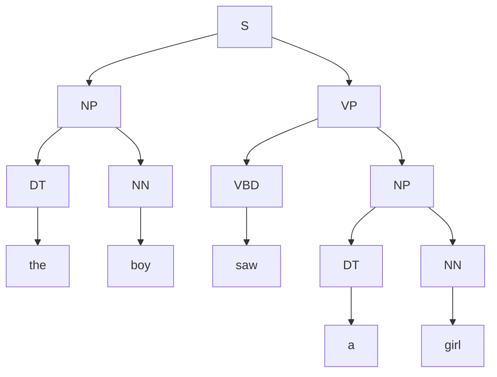
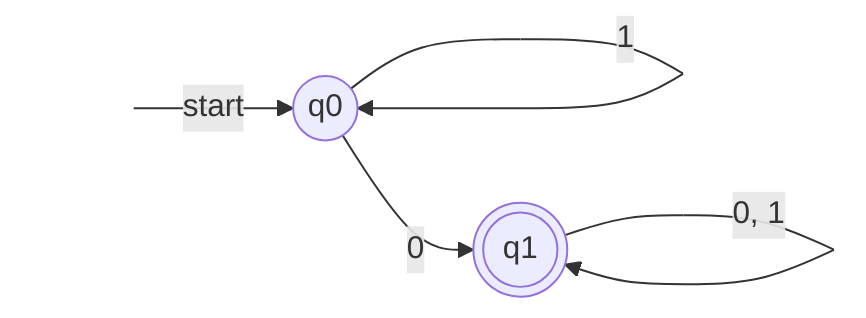
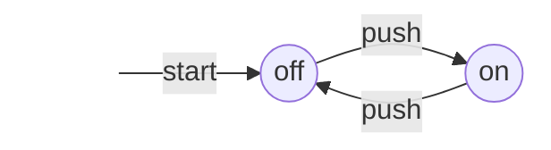

Formal languages and automata address the following question: how can we describe, by finitely many rules, a set of strings that is usually infinite, and how can a machine decide whether a given string belongs to the set? There are two routes. The first is generation: write down a set of rewriting rules (a grammar), and call a sentence valid if the rules can produce it. The second is recognition: design a machine with only finitely many states (an automaton) that reads symbols one at a time, and call a sentence valid if the machine is in an "accepting" state when the input is exhausted. The two routes are two sides of one coin, and most theorems of this course say that a certain class of grammars and a certain class of automata describe exactly the same family of languages. The theory underlies lexical and syntactic analysis in compilers ([4.2.2](/4.2.2)), and is the mathematics behind practical **regular expressions** ([4.2.11](/4.2.11)), string matching algorithms ([4.3.13](/4.3.13)), and computability theory (the **Turing machine** introduced in [4.3.1](/4.3.1)). This chapter first looks at an intuitive example of each route, then defines the basic objects of the whole course (alphabets, strings, languages, and their operations), and finally reviews the proof methods that will be used again and again.

## 1.1. Two Ways to Describe a Language

Human speech has regularities. Looking at the sentences "the boy saw a girl with a telescope" and "a boy played a ball in the park", we can sort the words into classes (determiner DT, noun NN, past-tense verb VBD, preposition IN) and then summarize how phrases are built:

$$
\begin{aligned}
\mathrm{S} &\to \mathrm{NP}\ \mathrm{VP}, & \mathrm{NP} &\to \mathrm{DT}\ \mathrm{NN}, & \mathrm{PP} &\to \mathrm{IN}\ \mathrm{NP},\\
\mathrm{VP} &\to \mathrm{VBD}\ \mathrm{NP}, & \mathrm{VP} &\to \mathrm{VP}\ \mathrm{PP}, & \mathrm{DT} &\to \text{the} \mid \text{a}, \ \dots
\end{aligned}
$$

A sentence is valid if and only if, starting from S, we can repeatedly replace a symbol on a left-hand side by the corresponding right-hand side and finally obtain the sentence; the replacement process can be drawn as a tree (the parse tree of Chapter 2). The word sequence "the a telescope boy with saw girl a" cannot be drawn as such a tree in any way, so it is not valid. A dozen or so rules generate infinitely many sentences, because $\mathrm{VP} \to \mathrm{VP}\ \mathrm{PP}$ can be used repeatedly. This is the idea of a grammar, proposed by Chomsky in the 1950s.



The second idea is to draw a directed graph: start at the initial vertex; each time a word is read, follow the edge labeled by that word; if we stop exactly at a terminal vertex (double circle) when the sentence ends, the sentence is valid. For example, the set of strings over the alphabet $\{0, 1\}$ that contain at least one 0 is recognized by the following machine with two states: in $q_0$, reading a 1 keeps us where we are, and reading a 0 moves us to $q_1$; from then on we stay in $q_1$ whatever we read.



The same set can be written as the regular expression $1^*0(0+1)^*$: any number of 1s, then a 0, then an arbitrary string (Chapter 3).

Not every language is this simple. The language $\{0^n1^n \mid n \ge 1\}$ is generated by the two rules $S \to 01 \mid 0S1$, yet no finite automaton recognizes it (Chapter 6 proves this with the pumping lemma): the machine would have to remember how many 0s it has read, and finitely many states cannot remember an arbitrarily large number. Adding a stack to the automaton gives a pushdown automaton, which does recognize it (Chapter 7). The language $\{0^n1^n2^n \mid n \ge 1\}$ is beyond even context-free grammars and requires a Turing machine that can move back and forth over a tape, reading and writing (Chapter 10). Ordered by descriptive power, the course discusses the following four classes of languages:

| Language class | Generating model | Recognizing model | Typical example | In this course |
|---|---|---|---|---|
| Regular languages (type 3) | Regular grammars, regular expressions | Finite automata | Strings containing at least one 0 | Chapters 3–6 |
| Context-free languages (type 2) | Context-free grammars | Pushdown automata | $0^n1^n$, arithmetic expressions, syntax of programming languages | Chapters 2, 7–9 |
| Context-sensitive languages (type 1) | Context-sensitive grammars | Linear bounded automata | $0^n1^n2^n$ | Chapter 2 |
| Recursively enumerable languages (type 0) | Type-0 grammars | Turing machines | Halting programs | Chapters 10–11 |

The last chapter takes up more fundamental questions: what it means to be "computable", which problems have no algorithm at all (undecidability), and which of the problems that do have algorithms can be solved efficiently (P versus NP).

## 1.2. Alphabets, Strings, and Languages

**Definition 1.2.1 (Alphabet)** A nonempty finite set of symbols is called an **alphabet**, usually denoted $\Sigma$.

Examples are the binary alphabet $\{0, 1\}$, the lowercase English alphabet $\{a, b, \dots, z\}$, the ASCII character set, and the DNA bases $\{\mathrm{A}, \mathrm{C}, \mathrm{G}, \mathrm{T}\}$. What the symbols are does not matter; what matters is that there are only finitely many.

**Definition 1.2.2 (String)** A **string** (also called a word) over an alphabet $\Sigma$ is a finite sequence $w = a_1 a_2 \cdots a_n$ of symbols of $\Sigma$ ($a_i \in \Sigma$). The number $n$ is called the **length** of $w$, written $\lvert w\rvert$. The string of length 0 is called the **empty string**, written $\varepsilon$.

For example, over $\Sigma = \{a, b\}$, the strings $\varepsilon$, $a$, $aaa$, $baba$ all occur, with $\lvert \varepsilon\rvert = 0$ and $\lvert bbaba\rvert = 5$. The notation $\lvert w\rvert_a$ denotes the number of occurrences of the symbol $a$ in $w$; for instance $\lvert bbaba\rvert_a = 2$. Note that $\varepsilon$ is a string, not a symbol, and it belongs to no alphabet.

**Definition 1.2.3 (Concatenation)** Let $x = a_1 \cdots a_m$ and $y = b_1 \cdots b_n$. The result of the **concatenation** of $x$ and $y$ is $xy = a_1 \cdots a_m b_1 \cdots b_n$. The powers of a string $w$ are defined by $w^0 = \varepsilon$ and $w^{n} = w^{n-1}w$ ($n \ge 1$).

Concatenation is associative, $(xy)z = x(yz)$, has $\varepsilon$ as its identity, $\varepsilon x = x\varepsilon = x$, and satisfies $\lvert xy\rvert = \lvert x\rvert + \lvert y\rvert$; but in general $xy \ne yx$. In algebraic language, the set of all strings over $\Sigma$ forms a **monoid** under concatenation, called the free monoid generated by $\Sigma$.

**Definition 1.2.4 (Prefix, Suffix, and Substring)** If $w = xyz$, then $x$ is called a **prefix** of $w$, $z$ a **suffix** of $w$, and $y$ a **substring** of $w$. Both $\varepsilon$ and $w$ itself are prefixes and suffixes; a prefix different from $w$ is called a proper prefix. The **reversal** of a string $w = a_1 a_2 \cdots a_n$ is $w^{\mathrm{R}} = a_n \cdots a_2 a_1$; a string with $w = w^{\mathrm{R}}$ is called a palindrome.

**Definition 1.2.5 (Powers and Closure of an Alphabet)** For an alphabet $\Sigma$ and a natural number $n$, $\Sigma^n$ is the set of all strings of length $n$ over $\Sigma$: $\Sigma^0 = \{\varepsilon\}$ and $\Sigma^n = \{ax \mid a \in \Sigma,\ x \in \Sigma^{n-1}\}$ ($n \ge 1$). Let

$$
\Sigma^* = \Sigma^0 \cup \Sigma^1 \cup \Sigma^2 \cup \cdots, \qquad \Sigma^+ = \Sigma^1 \cup \Sigma^2 \cup \cdots,
$$
so that $\Sigma^*$ is the set of all strings over $\Sigma$, and $\Sigma^+ = \Sigma^* \setminus \{\varepsilon\}$ is the set of all nonempty strings.

For example, for $\Sigma = \{0, 1\}$ we have $\Sigma^2 = \{00, 01, 10, 11\}$ and $\Sigma^* = \{\varepsilon, 0, 1, 00, 01, 10, 11, 000, \dots\}$. Strictly speaking $\Sigma$ and $\Sigma^1$ are not the same: the elements of the former are symbols, those of the latter are strings of length 1; usually we do not distinguish them.

**Definition 1.2.6 (Formal Language)** Let $\Sigma$ be an alphabet. Any subset $L \subseteq \Sigma^*$ is called a **formal language** over $\Sigma$, or simply a **language**.

A language may be finite or infinite: all English words over $\Sigma$, all valid C++ programs ($\Sigma$ the ASCII characters), four-character Chinese idioms, chemical formulas, as well as $\{0^n1^n \mid n \ge 1\}$ and "strings with equally many 0s and 1s" are all languages. Keep two extreme examples apart: the empty language $\varnothing$ contains no string at all, while $\{\varepsilon\}$ contains one string (the empty string); $\varnothing \ne \{\varepsilon\}$.

In the theory of formal languages, "deciding whether a string $w$ belongs to $L$" is the uniform shape of a whole class of problems: deciding whether a number is prime is deciding whether its binary representation belongs to the language of binary representations of primes. Hence languages and **decision problems** are the same thing, a viewpoint that becomes important in Chapter 11.

**Theorem 1.2.1** For any alphabet $\Sigma$, the set $\Sigma^*$ is countably infinite, whereas the set $\mathcal{P}(\Sigma^*)$ of all languages over $\Sigma$ is uncountable.

**Proof** Fix an order on the symbols of $\Sigma$ and list the strings of $\Sigma^*$ first by length and then, among strings of equal length, in **lexicographic order**: $\varepsilon, 0, 1, 00, 01, 10, 11, 000, \dots$ (for $\Sigma = \{0,1\}$). There are only $\lvert \Sigma\rvert^n$ strings of each length, so every string appears at some finite position of this sequence. This gives a bijection between $\Sigma^*$ and $\mathbb{N}$, so $\Sigma^*$ is a **countable set**. The set of all languages is the **power set** of $\Sigma^*$, and by **Cantor's theorem** the power set of a countably infinite set is uncountable. $\square$

This simple fact has a profound consequence. Any way of describing a language (grammars, automata, programs) is itself a finite string over some finite alphabet, so there are only countably many descriptions but uncountably many languages: the vast majority of languages have no finite description, and in particular no algorithm can decide them. This course studies the languages that can be described by finite rules.

## 1.3. Operations on Languages

Languages are sets, so set operations such as **union**, **intersection**, and **set difference** apply to them as usual; the complement of a language $L \subseteq \Sigma^*$ is $\overline{L} = \Sigma^* \setminus L$ (it depends on the ambient **alphabet**). Three further operations come from strings.

**Definition 1.3.1 (Concatenation and Powers of Languages)** The concatenation of languages $L$ and $M$ is $LM = \{xy \mid x \in L,\ y \in M\}$. The powers of a language are defined by $L^0 = \{\varepsilon\}$ and $L^n = L^{n-1}L$ ($n \ge 1$).

For example, let $L = \{001, 10, 111\}$ and $M = \{\varepsilon, 001\}$. Then $L \cup M = \{\varepsilon, 10, 001, 111\}$ and $LM = \{001, 10, 111, 001001, 10001, 111001\}$. By definition $L\varnothing = \varnothing L = \varnothing$ and $L\{\varepsilon\} = \{\varepsilon\}L = L$: $\varnothing$ is the zero element of concatenation and $\{\varepsilon\}$ is its identity.

**Definition 1.3.2 (Kleene Closure)** The **Kleene closure** (also called the star closure) and the **positive closure** of a language $L$ are

$$
L^* = \bigcup_{i \ge 0} L^i = L^0 \cup L^1 \cup L^2 \cup \cdots, \qquad L^+ = \bigcup_{i \ge 1} L^i,
$$
respectively. That is, $L^*$ consists of all strings obtained by concatenating any finite number (including zero) of strings of $L$.

The $\Sigma^*$ of Definition 1.2.5 is exactly the Kleene closure of the alphabet regarded as the language $\{a \mid a \in \Sigma\}$.

**Example 1.3.1** For $L = \{0, 11\}$, the language $L^*$ consists of all concatenations of 0 and 11, that is, the strings in which the 1s occur only in consecutive pairs:

$$
L^* = \{\varepsilon, 0, 11, 00, 011, 110, 000, 0011, 0110, 1100, 1111, \dots\}.
$$
Moreover, $\varnothing^* = \{\varepsilon\}$ (because $\varnothing^0 = \{\varepsilon\}$ and all other powers are empty), and $\{\varepsilon\}^* = \{\varepsilon\}$. These two are the only languages whose closure is finite: as soon as $L$ contains a nonempty string $x$, the strings $x, xx, xxx, \dots$ are pairwise distinct.

**Property 1.3.1** For any languages $L, M, N$:

1. $L^+ = LL^* = L^*L$, $L^* = L^+ \cup \{\varepsilon\}$, $(L^*)^* = L^*$.
2. $L(M \cup N) = LM \cup LN$ and $(M \cup N)L = ML \cup NL$.
3. $(LM)^{\mathrm{R}} = M^{\mathrm{R}}L^{\mathrm{R}}$, where $L^{\mathrm{R}} = \{w^{\mathrm{R}} \mid w \in L\}$.

All these equalities can be verified directly from the definitions: write the strings on both sides as concatenations of several segments and compare which language each segment comes from. Concatenation does not distribute over intersection: for $L = \{\varepsilon, 0\}$, $M = \{0\}$, $N = \{00\}$ we have $L(M \cap N) = \varnothing$, whereas $LM \cap LN = \{0, 00\} \cap \{00, 000\} = \{00\}$.

**Example 1.3.2** Question: under what condition does $L^+ = L^* \setminus \{\varepsilon\}$ hold?

By Property 1.3.1, $L^* = L^+ \cup \{\varepsilon\}$, so $L^* \setminus \{\varepsilon\} = L^+ \setminus \{\varepsilon\}$, and the required equality is equivalent to $\varepsilon \notin L^+$. If $\varepsilon \in L$, then $\varepsilon \in L^1 \subseteq L^+$. Conversely, if $\varepsilon \notin L$, every string of $L^i$ ($i \ge 1$) is a concatenation of $i$ nonempty strings and has length at least $i$, so $\varepsilon \notin L^+$. Hence the condition is $\varepsilon \notin L$.

## 1.4. Common Proof Techniques

Almost every theorem of this course says that a constructed object has exactly a certain property, and the proofs must be rigorous. We review the most common proof methods below; all of them already appear in discrete mathematics, and here we stress their use on strings and languages.

### 1.4.1. Deduction, Contrapositive, and Contradiction

A proof is a sequence of statements, each of which is a hypothesis (premise), a known fact, or follows from earlier statements by the rules of logic; the last statement is the conclusion. Common forms:

| Statement to prove | Method |
|---|---|
| If $H$ then $C$ | Derive $C$ from the premise $H$ |
| $A$ if and only if $B$ | Prove "if $A$ then $B$" and "if $B$ then $A$" separately |
| Equality of sets $R = S$ | Prove $R \subseteq S$ (take any $x \in R$ and show $x \in S$) and $S \subseteq R$ separately |
| If $H$ then $C$ (contrapositive) | Prove the equivalent "if not $C$ then not $H$" |
| If $H$ then $C$ (contradiction) | Assume $H$ and "not $C$" together and derive a contradiction |
| There exists $x$ with $P(x)$ | Exhibit a specific $x$ |
| $P(x)$ fails for all $x$ | Give a counterexample |

**Example 1.4.1** For a real number $x$, $\lfloor x\rfloor = \lceil x\rceil$ if and only if $x$ is an integer.

If $x$ is an integer, then $\lfloor x\rfloor = x = \lceil x\rceil$ by definition. Conversely, by definition $\lfloor x\rfloor \le x \le \lceil x\rceil$; if $\lfloor x\rfloor = \lceil x\rceil$, then $x$ is squeezed between two equal integers and must equal them, so $x$ is an integer.

**Example 1.4.2 (Proof by Contradiction)** Let $U$ be an infinite set, $S$ a finite subset of $U$, and $T = U \setminus S$. Then $T$ is infinite.

Suppose $T$ is finite. Since $S$ is also finite, $U = S \cup T$, a union of two finite sets, is finite, contradicting that $U$ is infinite.

The most frequent proofs about languages are set equalities: to prove that "the language generated by a grammar $G$ is exactly $L$" or that "the language accepted by an automaton $A$ is exactly $L$", we prove both inclusions: every string generated by $G$ lies in $L$ (nothing extra), and every string of $L$ can be generated by $G$ (nothing missing).

### 1.4.2. Inductive Definitions and Structural Induction

**Definition 1.4.1 (Inductive Definition)** An **inductive definition** of a set $S$ has three parts:

1. Basis: some elements of $S$ are given directly;
2. Induction: rules are given for constructing new elements from elements already in $S$;
3. Minimality: the elements of $S$ are exactly those obtained by finitely many applications of 1 and 2, that is, $S$ is the smallest set satisfying 1 and 2.

The sets $\Sigma^n$ above are defined inductively. Another example is the set $B$ of balanced parenthesis strings:

1. Basis: $\varepsilon \in B$;
2. Induction: if $x \in B$ then $(x) \in B$; if $x, y \in B$ then $xy \in B$;
3. Minimality: the strings in $B$ are generated only by 1 and 2.

The set $\mathbb{N}$ of natural numbers is also defined this way: $0 \in \mathbb{N}$; if $n \in \mathbb{N}$ then $n + 1 \in \mathbb{N}$; and $\mathbb{N}$ is the smallest set satisfying these two conditions. Induction on this definition is ordinary mathematical induction. In general, for an inductively defined set we can use *structural induction* to prove that a property $P(x)$ holds for all its elements:

1. Basis: for each element $a$ given directly in the basis, prove $P(a)$;
2. Induction: for each rule "if $a_1, \dots, a_n \in S$ then $f(a_1, \dots, a_n) \in S$", prove that if $P(a_1), \dots, P(a_n)$ all hold, then $P(f(a_1, \dots, a_n))$ holds.

Minimality guarantees that every element of $S$ is obtained by finitely many applications of the rules, so induction on the number of rule applications gives the conclusion.

**Theorem 1.4.1** Every balanced parenthesis string has equally many left and right parentheses.

**Proof** By structural induction on $B$. Basis: $\varepsilon$ contains 0 parentheses of each kind. Induction: suppose $x$ contains $m$ parentheses of each kind and $y$ contains $n$ of each kind; then $(x)$ contains $m + 1$ of each kind and $xy$ contains $m + n$ of each kind. $\square$

Mathematical induction also has a common strong form (complete induction): first prove $P(0)$, then prove "if $P(k)$ holds for all $k < n$, then $P(n)$ holds". Strong induction on the length of strings is the standard way to prove that "every string of $L$ can be generated by the grammar": split a string of length $n$ into shorter strings and apply the induction hypothesis to them. Both forms are valid on any **well-order**ed set.

### 1.4.3. Mutual Induction

Sometimes a statement is hard to prove directly, but it becomes natural to prove it by induction together with several related statements, where the induction step of each statement uses the induction hypotheses of the others. This is called *mutual induction*. It is almost unavoidable when analyzing automata: each state of an automaton corresponds to an assertion about "the strings that lead here".

**Example 1.4.3** A switch has two states, off and on. It starts off, and each push toggles it:



Prove that after $n$ pushes the switch is on if and only if $n$ is odd.

To prove this one statement alone, the induction step needs to know what "being off" means, so we prove two statements together:

- $S_1(n)$: after $n$ pushes the switch is off if and only if $n$ is even;
- $S_2(n)$: after $n$ pushes the switch is on if and only if $n$ is odd.

**Proof** By induction on $n$; each statement has an "if" and an "only if" direction.

Basis $n = 0$: 0 is even, and after 0 pushes the switch is in its initial state off, so both directions of $S_1(0)$ hold. 0 is not odd, and after 0 pushes the switch is not on, so both sides of $S_2(0)$ are false and the equivalence holds.

Induction: suppose $S_1(n)$ and $S_2(n)$ hold. For $S_1(n+1)$: if $n + 1$ is even, then $n$ is odd, so by $S_2(n)$ the switch is on after $n$ pushes, and one more push turns it off. Conversely, if the switch is off after $n + 1$ pushes, it was on after $n$ pushes (only on goes to off under push), so by $S_2(n)$ $n$ is odd, and hence $n + 1$ is even. The proof of $S_2(n+1)$ is symmetric and uses $S_1(n)$. $\square$

The two statements support each other: $S_1(n+1)$ depends on $S_2(n)$, and $S_2(n+1)$ depends on $S_1(n)$. When Chapter 4 proves what language a finite automaton accepts, one such statement is written for each state, and all of them are proved by induction together.

## Exercises

1. Use mutual induction to prove that, over the alphabet $\{0, 1\}$, the automaton below is in state 2 after reading $w$ if and only if $w$ contains an odd number of 0s (hint: simultaneously prove "it is in state 1 if and only if $w$ contains an even number of 0s").

   ```mermaid
   flowchart LR
       s0[" "] -->|start| p1((1))
       p1 -->|1| p1
       p1 -->|0| p2(((2)))
       p2 -->|1| p2
       p2 -->|0| p1
       style s0 fill:none,stroke:none
   ```

2. Prove that $(L^*)^* = L^*$, and give an example showing that in general $(LM)^* \ne L^*M^*$.
3. Let $\Sigma = \{a, b\}$. How many strings over $\Sigma$ have length at most $n$?
