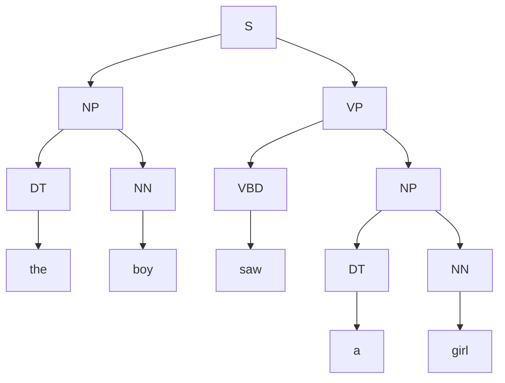
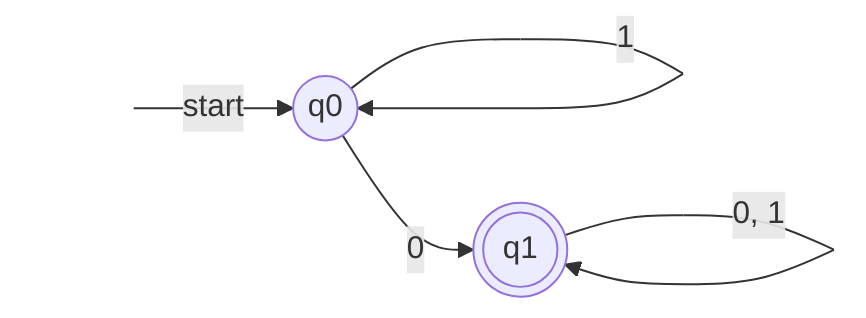
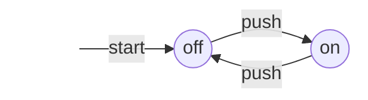

形式语言与自动机研究这样一个问题：怎样用有限的规则描述一个通常无限的字符串集合，又怎样用机器判定一个字符串是否属于这个集合。回答有两条路线：一条是生成，写出一组改写规则（文法），凡是能由规则生成的句子都合法；另一条是识别，设计一台只有有限个状态的机器（自动机），逐个读入符号，读完时处于"接受"状态的句子就合法。两条路线一体两面，本课程的大部分定理都在说明某一类文法与某一类自动机描述的恰好是同一族语言。这套理论是编译器词法分析与语法分析的基础（[4.2.2](/4.2.2)），也是实用**正则表达式**（[4.2.11](/4.2.11)）、串匹配算法（[4.3.13](/4.3.13)）和可计算性理论（[4.3.1](/4.3.1) 介绍过的**图灵机**）背后的数学。本章先看两条路线的直观例子，再定义全课程的基本对象：字母表、字符串、语言及其运算，最后回顾后面反复使用的证明方法。

## 1.1. 两种描述语言的方法

人说的话有规律。观察句子 the boy saw a girl with a telescope 和 a boy played a ball in the park，可以把词分成冠词 DT、名词 NN、动词 VBD、介词 IN 几类，再总结出短语的构成规则：

$$
\begin{aligned}
\mathrm{S} &\to \mathrm{NP}\ \mathrm{VP}, & \mathrm{NP} &\to \mathrm{DT}\ \mathrm{NN}, & \mathrm{PP} &\to \mathrm{IN}\ \mathrm{NP},\\
\mathrm{VP} &\to \mathrm{VBD}\ \mathrm{NP}, & \mathrm{VP} &\to \mathrm{VP}\ \mathrm{PP}, & \mathrm{DT} &\to \text{the} \mid \text{a}, \ \dots
\end{aligned}
$$

一个句子合法，当且仅当能从 S 出发反复用规则把左边的符号换成右边，最终得到这个句子；换的过程可以画成一棵树（第 2 章的语法分析树）。the a telescope boy with saw girl a 无论怎样都画不出树，因而不合法。规则只有十几条，能生成的句子却有无穷多个，因为 $\mathrm{VP} \to \mathrm{VP}\ \mathrm{PP}$ 可以反复使用。这就是文法的思路，由 Chomsky 在 20 世纪 50 年代提出。



第二种思路是画一张有向图：从起点出发，读一个词就沿着标有这个词的边走一步，句子读完时恰好停在终点（双圈），就认为句子合法。例如，字母表 $\{0, 1\}$ 上"至少含一个 0"的字符串集合可以由下面这台只有两个状态的机器识别：在 $q_0$ 读到 1 原地不动，读到 0 进入 $q_1$，此后无论读什么都留在 $q_1$。



同一个集合也能写成正规表达式 $1^*0(0+1)^*$：先是任意多个 1，然后一个 0，然后任意字符串（第 3 章）。

并非所有语言都这样简单。$\{0^n1^n \mid n \ge 1\}$ 可以由两条规则 $S \to 01 \mid 0S1$ 生成，却没有任何有限自动机能识别它（第 6 章用泵引理证明）：机器需要记住读过多少个 0，而有限个状态记不住任意大的数。给自动机加一个栈，就得到能识别它的下推自动机（第 7 章）。$\{0^n1^n2^n \mid n \ge 1\}$ 连上下文无关文法也无能为力，需要能来回读写纸带的图灵机（第 10 章）。按描述能力，本课程依次讨论下面四类语言：

| 语言类 | 生成模型 | 识别模型 | 典型例子 | 本课程 |
|---|---|---|---|---|
| 正规语言（3 型） | 正规文法、正规表达式 | 有限自动机 | 至少含一个 0 的串 | 第 3–6 章 |
| 上下文无关语言（2 型） | 上下文无关文法 | 下推自动机 | $0^n1^n$、算术表达式、程序设计语言的语法 | 第 2、7–9 章 |
| 上下文有关语言（1 型） | 上下文有关文法 | 线性有界自动机 | $0^n1^n2^n$ | 第 2 章 |
| 递归可枚举语言（0 型） | 0 型文法 | 图灵机 | 停机的程序 | 第 10–11 章 |

最后一章讨论更根本的问题：什么是"可以计算的"，哪些问题没有算法（不可判定），以及有算法的问题中哪些可以高效地解决（P 与 NP）。

## 1.2. 字母表、字符串与语言

**定义 1.2.1（字母表）** 符号的非空有限集合称为**字母表**，通常记作 $\Sigma$。

例如二进制字母表 $\{0, 1\}$、英文小写字母表 $\{a, b, \dots, z\}$、ASCII 字符集、DNA 碱基 $\{\mathrm{A}, \mathrm{C}, \mathrm{G}, \mathrm{T}\}$。符号本身是什么无关紧要，要紧的是只有有限个。

**定义 1.2.2（字符串）** 字母表 $\Sigma$ 上的**字符串**（简称串，也称字）是 $\Sigma$ 中符号构成的有限序列 $w = a_1 a_2 \cdots a_n$（$a_i \in \Sigma$）。$n$ 称为 $w$ 的**长度**，记作 $\lvert w\rvert$。长度为 0 的串称为**空串**，记作 $\varepsilon$。

例如在 $\Sigma = \{a, b\}$ 上，$\varepsilon$、$a$、$aaa$、$baba$ 都是串，$\lvert \varepsilon\rvert = 0$，$\lvert bbaba\rvert = 5$。$\lvert w\rvert_a$ 表示符号 $a$ 在 $w$ 中出现的次数，如 $\lvert bbaba\rvert_a = 2$。注意 $\varepsilon$ 是一个串，不是符号，它不属于任何字母表。

**定义 1.2.3（连接运算）** 设 $x = a_1 \cdots a_m$，$y = b_1 \cdots b_n$，则 $x$ 与 $y$ 的**连接运算**结果为 $xy = a_1 \cdots a_m b_1 \cdots b_n$。串 $w$ 的幂定义为 $w^0 = \varepsilon$，$w^{n} = w^{n-1}w$（$n \ge 1$）。

连接满足结合律 $(xy)z = x(yz)$，以 $\varepsilon$ 为单位元 $\varepsilon x = x\varepsilon = x$，并且 $\lvert xy\rvert = \lvert x\rvert + \lvert y\rvert$；但一般 $xy \ne yx$。用代数的语言说，$\Sigma$ 上的全体字符串在连接下构成一个**含幺半群**，称为 $\Sigma$ 生成的自由幺半群。

**定义 1.2.4（前缀、后缀与子串）** 若 $w = xyz$，则称 $x$ 为 $w$ 的**前缀**，$z$ 为 $w$ 的**后缀**，$y$ 为 $w$ 的**子串**。$\varepsilon$ 和 $w$ 本身既是前缀也是后缀；不等于 $w$ 的前缀称为真前缀。串 $w = a_1 a_2 \cdots a_n$ 的**反转**是 $w^{\mathrm{R}} = a_n \cdots a_2 a_1$；满足 $w = w^{\mathrm{R}}$ 的串称为回文。

**定义 1.2.5（字母表的幂与闭包）** 对字母表 $\Sigma$ 和自然数 $n$，$\Sigma^n$ 是 $\Sigma$ 上全体长度为 $n$ 的串的集合：$\Sigma^0 = \{\varepsilon\}$，$\Sigma^n = \{ax \mid a \in \Sigma,\ x \in \Sigma^{n-1}\}$（$n \ge 1$）。令

$$
\Sigma^* = \Sigma^0 \cup \Sigma^1 \cup \Sigma^2 \cup \cdots, \qquad \Sigma^+ = \Sigma^1 \cup \Sigma^2 \cup \cdots,
$$
即 $\Sigma^*$ 是 $\Sigma$ 上全体字符串的集合，$\Sigma^+ = \Sigma^* \setminus \{\varepsilon\}$ 是全体非空串的集合。

例如 $\Sigma = \{0, 1\}$ 时，$\Sigma^2 = \{00, 01, 10, 11\}$，$\Sigma^* = \{\varepsilon, 0, 1, 00, 01, 10, 11, 000, \dots\}$。注意 $\Sigma$ 与 $\Sigma^1$ 严格说并不相同：前者的元素是符号，后者的元素是长度为 1 的串，不过通常不加区分。

**定义 1.2.6（形式语言）** 设 $\Sigma$ 为字母表，$\Sigma^*$ 的任一子集 $L \subseteq \Sigma^*$ 称为 $\Sigma$ 上的一个**形式语言**，简称**语言**。

语言可以有限也可以无限：$\Sigma$ 上全体英文单词、全体合法的 C++ 程序（$\Sigma$ 为 ASCII）、四字成语、化学分子式，以及 $\{0^n1^n \mid n \ge 1\}$、"0 与 1 个数相等的串"，都是语言。两个极端的例子要分清：空语言 $\varnothing$ 不含任何串，而 $\{\varepsilon\}$ 含有一个串（空串），$\varnothing \ne \{\varepsilon\}$。

在形式语言理论里，"判定串 $w$ 是否属于 $L$"是一类问题的统一形式：判断一个数是否为素数，就是判断它的二进制表示是否属于"素数的二进制表示"这个语言。因此语言与**判定问题**是一回事，这个观点在第 11 章变得重要。

**定理 1.2.1** 对任一字母表 $\Sigma$，$\Sigma^*$ 是可数无穷集，而 $\Sigma$ 上全体语言构成的集合 $\mathcal{P}(\Sigma^*)$ 不可数。

**证明** 给 $\Sigma$ 的符号规定一个顺序，把 $\Sigma^*$ 中的串先按长度、同长度的再按**字典序**排列：$\varepsilon, 0, 1, 00, 01, 10, 11, 000, \dots$（$\Sigma = \{0,1\}$ 时）。每个长度只有 $\lvert \Sigma\rvert^n$ 个串，因此每个串都出现在这个序列的某个有限位置上，这给出 $\Sigma^*$ 与 $\mathbb{N}$ 之间的双射，$\Sigma^*$ 是**可数集合**。全体语言就是 $\Sigma^*$ 的**幂集**，由 **Cantor 定理**，可数无穷集的幂集不可数。$\square$

这个简单的事实有深刻的推论。任何一种描述语言的方式（文法、自动机、程序）本身都是某个有限字母表上的有限串，所以描述只有可数多个，而语言有不可数多个：绝大多数语言没有任何有限的描述，当然也就没有算法能判定它们。本课程研究的是那些可以用有限规则描述的语言。

## 1.3. 语言的运算

语言是集合，**并集**、**交集**、**差集**这些集合运算对语言照样适用；语言 $L \subseteq \Sigma^*$ 的补是 $\overline{L} = \Sigma^* \setminus L$（取决于所在的**字母表**）。此外还有三种来自串的运算。

**定义 1.3.1（语言的连接与幂）** 语言 $L$ 与 $M$ 的连接为 $LM = \{xy \mid x \in L,\ y \in M\}$。语言的幂定义为 $L^0 = \{\varepsilon\}$，$L^n = L^{n-1}L$（$n \ge 1$）。

例如 $L = \{001, 10, 111\}$，$M = \{\varepsilon, 001\}$，则 $L \cup M = \{\varepsilon, 10, 001, 111\}$，$LM = \{001, 10, 111, 001001, 10001, 111001\}$。按定义，$L\varnothing = \varnothing L = \varnothing$，$L\{\varepsilon\} = \{\varepsilon\}L = L$：$\varnothing$ 是连接的零元，$\{\varepsilon\}$ 是单位元。

**定义 1.3.2（Kleene 闭包）** 语言 $L$ 的 **Kleene 闭包**（也称**星闭包**）与**正闭包**分别为

$$
L^* = \bigcup_{i \ge 0} L^i = L^0 \cup L^1 \cup L^2 \cup \cdots, \qquad L^+ = \bigcup_{i \ge 1} L^i.
$$
即 $L^*$ 由把 $L$ 中任意有限个（包括零个）串依次连接得到的全体串构成。

定义 1.2.5 中的 $\Sigma^*$ 正是把字母表看成语言 $\{a \mid a \in \Sigma\}$ 后的 Kleene 闭包。

**例 1.3.1** $L = \{0, 11\}$ 时，$L^*$ 由 0 和 11 任意拼接而成，即"1 都成对连续出现"的串：

$$
L^* = \{\varepsilon, 0, 11, 00, 011, 110, 000, 0011, 0110, 1100, 1111, \dots\}.
$$
而 $\varnothing^* = \{\varepsilon\}$（$\varnothing^0 = \{\varepsilon\}$，其余各次幂都为空），$\{\varepsilon\}^* = \{\varepsilon\}$。这两个语言是仅有的闭包为有限集的语言：只要 $L$ 含一个非空串 $x$，$x, xx, xxx, \dots$ 就互不相同。

**性质 1.3.1** 对任意语言 $L, M, N$：

1. $L^+ = LL^* = L^*L$，$L^* = L^+ \cup \{\varepsilon\}$，$(L^*)^* = L^*$。
2. $L(M \cup N) = LM \cup LN$，$(M \cup N)L = ML \cup NL$。
3. $(LM)^{\mathrm{R}} = M^{\mathrm{R}}L^{\mathrm{R}}$，其中 $L^{\mathrm{R}} = \{w^{\mathrm{R}} \mid w \in L\}$。

这些等式都可以直接按定义验证：两边的串都写成"若干段的连接"，比较每一段来自哪个语言即可。连接对交并不满足分配律，例如 $L = \{\varepsilon, 0\}$，$M = \{0\}$，$N = \{00\}$ 时 $L(M \cap N) = \varnothing$，而 $LM \cap LN = \{0, 00\} \cap \{00, 000\} = \{00\}$。

**例 1.3.2** 问：什么条件下 $L^+ = L^* \setminus \{\varepsilon\}$？

由性质 1.3.1，$L^* = L^+ \cup \{\varepsilon\}$，因此 $L^* \setminus \{\varepsilon\} = L^+ \setminus \{\varepsilon\}$，所求等式等价于 $\varepsilon \notin L^+$。若 $\varepsilon \in L$，则 $\varepsilon \in L^1 \subseteq L^+$；反之若 $\varepsilon \notin L$，$L^i$（$i \ge 1$）中的串都是 $i$ 个非空串的连接，长度至少为 $i$，于是 $\varepsilon \notin L^+$。所以条件是 $\varepsilon \notin L$。

## 1.4. 常用证明技术

本课程的定理几乎都是"某个构造出来的对象恰好具有某种性质"，证明需要严格。下面回顾最常用的几种证明方法，它们在离散数学中都已出现，这里着重于在字符串与语言上的用法。

### 1.4.1. 演绎、逆否与反证

一个证明是一串命题，每一个或者是假设（前提），或者是已知的事实，或者由前面的命题按逻辑规则推出，最后一个命题是结论。几种常见形式：

| 要证的命题 | 证法 |
|---|---|
| 若 $H$ 则 $C$ | 以 $H$ 为前提推出 $C$ |
| $A$ 当且仅当 $B$ | 分别证明"若 $A$ 则 $B$"与"若 $B$ 则 $A$" |
| 集合相等 $R = S$ | 分别证明 $R \subseteq S$（任取 $x \in R$，证 $x \in S$）与 $S \subseteq R$ |
| 若 $H$ 则 $C$（逆否） | 改证等价的"若非 $C$ 则非 $H$" |
| 若 $H$ 则 $C$（反证） | 假设 $H$ 与"非 $C$"同时成立，推出矛盾 |
| 存在 $x$ 使 $P(x)$ | 给出一个具体的 $x$ |
| 对所有 $x$ 有 $P(x)$ 不成立 | 给出一个反例 |

**例 1.4.1** 设 $x$ 为实数，则 $\lfloor x\rfloor = \lceil x\rceil$ 当且仅当 $x$ 是整数。

若 $x$ 是整数，按定义 $\lfloor x\rfloor = x = \lceil x\rceil$。反之，由定义 $\lfloor x\rfloor \le x \le \lceil x\rceil$；若 $\lfloor x\rfloor = \lceil x\rceil$，则 $x$ 被夹在两个相等的整数之间，只能等于它们，因而是整数。

**例 1.4.2（反证）** 设 $U$ 是无穷集，$S$ 是 $U$ 的有限子集，$T = U \setminus S$，则 $T$ 是无穷集。

假设 $T$ 有限。$S$ 也有限，于是 $U = S \cup T$ 作为两个有限集的并是有限集，与 $U$ 是无穷集矛盾。

语言的证明中最常见的是集合相等：要证"文法 $G$ 生成的语言恰好是 $L$"或"自动机 $A$ 接受的语言恰好是 $L$"，就要证明两个方向的包含——$G$ 生成的每个串都在 $L$ 中（不多），$L$ 中的每个串都能由 $G$ 生成（不少）。

### 1.4.2. 归纳定义与结构归纳

**定义 1.4.1（归纳定义）** 集合 $S$ 的**归纳定义**由三部分组成：

1. 基础：直接给出 $S$ 中的若干元素；
2. 归纳：给出由 $S$ 中已有元素构造新元素的规则；
3. 极小性：$S$ 中的元素只能由 1、2 经有限次使用得到，即 $S$ 是满足 1、2 的最小集合。

前面的 $\Sigma^n$ 就是归纳定义的。再如，合法括号串的集合 $B$：

1. 基础：$\varepsilon \in B$；
2. 归纳：若 $x \in B$，则 $(x) \in B$；若 $x, y \in B$，则 $xy \in B$；
3. 极小性：$B$ 中的串只能由 1、2 生成。

自然数集 $\mathbb{N}$ 也是这样定义的：$0 \in \mathbb{N}$；若 $n \in \mathbb{N}$，则 $n + 1 \in \mathbb{N}$；$\mathbb{N}$ 是满足这两条的最小集合。对这个定义作归纳，就是普通的数学归纳法。一般地，对归纳定义的集合可以用结构归纳法（structural induction）证明性质 $P(x)$ 对其中所有元素成立：

1. 基础：对基础部分直接给出的每个元素 $a$，证明 $P(a)$；
2. 归纳：对每条规则"若 $a_1, \dots, a_n \in S$，则 $f(a_1, \dots, a_n) \in S$"，证明：若 $P(a_1), \dots, P(a_n)$ 都成立，则 $P(f(a_1, \dots, a_n))$ 成立。

极小性保证了 $S$ 的每个元素都由有限次使用规则得到，所以对规则使用的次数作数学归纳就得到结论。

**定理 1.4.1** 每个合法括号串中左括号与右括号的个数相等。

**证明** 对 $B$ 的结构归纳。基础：$\varepsilon$ 中两种括号都是 0 个。归纳：设 $x$ 中两种括号各 $m$ 个，$y$ 中各 $n$ 个，则 $(x)$ 中各 $m + 1$ 个，$xy$ 中各 $m + n$ 个。$\square$

数学归纳法还有一种常用的强形式（完全归纳）：先证 $P(0)$，再证"若对一切 $k < n$ 都有 $P(k)$，则 $P(n)$"。对串的长度作强归纳是证明"$L$ 中每个串都能由文法生成"的标准方法：把长为 $n$ 的串拆成更短的串，对它们用归纳假设。这两种形式对任何**良序**集都成立。

### 1.4.3. 互归纳

有时直接证明一个命题很困难，但把它与几个相关命题放在一起同时归纳却很自然，每个命题的归纳步骤要用到其他命题的归纳假设。这称为互归纳（mutual induction）。分析自动机时它几乎不可避免：自动机的每个状态都对应一个关于"读到这里的串"的断言。

**例 1.4.3** 一个开关有两个状态 off 和 on，初始为 off，每按一次就切换一次：



证明：按了 $n$ 次之后开关处于 on，当且仅当 $n$ 是奇数。

只证这一个命题时，归纳步骤需要知道"处于 off 意味着什么"，因此同时证明两个命题：

- $S_1(n)$：按 $n$ 次后开关处于 off，当且仅当 $n$ 是偶数；
- $S_2(n)$：按 $n$ 次后开关处于 on，当且仅当 $n$ 是奇数。

**证明** 对 $n$ 归纳，每个命题都有"当"与"仅当"两个方向。

基础 $n = 0$：0 是偶数，按 0 次后开关处于初始状态 off，$S_1(0)$ 的两个方向都成立。0 不是奇数，按 0 次后也不处于 on，$S_2(0)$ 的两边都为假，等价式成立。

归纳：设 $S_1(n)$、$S_2(n)$ 成立。对 $S_1(n+1)$：若 $n + 1$ 是偶数，则 $n$ 是奇数，由 $S_2(n)$ 按 $n$ 次后处于 on，再按一次处于 off；反之若按 $n + 1$ 次后处于 off，则按 $n$ 次后处于 on（只有 on 经 push 到 off），由 $S_2(n)$，$n$ 是奇数，于是 $n + 1$ 是偶数。$S_2(n+1)$ 的证明对称，用到 $S_1(n)$。$\square$

两个命题互相支撑：$S_1(n+1)$ 依赖 $S_2(n)$，$S_2(n+1)$ 依赖 $S_1(n)$。第 4 章证明有限自动机接受的语言时，就是为每个状态写一个这样的命题，再一起归纳。

## 习题

1. 用互归纳法证明：字母表 $\{0, 1\}$ 上，下面的自动机读完 $w$ 后处于状态 2，当且仅当 $w$ 含奇数个 0（提示：同时证明"处于状态 1 当且仅当 $w$ 含偶数个 0"）。

   ```mermaid
   flowchart LR
       s0[" "] -->|start| p1((1))
       p1 -->|1| p1
       p1 -->|0| p2(((2)))
       p2 -->|1| p2
       p2 -->|0| p1
       style s0 fill:none,stroke:none
   ```

2. 证明 $(L^*)^* = L^*$，并举例说明一般 $(LM)^* \ne L^*M^*$。
3. 设 $\Sigma = \{a, b\}$。$\Sigma$ 上长度不超过 $n$ 的串共有多少个？
