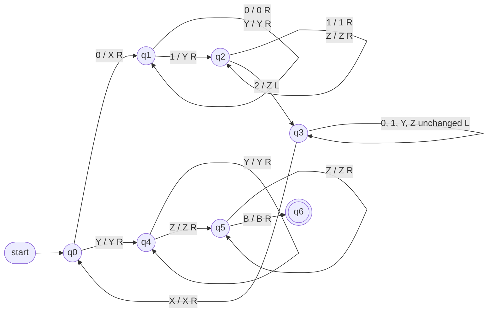

A **finite automaton** has only finite memory, and a **pushdown automaton** has a stack but can access it only in last-in-first-out order: a language such as $\{0^n1^n2^n \mid n \ge 1\}$, which requires checking two groups of counts at once, is recognized by neither (Example 9.1.1 of [4.8.9](/4.8.9)). The **Turing machine** studied in this chapter replaces the stack by an infinite tape that can be moved along in both directions and read and written at will. This looks like a small change, yet it yields a model of all "mechanical computation": as we shall see, adding tapes, allowing nondeterminism, or even replacing the tape by two stacks or two counters does not change the power, and ordinary computers and Turing machines can simulate each other. This robustness is the basis of the Church–Turing thesis and the starting point of the next chapter ([4.8.11](/4.8.11)), which discusses "which problems cannot be solved by an algorithm". Section [4.3.1](/4.3.1) briefly introduced the Turing machine as a model of computation; here we give a precise definition and study it systematically.

## 10.1. Definition of Turing Machines

### 10.1.1. Formal Definition

A Turing machine consists of a finite control, a tape that extends infinitely in both directions and is divided into cells, and a read–write head. Each cell holds one tape symbol; at the start the input string occupies a block of consecutive cells, all other cells contain the blank symbol $B$, and the head points at the first symbol of the input. In each step, depending on the current state and the symbol under the head, the Turing machine rewrites that symbol, moves the head one cell left or right, and enters a new state.

**Definition 10.1.1 (Turing Machine)** A **Turing machine** (TM) is a 7-tuple $M = (Q, \Sigma, \Gamma, \delta, q_0, B, F)$, where
- $Q$ is a finite set of states, $\Gamma$ is a finite set of tape symbols, and $\Sigma \subseteq \Gamma$ is the input alphabet;
- $\delta\colon Q \times \Gamma \to Q \times \Gamma \times \{\mathrm{L}, \mathrm{R}\}$ is the transition function, a partial function (it may be undefined on some $(q, X)$);
- $q_0 \in Q$ is the start state, $B \in \Gamma \setminus \Sigma$ is the blank symbol, and $F \subseteq Q$ is the set of final states.

$\delta(q, X) = (p, Y, D)$ means: in state $q$ reading $X$, rewrite $X$ as $Y$, move the head one cell in direction $D$ ($\mathrm{L}$ left, $\mathrm{R}$ right), and enter state $p$.

Unlike a **pushdown automaton**, the input **alphabet** is a subset of the set of tape symbols: the tape is both the input and the working storage. The Turing machine here is deterministic, and every configuration has at most one successor; the nondeterministic version is in Section 10.3.2. The Turing machine of [4.3.1](/4.3.1) used a halting state $\mathrm{h}$ to indicate the end of a computation, whereas here final states indicate acceptance; the two differ only in convention.

### 10.1.2. Instantaneous Descriptions

**Definition 10.1.2 (Instantaneous Description of a Turing Machine)** A configuration of a Turing machine is written as a string $X_1X_2\cdots X_{i-1}\,q\,X_iX_{i+1}\cdots X_n$, called an **instantaneous description** (ID): $q$ is the current state, the head is scanning $X_i$, and $X_1\cdots X_n$ is the part of the tape between the leftmost and rightmost nonblank symbols (when the head is outside this stretch, we add enough $B$'s at the corresponding end so that the head falls within the string).

A one-step move $\vdash_M$ (written $\vdash$ when no confusion arises) is defined as follows. If $\delta(q, X_i) = (p, Y, \mathrm{L})$, then

$$
X_1\cdots X_{i-1}\,q\,X_i\cdots X_n \vdash X_1\cdots X_{i-2}\,p\,X_{i-1}YX_{i+1}\cdots X_n;
$$
for $i = 1$ the head moves to a new blank cell, written $p\,BYX_2\cdots X_n$; for $i = n$ and $Y = B$, the new blank at the right end is not written. If $\delta(q, X_i) = (p, Y, \mathrm{R})$, then

$$
X_1\cdots X_{i-1}\,q\,X_i\cdots X_n \vdash X_1\cdots X_{i-1}Y\,p\,X_{i+1}\cdots X_n;
$$
for $i = n$ the head moves to the blank cell on the right, written $X_1\cdots X_{n-1}Y\,p\,B$; for $i = 1$ and $Y = B$, the blank at the left end is not written. $\vdash^*$ is the reflexive transitive closure of $\vdash$.

**Definition 10.1.3 (Language of a Turing Machine)** The language **accepted** by a Turing machine $M$ is

$$
L(M) = \{ w \in \Sigma^* \mid q_0w \vdash^* \alpha\,p\,\beta,\ p \in F,\ \alpha, \beta \in \Gamma^* \}.
$$
If $\delta(q, X)$ is undefined in an ID $\alpha\,q\,X\beta$, we say that $M$ **halts** in that ID.

We may assume that $M$ halts upon entering a final state: deleting all transitions leaving final states does not change the accepted language (the input is already accepted at the moment a final state is reached). From now on we always make this assumption. Then on an input $w$ the machine $M$ has only three possible outcomes: it enters a final state and halts (accepts); it halts in a non-final state (rejects); or it never halts. In the latter two cases $w \notin L(M)$, but from the outside the third outcome cannot be distinguished from "not yet finished". This difference leads to two classes of languages:

**Definition 10.1.4 (Recursively Enumerable Language)** A language $L$ is called a **recursively enumerable language** (RE language) if $L = L(M)$ for some Turing machine $M$.

**Definition 10.1.5 (Recursive Language)** A language $L$ is called a **recursive language** if $L = L(M)$ for some Turing machine $M$ that halts on every input.

Every recursive language is recursively enumerable. A Turing machine recognizing a recursive language gives a "yes" or "no" answer on every input, so it is an algorithm; for a recursively enumerable language the Turing machine guarantees only to say "yes" when $w \in L$. The next chapter proves that these two classes really differ, and that there are languages that are not recursively enumerable. The name "recursively enumerable" comes from an equivalent characterization: $L$ is recursively enumerable if and only if some Turing machine outputs (enumerates) all elements of $L$ one by one.

## 10.2. Designing Turing Machines

### 10.2.1. An Example

**Example 10.2.1** A **Turing machine** recognizing $L = \{0^n1^n2^n \mid n \ge 1\}$:

$$
M = (\{q_0, \dots, q_6\}, \{0, 1, 2\}, \{0, 1, 2, X, Y, Z, B\}, \delta, q_0, B, \{q_6\}).
$$
The idea is to repeatedly "cross out" one 0, one 1, and one 2, rewriting them as $X, Y, Z$:
- $q_0$: on reading a 0, rewrite it as $X$ and enter $q_1$ to look for a 1 to the right; on reading $Y$, all 0's have been crossed out, and the machine enters $q_4$ for the final check;
- $q_1$: skip over $0$ and $Y$; on reading a 1, rewrite it as $Y$ and enter $q_2$ to look for a 2 to the right;
- $q_2$: skip over $1$ and $Z$; on reading a 2, rewrite it as $Z$ and enter $q_3$ to return;
- $q_3$: move left over $0, 1, Y, Z$; on reading $X$, move one cell right and return to $q_0$;
- $q_4$, $q_5$: confirm that only $Y$'s and $Z$'s remain; on reading $B$, enter the final state $q_6$.

| State | $0$ | $1$ | $2$ | $X$ | $Y$ | $Z$ | $B$ |
|---|---|---|---|---|---|---|---|
| $q_0$ | $(q_1, X, \mathrm{R})$ | | | | $(q_4, Y, \mathrm{R})$ | | |
| $q_1$ | $(q_1, 0, \mathrm{R})$ | $(q_2, Y, \mathrm{R})$ | | | $(q_1, Y, \mathrm{R})$ | | |
| $q_2$ | | $(q_2, 1, \mathrm{R})$ | $(q_3, Z, \mathrm{L})$ | | | $(q_2, Z, \mathrm{R})$ | |
| $q_3$ | $(q_3, 0, \mathrm{L})$ | $(q_3, 1, \mathrm{L})$ | | $(q_0, X, \mathrm{R})$ | $(q_3, Y, \mathrm{L})$ | $(q_3, Z, \mathrm{L})$ | |
| $q_4$ | | | | | $(q_4, Y, \mathrm{R})$ | $(q_5, Z, \mathrm{R})$ | |
| $q_5$ | | | | | | $(q_5, Z, \mathrm{R})$ | $(q_6, B, \mathrm{R})$ |
| $q_6$ | | | | | | | |

An empty cell means undefined: for example, reading a 2 in $q_1$ shows that there are not enough 1's, and $M$ halts and rejects. In the **transition diagram**, a label $X / Y\ D$ on an arc means read $X$, write $Y$, and move in direction $D$:



The following program simulates this Turing machine, prints its sequence of IDs on $001122$ (the state in brackets is written before the scanned symbol), and checks on all strings of length at most 9 that it accepts exactly $L$.

```python
from itertools import product

# delta[(q, X)] = (p, Y, D) with D in "LR"; missing entries mean the machine halts.
def run(delta, q0, finals, w, blank="B", max_steps=10_000, trace=False):
    tape = dict(enumerate(w))
    q, head, steps = q0, 0, 0
    while q not in finals:
        if trace:
            print(show(tape, q, head, blank))
        X = tape.get(head, blank)
        if (q, X) not in delta:
            return False, steps            # halts without accepting
        q, tape[head], D = delta[q, X]
        head += 1 if D == "R" else -1
        steps += 1
        if steps > max_steps:
            raise RuntimeError("step limit exceeded")
    if trace:
        print(show(tape, q, head, blank))
    return True, steps

def show(tape, q, head, blank):
    cells = [i for i, c in tape.items() if c != blank]
    lo, hi = min(cells + [head]), max(cells + [head])
    s = "".join(tape.get(i, blank) for i in range(lo, hi + 1))
    k = head - lo
    return s[:k] + f"[{q}]" + s[k:]

# Turing machine for { 0^n 1^n 2^n : n >= 1 }
delta = {
    ("q0", "0"): ("q1", "X", "R"), ("q0", "Y"): ("q4", "Y", "R"),
    ("q1", "0"): ("q1", "0", "R"), ("q1", "Y"): ("q1", "Y", "R"), ("q1", "1"): ("q2", "Y", "R"),
    ("q2", "1"): ("q2", "1", "R"), ("q2", "Z"): ("q2", "Z", "R"), ("q2", "2"): ("q3", "Z", "L"),
    ("q4", "Y"): ("q4", "Y", "R"), ("q4", "Z"): ("q5", "Z", "R"),
    ("q5", "Z"): ("q5", "Z", "R"), ("q5", "B"): ("q6", "B", "R"),
}
for X in "01YZ":
    delta["q3", X] = ("q3", X, "L")
delta["q3", "X"] = ("q0", "X", "R")

run(delta, "q0", {"q6"}, "001122", trace=True)
for w in ["012", "001122", "000111222", "0112", "001212", ""]:
    print(f"{w!r:12}", *run(delta, "q0", {"q6"}, w))

# exhaustive check against the definition
ok = all(run(delta, "q0", {"q6"}, "".join(t))[0] ==
         (lambda s: len(s) % 3 == 0 and len(s) > 0 and s == "0" * (len(s)//3) + "1" * (len(s)//3) + "2" * (len(s)//3))("".join(t))
         for n in range(10) for t in product("012", repeat=n))
print("all strings of length <= 9 agree:", ok)
```

```text
[q0]001122
X[q1]01122
X0[q1]1122
X0Y[q2]122
X0Y1[q2]22
X0Y[q3]1Z2
X0[q3]Y1Z2
X[q3]0Y1Z2
[q3]X0Y1Z2
X[q0]0Y1Z2
XX[q1]Y1Z2
XXY[q1]1Z2
XXYY[q2]Z2
XXYYZ[q2]2
XXYY[q3]ZZ
XXY[q3]YZZ
XX[q3]YYZZ
X[q3]XYYZZ
XX[q0]YYZZ
XXY[q4]YZZ
XXYY[q4]ZZ
XXYYZ[q5]Z
XXYYZZ[q5]B
XXYYZZB[q6]B
'012'        True 8
'001122'     True 23
'000111222'  True 46
'0112'       False 8
'001212'     False 9
''           False 0
all strings of length <= 9 agree: True
```

Each time a group of symbols is crossed out, the head must make a round trip, so on an input of length $3n$ the machine takes $\Theta(n^2)$ steps in total. This Turing machine halts on every input, so $L$ is a **recursive language**.

### 10.2.2. Programming Techniques

Writing the **transition table** directly soon becomes tedious. The following techniques are only ways of organizing the transition table; what we obtain is still a Turing machine in the sense of Definition 10.1.1.

- Storage in the state: take the states to be pairs $[q, a]$, where $q$ is a control state and $a$ ranges over finitely many values, used to "remember" a symbol. For example, to recognize $L(01^* + 10^*)$ (the first symbol never occurs again): after reading the first symbol $a$, enter $[q_1, a]$; while scanning to the right, halt and reject on meeting $a$ and accept on meeting $B$.
- Multiple tracks: take the tape symbols to be tuples, which amounts to dividing the tape into several "tracks", the head seeing the symbols of all tracks at the same position. One track often holds the data and another carries marks. For example, to recognize $\{wcw \mid w \in \{0, 1\}^+\}$: tick off on the second track the corresponding symbols on the two sides of $c$ one by one, remember the ticked symbol in the storage of the state, and compare back and forth.
- Subroutines: regard a group of states performing some function as a subroutine, with its own entry state and return state; a call enters the entry state, and after completion moves to the state specified by the caller. For example, multiplication: the tape initially holds $0^m10^n1$; the main program crosses out one 0 of $0^m$ at a time and calls the subroutine "copy $0^n$ to the end"; finally the auxiliary symbols are erased, leaving $0^{mn}$ on the tape.

**Remark** These techniques show that a Turing machine can be used to compute functions and not only to recognize languages: fix the formats of the input and output on the tape, and the content of the tape at halting is the value of the function. The binary increment in [4.3.1](/4.3.1) is one example. The (partial) functions computable in this way are called partial recursive functions, which and the **recursively enumerable languages** are two ways of speaking about the same theory.

## 10.3. Extensions of Turing Machines

### 10.3.1. Multitape Turing Machines

**Definition 10.3.1 (Multitape Turing Machine)** A **multitape Turing machine** has a finite control and $k$ tapes ($k \ge 1$), each with its own head. At the start the input is placed on the first tape, all other tapes are blank, and the first head points to the first symbol of the input. In each step, depending on the current state and the $k$ symbols under the heads, the machine enters a new state, rewrites the symbol under each head, and moves each head independently left, right, or not at all (written $\mathrm{S}$). The transition function has the form

$$
\delta\colon Q \times \Gamma^k \to Q \times \Gamma^k \times \{\mathrm{L}, \mathrm{R}, \mathrm{S}\}^k.
$$

Programs are much easier to write for multitape Turing machines. For example, for $\{0^n1^n2^n\}$: copy the 0's to the second tape and the 1's to the third tape, and then compare the lengths of the three parts simultaneously; one scan suffices, taking $O(n)$ time.

**Theorem 10.3.1** The language accepted by every multitape Turing machine is accepted by some (one-tape) **Turing machine**.

**Proof** Let $M$ have $k$ tapes. Construct a one-tape Turing machine $N$ whose tape has $2k$ tracks: track $2i - 1$ holds the content of the $i$-th tape of $M$, and track $2i$ has a mark $\times$ at one position only, indicating the position of the $i$-th head of $M$. The state of $N$ stores the state of $M$ together with finite information such as the number of marks to the left of the leftmost mark.

To simulate one step of $M$, $N$ starts from the leftmost mark and scans to the right, recording in its state the symbol under the head of each track as it passes the marks; once all $k$ symbols have been collected, $N$ knows the transition that $M$ is to carry out in this step, so it scans to the left, rewriting the symbol at each mark and moving the mark one cell left or right. Finally $N$ changes the recorded state of $M$ in its state. When $M$ enters a final state, so does $N$. The computation of $N$ on the input corresponds step by step to that of $M$, so $L(N) = L(M)$. $\square$

**Theorem 10.3.2** If a $k$-tape Turing machine $M$ takes $T(n)$ steps on inputs of length $n$ ($T(n) \ge n$), then the machine $N$ of Theorem 10.3.1 simulates it in $O(T(n)^2)$ steps.

**Proof** In each step of $M$, each head deviates by at most one cell, so after $t$ steps any two marks are at distance at most $2t$. $N$ needs only a constant number of round trips within this range to simulate one step (plus a constant number of local operations at each mark), taking time $O(t)$. The total time is $\sum_{t \le T(n)} O(t) = O(T(n)^2)$. $\square$

The quadratic cost cannot be avoided entirely: recognizing palindromes $\{w \mid w = w^{\mathrm{R}}\}$ takes only linear time on a two-tape Turing machine, whereas any one-tape Turing machine needs $\Omega(n^2)$ steps (by an argument with crossing sequences, omitted here). But in the polynomial sense the two are equivalent, which is crucial for defining the complexity class $\mathrm{P}$ in the next chapter.

### 10.3.2. Nondeterministic Turing Machines

**Definition 10.3.2 (Nondeterministic Turing Machine)** A **nondeterministic Turing machine** (NTM) is the same as in Definition 10.1.1, except that $\delta(q, X)$ is a finite subset of $Q \times \Gamma \times \{\mathrm{L}, \mathrm{R}\}$, from which one action may be chosen in each step. The definitions of ID and $\vdash$ are modified accordingly, and an ID may have several successors. $M$ accepts $w$ if and only if there is a computation starting from $q_0w$ that reaches a final state.

**Theorem 10.3.3** If $M_N$ is a nondeterministic Turing machine, then there is a deterministic Turing machine $M_D$ with $L(M_D) = L(M_N)$.

**Proof** Suppose every $\delta(q, X)$ in $\delta$ has at most $m$ choices. All computations of $M_N$ on an input $w$ form a tree: the root is $q_0w$, and the children of an ID are its at most $m$ successors. $w \in L(M_N)$ if and only if some node of the tree has a final state. $M_D$ performs a **breadth-first search** on this tree: it is implemented as a two-tape Turing machine, whose first tape holds a queue of IDs (separated by delimiters, with the ID currently being processed marked), initially containing only $q_0w$. To process the current ID, $M_D$ accepts if its state is final; otherwise it copies the ID to the second tape, constructs all its successors there one after another, appends them to the end of the queue on the first tape, and then moves the mark to the next ID.

If $M_N$ reaches a final state at step $t$, this ID is at level $t$ of the tree, and there are at most $1 + m + \cdots + m^t \le (m+1)^t$ nodes at levels up to $t$, so $M_D$ reaches it in finite time and accepts. Conversely, $M_D$ accepts only when it finds an accepting ID of $M_N$. Breadth-first rather than depth-first search is necessary: depth-first search might get stuck in a branch that never halts. Finally Theorem 10.3.1 converts the two-tape $M_D$ to one tape. $\square$

In the proof, the time of $M_D$ is an exponential function of the number of steps of $M_N$. Whether there is an essentially faster deterministic simulation is the $\mathrm{P}$ versus $\mathrm{NP}$ question of the next chapter.

## 10.4. Restricted Turing Machines

In the other direction we restrict the **Turing machine** and see how weak a form still retains full power. These models are useful in proofs: to show that a system "can simulate arbitrary computation", it suffices to show that it can simulate one of these simple models.

### 10.4.1. Semi-Infinite Tapes

**Theorem 10.4.1** Every **recursively enumerable language** is accepted by a Turing machine satisfying the following two conditions: its tape extends infinitely only to the right and the head never moves to the left of its initial position, that is, it has only a *semi-infinite tape*; and it never writes the blank symbol $B$.

**Proof** Never writing $B$: introduce a new tape symbol $B'$, change the transitions that write $B$ to write $B'$, and let the action on reading $B'$ be the same as on reading $B$. Then the nonblank part of the tape is always one contiguous stretch.

Semi-infinite tape: let the tape cells of the original Turing machine $M_1$ be $\dots, X_{-2}, X_{-1}, X_0, X_1, X_2, \dots$, with the head starting at $X_0$. The tape of the new Turing machine $M_2$ is divided into two tracks: the upper track holds $X_0, X_1, X_2, \dots$ in order, and the lower track holds $*, X_{-1}, X_{-2}, \dots$ in order, where $*$ marks the leftmost cell. $M_2$ remembers in its state whether the head of $M_1$ is currently in the right part (looking at the upper track) or the left part (looking at the lower track); in the left part, a left move of $M_1$ corresponds to a right move of $M_2$ and vice versa; upon reading $*$ in the leftmost cell, the roles of the tracks are switched. Each step of $M_2$ corresponds to a step of $M_1$, and the two accept the same language. $\square$

### 10.4.2. Multistack Machines

**Definition 10.4.1 (Multistack Machine)** A **multistack machine** is a deterministic pushdown automaton with $k$ stacks ($k \ge 1$): in each step, depending on the current state, the next input symbol (or none), and the $k$ top stack symbols, it enters a new state and replaces each top symbol separately. It accepts by final state. So that it can check whether the input has been read completely, we assume that the input ends with an end marker not in the alphabet.

A **deterministic pushdown automaton** with one stack is much weaker than a Turing machine, but two stacks are already enough:

**Theorem 10.4.2** If $L$ is a recursively enumerable language, then $L$ is accepted by a two-stack machine.

**Proof** Let a Turing machine $M$ accept $L$. The two-stack machine $S$ first pushes the whole input $w$ onto the first stack and then pops everything and pushes it onto the second stack, so that the top of the second stack is the first symbol of $w$. After that, the first stack holds the tape content to the left of the head (its top is the cell immediately to the left of the head), and the second stack holds the content at and to the right of the head (its top is the symbol under the head). A step $\delta(q, X) = (p, Y, \mathrm{R})$ of $M$ corresponds to: pop $X$ from the second stack and push $Y$ onto the first stack; a step $\delta(q, X) = (p, Y, \mathrm{L})$ corresponds to: pop $X$ from the second stack and push $Y$, and then move the top of the first stack to the second stack. When a stack is popped down to its bottom, the head has reached the blank region, and we simply push a $B$. $S$ accepts when $M$ accepts. $\square$

Conversely, a multistack machine can obviously be simulated by a **multitape Turing machine** (one tape per stack), so multistack machines (with at least two stacks) are equivalent to Turing machines.

### 10.4.3. Counter Machines

**Definition 10.4.2 (Counter Machine)** A **counter machine** is the same as a multistack machine, except that every stack is replaced by a counter holding a nonnegative integer. In each step, depending on the current state, the next input symbol, and whether each counter is 0, it enters a new state and increments, decrements, or leaves unchanged each counter (decrementing 0 is not allowed).

A counter machine is equivalent to a multistack machine whose stack **alphabet** is only $\{Z_0, X\}$: the stack $X^iZ_0$ represents the counter value $i$, and a top of $Z_0$ means value 0. So the languages accepted by counter machines are all recursively enumerable.

**Theorem 10.4.3** Every recursively enumerable language is accepted by a three-counter machine.

**Proof** By Theorem 10.4.2 it suffices to simulate a two-stack machine with three counters. Suppose there are $r - 1$ stack symbols in all, numbered $1, \dots, r - 1$. Regard a stack $X_1X_2\cdots X_n$ ($X_1$ the top) as the integer in base $r$

$$
X_1 + X_2r + \cdots + X_nr^{n-1},
$$
with each of the two stacks held in one counter and the third counter used as an auxiliary (normally 0). Popping is division by $r$ with the integer part taken: repeatedly decrease the counter being operated on by $r$ and increase the auxiliary counter by 1 until it can no longer be decreased, and then move the auxiliary counter back. Pushing $X$ is multiplication by $r$ followed by adding $X$: repeatedly decrease the counter by 1 and increase the auxiliary counter by $r$, move back, and then add $X$. The top of the stack is the remainder on division by $r$, which is recorded in the state during the division (the remainder is less than $r$, finitely many values). $\square$

**Theorem 10.4.4** Every recursively enumerable language is accepted by a two-counter machine.

**Proof** By Theorem 10.4.3 it suffices to simulate three counters $i, j, k$ with two counters. Use one counter to hold $m = 2^i3^j5^k$ and the other as an auxiliary. Incrementing $i$ is multiplying $m$ by 2 and decrementing is dividing by 2; $j$ and $k$ correspond to 3 and 5; multiplication and division are again carried out by repeated adding and subtracting with the auxiliary counter. $i = 0$ if and only if $m$ is not divisible by 2, which can be decided while moving $m$ to the auxiliary counter, by recording in the state the number of units moved modulo 2, and then moving it back. $\square$

With only one counter, a counter machine is equivalent to a deterministic pushdown automaton whose stack alphabet is only $\{Z_0, X\}$; it accepts only **deterministic context-free languages** and is strictly weaker than a deterministic pushdown automaton: for example, the language $L_{wcw^{\mathrm{R}}}$ of Example 7.6.1 of [4.8.7](/4.8.7) requires remembering an arbitrarily long string, which one counter cannot do.

## 10.5. Turing Machines and Computers

The computing power of a **Turing machine** equals that of an ordinary computer; we describe the simulations in both directions.

- A computer simulates a Turing machine: the transition function is a finite table, and writing it as a program is straightforward; the only problem is that the tape is infinite while the storage of a computer is finite. But any halting computation uses only finitely many cells, and as long as storage may be added on demand (for example by changing the external storage medium), a computer can simulate any computation of a Turing machine.
- A Turing machine simulates a computer: use a **multitape Turing machine** to simulate a stored-program computer. One tape holds the memory (address–content pairs of the form $\#0{*}w_0\#1{*}w_1\#\cdots$, with addresses never written not appearing), one tape holds the instruction counter, one tape holds the memory address register, one tape holds the input, and one more is a scratch tape. Simulating an instruction means: find the instruction by the instruction counter, decode it, find the operands by their addresses, carry out the operation on the scratch tape, and write the result back to memory.

The efficiency of the simulation is polynomial. Suppose each instruction of the computer increases the word length by at most 1 bit and its operation can be performed by a multitape Turing machine in time polynomial in the word length (addition, subtraction, multiplication, and division all satisfy this). Then for $n$ steps of the computer, a multitape Turing machine can simulate them in $O(n^3)$ steps and a one-tape Turing machine in $O(n^6)$ steps. Limiting the growth of the word length is necessary: if one step may double the word length (for example by repeated squaring), after $n$ steps the numbers have $2^n$ bits, and no model that works bit by bit can keep up in polynomial time, whereas the word length of real computers is fixed.

Thus, at the granularity of "polynomial time", Turing machines, multitape Turing machines, and the **random-access machines** of [4.3.1](/4.3.1) are equivalent models of computation. This justifies defining complexity classes by Turing machines in the next chapter: whether a problem has a polynomial-time algorithm does not depend on which "reasonable" model of computation is chosen.

## 10.6. The Church–Turing Thesis

In the 1930s several formalizations were proposed for "effectively computable" (computable by a mechanical method in finitely many steps): the general recursive functions of Gödel and Herbrand, Church's λ-calculus, Turing's **Turing machine**, and Post's production systems. All of them were later proved to define the same class of functions.

The *Church–Turing thesis* asserts that every function that is intuitively effectively computable can be computed by a Turing machine.

This is a thesis and not a theorem: one side of it is the intuitive notion "effectively computable", which has no mathematical definition, so it cannot be proved and can only be supported by evidence. There are two kinds of evidence: every reasonable model of computation proposed so far (the variants in this chapter, random-access machines, programming languages, cellular automata) is equivalent to the Turing machine; and nobody has found a function that is intuitively computable but not computable by a Turing machine. After accepting the thesis, "there exists an algorithm" has a precise meaning: there exists a Turing machine that halts on every input. The undecidability results of the next chapter rely on it to extend "a Turing machine cannot do it" to "no algorithm can do it".

**Remark** Two related but stronger statements need to be distinguished. The extended **Church–Turing thesis** asserts that any "reasonable" physical model of computation can be simulated by a Turing machine at polynomial cost; it is the basis of model independence in complexity theory, and quantum computers are a potential challenge to it (a quantum computer can factor integers in polynomial time, whereas it is not known whether a classical Turing machine can). But a quantum computer can still be simulated by a Turing machine (at exponential cost), so it does not challenge the original thesis: the range of what is computable is unchanged, and only the efficiency changes.

The **grammar** side also has a result corresponding to Turing machines, which completes the table of the **Chomsky hierarchy** in [4.8.2](/4.8.2):

**Theorem 10.6.1** A language $L$ is a type-0 language (generated by some **unrestricted grammar**) if and only if $L$ is a **recursively enumerable language**.

**Proof** (outline) Let $L = L(G)$. A nondeterministic Turing machine, starting from $S$ on the second track, at each step nondeterministically chooses a production $\alpha \to \beta$ and an occurrence of $\alpha$ in the sentential form, replaces it by $\beta$ (shifting the content on the right accordingly), and at any time compares the sentential form with the input, accepting if they are equal. By Theorem 10.3.3 it is converted to a deterministic Turing machine. Conversely, let a Turing machine $M$ accept $L$; construct a grammar that first generates two copies of $w$ (one used for the final output, the other as the tape of $M$, the two matched cell by cell), and then simulates the transitions of $M$ by productions of the form $qX \to Yp$ and $ZqX \to pZY$; after $M$ enters a final state, productions erase the tape copy and leave only $w$. $\square$

Type-1 (context-sensitive) languages correspond to linear bounded automata, that is, **nondeterministic Turing machines** whose head never leaves the region occupied by the input. Every context-sensitive language is a **recursive language**, but not conversely. So the four classes of languages of the Chomsky hierarchy correspond one to one to four kinds of automata:

| Grammar | Language | Automaton |
|---|---|---|
| Type 0 (unrestricted grammar) | Recursively enumerable language | Turing machine |
| Type 1 (**context-sensitive grammar**) | Context-sensitive language | Linear bounded automaton |
| Type 2 (**context-free grammar**) | **Context-free language** | Pushdown automaton |
| Type 3 (**regular grammar**) | **Regular language** | Finite automaton |

## Summary

| Topic | Key points |
|---|---|
| **Turing machine** | 7-tuple $(Q, \Sigma, \Gamma, \delta, q_0, B, F)$; $\delta(q, X) = (p, Y, D)$; ID $\alpha\,q\,\beta$ |
| Two classes of languages | **Recursively enumerable language**: accepted by some Turing machine; **recursive language**: accepted by some Turing machine that always halts |
| Programming techniques | Storage in the state, multiple tracks, subroutines; Turing machines can also compute functions |
| **Multitape Turing machine** | Equivalent to one tape, simulated with $2k$ tracks, quadratic time |
| **Nondeterministic Turing machine** | Equivalent to deterministic, breadth-first search of the computation tree, exponential time |
| Restricted models | **Semi-infinite tape**, two-stack machine, and two-**counter machine** are all equivalent to Turing machines; one counter or one stack is not |
| Computers | Mutual simulation with Turing machines at polynomial cost |
| **Church–Turing thesis** | Effectively computable = Turing computable; type-0 languages = recursively enumerable languages |
