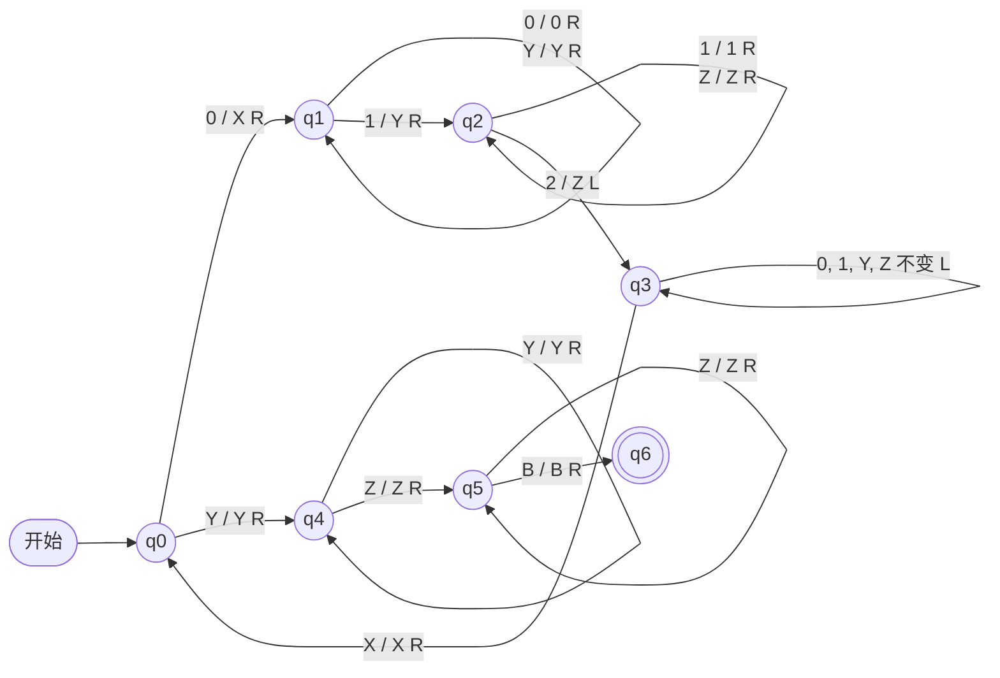

**有限自动机**只有有限的记忆，**下推自动机**多了一个栈，但只能后进先出地访问它：$\{0^n1^n2^n \mid n \ge 1\}$ 这样需要同时核对两组计数的语言，二者都无法识别（[4.8.9](/4.8.9) 例 9.1.1）。本章研究的**图灵机**把栈换成一条可以双向移动、随意读写的无限长纸带。看起来只是一个小小的改动，得到的却是一切"机械计算"的模型：后面会看到，增加纸带、允许非确定、甚至把纸带换成两个栈或两个计数器，能力都不再变化；普通计算机与图灵机也可以互相模拟。这种稳健性是 Church–Turing 论题的依据，也是下一章（[4.8.11](/4.8.11)）讨论"什么问题不能用算法解决"的出发点。[4.3.1](/4.3.1) 把图灵机作为计算模型简单介绍过，本章给出精确的定义并系统地研究它。

## 10.1. 图灵机的定义

### 10.1.1. 形式定义

图灵机由一个有限控制器、一条两端无限延伸并划分为单元格的纸带和一个读写头组成。每个单元格存放一个带符号；开始时输入串放在连续的若干单元格中，其余单元格都是空白符 $B$，读写头指向输入的第一个符号。每一步，图灵机根据当前状态和读写头下的符号，改写这个符号、把读写头左移或右移一格，并转入新的状态。

**定义 10.1.1（图灵机）** 一个**图灵机**（TM）是一个七元组 $M = (Q, \Sigma, \Gamma, \delta, q_0, B, F)$，其中
- $Q$ 是有限的状态集，$\Gamma$ 是有限的带符号集，$\Sigma \subseteq \Gamma$ 是输入字母表；
- $\delta\colon Q \times \Gamma \to Q \times \Gamma \times \{\mathrm{L}, \mathrm{R}\}$ 是转移函数，它是部分函数（可以在某些 $(q, X)$ 上没有定义）；
- $q_0 \in Q$ 是开始状态，$B \in \Gamma \setminus \Sigma$ 是空白符，$F \subseteq Q$ 是终态集。

$\delta(q, X) = (p, Y, D)$ 表示：在状态 $q$ 读到 $X$ 时，把 $X$ 改写为 $Y$，读写头向 $D$ 方向移动一格（$\mathrm{L}$ 左、$\mathrm{R}$ 右），转入状态 $p$。

与**下推自动机**不同，输入**字母表**是带符号集的子集：纸带既是输入，也是工作存储。这里的图灵机是确定的，每个格局至多有一个后继；非确定的版本见 10.3.2 节。[4.3.1](/4.3.1) 中的图灵机用停机状态 $\mathrm{h}$ 表示计算结束，这里用终态表示接受，二者只是约定不同。

### 10.1.2. 瞬时描述

**定义 10.1.2（图灵机的瞬时描述）** 图灵机的格局用串 $X_1X_2\cdots X_{i-1}\,q\,X_iX_{i+1}\cdots X_n$ 表示，称为**瞬时描述**（ID）：$q$ 是当前状态，读写头正扫描 $X_i$，$X_1\cdots X_n$ 是纸带上最左与最右的非空白符号之间的部分（读写头在这一段之外时，再在相应一端补上若干个 $B$，使读写头落在串内）。

一步转移 $\vdash_M$（不致混淆时写 $\vdash$）定义如下。若 $\delta(q, X_i) = (p, Y, \mathrm{L})$，则

$$
X_1\cdots X_{i-1}\,q\,X_i\cdots X_n \vdash X_1\cdots X_{i-2}\,p\,X_{i-1}YX_{i+1}\cdots X_n;
$$
$i = 1$ 时读写头移到新的空白格，记为 $p\,BYX_2\cdots X_n$；$i = n$ 且 $Y = B$ 时，右端新产生的空白不写出。若 $\delta(q, X_i) = (p, Y, \mathrm{R})$，则

$$
X_1\cdots X_{i-1}\,q\,X_i\cdots X_n \vdash X_1\cdots X_{i-1}Y\,p\,X_{i+1}\cdots X_n;
$$
$i = n$ 时读写头移到右边的空白格，记为 $X_1\cdots X_{n-1}Y\,p\,B$；$i = 1$ 且 $Y = B$ 时，左端的空白不写出。$\vdash^*$ 是 $\vdash$ 的自反传递闭包。

**定义 10.1.3（图灵机的语言）** 图灵机 $M$ **接受**的语言是

$$
L(M) = \{ w \in \Sigma^* \mid q_0w \vdash^* \alpha\,p\,\beta,\ p \in F,\ \alpha, \beta \in \Gamma^* \}.
$$
若 ID $\alpha\,q\,X\beta$ 中 $\delta(q, X)$ 没有定义，称 $M$ 在该 ID **停机**。

可以假定 $M$ 进入终态后就停机：删去从终态出发的所有转移，接受的语言不变（到达终态的那一刻输入就已被接受）。今后总作这个假定。于是在输入 $w$ 上，$M$ 只有三种结局：进入终态并停机（接受）；在非终态停机（拒绝）；永不停机。后两种情况下 $w \notin L(M)$，但从外部观察，第三种结局无法与"还没算完"区分。这个区别引出两类语言：

**定义 10.1.4（递归可枚举语言）** 若存在图灵机 $M$ 使 $L = L(M)$，则称 $L$ 为**递归可枚举语言**（RE 语言）。

**定义 10.1.5（递归语言）** 若存在图灵机 $M$ 使 $L = L(M)$，且 $M$ 在每个输入上都停机，则称 $L$ 为**递归语言**。

递归语言都是递归可枚举语言。识别递归语言的图灵机对每个输入都给出"是"或"否"的回答，它就是一个算法；对递归可枚举语言，图灵机只保证在 $w \in L$ 时说"是"。下一章证明这两类语言确实不同，而且存在不是递归可枚举的语言。"递归可枚举"这个名称来自等价的刻画：$L$ 是递归可枚举语言，当且仅当存在一台图灵机逐个输出（枚举）$L$ 的全部元素。

## 10.2. 设计图灵机

### 10.2.1. 例子

**例 10.2.1** 识别 $L = \{0^n1^n2^n \mid n \ge 1\}$ 的**图灵机**

$$
M = (\{q_0, \dots, q_6\}, \{0, 1, 2\}, \{0, 1, 2, X, Y, Z, B\}, \delta, q_0, B, \{q_6\}).
$$
思路是反复"划掉"一个 0、一个 1、一个 2，分别改写为 $X, Y, Z$：
- $q_0$：读到 0，改写为 $X$，转入 $q_1$ 向右找 1；读到 $Y$ 说明 0 已经划完，转入 $q_4$ 做最后的检查；
- $q_1$：越过 $0$ 与 $Y$，读到 1 改写为 $Y$，转入 $q_2$ 向右找 2；
- $q_2$：越过 $1$ 与 $Z$，读到 2 改写为 $Z$，转入 $q_3$ 返回；
- $q_3$：向左越过 $0, 1, Y, Z$，读到 $X$ 后右移一格回到 $q_0$；
- $q_4$、$q_5$：确认剩下的只有 $Y$ 和 $Z$，读到 $B$ 进入终态 $q_6$。

| 状态 | $0$ | $1$ | $2$ | $X$ | $Y$ | $Z$ | $B$ |
|---|---|---|---|---|---|---|---|
| $q_0$ | $(q_1, X, \mathrm{R})$ | | | | $(q_4, Y, \mathrm{R})$ | | |
| $q_1$ | $(q_1, 0, \mathrm{R})$ | $(q_2, Y, \mathrm{R})$ | | | $(q_1, Y, \mathrm{R})$ | | |
| $q_2$ | | $(q_2, 1, \mathrm{R})$ | $(q_3, Z, \mathrm{L})$ | | | $(q_2, Z, \mathrm{R})$ | |
| $q_3$ | $(q_3, 0, \mathrm{L})$ | $(q_3, 1, \mathrm{L})$ | | $(q_0, X, \mathrm{R})$ | $(q_3, Y, \mathrm{L})$ | $(q_3, Z, \mathrm{L})$ | |
| $q_4$ | | | | | $(q_4, Y, \mathrm{R})$ | $(q_5, Z, \mathrm{R})$ | |
| $q_5$ | | | | | | $(q_5, Z, \mathrm{R})$ | $(q_6, B, \mathrm{R})$ |
| $q_6$ | | | | | | | |

空格表示没有定义：例如在 $q_1$ 读到 2，说明 1 不够，$M$ 停机拒绝。**转移图**中弧上的 $X / Y\ D$ 表示读 $X$、写 $Y$、向 $D$ 移动：



下面的程序模拟这台图灵机，打印它在 $001122$ 上的 ID 序列（方括号中的状态写在被扫描的符号之前），并对长度不超过 9 的全部串检验它接受的恰好是 $L$。

```python
from itertools import product

# delta[(q, X)] = (p, Y, D) with D in "LR"; missing entries mean the machine halts.
def run(delta, q0, finals, w, blank="B", max_steps=10_000, trace=False):
    tape = dict(enumerate(w))
    q, head, steps = q0, 0, 0
    while q not in finals:
        if trace:
            print(show(tape, q, head, blank))
        X = tape.get(head, blank)
        if (q, X) not in delta:
            return False, steps            # halts without accepting
        q, tape[head], D = delta[q, X]
        head += 1 if D == "R" else -1
        steps += 1
        if steps > max_steps:
            raise RuntimeError("step limit exceeded")
    if trace:
        print(show(tape, q, head, blank))
    return True, steps

def show(tape, q, head, blank):
    cells = [i for i, c in tape.items() if c != blank]
    lo, hi = min(cells + [head]), max(cells + [head])
    s = "".join(tape.get(i, blank) for i in range(lo, hi + 1))
    k = head - lo
    return s[:k] + f"[{q}]" + s[k:]

# Turing machine for { 0^n 1^n 2^n : n >= 1 }
delta = {
    ("q0", "0"): ("q1", "X", "R"), ("q0", "Y"): ("q4", "Y", "R"),
    ("q1", "0"): ("q1", "0", "R"), ("q1", "Y"): ("q1", "Y", "R"), ("q1", "1"): ("q2", "Y", "R"),
    ("q2", "1"): ("q2", "1", "R"), ("q2", "Z"): ("q2", "Z", "R"), ("q2", "2"): ("q3", "Z", "L"),
    ("q4", "Y"): ("q4", "Y", "R"), ("q4", "Z"): ("q5", "Z", "R"),
    ("q5", "Z"): ("q5", "Z", "R"), ("q5", "B"): ("q6", "B", "R"),
}
for X in "01YZ":
    delta["q3", X] = ("q3", X, "L")
delta["q3", "X"] = ("q0", "X", "R")

run(delta, "q0", {"q6"}, "001122", trace=True)
for w in ["012", "001122", "000111222", "0112", "001212", ""]:
    print(f"{w!r:12}", *run(delta, "q0", {"q6"}, w))

# exhaustive check against the definition
ok = all(run(delta, "q0", {"q6"}, "".join(t))[0] ==
         (lambda s: len(s) % 3 == 0 and len(s) > 0 and s == "0" * (len(s)//3) + "1" * (len(s)//3) + "2" * (len(s)//3))("".join(t))
         for n in range(10) for t in product("012", repeat=n))
print("all strings of length <= 9 agree:", ok)
```

```text
[q0]001122
X[q1]01122
X0[q1]1122
X0Y[q2]122
X0Y1[q2]22
X0Y[q3]1Z2
X0[q3]Y1Z2
X[q3]0Y1Z2
[q3]X0Y1Z2
X[q0]0Y1Z2
XX[q1]Y1Z2
XXY[q1]1Z2
XXYY[q2]Z2
XXYYZ[q2]2
XXYY[q3]ZZ
XXY[q3]YZZ
XX[q3]YYZZ
X[q3]XYYZZ
XX[q0]YYZZ
XXY[q4]YZZ
XXYY[q4]ZZ
XXYYZ[q5]Z
XXYYZZ[q5]B
XXYYZZB[q6]B
'012'        True 8
'001122'     True 23
'000111222'  True 46
'0112'       False 8
'001212'     False 9
''           False 0
all strings of length <= 9 agree: True
```

每划掉一组符号，读写头要往返一次，所以在长度为 $3n$ 的输入上共走 $\Theta(n^2)$ 步。这台图灵机在每个输入上都停机，所以 $L$ 是**递归语言**。

### 10.2.2. 编程技巧

直接写**转移表**很快就会变得冗长。下面几种技巧都只是组织转移表的方式，得到的仍然是定义 10.1.1 的图灵机。

- 状态中的存储：把状态取为二元组 $[q, a]$，其中 $q$ 是控制状态，$a$ 取有限个值，用来"记住"一个符号。例如识别 $L(01^* + 10^*)$（第一个符号此后不再出现）：读入第一个符号 $a$ 后进入 $[q_1, a]$，向右扫描时遇到 $a$ 就停机拒绝，遇到 $B$ 就接受。
- 多道：把带符号取为元组，相当于纸带分成上下几"道"，读写头同时看到同一位置上各道的符号。常用一道存放数据、另一道做标记。例如识别 $\{wcw \mid w \in \{0, 1\}^+\}$：在第二道上逐个给 $c$ 两侧对应的符号打勾，用状态中的存储记住打勾的符号，往返比较。
- 子程序：把完成某个功能的一组状态看作子程序，有自己的入口状态和返回状态；调用时转入入口，完成后转入调用方指定的状态。例如乘法：纸带上初始为 $0^m10^n1$，主程序每次划掉一个 $0^m$ 中的 0，调用"把 $0^n$ 复制到末尾"的子程序，最后清除辅助符号，纸带上剩下 $0^{mn}$。

**注** 这些技巧说明，图灵机可以用来计算函数，而不只是识别语言：约定输入和输出在纸带上的格式，停机时纸带上的内容就是函数值。[4.3.1](/4.3.1) 中的二进制加 1 就是一例。能这样计算的（部分）函数称为部分递归函数，它与**递归可枚举语言**是同一个理论的两种说法。

## 10.3. 图灵机的扩展

### 10.3.1. 多带图灵机

**定义 10.3.1（多带图灵机）** **多带图灵机**有一个有限控制器和 $k$ 条纸带（$k \ge 1$），每条纸带有自己的读写头。开始时输入放在第一条纸带上，其余纸带全为空白，第一个读写头指向输入的第一个符号。每一步，根据当前状态和 $k$ 个读写头下的符号，转入新状态，改写每个读写头下的符号，并让每个读写头独立地左移、右移或不动（记为 $\mathrm{S}$）。转移函数形如

$$
\delta\colon Q \times \Gamma^k \to Q \times \Gamma^k \times \{\mathrm{L}, \mathrm{R}, \mathrm{S}\}^k.
$$

多带图灵机写起程序方便得多。例如 $\{0^n1^n2^n\}$：把 0 复制到第二条带、1 复制到第三条带，再同时比较三段的长度，一遍扫描即可，用时 $O(n)$。

**定理 10.3.1** 每个多带图灵机接受的语言都是某个（单带）**图灵机**接受的语言。

**证明** 设 $M$ 有 $k$ 条带。构造单带图灵机 $N$，它的纸带有 $2k$ 道：第 $2i - 1$ 道存放 $M$ 第 $i$ 条带的内容，第 $2i$ 道只在一个位置有标记 $\times$，表示 $M$ 第 $i$ 个读写头的位置。$N$ 的状态中存放 $M$ 的状态，以及最左标记左边的标记个数等有限的信息。

模拟 $M$ 的一步时，$N$ 从最左的标记出发向右扫描，经过每个标记时把该道读写头下的符号记在状态中；全部 $k$ 个符号收集完毕后，$N$ 知道了 $M$ 这一步要执行的转移，于是向左扫描，在每个标记处改写符号、把标记左移或右移一格。最后 $N$ 改变状态中记录的 $M$ 的状态。$M$ 进入终态时 $N$ 也进入终态。$N$ 在输入上的计算逐步对应 $M$ 的计算，所以 $L(N) = L(M)$。$\square$

**定理 10.3.2** 若 $k$ 带图灵机 $M$ 在长度为 $n$ 的输入上走 $T(n)$ 步（$T(n) \ge n$），则定理 10.3.1 中的 $N$ 用 $O(T(n)^2)$ 步完成模拟。

**证明** $M$ 每走一步，每个读写头至多偏离一格，所以走了 $t$ 步后任意两个标记的距离不超过 $2t$。$N$ 模拟一步只需在这个范围内往返常数次（外加在每个标记处的常数次局部操作），用时 $O(t)$。总时间为 $\sum_{t \le T(n)} O(t) = O(T(n)^2)$。$\square$

平方的代价不能完全避免：识别回文 $\{w \mid w = w^{\mathrm{R}}\}$ 用双带图灵机只需线性时间，而任何单带图灵机都需要 $\Omega(n^2)$ 步（用交叉序列论证，这里从略）。但在多项式的意义下二者等价，这一点对下一章定义复杂度类 $\mathrm{P}$ 至关重要。

### 10.3.2. 非确定图灵机

**定义 10.3.2（非确定图灵机）** **非确定图灵机**（NTM）与定义 10.1.1 相同，只是 $\delta(q, X)$ 是 $Q \times \Gamma \times \{\mathrm{L}, \mathrm{R}\}$ 的有限子集，每一步可以从中任选一个动作。ID 与 $\vdash$ 的定义相应修改，一个 ID 可以有多个后继。$M$ 接受 $w$，当且仅当存在一条从 $q_0w$ 出发、到达终态的计算。

**定理 10.3.3** 若 $M_N$ 是非确定图灵机，则存在确定图灵机 $M_D$ 使 $L(M_D) = L(M_N)$。

**证明** 设 $\delta$ 中任一 $\delta(q, X)$ 至多有 $m$ 个选择。$M_N$ 在输入 $w$ 上的全部计算构成一棵树：根是 $q_0w$，每个 ID 的孩子是它的至多 $m$ 个后继。$w \in L(M_N)$ 当且仅当树中有某个结点的状态是终态。$M_D$ 在这棵树上做**广度优先搜索**：它用双带图灵机实现，第一条带上存放一个 ID 队列（用分隔符隔开，并标出当前正在处理的 ID），开始时只有 $q_0w$。处理当前 ID 时，若它的状态是终态则接受；否则把它复制到第二条带上，在那里依次构造它的全部后继，追加到第一条带上队列的末尾，再把标记移到下一个 ID。

若 $M_N$ 在第 $t$ 步到达终态，这个 ID 在树的第 $t$ 层，层数不超过 $t$ 的结点至多有 $1 + m + \cdots + m^t \le (m+1)^t$ 个，所以 $M_D$ 在有限时间内处理到它并接受。反之 $M_D$ 只在找到 $M_N$ 的接受 ID 时接受。广度优先而不是深度优先是必需的：深度优先可能陷入一条永不停机的分支。最后由定理 10.3.1 把双带的 $M_D$ 化为单带。$\square$

证明中 $M_D$ 的时间是 $M_N$ 的步数的指数函数。是否存在本质上更快的确定性模拟，就是下一章的 $\mathrm{P}$ 与 $\mathrm{NP}$ 问题。

## 10.4. 受限的图灵机

另一个方向是限制**图灵机**，看它在多弱的形式下仍保持全部能力。这些模型在证明中很有用：要证明某个系统"能模拟任意计算"，只需证明它能模拟其中某个简单的模型。

### 10.4.1. 半无穷带

**定理 10.4.1** 每个**递归可枚举语言**都能由一台满足以下两个条件的图灵机接受：纸带只向右无限延伸，读写头从不移到初始位置的左边，即只有半无穷带（semi-infinite tape）；它从不写空白符 $B$。

**证明** 从不写 $B$：引入新带符号 $B'$，原来写 $B$ 的转移改为写 $B'$，读 $B'$ 时的动作与读 $B$ 相同。这样纸带上的非空白部分总是连续的一段。

**半无穷带**：设原图灵机 $M_1$ 的纸带单元格为 $\dots, X_{-2}, X_{-1}, X_0, X_1, X_2, \dots$，读写头从 $X_0$ 出发。新图灵机 $M_2$ 的纸带分为两道：上道依次存放 $X_0, X_1, X_2, \dots$，下道依次存放 $*, X_{-1}, X_{-2}, \dots$，其中 $*$ 标记最左的单元格。$M_2$ 在状态中记住 $M_1$ 的读写头当前在右半部分（看上道）还是左半部分（看下道）；在左半部分时，$M_1$ 的左移对应 $M_2$ 的右移，反之亦然；在最左一格读到 $*$ 时切换上下道。$M_2$ 的每一步对应 $M_1$ 的一步，两者接受同一语言。$\square$

### 10.4.2. 多栈机

**定义 10.4.1（多栈机）** **多栈机**是有 $k$ 个栈（$k \ge 1$）的确定下推自动机：每一步根据当前状态、下一个输入符号（或不读输入）和 $k$ 个栈顶符号，转入新状态，并分别替换每个栈顶。它以终态接受。为了让它能检查输入是否读完，约定输入以一个不在字母表中的结束标记结尾。

一个栈的**确定下推自动机**比图灵机弱得多，两个栈却已足够：

**定理 10.4.2** 若 $L$ 是递归可枚举语言，则 $L$ 能由一台双栈机接受。

**证明** 设图灵机 $M$ 接受 $L$。双栈机 $S$ 先把整个输入 $w$ 压入第一个栈，再全部弹出并压入第二个栈，于是第二个栈的栈顶是 $w$ 的第一个符号。此后用第一个栈存放读写头左边的纸带内容（栈顶是紧邻读写头左边的单元格），第二个栈存放读写头所在及其右边的内容（栈顶是读写头下的符号）。$M$ 的一步 $\delta(q, X) = (p, Y, \mathrm{R})$ 对应：从第二个栈弹出 $X$，把 $Y$ 压入第一个栈；$\delta(q, X) = (p, Y, \mathrm{L})$ 对应：从第二个栈弹出 $X$ 并压入 $Y$，再把第一个栈的栈顶移到第二个栈。某个栈弹到栈底时，说明读写头走到了空白区域，压入一个 $B$ 即可。$S$ 在 $M$ 接受时接受。$\square$

反过来，多栈机显然可以用**多带图灵机**模拟（每个栈一条带），所以多栈机（至少两个栈）与图灵机等价。

### 10.4.3. 计数器机

**定义 10.4.2（计数器机）** **计数器机**与多栈机相同，只是把每个栈换成一个存放非负整数的计数器。每一步根据当前状态、下一个输入符号和每个计数器是否为 0，转入新状态，并把每个计数器加 1、减 1 或保持不变（不允许把 0 减 1）。

计数器机相当于栈**字母表**只有 $\{Z_0, X\}$ 的多栈机：栈 $X^iZ_0$ 表示计数器的值 $i$，栈顶为 $Z_0$ 即值为 0。所以计数器机接受的都是递归可枚举语言。

**定理 10.4.3** 每个递归可枚举语言都能由一台三计数器机接受。

**证明** 由定理 10.4.2，只需用三个计数器模拟双栈机。设栈符号共 $r - 1$ 个，编号为 $1, \dots, r - 1$。把栈 $X_1X_2\cdots X_n$（$X_1$ 是栈顶）看成 $r$ 进制整数

$$
X_1 + X_2r + \cdots + X_nr^{n-1},
$$
两个栈各由一个计数器存放，第三个计数器作为辅助（平时为 0）。弹栈是除以 $r$ 取整：反复把被操作的计数器减 $r$、辅助计数器加 1，直到不够减，再把辅助计数器搬回来。压入 $X$ 是乘以 $r$ 再加 $X$：反复把计数器减 1、辅助计数器加 $r$，搬回后再加 $X$。栈顶是除以 $r$ 的余数，在做除法时用状态记下（余数小于 $r$，有限个值）。$\square$

**定理 10.4.4** 每个递归可枚举语言都能由一台双计数器机接受。

**证明** 由定理 10.4.3，只需用两个计数器模拟三个计数器 $i, j, k$。用一个计数器存放 $m = 2^i3^j5^k$，另一个作辅助。$i$ 加 1 是 $m$ 乘以 2，减 1 是除以 2，$j$、$k$ 对应 3 和 5；乘除仍用辅助计数器反复加减完成。$i = 0$ 当且仅当 $m$ 不能被 2 整除，这可以在把 $m$ 搬到辅助计数器的过程中，用状态记录搬运次数模 2 来判断，再搬回去。$\square$

只有一个计数器时，计数器机相当于栈字母表只有 $\{Z_0, X\}$ 的确定下推自动机，接受的都是**确定上下文无关语言**，而且能力严格弱于确定下推自动机：例如 [4.8.7](/4.8.7) 例 7.6.1 的 $L_{wcw^{\mathrm{R}}}$ 要求记住任意长的串，一个计数器做不到。

## 10.5. 图灵机与计算机

**图灵机**与普通计算机的计算能力相同，下面说明两个方向的模拟。

- 计算机模拟图灵机：转移函数是一张有限的表，写成程序是直接的；唯一的问题是纸带无限，而计算机的存储有限。但任一次停机的计算只用到有限多个单元格，只要允许按需增加存储（例如更换外存介质），计算机就能模拟图灵机的任一计算。
- 图灵机模拟计算机：用**多带图灵机**模拟存储程序式计算机。一条带存放存储器（形如 $\#0{*}w_0\#1{*}w_1\#\cdots$ 的地址–内容对，未写过的地址不出现），一条带存放指令计数器，一条带存放存储器地址寄存器，一条带存放输入，另有一条草稿带。模拟一条指令就是：按指令计数器找到指令，解码，按地址找到操作数，在草稿带上完成运算，再写回存储器。

模拟的效率是多项式的。设计算机的每条指令至多使字长增加 1 位、且其运算能由多带图灵机在字长的多项式时间内完成（加减乘除都满足），则计算机执行 $n$ 步，多带图灵机可以在 $O(n^3)$ 步内模拟，单带图灵机在 $O(n^6)$ 步内模拟。限制字长增长是必要的：若允许一步把字长翻倍（如反复自乘），$n$ 步后数字有 $2^n$ 位，任何逐位工作的模型都无法在多项式时间内跟上，而实际计算机的字长是固定的。

所以，在"多项式时间"这个粒度上，图灵机、多带图灵机与 [4.3.1](/4.3.1) 的**随机存取机**是等价的计算模型。这为下一章用图灵机定义复杂度类提供了依据：一个问题是否有多项式时间算法，与选用哪种"合理"的计算模型无关。

## 10.6. Church–Turing 论题

20 世纪 30 年代，人们为"能行可计算"（effectively computable，即能用机械的方法在有限步内算出）提出了多种形式化：Gödel 与 Herbrand 的一般递归函数、Church 的 λ 演算、Turing 的**图灵机**、Post 的产生式系统。它们后来都被证明定义了同一类函数。

Church–Turing 论题（Church–Turing thesis）断言：凡是直观上能行可计算的函数，都能由图灵机计算。

这是一个论题而不是定理：它的一端是没有数学定义的直观概念"能行可计算"，因而无法证明，只能由证据支持。证据有二：迄今提出的每一种合理的计算模型（本章的各种变体、随机存取机、程序设计语言、元胞自动机）都与图灵机等价；也没有人找到直观上可计算、却不能由图灵机计算的函数。接受这一论题后，"存在算法"就有了精确的含义：存在一台在每个输入上都停机的图灵机。下一章的不可判定性结论正是依靠它，才从"图灵机做不到"推广为"任何算法都做不到"。

**注** 有两个相关但更强的说法需要区分。扩展的 **Church–Turing 论题**断言任何"合理的"物理计算模型都能被图灵机以多项式的代价模拟，它是复杂性理论中模型无关性的依据；量子计算机是对它的潜在挑战（量子计算机能在多项式时间内分解整数，而目前不知道经典图灵机能否做到）。但量子计算机仍能被图灵机（以指数代价）模拟，所以它不挑战原来的论题：可计算的范围不变，变的只是效率。

**文法**一方也有与图灵机对应的结论，它补全了 [4.8.2](/4.8.2) 中 **Chomsky 体系**的表格：

**定理 10.6.1** 语言 $L$ 是 0 型语言（能由某个**无限制文法**生成），当且仅当 $L$ 是**递归可枚举语言**。

**证明**（要点） 设 $L = L(G)$。非确定图灵机在第二道上从 $S$ 开始，每一步非确定地选一个产生式 $\alpha \to \beta$ 和句型中 $\alpha$ 的一次出现，把它替换为 $\beta$（右边的内容相应平移），并随时比较句型是否等于输入；相等则接受。由定理 10.3.3 化为确定图灵机。反之，设图灵机 $M$ 接受 $L$，构造文法：先生成 $w$ 的两份副本（一份用来最后输出，另一份作为 $M$ 的纸带，二者逐格配对），再用形如 $qX \to Yp$、$ZqX \to pZY$ 的产生式模拟 $M$ 的转移；$M$ 进入终态后，用产生式擦除纸带一份，只留下 $w$。$\square$

1 型（上下文有关）语言对应线性有界自动机，即读写头不越出输入所占区域的**非确定图灵机**。上下文有关语言都是**递归语言**，但反之不然。于是 Chomsky 体系的四类语言与四种自动机一一对应：

| 文法 | 语言 | 自动机 |
|---|---|---|
| 0 型（无限制文法） | 递归可枚举语言 | 图灵机 |
| 1 型（**上下文有关文法**） | 上下文有关语言 | 线性有界自动机 |
| 2 型（**上下文无关文法**） | **上下文无关语言** | 下推自动机 |
| 3 型（**正规文法**） | **正规语言** | 有限自动机 |

## 小结

| 主题 | 要点 |
|---|---|
| **图灵机** | 七元组 $(Q, \Sigma, \Gamma, \delta, q_0, B, F)$；$\delta(q, X) = (p, Y, D)$；ID $\alpha\,q\,\beta$ |
| 两类语言 | **递归可枚举语言**：某台图灵机接受；**递归语言**：某台总停机的图灵机接受 |
| 编程技巧 | 状态中的存储、多道、子程序；图灵机也可以计算函数 |
| **多带图灵机** | 与单带等价，用 $2k$ 道模拟，时间平方 |
| **非确定图灵机** | 与确定图灵机等价，对计算树做广度优先搜索，时间指数 |
| 受限模型 | **半无穷带**、双栈机、双**计数器机**都与图灵机等价；单计数器、单栈不行 |
| 计算机 | 与图灵机互相模拟，代价是多项式 |
| **Church–Turing 论题** | 能行可计算 = 图灵机可计算；0 型语言 = 递归可枚举语言 |
